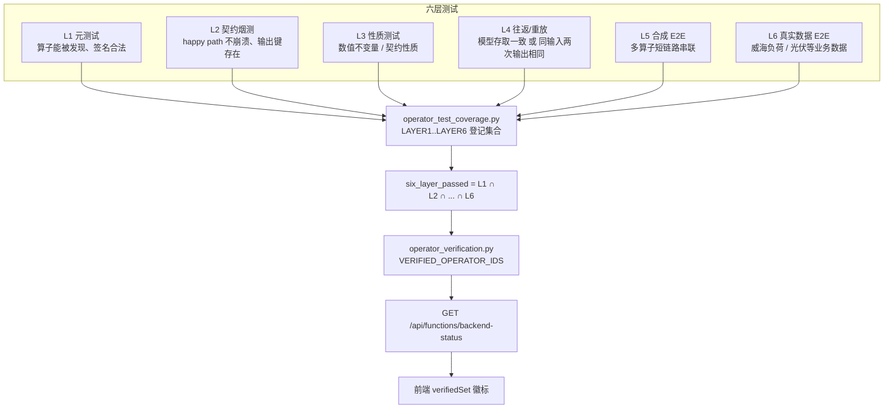
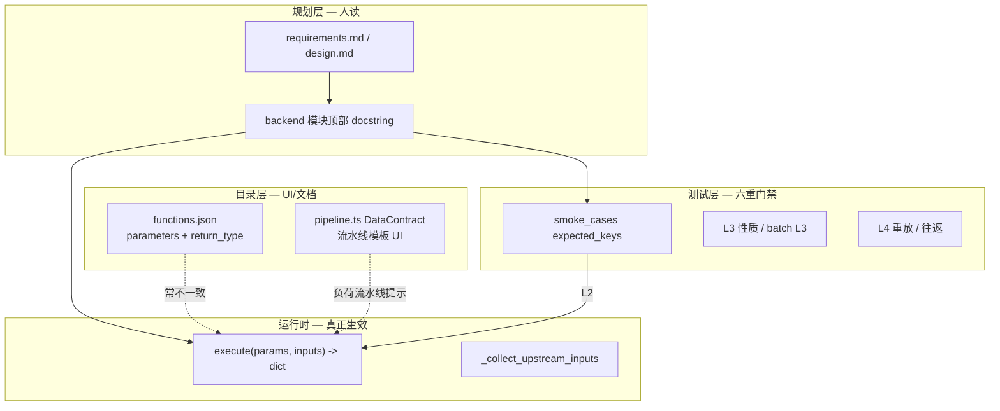

# 算子 I/O 契约与六重测试说明

> **日期**：2026-07-23  
> **范围**：`backend-service/services/operator_backends/` 下 138 个 backend（137 已六重验证，`load_hdf5` / `load_mongodb` 故意除外）  
> **读者**：填算子、写工作流、读函数库徽标、排查「界面改了但行为没变」的同学

---

## 0. 一句话结论

| 概念 | 结论 |
|------|------|
| **可执行** | `OperatorRouter` 能 `auto_discover` 并 `execute` |
| **已验证** | 同时出现在 L1∩L2∩L3∩L4∩L5∩L6 登记集合 → `VERIFIED_OPERATOR_IDS` → 前端绿色徽标 |
| **I/O 契约** | **没有单一机器可读 Schema**；运行时以 `execute(params, inputs) -> dict` 为准，测试以 smoke 用例表 `expected_keys` 锁定 |
| **手动跑工作流** | **不会**更新「已验证」徽标；必须 pytest + `operator_test_coverage.py` 登记 |

**事实源文件**：

- `backend-service/services/operator_test_coverage.py` — 六层登记 + `six_layer_passed()`
- `backend-service/services/operator_verification.py` — `VERIFIED_OPERATOR_IDS`（import 时 = 六重交集）
- `backend-service/api/functions.py` — `GET /api/functions/backend-status` 给前端徽标

---

## 1. 六重测试：设计目标

**核心问题**：「有 backend 可执行」≠「在生产工作流里可信」。

手动拖一次工作流只能证明「这次没崩」，不能证明：

- 接口契约稳定（输出键、类型）
- 同输入可重复（无随机泄漏、无隐式状态）
- 模型能存取一致
- 在真实业务数据上也能跑

因此设计 **L1–L6 六层**，每层测不同维度；只有 **六层登记集合的交集** 才算「已验证」。



### 1.1 当前数量（2026-07-23）

| 口径 | 数量 |
|------|------|
| 后端已注册 | 138 |
| **已六重验证 (VERIFIED)** | **137** |
| 故意不做 | 2（`load_hdf5`、`load_mongodb`） |

P4 填批进度：92 → 104（α）→ 113（β 特征）→ 121（β 评估）→ **137（γ）**。

---

## 2. 六重测试：代码实现

### 2.1 覆盖登记 — `services/operator_test_coverage.py`

**人工维护的覆盖账本**（不是 pytest 自动扫描）。每个算子 ID 必须显式出现在 6 个 `FrozenSet` 里：

| 集合 | 含义 | 主要测试文件 |
|------|------|--------------|
| `LAYER1_META` | L1 期望注册 | `tests/operators/test_operator_meta.py` |
| `LAYER2_SMOKE` | L2 烟测 | `test_operators_smoke.py`、`*_smoke_cases.py`、`*_operators_smoke.py` |
| `LAYER3_PROPERTY` | L3 性质 | `test_operator_properties.py`、`test_*_batch_coverage.py` |
| `LAYER4_ROUNDTRIP` | L4 往返/重放 | `test_model_roundtrip.py`、`test_stateless_replay.py`、batch L4 |
| `LAYER5_SYNTHETIC_E2E` | L5 合成链路 | `tests/operators/test_end_to_end.py` |
| `LAYER6_REALDATA_E2E` | L6 真实数据 | `tests/test_e2e_*_realdata.py` |

**交集计算**（严格六重）：

```python
def six_layer_passed() -> FrozenSet[str]:
    sets = list(layer_sets().values())
    out = sets[0]
    for s in sets[1:]:
        out = out & s
    return frozenset(out)
```

**批次常量**（P4 示例）：`P4_ALPHA`、`P4_BETA_FE`、`P4_BETA_EVAL`、`P4_GAMMA` 通过 `|` union 进六层集合。

**辅助函数**：`missing_layers(op_id)` — 查某算子缺哪一层，补测时用。

### 2.2 验证导出 — `services/operator_verification.py`

前端徽标 **唯一事实源**：

```python
VERIFIED_OPERATOR_IDS: frozenset[str] = six_layer_passed()
```

禁止手工往集合里塞未覆盖 ID。API 用 `filter_verified_registered(registered_ids)` 返回「已注册 ∩ 已验证」。

### 2.3 各层职责与实现要点

#### L1 — 元测试

- **文件**：`tests/operators/test_operator_meta.py`
- **测什么**：与业务无关的插件规范
  - `auto_discover` 扫到足够多算子、ID 小写合法、无重复
  - 每个 backend 的 `execute(params, inputs)` 可调用、≥2 个位置参数
  - `EXPECTED_P4_*` 等 parametrized：批次算子必须 `router.has_operator(op_id)`

#### L2 — 契约烟测

- **测什么**：合理合成输入下不崩溃；返回 `dict`；**契约声明的输出键都存在**
- **不测**：数值精度（L3 负责）
- **模式**：用例表 + parametrized pytest

用例表五元组（见 `test_operators_smoke.py` 头部注释）：

```
(operator_id, params_builder, inputs_builder, expected_keys, extra_asserts)
```

- `params_builder(tmp_path)` / `inputs_builder(tmp_path)` — 延迟构造入参
- `expected_keys` — **输出契约在测试层的主事实源**
- `extra_asserts(result)` — 额外类型/形状检查（如 `_output_is_dataframe`）

批次 smoke 文件索引：

| 批次 | 用例表 | 烟测执行器 |
|------|--------|------------|
| P0–P3 填批 | `test_operators_smoke.py` → `SMOKE_CASES` | 同文件 |
| P4-α Legacy | `legacy_smoke_cases.py` | `test_legacy_operators_smoke.py` |
| P4-β 特征 | `feature_smoke_cases.py` | `test_feature_operators_smoke.py` |
| P4-β 评估 | `eval_smoke_cases.py` | `test_eval_operators_smoke.py` |
| P4-γ 剩余 | `p4_gamma_smoke_cases.py` | `test_p4_gamma_operators_smoke.py` |

**特殊处理**：

- `load_api`：`unittest.mock.patch` mock `requests.get`
- `lightgbm` / `catboost`：环境无包则 `pytest.importorskip`；覆盖表仍登记

#### L3 — 性质测试

两类实现：

1. **Hypothesis**（`test_operator_properties.py`）— 核心算子，验证 design 中 Correctness Properties（如 min_max ∈ [0,1]、labels ⊆ {-1,1}）
2. **批次 L3**（`test_*_batch_coverage.py`）— 复用 smoke 入参，断言键存在 + 数值有限

#### L4 — 往返 / 确定性重放

| 算子类型 | 文件 | 断言 |
|----------|------|------|
| train/predict 模型 | `test_model_roundtrip.py` | 磁盘 `model_id` predict ≡ 内存 model predict |
| 无状态 / 评估 / 滤波等 | `test_stateless_replay.py`、batch L4 | 同 params+inputs 执行两次，关键输出一致 |

**L4 定制比较**（避免比 uuid 字段）：forecast 只比 `predictions`；`auto_tune_*` 只比 `best_params` 的 key 集合；`load_api` 排除 L4 重放。

#### L5 — 合成端到端

- **文件**：`tests/operators/test_end_to_end.py`
- **测什么**：单算子巡检 + mini-pipeline（如 ridge → save_model_artifact → load_model_artifact）
- 类名示例：`TestEndToEndP4GammaPipeline`、`TestEndToEndBatch67SoftCoverage`

#### L6 — 真实业务数据 E2E

| 业务 | 数据路径 |
|------|----------|
| 威海负荷 | `load_forecast_refactored/datasets/load_true_weihai_260415.csv` |
| 光伏故障 | `fault-diag-algo-release-3.1/enos_fault_diag/test/train_small.parquet` + `label_small.parquet` |

文件按波次拆分：`test_e2e_legacy_realdata.py`、`test_e2e_p4_gamma_realdata.py` 等。

**L6 注意**：`train_test_split_ts` 会从 `train_features` 去掉目标列；仅 `record_time` 时 forecast 类算子无数值特征 — 需在切分前加 `hour`/`dow` 等数值列（见 `test_e2e_p4_gamma_realdata._weihai_feature_df`）。

### 2.4 门禁测试 — `tests/test_operator_verification.py`

Meta-test，防止「登记了但没真测」：

| 测试 | 作用 |
|------|------|
| `test_verified_equals_six_layer_intersection` | `VERIFIED` ≡ 六重交集 |
| `test_every_verified_has_no_missing_layer` | 每个已验证算子六层齐全 |
| `test_p4_*_fully_covered` | 各批次门禁 |
| `test_all_backend_operators_verified_except_env_deps` | 除 hdf5/mongodb 外全部 backend 已验证 |

### 2.5 新增算子标准流程

```
1. 写 backend（operator_backends/xxx.py，OPERATOR_ID + execute）
2. 定 I/O 契约（docstring + 参考模板，见第 3 节）
3. 写 smoke spec（*smoke_cases.py：expected_keys + builders）
4. 写 L2 烟测（通常只引用 cases）
5. 写 L3/L4（batch_coverage，复用 cases）
6. 写 L5（test_end_to_end.py）
7. 写 L6（test_e2e_*_realdata.py，真实数据场景）
8. L1 meta（test_operator_meta.py → EXPECTED_*）
9. 覆盖登记（operator_test_coverage.py union 进 LAYER1..LAYER6）
10. 门禁（test_operator_verification.py）
11. pytest 全绿 → VERIFIED 自动更新
12. 重启后端 → 前端徽标刷新
```

### 2.6 验收命令

```bash
cd backend-service

# 全量门禁
python -m pytest tests/test_operator_verification.py -q

# P4-γ 专项示例
python -m pytest tests/operators/test_p4_gamma_operators_smoke.py \
  tests/operators/test_p4_gamma_batch_coverage.py \
  tests/test_e2e_p4_gamma_realdata.py -q
```

---

## 3. 算子 I/O 契约：怎么敲定

### 3.1 一句话结论

**没有单一的机器可读 Schema 自动生成**。契约是：

> **设计文档定意图 → backend 代码 + 模块注释定运行时事实 → 烟测 `expected_keys` 锁定 → 六重测试强制执行**

`functions.json` 和 `DataContract` 框架存在，但与真实 backend **常不同步**；增强工作流运行时 **基本不做 Schema 校验**。

### 3.2 契约分层



| 层级 | 位置 | 规定什么 | 是否强制 |
|------|------|----------|----------|
| 需求/设计 | `docs/specs/operator-backend-filling/requirements.md`、`design.md` | 入参名、输出键、错误类型、train/predict 模式 | 人工对齐 |
| **Backend 实现** | `services/operator_backends/*.py` | **运行时真实契约** | `inputs.get` + `OperatorExecutionError` |
| 函数库元数据 | `data/functions.json` | UI 展示 `parameters`、`return_type` | **弱约束**，常与 backend 不一致 |
| 负荷 DataContract | `operator_execution/data_contracts.py` | 列名、dtype、约束 | **仅定义**，主执行路径未调用 |
| **烟测用例表** | `*smoke_cases.py`、`SMOKE_CASES` | `expected_keys` + `extra_asserts` | **L2 强制** |
| 性质测试 | `test_operator_properties.py` | 数值不变量 | L3 子集 |
| 工作流连线 | `workflows_enhanced._collect_upstream_inputs` | 上游 dict 键 → 下游 `inputs` | 运行时隐式规则 |

### 3.3 运行时硬约定

所有 backend 统一签名（`OperatorRouter` 分发）：

```python
def execute(params: dict, inputs: dict) -> dict:
    ...
```

| 参数 | 来源 |
|------|------|
| `params` | 节点 `config`（去内部键）+ `execution_data` + `GlobalConfigInjector` 注入的 `global_config` |
| `inputs` | `_collect_upstream_inputs`：上游返回 dict 的 **key 合并**进下游；多路同名 key 用边 `targetHandle`（如 `source_data`）消歧 |
| **返回值** | `dict`；**key 即下游能接到的 port 名** |

**模块内自文档示例**（`min_max_scale.py`）：

```
params:  columns (list[str] | None)
inputs:  data (pd.DataFrame)
返回:    {"data": pd.DataFrame}
```

缺 `data` 或非 DataFrame → `OperatorExecutionError(..., "InputError", ...)`。

### 3.4 家族模板（同类算子共用契约）

| 家族 | 模板/参考 | inputs（典型） | outputs（train 典型） |
|------|-----------|----------------|----------------------|
| sklearn 分类器 | `_sklearn_classifier_utils.run_sklearn_classifier`、`random_forest_classifier.py` | `features`, `target` | `model`, `model_id`, `predictions`, `y_true`, `feature_importances`… |
| 时序 forecast | `ridge_forecast` / `xgboost_forecast` 对齐 | `train_features`, `train_target`, `test_features`, `test_target` | `predictions`, `y_pred`, `model`, `forecast_values`… |
| 无状态变换 | `label_encode.py`、`min_max_scale.py` | `data` | `{"data": DataFrame}` |
| 评估指标 | `smape_score.py`、`mse_rmse_mae.py` | `y_true`, `y_pred` | `{"score": float}` 或 `{mse, rmse, mae}` |
| 数据源 | `load_csv.py` | （params 里 path）或 `{}` | `{"data": DataFrame}` |
| 模型 IO | `save_model_artifact` / `load_model_artifact` | `model`, `feature_list` / `model_ref` | `saved`, `model_ref` / `model` |

填新算子时：**先定家族 → 抄参考 backend → 在 docstring 和 smoke spec 里写清差异**。

### 3.5 测试如何「锁定」输出契约

1. **L2**：`for key in expected_keys: assert key in result`
2. **extra_asserts**：类型检查（如 `_classifier_train_output` 断言 `predictions` 是 ndarray、`model_id` 非空）
3. **L3**：Hypothesis 或 batch 再断言不变量
4. **L4**：同输入两次输出一致（定制比较字段）
5. **L5/L6**：链路上下游 key 能接上

**流程**：backend docstring 定意图 → smoke spec 写 `expected_keys` → pytest 绿 → `operator_test_coverage.py` 登记。

### 3.6 `functions.json` 与 backend 的差异（示例）

`min_max_scale` 在 JSON 中：

- `parameters`: `data`（ARRAY）、`feature_range`
- `return_type`: ARRAY

backend 实际：

- 输入：`inputs["data"]`（**DataFrame**）
- 参数：`columns`（无 `feature_range`）
- 输出：`{"data": DataFrame}`

增强工作流走 `OperatorRouter.execute(function_id, params, inputs)`，**不读 functions.json 做入参校验**。JSON 主要服务函数库展示、部分旧 ExecutionService 路径。

### 3.7 DataContract 框架（已设计、未接入主链路）

| 文件 | 职责 |
|------|------|
| `operator_execution/schema_validator.py` | `DataContract` dataclass + `SchemaValidator.validate_output` |
| `operator_execution/data_contracts.py` | `LOAD_FORECAST_CONTRACTS`（负荷流水线若干节点的输出契约） |
| `operator_execution/data_adapter.py` | 列名映射适配 |
| `frontend-sevice/src/types/pipeline.ts` | 前端 `DataContract` 类型 + 模板边 `contractId` |
| `DataContractTooltip.tsx` | 编辑器 UI 提示 |

`workflows_enhanced` 执行路径 **import 了** `SchemaValidator`，但节点执行处 **仅** `op_router.execute(...)`，**未调用** `validate_output` / `LOAD_FORECAST_CONTRACTS`。

---

## 4. 字段追踪速查（UI → 执行）

典型链路：

```
UI 节点 config / 边 handle
  → HTTP 工作流 execute
  → _collect_upstream_inputs → inputs 字典
  → GlobalConfigInjector → params
  → OperatorRouter.execute(function_id, params, inputs)
  → 返回 dict（key = 下游 port）
  → 前端 outputSummary / 下一节点 inputs
```

| 现象 | 优先查 |
|------|--------|
| UI 有连线但算子报缺输入 | 上游返回 dict 是否含下游 `inputs.get` 的 key；`targetHandle` 别名 |
| 参数改了不生效 | 字段在 `params` 还是 `inputs`；是否被 `global_config` 覆盖 |
| 函数库与运行行为不一致 | 以 backend + smoke `expected_keys` 为准，不是 functions.json |
| 徽标仍是「未验证」 | 是否 pytest + 六层登记；是否重启后端 |

---

## 5. 已知缺口与演进方向

### 5.1 当前缺口

1. **三套命名并存**：`functions.json` parameter 名、`execute` 的 `inputs` 键、边 `targetHandle` — 改一处要追三层。
2. **运行时无 Schema 门禁**：列名/类型错误往往到算子内部才报错。
3. **测试契约 ⊄ 文档契约**：六重保证 smoke 表的 keys，不保证与 functions.json 一致。
4. **环境依赖算子**：`load_hdf5`、`load_mongodb` 维持「可执行·未验证」。

### 5.2 可选演进（未实施）

1. 以 `*smoke_cases.py` 的 `expected_keys` + backend docstring **生成 manifest**（单一机器可读事实源）。
2. `functions.json` 与工作流 UI 从 manifest 同步。
3. 在 `workflows_enhanced` 节点执行后挂 `SchemaValidator.validate_output`（至少负荷模板边）。

---

## 6. 关键文件索引

| 路径 | 职责 |
|------|------|
| `backend-service/services/operator_execution/router.py` | 算子注册与 `execute` 分派 |
| `backend-service/services/operator_test_coverage.py` | 六层登记、`six_layer_passed()` |
| `backend-service/services/operator_verification.py` | `VERIFIED_OPERATOR_IDS` |
| `backend-service/api/functions.py` | `GET /backend-status` |
| `backend-service/api/workflows_enhanced.py` | 增强工作流执行、`_collect_upstream_inputs` |
| `backend-service/tests/operators/test_operators_smoke.py` | P0–P3 主 smoke 表与 L2 |
| `backend-service/tests/operators/*_smoke_cases.py` | 各批次 smoke 用例表 |
| `backend-service/tests/test_operator_verification.py` | 六重门禁 |
| `backend-service/data/functions.json` | 函数库元数据（展示用，≠ 运行时契约） |
| `docs/specs/operator-backend-filling/design.md` | 填批设计：各 Component 的 I/O 约定 |
| `docs/docs_zxk/算子填充P4任务拆解_2026-07-23.md` | P4 填批进度与验收命令 |
| `frontend-sevice/src/hooks/useBackendReadyOperators.ts` | 前端「可执行 / 已验证」徽标 |

---

## 7. 相关文档

- 工程契约追踪模板：`docs/docs_zxk/ENGINEERING_CONTRACT_TRACE_TEMPLATE.md`
- 负荷算子集成设计（含 SchemaValidator 设想）：`docs/specs/load-forecast-operator-integration/design.md`
- P4 任务拆解：`docs/docs_zxk/算子填充P4任务拆解_2026-07-23.md`
