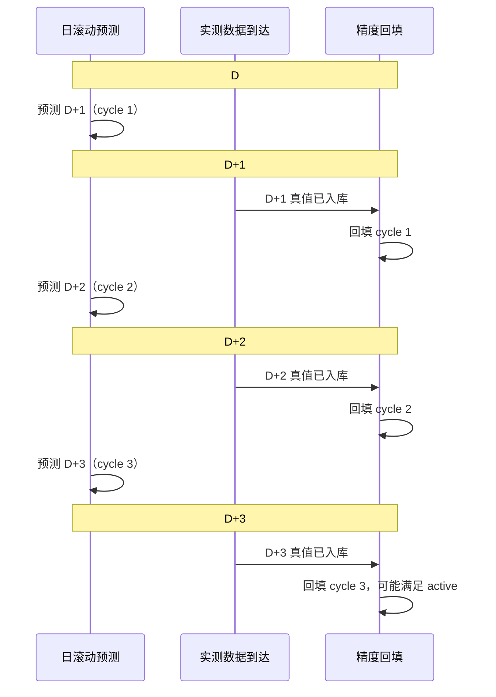

<!-- @AI_GENERATED -->
# 负荷预测前端人工验证操作手册：立即触发、自然三周期与隔离快速演练

> **目标**：在前端“定时调度 / 算法部署 / 精度运营”页面验证正式 `load_forecast` 链路；明确哪些操作会写数据、当前能验证到哪里，以及为什么不能靠连续点击在几分钟内凑出 3 个有效周期。
>
> **安全结论**：可以在前端立即触发任务，但它会真实运行、真实写入数据和任务执行结果。不要在正式 `load_forecast` 槽位伪造预测、真值、指标或切换事件。
>
> **推荐顺序**：先做“立即触发冒烟验证”，再等待自然日滚动形成 3 个有效周期；若必须当天验证指标/告警/通道 A，需补一个仅允许 `load_forecast_e2e_demo` 使用的虚拟时钟演练能力。

---

## 0. 先选对验证等级

| 验证等级 | 要验证什么 | 是否现在可做 | 是否写正式数据 | 是否能得到 3 个有效周期 |
|---|---|---:|---:|---:|
| A. 控制面只读 | 后端、任务注册、slot、production/shadow 身份、自动切换关闭 | 可以 | 否 | 否 |
| B. 单次冒烟 | 数据拉取 → 日滚动训练预测 → 回填/监控任务能被真实触发 | 可以 | **是** | 否 |
| C. 自然业务验证 | 三个不同自然日的预测被真实值回填，指标变为 `active` | 可以，但需等待 | 是 | 是，约 3 天后 |
| D. 快速 E2E 演练 | 在隔离 demo 中模拟 3 个虚拟日期、告警、RCA、通道 A/回滚 | 当前 UI 不具备，需要小改造 | 仅 demo | 是，几分钟内 |

本手册的“前端立即操作”是 B；C 是正式可采信的精度验证；D 是开发/演示用的隔离测试，不应用于生产结论。

---

## 1. 理解三个关键限制

### 1.1 “立即执行”不是预览，而是后台真实任务

前端任务行的“立即执行 / 立即触发”按钮对应：

```text
POST /api/scheduler/tasks/{task_id}/trigger-now
```

- `task_id` — 任务唯一标识，例如 `lf_daily_rolling`。
- 后端会新建后台线程真实运行任务。
- 任务结束后，`last_execution_time` — 最后执行时间、`last_result` — 最后结果，会写回调度任务配置。
- 它**不改变** `status`（任务运行/停止开关）；任务是否继续按 cron 跑，仍由当前 `status` 和 cron 决定。

因此，不要把“立即执行”当成无副作用的 UI 演示按钮。

### 1.2 同一天连续点三次，不会得到三个有效周期

日滚动任务把当天记为触发日 `T`：

```text
训练数据截止 = T-1 23:59:59.999
预测目标     = T+1
```

每个预测周期的 `prediction_cycle_id`（预测周期 ID）由：

```text
workflow_id（工作流 ID） + version_tag（版本标签） + forecast_timestamp（预测目标时间）
```

共同决定。同一个自然日重复触发，`forecast_timestamp` 仍是同一批 T+1 时间点，因此同版本会命中已存在的周期并去重；即使页面多次显示“成功”，也不是新增三轮独立实验。

### 1.3 真值尚未到达，回填不会凭空产生精度

`lf_accuracy_backfill` 只会在平台数据库中已经存在同一时间点的实测值时，把：

```text
PredictionResult.actual_value（预测记录的真实值）
= StationData.value（平台已拉取的实测值）
```

写回预测记录。它不会从未来 CSV 偷读标签，也不会凭 `predicted_value`（预测值）自己生成 `actual_value`（真实值）。

因此，连续触发“回填”也不会产生三个有效周期；没有真实值，就仍然没有 `evaluated` 记录。

---

## 2. 操作前检查：先记录基线，避免测试后无法判断变化

在前端打开以下三个区域，先截图或记录当前值。

### 2.1 定时调度页面

筛选 `pipeline`（调度管线）为 `load_forecast`，核对下列任务都存在且 `slot`（槽位）为 `load_forecast`：

| `task_id`（任务 ID） | 正常 cron | 本次职责 |
|---|---|---|
| `mock_data_feed` | `0 0 * * *` | 向模拟公司数据源追加一批数据。 |
| `lf_data_pull` | `0 1 * * *` | 以高水位增量拉取公司数据到平台 `StationData`。 |
| `lf_daily_rolling` | `30 1 * * *` | 按 production / shadow 身份训练并预测 T+1。 |
| `lf_accuracy_backfill` | `0 4 * * *` | 以已入库真值回填最近 7 天预测，计算版本级指标。 |
| `lf_accuracy_monitor` | `5 4 * * *` | 只读指标与部署身份，创建退化告警；不执行切换。 |

记录每个任务的：

- `status` — 是否为 `running`；
- `cron_expr` — cron 表达式；
- `last_execution_time` — 上次执行时间；
- `last_result` — 上次结果；
- `next_scheduled_time` — 当前进程计算的下次运行时间。

> **列表标签的限制**：当前任务列表摘要返回 `pipeline`（调度管线）但不返回 `slot`（槽位）。如果页面只显示 `load_forecast` 标签，它只能证明管线名称；请打开任务详情/编辑抽屉确认 `slot=load_forecast`，或让前端补充展示该字段，不能只凭列表标签判定槽位已切换。

### 2.2 算法部署页面

选择 `slot=load_forecast`，确认：

- production：`workflow-20260511-optimal-505@optimal-505-production`；
- 两个 shadow：`shadow-run43-mape4109`、`shadow-run7-generic-mape4109`；
- `auto_switch_enabled`（自动切换开关）为 `false`；
- `training_window_days`（训练窗口天数）为 365；
- 切换日志为空或记录清楚当前已有历史。

### 2.3 精度运营页面

选择 `slot=load_forecast`，记录：

- production/shadow 的 `rolling_mape`（7 天滚动 MAPE）、`rolling_wmape`（7 天滚动 WMAPE）；
- `valid_cycle_count`（已有真值的独立预测周期数）；
- `coverage_rate`（真值覆盖率）；
- `status`（`active` 或 `insufficient_data`）；
- `open_alert_count`（开放告警数）；
- `active_recovery_count`（执行中的恢复决策数）。

当前刚启动后的正常预期是指标为空、告警为 0；这不是错误，只表示尚没有本进程生成并回填的预测。

---

## 3. 方案 A：现在可做的“单次冒烟验证”

### 3.1 适用场景与风险

适用：你要现在验证“前端按钮 → 后端任务 → 正式槽位 → 部署身份”的连通性。

风险：此流程会向正式槽位写入数据、运行真实工作流并可能训练模型。若当前环境连接的是需要保护的生产数据库，请先停止，改在隔离环境或 demo 槽位实施。

> **不要先改 cron。** 手动触发更可控，且不会改变明天的排程。以下每一步都要等上一步的 `last_result`（最后结果）更新后再继续。

### 3.2 前端操作顺序


#### 步骤 1：触发 `mock_data_feed`

在 `mock_data_feed` 行点击“立即执行 / 立即触发”。

- **预期**：后端将一批模拟公司数据追加到上游模拟数据源。
- **成功观察点**：刷新任务列表，`last_execution_time` 更新，`last_result=success`。
- **失败排查**：若返回 `engine_not_ready`，说明 SchedulerEngine 未初始化完成；若是 `task_not_registered`，说明后端启动注册失败，需要看后端日志，不要重复狂点。

#### 步骤 2：触发 `lf_data_pull`

等待步骤 1 成功后，点击 `lf_data_pull` 的“立即执行”。

- **预期**：按 `slot=load_forecast` 查询高水位，增量写入平台 `StationData`。
- **成功观察点**：任务显示成功；后端日志应含 `slot=load_forecast pulled and inserted ... rows`。
- **不应做的事**：不要把任务的 `slot` 改成 `default` 来“试试能否有数据”；那会重新制造分区断链。

#### 步骤 3：触发 `lf_daily_rolling`

等待数据拉取完成后，点击 `lf_daily_rolling` 的“立即执行”。

- **预期**：读取 `load_forecast` 部署槽位，按 production + 两个 shadow 顺序执行；训练数据截止 T-1，产生 T+1 预测。
- **成功观察点**：任务最终 `last_result=success`；后端日志能看到 production / shadow 的 workflow 与预测时间。
- **重要解释**：任务成功不等于已有 `active` 精度；此时预测刚写入，`actual_value` 仍为空。
- **等待建议**：训练可能耗时。不要因为按钮已经返回 `triggered` 就立刻连续点击；等待后台完成并刷新任务行状态。

#### 步骤 4：触发 `lf_accuracy_backfill`

点击“立即执行”。

- **预期**：系统只会回填历史上已经到达真值的预测记录。
- **本轮常见结果**：如果刚刚只产生 T+1 预测，T+1 真值尚未到达，任务仍可能成功完成，但 `updated_versions=0` 或精度快照仍为空；这是正确的防穿越行为。
- **检查点**：不要要求本步骤立即生成 MAPE；先确认没有跨 slot 或跨版本错误。

#### 步骤 5：触发 `lf_accuracy_monitor`

点击“立即执行”。

- **预期**：只读 `load_forecast` 的部署版本和版本级指标，创建满足阈值的告警。
- **本轮常见结果**：`new_alerts=0`，因为尚无 `active` 指标；这是正常结果。
- **安全边界**：它不会把 shadow 自动提升成 production。

### 3.3 冒烟验证完成的判定

以下全部满足，即可判定“单次端到端冒烟通过”：

- [ ] 五个任务在 UI 中均属于 `load_forecast` 槽位；
- [ ] 前三个手动任务均无失败，后端日志中的 slot 为 `load_forecast`；
- [ ] 算法部署页的 production / 两个 shadow 身份未变化；
- [ ] `auto_switch_enabled=false` 仍保持关闭；
- [ ] 精度运营页没有因为一次未回填预测而伪造告警；
- [ ] 没有产生意外的 SwitchEvent（切换事件）。

---

## 4. 方案 B：临时改 cron 的验证（可做，但不推荐优先使用）

### 4.1 为什么不建议把时间直接设为“10:30”

cron 是每天执行一次的表达式。如果服务器当前时间已经超过 10:30，把 cron 改为 `30 10 * * *` 只会排到**明天**，不会立刻执行。

若确需用 cron 验证，先查看后端健康接口里的 `current_time`（服务器本地时间），设置为至少未来 5 分钟后的时刻，并保持任务顺序。例如当前是 17:00：

| 任务 | 临时 cron 示例 | 原始 cron（验证后必须恢复） |
|---|---|---|
| `mock_data_feed` | `5 17 * * *` | `0 0 * * *` |
| `lf_data_pull` | `8 17 * * *` | `0 1 * * *` |
| `lf_daily_rolling` | `12 17 * * *` | `30 1 * * *` |
| `lf_accuracy_backfill` | `18 17 * * *` | `0 4 * * *` |
| `lf_accuracy_monitor` | `21 17 * * *` | `5 4 * * *` |

> 上表时间仅示例。实际操作时以服务器当前小时为准，并留出足够训练时间；如果日滚动训练可能超过几分钟，必须继续拉开后续任务间隔。

### 4.2 前端改 cron 的安全步骤

1. 在每一行点击编辑，**只修改** `cron_expr`（cron 表达式）。
2. 保持 `slot=load_forecast`、`pipeline=load_forecast`、`status=running` 不变。
3. 先修改五个任务，再观察 `next_scheduled_time` 是否是今天的预期时刻。
4. 按顺序等待任务自然执行，期间查看后端日志。
5. 完成后立即恢复原始 cron，并再次刷新确认下一次时间回到正常次日计划。

改变 cron 会持久化写入任务配置并重新注册调度器。若忘记恢复，明天仍会按临时时间运行；这比“立即执行一次”更容易遗留运行风险。

---

## 5. 为什么自然形成 3 个有效周期至少需要约 3 天

设第一次日滚动在自然日 D 执行：



要进入 `active`（可被监控/仲裁使用），当前代码要求：

```text
valid_cycle_count（有效周期数） >= 3
AND
coverage_rate（真值覆盖率） >= 0.9
```

所以第一次预测后的同一天，无论点多少次，都无法自然获得第二、第三个不同 `prediction_cycle_id`，更无法拥有未来三天的真实值。

### 5.1 自然验证的每日检查点

| 日程 | 前端应看什么 | 成功标准 |
|---|---|---|
| D | 日滚动任务 | 新增 production + shadow 的 T+1 预测；不要求指标。 |
| D+1 | 回填、精度快照 | cycle 1 已有真值；`valid_cycle_count` 开始增加。 |
| D+2 | 回填、精度快照 | cycle 2 已有真值；继续检查版本不混。 |
| D+3 | 回填、精度快照 | `valid_cycle_count >= 3` 且 `coverage_rate >= 0.9` 时转为 `active`。 |
| D+3 之后 | 监控/RCA | 才具备观察真实退化告警、RCA 和通道 A 门槛的可信样本。 |

---

## 6. 方案 C：若必须当天看到 3 个有效周期，应该怎么做

### 6.1 当前前端做不到，原因是什么

当前前端/后端公开能力没有“虚拟日期”或“造真值”入口。直接在正式槽位通过以下方式加速都是错误做法：

- 同日连续点击 `lf_daily_rolling`；
- 修改操作系统时间；
- 直接写数据库或 JSON 把 `actual_value` 填成伪造值；
- 直接写 `accuracy_metrics.json` 伪造 `active`；
- 打开 `auto_switch_enabled` 后期待 cron 自动切换；
- 把正式任务临时换到 `load_forecast_e2e_demo` 或把 demo 写到正式槽位。

这些做法会破坏时间语义、污染正式数据或绕过通道 A 的治理门槛。

### 6.2 正确的快速方案：只给 demo 槽位增加虚拟时钟演练

建议新增一个**仅测试环境可见**的“负荷预测 E2E 演练”前端面板，后端仅接受：

```text
slot = load_forecast_e2e_demo
```

任何 `slot=load_forecast` 的请求都应返回拒绝。该功能不复用正式 cron，不修改正式 `slots.json` 身份，也不写正式指标目录。

建议请求字段：

| 字段 | 含义 | 例子 |
|---|---|---|
| `slot` | 只允许的隔离槽位 | `load_forecast_e2e_demo` |
| `virtual_trigger_date` | 本轮虚拟触发日 T | `2026-07-10` |
| `seed_actual_for_forecast` | 是否同时为 T+1 写入演练真值 | `true` |
| `prediction_bias_pct` | 演练预测误差比例，用于验证指标/告警 | `0.20` |
| `run_backfill` | 是否立即运行同一虚拟时钟下的回填 | `true` |
| `run_monitor` | 是否在指标已 active 后运行监控 | `true` |

后端实现必须同时把以下两个“当前时间”改为可注入测试时钟：

1. 日滚动任务的 `trigger_date`（当前来自 `date.today()`）；
2. 回填窗口的 `cutoff` / 评估当前时间（当前来自 `datetime.utcnow()`）。

只改第一个是不够的：若虚拟日期是历史日期，而回填仍拿真实当前时间计算最近 7 天窗口，演练记录仍可能被窗口排除。

### 6.3 快速三周期的正确虚拟步骤

在 demo 面板里按三个不同虚拟日执行：

| 轮次 | `virtual_trigger_date` | 执行内容 | 预期结果 |
|---:|---|---|---|
| 1 | D0 | 预测 D0+1 → 写 D0+1 演练真值 → 回填 | 一个独立 `prediction_cycle_id`，有效周期数 1。 |
| 2 | D1 | 预测 D1+1 → 写 D1+1 演练真值 → 回填 | 有效周期数 2。 |
| 3 | D2 | 预测 D2+1 → 写 D2+1 演练真值 → 回填 | 有效周期数 3；若覆盖率 ≥90%，指标变 `active`。 |
| 4（可选） | D3 | 用 `prediction_bias_pct` 制造高误差并监控 | 验证 15% 退化告警、RCA、仲裁；通道 A 仍须显式确认。 |

这才是“几分钟得到 3 周期”的正确方式：不是欺骗正式生产时间，而是对测试槽位注入一致的虚拟时间、虚拟实测和独立版本指标。

---

## 7. 推荐你现在怎么做

### 如果你的目标是今天确认正式链路能跑

按第 3 节手动触发一次。它可以确认：

```text
按钮 → 后端后台线程 → load_forecast 槽位 → production/shadow 工作流 → 回填/监控任务
```

但请接受：本轮精度很可能仍为空，且这是正常的。

### 如果你的目标是拿到可信的真实精度结论

不要改系统日期，不要伪造真值。保留正常 cron，连续观察 D、D+1、D+2、D+3 的自然周期，直到版本级指标 `active`。

### 如果你的目标是今天演示“精度退化 → RCA → 通道 A”

不要在正式槽位做。应先实现第 6 节的 demo 虚拟时钟演练能力；完成后，我可以再提供一份按按钮逐步点击的 demo 验收脚本。

---

## 8. 任务完成后恢复与复核清单

- [ ] 若改过 cron，已恢复 00:00 / 01:00 / 01:30 / 04:00 / 04:05 的原始节奏。
- [ ] `slot` 始终保持 `load_forecast`，未写回 `default`。
- [ ] `auto_switch_enabled` 仍为 `false`。
- [ ] 未调用任何 production/shadow 切换或回滚操作。
- [ ] 已记录本次手动触发的时间、任务 ID、`last_result` 和后端日志摘要。
- [ ] 若只完成单次冒烟，验收结论明确写为“调度和执行链路通过，尚未形成有效精度周期”，不写成“精度验证通过”。
<!-- @AI_GENERATED: end -->
