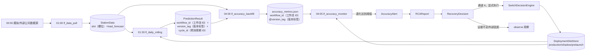
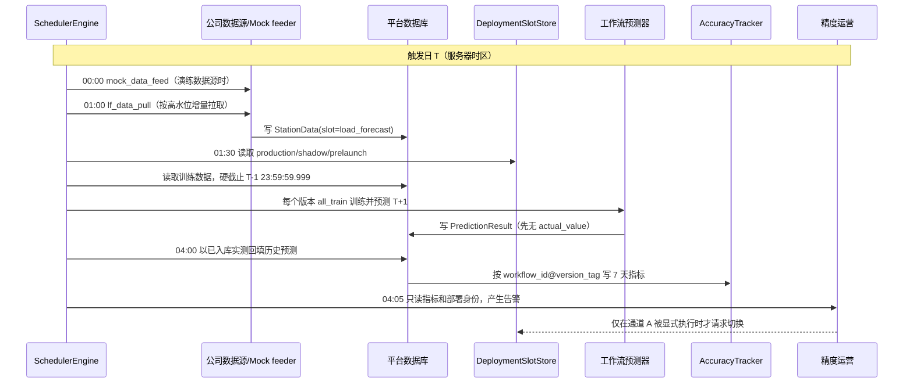
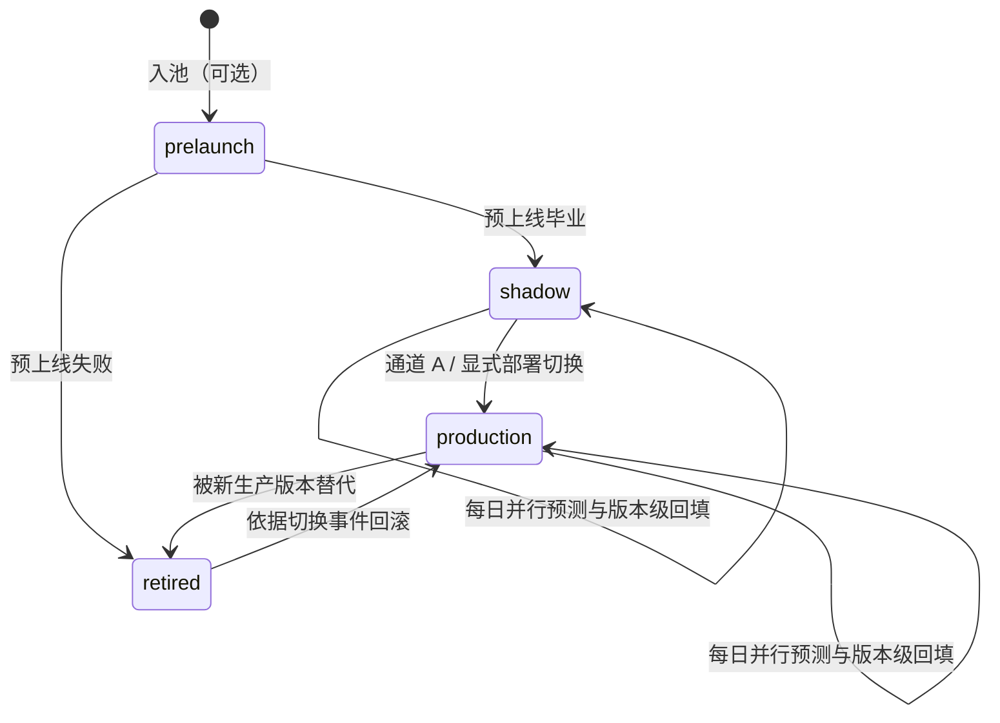
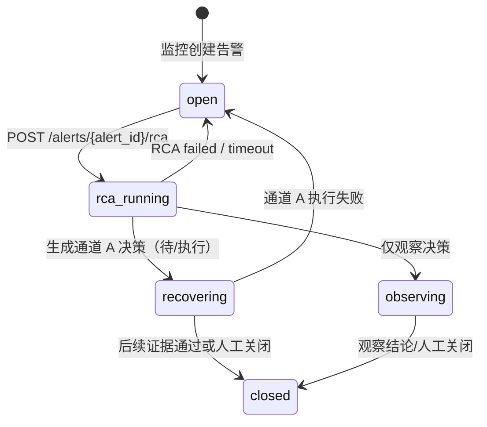
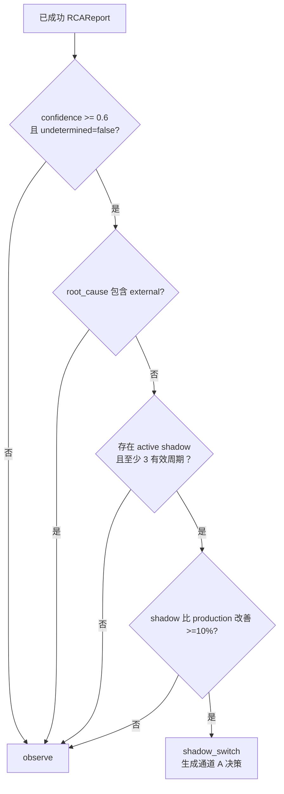
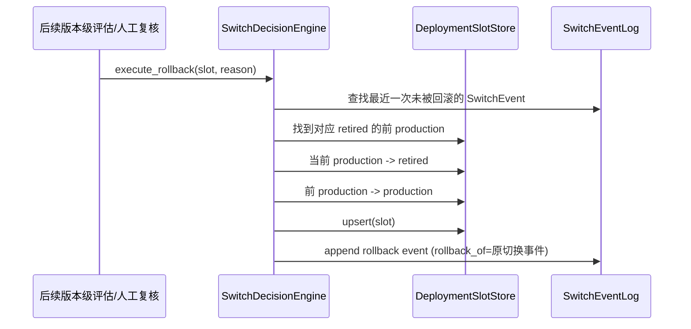

<!-- @AI_GENERATED -->
# 负荷预测正式链路：字段流转、指标判定与精度运营深度讲解

> **适用范围**：正式槽位 `load_forecast`。本文解释从每日定时调度到训练预测、版本级精度评估、退化根因分析（RCA）、通道 A 影子切换和部署回滚的真实链路。
>
> **阅读目标**：读完后能回答四个问题：数据和版本身份怎样一路传递？每项精度指标怎么算？什么条件下会告警、建议切换或只观察？为什么“精度运营”不能直接偷偷改生产版本？
>
> **事实边界**：本文以当前代码与配置为准；示例中的计算数值只用于说明，**不是**当前线上精度结论。当前 `load_forecast_e2e_demo` 是隔离演练槽位，不属于本故事线。

---

## 0. 一页看懂：正式故事线



### 0.1 字段速记与四条边界

| 字段/对象 | 中文含义 | 作用 |
|---|---|---|
| `slot` | 槽位、分区键 | 把正式负荷数据、版本、指标和运营记录隔离在 `load_forecast` 下。 |
| `pipeline` | 调度管线名 | 让 SchedulerEngine 启动同类任务；它不是数据/部署分区真源。 |
| `workflow_id` | 工作流/模板唯一标识 | 指向实际执行的工作流定义。 |
| `version_tag` | 部署版本标签 | 区分同一工作流的 production、shadow 等具体版本。 |
| `prediction_cycle_id` | 预测周期 ID | 把同一轮预测的多点记录关联起来。 |

| 边界 | 当前正式规则 | 常见误解 |
|---|---|---|
| 正式分区 | `slot = "load_forecast"` | `pipeline="load_forecast"` 只是调度管线标签，不能单独证明数据或部署身份。 |
| 发布真源 | `backend-service/data/deployment/slots.json` — 部署槽位登记文件，保存当前 production/shadow/prelaunch 身份，按 `slot` 分区 | 旧 `VersionRegistry` 仅用于未迁移路径的只读兼容，不是当前发布写入真源。 |
| 精度身份 | `workflow_id@version_tag` | 同一工作流的两个版本不能共享同一份指标；带 `version_tag` 查询未命中会 fail-closed。 |
| 切换职责 | 精度运营**提出并执行经确认的通道 A 决策**；部署状态机真正改身份 | `AccuracyMonitor` 和 04:05 cron 只产生告警，绝不自动把 shadow 提升为 production。 |

---

## 1. 当前正式配置快照

### 1.1 运行中的版本身份

正式槽位配置见 `backend-service/data/deployment/slots.json`：

| 形态（role） | `workflow_id` | `version_tag` | 业务含义 |
|---|---|---|---|
| production | `workflow-20260511-optimal-505` | `optimal-505-production` | 当前正式生产版本；每日必须运行。 |
| shadow | `workflow-20260511-optimal-505` | `shadow-run43-mape4109` | 第 43 轮 AutoResearch 产生的同工作流不同版本；与 production 并行预测，不对外生效。 |
| shadow | `workflow-20260511-optimal-505` | `shadow-run7-generic-mape4109` | 通用算子版候选；同样只做影子预测与评估。 |

这里最容易忽略的是：三个版本的 `workflow_id` 可以相同，但 `version_tag` 不同。因此版本的完整主键是：

```text
version_key = workflow_id + "@" + version_tag
```

例如：

```text
workflow-20260511-optimal-505@shadow-run43-mape4109
```

这把“同一工作流模板的不同部署版本”区分开，防止 shadow 的精度误写到 production 上。

### 1.2 正式阈值与容量

精度运营配置位于 `backend-service/data/precision_ops/load_forecast/config.json`；部署容量与训练窗口位于 `data/deployment/slots.json` 的 `load_forecast` 节点。

| 配置字段（英文） | 当前值 | 在哪一步使用 | 含义 |
|---|---:|---|---|
| `evaluation_window_days` | 7 | 回填与监控 | 正式精度统一看最近 7 天；回填代码固定该窗口，避免临时放宽口径。 |
| `min_valid_cycles` | 3 | 指标激活、通道 A 候选筛选 | 至少 3 个已回填的预测周期才可视为样本足够。 |
| `degradation_threshold_pct` | 15 | 退化告警 | 当前指标相对发布基线劣化达到 15% 才创建告警。 |
| `switch_margin_pct` | 10 | 通道 A 影子筛选 | shadow 相比 production 至少改善 10% 才能作为切换候选。 |
| `cooldown_hours` | 24 | RCA 与部署冷却 | RCA 冷却为 24 小时；部署槽位也以冷却期避免频繁切换。 |
| `max_shadow_slots` | 5 | 每日滚动运行 | 每日最多运行 5 个 shadow。当前有 2 个。 |
| `max_prelaunch_slots` | 2 | 每日滚动运行 | 每日最多运行 2 个 prelaunch。 |
| `training_window_days` | 365 | 每日训练 | 从触发日前可用数据中取最近 365 天训练窗口。 |
| `switch_observation_days` | 7 | 部署资格检查 | 旧式部署资格判断所需的连续优于天数；不替代 RCA 仲裁门槛。 |
| `auto_switch_enabled` | `false` | 正式发布治理 | 禁止 cron 回填自动发布；通道 A 必须显式走决策与部署状态机。 |
| `prediction_retention_days` | 90 | 数据留存 | 预测记录保留天数配置。 |
| `min_eval_points` | 72 | 评估充分性 | 评估最少点数配置；需与实际评估任务的输入数据一起观察。 |
| `eval_window_points` | 168 | 点位口径 | 15 分钟频率下，168 点约等于 42 小时；它是配置参数，不等于正式固定的 7 天日期窗口。 |

> **不要混淆**：`evaluation_window_days=7` 是当前回填代码的日期窗口；`eval_window_points=168` 是配置中的点位参数。是否恰好对应 7 天，取决于采样频率，不能只看一个数字下结论。

---

## 2. 两张图讲清“时间”和“身份”

### 2.1 每日时间线：触发日 T 的数据穿越防线



### 2.2 版本身份状态图



`production`、`shadow`、`prelaunch`、`retired` 是 `ModelVersion.status` 的身份。每天执行时，production 必跑；shadow 和 prelaunch 受各自容量上限约束；`retired` 只保留审计和回滚价值，不再参与每日预测。

---

## 3. 字段总览：哪些字段必须全程不丢

### 3.1 四个“贯穿主键”

| 字段 | 产生位置 | 后续消费者 | 为什么不能改名或漏传 |
|---|---|---|---|
| `slot` | `main.py` 的 `LOAD_FORECAST_SLOT`、任务配置 | 数据表、部署槽位、指标文件、告警/RCA 目录 | 这是数据与运营资产的分区键；若写成 `default`，会造成正式身份和指标断链。 |
| `workflow_id` | 部署版本登记 | 工作流执行、预测记录、指标和告警 | 标识使用哪一份工作流模板。 |
| `version_tag` | `ModelVersion` | `PredictionResult`、`accuracy_metrics.json`、切换目标 | 标识同一个 `workflow_id` 下的具体部署版本。 |
| `prediction_cycle_id` | `_run_single_prediction()` | 回填统计、有效周期计数 | 区分每天/每次预测周期，防止多点预测被误判为多个独立周期。 |

### 3.2 预测周期 ID 的形成

`_run_single_prediction()` 使用下面的可追踪格式：

```text
prediction_cycle_id =
  workflow_id[:70]
  + ":"
  + sha256(version_tag)[:16]
  + ":"
  + forecast_timestamp.strftime("%Y%m%d%H%M%S")
```

`version_tag` 使用短哈希是为了既保留版本隔离，又避免数据库 `cycle_id` 列被长标签撑爆。它不是安全凭据，不应用作身份认证。

---

## 4. 阶段一：数据进入正式槽位

### 4.1 调度任务和顺序

| 任务 ID | 默认 cron | 输入 | 关键输出 | `slot` 作用 |
|---|---|---|---|---|
| `mock_data_feed` | `0 0 * * *` | 模拟公司库 | 公司侧新增数据 | 演练用上游喂数；真正写入平台的动作仍由下一步完成。 |
| `lf_data_pull` | `0 1 * * *` | 数据源、平台高水位 | `StationDataRecord` | 使用正式 `load_forecast` 写平台数据。 |
| `lf_daily_rolling` | `30 1 * * *` | 槽位版本、历史实测 | `PredictionResult` | 生产/影子/预上线在同一正式槽位内并行比较。 |
| `lf_accuracy_backfill` | `0 4 * * *` | 已有预测 + 已入库实测 | 版本级滚动指标 | 回填和汇总只查询 `slot=load_forecast`。 |
| `lf_accuracy_monitor` | `5 4 * * *` | 部署身份 + 版本级指标 | `AccuracyAlert` | 只监控该正式槽位，不改变其部署身份。 |

实际 cron 由 `data/scheduler/tasks.json` 和 `DBConfig` 共同决定；上表用于理解默认执行顺序。系统启动后通过 `SchedulerEngine.start_pipeline("load_forecast", catchup=False)` 启动，`catchup=False` 的意思是不会把服务停机期间错过的 cron 全部补跑。

### 4.2 高水位增量拉取

`make_data_pull_task()` 对每个站点执行：

```mermaid
flowchart TD
    A[读取 StationData 中该 slot+station 的最大 timestamp_utc] --> B[得到 since_timestamp]
    B --> C[station_source.pull_latest(station_id, since_timestamp)]
    C --> D{有新增记录？}
    D -->|否| E[跳过该站点]
    D -->|是| F[组装 StationDataRecord]
    F --> G[insert_station_data]
    G --> H[(StationData)]
```

写入字段如下：

| 字段 | 来源 | 说明 |
|---|---|---|
| `station_id` | 上游记录 | 站点身份。 |
| `timestamp_utc` | 上游记录时间 | 高水位和真值匹配的时间轴。 |
| `feature_name` | 上游记录 | 当前正式负荷故事线通常为 `load`。 |
| `value` | 上游实测 | 训练标签与后续回填的 actual 来源。 |
| `slot` | `LOAD_FORECAST_SLOT` | 必须是 `load_forecast`，保证与训练、预测、评估同一分区。 |

**为什么不会重复拉取？** 高水位查询条件包含 `StationData.slot == slot` 和 `station_id`。每个槽位维护自己的最大时间戳，所以 demo、历史 `default` 和正式 `load_forecast` 不会互相抢进度。

---

## 5. 阶段二：每日滚动训练与预测

### 5.1 T、T-1、T+1 的严格语义

触发日记为 `T`。训练窗口由 `compute_training_window()` 计算，但有一条硬约束：

```text
训练数据时间 <= T-1 23:59:59.999
预测目标      = T+1
```


这条约束解决的是典型的数据穿越问题：在 T 日触发训练时，不能把 T 日乃至未来真实负荷当成已知训练标签。为 lag 特征预热可以取训练窗口前 14 天历史，但同样不能越过 `T-1` 的硬截止。

### 5.2 运行哪些版本

`make_daily_rolling_task()` 从 `DeploymentSlotStore` 读取 `load_forecast`：

1. 读取 `training_window_days`、`max_shadow_slots`、`max_prelaunch_slots`；
2. 读取一个 `production_model`；
3. 读取状态为 `shadow` 的模型，按 `accuracy_score` 从低到高排序并取前 N 个；
4. 读取状态为 `prelaunch` 的模型，按入池时间升序并取前 N 个；
5. 逐个运行工作流，生产版本失败不会阻断其他候选，但会记录生产失败日志。

工作流调用时对 `train_test_split_ts` 注入：

```json
{
  "mode": "all_train"
}
```

含义是：本次**线上日滚动任务**使用完整可训练窗口产生未来预测，而不是再在该窗口内切出一段用于离线测试。线上效果验证由后续真实值回填承担。

### 5.3 `PredictionResult`：预测和评估之间的桥

成功预测先写入：

| 字段 | 初始值 | 后续如何变化 |
|---|---|---|
| `slot` | `load_forecast` | 保持不变，用于分区。 |
| `workflow_id` | 当前运行工作流 ID | 保持不变。 |
| `version_tag` | 当前部署版本标签 | 保持不变，是版本级归属关键。 |
| `prediction_cycle_id` | 当前周期 ID | 用于回填时统计有效/总周期。 |
| `forecast_timestamp` | 预测目标点时间 | 到达可用实测时间后用于精确匹配真值。 |
| `predicted_value` | 工作流输出 | 预测值。 |
| `actual_value` | `null` | 真值到达后回填为实测值。 |
| `status` | `predicted` | 回填成功后变为 `evaluated`；失败路径为 `failed`。 |
| `is_shadow` | production 为 `false`，其余为 `true` | 用于说明该记录是否来自非正式版本。 |

> 失败时系统仍会写一条 `status="failed"`、`predicted_value=0.0` 的记录用于审计，但它不应被当作成功预测的业务结论。

---

## 6. 阶段三：7 天版本级精度回填

### 6.1 回填做什么，为什么不会偷看未来

回填任务的窗口固定为最近 7 天：

```text
cutoff = 当前 UTC 时间 - 7 天
```

它只回填满足以下条件的预测：

```text
PredictionResult.slot = load_forecast
actual_value IS NULL
forecast_timestamp ∈ [cutoff, 最新已入库实测时间]
```

对每条预测，只有平台库中出现**同 `station_id`、同 `feature_name`、同 `timestamp_utc`** 的实测 `StationData.value`，才写入：

```text
actual_value = StationData.value
status       = "evaluated"
evaluated_at = 当前时间
```

因此，回填不直接读取外部 CSV 的未来标签；它只使用已经通过数据拉取进入平台库的实际值。

### 6.2 按完整版本分组

回填分组键是：

```python
groups[(workflow_id, version_tag)]
```

而不是只用 `workflow_id`。这是当前链路最重要的防错点之一：若 production 和 shadow 共享同一 `workflow_id`，只按工作流分组会把两个版本的预测混在一起，结果会同时污染告警、候选评估和切换结论。

### 6.3 三个主指标公式

设窗口内已回填样本为 \(i=1...n\)，预测为 \(\hat y_i\)，真实值为 \(y_i\)。指标结果均以百分比表示（MAE 除外）。

#### MAPE：平均绝对百分比误差

\[
\operatorname{MAPE}=
\frac{1}{n}\sum_{i=1}^{n}
\left|\frac{\hat y_i-y_i}{y_i}\right|\times100\%
\]

- 只纳入 `actual_value != 0` 的点，避免除零。
- 每个点权重相同；低负荷时一个小绝对误差也可能形成很高百分比误差。

#### WMAPE：加权平均绝对百分比误差

\[
\operatorname{WMAPE}=
\frac{\sum_{i=1}^{n}|\hat y_i-y_i|}
     {\sum_{i=1}^{n}|y_i|}
\times100\%
\]

- 只要 `actual_value` 有值就可参与分子；若分母 \(\sum|y_i|=0\)，结果为 `None`。
- 负荷较大的点权重更高，通常更适合衡量总体电量/负荷影响。

#### MAE：平均绝对误差

\[
\operatorname{MAE}=
\frac{1}{n}\sum_{i=1}^{n}|\hat y_i-y_i|
\]

- 使用原始负荷单位，不是百分比。
- `actual=0` 的点也参与；适合配合百分比指标判断绝对影响。

### 6.4 充分性与状态判定

| 字段 | 计算方式 | 含义 |
|---|---|---|
| `valid_cycle_count` | 已回填记录涉及的去重 `prediction_cycle_id` 数 | 有多少个预测周期已有真值。它不是简单的“点数”，也不必然等于自然日数。 |
| `total_cycle_count` | 当前窗口预测记录涉及的去重 `prediction_cycle_id` 数 | 总共应评估多少个周期。 |
| `coverage_rate` | `已回填点数 / 当前窗口预测点数` | 真值覆盖程度。 |
| `window_days` | 固定 `7` | 本次指标使用的日期窗口。 |
| `status` | 下方规则 | `active` 才允许监控和通道 A 使用。 |

正式激活规则：

\[
status =
\begin{cases}
\texttt{active}, & valid\_cycle\_count\ge3\ \land\ coverage\_rate\ge0.9\\
\texttt{insufficient\_data}, & \text{其他情况}
\end{cases}
\]

`AccuracyTracker.update_metrics()` 最终把版本指标写入：

```text
backend-service/data/precision_ops/load_forecast/accuracy_metrics.json
metrics[workflow_id@version_tag]
```

带 `version_tag` 的读取没有匹配到对应版本时会直接返回 `None`，不会退回裸 `workflow_id` 的旧指标。这就是 **fail-closed**：宁可暂时无监控，也不误把旧版本成绩安到新版本名下。

---

## 7. 阶段四：精度退化告警

### 7.1 谁被监控

`AccuracyMonitor.evaluate(slot)` 只对部署槽位中的下列版本执行退化判定：

- 一个 `production`；
- 所有状态为 `shadow` 的版本。

`prelaunch` 会出现在只读快照中，但不会触发退化告警；`retired` 不参与每日预测与监控。

### 7.2 选择 WMAPE 还是 MAPE

监控优先级不是“只要当前算出了 WMAPE 就一定用 WMAPE”，而是：

```text
若 当前 rolling_wmape 有值 且 部署版本 baseline_wmape 有效且 > 0：
    比较 WMAPE
否则：
    比较 MAPE
```

这条回退规则很关键。当前正式 production 的 `baseline_wmape` 为空，只有 `baseline_mape=5.6616`；如果监控强行把新产生的 WMAPE 与缺失或 MAPE 基线比较，就会产生错误结论或静默跳过。因此当前正式场景会安全使用 MAPE。

### 7.3 退化率与严重级别

设实际比较指标为 \(M_{current}\)，发布基线为 \(M_{baseline}\)：

\[
\operatorname{degradation\_pct}=
\frac{M_{current}-M_{baseline}}
     {M_{baseline}}
\times100\%
\]

当前阈值 `degradation_threshold_pct=15`：

| 条件 | 结果 |
|---|---|
| 指标不存在、`status != active`、基线缺失或基线 \(\le0\) | 不告警，等待数据充分。 |
| `degradation_pct < 15%` | 不告警。 |
| `15% ≤ degradation_pct < 30%` | 创建 `warning` 告警。 |
| `degradation_pct ≥ 30%` | 创建 `critical` 告警。 |

`30%` 来自 `2 × degradation_threshold_pct`，不是单独配置项。

### 7.4 数值例子：生产版本为什么会告警

以下是**教学示例**，不是实时数据：假设当前 production 使用 MAPE 基线 \(5.6616\%\)，当前 7 天 MAPE 为 \(6.55\%\)。

\[
\frac{6.55-5.6616}{5.6616}\times100\%
\approx15.69\%
\]

因为 \(15.69\%\ge15\%\)，系统创建一条 `warning` 告警。告警中会保留：

```json
{
  "slot": "load_forecast",
  "model_form": "production",
  "workflow_id": "workflow-20260511-optimal-505",
  "version_tag": "optimal-505-production",
  "metric_name": "mape",
  "baseline_metric": 5.6616,
  "current_metric": 6.55,
  "degradation_pct": 15.69,
  "status": "open"
}
```

同一 `slot + model_form + workflow_id + version_tag` 若已有开放告警，监控不会无限重复创建新告警；这是告警去重，而不是忽略真实退化。

---

## 8. 阶段五：RCA 根因分析

### 8.1 告警状态机



`RCAOrchestrator` 的输入是 `slot`（槽位）、`AccuracyAlert`（精度告警对象）和 `trigger_type`（RCA 触发方式：`alert` / `scheduled` / `manual`）。输出是 `RCAReport`（根因分析报告）。它在调用 RCA skill 前先把告警状态改为 `rca_running`，然后把结果写回；发生异常或超时则让告警回到 `open`，避免半完成状态卡死。

### 8.2 RCA 输出字段

| 字段 | 类型 | 问题回答 |
|---|---|---|
| `root_cause` | string | 根因类别，例如 `data_gap`、`feature_broken`、`model_decay`、`external`。 |
| `confidence` | 0 到 1 | 对该根因的置信度。 |
| `undetermined` | boolean | 是否无法可靠定论。 |
| `error_profile.mape_by_hour` | map | 哪些小时的平均 MAPE 更差。 |
| `error_profile.mape_by_weekday` | map | 哪些星期几更差。 |
| `error_profile.worst_windows` | list | 最差的时间窗口及其 MAPE。 |
| `error_profile.error_bias` | enum | 高估、低估或均衡。 |
| `data_quality_diagnosis` | object | 缺失率、异常率、特征漂移、数据新鲜度延迟。 |
| `actionable_insights` | list | 具体建议及其证据。 |
| `artifacts_dir` | relative path | RCA 产物目录；必须相对 `backend-service/`，不能持久化绝对路径。 |

RCA 成功后会为告警设置 24 小时冷却期，非手动触发在冷却期内优先复用已有 RCA，避免反复启动相同分析。

---

## 9. 阶段六：仲裁、通道 A 与观察

### 9.1 仲裁不是切换

`RecoveryArbitrator.decide(slot, rca_report_id)` 的输出是 `RecoveryDecision`，即“建议和理由”，不会直接修改 `slots.json`。这是把**诊断**与**发布**分开：RCA 可以不确定，部署动作必须可审计、可回滚。



### 9.2 通道 A 的候选门槛

仲裁器获取 production 与所有 shadow 的**版本级 active 指标**。比较指标使用：有 WMAPE 就取 WMAPE，否则取 MAPE。

设 production 分数为 \(S_p\)，shadow 分数为 \(S_s\)，两者都是“越低越好”的误差指标：

\[
\operatorname{improvement\_pct}=
\frac{S_p-S_s}{S_p}\times100\%
\]

shadow 必须同时满足：

1. 指标 `status == "active"`；
2. `valid_cycle_count >= min_valid_cycles`，当前至少 3；
3. \(S_s < S_p\)；
4. \(improvement\_pct \ge switch\_margin\_pct\)，当前至少 10%。

多个 shadow 都合格时：优先取比较指标最低者；若仍相同，优先有效周期更多者。

**教学例子**：若 production 为 \(6.55\%\)，shadow 为 \(5.70\%\)，则：

\[
\frac{6.55-5.70}{6.55}\times100\%
\approx12.98\%
\]

假设 shadow 已 `active` 且有 4 个有效周期，RCA 置信度为 `0.78`、根因为 `model_decay`，则会生成 `channel="shadow_switch"` 的建议。若任何一项不满足，结果为 `channel="observe"`，不是强行切换。

### 9.3 observe 不是失败

`observe` 的 SLA 为 12 小时，而通道 A 决策的 SLA 为 2 小时。以下情况应观察而非发布：

- RCA `confidence < 0.6`；
- `undetermined=true`；
- 根因属于外部因素（如节假日、突发天气、外部数据变化）；
- 没有达到样本、覆盖率或改善分差门槛的影子版本；
- 当前已有正在执行的通道 A 决策。

观察意味着保留现有 production，继续积累可比较证据，或让人工处理数据/特征问题；不是让 AutoResearch 或 cron 绕过发布审批。

---

## 10. 阶段七：执行通道 A，生产身份如何变化

### 10.1 HTTP 调用链

| 顺序 | 接口 | 输入关键字段 | 输出关键字段 |
|---:|---|---|---|
| 1 | `POST /api/accuracy-operations/alerts/{alert_id}/rca` | `alert_id` — 告警 ID；`trigger_type` — RCA 触发方式 | `RCAReport` — 根因分析报告。 |
| 2 | `POST /api/accuracy-operations/recovery/decide` | `slot` — 槽位；`rca_report_id` — 已成功的 RCA 报告 ID | `RecoveryDecision` — 恢复通道建议。 |
| 3 | `POST /api/accuracy-operations/recovery/shadow-switch` | `slot` — 槽位；`decision_id` — 恢复决策 ID；`shadow_workflow_id` — 请求参考用的影子工作流 ID | 已执行的 `RecoveryDecision`，其中带 `switch_event_id` — 部署切换审计事件 ID。 |
| 4 | 部署接口 / 状态机 | `target_workflow_id` — 被提升的工作流 ID；`target_version_tag` — 被提升的具体版本标签；切换原因 | `SwitchEvent` — 只追加的切换审计事件；以及更新后的 `DeploymentSlot` — 槽位身份快照。 |

第 3 步请求中的 `shadow_workflow_id` 是前端/调用方参考字段；真正的目标身份来自 `RecoveryDecision.target_workflow_id`（建议提升的工作流 ID）和 `target_version_tag`（建议提升的版本标签）。这样即使同一 workflow 有多个 shadow 版本，状态机仍能按完整版本身份定位目标。

### 10.2 `SwitchDecisionEngine.execute_switch()` 的原子效果

通道 A 执行后，部署状态机按以下顺序处理：


安全检查包括：

- slot 不存在；
- 目标不在 shadow 列表；
- 目标状态不是 `shadow`；
- 同一 `workflow_id` 有多个 shadow 版本却未指定 `target_version_tag`；
- 冷却期内重复切换（除非部署侧显式 `force=true`）。

`auto_switch_enabled=false` 的真实含义是：**04:00 回填任务不会自己调切换引擎**。通道 A 的 `/recovery/shadow-switch` 是一次显式的、带 RCA/决策上下文的执行，不等于 cron 自动发布。调用过程中事件的 `trigger_type` 可能记为 `auto`，它是切换事件的来源标签，不应被误解为“回填 cron 已开启自动切换”。

### 10.3 不要把废弃回填路径当成正式行为

`load_forecast_tasks.py` 仍保留 `_legacy_make_accuracy_backfill_task()` 与 `_post_backfill_slot_update()` 供历史审计和兼容；其中旧辅助逻辑能看到“若 `auto_switch_enabled` 则检查切换资格”的代码。

**当前正式启动入口没有调用旧工厂。** `main.py` 注册的是 `make_accuracy_backfill_task()`，其版本级后置函数 `_post_versioned_backfill_slot_update()` 只回写 `accuracy_score`、连续优于天数和 prelaunch 生命周期，并明确禁止在 cron 回填路径提升 shadow。阅读日志或搜索源码时，应以实际注册的工厂函数为准。

---

## 11. 回滚：如何回到前一 production

`SwitchDecisionEngine.execute_rollback(slot, reason)` 只负责做状态还原和追加审计事件；它不自己判断“何时应该回滚”。回滚决策应由后续实际评估证据或人工发布流程触发。



回滚必须满足：

1. slot 存在；
2. 当前有 production；
3. 切换事件日志中存在最近一次可回滚的非 rollback 事件；
4. `shadow_models` 中还能找到该事件的原 production，且它处于 `retired`。

若旧版本被人工清理，或没有历史切换事件，回滚会被拒绝而不是猜测一个目标。这是有意的 fail-safe 行为。

> **当前实现边界**：`RecoveryDecision.sla_deadline` 会记录通道 A 为 2 小时、观察为 12 小时的处理时限，但已阅读的正式代码并没有发现“超过 SLA 就由 cron 自动调用回滚”的路径。不要把 SLA 当作自动回滚开关；回滚仍应走部署状态机并保留原因与事件审计。

---

## 12. 一次完整退化演练（不写真实数据）

下面用虚拟时间和数值串起全流程：

1. **T 日 01:00**：`lf_data_pull` 把站点 `mock_load_station` 的新实测写成 `StationData(slot="load_forecast")`。
2. **T 日 01:30**：每日任务读取 `load_forecast` 槽位。production、两个 shadow 都以截止 `T-1 23:59:59.999` 的历史训练，写出 T+1 的 `PredictionResult`。production 的记录使用 `version_tag="optimal-505-production"`。
3. **数日后 04:00**：T+1 的真实负荷已进入平台库。回填通过 `forecast_timestamp == timestamp_utc` 取得真值，将预测变为 `evaluated`。
4. **形成 7 天窗口**：production 有 4 个有效周期、`coverage_rate=0.96`，所以 `status="active"`。计算结果为 MAPE `6.55%`。
5. **T+N 日 04:05**：基线 `baseline_mape=5.6616%`，退化为 `15.69%`，创建 `warning` 的 `AccuracyAlert`。
6. **RCA**：报告认为根因为 `model_decay`，`confidence=0.78`，且不是 `external`。
7. **仲裁**：某 shadow 的 active 比较指标 `5.70%`，比 production `6.55%` 改善 `12.98%`，有效周期 `4 ≥ 3`，因此生成通道 A `RecoveryDecision`。
8. **显式执行**：调用通道 A 接口；状态机精确选择目标 `workflow_id + version_tag`，原 production 变 `retired`，目标变 `production`，并追加切换事件。
9. **后续评估**：继续等真实值回填。如果后续证据证明切换没有改善，运维/发布流程调用 `execute_rollback()` 恢复被保留的 retired 前 production。

---

## 13. 现场排错：按字段从 UI 一直追到最终分支

### 13.1 最常查的字段链路

| 现象 | 从哪里开始查 | 必须追到哪里 |
|---|---|---|
| 页面写着负荷预测，数据却在旧槽位 | `data/scheduler/tasks.json` 的 `slot` | `make_data_pull_task(..., slot)` 创建的 `StationDataRecord.slot`。 |
| shadow 看起来跑了，但没有独立指标 | `PredictionResult.version_tag` | `accuracy_metrics.json` 的 `workflow_id@version_tag` 键。 |
| 有预测却没有告警 | `valid_cycle_count`、`coverage_rate`、`status` | `AccuracyMonitor._check_version()` 的 `status == "active"` 与基线判定。 |
| 有告警却不切换 | `RCAReport.confidence`、`root_cause` | `RecoveryArbitrator._find_qualified_shadow()` 的样本数与 10% 分差门槛。 |
| 通道 A 选错同工作流不同版本 | `RecoveryDecision.target_version_tag` | `SwitchDecisionEngine.execute_switch(... target_version_tag=...)`。 |
| 回滚失败 | 最新 `SwitchEvent` | 当前 `shadow_models` 是否保留原 production 的 `retired` 记录。 |

### 13.2 三个固定自问

1. **改名发生在哪一层？** UI 常显示 `pipeline`，真正控制分区的是 `slot`；版本完整身份是 `workflow_id + version_tag`。
2. **缺省回退是什么？** 监控优先 WMAPE，但没有有效 WMAPE 基线时回退 MAPE；带标签版本指标没有匹配时不回退，这是 fail-closed。
3. **最终改变行为的分支是什么？** `status == "active"` 才能监控；退化率达到 15% 才告警；RCA 置信度、样本数、10%改善分差全通过才给出通道 A。

---

## 14. 发布前 / 演练前检查清单

### 配置与身份

- [ ] 正式任务 `slot` 全为 `load_forecast`，不是 `default` 或 demo。
- [ ] `slots.json` 中 production/shadow 均有完整 `workflow_id` 和 `version_tag`。
- [ ] `auto_switch_enabled=false` 同时出现在部署槽位和精度运营配置中。
- [ ] `training_window_days`、shadow 容量与实际资源预算一致。

### 数据与预测

- [ ] `StationData` 的 `slot`、站点、特征、时间轴正确。
- [ ] 日滚动训练数据没有越过 `T-1 23:59:59.999`。
- [ ] `PredictionResult` 同时写入 `workflow_id`、`version_tag`、`prediction_cycle_id`。
- [ ] production 与 shadow 均能看到独立版本键，而不是混在裸 `workflow_id` 下。

### 指标与运营

- [ ] 最近 7 天内有足够的 `evaluated` 预测。
- [ ] `valid_cycle_count >= 3` 且 `coverage_rate >= 0.9` 后才把状态解释为 `active`。
- [ ] 退化比较使用的是同一种指标和同一种基线；没有 WMAPE 基线时应使用 MAPE。
- [ ] 通道 A 前确认 RCA 非外部根因、`confidence >= 0.6`、shadow 改善至少 10%。
- [ ] 切换前确认目标的 `version_tag`，避免同 workflow 多版本歧义。
- [ ] 切换后保留 `SwitchEvent` 与旧 production 的 `retired` 记录，保证可回滚。

---

## 15. 关键文件索引

| 相对路径 | 职责 |
|---|---|
| `backend-service/main.py` | 服务启动和调度装配：定义正式 `LOAD_FORECAST_SLOT`，注册五段任务并启动 `load_forecast` 管线。 |
| `backend-service/services/scheduler/tasks/load_forecast_tasks.py` | 数据拉取、严格 gap-1-day 日滚动预测、版本级回填、独立监控任务工厂的业务实现。 |
| `backend-service/services/deployment/models.py` | `DeploymentSlot`、`ModelVersion`、`SwitchEvent` 等部署身份与审计数据模型。 |
| `backend-service/services/deployment/switch_decision.py` | `SwitchDecisionEngine`：精确版本切换、冷却校验、append-only 事件和回滚状态机。 |
| `backend-service/services/precision_ops/accuracy_tracker.py` | 以 `workflow_id@version_tag` 为键读写版本级 MAPE/WMAPE/MAE、覆盖率和状态。 |
| `backend-service/services/accuracy_operations/monitor.py` | `AccuracyMonitor`：只读部署身份与版本指标，计算退化并创建去重告警。 |
| `backend-service/services/accuracy_operations/rca_orchestrator.py` | `RCAOrchestrator`：管理告警到 RCA 报告的状态迁移、冷却、超时与失败回退。 |
| `backend-service/services/accuracy_operations/arbitrator.py` | `RecoveryArbitrator`：按 RCA 和 shadow 证据生成 observe 或通道 A 决策，并委托部署引擎执行。 |
| `backend-service/api/accuracy_operations.py` | 精度运营 HTTP API：RCA、仲裁、通道 A、快照、告警关闭的输入输出契约。 |
| `backend-service/data/deployment/slots.json` | 正式发布身份真源：production/shadow/prelaunch/retired 的当前快照与部署容量。 |
| `backend-service/data/precision_ops/load_forecast/config.json` | 7 天窗口、退化阈值、切换分差、最少有效周期等正式精度运营配置。 |
| `backend-service/data/scheduler/tasks.json` | 调度任务的展示和持久化配置，记录每项任务的 cron、pipeline、slot 与启停状态。 |

---

## 16. 最终总结

这条链路不是“模型训练一次，然后看一个 MAPE 数字”。它是一套带身份、时间边界和治理门槛的运行系统：

```text
相同 slot 的数据
  → 带完整版本身份的预测
  → 7 天真值回填
  → 版本级指标
  → 可解释退化告警
  → 带置信度的 RCA
  → 有样本门槛的恢复仲裁
  → 显式、可审计、可回滚的部署动作
```

只要持续守住三个不变量，故事线就不会断：

1. **槽位不混**：正式数据、部署和精度运营始终使用 `load_forecast`；
2. **版本不混**：所有指标、告警和切换都带 `workflow_id + version_tag`；
3. **职责不混**：监控负责发现，RCA 负责解释，仲裁负责建议，部署状态机负责真正切换与回滚。
<!-- @AI_GENERATED: end -->
