# AutoResearch 迭代历程详版

> 本文按代际梳理 AutoResearch 模块的完整演进：每一代的架构是什么、相比上一代新增了什么、为什么新增、怎么设计与实现的，并配流程图。
> 适用场景：答辩讲述、整体复盘、新人交接。

---

## 0. 全局主线

AutoResearch 是 AIP 工业 AI 算法平台的自动化实验系统，服务于负荷预测等场景。它的演进不是一开始画好的蓝图，而是每一代用真实实验数据逼出来的：

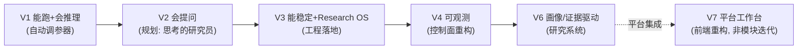

一条认知主线贯穿始终——**从"自动调参器"到"基于证据、由数据画像驱动的研究操作系统"**。

| 代际 | 时间 | 一句话定位 |
|---|---|---|
| V1 | 2026-04-30 ~ 05-07 | 一周搭出完整能力栈：能跑、会推理、有记忆 |
| V2 | 2026-05 | 规划升级：让系统先提问再实验（八大需求） |
| V3 | 2026-05-21 ~ 05-22 | 工程稳定 + Research OS 方向 |
| V4 | 2026-05-22 ~ 05-28 | 控制面重构：过程可观测、可控制 |
| V6 | 规划中 | 画像驱动 + Evidence Ledger + 三级实验调度 |
| V7 | 2026-07 | AIP 平台前端重构，AutoResearch 作为"自动化回测"接入算法生命周期（平台级，非模块迭代） |

> 注：无第五代，第四代直接跳到第六代规划。

---

## 1. V1 第一代：从零到工业级 AutoML（2026-04-30 ~ 05-07）

### 1.1 起点与痛点

业务场景是负荷预测，算法工程师手工调参：一个工程师一天调 5~10 次，靠直觉、结论不可复现、重复踩坑。

原来的做法：

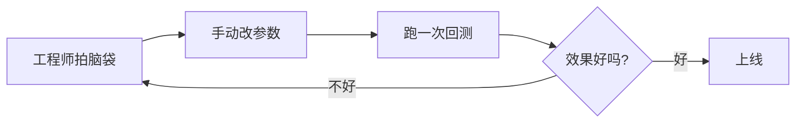

目标：把"人工调参"变成"系统自动研究"，而且不是瞎试——要自动、智能、可追溯、会学习、安全。

为什么不用现成的 Grid Search / 贝叶斯优化？因为场景有**四层可调维度**（参数/特征/模型/数据），很多是离散选择 + 结构开关，传统方法不够灵活，必须上智能体驱动。

### 1.2 V1 整体架构

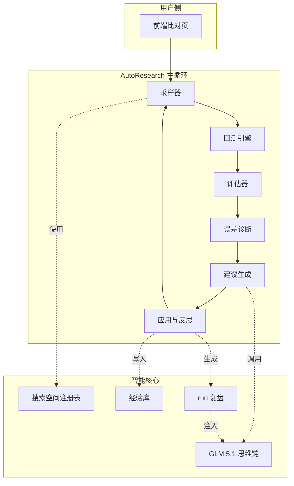

技术栈：后端 Python + FastAPI，前端 React + echarts，LLM 用 GLM-5.1（仅假设生成器），存储用 JSON 文件。

### 1.3 V1 的六个 Stage（每一步解决上一步暴露的问题）

演进路线：

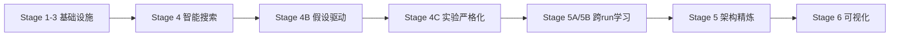

#### Stage 1-3：基础设施（解决"能跑但笨"）

**Stage 1 — 候选池可追溯**
- 问题：跑完实验候选池只有 ID，不知道用了什么参数、相对基线改了什么、哪次跑出来的。
- 做法：候选记录新增 `challenger_override`、`effective_structure_patch`、`effective_parameter_patch`、`diff_from_baseline`、`source_run_id + iteration`，前端加"详情抽屉"。

**Stage 2 — GLM 建议增强**
- 问题：GLM 给建议只看 MAPE 数字，不看误差为什么发生。
- 做法：回测后自动算 `error_profile`（平均/最大 MAPE、偏差方向、高误差天、工作日/节假日差距）和 `data_coverage`（总天数、成功天数、跳过原因），注入 GLM prompt，让它"先分析再建议"。
- 效果：建议从"拍脑袋改 train_days"升级成"因为周末误差大，建议加强节假日特征"。

**Stage 3 — 搜索策略饱和检测**
- 问题：系统在同一方向死磕，连续 4 轮改善很小还在继续。
- 做法：实现 `_is_parameter_saturated`，最近 K=4 轮改善都 < 5% 阈值 → 判定参数层饱和 → 自动切换到结构探索。

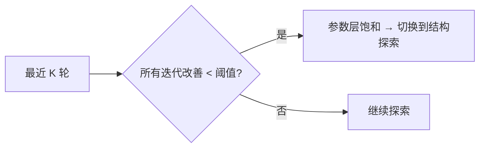

#### Stage 4：智能搜索架构（四件大事）

**1. 统一搜索空间注册表**
- 问题：每次只能调 train_days 几个参数，特征/模型动不了；换模板要重写搜索规则。
- 做法：把"可调什么"写成 JSON 注册表，分四层（训练/特征/模型/数据），每个参数带 `type`（categorical/boolean/subset）、`options`、`patch_target`。
- 落地：`load_forecast_v1.json` + `autoresearch_registry_service.py` + `_sample_from_registry` + `_sample_to_patches`。
- 好处：换新模板（如光伏预测）只需写新注册表 JSON，引擎代码不改。

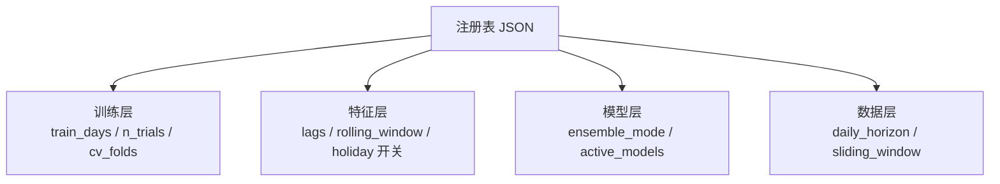

**2. 阶段化激活**
- 思想：不一上来搜所有层，按顺序逐层放开：训练 → 特征 → 模型 → 数据，每层独立判定饱和（采样 ≥4 轮且改善都 <5%）才解锁下一层。

**3. 集成模式搜索**
- 思想：让系统能自动尝试多模型组合：`single_best` / `all_adaptive` / `subset_adaptive`，权重用 OOF RMSE 逆权重（威海方案验证有效）。
- 实现：`_build_ensemble_mode_patches` 生成结构开关 + 权重参数；`ensemble_forecast` 算子新增 `weight_strategy`（equal / oof_rmse_inverse）。

**4. 误差诊断驱动建议**
- 思想：按误差画像判定主要误差来源，走不同建议分支，对症下药。

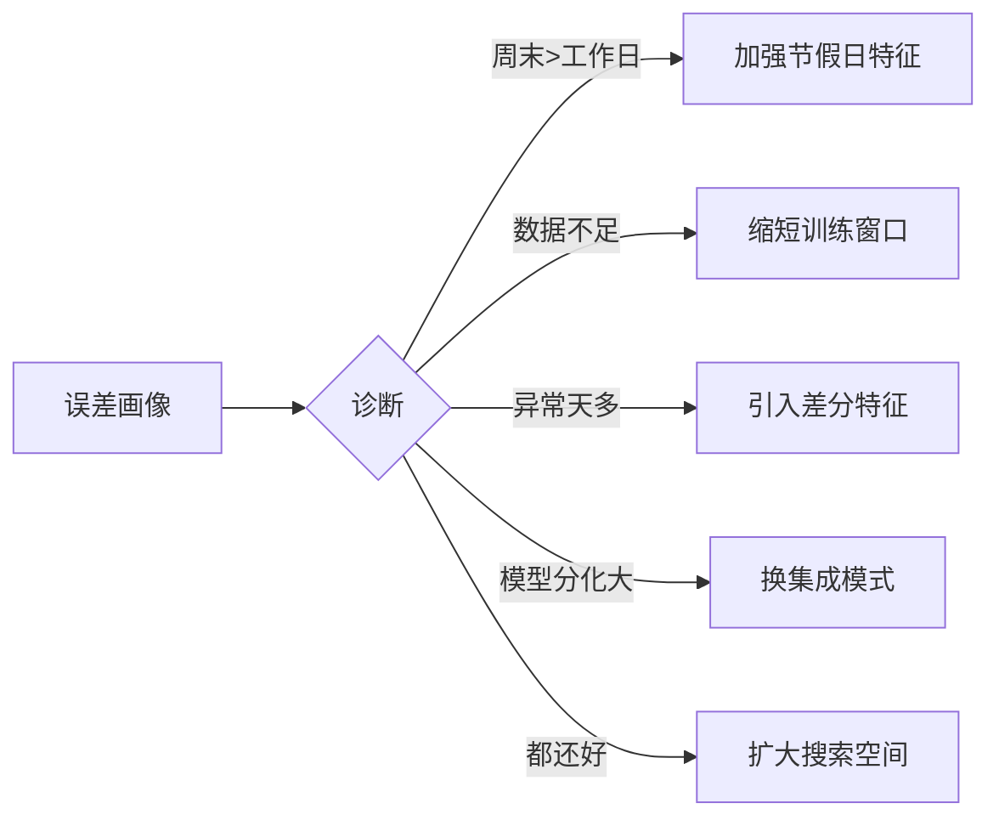

#### Stage 4B：假设驱动实验（最关键跃升）

- 问题：GLM 每次重新推理不积累、建议没"为什么"、改了之后没人检查有没有改善。系统能做实验，但不像科学家那样做。
- 核心改造：GLM 从"填空"变"推理"，走 **观察 → 假设 → 设计 → 预期 → 回退** 五步思维链。

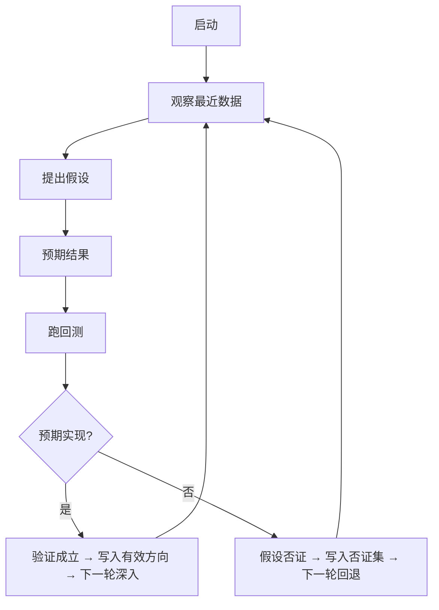

四个关键能力：
1. **假设生成**：每个 proposal 必须有 `observation` / `hypothesis` / `hypothesis_type` / `expected_outcome` / `fallback_if_failed` / `deepen_if_verified`。
2. **假设验证**：`_verify_hypothesis` 比对 expected_outcome 阈值 vs 实际指标。
3. **洞察累积**：`insights.effective_directions` / `ineffective_directions` + 计数。
4. **已否证集**：FIFO 最多 20 条，下一轮 GLM 自动回避。

**踩坑修复**：最初去重用文本精确匹配，但 GLM 每次措辞略不同 → 改成 `_build_patch_fingerprint` 按 patch 实际改动内容（结构开关/节点参数/全局配置）提取指纹去重。

#### Stage 4C：实验严格化（四个科学原则）

- 问题：一次改很多东西不知哪个起作用、可能死磕、分不清"改动改善"和"数据波动"。

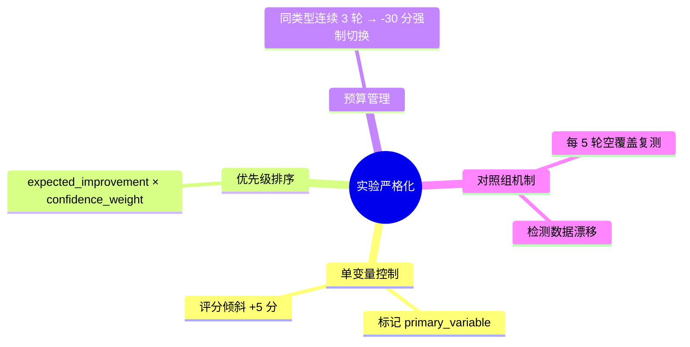

- 单变量控制：每个候选标 `primary_variable`，只改一个维度 +5 分（评分倾斜，不硬限制）。
- 优先级排序：`hypothesis_priority = expected_improvement × confidence_weight`，high=1.0/medium=0.7/low=0.4。
- 预算管理：`run_state.consecutive_type_count`，某类型连续 ≥3 轮 → 下一轮 -30 分强制转向。
- 对照组：每 5 轮跑一次"不改任何东西"的回测，和第 1 轮 baseline 比，差 >1% 判定数据漂移。

#### Stage 5A/5B：跨 run 学习（让系统有记忆）

- 问题：到 4C 系统在单次 run 内已经聪明，但每次新 run 都从零开始，经验不能传给下一次。
- 类比：实习生每次从零学 vs 经验员工有笔记本。

**Stage 5A — run_insight（写笔记本）**：run 结束自动生成结构化复盘，含 `learned_rules` / `ineffective_attempts` / `open_questions` / `recommended_starting_config_for_similar`，存到 `autoresearch_run_insights/<run_id>.json`。规则提取保底 + GLM 增强。

**Stage 5B — 跨 run 知识传递（新人入职读笔记本）**：新 run 启动时按场景指纹匹配历史 insight，注入首轮 GLM prompt。

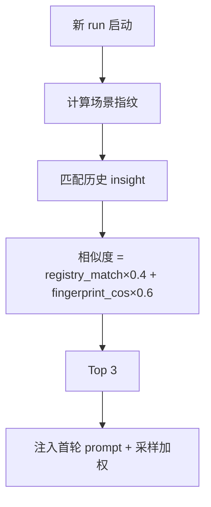

场景指纹：`granularity_minutes + span_days + weekend_weekday_gap + outlier_ratio + seasonality_strength`，定义"什么算相似场景"。

**关键策略——不锁定起点，只加权**：历史推荐 train_days=45 不是 `override=45`（锁定），而是采样时 45 的权重 ×2（加权）。锁定会偏离自主探索初衷，加权能加速但保持多样性。

#### Stage 5：架构精炼（让智能不打架）

跑起来后发现采样和建议是两套系统各自为政，暴露 4 个问题：

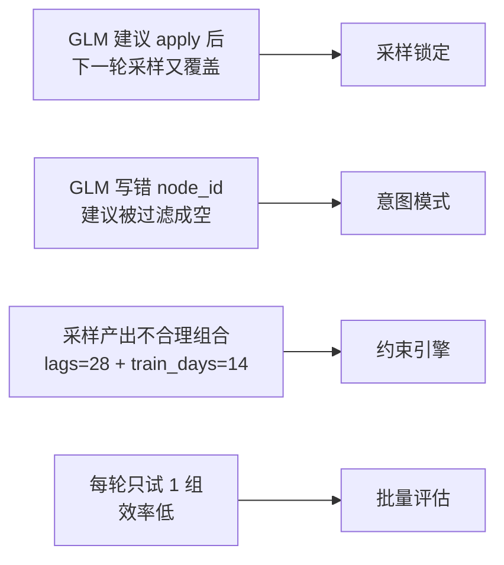

1. **采样尊重 runtime_patch**：`_build_locked_params_from_runtime_patch` 提取已 apply 锁定参数，采样器跳过，GLM 建议永不被覆盖。
2. **重新采样替代偏移**：旧逻辑随机偏移 ±7 可能产出 train_days=2 极端值；改为从注册表 options 里选不等于 contract 的值。
3. **参数约束规则**：4 条约束（lags 最大值 ≤ train_days、single_best 不配 active_models、step ≤ window_size、cv_folds ≤ train_days/daily_horizon），最多重试 5 次；注册表新增 `condition` 字段支持条件参数。
4. **GLM 意图模式**：GLM 不再写 node_id（经常写错），只写"意图" intent（adjust_param / enable_node / disable_node / change_ensemble），后端 `_translate_intent_to_patches` 翻译成合法 patch。

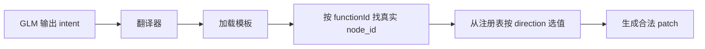

5. **批量评估**：支持 `batch_size > 1`，N 组取最优，算力换精度，相同轮数覆盖 3~5 倍搜索空间。
6. **排序稳定性**：`_autoresearch_rank_key` 新增方差惩罚 + 相对改善率，稳定候选排前面。

#### Stage 6：可视化与导出

- 假设类型分布饼图（parameter/feature/model/data）——一眼看系统主要在哪层探索。
- 搜索空间覆盖热力图——哪些参数试过、哪些没试，颜色深浅表示采样次数。
- Markdown 实验报告一键导出——可分享、可归档、可做会议材料。

### 1.4 V1 总结

一周内搭出完整能力栈，系统从"能跑"变成"有记忆、会推理、跑完能复盘"。但本质上还是一个复杂的**自动调参器**，不是真正意义上的"研究员"——它还是在被动试参数，不知道自己在研究什么问题。

---

## 2. V2 第二代：规划"会思考的研究员"（2026-05）

### 2.1 待解决的问题

V1 完成后反思一个根本问题：**系统还是在被动地试参数，它不知道自己在研究什么问题。** GLM 收到一堆原始数字自己猜该关注什么，假设质量不稳定。

V2 是完整升级规划，核心理念：让系统**先提出问题，再去做实验**。

### 2.2 V2 目标架构：多智能体流水线

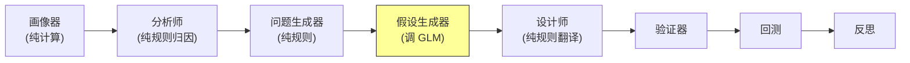

**核心设计原则——只有假设生成器调 GLM，其余全部确定性规则**：省 token、可审计、可调试。

**降级策略**（任何一层失败有兜底）：


### 2.3 八大需求（相比 V1 的新增）

| # | 需求 | 优先级 | 相比 V1 新增了什么 | 为什么新增 |
|---|---|---|---|---|
| 1 | 三集画像 | P0 | 训练/验证/测试集分别画像 + 三集对比诊断 | V1 只看总分 MAPE，不知道训练集长什么样、验证集有没有过拟合、测试集哪个时段最差 |
| 2 | 研究问题生成器 | P0.5 | 从误差归因提炼"本次要回答的问题" | V1 GLM 自己猜该关注什么；V2 系统告诉 GLM"你要回答这个问题" |
| 3 | 知识库分层 | P1 | L1原始→L2规律→L3反面→L4假设模板 + 生命周期 | V1 经验只是平铺；V2 让经验可衰减、可复活、可冲突解决 |
| 4 | 阶段性反思 | P1 | 每 20 轮判定趋势、主动换方向 | V1 饱和检测是被动触发；V2 主动反思策略 |
| 5 | 实验质量评分 | P2 | 5 维评分 + 动态权重 | V1 优先级只看预期收益；V2 加知识增益、风险维度 |
| 6 | 多智能体流水线 | P3 | 5 角色分工 | V1 逻辑揉在一个主循环；V2 角色边界清晰 |
| 7 | 可视化 | P3 | 时序对比图、研究问题、反思记录 | V1 只有饼图热力图 |
| 8 | API 接口 | P3 | 统一挂 `/api/workflows/enhanced/` | 规范化对外能力 |

### 2.4 关键数据结构设计

**三集画像流程**（画像器只负责"看"和"算"，不判断原因——判断原因是分析师的事）：

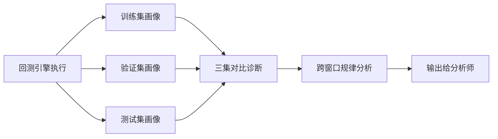

训练集画像包含：负荷曲线统计（均值/标准差/偏度/峰度）、峰谷分布、数据质量、周期性强度、时段分布、主导模式、训练拟合误差。

三集对比诊断规则：训练集模式 vs 测试日类型不一致 → 模式不匹配；test_mape > cv_val_mape×1.5 → 确认过拟合；三者 MAPE 差异 >50% → 泛化差。

**知识声明（KnowledgeClaim）**——每条经验带完整证据链：

```json
{
  "claim": "train_days=45 在高周期性场景下优于 30",
  "condition": {"seasonality_strength": ">0.7"},
  "evidence": ["run-a", "run-b", "run-c"],
  "confidence": 0.85,
  "layer": "L2",
  "status": "active"
}
```

**知识生命周期**（状态机）：

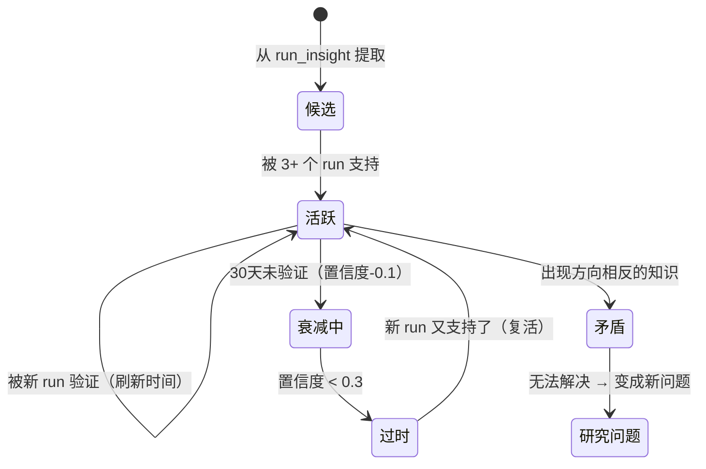

**注入权重公式**：`最终权重 = 层级基础权重(L4=1.0/L3=0.8/L2=0.5/L1=0.2) × 类型倍率(因果=2.0/相关=1.0) × 场景匹配度(匹配=1.0/不匹配=0.3)`。

### 2.5 实施计划

42 个任务分 5 阶段 22 个并行波次：

| 阶段 | 内容 | 波次 |
|---|---|---|
| P0 打地基 | 改回测引擎 + 画像器数据模型 + 三集诊断 | 0-10 |
| P0.5 分析+提问 | 分析师 + 问题生成器 | 10-16 |
| P1 记忆+反思 | 知识库核心 + 衰减复活 + 反思 + 采样偏置 | 16-32 |
| P2 聪明选实验 | 质量评分 + 信息增益 + 参数约束 | 32-38 |
| P3 分工协作 | 编排器 + 去重 + API | 38-42 |

### 2.6 关键设计决策

| 决策 | 理由 |
|---|---|
| 新模块独立文件，不重写主循环 | 降低风险，渐进集成 |
| 知识用 atomic write | 防止写到一半崩溃 |
| 属性测试 + 场景测试双轨 | 覆盖通用正确性 + 具体行为 |
| ClaimKey 结构化标识 | 确定性冲突检测，不靠自然语言比较 |

### 2.7 V2 定位

V2 是规划代，把"会思考的研究员"的完整设计说清楚了。它产出的需求/设计/任务三篇文档，是后续 V3、V4 工程落地的蓝图。

---

## 3. V3 第三代：工程落地 + Research OS 方向（2026-05-21 ~ 05-22）

### 3.1 待解决的问题

V2 理想很完整，但工程跑起来暴露了 V1/V2 积累的债务：

| 问题 | 严重性 |
|---|---|
| 死锁/僵尸运行 | 系统跑着跑着就挂，进程没清干净 |
| 断点恢复缺失 | 中途崩溃，已完成实验全丢 |
| `except Exception: pass` 满天飞 | 出了问题根本找不到原因 |
| 状态丢失 | cancel events / comparison store 没持久化 |

V3 双线推进：**工程问题修复** + **下一代架构规划（Research OS）**。

### 3.2 工程修复：状态落盘 + 服务拆分

#### 持久化层（新增）

以前 AutoResearch 主要依赖内存状态，服务一重启全丢。V3 新增三个持久化组件：

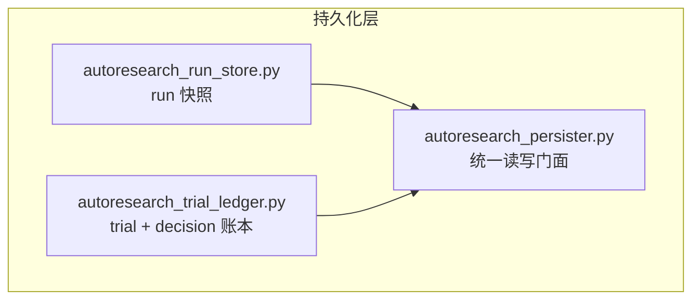

| 数据对象 | 存储位置 | 内容 |
|---|---|---|
| run 快照 | `autoresearch_runs/{run_id}.json` | status/progress/best_candidate/top_candidates/runtime_patch/iterations |
| trial 账本 | `autoresearch_runs/{run_id}/trials.jsonl` | 每轮候选 override/patch/指标/mape_improvement/失败信息 |
| decision 账本 | `autoresearch_runs/{run_id}/decisions.jsonl` | 启动/apply/reject/continue/cancel/failed/finished 事件 |

新增查询接口：`/auto-research-runs`、`/auto-research-runs/{run_id}/trials`、`/auto-research-runs/{run_id}/decisions`、`/auto-research-stats`。

#### 主循环逻辑拆成独立服务

原来 `workflows_enhanced.py` 把候选评价、proposal 打分、batch 选择、假设验证、收敛判断、诊断、洞察、记忆、自愈、自动应用全揉在一起。V3 拆出 10 个服务：

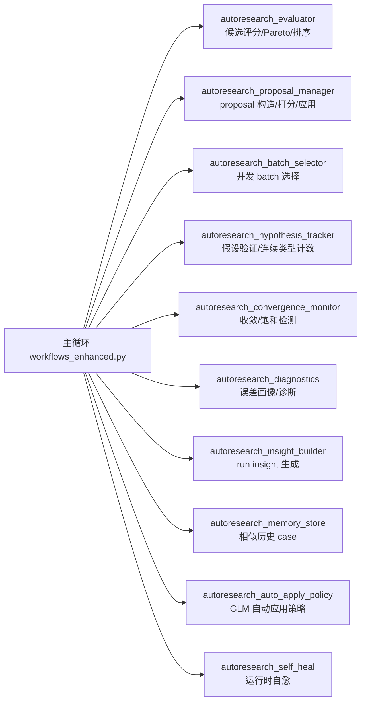

意义：以后改"proposal 为什么被跳过"只改 `auto_apply_policy.py`，改"平台期怎么扩搜索空间"只改 `self_heal.py`，不用在超长文件里硬改。主 API 保留包装函数降低改动风险。

#### 自愈逻辑（三类情况）

`autoresearch_self_heal.py` 处理：
1. 无测试数据 → 自动关闭严格窗口过滤和目标掩码。
2. 训练数据不足 → 自动下调 train_days 和 backtest_train_days。
3. 连续几轮平台期 → 自动扩大 auto_tune_n_trials 和 train_days 搜索范围。

#### GLM 自动应用策略集中化

`autoresearch_auto_apply_policy.py` 把跳过原因说清楚：`no_recommended_proposal` / `auto_apply_disabled` / `validator_failed` / `risk_exceeds_threshold`。连续多次因低风险阈值被拦截时，自动把 `auto_apply_risk_level_max` 从 low 提到 medium（只影响自动应用门槛，不绕过 validator）。

#### 可选扩展：Optuna fallback + ASHA 多保真

- `autoresearch_optuna_sampler.py`：当 `sampler_backend == "optuna"` 走 Optuna 风格采样兜底，为下一代留标准调参后端入口。
- `autoresearch_multifidelity_scheduler.py`：先用少窗口粗筛，再有希望的候选提升到完整窗口。开关 `multi_fidelity_enabled` / `asha_enabled`，未提升组标记 `pruned`。**未设默认**，因改变 batch 执行路径需真实实验验证。

#### batch 选择关键修复

并发 batch 原隐患：选出 best group 后覆盖主 comparison，group0 失败被掩盖。修复：先保留每个 group 原始结果快照，再把 best successful group 写回主 comparison，GLM 和 batch 展示仍能看到原始组结果。

### 3.3 验证情况

```bash
conda run -n cp_web python -m py_compile api/workflows_enhanced.py services/autoresearch_*.py  # 通过
PYTHONPATH=. conda run -n cp_web pytest tests/test_autoresearch_*.py  # 50 passed, 22 warnings
```

### 3.4 Research OS 演进方向（架构规划）

V3 正式提出 **Research OS** 概念——把 AutoResearch 从"工具"升级为"操作系统"：研究者只需定义目标，系统自动设计实验、执行、记录、总结。

**核心数据模型**：

```
Study → Trial → Decision → Artifact → KnowledgeClaim
```

- Study：一次完整的自动实验任务
- Trial：单轮实验（采样→回测→评估）
- Decision：每轮决策记录（为什么这么选）
- Artifact：实验产物（模型、日志、图表）
- KnowledgeClaim：沉淀的知识声明

**五层路线图**（用厨房类比）：

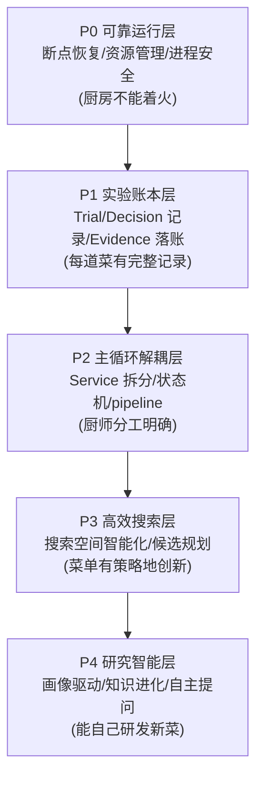

**对标系统**：Optuna（Trial/Study 模型）、Google Vizier（实验管理）、Hyperband/ASHA（分阶段评估）、auto-sklearn（自动 ML 流水线）、MLflow（实验追踪）。

### 3.5 V3 定位

V3 把"先稳定、再演进"的原则落地，用 Research OS 这个隐喻统一了后续所有迭代的方向感。这次改动不是堆功能，而是补工程底座——状态持久化、Trial/Decision 账本、组件化、单测覆盖、可选扩展点。这些对短期指标提升不显眼，但对做成真正可用的"自动研究系统"很关键。

---

## 4. V4 第四代：控制面重构——让过程可观测（2026-05-22 ~ 05-28）

### 4.1 待解决的问题

工程稳了之后，真正开始做 V2 规划中的核心能力。V4 用一周重建整个"控制面"，核心变化：**从"能跑"到"过程质量可观测、可控制"**。

目标不是"跑更多轮"，而是让系统从"盲目调参"进化为"有方向、有证据、有知识沉淀的研究系统"。要回答的核心问题：**系统跑了 50 轮之后，产出的结论是否可信、可复验、可沉淀？**

### 4.2 V4 三链架构（核心）

V4 建立三条核心链路同时运行，交汇点是 **Evidence Record（证据记录）**：

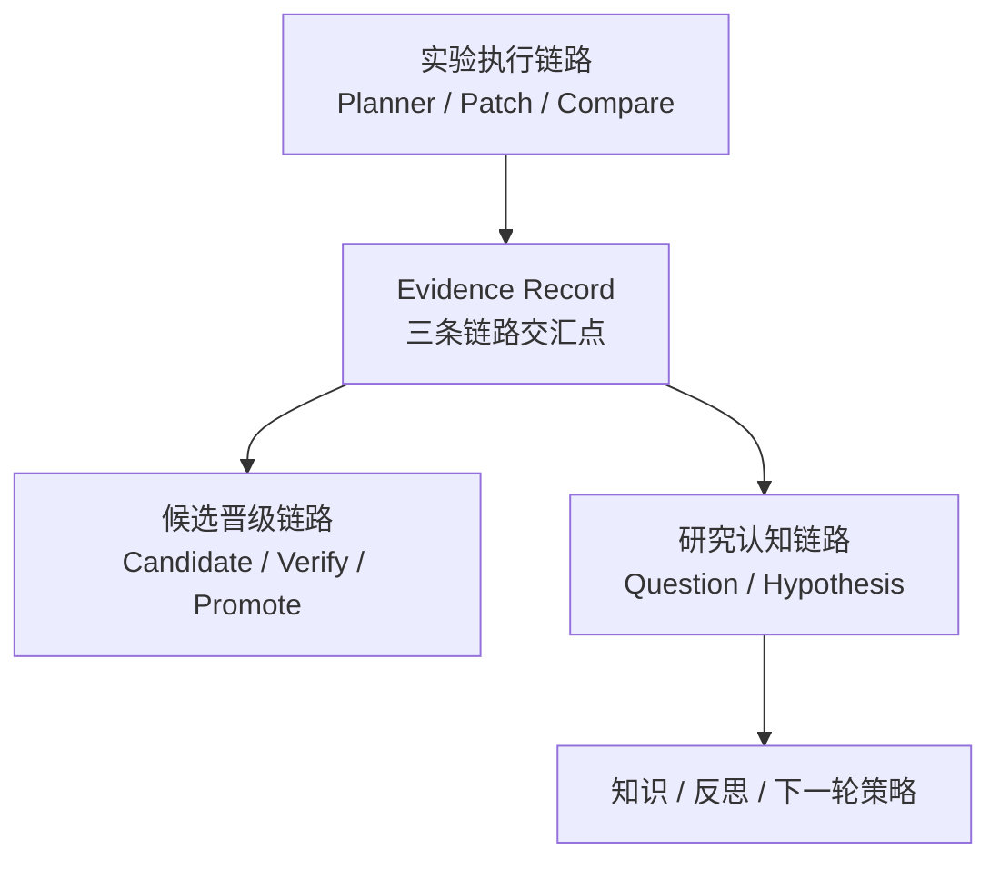

如果只看 Top MAPE，会丢掉系统真正要回答的问题：这个结果是不是可信、是不是新颖、能不能复验、能不能迁移、能不能解释下一轮为什么这么跑。

#### 总流程大图

```mermaid
flowchart TD
    A["Run 启动<br/>baseline / registry / windows"]

    P1["Planner 生成方向 slot"]
    P2["候选来源 GLM / registry / memory"]
    P3["采样敲定 方向匹配/去重/防白跑"]

    X1["执行实验 patch→compare"]
    X2["回测结果 MAPE/曲线/窗口"]
    X3["Evidence Record 可信度与指纹"]

    C1["候选池 candidate_signature"]
    C2["新颖性审计 novelty_audit"]
    C3["复验池 verification queue"]
    C4["Promote 新 baseline"]

    R1["误差画像"]
    R2["归因分析"]
    R3["研究问题"]
    R4["假设"]
    R5["假设验证 verified/disproved"]

    K1["Knowledge Claim"]
    K2["Reflection"]
    K3["下一轮策略"]

    A --> P1 --> P2 --> P3 --> X1 --> X2 --> X3
    X3 --> C1 --> C2 --> C3 --> C4
    C4 -.新基线.-> A
    X2 --> R1 --> R2 --> R3 --> R4
    R4 -.生成候选意图.-> P2
    X3 --> R5 --> R3
    X3 --> K1 --> K3
    X3 --> K2 --> K3
    K3 -.影响采样.-> P1
```

### 4.3 五层模型

```mermaid
flowchart TD
    L1["输入层<br/>baseline / registry / config<br/>dataset_profiler.py"]
    L2["规划层<br/>planner / layers / GLM<br/>autoresearch_candidate_planner.py"]
    L3["执行层<br/>patch / compare / worker<br/>主循环"]
    L4["证据层<br/>evidence / novelty / question<br/>autoresearch_evidence.py"]
    L5["沉淀层<br/>pool / knowledge / reflection<br/>knowledge_layer.py / periodic_reflection.py"]
    L1 --> L2 --> L3 --> L4 --> L5
    L5 -.反馈.-> L2
```

| 层级 | 回答的问题 |
|---|---|
| 输入层 | 基线是谁？搜索空间是什么？窗口怎么设？ |
| 规划层 | 该试 parameter/feature/model/data 还是 risk？ |
| 执行层 | 实际 patch 是什么？回测有没有可比结果？ |
| 证据层 | 是单窗口偶然还是多窗口确认？是否重复？ |
| 沉淀层 | 能不能 Promote？能不能成为知识？下一阶段怎么跑？ |

### 4.4 相比 V3 的新增

#### 1. 候选规划器（Candidate Planner）

核心变化：从"并行候选"升级为"先规划方向，再并行验证"。

五种方向类型：parameter（调参数）/ feature（改特征）/ model（换模型/集成）/ data（调数据层）/ risk（风险探索）。每组附带 `direction_type`、`exploration_health`、`verification_status` 元数据。

```mermaid
flowchart LR
    Planner[候选规划器] --> D1[parameter 方向]
    Planner --> D2[feature 方向]
    Planner --> D3[model 方向]
    Planner --> D4[data 方向]
    Planner --> D5[risk 方向]
    D1 --> G1[batch group 1]
    D2 --> G2[batch group 2]
    D3 --> G3[batch group 3]
```

Planner 维护 `exploration_health.scoreboard`（方向覆盖记分板），判断是否偏科（如 `parameter_overdominance=true`）。

#### 2. Research Cockpit（前端五卡视图）

```mermaid
flowchart TD
    A["Experiment 实验卡<br/>并行组状态/patch/失败原因"] --> B["Evidence 证据卡<br/>强度分布/复验结果"]
    B --> C["Question 问题卡<br/>研究问题生命周期"]
    C --> D["Knowledge 知识卡<br/>分层治理/置信度"]
    D --> E["Strategy 策略卡<br/>探索健康度/方向分布"]
```

让研究过程第一次变得可观测。复盘一个 run 按这个顺序读：实验→证据→候选→复验→问题→知识→反思，比"先看 Top-3 MAPE"更稳。

#### 3. 搜索空间智能化

从 flat registry 升级为多组并行 patch：并行组真实 patch 执行（不再只生成空壳）、失败原因传播、前端多组显示、历史迭代追溯。

#### 4. Evidence 统一为晋级链唯一事实来源

```mermaid
flowchart TD
    A["回测出现正收益"] --> B["写入候选池"]
    B --> C["计算 candidate_signature"]
    C --> D["Novelty Audit"]
    D --> E{is_novel?}
    E -- 否 --> F[标记重复 不当新突破]
    E -- 是 --> G[进入候选池 Top/Pareto]
    G --> H[加入复验池]
    H --> I[多窗口复验]
    I --> J{passed?}
    J -- 否 --> K[不能 Promote]
    J -- 是 --> L[允许 Promote 审核]
    L --> M[Promoted Baseline]
```

**Novelty Audit**：为每个候选生成稳定签名（基于 patch 内容哈希），检查同 signature/同 MAPE/同 changed_variables 是否历史出现过。给每个实验贴"身份证"，重复的标记为"重复发现"而非"新突破"。

**三个最容易混的指纹/签名/哈希**：

| 名称 | 管什么 | 用在哪 |
|---|---|---|
| `patch_fingerprint` | 单次实验具体改了什么 | evidence / question lifecycle |
| `candidate_signature` | 候选完整配置 | candidate pool / verification queue 去重 |
| `scenario_condition_hash` | 场景条件 | knowledge ingest / inject 迁移判断 |

#### 5. 复验池闭环（Candidate Verification Queue）

把"Top 候选直接 Promote"改成完整闭环：**候选池 → 复验池 → 多窗口复验 → Promote**。

后端 5 个 API：查看复验池 / 从候选池加入 / 启动下一条 / 启动指定 / 取消。

核心规则：
- 入池按 `candidate_id` 和 `patch_signature` 去重。
- 串行执行，同一时间只允许一条 running。
- 默认 `min_windows_challenger_better=2`（至少 2 个窗口挑战者更优）。
- Promote 默认要求至少一条 passed 复验记录；人工跳过必须显式 `force=true`。
- 活跃 AutoResearch run 存在时阻止复验（避免抢 CPU）。

**单窗口不可信原则**：单窗口跑出好结果只说明"值得关注"，不说明"稳定有效"。正确顺序：`干净 baseline → AutoResearch → candidate → verification queue → passed → promote → 新 baseline`。

#### 6. Baseline Cache 内容哈希

- 问题：旧 cache 只按 24h TTL 判断，baseline 模板/窗口/评测契约变了但 key 没变会复用旧结果。
- 修复：cache key 覆盖 baseline_workflow_id + 完整内容 + windows + baseline_contract + baseline_config_override。命中条件：cache 存在 + age<24h + 内容 hash 一致，否则重建并记录失效原因。

### 4.5 50 轮效果验证（P0.7）——关键的诚实复盘

对 run `ares-9c429d5ed43c` 跑满 50 轮做完整复盘：

| 维度 | 结果 |
|---|---|
| 多方向探索覆盖 | ✅ parameter/feature/model/data/risk 都有覆盖 |
| group 1 不再固定 parameter | ✅ 最长连续 parameter streak 只有 3 轮 |
| Research Question 去重 | ✅ 从 98 条无状态问题收敛到 7 条带生命周期 |
| Evidence 落账 | ✅ 130 条 evidence record 按方向记录 |
| Knowledge 治理 | ✅ 有 active/candidate/conflicted 状态统计 |
| Top 候选是否新突破 | ❌ Top-1 MAPE 4.2421 历史已出现 4 次，不是新发现 |
| 多窗口证据 | ❌ 130 条全是 insufficient_evidence，没有多窗口确认 |
| Reflection 消费证据 | ❌ exploration_coverage 输出 0.0，没真正读 scoreboard |
| Knowledge 置信度 | ❌ 单 run 文本型 claim confidence 过高（1.0） |

**V4 诚实结论：控制面改善了"过程质量"，但还没改善"结论质量"。** 系统学会了多方向探索，但最终找到的最好结果其实是历史老配置。就像研究员换了很多方向做实验，但核心结论还是之前发表过的。

### 4.6 复盘后的 6 项代码调整

| # | 调整 | 解决的问题 |
|---|---|---|
| 1 | Novelty Audit 增强 | 同 MAPE 反复出现却当新突破 |
| 2 | Evidence Contract 统一 | windows_total=0、缺 failure_reason |
| 3 | Reflection 消费证据 | coverage 一直 0.0，闭眼写总结 |
| 4 | TrainProfile 画像质量标记 | 画像 fallback 到空下游不知道 |
| 5 | Knowledge 指纹统一 + 置信度收紧 | ingest/inject 指纹不一致、单 run claim 过高 |
| 6 | Research Question / GLM 状态可解释 | 分不清 GLM 生成还是规则 fallback |

具体：
- TrainProfile 新增 `profile_quality`（source/point_count/has_real_load_curve 等），下游可判断画像是真实还是空壳。
- `normalize_scenario_fingerprint()` 统一字段白名单，ingest 和 inject 走同一套规范化+哈希管道。
- 单 run 文本型 claim 在 evidence < 2 时 confidence 降为 0.2。
- GLMQuestionResult 新增 `disabled_reason`；问题来源标注 `glm/rule/glm_fallback`。

### 4.7 V4 定位

V4 把控制面建起来了，过程可观测、可控制、可复验。但 50 轮数据诚实地暴露：**过程质量 ≠ 结论质量**。这个发现直接催生了 V6。

---

## 5. V6 第六代：画像驱动的研究系统（规划中）

### 5.1 待解决的问题（V4 数据诊断）

V4 的 50 轮复盘暴露的关键信号（来自 run `ares-6fd54813f76b`）：

- 重复探索仍偏高：`duplicate_count=4 / new_count=1`。
- `parameter_overdominance=true`：feature/model/data 没稳定成为主探索方向。
- 历史强候选复验失败：单窗口/短 run 强候选不能直接 Promote。
- `load_forecast_v2` 已扩展模型超参和天气特征，但近期正收益比例不高 → 继续堆离散参数不是突破口。

**根因诊断**：系统还是在"盲搜"——画像数据有了但没参与选择研究方向的决策；Evidence 分散，各模块各存一套，没有统一事实来源；探索缺乏语义，只是 flat 参数枚举。

### 5.2 V6 核心设计：五层闭环

```mermaid
flowchart TD
    A["Dataset Profile / Error Shape"] --> B["Research Question"]
    B --> C["Research Action Planner"]
    C --> D["Executable Patch"]
    D --> E["Backtest / Verification"]
    E --> F["Evidence Ledger"]
    F --> G["Knowledge / Anti-pattern"]
    G --> C
    F --> B
```

核心变化：
- Dataset Profile 不再只是展示字段，而是**参与选择研究方向**。
- Research Question 成为每次实验的上层对象，patch 只是它的执行形态。
- Search Space 从 flat registry 升级为 typed research actions。
- Novelty Audit 从事后审计前移为**执行前门控**。
- Evidence Ledger 成为候选池/复验池/问题生命周期/知识沉淀的**单一事实来源**。
- GLM 只负责提问题、解释误差、生成实验意图；确定性 patch 生成、白名单、风险门控留代码侧。

### 5.3 相比 V4 的六大变化

#### 1. Profile 驱动选路

画像信号直接决定探索方向，降低 feature/data 方向的盲试比例：

| 画像信号 | 优先 action |
|---|---|
| 波动强、峰谷切换明显 | rolling/stat/diff |
| 周末/节假日差异明显 | calendar feature ablation |
| 近期漂移强 | 短训练窗口 + regularization |
| 天气相关强 | weather probe |
| 数据短或噪声大 | 限制高复杂模型 |
| 某窗口异常大 | 先做 window diagnosis，不直接写通用知识 |

#### 2. Research Space V3（research action）

新增 `load_forecast_v3`，把可探索项表达为 **research action**（而非 flat 参数列表）。7 类 action：`short_window_vs_long_window` / `calendar_feature_ablation` / `rolling_window_family` / `ensemble_weight_strategy` / `model_regularization_profile` / `weather_sensitivity_probe` / `horizon_density_probe`。

每个 action 包含：`action_id` / `target_direction` / `applicable_profile` / `patch_template` / `max_changed_variables` / `risk_level` / `expected_evidence` / `stop_conditions` / `fallback_actions` / `known_anti_patterns`。

#### 3. Novelty 前置门控（从事后审计到执行前拦截）

- 同 `patch_signature` 已跑过 → 跳过。
- 同 `changed_variables` 组合重复过多 → 降权。
- 近邻 patch 已 `multi_window_rejected` → 默认跳过（除非 profile 条件不同）。
- 同 action 连续无效 → cooldown。
- 跳过原因写入 planner reason（不黑盒）。

#### 4. Evidence Ledger（中心事实表）

不再让 candidate/question/knowledge 各存一套不可对齐结论。统一记录：run/iteration/group/action_id/research_question_id/patch_fingerprint/changed_variables/profile_fingerprint/windows_total/windows_challenger_better/evidence_strength/failure_reason/novelty_result/状态。

**派生关系**：
- Candidate Pool ← positive evidence
- Verification Queue ← 需复验的 candidate evidence
- KnowledgeLayer ← `multi_window_confirmed` 或稳定重复证据
- Research Question lifecycle ← evidence 自动推进

#### 5. Staged Evaluation（三级实验调度）

| Stage | 策略 | 限制 |
|---|---|---|
| A: cheap probe | 1 窗口、低 trials | 输出不能进 active knowledge |
| B: formal compare | 3 窗口正式比较 | 生成候选证据 |
| C: verification | 5 窗口复验 | 只有 passed 才 Promote |

Stage A positive 只能决定是否进 Stage B，不能升级知识；只有 Stage C passed 才允许 Promote 或 active knowledge。避免单窗口"假阳性"。

#### 6. Agent / Service 分层（4 个明确 Service）

不引入复杂 orchestration 框架，先落 4 个 service：

```mermaid
flowchart LR
    A[Analyst<br/>profile+error+evidence→研究问题] --> B[ResearchActionPlanner<br/>问题→action, novelty/risk/cost 排序]
    B --> C[PatchCompiler<br/>action→runtime patch, 白名单+结构合法性]
    C --> D[回测执行]
    D --> E[EvidenceCritic<br/>评价证据强度/失败原因/入复验/沉淀知识]
    E --> A
```

### 5.4 验证策略（不只看 MAPE，看研究质量）

- duplicate candidate ratio 下降。
- `new_count / total` 上升。
- 每个 action 有明确 reason 和 profile basis。
- `multi_window_confirmed` 不集中在重复组合。
- Research Question 能被 evidence 推动状态变化。
- 三池（Candidate/Verification/Knowledge）对同一 evidence 状态一致。

### 5.5 风险边界

- 不一次性重写 `_run_autoresearch_task`，先通过 service 插入点渐进替换。
- GLM 不直接写可执行 patch，patch 仍需 deterministic compiler。
- single-window positive 不升级为 active knowledge。
- v3 registry 兼容 v1/v2。
- Profile 数据质量不足时降级到 conservative planner。

### 5.6 V6 定位

V6 是 V4 诚实复盘的直接回应——用数据驱动诊断找到根因（画像没参与决策 + Evidence 分散 + 探索缺语义），全部解决。目标：从"自动调参/组合试验器"升级为"画像驱动、证据驱动、可避免重复探索的研究系统"。

---

## 6. V7 第七代：AIP 平台前端重构（2026-07，平台级集成）

> 说明：V7 是 AIP 平台前端重构，**不是 AutoResearch 模块的代际迭代**，但它把 AutoResearch 作为"自动化回测"接入了完整的算法生命周期工作台，是 AutoResearch 在平台层面的归宿，答辩时可作为"系统走向产品化"的收尾。

### 6.1 待解决的问题

当前左侧导航像历史功能堆叠：Agentic Service、算法服务、算法模板、部署、运营、精度运营分散在多个分组。用户想做"开发一个算法并持续运营"要在多个菜单间跳转，工作流/模板/AutoResearch/精度运营之间缺统一入口。

### 6.2 新核心路径

```mermaid
flowchart LR
    A[行业场景] --> B[推荐方案/模板]
    B --> C[工作流开发]
    C --> D["AutoResearch 回测优化"]
    D --> E[精度运营]
    E --> F[部署上线]
```

把现有分散功能重组为面向算法生命周期的工作台。

### 6.3 新导航结构

```text
首页
行业服务（行业场景 / 算法方案库 / 行业数据管理）
算法开发（算法管理 / 工作流编排 / 基础算法库 / 自动化回测 / 算法部署 / 算法运营）
系统
```

- "算法管理"是新增默认首页，按"场景-算法-版本"聚合展示工作流模板、开发版本、回测状态、运营状态、部署入口。
- "自动化回测"对应现有 AutoResearch / baseline compare。
- "算法运营"对应现有精度运营。
- "算法部署"第一阶段先做占位。

### 6.4 AutoResearch 怎么打通

AutoResearch 不再只是独立页面，成为工作流版本的优化工具：

```mermaid
flowchart LR
    A[算法管理] --> B[选择工作流版本]
    B --> C[自动化回测]
    C --> D[候选版本]
    D --> E[多窗口复验]
    E --> F[Promote]
    F --> G[回到算法管理形成新版本]
    G --> H[进入算法运营]
```

第一阶段先做入口和参数打通（携带 workflow_id 上下文），不强制改后端统一版本模型。明确区分单窗口候选、复验通过候选、可 Promote 版本、生产版本。

### 6.5 V7 定位

V7 让 AutoResearch 从"独立工具"变成"算法生命周期工作台"的一环，是系统走向产品化的关键一步。

---

## 7. 全程架构演进对比

### 7.1 智能核心的演进

```mermaid
flowchart TB
    subgraph V1["V1: 单主循环 + GLM 填空→推理"]
        A1[采样→回测→评估→诊断→建议→应用]
        A2[GLM 5.1 思维链]
        A3[经验库 JSON]
    end
    subgraph V2["V2: 多智能体流水线（规划）"]
        B1[画像器→分析师→问题生成器→假设生成器→设计师]
        B2[知识库 L1-L4 分层]
    end
    subgraph V3["V3: 持久化 + 服务化"]
        C1[run_store/trial_ledger/persister]
        C2[10 个独立服务]
        C3[Optuna/ASHA 扩展点]
    end
    subgraph V4["V4: 三链 + 控制面"]
        D1[实验执行链/候选晋级链/研究认知链]
        D2[Evidence 唯一事实源]
        D3[候选规划器/复验池/Novelty Audit]
    end
    subgraph V6["V6: 画像/证据驱动（规划）"]
        E1[Profile 驱动选路]
        E2[Research Action]
        E3[Evidence Ledger]
        E4[三级实验调度]
    end
    V1 --> V2 --> V3 --> V4 --> V6
```

### 7.2 每代"比上一代多解决了什么"

| 代际 | 上一代遗留问题 | 本代核心解法 |
|---|---|---|
| V1 | 纯手工调参 | 自动搜索 + 假设驱动 + 跨 run 学习 |
| V2 | V1 还是被动试参，不知研究什么 | 先提问再实验，多智能体分工，知识分层 |
| V3 | V2 工程债务：死锁/无断点/状态丢 | 持久化账本 + 服务拆分 + Research OS 蓝图 |
| V4 | V3 能力有了但过程不可观测 | 三链架构 + 控制面五卡 + Evidence 统一 + 复验闭环 |
| V6 | V4 过程质量≠结论质量，盲搜+Evidence 分散 | 画像驱动选路 + Evidence Ledger + Novelty 前置 + 三级调度 |
| V7 | AutoResearch 是独立工具，未接入生命周期 | 平台工作台，自动化回测成为算法开发一环 |

### 7.3 一条贯穿始终的认知主线

```mermaid
flowchart LR
    A["自动调参器<br/>(V1)"] --> B["会提问的研究员<br/>(V2 规划)"]
    B --> C["可恢复的工程系统<br/>(V3)"]
    C --> D["可观测的控制面<br/>(V4)"]
    D --> E["画像/证据驱动的研究系统<br/>(V6)"]
    E --> F["算法生命周期工作台的一环<br/>(V7)"]
```

这不是一开始设计好的蓝图，而是每一代用真实的实验数据（尤其 V4 的 50 轮诚实复盘）逼出来的演进。**每一次"过程质量改善了但结论质量没改善"的发现，都直接催生下一代的设计。**

---

## 8. 深入：Planner 决策机制与 Action 边界

本章深入对比 V4 的 Candidate Planner 与 V6 的 ResearchActionPlanner，并讨论 V6 action 集合的覆盖边界——这是答辩最容易被追问的点。

### 8.1 V4 Candidate Planner：如何判断这一轮该研究什么方向

#### 要解决的痛点

V4 之前虽支持并行组，但"并行"不等于"多方向"。常见情况是三组看似不同，实际都在试同一个参数的不同取值：

```text
组 1：train_days = 30
组 2：train_days = 60
组 3：train_days = 75
```

这不是多方向研究，只是同一个参数的不同取值。Planner 的作用就是**在采样之前先分配方向**。

#### 核心依据：layer scoreboard（方向记分板）

每轮开始，Planner 读取历史 `batch_groups`，为五个方向各建一条记分板：

```json
{
  "feature": {
    "attempts": 2,                  // 试过几次
    "successes": 1,                 // 成功几次
    "failures": 1,                  // 失败几次
    "timeout_count": 0,             // 超时几次
    "best_score_advantage": 0.12,   // 该方向最佳收益
    "last_tried_iteration": 8,      // 上次试是第几轮
    "coverage_gap": 3               // 覆盖缺口（离目标还差几次）
  }
}
```

判断逻辑：**attempts 少、coverage_gap 大、last_tried_iteration 老的方向，优先安排。**

#### 分配逻辑：按 batch_size 分角色

```mermaid
flowchart TB
    A["每轮开始"] --> B["读取历史 batch_groups"]
    B --> C["构建 layer scoreboard"]
    C --> D["生成候选槽位"]
    D --> E1["组 1 exploit<br/>利用当前主候选"]
    D --> E2["组 2 diversify<br/>特征/模型方向"]
    D --> E3["组 3 explore_risk<br/>数据/风险探索"]
    E1 --> F["并行回测"]
    E2 --> F
    E3 --> F
    F --> G["写入 batch_groups/trials"]
    G --> B
```

- batch_size ≥ 5：同一轮覆盖全部五类方向。
- batch_size = 3（默认）：分配三类角色 `exploit` / `diversify` / `explore_risk`。
- batch_size < 5：按历史覆盖缺口轮换方向，连续多轮覆盖五类（跨轮覆盖）。

每个 slot 带元数据，写进 `planner_reason` 不黑盒：

```json
{
  "group_idx": 1,
  "target_direction": "feature",
  "target_layer": "feature",
  "exploration_role": "diversify",
  "candidate_source": "registry_targeted",
  "planner_reason": "target=feature; attempts=0; coverage_gap=2"
}
```

#### 方向定了之后，patch 从哪来

方向只是标签，真正 patch 有两条来源，靠**方向匹配**决定：

```mermaid
flowchart TD
    A["Planner 生成 slot<br/>target_direction=feature"] --> B["查找 GLM 候选<br/>_last_glm_proposals"]
    B --> C{方向匹配?}
    C -- "是" --> D["使用 GLM 候选 patch"]
    C -- "否" --> E["按 target_layer 从 registry 定向采样"]
    D --> F["去重/防白跑/风险校验"]
    E --> F
    F --> G["形成 batch group 执行"]
```

方向匹配是**纯规则映射**，不是语义相似度：

| GLM 候选字段 | 归一化后方向 |
|---|---|
| `selected_layer=training` 或 `hypothesis_type=parameter` | parameter |
| `selected_layer=feature` 或 `hypothesis_type=feature` | feature |
| `selected_layer=model` 或 `hypothesis_type=model` | model |
| `selected_layer=data` 或 `hypothesis_type=data` | data |
| `selected_layer=risk` | risk |

匹配上就用 GLM patch，匹配不上回退 registry 采样。**GLM 只是候选来源之一，不独占决策。**

关键防污染规则：非 parameter 方向会剔除 `train_days / backtest_train_days`，避免 feature/data 组又被训练参数污染。

`slot 1`（主候选）特殊：不走方向匹配，先由主候选路径生成（通常来自 `latest_auto_proposal` 或上轮最优），再贴 slot 0 元数据。**主候选优先，并行组做方向覆盖。**

### 8.2 下一轮研究方向被什么影响

下一轮不是凭空规划，Planner 综合七个输入信号：

```mermaid
flowchart TD
    subgraph 输入信号
        I1["research_questions<br/>上轮画像/归因/GLM Questioner"]
        I2["latest_auto_proposal<br/>GLM 主推荐候选"]
        I3["_last_glm_proposals<br/>最近 GLM 候选列表"]
        I4["exploration_health<br/>方向是否偏科"]
        I5["current_research_focus<br/>Reflection 输出"]
        I6["active_layers<br/>注册表可采样范围"]
        I7["memory_cases / avoid_set<br/>历史经验/失败记录"]
    end
    subgraph 规划与执行
        P["build_slots 生成 group 角色"]
        M["方向匹配 + 采样"]
        E["batch groups 回测"]
        L["Evidence 回写"]
    end
    I1 --> P
    I2 --> P
    I3 --> M
    I4 --> P
    I5 --> P
    I6 --> M
    I7 --> M
    P --> M --> E --> L --> P
```

| 信号 | 来源 | 怎么影响下一轮 |
|---|---|---|
| layer scoreboard | 历史 batch_groups 累计 | coverage_gap 大的方向优先（Planner 主驱动） |
| exploration_health | Planner 自算 | `parameter_overdominance=true` → 临时把对应 layer 加入 active_layers 去偏 |
| current_research_focus | Periodic Reflection 输出 | `priority_layers` 采样概率 ×2，`avoid_layers` ×0.5，`force_activate` 强制激活 |
| research_questions | 上轮画像/归因/GLM Questioner | 进入 GLM proposal prompt，要求优先围绕这些问题设计假设 |
| latest_auto_proposal / _last_glm_proposals | GLM | 提供 candidate_source，方向匹配时进入对应 slot |
| memory_cases / avoid_set | 历史经验 | 加权历史成功配置，回避失败组合 |
| 假设验证结果 | hypothesis_tracker | 成立 → `deepen_if_verified` 深挖；不成立 → `fallback_if_failed` 换解释 |

#### 研究问题影响采样的三层路径（最易混处）

研究问题**不直接调用采样器**，而是通过三层间接影响：

```mermaid
flowchart TD
    A["研究问题"] --> B["第一层: 进入 GLM proposal prompt"]
    B --> C["GLM 候选 intent / patch"]
    C --> D["第二层: 方向匹配到 planner slot"]
    D --> E["进入 batch group"]
    A --> F["第三层: 阶段反思 Reflection"]
    F --> G["current_research_focus"]
    G --> H["registry 采样加权"]
    H --> E
```

#### Reflection 怎么换方向

每 20 轮触发，输入 scoreboard/evidence_summary/novelty_summary，输出四种决策：

| 信号 | 可能决策 |
|---|---|
| 探索覆盖不足 | shift_focus 或提高低覆盖方向优先级 |
| 单窗口正收益很多 | 先 confirm / verification |
| 重复候选很多 | 优先 novel candidates |
| 长期无收益 | expand_registry 或 early_stop |
| 某方向失败/超时多 | 降低该类组合采样权重 |

#### V4 的局限（50 轮复盘暴露）

- **方向是粗粒度标签**：`target_direction=feature` 不等于真的只改了 feature，patch 里可能还是 train_days。方向和真实 patch 没绑死。
- **`parameter_overdominance=true`**：train_days 易带来收益，training 层不易饱和，即使 Planner 说研究 feature，注册表主采样仍偏向 training。
- **盲搜**：方向选择只看 coverage_gap（试得少），不看画像适不适合。
- **Novelty 是事后审计**：跑完才发现重复，回测资源已浪费。

这些局限正是 V6 要解决的。

### 8.3 V6 ResearchActionPlanner 与 V4 Planner 的区别

两者在五层闭环里的位置对比：

```mermaid
flowchart LR
    subgraph V4["V4 Planner"]
        A4["layer scoreboard<br/>(coverage_gap)"] --> B4["target_direction<br/>(5类粗粒度)"]
        B4 --> C4["registry 采样<br/>(flat 参数)"]
        C4 --> D4["patch"]
    end
    subgraph V6["V6 Action Planner"]
        A6["Profile + Error + Evidence"] --> B6["Research Question"]
        B6 --> C6["ResearchActionPlanner<br/>问题→action"]
        C6 --> D6["typed action<br/>(带语义+停止条件)"]
        D6 --> E6["PatchCompiler<br/>action→patch"]
        E6 --> F6["patch"]
    end
```

#### 核心区别对照表

| 维度 | V4 Candidate Planner | V6 ResearchActionPlanner |
|---|---|---|
| 规划对象 | 方向（5 类粗粒度标签） | research action（带语义的实验动作，如 `calendar_feature_ablation`） |
| 决策依据 | layer scoreboard 的 coverage_gap | Profile 信号 + Research Question + Evidence + novelty/risk/cost 排序 |
| 画像作用 | 不参与选方向，只是展示字段 | **参与选方向**（波动强→rolling；周末敏感→calendar ablation） |
| patch 来源 | 方向定了后从 flat registry 采样 | action 自带 `patch_template`，由 PatchCompiler 编译 |
| action 元数据 | 只有 target_direction/layer/role/reason | action_id/applicable_profile/patch_template/risk_level/expected_evidence/stop_conditions/fallback_actions/known_anti_patterns |
| Novelty | 事后审计（跑完才发现重复） | **前置门控**（执行前拦截，已跑过 signature 直接跳过） |
| 停止条件 | 无（靠饱和检测被动触发） | 每个 action 自带 `stop_conditions` + 同 action 连续无效触发 cooldown |
| planner_reason | `target=feature; attempts=0; coverage_gap=2` | 含 profile basis + novelty_result + risk/cost，可解释为什么不跑某 action |
| Evidence 关系 | Evidence 是候选的附属记录 | Evidence Ledger 是**中心事实表**，action_id 把 evidence 关联回 research question |
| 实验调度 | 单一窗口策略 | **三级调度**：A(1窗口probe)→B(3窗口formal)→C(5窗口verification)，只有 C passed 才 Promote |
| GLM 角色 | GLM proposal 是候选来源之一 | GLM 只提问题/假设/意图，不直接写 patch |

#### 三个最本质的区别

**1. 从"方向标签"到"语义动作"**

V4 的 `target_direction=feature` 是个粗篮子——不保证真的只改 feature，也不告诉"为什么要改 feature"。V6 的 `calendar_feature_ablation` 是**有语义的实验动作**：自带适用画像条件（周末敏感才启用）、预期证据（周末窗口 MAPE 下降）、停止条件（连续 2 次无效 cooldown）、已知反模式。从"我打算去 feature 层逛逛"变成"我要验证节假日特征消融能否降低周末误差"。

**2. 从"盲搜"到"画像驱动"**

V4 选 feature 方向只是因为 feature 试得少（coverage_gap 大），不管当前数据适不适合。V6 选 `calendar_feature_ablation` 是因为**画像显示周末/节假日差异明显**。这降低了 feature/data 方向的盲试比例，也能解释为什么某些 action 不该在当前场景执行。

```mermaid
flowchart LR
    subgraph V4
        A1["coverage_gap 大"] --> B1["选 feature 方向"]
        B1 --> C1["盲采 feature 参数"]
    end
    subgraph V6
        A2["画像: 周末差异明显"] --> B2["选 calendar_feature_ablation"]
        B2 --> C2["编译成 holiday_features 开关 patch"]
    end
```

**3. 从"事后审计"到"前置门控 + 三级调度"**

V4 的 Novelty Audit 跑完回测后才检查"哦原来历史出现过"，资源已花。V6 前移到执行前：同 `patch_signature` 已跑过 → 跳过；近邻 patch 已 `multi_window_rejected` → 默认跳过；同 action 连续无效 → cooldown。**不消耗回测资源就完成去重。** 叠加三级调度：Stage A 1 窗口 probe 快速排除坏 action（不进 active knowledge）→ Stage B 3 窗口正式比较 → Stage C 5 窗口复验，只有 passed 才 Promote。V4 单一窗口策略，单窗口"假阳性"会污染候选池；V6 用分级投入避免。

#### 一句话总结

V4 Planner 解决"**并行组不要都在 train_days 上打转**"——会分配方向，但方向是粗粒度标签、盲选、事后去重。

V6 Action Planner 解决"**每个方向的选择要有依据、有语义、不重复、分级验证**"——知道**为什么**选这个 action（画像依据）、**什么时候停**（stop conditions）、**结果可信到什么程度**（三级调度），最终把过程质量转化为结论质量。

### 8.4 V6 的 action 是固定的吗？未覆盖怎么办

这是答辩最容易被追问的点，需诚实回答。

#### 直接回答：是的，action 是静态注册的

V6 的 action 是**静态定义在 `load_forecast_v3.json` 注册表里**的，不是运行时动态生成。设计文档任务 T3 明确：

> "先覆盖最常见 15-25 个 action，**不追求穷尽**。"

每个 action 是一个 JSON 条目，`PatchCompiler` 读这些条目把 action 编译成 runtime patch。本质上 action 集合是**预先枚举的**——和 V1 flat registry 哲学一致，只是粒度从"参数"升级到"语义动作"。

#### V6 对"覆盖不全"的态度是明确的接受

设计没有假装覆盖一切，相反显式接受不穷尽：

- T3 停止条件："先覆盖最常见 15-25 个 action，不追求穷尽"
- 风险边界："若 profile 数据质量不足，应降级到 conservative planner"
- 兼容性："v3 registry 需要兼容 v1/v2，不要破坏历史 run 读取"

立场：**用 15-25 个 action 覆盖负荷预测领域的主要杠杆（窗口/特征/模型/集成/天气/horizon），剩下的靠降级和扩展机制兜底。**

#### 出现未覆盖情况时的三层兜底

```mermaid
flowchart TD
    Q["新的研究问题/误差现象"] --> A{能映射到现有 action?}
    A -- "能" --> B["ResearchActionPlanner 选 action<br/>+ profile 匹配 + novelty 门控"]
    A -- "不能，但 profile 有效" --> C["第二层: conservative planner<br/>降级到安全 action 或 v1/v2 registry 采样"]
    A -- "不能，且 profile 不足" --> D["第二层: conservative planner<br/>不盲目启用天气/复杂模型"]
    C --> E["问题进 research_questions<br/>状态 open，记录待扩展"]
    D --> E
    E --> F["第三层: 人工/后续补 action<br/>v3 registry 加 JSON，不改代码"]
    F --> B
```

**第一层 — action 的 `applicable_profile` + `fallback_actions`**：每个 action 自带适用画像和 fallback。action 在当前 profile 下不适用（如天气不敏感却想跑 weather probe）时跳过并写明原因；`fallback_actions` 给同方向备选。只在已有 action 内部流转，解决不了"全新维度"。

**第二层 — conservative planner 降级**：当 profile 不足、找不到匹配 action、或风险评估不通过时，降级到 conservative planner——回退到低风险、已知安全策略，最合理实现是回退到 v1/v2 flat registry 定向采样（v3 兼容 v1/v2 这条边界就是为此）。**系统不会因没 action 可选就停摆，只是探索质量退化到 V4 水平。**

**第三层 — action 集合可配置扩展（关键）**：action 是 JSON 配置不是硬编码。新增 action 不需要改 Python 代码，只需在 `load_forecast_v3.json` 加一条：

```json
{
  "action_id": "new_pattern_X",
  "target_direction": "feature",
  "applicable_profile": {...},
  "patch_template": {...},
  "risk_level": "low",
  "expected_evidence": {...},
  "stop_conditions": {...}
}
```

所以"出现没包括的情况"的真正答案：**先降级跑、把现象沉淀成 research_question（open 状态），等人工或后续迭代把新 action 写进 registry，下次就能覆盖。** 这是和 V1"换模板只改 JSON 不改代码"一脉相承的设计哲学。

#### 诚实的边界：V6 真正没解决的

有三件事 V6 设计**没有完全回答**，答辩时心里有数：

| 没解决的问题 | 现状 | 风险 |
|---|---|---|
| GLM 能否动态提议新 action | 设计说 GLM 只提问题/假设/意图，不能写可执行 patch。若 GLM 提出现有 action 覆盖不了的新维度，该意图无法直接执行 | 新维度探索被 registry 卡死，只能人工补 |
| conservative planner 的具体行为 | 设计只说"降级到 conservative planner"，没规定它具体选哪些 action、用什么策略 | 实现时可能退化成纯随机，质量回到 V4 之前 |
| action 覆盖率度量 | 没有定义"当前 action 集合对问题空间的覆盖度"指标 | 可能长期有盲区却不自知 |

#### 答辩话术建议

被问到"action 固定会不会限制探索"时：

> "V6 的 action 是静态注册的，设计上显式接受不穷尽——先用 15-25 个 action 覆盖负荷预测的主要杠杆。出现未覆盖情况时有三层兜底：一是 action 自带的 applicable_profile 和 fallback_actions 在已有集合内流转；二是降级到 conservative planner，回退到 v1/v2 兼容的 flat registry 采样，系统不会停摆；三是 action 是 JSON 配置不是硬编码，新场景沉淀成 research_question 后，补一条 registry 条目就能覆盖，不改代码。**真正没解决的是 GLM 动态提议全新 action 维度并直接执行——这是有意为之的边界，因为让 GLM 直接生成可执行 patch 会破坏确定性和可审计性，这个代价 V6 不接受。**"

把"限制"重新定义为"有意为之的工程边界"——用保守性换可审计性，用配置扩展换动态性，是经过权衡的。

---

## 9. 答辩可能被问到的问题预案

**Q: 为什么不用现成的 AutoML（Optuna/贝叶斯优化）？**
A: 场景有四层可调维度（参数/特征/模型/数据），很多是离散选择+结构开关，传统方法不够灵活。V3 也加了 Optuna fallback 作为可选采样后端，但主路径是智能体驱动。对标了 Optuna/Google Vizier/ASHA/auto-sklearn/MLflow，借鉴 Trial/Study 数据模型和分阶段评估。

**Q: V4 跑了 50 轮 Top 候选还是历史重复，是不是失败了？**
A: 不是失败，是诚实复盘。V4 的目标是"过程可观测可控制"，这个目标达成了（多方向覆盖✅、问题去重 98→7✅、Evidence 落账 130 条✅）。Top 重复恰恰是控制面暴露问题的能力——以前根本不知道是重复。这个发现直接催生了 V6 的 Novelty 前置门控和画像驱动选路。

**Q: 单窗口好结果为什么不能直接上线？**
A: 单窗口可能只是偶然收益/特定时间窗过拟合/历史重复。必须走 `candidate → novelty audit → verification queue → 多窗口 passed → promote`。这是 V4 确立、V6 强化的核心原则。

**Q: GLM 在系统里到底干什么？会不会乱来？**
A: 只有假设生成器调 GLM，其余全是确定性规则。GLM 只能提问题/假设/实验意图（intent），不能直接写可执行 patch——intent 由代码侧翻译器（PatchCompiler）转成合法 patch，经白名单+风险门控+审计后才能执行。降级链：多智能体→单智能体→纯随机。

**Q: 跨 run 经验会不会误导？**
A: 不会无脑套用。场景指纹匹配，相似度 = registry_match×0.4 + fingerprint_cos×0.6；不锁定起点只加权（推荐参数权重 ×2）；跨场景降权到 0.3；知识有生命周期（候选→活跃→衰减→过时/矛盾），矛盾时转成新研究问题。

**Q: V6 为什么不一次性重写主循环？**
A: 风险边界明确：先通过 service 插入点渐进替换，不一次性重写 `_run_autoresearch_task`；v3 registry 兼容 v1/v2；Profile 数据质量不足时降级到 conservative planner。

**Q: V6 的 action 是固定的吗？出现 action 没覆盖的情况怎么办？**
A: 是静态注册的（`load_forecast_v3.json`，15-25 个，设计上"不追求穷尽"）。三层兜底：① action 自带 `applicable_profile` + `fallback_actions` 在已有集合内流转；② 找不到匹配 action 时降级到 conservative planner，回退 v1/v2 flat registry 采样，系统不停摆；③ action 是 JSON 配置不是硬编码，新场景沉淀成 research_question 后补一条 registry 条目即可覆盖，不改代码。真正没解决的是 GLM 动态提议全新 action 维度并直接执行——这是有意为之的边界，让 GLM 直接写可执行 patch 会破坏确定性和可审计性。详见 §8.4。

---

← [[wiki/projects/autoresearch/index|AutoResearch 项目总览]]
