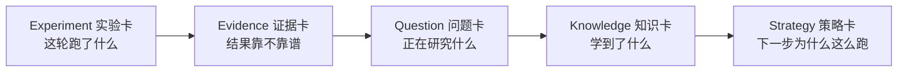

# Research Cockpit 信息架构收敛展示汇报

日期：2026-05-25

## 一句话结论

AutoResearch 前端从“很多字段堆在一起”收敛为“五张研究卡片”，让用户先看实验状态，再看证据、问题、知识和策略。

## 为什么要改

原来的页面有两个问题：

- `研究驾驶舱` 和 `自主研究员产物` 信息重复。
- 字段和 tag 太多，用户很难判断当前最重要的信息。

所以这次不继续加字段，而是重排信息架构。

## 怎么改

## 改完有什么用

### 1. 第一眼看实验状态

实验卡放第一，展示第几轮、第几组、研究方向、改动内容和失败原因。

### 2. 证据直接翻译成人话

不再只显示 `evidence_strength`，而是显示：

- 单窗口正收益，需要复验。
- 多窗口确认，可以作为有效证据。
- 证据不足，不能沉淀为知识。

### 3. 问题不再像模板刷屏

问题卡只展示当前最重要的问题，其它候选原因、证据引用和 patch 意图放入详情。

### 4. 知识不再只是字段

知识卡把 candidate / active / conflicted 等状态翻译成：

- 候选知识：等待复验。
- 有效知识：可以优先注入。
- 冲突知识：需要转成研究问题。

### 5. 策略解释放最后

策略卡解释下一步为什么这么跑，但不抢占第一眼实验状态。

## 验证

- 前端 build 通过。
- 后端和 worker 没有被停止或重启。
- 本次只改展示层，不影响正在运行的实验。

## 后续

下一步建议人工打开页面确认信息密度。如果仍然偏多，就继续把详情内容折叠到 Evidence 或 Debug 区，不再增加主视图字段。
