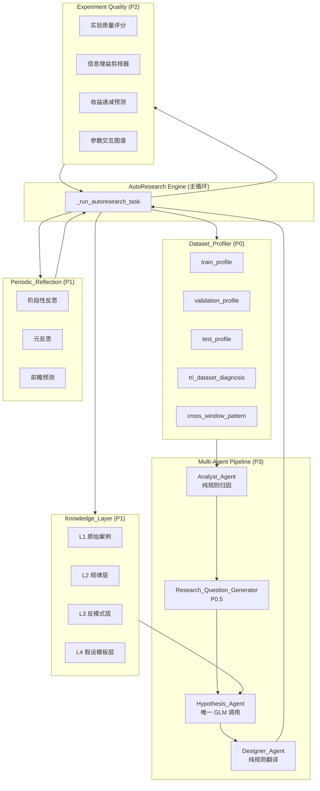

# Design Document: AutoResearch Next-Gen（自主研究员）

## Overview

本设计文档描述 AIP AutoResearch 系统从"自动参数搜索"升级为"自主研究员"的技术架构。核心演进方向：

1. **三集画像（Dataset_Profiler）**：对训练集、验证集（CV fold）、测试集进行结构化统计画像，为下游归因和研究问题生成提供高质量事实基础
2. **研究问题生成器（Research_Question_Generator）**：从诊断事实中自动提炼结构化研究问题，替代直接向 GLM 注入原始统计数据
3. **分层知识库（Knowledge_Layer）**：将扁平经验库升级为 L1-L4 分层结构，支持知识的验证、衰减、复活和冲突解决
4. **阶段性反思（Periodic_Reflection）**：每 N 轮深度反思，输出可执行策略决策并实际偏置后续采样方向
5. **实验质量评分与信息增益**：对实验设计进行质量评分，基于信息增益动态收缩搜索空间
6. **多智能体轻量流水线**：将单一 GLM 研究员拆分为 Analyst → Hypothesis → Designer 流水线

**设计原则**：
- 小步推进，不一次性重写主循环 `_run_autoresearch_task`
- 新模块以独立 Python 文件存在，通过明确接口与主循环集成
- 仅 Hypothesis_Agent 调用 GLM，其余环节为纯规则/统计
- 所有输出通过结构化 schema + validator + audit

## Architecture

### 整体架构图



### 模块部署位置

| 模块 | 文件路径 | 职责 |
|------|----------|------|
| Dataset_Profiler | `backend-service/services/dataset_profiler.py` | 统计画像生成（不含归因） |
| Analyst_Agent | `backend-service/services/analyst_agent.py` | 纯规则误差归因 |
| Research_Question_Generator | `backend-service/services/research_question_generator.py` | 研究问题生成 |
| Knowledge_Layer | `backend-service/services/knowledge_layer.py` | 分层知识库管理 |
| Periodic_Reflection | `backend-service/services/periodic_reflection.py` | 阶段性反思与策略决策 |
| Experiment_Quality | `backend-service/services/experiment_quality.py` | 实验评分与信息增益 |
| Candidate_Planner | `backend-service/services/autoresearch_candidate_planner.py` | 第四代候选规划器：为并发 group 分配参数/特征/模型/数据/风险探索方向 |
| Agent_Orchestrator | `backend-service/services/agent_orchestrator.py` | 多智能体编排 |
| 主循环集成 | `backend-service/api/workflows_enhanced.py` | 现有主循环，渐进式集成新模块 |

### 数据流向

```mermaid
sequenceDiagram
    participant Loop as AutoResearch_Engine
    participant DP as Dataset_Profiler
    participant AA as Analyst_Agent
    participant RQG as Research_Question_Generator
    participant KL as Knowledge_Layer
    participant HA as Hypothesis_Agent (GLM)
    participant DA as Designer_Agent
    participant BT as Backtest Engine

    Loop->>BT: 执行回测
    BT-->>Loop: 回测结果 (含 cv_fold_metrics)
    Loop->>DP: 传入回测结果 + 原始数据
    DP-->>Loop: train_profile, validation_profile, test_profile, tri_dataset_diagnosis
    Loop->>AA: 传入 Dataset_Profiler 输出
    AA-->>Loop: error_attribution, pattern_report
    Loop->>RQG: 传入 error_attribution
    RQG->>KL: 检索 L3 反模式
    KL-->>RQG: 相关反模式
    RQG-->>Loop: research_questions (1~3个)
    Loop->>KL: 检索匹配知识
    KL-->>Loop: 相关 Knowledge_Claims
    Loop->>HA: research_questions + knowledge_claims + reflection_decision
    HA-->>Loop: 结构化假设 (1~3个)
    Loop->>DA: 假设意图
    DA-->>Loop: 具体 patches
    Loop->>BT: 应用 patches 执行回测
```

### 第四代候选规划器（Candidate_Planner）

**文件**：`backend-service/services/autoresearch_candidate_planner.py`

**职责边界**：候选规划器只决定“本轮每个并发 group 应该探索什么方向”，不执行回测、不写模板、不自动 promote patch。它消费 run_state、batch_size、已有 GLM proposal 和历史 batch 结果，输出候选槽位（candidate slots）。

```python
class AutoResearchCandidatePlanner:
    """第四代候选规划器 — 主动覆盖参数/特征/模型/数据/风险探索方向"""

    def build_slots(
        self,
        batch_size: int,
        iteration: int,
        run_state: Dict[str, Any],
        active_layers: Optional[List[str]] = None,
    ) -> List[Dict[str, Any]]:
        """
        返回本轮 group 槽位。

        每个槽位包含：
        - target_direction: parameter / feature / model / data / risk
        - target_layer: training / feature / model / data
        - exploration_role: exploit / diversify / explore_risk
        - candidate_source: primary / glm / registry_targeted / memory_random
        - planner_reason: 规划原因，供审计和前端展示
        """
        ...

    def build_scoreboard(self, run_state: Dict[str, Any]) -> Dict[str, Any]:
        """从历史 iterations/latest_batch_groups 中汇总方向覆盖、收益和失败统计。"""
        ...
```

**默认调度规则**：

- `batch_size >= 5`：同一轮覆盖 `parameter`、`feature`、`model`、`data`、`risk` 五类。
- `batch_size = 3`：第一组 `parameter/exploit`，第二组在 `feature/model` 中轮换，第三组在 `data/risk` 中轮换。
- `batch_size = 2`：第一组 `parameter/exploit`，第二组选当前 `coverage_gap` 最大的方向。
- `batch_size = 1`：不启用多方向规划，保持原单候选路径。

**与现有主循环的集成点**：

1. `_run_autoresearch_task` 进入 batch 模式后调用 `AutoResearchCandidatePlanner.build_slots()`。
2. 主候选仍作为 group 1，但补充 `target_direction`、`exploration_role` 和 `planner_reason`。
3. 后续 group 优先匹配同方向 GLM proposal；没有匹配时，注册表模式使用目标 layer 定向采样。
4. group 结束后，`batch_groups` 记录每组的规划方向、来源、patch 和失败原因。
5. trial ledger 复用现有 `batch_groups` 字段，不新增前端 API。

**风险处理**：

- 风险探索方向不等于无约束高风险。第一版只选择更大结构变化或更少探索过的层，仍通过现有 validator、risk level、timeout 和 cancel 保护。
- 某方向连续超时会在 scoreboard 中增加 `timeout_count`，后续降低优先级；但不会永久禁用，避免搜索空间塌缩。

### 第四代探索策略质量提升（P0.7）

基于 `ares-165cc9625236` 运行观察，候选规划器已经解决“能不能覆盖”和“能不能跑完”的问题：22 个已落账 trial 全部成功，54 个 batch group 覆盖 parameter / feature / model / data / risk 五类方向，且没有 timeout。下一步重点转向“探索质量”：主候选去偏、激活层语义对齐、研究问题生命周期、多窗口确认和知识置信度治理。

#### 运行观察

- 方向覆盖有效：batch group 中 parameter=18、feature=9、model=9、data=9、risk=9。
- 稳定性有效：失败轮次为 0，group timeout 为 0，说明 batch timeout 从 10min 提升后不再误杀长耗时实验。
- 主线仍偏：主 trial 中 parameter=16、feature=6，model/data/risk 基本只在并行组里出现，导致主线结论仍围绕 `train_days` 和 `auto_tune_xgboost`。
- 激活层语义不一致：状态中 `active_layers=["training","feature"]`，但 planner 已经安排 model/data/risk group，`planner_reason` 出现 `layer_not_active`。
- GLM 实际未启用：`glm_meta.enabled=false`，proposal 主要来自规则与 memory cases，但前端仍容易理解为“GLM 候选”。
- 研究问题重复：`midday 误差偏高`、`数据漂移` 持续重复生成，缺少 open/testing/resolved 状态。
- 证据强度偏弱：当前很多结论来自 `windows_total=1` 的单窗口评估，不能直接沉淀为高置信知识。

#### 设计改进

1. **主候选轮换策略**：Candidate_Planner 输出 `recommended_primary_direction`。当 parameter attempts 明显高于其他方向且近 N 轮收益平台期时，group 1 可轮换为 feature/model/data，而不是固定 parameter。
2. **激活层同步器**：新增轻量函数 `sync_active_layers_with_planner(scoreboard, active_layers)`，当未激活层已有成功 group 或 coverage_gap 过大时，写入 `force_activate_recommendation`，必要时在当前 run 内加入 `active_layers_runtime_patch`。
3. **研究问题生命周期**：Research_Question_Generator 对问题生成 `question_key`，合并重复问题并维护 `status`、`evidence_count`、`tested_patch_fingerprints`。重复问题不再无限追加，而是更新证据和验证状态。
4. **规则候选显式标识**：当 `llm_used=false` 时，proposal 标记 `rule_fallback=true`，前端展示为“规则/记忆候选”，避免把未启用 GLM 的规则候选误当成 LLM 推理。
5. **多窗口确认机制**：单窗口正收益候选标记 `needs_multi_window_confirmation=true`，后续反思或候选规划器安排复验；Knowledge_Layer 将单窗口证据作为低置信候选，跨窗口稳定后再提升 confidence。
6. **无效方向降权**：scoreboard 扩展 `ineffective_count` 和 `negative_score_count`，失败为 0 但持续负收益的方向也会降权，避免系统重复跑“能成功但没收益”的候选。
7. **探索健康度输出**：run report 和前端展示方向覆盖、主线偏置、timeout、负收益方向、GLM 启用状态、单窗口/多窗口证据比例。

#### 数据结构扩展

```python
PlannerScoreboardRow = {
    "attempts": int,
    "successes": int,
    "failures": int,
    "timeout_count": int,
    "best_score_advantage": float | None,
    "negative_score_count": int,
    "ineffective_count": int,
    "coverage_gap": int,
}

ResearchQuestionState = {
    "question_key": str,
    "question": str,
    "status": "open" | "testing" | "resolved" | "stale",
    "first_seen_iteration": int,
    "last_seen_iteration": int,
    "evidence_count": int,
    "tested_patch_fingerprints": list[str],
}

EvidenceStrength = {
    "window_count": int,
    "single_window_evidence": bool,
    "multi_window_evidence": bool,
    "needs_multi_window_confirmation": bool,
}
```


## Components and Interfaces

### 1. Dataset_Profiler（数据集画像器）

**文件**：`backend-service/services/dataset_profiler.py`

**职责边界**：只负责产出统计事实和画像数据，不负责归因推理。

**公开接口**：

```python
class DatasetProfiler:
    """数据集画像器 — 对训练集/验证集/测试集生成结构化统计画像"""

    def compute_train_profile(
        self,
        train_data: pd.DataFrame,  # 训练集数据，含 timestamp + load 列
        train_fit_mape: Optional[float] = None,  # 训练集拟合 MAPE（从回测引擎获取）
    ) -> TrainProfile:
        """生成训练集画像"""
        ...

    def compute_validation_profile(
        self,
        cv_fold_metrics: List[CVFoldMetric],  # 回测引擎返回的 per-fold 指标
    ) -> ValidationProfile:
        """生成验证集画像（需回测引擎扩展后可用）"""
        ...

    def compute_test_profile(
        self,
        actual: np.ndarray,     # 真实值（96 个点）
        predicted: np.ndarray,  # 预测值（96 个点）
        timestamps: List[str],  # 时间戳列表
    ) -> TestProfile:
        """生成测试集画像"""
        ...

    def compute_tri_dataset_diagnosis(
        self,
        train_profile: TrainProfile,
        validation_profile: Optional[ValidationProfile],
        test_profile: TestProfile,
    ) -> TriDatasetDiagnosis:
        """生成三集对比诊断报告"""
        ...

    def compute_cross_window_pattern(
        self,
        window_profiles: List[TestProfile],  # 多个回测窗口的 test_profile
    ) -> CrossWindowPattern:
        """分析跨窗口系统性误差模式（需 ≥3 个窗口）"""
        ...
```

**与现有代码的集成点**：
- 在 `_run_autoresearch_task` 每轮回测完成后调用
- 回测引擎 `_execute_backtest` 需扩展返回 `cv_fold_metrics`（P0 前置依赖）
- 输出存入 `run_state["dataset_profiles"]`

### 2. Analyst_Agent（分析师智能体）

**文件**：`backend-service/services/analyst_agent.py`

**职责**：纯规则/统计模块（不调用 GLM），从 Dataset_Profiler 的事实输出推导归因。

```python
class AnalystAgent:
    """纯规则归因分析 — 从统计事实推导误差归因"""

    def analyze(
        self,
        train_profile: TrainProfile,
        test_profile: TestProfile,
        tri_dataset_diagnosis: TriDatasetDiagnosis,
        cross_window_pattern: Optional[CrossWindowPattern] = None,
    ) -> AnalystOutput:
        """
        执行规则归因分析。

        Returns:
            AnalystOutput 包含:
            - error_attribution: {primary_cause, contributing_factors, evidence}
            - pattern_report: 模式报告
        """
        ...
```

**归因规则优先级**（扩展现有 `_compute_error_diagnosis`）：
1. `pattern_mismatch` → 训练/测试模式不一致
2. `confirmed_overfit` → 过拟合
3. `drift_signal` → 数据漂移
4. `peak_valley_concentration` → 峰谷集中误差
5. `period_specific_error` → 时段特异性误差
6. `model_divergence` → 模型分歧（复用现有逻辑）
7. `parameter_saturation` → 参数饱和（兜底）

### 3. Research_Question_Generator（研究问题生成器）

**文件**：`backend-service/services/research_question_generator.py`

**职责**：独立模块，消费 Analyst_Agent 输出的 `error_attribution`，生成结构化研究问题。

```python
class ResearchQuestionGenerator:
    """研究问题生成器 — 基于规则从归因事实中提炼研究问题"""

    def generate(
        self,
        error_attribution: ErrorAttribution,
        cross_window_pattern: Optional[CrossWindowPattern] = None,
        knowledge_layer: Optional[KnowledgeLayer] = None,  # 用于检索 L3 反模式
        recent_questions: Optional[List[ResearchQuestion]] = None,  # 最近 5 轮问题，用于去重
    ) -> List[ResearchQuestion]:
        """
        生成 1~3 个结构化研究问题。

        去重规则：新问题与最近 5 轮问题的关键词重叠率 > 0.8 时标记为 recurring。
        """
        ...
```

**生成规则**：
- `worst_period` 连续 ≥3 窗口为同一时段 → "为什么该时段误差持续偏高"
- `overfit_detection` 为 `confirmed_overfit` → "如何降低过拟合"
- `drift_signal` 为正 → "如何应对数据漂移"
- 知识冲突存在 → "如何解决 {param} 的矛盾建议"

### 4. Knowledge_Layer（知识层）

**文件**：`backend-service/services/knowledge_layer.py`

**存储目录**：`backend-service/data/autoresearch_knowledge/`

```python
class KnowledgeLayer:
    """分层知识库管理 — L1 原始案例 / L2 规律 / L3 反模式 / L4 假设模板"""

    def ingest_run_insight(self, run_insight: Dict[str, Any]) -> None:
        """从 run_insight 提取 L2/L3 候选知识"""
        ...

    def search(
        self,
        scenario_condition_hash: Optional[str] = None,
        layer: Optional[str] = None,  # "L2" / "L3" / "L4"
        knowledge_type: Optional[str] = None,
        target_param: Optional[str] = None,
        min_confidence: float = 0.0,
    ) -> List[KnowledgeClaim]:
        """知识检索"""
        ...

    def get_injection_candidates(
        self,
        scenario_fingerprint: Dict[str, Any],
    ) -> List[Tuple[KnowledgeClaim, float]]:
        """获取待注入 GLM_Prompt 的知识及其权重"""
        ...

    def update_evidence(
        self,
        claim_key: ClaimKey,
        run_id: str,
        is_supporting: bool,  # True=支撑, False=反证
    ) -> None:
        """更新知识的证据/反证"""
        ...

    def apply_decay(self) -> int:
        """执行知识衰减，返回衰减的知识数量"""
        ...

    def resolve_conflicts(self) -> List[KnowledgeConflict]:
        """检测并解决知识冲突，返回无法解决的冲突列表"""
        ...
```

**注入权重计算**：
```
base_weight = layer_weight[claim.layer]  # L4=1.0, L3=0.8, L2=0.5, L1=0.2
type_multiplier = 2.0 if claim.knowledge_type == "causal_candidate" else 1.0
scenario_multiplier = 1.0 if scenario_matches else 0.3
final_weight = base_weight * type_multiplier * scenario_multiplier
```

### 5. Periodic_Reflection（阶段性反思）

**文件**：`backend-service/services/periodic_reflection.py`

```python
class PeriodicReflection:
    """阶段性反思 — 每 N 轮深度分析并输出策略决策"""

    def should_trigger(self, iteration: int, reflection_interval: int = 20) -> bool:
        """判断是否应触发反思"""
        ...

    def reflect(
        self,
        iterations: List[Dict[str, Any]],  # 过去 N 轮迭代数据
        run_state: Dict[str, Any],
        target_mape: Optional[float] = None,
    ) -> ReflectionResult:
        """
        执行深度反思。

        Returns:
            ReflectionResult 包含:
            - reflection_decision: {status, decision, reason, next_focus, ...}
            - projected_final_performance: 前瞻预测
            - meta_reflection: 元反思（若适用）
        """
        ...

    def apply_decision(
        self,
        decision: ReflectionDecision,
        run_state: Dict[str, Any],
        registry: Dict[str, Any],
    ) -> Dict[str, Any]:
        """将反思决策写入 run_state（如 shift_focus 时设置 current_research_focus）"""
        ...
```

### 6. Experiment_Quality（实验质量评分）

**文件**：`backend-service/services/experiment_quality.py`

```python
class ExperimentQualityScorer:
    """实验质量评分 — 评估实验设计的质量和信息增益"""

    def score(
        self,
        hypothesis: Dict[str, Any],
        patch: Dict[str, Any],
        previous_iteration: Optional[Dict[str, Any]] = None,
        knowledge_claims: Optional[List[KnowledgeClaim]] = None,
        current_iteration: int = 0,
        total_iterations: int = 100,
    ) -> ExperimentQuality:
        """计算实验质量评分"""
        ...

    def rank_experiments(
        self,
        experiments: List[ExperimentQuality],
        current_iteration: int,
        total_iterations: int,
    ) -> List[ExperimentQuality]:
        """按综合评分排序实验设计"""
        ...


class InformationGainPruner:
    """信息增益剪枝器 — 基于信息增益动态收缩搜索空间"""

    def compute_info_gain(
        self,
        iteration_result: Dict[str, Any],
        param_regions: Dict[str, Any],
    ) -> Dict[str, float]:
        """计算各参数区间的信息增益"""
        ...

    def prune(
        self,
        info_gain_history: List[Dict[str, float]],
        threshold: float = 0.01,
        consecutive_rounds: int = 3,
    ) -> List[PruneRecord]:
        """标记 exhausted 区间并返回收缩记录"""
        ...


class ProactivePredictor:
    """收益递减预测器 — 基于历史曲线预测未来收益"""

    def predict(
        self,
        info_gain_history: List[float],
    ) -> PredictionResult:
        """预测边际增益和到达收益递减的轮数"""
        ...


class ParameterInteractionGraph:
    """参数交互图谱 — 维护硬约束和交互效应"""

    def validate_combination(
        self,
        params: Dict[str, Any],
    ) -> Tuple[bool, Optional[str]]:
        """验证参数组合是否违反硬约束，返回 (valid, reason)"""
        ...

    def filter_valid_combinations(
        self,
        candidates: List[Dict[str, Any]],
    ) -> List[Dict[str, Any]]:
        """过滤掉违反硬约束的参数组合"""
        ...
```

### 7. Agent_Orchestrator（智能体编排器）

**文件**：`backend-service/services/agent_orchestrator.py`

```python
class AgentOrchestrator:
    """多智能体编排器 — 协调 Analyst → Hypothesis → Designer 流水线"""

    def __init__(self, mode: str = "single_agent"):
        """
        Args:
            mode: "multi_agent" 或 "single_agent"（默认）
        """
        ...

    async def run_pipeline(
        self,
        dataset_profiles: DatasetProfiles,
        run_state: Dict[str, Any],
        knowledge_layer: KnowledgeLayer,
        registry: Dict[str, Any],
    ) -> PipelineResult:
        """
        执行完整流水线。

        multi_agent 模式：Dataset_Profiler → Analyst → RQG → Hypothesis(GLM) → Designer
        single_agent 模式：回退到现有 _glm_generate_proposal_candidates 逻辑

        降级：若 Hypothesis_Agent GLM 调用失败，自动回退到 single_agent 模式。
        """
        ...
```

### 8. API 接口新增

所有新增接口统一挂载在 `/api/workflows/enhanced/` 前缀下：

| 方法 | 路径 | 用途 |
|------|------|------|
| GET | `/api/workflows/enhanced/knowledge/search` | 知识检索（支持 `scenario_condition_hash`、层级、置信度、`knowledge_type`、`claim_key.target_param` 过滤） |
| GET | `/api/workflows/enhanced/datasets/{dataset_id}/profile` | 数据集画像查询 |
| GET | `/api/workflows/enhanced/auto-research/{run_id}/reflections` | 反思记录查询 |
| GET | `/api/workflows/enhanced/auto-research/{run_id}/research-questions` | 研究问题查询 |
| POST | `/api/workflows/enhanced/datasets/register` | 数据集注册（接收 `file_path` 或 `upload_id`，返回 `dataset_id`） |
| GET | `/api/workflows/enhanced/datasets` | 数据集列表 |


## Data Models

### TrainProfile（训练集画像）

```json
{
  "load_curve_stats": {
    "mean": 1234.5,
    "std": 200.3,
    "skewness": 0.12,
    "kurtosis": 2.8
  },
  "peak_valley_distribution": {
    "avg_peaks_per_day": 2.3,
    "avg_valleys_per_day": 2.1,
    "avg_peak_valley_amplitude": 450.2
  },
  "data_quality": {
    "missing_rate": 0.02,
    "outlier_rate": 0.01,
    "max_consecutive_missing": 3
  },
  "periodicity_strength": {
    "daily_autocorrelation": 0.85,
    "weekly_autocorrelation": 0.72
  },
  "period_distribution": {
    "morning_peak": {"mean": 1500.0, "std": 180.0, "ratio": 0.28},
    "noon": {"mean": 1200.0, "std": 150.0, "ratio": 0.22},
    "evening_peak": {"mean": 1600.0, "std": 200.0, "ratio": 0.30},
    "night": {"mean": 800.0, "std": 100.0, "ratio": 0.20}
  },
  "dominant_pattern": "weekday_dominant",
  "weekday_weekend_gap": 0.15,
  "train_fit_mape": 3.2
}
```

### ValidationProfile（验证集画像）

```json
{
  "cv_fold_losses": [
    {"fold_id": 1, "train_loss": 0.02, "val_loss": 0.035, "gap": 0.015},
    {"fold_id": 2, "train_loss": 0.021, "val_loss": 0.038, "gap": 0.017}
  ],
  "cv_val_mape": 4.1,
  "overfit_indicator": "moderate",
  "cv_loss_trend": "stable"
}
```

### TestProfile（测试集画像）

```json
{
  "actual_vs_predicted": [{"timestamp": "2024-01-15T00:00", "actual": 1200, "predicted": 1180}, "..."],
  "overall_mape": 5.2,
  "overall_rmse": 85.3,
  "max_single_point_error": {"percentage": 15.3, "timestamp": "2024-01-15T18:30"},
  "period_error_breakdown": {
    "morning_peak_mape": 4.8,
    "noon_mape": 3.2,
    "evening_peak_mape": 7.1,
    "night_mape": 4.5,
    "worst_period": "evening_peak"
  },
  "peak_error_ratio": 1.8,
  "valley_error_ratio": 1.3,
  "high_error_at_extremes": true
}
```

### TriDatasetDiagnosis（三集对比诊断）

```json
{
  "pattern_consistency": "pattern_mismatch",
  "pattern_mismatch_detail": "训练集以工作日为主(weekday_dominant)，测试日为周末",
  "overfit_detection": "confirmed_overfit",
  "overfit_detail": "test_mape(5.2) > cv_val_mape(4.1) * 1.5",
  "generalization_assessment": "moderate",
  "diagnosis_conclusion": "模型存在中度过拟合，且训练集模式与测试日不一致。建议：1)调整训练窗口纳入更多周末数据；2)降低模型复杂度或增加正则化。"
}
```

### CrossWindowPattern（跨窗口规律）

```json
{
  "error_trend": "stagnating",
  "periodic_error_pattern": "evening_peak_consistently_high",
  "drift_signal": 0.02,
  "consistently_bad_periods": ["evening_peak"],
  "window_count": 7
}
```

### ResearchQuestion（研究问题）

```json
{
  "question": "为什么晚高峰误差持续高于其他时段？",
  "evidence": [
    "cross_window_pattern.consistently_bad_periods 包含 evening_peak",
    "最近 5 个窗口中 evening_peak_mape 均值为 7.2%，全日均值为 4.8%"
  ],
  "candidate_causes": [
    "晚高峰负荷波动大，现有特征无法捕捉",
    "训练数据中晚高峰样本权重不足",
    "L3 反模式：rolling_statistics.window_sizes 过小无法覆盖晚高峰周期"
  ],
  "next_experiment_goal": "验证增大 rolling_statistics.window_sizes 是否能降低晚高峰误差",
  "recurring": false,
  "priority": "high"
}
```

### KnowledgeClaim（知识声明）

```json
{
  "claim_key": {
    "target_param": "train_days",
    "recommended_value": 45,
    "direction": "increase",
    "metric": "mape"
  },
  "claim": "train_days=45 在高周周期稳定性场景下优于 30",
  "condition": {
    "seasonality_strength": ">0.7",
    "weekend_weekday_gap": "<0.1"
  },
  "scenario_condition_hash": "a3f7c2d1e8b4",
  "evidence": ["ares-008f5ad201c9", "ares-659af6a40498", "ares-6ed686e1d1d2"],
  "counter_evidence": [],
  "confidence": 0.85,
  "knowledge_type": "causal_candidate",
  "last_validated_at": "2024-12-01T10:00:00",
  "status": "active",
  "layer": "L2"
}
```

### ReflectionDecision（反思决策）

```json
{
  "current_strategy": "在 training 层探索 train_days 和 cv_folds 组合",
  "status": "stagnating",
  "reason": "近 8 轮 MAPE 改善低于 0.05%，且同类假设重复否证",
  "decision": "shift_focus",
  "next_focus": "转向 feature 层，探索滞后特征和滚动统计参数",
  "reset_type": null,
  "current_research_focus": {
    "focus": "特征工程优化",
    "set_by": "periodic_reflection_iter_20",
    "priority_layers": ["feature"],
    "priority_params": ["create_lag_features.lags", "rolling_statistics.window_sizes"],
    "avoid_layers": ["training"]
  },
  "projected_final_performance": 4.8,
  "gap_to_target": 0.8,
  "estimated_rounds_to_target": 35
}
```

### ExperimentQuality（实验质量评分）

```json
{
  "single_variable_control": 0.9,
  "hypothesis_clarity": 0.8,
  "expected_outcome_measurable": 0.7,
  "risk_level": "low",
  "knowledge_gain_estimate": 0.6,
  "composite_score": 0.78
}
```

### AgentTrace（智能体审计记录）

```json
{
  "iteration": 15,
  "timestamp": "2024-12-01T10:30:00",
  "agents": [
    {
      "from_agent": "dataset_profiler",
      "to_agent": "analyst_agent",
      "message_type": "profiles",
      "payload_summary": "train_profile + test_profile + tri_dataset_diagnosis",
      "duration_ms": 120
    },
    {
      "from_agent": "analyst_agent",
      "to_agent": "research_question_generator",
      "message_type": "attribution",
      "payload_summary": "primary_cause=peak_valley_concentration",
      "duration_ms": 45
    }
  ]
}
```

### ErrorAttribution（误差归因 — Analyst_Agent 输出）

```json
{
  "primary_cause": "peak_valley_concentration",
  "contributing_factors": [
    {"factor": "evening_peak_feature_gap", "weight": 0.4},
    {"factor": "train_test_pattern_mismatch", "weight": 0.3}
  ],
  "evidence": {
    "peak_error_ratio": 1.8,
    "worst_period": "evening_peak",
    "pattern_consistency": "pattern_mismatch"
  }
}
```

### 统一错误响应格式

```json
{
  "error": {
    "code": "KNOWLEDGE_NOT_FOUND",
    "message": "未找到匹配的知识声明"
  }
}
```


## Correctness Properties

*A property is a characteristic or behavior that should hold true across all valid executions of a system—essentially, a formal statement about what the system should do. Properties serve as the bridge between human-readable specifications and machine-verifiable correctness guarantees.*

### Property 1: 训练集画像完整性与正确性

*For any* 合法的负荷时序数据（含 timestamp 和 load 列，长度 ≥ 96），Dataset_Profiler 生成的 `train_profile` SHALL 包含所有必需字段（`load_curve_stats`、`peak_valley_distribution`、`data_quality`、`periodicity_strength`、`period_distribution`、`dominant_pattern`），且四个时段的 `ratio` 之和等于 1.0（误差 < 0.01），`dominant_pattern` 枚举值与 `weekday_weekend_gap` 阈值规则一致。

**Validates: Requirements 1.1, 1.2, 1.3**

### Property 2: 验证集画像过拟合判定规则

*For any* `cv_fold_metrics` 列表（含 ≥2 个 fold，每个 fold 有 `train_loss` 和 `val_loss`），Dataset_Profiler 生成的 `validation_profile` 中 `overfit_indicator` SHALL 满足：当平均 gap 超过平均 train_loss 的 50% 时为 `high`，20%~50% 时为 `moderate`，低于 20% 时为 `low`；且 `cv_loss_trend` 方向与后期 fold 验证 loss 的单调性一致。

**Validates: Requirements 1.5, 1.6**

### Property 3: 测试集画像误差计算正确性

*For any* 长度为 96 的 actual/predicted 数组对（actual 中无零值），Dataset_Profiler 生成的 `test_profile` 中 `overall_mape` SHALL 等于逐点绝对百分误差的均值，`worst_period` SHALL 为四个时段中 MAPE 最大的时段，`peak_error_ratio` SHALL 为峰区误差均值与全局误差均值的比值。

**Validates: Requirements 1.7, 1.8, 1.9**

### Property 4: 三集对比诊断规则一致性

*For any* `train_profile`、`validation_profile`（可选）、`test_profile` 的组合，`tri_dataset_diagnosis` 中的 `overfit_detection` SHALL 满足：当 `validation_profile` 可用时以 `test_mape > cv_val_mape * 1.5` 判定 `confirmed_overfit`；当不可用时以 `test_mape > train_fit_mape * 1.5` 降级判定；`generalization_assessment` SHALL 满足相邻差异 < 20% 为 `good`、20%~50% 为 `moderate`、> 50% 为 `poor`。

**Validates: Requirements 1.10, 1.11, 1.12**

### Property 5: 跨窗口稳定差时段识别

*For any* ≥3 个回测窗口的误差数据集合，`cross_window_pattern` 中 `consistently_bad_periods` SHALL 仅包含在超过 60% 窗口中 MAPE 高于全日平均 MAPE 1.5 倍的时段，且不包含不满足此条件的时段。

**Validates: Requirements 1.13, 1.14**

### Property 6: 研究问题规则生成正确性

*For any* `error_attribution` 输入（含 `worst_period`、`overfit_detection`、`drift_signal` 字段），Research_Question_Generator 输出的研究问题列表 SHALL 满足：当 `worst_period` 连续 ≥3 窗口为同一时段时包含该时段相关问题；当 `overfit_detection` 为 `confirmed_overfit` 时包含过拟合相关问题；当 `drift_signal` > 0 时包含漂移相关问题；且每个问题包含 `question`、`evidence`、`candidate_causes`、`next_experiment_goal` 四个必需字段。

**Validates: Requirements 2.2, 2.3**

### Property 7: 研究问题去重

*For any* 新生成的研究问题和最近 5 轮已生成问题的集合，当新问题与某历史问题的关键词重叠率超过 0.8 时，该问题 SHALL 被标记为 `recurring: true`；当重叠率低于 0.8 时 SHALL 为 `recurring: false`。

**Validates: Requirements 2.6**

### Property 8: 知识置信度生命周期

*For any* Knowledge_Claim，其 `confidence` SHALL 满足以下生命周期规则：当 `evidence` 数量 ≥3 且 `counter_evidence` 为空时 confidence ≥ 0.8；每超过 30 天未验证 confidence 衰减 0.1；当 confidence < 0.3 时状态为 `stale`；当 `stale` 状态的知识获得新支撑证据后，confidence 基于全部 evidence/counter_evidence 重新计算，且若新 confidence ≥ 0.3 则状态恢复为 `active`。

**Validates: Requirements 3.4, 3.8, 3.9, 3.10**

### Property 9: 知识注入权重计算

*For any* Knowledge_Claim 和当前场景指纹的组合，注入权重 SHALL 满足：L4 层权重 > L3 层 > L2 层 > L1 层；`causal_candidate` 类型的权重为同层 `correlational` 类型的 2 倍；当 `scenario_condition_hash` 不匹配时权重降至匹配时的 0.3 倍。

**Validates: Requirements 3.5, 3.6, 3.7**

### Property 10: 知识冲突解决优先级

*For any* 两条 `claim_key.target_param` 相同但 `direction` 相反的 Knowledge_Claim，冲突解决 SHALL 按以下优先级选择胜出方：condition 字段数量更多的优先 > `last_validated_at` 更近的优先 > `confidence` 更高的优先。

**Validates: Requirements 3.11**

### Property 11: 反思触发与决策输出

*For any* 迭代计数 `n` 和反思间隔 `interval`（5 ≤ interval ≤ 50），Periodic_Reflection SHALL 在且仅在 `n % interval == 0` 时触发；触发后输出的 `reflection_decision` SHALL 包含 `status`（`improving`/`stagnating`/`degrading`）和 `decision`（`continue_current`/`shift_focus`/`expand_registry`/`early_stop`）字段；当最近 N 轮 MAPE 改善均 < 0.05% 时 `status` SHALL 为 `stagnating`。

**Validates: Requirements 4.1, 4.2, 4.4**

### Property 12: Research Focus 采样偏置

*For any* `run_state` 中存在 `current_research_focus` 且注册表已激活多层的场景，采样时 `priority_layers` 中已激活层的参数采样概率 SHALL 为其他已激活层的 2 倍，`avoid_layers` 中的参数采样概率 SHALL 为其他已激活层的 0.5 倍；若 `priority_layers` 包含未激活层，该层 SHALL 被 `force_activate`。

**Validates: Requirements 4.5, 4.6**

### Property 13: 前瞻预测与建议触发

*For any* 改善趋势历史（≥5 轮），`projected_final_performance` SHALL 基于对数或幂律模型拟合计算；当 `projected_final_performance` 高于目标 MAPE 且 `estimated_rounds_to_target` > 50 时，`reflection_decision` SHALL 建议 `expand_registry` 或 `shift_focus`。

**Validates: Requirements 4.11, 4.12**

### Property 14: 元反思警告触发

*For any* 反思历史序列，当连续 3 次反思后的策略建议均未被后续实验采纳时，Meta_Reflection SHALL 输出 `meta_warning`；`reflection_effectiveness_stats` 中 `adoption_rate` SHALL 等于 `adopted_count / total_reflections`。

**Validates: Requirements 4.13, 4.14**

### Property 15: 实验质量评分与动态权重排序

*For any* 实验设计集合和当前轮次，`experiment_quality` 各维度评分 SHALL 在 [0, 1] 范围内；综合排序公式中早期轮次（前 30%）`w_info > w_metric`，后期轮次 `w_metric > w_info`；排序结果 SHALL 与公式计算一致。

**Validates: Requirements 5.1, 5.2**

### Property 16: 信息增益与搜索空间收缩

*For any* 参数区间的信息增益历史序列，当某区间连续 3 轮信息增益 < 0.01 时该区间 SHALL 被标记为 `exhausted` 并从后续采样中排除；未满足条件的区间 SHALL 不被排除。

**Validates: Requirements 5.4, 5.5**

### Property 17: 收益递减预测与建议

*For any* 信息增益曲线（≥5 个数据点），Proactive_Predictor SHALL 输出 `predicted_marginal_gain` 和 `rounds_to_diminishing_returns`；当 `predicted_marginal_gain` 连续 3 轮 < 0.05% 时 SHALL 建议 `suggest_early_convergence`；当最近 5 轮改善斜率 > 0.1%/轮时 SHALL 建议 `suggest_extension`。

**Validates: Requirements 5.7, 5.8, 5.9**

### Property 18: Analyst_Agent 纯规则归因

*For any* Dataset_Profiler 输出的 `train_profile`、`test_profile`、`tri_dataset_diagnosis` 组合，Analyst_Agent 输出的 `error_attribution` SHALL 包含 `primary_cause`、`contributing_factors`、`evidence` 三个字段，且 `primary_cause` 的选择与归因规则优先级一致（pattern_mismatch > confirmed_overfit > drift_signal > peak_valley_concentration > period_specific_error > model_divergence > parameter_saturation）。

**Validates: Requirements 6.2**

### Property 19: 假设结构化去重

*For any* 新生成的假设和已否证假设的 Patch_Fingerprint 索引，当新假设的 `target_function_id` + `param_key` + `direction` 与索引中某条记录完全匹配时，该假设 SHALL 被确定性拒绝（不依赖 GLM 判断）；不匹配时 SHALL 通过。

**Validates: Requirements 6.5**

### Property 20: 参数交互约束执行

*For any* 参数组合和硬约束定义（如 "lags 不能超过 train_days × 96"），Parameter_Interaction_Graph SHALL 正确识别并排除所有违反硬约束的组合，且不排除合法组合。

**Validates: Requirements 5.12**

### Property 21: 核心数据结构序列化 Round-Trip

*For any* 合法的 `train_profile`、`validation_profile`、`test_profile`、`tri_dataset_diagnosis`、`research_question`、`experiment_quality`、`knowledge_claim`、`periodic_reflection`、`agent_trace`、`error_attribution` 实例，JSON 序列化后再反序列化 SHALL 产生与原始实例等价的对象（所有字段保持不变）。

**Validates: Requirements 8.1**


## Error Handling

### 模块级错误处理策略

| 模块 | 错误场景 | 处理策略 |
|------|----------|----------|
| Dataset_Profiler | 输入数据为空或格式异常 | 返回带 `null` 字段的部分画像，不中断主循环 |
| Dataset_Profiler | 回测引擎未返回 `cv_fold_metrics` | `validation_profile` 标记为不可用，三集诊断降级为二集 |
| Analyst_Agent | 所有归因规则均未命中 | 返回 `primary_cause: "parameter_saturation"`（兜底） |
| Research_Question_Generator | 无法生成任何问题 | 返回空列表，主循环跳过研究问题注入 |
| Knowledge_Layer | 知识文件损坏 | 跳过损坏文件，记录警告日志，不影响其他知识 |
| Knowledge_Layer | 冲突无法解决 | 将冲突注入 Research_Question_Generator 作为新研究问题 |
| Periodic_Reflection | 迭代数据不足（< 5 轮） | 跳过反思，返回 `insufficient_data` 状态 |
| Hypothesis_Agent (GLM) | GLM 调用超时或失败 | Agent_Orchestrator 自动降级到 `single_agent` 模式 |
| Hypothesis_Agent (GLM) | GLM 返回非法 JSON | 解析失败时回退到注册表随机采样 |
| Designer_Agent | 意图无法翻译为合法 patch | 返回空 patch，主循环跳过本轮应用 |
| Information_Gain_Pruner | 历史数据不足（< 3 轮） | 不执行剪枝，保持搜索空间不变 |
| Parameter_Interaction_Graph | 所有候选组合均违反约束 | 放宽约束（仅保留硬约束），记录警告 |
| API 接口 | 任何未预期异常 | 返回统一错误格式 `{"error": {"code": "...", "message": "..."}}` |

### 降级链路

```
multi_agent 模式
  ↓ GLM 失败
single_agent 模式（现有 _glm_generate_proposal_candidates）
  ↓ GLM 仍然失败
注册表随机采样（纯规则，无 GLM 依赖）
```

### 数据完整性保护

- 所有写入 `run_state` 的操作使用 copy-on-write 模式：先构建完整对象，验证后再赋值
- Knowledge_Layer 写入使用 atomic write（写临时文件 → rename）
- `run_insight` 生成失败不影响 run 的正常结束
- 所有 JSON 序列化前调用 `_sanitize_json_floats` 处理 NaN/Inf

## Testing Strategy

### 测试框架选择

- **单元测试**：`pytest` + `pytest-asyncio`（与现有后端测试框架一致）
- **属性测试**：`hypothesis`（Python 属性测试库）
- **集成测试**：`pytest` + `httpx`（FastAPI TestClient）

### 双轨测试方法

#### 属性测试（Property-Based Testing）

针对 Correctness Properties 1-21，使用 `hypothesis` 库实现属性测试：

- 每个属性测试最少运行 **100 次迭代**
- 每个测试用注释标注对应的设计属性：`# Feature: autoresearch-next-gen, Property {N}: {title}`
- 生成器覆盖边界条件：空数据、极端值、全零、全相同值等

**属性测试重点模块**：
- Dataset_Profiler：画像计算的数学正确性（Property 1-5）
- Research_Question_Generator：规则触发和去重逻辑（Property 6-7）
- Knowledge_Layer：置信度生命周期、权重计算、冲突解决（Property 8-10）
- Periodic_Reflection：触发条件、决策规则、采样偏置（Property 11-14）
- Experiment_Quality：评分范围、排序公式、收缩规则（Property 15-17）
- Agent 逻辑：归因规则、去重逻辑、约束执行（Property 18-20）
- 数据结构：序列化 round-trip（Property 21）

#### 单元测试（Example-Based）

针对具体场景和边界条件：

| 测试场景 | 对应需求 | 验证点 |
|----------|----------|--------|
| 训练集拟合指标提取 | 1.4 | 从不同回测返回值中正确提取 train_fit_mape |
| pattern_mismatch 建议 | 1.11 | diagnosis_conclusion 包含训练窗口调整建议 |
| confirmed_overfit 建议 | 1.12 | diagnosis_conclusion 包含降低复杂度建议 |
| L3 反模式补充 | 2.4 | candidate_causes 包含反模式来源 |
| expand_registry 不自动执行 | 4.7 | 输出建议但 run 继续 |
| early_stop 不终止 | 4.8 | 日志提示但 run 继续 |
| GLM 降级到 single_agent | 6.9 | 模拟超时后系统继续运行 |
| agent_mode 配置 | 6.10 | 两种模式行为差异 |
| 文件格式错误 | 7.8 | 返回具体错误信息 |

#### 集成测试

| 测试场景 | 对应需求 | 验证点 |
|----------|----------|--------|
| 回测引擎返回 cv_fold_metrics | 1.5 | 扩展后的返回结构正确 |
| 研究问题注入 GLM_Prompt | 2.5 | prompt 中包含研究问题 |
| 知识检索 API | 3.13 | 支持各种过滤和排序 |
| 反思注入 GLM_Prompt | 4.10 | prompt 中包含反思决策 |
| 因果归因反馈知识层 | 5.11 | Knowledge_Layer 中 evidence 更新 |
| 数据集画像 API | 7.4 | 返回格式正确 |
| 数据集注册 API | 7.6 | 返回 dataset_id |
| 所有新增 API 端点 | 8.2 | 端点可访问 |

### 测试目录结构

```
backend-service/tests/
├── test_dataset_profiler.py          # Dataset_Profiler 单元测试 + 属性测试
├── test_analyst_agent.py             # Analyst_Agent 规则归因测试
├── test_research_question_generator.py  # 研究问题生成测试
├── test_knowledge_layer.py           # 知识库分层测试
├── test_periodic_reflection.py       # 阶段性反思测试
├── test_experiment_quality.py        # 实验质量评分测试
├── test_agent_orchestrator.py        # 多智能体编排测试
├── test_parameter_interaction.py     # 参数交互图谱测试
└── test_api_endpoints.py             # API 集成测试
```

### 属性测试配置

```python
from hypothesis import given, settings, strategies as st

@settings(max_examples=100)
@given(load_data=st.lists(st.floats(min_value=0, max_value=5000), min_size=96, max_size=9600))
def test_train_profile_completeness(load_data):
    """Feature: autoresearch-next-gen, Property 1: 训练集画像完整性与正确性"""
    ...
```
