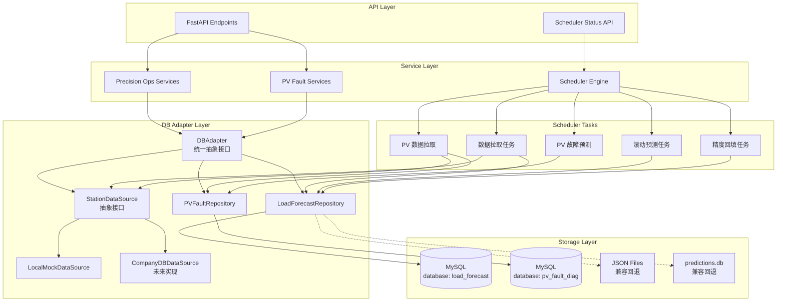
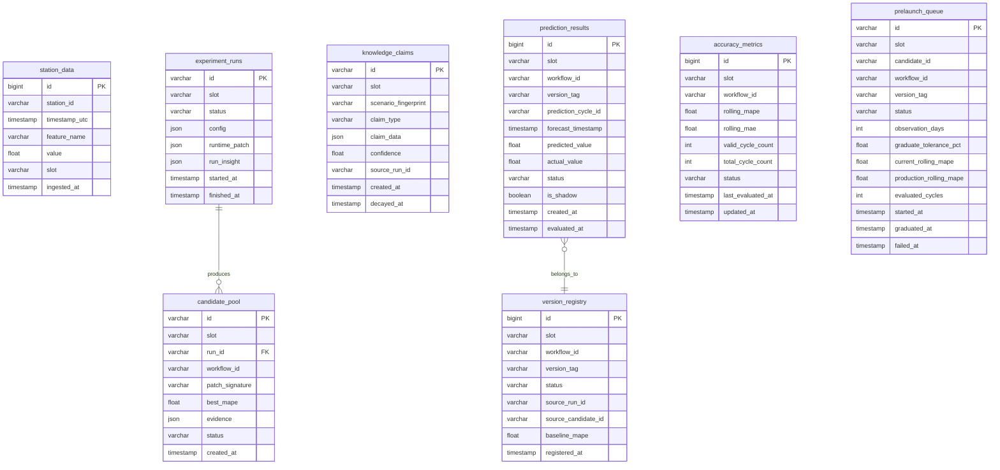
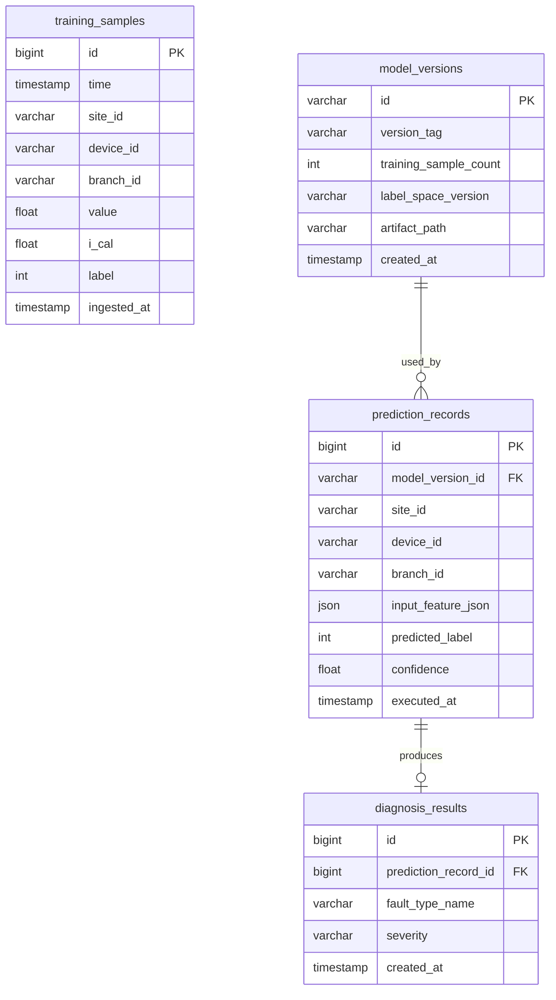
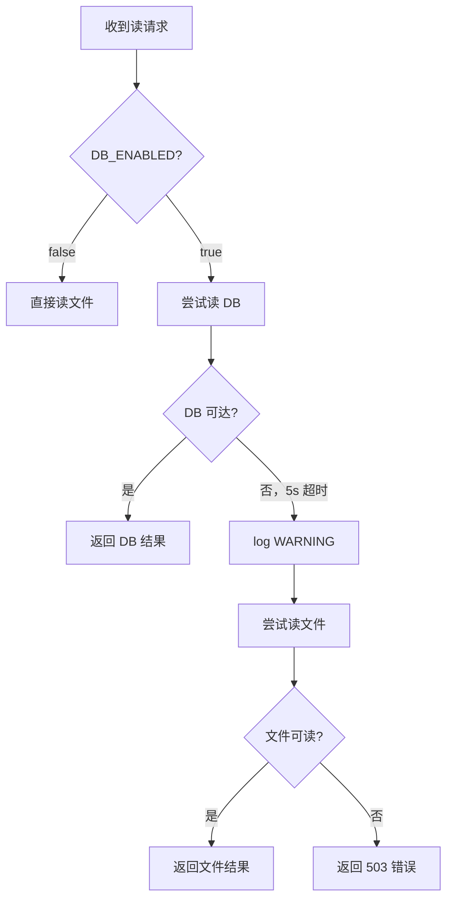

# 设计文档：数据管线数据库集成

## Overview

本特性将 AIP 平台中两条独立数据管线（负荷预测 Load_Forecast_Pipeline 和光伏故障诊断 PV_Fault_Pipeline）从当前的文件存储（JSON/SQLite/Parquet）迁移到正式的关系型数据库（MySQL），并实现定时任务拉取站点实际数据、执行滚动预测、回填精度指标的生产级闭环。

核心设计决策：

- **SQLAlchemy** 作为 ORM / 数据库抽象层，提供同步（`sqlalchemy` + `pymysql`）和异步（`sqlalchemy[asyncio]` + `aiomysql`）双模式支持
- **APScheduler** 作为定时任务调度器，支持 cron 表达式和任务重叠保护
- **Alembic** 作为数据库 Schema 迁移管理工具
- **两条管线完全独立**：不同数据库（`load_forecast` / `pv_fault_diag`），独立连接池，独立调度器配置（注：MySQL 中 "schema" 等同于 "database"，隔离通过独立数据库实现）
- **渐进式迁移**：通过 `DB_ENABLED` 开关和双写机制实现平滑过渡

### 后续公司数据库对接

公司远程数据库同为 MySQL（地址 `10.65.101.249`），引擎一致，切换时仅需通过环境变量修改连接 URL 和凭据即可。`pymysql` 驱动已是项目既有依赖（见 `backend-service/data_fetch/fetcher.py`），无需额外安装。本地开发使用 Homebrew MySQL 9.6.0（`root@localhost` 无密码，已有数据库 `aip_algo_platform`），生产环境指向公司 MySQL 实例。

## Architecture

### 高层架构图



### 组件职责划分

| 组件 | 职责 | 位置（相对于 `backend-service/`） |
|------|------|------|
| `DBAdapter` | 连接池管理、健康检查、migration 执行、引擎切换 | `services/db/adapter.py` |
| `LoadForecastRepository` | 负荷预测 schema 的所有 CRUD 操作 | `services/db/repositories/load_forecast.py` |
| `PVFaultRepository` | 光伏故障诊断 schema 的所有 CRUD 操作 | `services/db/repositories/pv_fault.py` |
| `StationDataSource` | 站点数据源抽象接口（`pull_latest` / `get_available_stations`） | `services/db/datasources/base.py` |
| `LocalMockDataSource` | 本地 CSV/Parquet 文件模拟数据源 | `services/db/datasources/local_mock.py` |
| `SchedulerEngine` | APScheduler 封装，任务注册、重叠保护、故障记录 | `services/scheduler/engine.py` |
| `MigrationTool` | 历史数据一次性导入工具 | `services/db/migration_tool.py` |
| `DualWriteProxy` | 双写代理，协调 DB 和文件写入 | `services/db/dual_write.py` |

## Components and Interfaces

### 1. DBAdapter — 数据库抽象层

```python
# services/db/adapter.py

class DBAdapter:
    """
    数据库适配器 — 管理连接池、引擎初始化、健康检查和 schema 迁移。

    职责：
      - 根据 DB_ENGINE 环境变量创建 SQLAlchemy Engine
      - 维护连接池（可配置 max_connections、idle_timeout、connection_lifetime）
      - 启动时执行健康检查 + Alembic 自动迁移
      - 提供同步 Session 和异步 AsyncSession 工厂
      - 连接失败时按指数退避重试（最多 3 次，base=1s，multiplier=2×，max=8s）
    """

    def __init__(self, config: DBConfig) -> None: ...

    # --- 连接管理 ---
    def get_sync_session(self) -> Session: ...
    def get_async_session(self) -> AsyncSession: ...

    # --- 健康检查 ---
    def health_check(self) -> bool: ...

    # --- 迁移 ---
    def run_migrations(self) -> None: ...

    # --- 生命周期 ---
    def dispose(self) -> None: ...
```

**`DBConfig`（数据库配置）** 数据类：

| 字段 | 类型 | 来源 | 说明 |
|------|------|------|------|
| `engine` | `str` | `DB_ENGINE` 环境变量 | 数据库引擎类型，默认 `mysql`；预留 `postgresql` 供未来扩展 |
| `connection_url` | `str` | `DB_CONNECTION_URL` 或拼接 | 完整连接字符串，如 `mysql+pymysql://root@localhost:3306/aip_algo_platform`；异步模式使用 `mysql+aiomysql://root@localhost:3306/...` |
| `max_connections` | `int` | `DB_POOL_MAX` 环境变量，默认 `10`，范围 1–100 | 连接池最大连接数 |
| `idle_timeout` | `int` | `DB_POOL_IDLE_TIMEOUT`，默认 `300`，范围 10–3600 | 空闲连接超时（秒） |
| `connection_lifetime` | `int` | `DB_POOL_CONN_LIFETIME`，默认 `3600`，范围 60–86400 | 连接最大生存期（秒） |
| `pool_wait_timeout` | `int` | `DB_POOL_WAIT_TIMEOUT`，默认 `30`，范围 1–120 | 池满时排队等待超时（秒） |
| `retry_attempts` | `int` | 固定 `3` | 连接失败重试次数 |
| `retry_base_delay` | `float` | 固定 `1.0` | 重试基础延迟（秒） |

配置优先级：**环境变量 > 配置文件 > 代码默认值**。

### 2. StationDataSource — 站点数据源接口

```python
# services/db/datasources/base.py

from abc import ABC, abstractmethod
from datetime import datetime
from typing import List
from dataclasses import dataclass

@dataclass
class StationRecord:
    """站点数据记录"""
    station_id: str          # 站点唯一标识
    timestamp: datetime      # 测量时间（UTC）
    feature_name: str        # 测量特征名称（如 "load"、"irradiance"）
    value: float             # 测量值

@dataclass
class StationInfo:
    """站点元信息"""
    station_id: str          # 站点唯一标识
    station_name: str        # 站点显示名称

class StationDataSource(ABC):
    """
    站点数据源抽象接口。

    所有数据拉取操作通过此接口进行。
    本地开发使用 LocalMockDataSource（读 CSV/Parquet），
    生产环境实现 CompanyDBDataSource（连接公司数据库）。
    """

    @abstractmethod
    def pull_latest(
        self,
        station_id: str,
        since_timestamp: datetime,
    ) -> List[StationRecord]:
        """
        拉取指定站点从 since_timestamp 之后的最新记录。

        无新记录时返回空列表，不抛异常。
        超时 30 秒后抛出 DataSourceError。
        """
        ...

    @abstractmethod
    def get_available_stations(self) -> List[StationInfo]:
        """获取所有可用站点列表"""
        ...

class DataSourceError(Exception):
    """
    数据源操作异常 — 封装底层驱动异常。

    调用方只需捕获 DataSourceError，不需要了解底层实现。
    """
    pass
```

### 3. SchedulerEngine — 定时任务调度器

```python
# services/scheduler/engine.py

class SchedulerEngine:
    """
    定时任务调度器 — 封装 APScheduler。

    职责：
      - 按 cron 表达式注册任务（最小粒度 1 分钟）
      - 任务重叠保护（同类型任务同时只运行一个实例）
      - 失败重试（1 次，可配置延迟）
      - 维护最近 20 条失败记录
      - 启动后若检测到漏跑，执行最多 1 次 catch-up
      - 两条管线任务完全独立（独立启停、独立失败计数）
    """

    def register_task(
        self,
        task_id: str,
        func: Callable,
        cron_expr: str,
        pipeline: str,           # "load_forecast" | "pv_fault"
        retry_delay: int = 60,   # 重试延迟（秒），范围 10–600
    ) -> None: ...

    def start_pipeline(self, pipeline: str) -> None: ...
    def stop_pipeline(self, pipeline: str) -> None: ...

    def get_status(self, pipeline: str) -> SchedulerStatus: ...
    def get_all_status(self) -> Dict[str, SchedulerStatus]: ...

@dataclass
class SchedulerStatus:
    """调度器状态快照"""
    pipeline: str                       # 管线名称
    running: bool                       # 是否运行中
    tasks: List[TaskStatus]             # 各任务状态

@dataclass
class TaskStatus:
    """单任务状态"""
    task_id: str                        # 任务 ID
    last_execution_time: Optional[datetime]   # 上次执行时间
    next_scheduled_time: Optional[datetime]   # 下次计划时间
    last_result: str                    # "success" | "failed" | "skipped"
    recent_failures: List[FailureRecord]     # 最近 20 条失败记录

@dataclass
class FailureRecord:
    """失败记录"""
    task_id: str
    trigger_time: datetime              # 触发时间
    error_message: str                  # 错误信息
    is_retry: bool                      # 是否为重试执行
```

### 4. DualWriteProxy — 双写代理

```python
# services/db/dual_write.py

class DualWriteProxy:
    """
    双写代理 — 过渡期同时写入数据库和文件。

    行为规则：
      - DB_ENABLED=true 且 dual-write 模式：先写 DB，再写文件；任一失败仅 log warning
      - DB_ENABLED=true 且非 dual-write：只写 DB
      - DB_ENABLED=false：只写文件（透明降级，无错误日志）

    读取规则：
      - DB_ENABLED=true：优先读 DB；DB 不可用（连接超时 5s 或查询失败）则降级到文件
      - DB_ENABLED=false：只读文件
    """

    def write(self, target: str, data: Any) -> WriteResult: ...
    def read(self, target: str, query: Any) -> Any: ...
```

### 5. Scheduler Status API

```
GET /api/scheduler/status
```

- **用途**：前端运维面板或 CLI 查看各管线调度器运行状态
- **返回体**：

| 字段 | 类型 | 说明 |
|------|------|------|
| `pipelines` | `Dict[str, PipelineStatus]` | 各管线状态，key 为管线名 |
| `pipelines.{name}.running` | `bool` | 该管线调度器是否运行中 |
| `pipelines.{name}.tasks` | `List[TaskStatus]` | 该管线下各任务状态 |
| `pipelines.{name}.tasks[].task_id` | `str` | 任务标识（如 `load_forecast_pull`） |
| `pipelines.{name}.tasks[].last_execution_time` | `str \| null` | 上次执行时间（ISO 8601） |
| `pipelines.{name}.tasks[].next_scheduled_time` | `str \| null` | 下次计划执行时间 |
| `pipelines.{name}.tasks[].last_result` | `str` | 上次结果：`success` / `failed` / `skipped` |
| `pipelines.{name}.tasks[].recent_failures` | `List[FailureRecord]` | 最近 20 条失败记录 |

```
POST /api/scheduler/{pipeline}/start
POST /api/scheduler/{pipeline}/stop
```

- **用途**：手动启停指定管线的调度器
- **语义**：仅影响指定 `pipeline`（`load_forecast` 或 `pv_fault`），不影响另一管线

## Data Models

### 负荷预测 Database (`load_forecast`)

> **注**：MySQL 中 "schema" 与 "database" 等价。本设计中 `load_forecast` 和 `pv_fault_diag` 分别是独立的 MySQL DATABASE，通过不同数据库名实现数据隔离。`jsonb` 类型在 MySQL 中对应原生 `JSON` 类型。



**关键索引**：

| 表 | 索引 | 用途 |
|------|------|------|
| `station_data` | `(slot, station_id, timestamp_utc)` | 按站点时间范围查询 |
| `prediction_results` | `(slot, workflow_id, forecast_timestamp)` | 窗口范围查询 |
| `prediction_results` | `(slot, prediction_cycle_id)` | 按周期回填实际值 |
| `accuracy_metrics` | `(slot, workflow_id)` UNIQUE | 按版本查精度 |
| `version_registry` | `(slot, workflow_id, version_tag)` UNIQUE | 版本唯一约束 |
| `candidate_pool` | `(slot, patch_signature)` | 候选去重 |

**`slot`（槽位）分区设计**：所有表都包含 `slot` 字段作为逻辑分区键。查询时必须带 `slot` 条件，确保不同槽位数据严格隔离。新增槽位只需插入带新 `slot` 值的数据，无需 DDL 变更。

### 光伏故障诊断 Database (`pv_fault_diag`)



**关键约束**：

- `training_samples` 复合唯一键：`(time, site_id, device_id, branch_id)` — 用于 Parquet 去重导入
- `prediction_records.confidence` 范围约束：`CHECK (confidence >= 0.0 AND confidence <= 1.0)`
- `training_samples` 组合索引：`(site_id, time, label)` — 支持多条件过滤查询

### 配置管理

所有数据库和调度器配置均通过环境变量管理，配置文件作为 fallback：

```python
# services/db/config.py

# --- 数据库连接 ---
DB_ENABLED = "true"                           # 总开关
DB_ENGINE = "mysql"                           # 引擎类型（当前使用 MySQL）
DB_CONNECTION_URL = "mysql+pymysql://root@localhost:3306/aip_algo_platform"
# 异步连接串由代码自动替换驱动前缀：mysql+aiomysql://root@localhost:3306/...

# --- 负荷预测 Database ---
LF_DB_SCHEMA = "load_forecast"                # MySQL 中为独立 DATABASE 名

# --- 光伏诊断 Database ---
PV_DB_SCHEMA = "pv_fault_diag"                # MySQL 中为独立 DATABASE 名

# --- 连接池 ---
DB_POOL_MAX = "10"                            # 最大连接数
DB_POOL_IDLE_TIMEOUT = "300"                  # 空闲超时（秒）
DB_POOL_CONN_LIFETIME = "3600"                # 连接最大生存期（秒）
DB_POOL_WAIT_TIMEOUT = "30"                   # 池满等待超时（秒）

# --- 调度器 ---
SCHED_LF_PULL_CRON = "0 1 * * *"             # 负荷数据拉取（每天 01:00）
SCHED_LF_PREDICT_CRON = "30 1 * * *"         # 负荷预测（每天 01:30）
SCHED_LF_BACKFILL_CRON = "0 3 * * *"         # 精度回填（每天 03:00）
SCHED_PV_PULL_CRON = "0 2 * * *"             # PV 数据拉取（每天 02:00）
SCHED_PV_PREDICT_CRON = "30 2 * * *"         # PV 预测（每天 02:30）
SCHED_TASK_RETRY_DELAY = "60"                 # 失败重试延迟（秒）

# --- 双写模式 ---
DB_DUAL_WRITE = "true"                        # 过渡期双写开关
```

配置文件路径：`backend-service/configs/db.yaml`（环境变量始终优先）。

### Alembic 迁移目录结构

```
backend-service/
  alembic/
    env.py                    # Alembic 运行环境配置
    alembic.ini               # Alembic 主配置
    versions/
      001_create_load_forecast_schema.py
      002_create_pv_fault_diag_schema.py
      003_add_station_data_table.py
      ...
```

迁移在 `DBAdapter.__init__()` 中自动执行（`alembic upgrade head`）。若迁移失败则回滚当前迁移、记录错误日志（含失败的 migration revision ID）、抛出异常阻止应用启动。

## Correctness Properties

*A property is a characteristic or behavior that should hold true across all valid executions of a system — essentially, a formal statement about what the system should do. Properties serve as the bridge between human-readable specifications and machine-verifiable correctness guarantees.*

### Property 1: 连接池配置验证

*For any* pool configuration where `max_connections` is within [1, 100], `idle_timeout` is within [10, 3600], and `connection_lifetime` is within [60, 86400], the DBAdapter should initialize successfully; for any configuration value outside these ranges, initialization should raise a validation error.

**Validates: Requirements 1.3**

### Property 2: 连接重试指数退避

*For any* sequence of N consecutive connection failures (where N ≤ 3), the DBAdapter should retry with delays of 1s, 2s, 4s respectively; if the (N+1)th attempt succeeds, no error is raised. For 4 consecutive failures (all 3 retries exhausted), the adapter should raise a connection error.

**Validates: Requirements 1.4**

### Property 3: 环境变量优先级

*For any* configuration parameter that has both an environment variable value and a config file value set, the DBAdapter should always use the environment variable value.

**Validates: Requirements 1.5**

### Property 4: 同步/异步执行一致性

*For any* valid SQL query, executing it synchronously and asynchronously through the DBAdapter should return logically identical result sets.

**Validates: Requirements 1.6**

### Property 5: 管线 Schema 隔离

*For any* table in the `load_forecast` schema and any table in the `pv_fault_diag` schema, there should be zero foreign key references between them, and a cross-schema query should return zero rows from the other schema.

**Validates: Requirements 2.1, 3.1**

### Property 6: 槽位数据分区隔离

*For any* two distinct slot values and any query scoped to one slot, the result set should contain zero rows where `slot` equals the other slot value.

**Validates: Requirements 2.5**

### Property 7: 数据记录存取往返保持

*For any* valid data record (station data, prediction result, or training sample) with all required fields, storing it to the database and then retrieving it should produce a record with all field values identical to the original (within floating-point precision for numeric fields).

**Validates: Requirements 2.4, 2.6, 3.4**

### Property 8: 写入原子性

*For any* multi-record write operation that fails midway (e.g., database constraint violation or connection loss after partial insert), the database should contain either all records committed before the failure point or none of the records from that transaction — no partial transaction state should be visible.

**Validates: Requirements 2.7, 3.6**

### Property 9: Parquet 导入幂等性

*For any* valid Parquet file, ingesting it N times (N ≥ 1) into the `pv_fault_diag.training_samples` table should produce the same row count as ingesting it once, with deduplication by the composite key `(time, site_id, device_id, branch_id)`.

**Validates: Requirements 3.3**

### Property 10: 训练样本组合查询正确性

*For any* combination of filters (site_id, time range [start, end), label set), the query result from `training_samples` should be exactly the subset of all rows where all specified conditions match, ordered by `time` ascending.

**Validates: Requirements 3.5**

### Property 11: 高水位拉取语义

*For any* sequence of data pull operations, each pull should request only records with timestamps strictly greater than the last successful pull's high-water-mark timestamp, ensuring no records are pulled twice and no records are missed.

**Validates: Requirements 4.2**

### Property 12: MAPE 计算正确性

*For any* set of (predicted_value, actual_value) pairs where actual_value ≠ 0, the computed rolling MAPE should equal `mean(|predicted - actual| / |actual|) × 100`, accurate to 4 decimal places.

**Validates: Requirements 4.4**

### Property 13: 调度任务重叠保护

*For any* task type with execution time exceeding its schedule interval, the scheduler should never have more than one concurrent instance of that task running — subsequent triggers should be skipped.

**Validates: Requirements 4.8**

### Property 14: 停机后最多一次 catch-up

*For any* downtime duration during which N ≥ 1 scheduled runs were missed, the scheduler should execute at most one catch-up run per task upon restart.

**Validates: Requirements 4.9**

### Property 15: 管线调度独立性

*For any* state change (start, stop, or failure) in one pipeline's scheduler, the other pipeline's scheduler state (running status, task schedule, failure counter) should remain unchanged.

**Validates: Requirements 5.1, 5.4**

### Property 16: PV 拉取批量上限

*For any* data source returning N available records where N > 10,000, the PV data pull task should process exactly 10,000 records per execution and leave the remaining records for subsequent pulls.

**Validates: Requirements 5.2**

### Property 17: 迁移幂等性

*For any* source data set (JSON files, SQLite tables, Parquet files), running the migration tool N times (N ≥ 1) should produce the same database state — same row counts, same data values — as running it once.

**Validates: Requirements 6.4**

### Property 18: 迁移完整性

*For any* source SQLite table with M rows or Parquet file with M rows, after successful migration the target database table should contain exactly M rows with all column values preserved.

**Validates: Requirements 6.2, 6.3**

### Property 19: 双写一致性

*For any* write operation in dual-write mode, both the database and the file storage should receive the data; if one target fails, the other target should still succeed and a warning should be logged.

**Validates: Requirements 7.1**

### Property 20: 读取降级回退

*For any* read operation when `DB_ENABLED=true`, if the database is unreachable (connection timeout > 5s or query error), the system should transparently return data from file-based storage without raising an error to the caller.

**Validates: Requirements 7.3**

### Property 21: API 响应格式不变性

*For any* existing REST API endpoint, the response JSON structure should be identical regardless of whether the backing storage is file-based or database-based — no field additions, removals, or type changes.

**Validates: Requirements 7.4**

### Property 22: DataSourceError 封装

*For any* type of underlying database driver exception or query timeout (> 30s), the StationDataSource implementation should raise only `DataSourceError` and never expose raw driver-specific exception types to the caller.

**Validates: Requirements 8.5**

## Error Handling

### 错误分级与处理策略

| 级别 | 场景 | 处理方式 |
|------|------|------|
| **FATAL** | Schema 迁移失败、数据库不可达（所有重试耗尽） | 阻止应用启动，记录 ERROR 日志，抛出异常 |
| **ERROR** | 写入事务失败、数据类型不匹配、Parquet 文件缺列 | 回滚事务，返回错误响应，记录 ERROR 日志 |
| **WARNING** | 双写中一侧失败、DB 读取超时降级到文件、任务重叠跳过 | 继续执行，记录 WARNING 日志，在 status API 中体现 |
| **INFO** | 正常调度执行、迁移完成、catch-up 执行 | 记录 INFO 日志 |

### 关键异常类型

```python
class DBAdapterError(Exception):
    """DB 适配器基础异常"""
    pass

class ConnectionExhaustedError(DBAdapterError):
    """连接池耗尽 — 排队等待超时"""
    pass

class MigrationError(DBAdapterError):
    """Schema 迁移失败 — 含失败的 revision ID"""
    def __init__(self, revision: str, cause: Exception): ...

class DataSourceError(Exception):
    """数据源操作异常 — 封装底层驱动异常，隐藏实现细节"""
    pass

class DataSourceTimeoutError(DataSourceError):
    """数据源查询超时（> 30s）"""
    pass

class IngestionError(Exception):
    """数据导入异常 — Parquet 缺列或类型不匹配"""
    def __init__(self, file_path: str, missing_columns: List[str] = None,
                 type_errors: List[str] = None): ...
```

### 事务保障

- 所有多表写入操作使用 SQLAlchemy Session 事务，失败时整体 rollback
- `prediction_results` 批量写入使用 `INSERT IGNORE` 或 `ON DUPLICATE KEY UPDATE` 防止重复（MySQL 语法）
- `training_samples` Parquet 导入在单一事务内完成，任何行失败则整体回滚
- 双写模式下，DB 事务和文件写入是独立的 — 一侧失败不回滚另一侧

### 降级策略



## Testing Strategy

### 测试分层

| 层次 | 工具 | 范围 | 运行频率 |
|------|------|------|------|
| **属性测试** | `hypothesis` (Python PBT 库) | DBAdapter 配置验证、数据往返、幂等性、MAPE 计算、隔离性 | CI 每次提交，每个属性 ≥ 100 次迭代 |
| **单元测试** | `pytest` | Repository CRUD、Scheduler 逻辑、Migration 映射、错误处理 | CI 每次提交 |
| **集成测试** | `pytest` + `testcontainers-python`（MySQL 容器）或直连本地 MySQL | 端到端 DB 操作、Alembic 迁移、真实连接池行为 | CI 每次提交（需 Docker 或本地 MySQL） |
| **冒烟测试** | 手动 / CI | 应用启动、健康检查、API 可达 | 部署后 |

### 属性测试配置

- 库：[hypothesis](https://hypothesis.readthedocs.io/)
- 最小迭代次数：100（通过 `@settings(max_examples=100)` 配置）
- 每个属性测试在测试文件中以注释标注对应的设计属性编号

标注格式：
```python
# Feature: data-pipeline-db-integration, Property 9: Parquet 导入幂等性
@given(parquet_data=st.lists(st.fixed_dictionaries({...}), min_size=1, max_size=50))
@settings(max_examples=100)
def test_parquet_ingestion_idempotence(parquet_data):
    ...
```

### 单元测试重点

- 各 Repository 方法的 CRUD 正确性（使用 SQLite in-memory 作为快速测试后端）
- Scheduler 的 cron 解析、重叠检测、catch-up 逻辑
- DualWriteProxy 在各模式组合下的行为
- MigrationTool 的文件映射逻辑和错误跳过
- DBConfig 配置解析和验证

### 集成测试重点

- Alembic 迁移从空库到最新 revision 的正确性
- 真实 MySQL 上的连接池行为（池满超时、空闲回收）
- 端到端调度任务执行（数据拉取 → 预测 → 回填）
- 双写模式在 DB 故障时的降级行为

### 测试数据生成策略

- 使用 `hypothesis` 的 `st.text()`、`st.floats()`、`st.datetimes()` 生成随机 station records
- 使用 `st.fixed_dictionaries()` 生成符合 schema 的 prediction records
- Parquet 测试数据通过 `pandas.DataFrame` + `hypothesis` 组合生成
- 所有测试使用独立数据库 / schema，测试结束后清理
