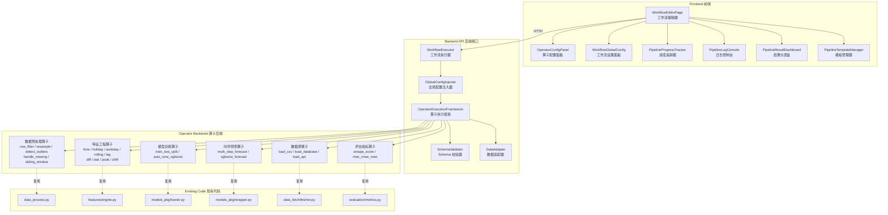
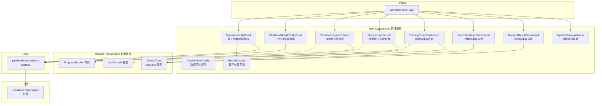
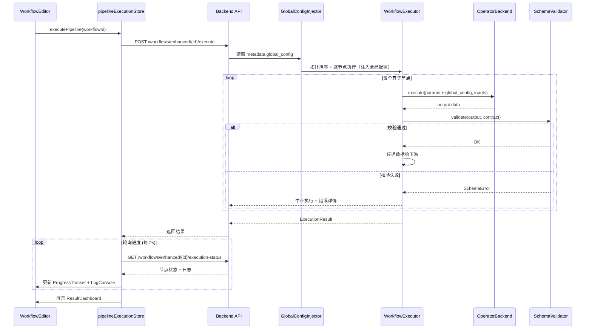

<!-- @AI_GENERATED -->
# 设计文档：基于 AIP 通用算子填充实现负荷预测流水线

## Overview

本设计文档描述将本地负荷预测代码的各步骤逻辑映射并填充到 AIP 平台已有通用算子中的完整技术方案。核心设计理念是**复用优先**：不新建自定义算子，而是为 `functions.json` 中已注册的通用算子实现真实的后端执行逻辑，使负荷预测流水线成为这些通用算子的一种特定组合（模板）。

### 设计范围

1. **后端算子执行框架**：统一的 `execute(params, inputs)` 接口、算子自动路由、Schema 校验、数据适配器
2. **后端算子填充**：~23 个通用算子的 Python 执行逻辑实现（`load_csv`、`row_filter`、`resample_timeseries`、`detect_outliers`、`handle_missing`、`extract_time_features`、`holiday_features`、`workday_features`、`rolling_statistics`、`create_lag_features`、`sliding_window`、`diff_features`、`pct_change_features`、`extract_statistical_features`、`peak_valley_features`、`shift_features`、`train_test_split_ts`、`multi_step_forecast`、`auto_tune_xgboost`、`xgboost_forecast`、`smape_score`、`mse_rmse_mae`、`load_database`、`load_api`）
3. **数据契约与校验**：算子间数据传递的 Schema 定义、自动校验、数据适配器
4. **前端算子配置面板**：人性化参数编辑、高级参数折叠、基础/高级分组
5. **前端流水线模板**：训练、推理、回测三种模板的预填充参数和数据契约
6. **前端执行可视化**：进度追踪器、日志控制台、结果仪表盘（训练/推理/回测三种）
7. **工作流全局配置**：`time_zone`、`operate_status`、`nowtime` 等工作流级别参数存储在 `EnhancedWorkflow.metadata.global_config` 中

### 技术栈

- **后端**：Python 3.10+ / FastAPI / Pydantic / pandas / XGBoost / scikit-learn / bayes_opt
- **前端**：React 18 / TypeScript / Ant Design 5 / ECharts (echarts-for-react) / zustand / axios / React Flow

### 设计决策

| 决策 | 选择 | 理由 |
|------|------|------|
| 算子发现机制 | 基于 `functions.json` ID 的自动路由 | 新增算子只需添加定义和实现，无需修改框架 |
| 算子执行接口 | 统一 `execute(params, inputs) -> dict` | 所有算子遵循一致接口，降低学习成本 |
| 数据契约存储 | JSON 格式嵌入 Pipeline Template 元数据 | 与工作流定义一体化，便于版本管理 |
| Schema 校验时机 | 算子执行后、数据传递前 | 尽早发现格式不匹配，避免下游算子收到脏数据 |
| 前端参数面板 | 根据 `functions.json` 自动生成 | 新增算子无需编写专用前端组件 |
| 不可映射参数处理 | 算子高级参数 + 工作流全局配置 | 取消 Domain_Options 独立概念，简化架构；无法映射到通用算子的参数分两类处理：算子特有的放入该算子高级参数，工作流级别的放入全局配置 |
| 工作流全局配置 | `EnhancedWorkflow.metadata.global_config` | 不新建算子，仅在工作流元数据中存储 `time_zone`/`operate_status`/`nowtime`，执行时注入每个算子上下文 |
| 状态管理 | zustand store 扩展现有 workflowEnhancedStore | 复用已有工作流状态管理模式 |

### 不可映射参数处理方案

原负荷预测代码中部分参数无法直接映射到已有通用算子的标准参数，处理方案如下：

| 原参数 | 归属 | 处理方式 |
|--------|------|----------|
| `time_zone` | 工作流全局配置 | 存入 `metadata.global_config.time_zone`，执行时注入每个算子上下文 |
| `operate_status` | 工作流全局配置 | 存入 `metadata.global_config.operate_status` |
| `nowtime` | 工作流全局配置 | 存入 `metadata.global_config.nowtime`，回测循环时由系统自动设置 |
| `separate_modeling` | `xgboost_forecast` 高级参数 | 是否分工作日/休息日建模，属于 XGBoost 训练策略 |
| `forecast_start_time` | `multi_step_forecast` 高级参数 | 预测起始时刻，属于多步预测配置 |
| `prefer_unit_len` | `xgboost_forecast` 高级参数 | 验证集配置，属于 XGBoost 训练策略 |
| `default_retrain` | `xgboost_forecast` 高级参数 | 重训练策略，属于 XGBoost 训练策略 |
| `parent_field`/`child_field`/`parent_id`/`child_id` | `load_csv` 高级参数 或 `row_filter` 算子 | 数据过滤条件，可通过 `row_filter` 算子实现 |
| `table_name` | `load_database` query 参数 | 包含在 SQL 查询语句中 |

## Architecture

### 整体架构



### 后端分层架构

```mermaid
graph LR
    subgraph "API Layer"
        EP[execute_workflow<br/>POST /api/workflows/enhanced/{id}/execute]
    end

    subgraph "Execution Layer"
        TE[TopologicalExecutor<br/>拓扑排序 + 逐节点执行]
        GCI2[GlobalConfigInjector<br/>从 metadata.global_config 读取<br/>注入每个算子的 params]
        OR[OperatorRouter<br/>算子 ID → 执行函数路由]
    end

    subgraph "Validation Layer"
        SV2[SchemaValidator<br/>输入/输出 Schema 校验]
        DA2[DataAdapter<br/>列名重映射]
        DC[DataContractRegistry<br/>数据契约注册表]
    end

    subgraph "Operator Layer"
        OPS[operator_backends/<br/>每个算子一个模块]
    end

    EP --> TE
    TE --> GCI2
    GCI2 --> OR
    OR --> SV2
    SV2 --> DA2
    DA2 --> OPS
    OPS --> SV2
    SV2 --> DC
```

### 前端组件架构



### 训练流水线数据流

```mermaid
graph LR
    LC[load_csv] --> RF[row_filter]
    RF --> RS[resample_timeseries]
    RS --> DO[detect_outliers]
    DO --> HM[handle_missing]
    HM --> ETF[extract_time_features]
    ETF --> HF[holiday_features]
    HF --> WF[workday_features]
    WF --> RLS[rolling_statistics]
    RLS --> CLF[create_lag_features]
    CLF --> SW[sliding_window]
    SW --> TTS[train_test_split_ts]
    TTS --> MSF[multi_step_forecast]
    MSF --> XGB[xgboost_forecast]
    XGB --> SMAPE[smape_score]
    XGB --> MSE[mse_rmse_mae]
```



### 数据流：训练流水线执行




## 工作流全局配置 (Workflow Global Config)

### 概述

工作流全局配置用于存储不属于任何特定算子、但需要在整个工作流执行过程中共享的参数。这些参数存储在 `EnhancedWorkflow.metadata.global_config` 中，执行时由 `GlobalConfigInjector` 注入到每个算子的执行上下文中。

### 设计理念

原负荷预测代码中有部分参数（如 `time_zone`、`operate_status`、`nowtime`）是工作流级别的概念，不属于任何单个算子。这些参数不应作为独立算子存在，而应作为工作流的元数据。前端通过工具栏中的"工作流设置"（工作流设置）面板进行编辑。

### 全局配置字段

```python
# EnhancedWorkflow.metadata.global_config 结构
{
    "time_zone": "Asia/Shanghai",       # 时区，影响时间特征提取和节假日判断
    "operate_status": "training",        # 运行状态：training / prediction / backtest
    "nowtime": "2026-04-10 00:00:00"    # 当前时间基准点，回测循环时由系统自动设置
}
```

### 后端注入机制

```python
# AIP-service/backend/services/operator_execution/global_config_injector.py

class GlobalConfigInjector:
    """
    从 EnhancedWorkflow.metadata.global_config 读取全局配置，
    在每个算子执行前将其合并到算子的 params 中。
    算子可通过 params['_global_config'] 访问全局配置。
    """

    def inject(self, params: dict, global_config: dict) -> dict:
        """将全局配置注入算子参数"""
        injected = {**params, '_global_config': global_config}
        # 常用字段直接展开到顶层，方便算子访问
        if 'time_zone' in global_config:
            injected.setdefault('time_zone', global_config['time_zone'])
        if 'nowtime' in global_config:
            injected.setdefault('nowtime', global_config['nowtime'])
        return injected
```

### 前端面板

**路径**: `src/components/workflow-enhanced/WorkflowGlobalConfigPanel.tsx`

```typescript
interface WorkflowGlobalConfigPanelProps {
  globalConfig: WorkflowGlobalConfig;
  onChange: (config: WorkflowGlobalConfig) => void;
}

interface WorkflowGlobalConfig {
  time_zone: string;        // 下拉选择常用时区，默认 Asia/Shanghai
  operate_status: string;   // 下拉选择 training/prediction/backtest
  nowtime: string;          // 日期时间选择器，回测模式下自动设置
}
```

前端展示位置：工作流编辑器工具栏中的"工作流设置"按钮，点击后弹出配置面板。面板包含：
- **时区**（`time_zone`）：下拉选择，默认 `Asia/Shanghai`
- **运行状态**（`operate_status`）：下拉选择 `training`/`prediction`/`backtest`
- **时间基准点**（`nowtime`）：日期时间选择器，回测模式下由系统自动设置为当前回测日期

### EnhancedWorkflow 模型扩展

```python
# 扩展现有 EnhancedWorkflow 模型
class EnhancedWorkflow(BaseModel):
    id: Optional[str] = None
    name: str
    description: Optional[str] = None
    nodes: List[EnhancedWorkflowNode]
    edges: List[EnhancedWorkflowEdge]
    metadata: Optional[Dict[str, Any]] = None  # 新增：包含 global_config
    createdAt: Optional[str] = None
    updatedAt: Optional[str] = None
```

## Components and Interfaces

### 1. 算子执行框架 (Operator Execution Framework)

**路径**: `AIP-service/backend/services/operator_execution/`

#### 1.1 OperatorRouter — 算子路由器

```python
# AIP-service/backend/services/operator_execution/router.py

class OperatorRouter:
    """
    根据 functions.json 中的算子 ID 自动路由到对应的后端执行函数。
    新增算子只需在 operator_backends/ 目录下添加模块并注册。
    """
    _registry: Dict[str, Callable]  # operator_id -> execute function

    def register(self, operator_id: str, execute_fn: Callable) -> None: ...
    def auto_discover(self, backends_dir: str) -> None: ...
    def execute(self, operator_id: str, params: dict, inputs: dict) -> dict: ...
    def has_operator(self, operator_id: str) -> bool: ...
```

自动发现机制：扫描 `operator_backends/` 目录下所有 Python 模块，每个模块导出 `OPERATOR_ID` 和 `execute(params, inputs)` 函数，路由器自动注册。

#### 1.2 SchemaValidator — Schema 校验器

```python
# AIP-service/backend/services/operator_execution/schema_validator.py

@dataclass
class DataContract:
    data_type: str                          # MATRIX / ARRAY / NUMBER / OBJECT
    required_columns: List[str]             # 必需列名
    column_types: Dict[str, str]            # 列名 -> 数据类型
    constraints: List[str]                  # 附加约束 ("no_nan", "time_ordered", ...)

class SchemaValidator:
    def validate_output(self, data: Any, contract: DataContract) -> ValidationResult: ...
    def validate_input(self, data: Any, expected_type: str) -> ValidationResult: ...
    def check_array_consistency(self, arr1: list, arr2: list) -> bool: ...

@dataclass
class ValidationResult:
    valid: bool
    errors: List[str]
    warnings: List[str]
```

#### 1.3 DataAdapter — 数据适配器

```python
# AIP-service/backend/services/operator_execution/data_adapter.py

class DataAdapter:
    """
    当上游算子输出的列名与下游算子期望的列名存在可映射关系时，
    自动执行列名重映射。
    """
    _column_mappings: Dict[str, str]  # source_col -> target_col

    def adapt(self, data: Any, source_contract: DataContract,
              target_contract: DataContract) -> Tuple[Any, List[str]]: ...
    def register_mapping(self, source: str, target: str) -> None: ...
```

#### 1.4 GlobalConfigInjector — 全局配置注入器

```python
# AIP-service/backend/services/operator_execution/global_config_injector.py

class GlobalConfigInjector:
    """
    从 EnhancedWorkflow.metadata.global_config 读取全局配置，
    在每个算子执行前注入到算子参数中。
    """
    def __init__(self, global_config: dict): ...
    def inject(self, params: dict) -> dict: ...
```

#### 1.5 统一算子执行接口

每个算子后端实现遵循统一接口：

```python
# AIP-service/backend/services/operator_backends/base.py

OPERATOR_ID: str = "operator_id"

def execute(params: dict, inputs: dict) -> dict:
    """
    统一算子执行接口。

    Args:
        params: 算子参数（来自节点 config + 高级参数 + 全局配置注入）
        inputs: 上游算子传递的数据（key 为端口名称）

    Returns:
        dict: 执行结果，key 为输出端口名称

    Raises:
        OperatorExecutionError: 执行失败时抛出
    """
    ...
```

### 2. 算子后端实现

#### 2.1 数据源算子

**load_csv** (`operator_backends/load_csv.py`)
```python
OPERATOR_ID = "load_csv"

def execute(params: dict, inputs: dict) -> dict:
    """
    读取 CSV/Excel 文件，返回 DataFrame。
    复用 pandas.read_csv，支持 delimiter/encoding/header_row 参数。
    输出按 timestamp_column 排序并去重。

    高级参数（负荷预测场景）：
    - parent_field / child_field / parent_id / child_id：
      当提供这些参数时，加载后自动按 parent_id/child_id 过滤数据行。
      也可不使用这些参数，改用下游 row_filter 算子实现过滤。
    """
    # params: file_path, timestamp_column, value_columns, delimiter, encoding, header_row
    # 高级参数: parent_field, child_field, parent_id, child_id
    # returns: {"data": DataFrame}
```

**load_database** (`operator_backends/load_database.py`)
```python
OPERATOR_ID = "load_database"

def execute(params: dict, inputs: dict) -> dict:
    """
    连接数据库执行 SQL 查询，返回 DataFrame。
    支持 mysql/postgresql/sqlite。
    table_name 包含在 query 参数的 SQL 语句中。
    """
    # params: db_type, connection_string, query, timestamp_column
    # returns: {"data": DataFrame}
```

**load_api** (`operator_backends/load_api.py`)
```python
OPERATOR_ID = "load_api"

def execute(params: dict, inputs: dict) -> dict:
    """
    发送 HTTP 请求获取远程数据，解析为 DataFrame。
    支持 GET/POST，支持 headers/body 配置。
    """
    # params: url, method, headers, body, response_format
    # returns: {"data": DataFrame}
```

#### 2.2 数据预处理算子

**row_filter** (`operator_backends/row_filter.py`)
```python
OPERATOR_ID = "row_filter"

def execute(params: dict, inputs: dict) -> dict:
    """
    按条件表达式过滤 DataFrame 行。
    用于负荷预测场景中按 parent_id/child_id 过滤数据。

    支持的过滤方式：
    - column_filters: {"column_name": "value"} 精确匹配
    - expression: pandas query 表达式字符串
    """
    # params: options (JSON, 含 column_filters 或 expression)
    # inputs: {"data": DataFrame}
    # returns: {"data": DataFrame (过滤后)}
```

**resample_timeseries** (`operator_backends/resample_timeseries.py`)
```python
OPERATOR_ID = "resample_timeseries"

def execute(params: dict, inputs: dict) -> dict:
    """
    时序重采样 + 时间戳补全。
    复用 data_process.get_completed_timestamp 的逻辑。
    支持 mean/sum/max/min 聚合方法。
    """
    # params: frequency, method
    # 高级参数: task_type, time_granularity, time_field, load_field
    # inputs: {"data": DataFrame}
    # returns: {"data": DataFrame}
```

**detect_outliers** (`operator_backends/detect_outliers.py`)
```python
OPERATOR_ID = "detect_outliers"

def execute(params: dict, inputs: dict) -> dict:
    """
    异常值检测。
    zscore 方法复用 data_process.chebyshev_detector 的 rolling MAD 逻辑。
    支持 zscore/iqr/isolation_forest 三种方法。
    仅使用历史数据（shift(1)），避免未来数据泄露。
    """
    # params: method, threshold
    # 高级参数: load_field, window_size
    # inputs: {"data": DataFrame}
    # returns: {"data": DataFrame, "outlier_indices": List[int]}
```

**handle_missing** (`operator_backends/handle_missing.py`)
```python
OPERATOR_ID = "handle_missing"

def execute(params: dict, inputs: dict) -> dict:
    """
    缺失值处理。
    linear 方法复用 data_process.get_completed_df 的 interpolate(method='time') 逻辑。
    支持 linear/ffill/bfill/mean 四种方法。
    插值后 ffill+bfill 兜底，确保输出无 NaN。
    """
    # params: method
    # 高级参数: time_field, load_field
    # inputs: {"data": DataFrame}
    # returns: {"data": DataFrame}
```

**sliding_window** (`operator_backends/sliding_window.py`)
```python
OPERATOR_ID = "sliding_window"

def execute(params: dict, inputs: dict) -> dict:
    """
    将时序数据按滑动窗口方式切片为模型输入样本。
    控制输入窗口大小，是跨层概念"step 配置"的输入窗口维度。

    窗口的实际时间跨度 = window_size × 时间粒度
    （如 window_size=96、时间粒度=15min 表示使用过去 24 小时的数据作为输入窗口）

    确保窗口切片过程中不发生未来数据泄露。
    丢弃不完整样本（数据头部不足一个完整窗口的部分）。
    """
    # params: window_size (必填), step (滑动步长, 默认 1)
    # 高级参数: target_column (目标列名, 默认 "load")
    # inputs: {"data": DataFrame}
    # returns: {"data": DataFrame (窗口化后的样本数据)}
```

#### 2.3 特征工程算子

**extract_time_features** (`operator_backends/extract_time_features.py`)
```python
OPERATOR_ID = "extract_time_features"

def execute(params: dict, inputs: dict) -> dict:
    """
    从时间戳提取 hour/dayofweek/month/day/quarter/is_holiday 特征。
    复用 features/engine.py 中时间特征提取部分的逻辑。
    time_zone 从全局配置注入获取。
    """
    # params: features (list)
    # 全局配置注入: time_zone
    # inputs: {"data": DataFrame}
    # returns: {"data": DataFrame (含新增特征列)}
```

**holiday_features** (`operator_backends/holiday_features.py`)
```python
OPERATOR_ID = "holiday_features"

def execute(params: dict, inputs: dict) -> dict:
    """
    中国法定节假日标记。
    复用 chinese_calendar.get_holiday_detail。
    支持高级参数配置是否剔除春节数据。
    """
    # 高级参数: remove_spring_festival
    # inputs: {"data": DataFrame}
    # returns: {"data": DataFrame (含 is_holiday, holiday_name 列)}
```

**workday_features** (`operator_backends/workday_features.py`)
```python
OPERATOR_ID = "workday_features"

def execute(params: dict, inputs: dict) -> dict:
    """
    工作日/休息日标记。
    复用 common.holidays.if_workday 逻辑。
    """
    # 高级参数: shift_rules (班次划分规则)
    # inputs: {"data": DataFrame}
    # returns: {"data": DataFrame (含 is_workday 列)}
```

**rolling_statistics** (`operator_backends/rolling_statistics.py`)
```python
OPERATOR_ID = "rolling_statistics"

def execute(params: dict, inputs: dict) -> dict:
    """
    滚动统计特征。复用 add_features.get_rolling_features 逻辑。
    仅使用历史数据，避免未来数据泄露。
    """
    # 高级参数: target_column, window_sizes, statistics
    # inputs: {"data": DataFrame}
    # returns: {"data": DataFrame (含滚动统计列)}
```

**create_lag_features** (`operator_backends/create_lag_features.py`)
```python
OPERATOR_ID = "create_lag_features"

def execute(params: dict, inputs: dict) -> dict:
    """
    滞后特征生成。对目标列执行 shift 操作。
    NaN 保留不填充，由下游算子决定处理策略。
    """
    # params: lags (list)
    # 高级参数: target_column, lag_periods
    # inputs: {"data": DataFrame}
    # returns: {"data": DataFrame (含滞后列)}
```

**diff_features / pct_change_features / extract_statistical_features / peak_valley_features / shift_features** — 类似模式，各自复用 `add_features.py` 中对应函数的逻辑。

#### 2.4 模型训练算子

**train_test_split_ts** (`operator_backends/train_test_split_ts.py`)
```python
OPERATOR_ID = "train_test_split_ts"

def execute(params: dict, inputs: dict) -> dict:
    """
    按时间顺序切分时序数据。
    保持时间顺序不打乱。
    支持 split_date 按日期切分（优先于比例切分）。
    """
    # params: train_ratio, val_ratio, split_date
    # 高级参数: time_field, target_column, task_type, forecast_horizon
    # inputs: {"data": DataFrame}
    # returns: {"train_features": DataFrame, "train_target": array,
    #           "test_features": DataFrame, "test_target": array}
```

**auto_tune_xgboost** (`operator_backends/auto_tune_xgboost.py`)
```python
OPERATOR_ID = "auto_tune_xgboost"

def execute(params: dict, inputs: dict) -> dict:
    """
    XGBoost 贝叶斯超参数优化。
    复用 models_pkg/trainer.py 中 xgb_model_trainer 的 BayesianOptimization 逻辑。
    """
    # params: n_trials, metric, cv_folds
    # inputs: {"train_features": DataFrame, "train_target": array}
    # returns: {"best_params": dict, "model": xgb.Booster}
```

#### 2.5 时序预测算子

**multi_step_forecast** (`operator_backends/multi_step_forecast.py`)
```python
OPERATOR_ID = "multi_step_forecast"

def execute(params: dict, inputs: dict) -> dict:
    """
    多步预测配置算子。
    控制预测步长和预测策略（递归/直接/混合），是跨层概念"step 配置"的预测步数维度。

    预测的实际时间跨度 = forecast_steps × step_size × 时间粒度
    （如 forecast_steps=96、step_size=1、时间粒度=15min 表示预测未来 24 小时）

    输出 forecast_config 配置对象，供下游 xgboost_forecast 算子使用。
    同时透传上游的训练/测试数据。
    """
    # params: forecast_steps (必填), strategy (recursive/direct/hybrid, 默认 recursive),
    #         step_size (默认 1)
    # 高级参数: forecast_start_time (预测起始时刻)
    # inputs: {"train_features": DataFrame, "train_target": array,
    #          "test_features": DataFrame, "test_target": array}
    # returns: {"forecast_config": {"strategy": str, "forecast_steps": int, "step_size": int,
    #                                "forecast_start_time": str},
    #           "train_features": DataFrame, "train_target": array,
    #           "test_features": DataFrame, "test_target": array}
```

**xgboost_forecast** (`operator_backends/xgboost_forecast.py`)
```python
OPERATOR_ID = "xgboost_forecast"

def execute(params: dict, inputs: dict) -> dict:
    """
    XGBoost 时序预测。
    训练模式：复用 model_prefer_trainer 逻辑训练模型并返回预测结果。
    预测模式：加载 model_id 指定的已训练模型执行推理。

    高级参数（原不可映射参数）：
    - separate_modeling: 是否分工作日/休息日建模 (true/false)
    - prefer_unit_len: 验证集长度倍数，与 ScenarioConfig 对应
    - default_retrain: 是否用全量数据重训练
    - sample_weight_decay: 样本权重衰减系数

    从上游 multi_step_forecast 接收 forecast_config，
    根据 strategy 决定预测方式。
    """
    # params: n_estimators, auto_tune, mode (train/predict), model_id
    # 高级参数: separate_modeling, prefer_unit_len, default_retrain,
    #          sample_weight_decay, task_type
    # inputs (train): {"forecast_config": dict,
    #                   "train_features": DataFrame, "train_target": array,
    #                   "test_features": DataFrame, "test_target": array}
    # inputs (predict): {"forecast_config": dict, "data": DataFrame}
    # returns (train): {"predictions": array, "model": xgb.Booster, "model_id": str,
    #                    "y_true": array, "y_pred": array}
    # returns (predict): {"forecast_timestamps": list, "forecast_values": list}
```

#### 2.6 评估指标算子

**smape_score** (`operator_backends/smape_score.py`)
```python
OPERATOR_ID = "smape_score"

def execute(params: dict, inputs: dict) -> dict:
    """
    SMAPE 计算。复用 utils.smape 逻辑。
    """
    # inputs: {"y_true": array, "y_pred": array}
    # returns: {"score": float}
```

**mse_rmse_mae** (`operator_backends/mse_rmse_mae.py`)
```python
OPERATOR_ID = "mse_rmse_mae"

def execute(params: dict, inputs: dict) -> dict:
    """
    MSE/RMSE/MAE 计算。
    """
    # inputs: {"y_true": array, "y_pred": array}
    # returns: {"mse": float, "rmse": float, "mae": float}
```


### 3. 工作流执行器增强

**路径**: `AIP-service/backend/api/workflows_enhanced.py` (扩展现有)

增强现有 `execute_workflow` 端点，集成算子执行框架和全局配置注入：

```python
# 增强后的执行流程
async def execute_workflow(workflow_id: str, execution_data: dict):
    # 1. 加载工作流定义
    # 2. 读取 metadata.global_config（全局配置）
    # 3. 初始化 GlobalConfigInjector
    # 4. 拓扑排序
    # 5. 逐节点执行：
    #    a. 收集上游输入
    #    b. GlobalConfigInjector 注入全局配置到 params
    #    c. SchemaValidator 校验输入
    #    d. DataAdapter 适配列名
    #    e. OperatorRouter 路由到对应后端
    #    f. 执行算子
    #    g. SchemaValidator 校验输出
    #    h. 记录执行日志和耗时
    # 6. 返回执行结果
```

新增异步执行 + 状态轮询端点：

```python
POST /api/workflows/enhanced/{id}/execute-async  # 异步执行，返回 execution_id
GET  /api/workflows/enhanced/{id}/execution-status/{execution_id}  # 轮询状态
POST /api/workflows/enhanced/{id}/preflight  # 预检（小规模样本）
```

### 4. 前端组件

#### 4.1 OperatorConfigPanel — 算子配置面板

**路径**: `src/components/workflow-enhanced/OperatorConfigPanel.tsx`

```typescript
interface OperatorConfigPanelProps {
  node: EnhancedWorkflowNode;
  functionDef: FunctionDefinition;  // 来自 functions.json
  executionResult?: NodeExecutionResult;
  onSave: (config: NodeConfig) => void;
  onClose: () => void;
}
```

功能：
- 根据 `parameters` 定义自动生成表单（STRING→Input, NUMBER→InputNumber/Slider, BOOLEAN→Switch, ARRAY→TagInput, SELECT→Select）
- 参数分为"基础参数"（默认展开）和"高级参数"（默认折叠）
- 高级参数区域承载原不可映射到通用算子标准参数的配置（如 `separate_modeling`、`prefer_unit_len` 等）
- 参数 tooltip 说明文字
- 必填字段校验 + 数值范围校验
- "恢复默认"按钮
- 执行结果预览标签页（MATRIX→表格前10行, ARRAY→前20元素, NUMBER→数值）

#### 4.2 WorkflowGlobalConfigPanel — 工作流设置面板

**路径**: `src/components/workflow-enhanced/WorkflowGlobalConfigPanel.tsx`

```typescript
interface WorkflowGlobalConfigPanelProps {
  globalConfig: WorkflowGlobalConfig;
  onChange: (config: WorkflowGlobalConfig) => void;
}
```

功能：
- 在工作流编辑器工具栏中以"工作流设置"按钮触发
- 编辑 `time_zone`（时区下拉选择）、`operate_status`（运行状态下拉选择）、`nowtime`（日期时间选择器）
- 保存时写入 `EnhancedWorkflow.metadata.global_config`

#### 4.3 PipelineTemplateMenu — 模板选择菜单

**路径**: `src/components/workflow-enhanced/PipelineTemplateMenu.tsx`

```typescript
interface PipelineTemplateMenuProps {
  onSelect: (template: PipelineTemplate) => void;
}

// 提供三种模板：
// 1. 负荷预测训练流水线
// 2. 负荷预测推理流水线
// 3. 负荷预测回测流水线
```

#### 4.4 PipelineProgressTracker — 流水线进度追踪

**路径**: `src/components/workflow-enhanced/PipelineProgressTracker.tsx`

```typescript
interface PipelineProgressTrackerProps {
  nodes: PipelineNodeStatus[];
  currentNode: string | null;
  overallStatus: ExecutionStatus;
  // 回测模式额外属性
  backtestProgress?: { currentDay: number; totalDays: number; currentDate: string };
}
```

复用 `load-forecast-training-ui` 中 ProgressTracker 的 Steps 步骤条设计模式。回测模式支持双层进度（外层日期进度 + 内层算子进度）。

#### 4.5 PipelineLogConsole — 流水线日志控制台

**路径**: `src/components/workflow-enhanced/PipelineLogConsole.tsx`

```typescript
interface PipelineLogConsoleProps {
  logs: PipelineLogEntry[];
  configSummary?: string;
  autoScroll: boolean;
}
```

复用 `load-forecast-training-ui` 中 LogConsole 的深色终端风格。回测模式支持分日日志分隔。

#### 4.6 结果仪表盘组件

**TrainingResultDashboard** — 训练结果（耗时图表、模型信息、评估指标、快速回测入口）
**PredictionResultDashboard** — 推理结果（预测曲线、结果表格、CSV 导出）
**BacktestResultDashboard** — 回测结果（汇总统计、逐日对比曲线、评估指标趋势、逐日明细表）

三个仪表盘均使用 ECharts (echarts-for-react) 渲染图表，复用 MetricsChart 组件模式。

#### 4.7 DataContractTooltip — 数据契约提示

**路径**: `src/components/workflow-enhanced/DataContractTooltip.tsx`

在连线上以 tooltip 形式展示 Data Contract 摘要（数据类型、关键列名、约束条件）。

### 5. 状态管理

**路径**: `src/stores/pipelineExecutionStore.ts`

```typescript
interface PipelineExecutionStore {
  // 执行状态
  executionId: string | null;
  executionStatus: ExecutionStatus;
  nodeStatuses: Record<string, NodeExecutionStatus>;
  logs: PipelineLogEntry[];
  isExecuting: boolean;

  // 全局配置
  globalConfig: WorkflowGlobalConfig;

  // 结果
  trainingResult: TrainingPipelineResult | null;
  predictionResult: PredictionPipelineResult | null;
  backtestResult: BacktestPipelineResult | null;

  // 执行历史
  executionHistory: ExecutionRecord[];

  // Actions
  executePipeline: (workflowId: string) => Promise<void>;
  executePreflightCheck: (workflowId: string) => Promise<PreflightResult>;
  pollExecutionStatus: () => void;
  stopPolling: () => void;
  startBacktest: (params: BacktestParams) => Promise<void>;
  updateGlobalConfig: (config: Partial<WorkflowGlobalConfig>) => void;
  exportResults: (format: 'csv') => void;
  loadHistoryConfig: (record: ExecutionRecord) => void;
  reset: () => void;
}
```

### 6. API 服务层扩展

**路径**: `src/services/workflowEnhancedApi.ts` (扩展现有)

```typescript
// 新增端点
export const pipelineApi = {
  executeAsync: (workflowId: string, params?: any) =>
    api.post(`/workflows/enhanced/${workflowId}/execute-async`, params),
  getExecutionStatus: (workflowId: string, executionId: string) =>
    api.get(`/workflows/enhanced/${workflowId}/execution-status/${executionId}`),
  preflight: (workflowId: string) =>
    api.post(`/workflows/enhanced/${workflowId}/preflight`),
  getNodeResult: (workflowId: string, executionId: string, nodeId: string) =>
    api.get(`/workflows/enhanced/${workflowId}/execution/${executionId}/node/${nodeId}`),
};
```


## Data Models

### 后端数据模型

#### WorkflowGlobalConfig — 工作流全局配置

```python
@dataclass
class WorkflowGlobalConfig:
    """工作流级别的全局配置，存储在 EnhancedWorkflow.metadata.global_config"""
    time_zone: str = "Asia/Shanghai"        # 时区
    operate_status: str = "training"         # 运行状态: training / prediction / backtest
    nowtime: Optional[str] = None            # 时间基准点，回测时由系统自动设置
```

#### DataContract — 数据契约

```python
@dataclass
class DataContract:
    """算子间数据传递的格式规范"""
    contract_id: str                        # 唯一标识
    data_type: str                          # MATRIX / ARRAY / NUMBER / OBJECT
    required_columns: List[str]             # 必需列名
    column_types: Dict[str, str]            # 列名 -> 数据类型映射
    constraints: List[str]                  # 约束条件列表
    description: str                        # 中文描述

# 负荷预测流水线数据契约定义
LOAD_FORECAST_CONTRACTS = {
    "load_csv_output": DataContract(
        contract_id="load_csv_output",
        data_type="MATRIX",
        required_columns=["record_time", "load"],
        column_types={"record_time": "datetime64", "load": "float64"},
        constraints=["time_ordered", "no_duplicates"],
        description="CSV 加载输出：含时间戳和负荷列的有序 DataFrame"
    ),
    "row_filter_output": DataContract(
        contract_id="row_filter_output",
        data_type="MATRIX",
        required_columns=["record_time", "load"],
        column_types={"record_time": "datetime64", "load": "float64"},
        constraints=["time_ordered"],
        description="行过滤输出：按条件过滤后的 DataFrame，保留原始列结构"
    ),
    "resample_output": DataContract(
        contract_id="resample_output",
        data_type="MATRIX",
        required_columns=["record_time", "load"],
        column_types={"record_time": "datetime64", "load": "float64"},
        constraints=["time_ordered", "continuous_index"],
        description="重采样输出：连续时间索引，缺失点为 NaN"
    ),
    "detect_outliers_output": DataContract(
        contract_id="detect_outliers_output",
        data_type="OBJECT",
        required_columns=["record_time", "load"],
        column_types={"record_time": "datetime64", "load": "float64"},
        constraints=["outliers_replaced_nan"],
        description="异常检测输出：异常值已替换为 NaN + 异常索引列表"
    ),
    "handle_missing_output": DataContract(
        contract_id="handle_missing_output",
        data_type="MATRIX",
        required_columns=["record_time", "load"],
        column_types={"record_time": "datetime64", "load": "float64"},
        constraints=["no_nan", "time_ordered"],
        description="缺失值处理输出：所有数值列无 NaN"
    ),
    "time_features_output": DataContract(
        contract_id="time_features_output",
        data_type="MATRIX",
        required_columns=["record_time", "load", "hour", "dayofweek", "month"],
        column_types={"hour": "int", "dayofweek": "int", "month": "int"},
        constraints=["features_merged"],
        description="时间特征输出：在输入基础上新增时间特征列"
    ),
    "holiday_features_output": DataContract(
        contract_id="holiday_features_output",
        data_type="MATRIX",
        required_columns=["is_holiday"],
        column_types={"is_holiday": "int"},
        constraints=["features_merged"],
        description="节假日特征输出：新增 is_holiday 列"
    ),
    "workday_features_output": DataContract(
        contract_id="workday_features_output",
        data_type="MATRIX",
        required_columns=["is_workday"],
        column_types={"is_workday": "int"},
        constraints=["features_merged"],
        description="工作日特征输出：新增 is_workday 列"
    ),
    "rolling_stats_output": DataContract(
        contract_id="rolling_stats_output",
        data_type="MATRIX",
        required_columns=[],  # 动态列名如 load_rolling_mean_24
        column_types={},      # 新增列均为 float64
        constraints=["features_merged"],
        description="滚动统计输出：新增滚动统计列"
    ),
    "lag_features_output": DataContract(
        contract_id="lag_features_output",
        data_type="MATRIX",
        required_columns=[],  # 动态列名如 load_lag_1
        column_types={},      # 新增列均为 float64
        constraints=["features_merged"],
        description="滞后特征输出：新增滞后列"
    ),
    "sliding_window_output": DataContract(
        contract_id="sliding_window_output",
        data_type="MATRIX",
        required_columns=[],  # 输入特征列 + 目标列
        column_types={},      # 所有列 float64
        constraints=["window_size_consistent", "step_aligned", "no_future_leak"],
        description="滑动窗口输出：按窗口切片后的样本数据"
    ),
    "train_test_split_output": DataContract(
        contract_id="train_test_split_output",
        data_type="OBJECT",
        required_columns=[],
        column_types={},
        constraints=["train_test_same_columns", "time_ordered"],
        description="数据切分输出：train_features, train_target, test_features, test_target"
    ),
    "multi_step_forecast_output": DataContract(
        contract_id="multi_step_forecast_output",
        data_type="OBJECT",
        required_columns=[],
        column_types={},
        constraints=["forecast_steps_positive", "strategy_valid"],
        description="多步预测配置输出：forecast_config + 透传训练/测试数据"
    ),
    "xgboost_train_output": DataContract(
        contract_id="xgboost_train_output",
        data_type="OBJECT",
        required_columns=[],
        column_types={},
        constraints=[],
        description="XGBoost 训练输出：predictions (ARRAY) + model (OBJECT) + y_true/y_pred"
    ),
    "xgboost_predict_output": DataContract(
        contract_id="xgboost_predict_output",
        data_type="OBJECT",
        required_columns=[],
        column_types={},
        constraints=[],
        description="XGBoost 预测输出：forecast_timestamps + forecast_values"
    ),
    "smape_output": DataContract(
        contract_id="smape_output",
        data_type="NUMBER",
        required_columns=[],
        column_types={},
        constraints=["range_0_200", "finite"],
        description="SMAPE 输出：百分比形式，取值 [0, 200]"
    ),
    "mse_rmse_mae_output": DataContract(
        contract_id="mse_rmse_mae_output",
        data_type="OBJECT",
        required_columns=[],
        column_types={},
        constraints=["non_negative", "finite"],
        description="MSE/RMSE/MAE 输出：三个非负浮点数"
    ),
}
```

#### OperatorExecutionResult — 算子执行结果

```python
@dataclass
class OperatorExecutionResult:
    node_id: str
    operator_id: str
    status: str                  # success / failed
    output: Any                  # 执行输出数据
    output_summary: dict         # 输出摘要（行数、列名等）
    execution_time: float        # 执行耗时（秒）
    error: Optional[str]         # 错误信息
    logs: List[dict]             # 执行日志
```

#### PipelineExecutionState — 流水线执行状态

```python
@dataclass
class PipelineExecutionState:
    execution_id: str
    workflow_id: str
    status: str                  # pending / running / success / failed
    current_node: Optional[str]
    node_results: Dict[str, OperatorExecutionResult]
    total_duration: float
    logs: List[dict]
    global_config: dict          # 执行时使用的全局配置快照
    created_at: str
    updated_at: str
    # 回测专属
    backtest_progress: Optional[dict]  # {current_day, total_days, current_date}
```

### 前端 TypeScript 类型定义

```typescript
// src/types/pipeline.ts

// ===== 工作流全局配置 =====
export interface WorkflowGlobalConfig {
  time_zone: string;        // 时区，默认 Asia/Shanghai
  operate_status: string;   // 运行状态: training / prediction / backtest
  nowtime: string;          // 时间基准点
}

// ===== 算子配置 =====
export interface OperatorParameter {
  name: string;
  type: 'STRING' | 'NUMBER' | 'BOOLEAN' | 'ARRAY' | 'SELECT';
  label: string;           // 中文标签
  description: string;     // 中文描述
  default_value: any;
  required: boolean;
  group: 'basic' | 'advanced';
  // SELECT 类型
  options?: { label: string; value: any }[];
  // NUMBER 类型
  min?: number;
  max?: number;
  step?: number;
}

// ===== 数据契约 =====
export interface DataContract {
  contractId: string;
  dataType: 'MATRIX' | 'ARRAY' | 'NUMBER' | 'OBJECT' | 'STRING';
  requiredColumns: string[];
  columnTypes: Record<string, string>;
  constraints: string[];
  description: string;
}

// ===== 流水线模板 =====
export interface PipelineTemplate {
  id: string;
  name: string;
  description: string;
  type: 'training' | 'prediction' | 'backtest';
  nodes: PipelineTemplateNode[];
  edges: PipelineTemplateEdge[];
  dataContracts: Record<string, DataContract>;  // edgeId -> contract
  defaultGlobalConfig: WorkflowGlobalConfig;    // 模板默认全局配置
}

export interface PipelineTemplateNode {
  operatorId: string;
  label: string;
  position: { x: number; y: number };
  defaultParams: Record<string, any>;       // 基础参数默认值
  advancedParams?: Record<string, any>;     // 高级参数默认值
}

export interface PipelineTemplateEdge {
  sourceOperator: string;
  targetOperator: string;
  contractId: string;
}

// ===== 执行状态 =====
export type ExecutionStatus = 'idle' | 'pending' | 'running' | 'success' | 'failed';

export interface NodeExecutionStatus {
  nodeId: string;
  operatorId: string;
  label: string;
  status: 'waiting' | 'running' | 'completed' | 'failed';
  duration?: number;
  error?: string;
}

export interface PipelineLogEntry {
  timestamp: string;
  message: string;
  type: 'info' | 'start' | 'success' | 'error' | 'config' | 'separator';
  nodeId?: string;
}

// ===== 执行结果 =====
export interface NodeExecutionResult {
  nodeId: string;
  status: 'success' | 'failed';
  output: any;
  outputSummary: {
    dataType: string;
    rowCount?: number;
    columnNames?: string[];
    preview?: any[];       // 前 10 行
    arrayLength?: number;
    value?: number;
  };
  executionTime: number;
  error?: string;
}

// ===== 训练结果 =====
export interface TrainingPipelineResult {
  executionId: string;
  totalDuration: number;
  completedAt: string;
  templateName: string;
  modelId?: string;
  nodeDurations: Record<string, number>;
  metrics?: {
    smape?: number;
    mse?: number;
    rmse?: number;
    mae?: number;
  };
}

// ===== 推理结果 =====
export interface PredictionPipelineResult {
  executionId: string;
  totalDuration: number;
  completedAt: string;
  modelId: string;
  forecastTimestamps: string[];
  forecastValues: number[];
  nodeDurations: Record<string, number>;
}

// ===== 回测结果 =====
export interface BacktestPipelineResult {
  executionId: string;
  totalDuration: number;
  totalDays: number;
  successDays: number;
  skippedDays: number;
  failedDays: number;
  dailyResults: BacktestDailyResult[];
  metrics?: {
    avgSmape: number;
    avgMae: number;
    avgRmse: number;
    dailySmape: { date: string; value: number }[];
    dailyMae: { date: string; value: number }[];
    dailyRmse: { date: string; value: number }[];
  };
}

export interface BacktestDailyResult {
  date: string;
  status: 'success' | 'skipped' | 'failed';
  durationSeconds?: number;
  forecastTimestamps?: string[];
  forecastValues?: number[];
  actualValues?: number[];
  pointCount?: number;
  reason?: string;
}

// ===== 执行历史 =====
export interface ExecutionRecord {
  executionId: string;
  templateName: string;
  templateType: 'training' | 'prediction' | 'backtest';
  status: ExecutionStatus;
  modelId?: string;
  totalDuration?: number;
  nodeConfigs: Record<string, any>;  // nodeId -> config snapshot
  globalConfig: WorkflowGlobalConfig; // 全局配置快照
  createdAt: string;
}

// ===== 端口类型颜色映射 =====
export const PORT_TYPE_COLORS: Record<string, string> = {
  MATRIX: '#1890ff',   // 蓝色
  ARRAY: '#52c41a',    // 绿色
  NUMBER: '#faad14',   // 黄色
  STRING: '#722ed1',   // 紫色
  OBJECT: '#eb2f96',   // 粉色
};
```

### 流水线模板数据定义

训练流水线模板的节点顺序和默认参数：

```typescript
// src/data/pipelineTemplates.ts

export const TRAINING_PIPELINE_TEMPLATE: PipelineTemplate = {
  id: 'load-forecast-training',
  name: '负荷预测训练流水线',
  description: '完整的负荷预测训练流程：数据加载 → 过滤 → 预处理 → 特征工程 → 滑动窗口 → 数据切分 → 多步预测配置 → 模型训练 → 评估',
  type: 'training',
  defaultGlobalConfig: {
    time_zone: 'Asia/Shanghai',
    operate_status: 'training',
    nowtime: ''  // 用户填写或回测时自动设置
  },
  nodes: [
    { operatorId: 'load_csv', label: 'CSV数据加载', position: {x:100,y:200},
      defaultParams: {timestamp_column:'record_time', delimiter:','},
      advancedParams: {parent_field:'parent_id', child_field:'child_id', parent_id:'', child_id:''} },
    { operatorId: 'row_filter', label: '行过滤', position: {x:250,y:200},
      defaultParams: {},
      advancedParams: {column_filters: {}} },
    { operatorId: 'resample_timeseries', label: '时序重采样', position: {x:400,y:200},
      defaultParams: {frequency:'15min', method:'mean'},
      advancedParams: {task_type:'D', time_granularity:'15min'} },
    { operatorId: 'detect_outliers', label: '异常值检测', position: {x:550,y:200},
      defaultParams: {method:'zscore', threshold:6.0},
      advancedParams: {load_field:'load', window_size:96} },
    { operatorId: 'handle_missing', label: '缺失值处理', position: {x:700,y:200},
      defaultParams: {method:'linear'},
      advancedParams: {time_field:'record_time', load_field:'load'} },
    { operatorId: 'extract_time_features', label: '时间特征', position: {x:100,y:400},
      defaultParams: {features:['hour','dayofweek','month','day','quarter']} },
    { operatorId: 'holiday_features', label: '节假日特征', position: {x:250,y:400},
      defaultParams: {},
      advancedParams: {remove_spring_festival:true} },
    { operatorId: 'workday_features', label: '工作日特征', position: {x:400,y:400},
      defaultParams: {} },
    { operatorId: 'rolling_statistics', label: '滚动统计', position: {x:550,y:400},
      defaultParams: {},
      advancedParams: {target_column:'load', window_sizes:[24,48,96,168]} },
    { operatorId: 'create_lag_features', label: '滞后特征', position: {x:700,y:400},
      defaultParams: {lags:[1,24,168]},
      advancedParams: {target_column:'load'} },
    { operatorId: 'sliding_window', label: '滑动窗口', position: {x:100,y:600},
      defaultParams: {window_size:96, step:1},
      advancedParams: {target_column:'load'} },
    { operatorId: 'train_test_split_ts', label: '数据切分', position: {x:250,y:600},
      defaultParams: {train_ratio:0.8, val_ratio:0.1},
      advancedParams: {target_column:'load', task_type:'D'} },
    { operatorId: 'multi_step_forecast', label: '多步预测配置', position: {x:400,y:600},
      defaultParams: {forecast_steps:96, strategy:'recursive', step_size:1},
      advancedParams: {forecast_start_time:'00:15'} },
    { operatorId: 'xgboost_forecast', label: 'XGBoost预测', position: {x:550,y:600},
      defaultParams: {n_estimators:200, auto_tune:false, mode:'train'},
      advancedParams: {task_type:'D', separate_modeling:'true', prefer_unit_len:2,
                       default_retrain:true, sample_weight_decay:0.99} },
    { operatorId: 'smape_score', label: 'SMAPE评估', position: {x:700,y:600},
      defaultParams: {} },
    { operatorId: 'mse_rmse_mae', label: 'MSE/RMSE/MAE', position: {x:700,y:700},
      defaultParams: {} },
  ],
  edges: [
    // load_csv → row_filter → resample → detect_outliers → handle_missing
    // → extract_time_features → holiday_features → workday_features
    // → rolling_statistics → create_lag_features → sliding_window
    // → train_test_split_ts → multi_step_forecast → xgboost_forecast
    // → smape_score + mse_rmse_mae
  ],
  dataContracts: { /* 引用 LOAD_FORECAST_CONTRACTS */ },
};
```

推理流水线和回测流水线模板结构类似，复用训练流水线中共享算子的配置。推理流水线在 `xgboost_forecast` 处使用 `mode: 'predict'` 并要求提供 `model_id`。


## Correctness Properties

*A property is a characteristic or behavior that should hold true across all valid executions of a system — essentially, a formal statement about what the system should do. Properties serve as the bridge between human-readable specifications and machine-verifiable correctness guarantees.*

### Property 1: load_csv 输出排序、去重与列过滤

*For any* CSV 文件内容（含时间戳列和数值列）和 `value_columns` 参数（为可用列的任意子集），`load_csv` 算子的输出 DataFrame 应按时间戳列升序排列、不包含重复的时间戳行，且仅包含 `timestamp_column` 和 `value_columns` 中指定的列。

**Validates: Requirements 1.3, 1.6**

### Property 2: resample_timeseries 连续时间网格与聚合正确性

*For any* 输入时序数据和目标频率 `frequency`，`resample_timeseries` 算子的输出应具有从最小时间到最大时间的连续等间隔时间索引，相邻时间戳的间隔等于 `frequency` 参数值。对于 `mean`/`sum`/`max`/`min` 四种聚合方法，输出的聚合值应与对应时间窗口内原始数据的聚合结果一致。

**Validates: Requirements 4.1, 4.2, 4.3**

### Property 3: detect_outliers 阈值单调性

*For any* 时序数据和两个阈值 t1 < t2，使用阈值 t2 检测到的异常点数量应小于或等于使用阈值 t1 检测到的异常点数量（更高的阈值 = 更宽松 = 更少异常）。

**Validates: Requirements 5.3**

### Property 4: 无未来数据泄露

*For any* 时序数据，`detect_outliers`、`rolling_statistics` 和 `sliding_window` 算子在时间点 t 的计算结果应仅依赖于 t 之前（含 t）的数据。具体地，在原始数据末尾追加新数据后重新执行，已有时间点的输出值不应发生变化。

**Validates: Requirements 5.5, 10.4, 37.5**

### Property 5: handle_missing 无 NaN 保证

*For any* 包含任意 NaN 分布模式的输入 DataFrame（目标列和非目标列均可含 NaN），`handle_missing` 算子的输出 DataFrame 中所有数值列应不包含任何 NaN 值。

**Validates: Requirements 6.3, 6.4**

### Property 6: extract_time_features 特征值正确性与列保留

*For any* 时间戳和输入 DataFrame，`extract_time_features` 算子提取的 `hour` 值应等于该时间戳的小时数，`dayofweek` 应等于星期几（0=周一），`month` 应等于月份，`day` 应等于日期，`quarter` 应等于季度。输出应包含输入 DataFrame 的所有原始列，并在此基础上新增特征列。

**Validates: Requirements 7.1, 7.2, 7.4**

### Property 7: 特征提取保留原始列

*For any* 输入 DataFrame，所有特征工程算子（`holiday_features`、`workday_features`、`rolling_statistics`、`create_lag_features`）的输出应包含输入 DataFrame 的所有原始列，并在此基础上新增特征列。

**Validates: Requirements 8.2, 9.1, 10.1, 11.1**

### Property 8: holiday_features 节假日标记正确性

*For any* 日期，`holiday_features` 算子生成的 `is_holiday` 值应与 `chinese_calendar.get_holiday_detail` 的返回结果一致。当 `remove_spring_festival` 选项启用时，春节期间的数据行应从输出中移除。

**Validates: Requirements 8.1, 8.3, 8.4**

### Property 9: workday_features 工作日标记正确性

*For any* 日期，`workday_features` 算子生成的 `is_workday` 值应与 `common.holidays.if_workday` 的返回结果一致。

**Validates: Requirements 9.1, 9.2**

### Property 10: rolling_statistics 滚动统计正确性

*For any* 时序数据和窗口大小 w，`rolling_statistics` 算子在位置 i 计算的滚动均值应等于 `data[i-w+1:i+1]` 的均值，滚动标准差应等于该窗口的标准差。

**Validates: Requirements 10.1, 10.2, 10.3**

### Property 11: create_lag_features 滞后特征正确性

*For any* 时序数据和滞后步数 k，`create_lag_features` 算子生成的滞后列在位置 i 的值应等于原始数据在位置 i-k 的值（当 i >= k 时），前 k 个位置应为 NaN。

**Validates: Requirements 11.1, 11.3**

### Property 12: diff_features 差分正确性

*For any* 时序数据，`diff_features` 算子生成的一阶差分列在位置 i 的值应等于 `data[i] - data[i-1]`。

**Validates: Requirements 12.1**

### Property 13: pct_change_features 变化率正确性

*For any* 时序数据和计算周期 p，`pct_change_features` 算子生成的变化率列在位置 i 的值应等于 `(data[i] - data[i-p]) / data[i-p]`（当 `data[i-p] != 0` 时）。

**Validates: Requirements 12.2**

### Property 14: train_test_split_ts 时间顺序保持与列一致性

*For any* 时序 DataFrame 和切分比例，`train_test_split_ts` 算子的输出应满足：训练集中所有时间戳早于测试集中所有时间戳，且训练集和测试集的特征列名集合完全一致。

**Validates: Requirements 14.1, 14.2**

### Property 15: SMAPE 公式正确性

*For any* 等长的 y_true 和 y_pred 数组（元素为非负浮点数），`smape_score` 算子的输出应等于 `(100/n) * Σ|y_pred - y_true| / ((|y_true| + |y_pred|) / 2)` 的计算结果，且取值范围在 [0, 200] 内。

**Validates: Requirements 17.1, 17.3**

### Property 16: MSE/RMSE/MAE 公式正确性

*For any* 等长的 y_true 和 y_pred 数组，`mse_rmse_mae` 算子的输出应满足：`mse = mean((y_true - y_pred)^2)`，`rmse = sqrt(mse)`，`mae = mean(|y_true - y_pred|)`，且三个值均为非负有限数。

**Validates: Requirements 17.2, 17.4**

### Property 17: 算子路由正确性

*For any* 已注册的算子 ID，`OperatorRouter` 应能正确路由到对应的 `execute` 函数并返回执行结果。对于未注册的算子 ID，应返回"算子未找到"错误。

**Validates: Requirements 18.2**

### Property 18: Schema 校验捕获违规

*For any* DataFrame 和 DataContract 定义，当 DataFrame 缺少 `required_columns` 中的列、列数据类型不匹配、或违反约束条件（如含 NaN 但约束要求 no_nan）时，`SchemaValidator` 应返回校验失败结果并列出所有违规项。对 ARRAY 类型数据应校验元素类型和长度一致性。

**Validates: Requirements 26.3, 26.4, 26.7**

### Property 19: 执行日志格式正确性

*For any* 算子名称、时间戳和执行耗时，生成的日志条目应匹配以下格式：开始时 `[HH:MM:SS] ▶ {算子名称} 开始执行...`，完成时 `[HH:MM:SS] ✓ {算子名称} 完成 (耗时 X.XXs)`，失败时 `[HH:MM:SS] ✗ {算子名称} 失败: {错误信息}`。

**Validates: Requirements 23.2, 23.3, 23.4**

### Property 20: 端口类型兼容性检查

*For any* 源端口数据类型和目标端口数据类型，类型兼容性检查应正确判断：相同类型兼容，OBJECT 与 MATRIX/ARRAY 兼容（作为容器），其他不同类型不兼容。

**Validates: Requirements 24.1, 24.2**

### Property 21: 回测汇总统计正确性

*For any* 回测每日结果数组，汇总统计中的 `success_days` 应等于状态为 `success` 的结果数量，`skipped_days` 应等于状态为 `skipped` 的数量，`failed_days` 应等于状态为 `failed` 的数量，三者之和应等于总天数。

**Validates: Requirements 34.9, 35.8**

### Property 22: multi_step_forecast 配置输出正确性

*For any* 有效的 `forecast_steps`（> 0）、`strategy`（recursive/direct/hybrid）和 `step_size`（> 0）参数组合，`multi_step_forecast` 算子的输出应包含正确的 `forecast_config` 对象（含 strategy、forecast_steps、step_size 三个字段），并透传上游的训练/测试数据不变。对于 `forecast_steps <= 0` 的输入，应返回参数校验错误。

**Validates: Requirements 36.1, 36.2, 36.4, 36.8**

### Property 23: sliding_window 窗口切片正确性

*For any* 时序数据、窗口大小 `window_size` 和滑动步长 `step_size`，`sliding_window` 算子的输出应满足：每个窗口包含恰好 `window_size` 个连续数据点，相邻窗口的起始位置偏移 `step_size`，不包含不完整窗口，且每个窗口仅包含该时间点及之前的历史数据（无未来数据泄露）。对于 `window_size <= 0` 或 `window_size > 数据行数` 的输入，应返回参数校验错误。

**Validates: Requirements 37.1, 37.2, 37.5, 37.6, 37.7, 37.8**

### Property 24: row_filter 过滤正确性

*For any* DataFrame 和过滤条件（column_filters 或 expression），`row_filter` 算子的输出应仅包含满足过滤条件的行，且保留原始列结构不变。输出行数应小于或等于输入行数。

**Validates: Requirements 29.1 (parent_field/child_field 过滤场景)**

### Property 25: 全局配置注入正确性

*For any* 工作流全局配置（含 time_zone、operate_status、nowtime）和算子参数，`GlobalConfigInjector` 注入后的参数应包含全局配置中的所有字段，且不覆盖算子自身已有的同名参数。

**Validates: 工作流全局配置设计**

### Property 26: options 序列化/反序列化往返一致性

*For any* 有效的业务参数对象（含 task_type、time_granularity、separate_modeling 等字段），将其序列化为 JSON 字符串后再反序列化，应得到与原始对象等价的结果。

**Validates: Requirements 29.5**


## Error Handling

### 算子执行错误

| 错误类型 | 触发条件 | 处理方式 |
|----------|----------|----------|
| `OperatorNotFoundError` | 算子 ID 未在 OperatorRouter 中注册 | 返回 404，提示算子未实现 |
| `ParameterValidationError` | 必填参数缺失、类型不匹配、值超出范围 | 返回 400，列出所有校验错误 |
| `SchemaValidationError` | 算子输出不符合 DataContract | 中止执行，返回违规详情（期望 vs 实际 Schema） |
| `OperatorExecutionError` | 算子执行过程中抛出异常 | 捕获异常，返回算子 ID + 错误类型 + 错误信息 |
| `DataAdapterError` | 列名重映射失败 | 记录日志，尝试继续执行或中止 |
| `CyclicDependencyError` | 工作流包含循环依赖 | 拓扑排序前检测，返回 400 |

### 数据源算子错误

| 错误类型 | 触发条件 | 处理方式 |
|----------|----------|----------|
| `FileNotFoundError` | `load_csv` 指定的文件不存在 | 返回包含文件路径的错误信息 |
| `FileParseError` | CSV/Excel 文件格式无法解析 | 返回包含解析错误详情的信息 |
| `DatabaseConnectionError` | `load_database` 数据库连接失败 | 返回连接错误信息，确保连接已关闭 |
| `SQLExecutionError` | SQL 查询执行出错 | 返回 SQL 错误信息，确保连接已关闭 |
| `HTTPRequestError` | `load_api` HTTP 请求失败 | 返回 HTTP 状态码和错误信息 |

### 预测算子错误

| 错误类型 | 触发条件 | 处理方式 |
|----------|----------|----------|
| `ModelNotFoundError` | 推理模式下 `model_id` 对应的模型不存在 | 返回 404，提示模型未找到 |
| `InsufficientDataError` | 训练数据不足以训练模型 | 返回提示信息，建议增加数据量 |
| `ForecastStepsError` | `multi_step_forecast` 的 `forecast_steps <= 0` | 返回参数校验错误 |
| `WindowSizeError` | `sliding_window` 的 `window_size` 无效 | 返回参数校验错误 |
| `ArrayLengthMismatchError` | `y_true` 和 `y_pred` 长度不一致 | 返回参数校验错误 |

### 回测错误处理

- 单日训练数据不足：标记该日为 `skipped`，记录原因，继续下一日
- 单日训练/预测异常：标记该日为 `failed`，记录错误信息，继续下一日
- 所有日期均失败/跳过：展示警告"回测无有效结果"
- `start_date > end_date`：执行前返回参数校验错误

### 全局配置错误

- `metadata.global_config` 缺失：使用默认值（`time_zone=Asia/Shanghai`, `operate_status=training`, `nowtime=当前时间`）
- `time_zone` 无效：返回参数校验错误，提示有效时区列表
- `nowtime` 格式无效：返回参数校验错误，提示期望格式 `YYYY-MM-DD HH:MM:SS`

## Testing Strategy

### 测试分层

```
┌─────────────────────────────────────────┐
│         E2E / Integration Tests          │  端到端流水线测试
├─────────────────────────────────────────┤
│         Property-Based Tests             │  26 个正确性属性
├─────────────────────────────────────────┤
│         Unit Tests (Example-Based)       │  算子逻辑 + 边界条件
├─────────────────────────────────────────┤
│         Schema Validation Tests          │  数据契约校验
└─────────────────────────────────────────┘
```

### Property-Based Tests（属性测试）

使用 **Hypothesis** (Python) 库实现属性测试，每个属性测试最少运行 100 次迭代。

每个属性测试必须引用设计文档中的属性编号：
- Tag 格式：**Feature: load-forecast-operator-integration, Property {number}: {property_text}**

属性测试覆盖的核心算子：
- `load_csv`：排序去重、列过滤（Property 1）
- `resample_timeseries`：连续时间网格、聚合正确性（Property 2）
- `detect_outliers`：阈值单调性（Property 3）
- 无未来数据泄露：`detect_outliers` + `rolling_statistics` + `sliding_window`（Property 4）
- `handle_missing`：无 NaN 保证（Property 5）
- `extract_time_features`：特征值正确性（Property 6）
- 特征列保留：所有特征工程算子（Property 7）
- `holiday_features`：节假日标记（Property 8）
- `workday_features`：工作日标记（Property 9）
- `rolling_statistics`：滚动统计正确性（Property 10）
- `create_lag_features`：滞后特征正确性（Property 11）
- `diff_features`：差分正确性（Property 12）
- `pct_change_features`：变化率正确性（Property 13）
- `train_test_split_ts`：时间顺序保持（Property 14）
- `smape_score`：SMAPE 公式（Property 15）
- `mse_rmse_mae`：MSE/RMSE/MAE 公式（Property 16）
- `OperatorRouter`：路由正确性（Property 17）
- `SchemaValidator`：校验捕获违规（Property 18）
- 日志格式：格式正确性（Property 19）
- 端口类型：兼容性检查（Property 20）
- 回测汇总：统计正确性（Property 21）
- `multi_step_forecast`：配置输出（Property 22）
- `sliding_window`：窗口切片（Property 23）
- `row_filter`：过滤正确性（Property 24）
- `GlobalConfigInjector`：注入正确性（Property 25）
- Options 序列化：往返一致性（Property 26）

### Unit Tests（单元测试）

单元测试覆盖具体示例和边界条件：

**数据源算子**：
- `load_csv`：文件不存在、空文件、不同编码、不同分隔符
- `load_database`：连接失败、SQL 错误、空结果集
- `load_api`：HTTP 错误码、响应解析失败

**数据预处理算子**：
- `row_filter`：空过滤条件、无匹配行、全部匹配
- `resample_timeseries`：空数据、单行数据、已对齐数据
- `detect_outliers`：无异常数据、全异常数据、三种方法对比
- `handle_missing`：无缺失、全缺失、四种方法对比
- `sliding_window`：window_size=1、window_size=数据长度、step_size>1

**特征工程算子**：
- 各算子的空输入、单行输入、特殊日期（春节、闰年）

**模型训练算子**：
- `train_test_split_ts`：split_date 优先于比例、极端比例（0.99/0.01）
- `multi_step_forecast`：各策略配置、无效参数

**评估指标算子**：
- `smape_score`：全零输入、完全匹配、长度不一致
- `mse_rmse_mae`：全零输入、完全匹配、长度不一致

### Integration Tests（集成测试）

**端到端流水线测试**：
- 使用 `datasets/load_true_weihai_260415.csv` 样本数据
- 执行完整训练流水线：`load_csv` → `row_filter` → `resample_timeseries` → `detect_outliers` → `handle_missing` → `extract_time_features` → `holiday_features` → `workday_features` → `rolling_statistics` → `create_lag_features` → `sliding_window` → `train_test_split_ts` → `multi_step_forecast` → `xgboost_forecast` → `smape_score` + `mse_rmse_mae`
- 验证最终输出包含有效的 SMAPE 值和 MSE/RMSE/MAE 值
- 验证每对相邻算子之间的数据传递符合 DataContract

**全局配置集成测试**：
- 验证 `GlobalConfigInjector` 正确注入 `time_zone`/`nowtime` 到每个算子
- 验证回测模式下 `nowtime` 自动更新

**预检功能测试**：
- 使用前 100 行数据执行预检
- 验证预检报告包含每对算子的数据传递状态

### 前端测试

- 组件渲染测试：`OperatorConfigPanel`、`WorkflowGlobalConfigPanel`、`PipelineProgressTracker`、`PipelineLogConsole`
- 状态管理测试：`pipelineExecutionStore` 的 actions 和 state 变更
- API 集成测试：`workflowEnhancedApi` 的请求/响应
<!-- @AI_GENERATED: end -->
