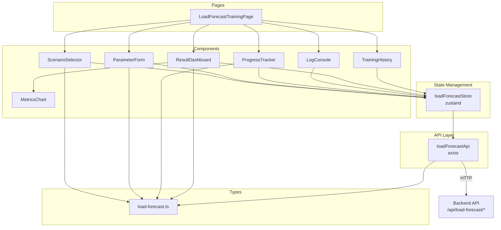
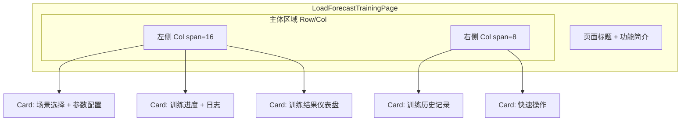
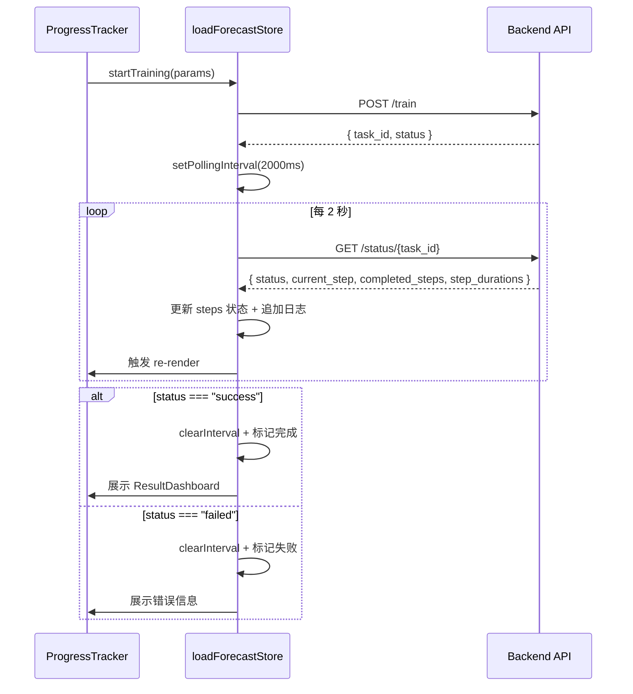

<!-- @AI_GENERATED -->
# Design Document: 负荷预测训练可视化界面

## Overview

本设计文档描述 AIP 工业AI算法平台中**负荷预测训练可视化界面**的前端架构与实现方案。该界面是一个单页面应用模块，集成在现有 React + Ant Design 前端项目中，通过路由 `/load-forecast/training` 访问。

核心功能包括：
1. **场景配置加载** — 从后端获取 6 种预测场景（DI/D/WI/W/MI/M）并展示
2. **训练参数配置** — 表单收集训练参数，支持场景推荐配置自动填充
3. **触发训练** — 调用 `POST /api/load-forecast/train` 启动训练
4. **实时进度监控** — 轮询 `GET /api/load-forecast/status/{task_id}` 展示四步训练进度
5. **训练日志控制台** — W&B 风格的深色终端日志面板
6. **训练结果仪表盘** — 展示 model_id、耗时统计、ECharts 图表
7. **快速回测验证** — 训练后调用 `POST /api/load-forecast/backtest` 验证精度
8. **训练历史** — 会话级训练记录列表，支持参数回填和重新训练

技术栈：React 18 + TypeScript + Ant Design 5 + ECharts (echarts-for-react) + zustand + axios + react-router-dom v6 + Vite。

后端 API 已完整实现，前端仅需对接，不修改后端代码。

## Architecture

### 整体架构

页面采用分层架构，遵循项目现有模式：



### 页面布局



### 数据流

1. **页面加载** → `loadForecastStore.fetchScenarios()` → `GET /api/load-forecast/scenarios`
2. **选择场景** → store 更新 `selectedScenario` → `ParameterForm` 自动填充推荐配置
3. **开始训练** → `store.startTraining(params)` → `POST /api/load-forecast/train` → 获取 `task_id`
4. **轮询进度** → `setInterval` 每 2s 调用 `GET /api/load-forecast/status/{task_id}` → 更新 steps/logs
5. **训练完成** → 停止轮询 → 展示 `ResultDashboard`
6. **快速回测** → `store.startBacktest(params)` → `POST /api/load-forecast/backtest` → 展示图表

### 轮询机制



## Components and Interfaces

### 1. LoadForecastTrainingPage（页面组件）

**路径**: `src/pages/LoadForecastTrainingPage.tsx`

顶层页面组件，负责布局编排和组件组合。

```typescript
// 页面加载时调用 fetchScenarios
// 使用 Ant Design Row/Col 布局
// 根据 store 中的训练状态条件渲染不同区域
```

### 2. ScenarioSelector（场景选择器）

**路径**: `src/components/load-forecast/ScenarioSelector.tsx`

以卡片网格形式展示 6 种预测场景，每张卡片显示 task_type、name、description。

**Props**:
```typescript
interface ScenarioSelectorProps {
  scenarios: ScenarioConfig[];
  selectedTaskType: string | null;
  loading: boolean;
  onSelect: (taskType: string) => void;
}
```

### 3. ParameterForm（参数配置表单）

**路径**: `src/components/load-forecast/ParameterForm.tsx`

使用 Ant Design Form 组件，收集训练参数。

**Props**:
```typescript
interface ParameterFormProps {
  initialValues?: Partial<TrainingParams>;
  onSubmit: (params: TrainingParams) => void;
  loading: boolean;
  disabled: boolean;
}
```

**表单字段**:
- 必填：`task_type`（Select）、`csv_path`（Input）、`parent_id`（Input）、`child_id`（Input）
- 可选：`forecast_horizon`（InputNumber, 默认 1, 正整数校验）、`time_granularity`（Select, 默认 "15min"）、`separate_modeling`（Switch, 默认 true）、`forecast_start_time`（TimePicker, 默认 "00:15"）

### 4. ProgressTracker（进度追踪器）

**路径**: `src/components/load-forecast/ProgressTracker.tsx`

使用 Ant Design Steps 组件展示四个训练步骤的状态。

**Props**:
```typescript
interface ProgressTrackerProps {
  steps: TrainingStepInfo[];
  currentStep: string | null;
  status: TaskStatus;
}
```

### 5. LogConsole（日志控制台）

**路径**: `src/components/load-forecast/LogConsole.tsx`

深色背景、等宽字体的终端风格面板，自动滚动到最新日志。

**Props**:
```typescript
interface LogConsoleProps {
  logs: LogEntry[];
  configSummary?: string;
}
```

### 6. ResultDashboard（结果仪表盘）

**路径**: `src/components/load-forecast/ResultDashboard.tsx`

训练完成后展示结果概览、耗时图表、快速回测入口。

**Props**:
```typescript
interface ResultDashboardProps {
  result: TrainingResult;
  stepDurations: Record<string, number>;
  onCopyModelId: () => void;
  onStartBacktest: () => void;
  backtestResult?: BacktestResult;
  backtestLoading: boolean;
}
```

### 7. MetricsChart（指标图表）

**路径**: `src/components/load-forecast/MetricsChart.tsx`

使用 echarts-for-react 渲染图表：步骤耗时条形图、耗时占比饼图、回测折线图、回测柱状图。

**Props**:
```typescript
interface MetricsChartProps {
  type: 'step-duration-bar' | 'step-duration-pie' | 'backtest-line' | 'backtest-bar';
  data: any;
  title?: string;
}
```

### 8. TrainingHistory（训练历史）

**路径**: `src/components/load-forecast/TrainingHistory.tsx`

展示当前会话的训练记录列表。

**Props**:
```typescript
interface TrainingHistoryProps {
  records: TrainingRecord[];
  onSelect: (record: TrainingRecord) => void;
}
```

### 9. loadForecastApi（API 服务层）

**路径**: `src/services/loadForecastApi.ts`

封装所有后端 API 调用，使用项目现有的 axios 实例。

```typescript
export const loadForecastApi = {
  getScenarios: () => api.get('/load-forecast/scenarios'),
  startTraining: (params: TrainingParams) => api.post('/load-forecast/train', params),
  getTaskStatus: (taskId: string) => api.get(`/load-forecast/status/${taskId}`),
  startBacktest: (params: BacktestParams) => api.post('/load-forecast/backtest', params),
};
```

### 10. loadForecastStore（状态管理）

**路径**: `src/stores/loadForecastStore.ts`

使用 zustand 管理全局状态，包括场景列表、训练参数、训练状态、日志、结果、历史记录。

```typescript
interface LoadForecastStore {
  // 场景
  scenarios: ScenarioConfig[];
  scenariosLoading: boolean;
  selectedTaskType: string | null;
  fetchScenarios: () => Promise<void>;
  selectScenario: (taskType: string) => void;

  // 训练
  trainingParams: Partial<TrainingParams>;
  trainingStatus: TaskStatus;
  currentTaskId: string | null;
  steps: TrainingStepInfo[];
  logs: LogEntry[];
  trainingResult: TrainingResult | null;
  isTraining: boolean;
  startTraining: (params: TrainingParams) => Promise<void>;
  pollStatus: () => void;
  stopPolling: () => void;

  // 回测
  backtestResult: BacktestResult | null;
  backtestLoading: boolean;
  startBacktest: () => Promise<void>;

  // 历史
  trainingHistory: TrainingRecord[];
  loadHistoryParams: (record: TrainingRecord) => void;

  // 重置
  resetTraining: () => void;
}
```

## Data Models

### TypeScript 类型定义

**路径**: `src/types/load-forecast.ts`

```typescript
// ===== 场景配置 =====
export interface ScenarioConfig {
  task_type: string;        // "DI" | "D" | "WI" | "W" | "MI" | "M"
  name: string;
  description: string;
  rounding_unit: string | null;
  default_retrain: boolean | null;
  forecast_horizon_range: number[] | null;
}

// ===== 训练参数 =====
export interface TrainingParams {
  task_type: string;
  csv_path: string;
  parent_id: string;
  child_id: string;
  forecast_horizon: number;
  time_granularity: string;
  separate_modeling: string;       // "true" | "false" (后端接收字符串)
  forecast_start_time: string;
  // 可选高级参数
  table_name?: string;
  parent_field?: string;
  child_field?: string;
  time_field?: string;
  load_field?: string;
  time_zone?: string;
  other_cols?: string[];
  specify_model?: string;
  nowtime?: string;
}

// ===== 任务状态 =====
export type TaskStatus = 'idle' | 'pending' | 'running' | 'success' | 'failed';

export type TrainingStepName = 'data_fetch' | 'anomaly_detection' | 'feature_engineering' | 'model_train';

export interface TrainingStepInfo {
  name: TrainingStepName;
  label: string;
  status: 'waiting' | 'running' | 'completed' | 'error';
  duration?: number;  // 秒
}

// ===== 日志条目 =====
export interface LogEntry {
  timestamp: string;     // "HH:MM:SS"
  message: string;
  type: 'info' | 'start' | 'success' | 'error' | 'config';
}

// ===== 训练结果 =====
export interface TrainingResult {
  task_id: string;
  model_id: string;
  total_duration: number;
  step_durations: Record<string, number>;
  task_type: string;
  created_at: string;
}

// ===== 回测参数 =====
export interface BacktestParams {
  task_type: string;
  csv_path: string;
  parent_id: string;
  child_id: string;
  forecast_horizon: number;
  time_granularity: string;
  separate_modeling: string;
  forecast_start_time: string;
  start_date: string;
  end_date: string;
  // 继承训练时的其他参数
  table_name?: string;
  parent_field?: string;
  child_field?: string;
  time_field?: string;
  load_field?: string;
  time_zone?: string;
  other_cols?: string[];
  specify_model?: string;
}

// ===== 回测结果 =====
export interface BacktestDailyResult {
  date: string;
  status: 'success' | 'skipped' | 'failed';
  duration_seconds?: number;
  forecast_timestamps?: string[];
  forecast_values?: number[];
  point_count?: number;
  reason?: string;
}

export interface BacktestResult {
  task_id: string;
  status: string;
  duration_seconds: number;
  total_days: number;
  success_days: number;
  skipped_days: number;
  failed_days: number;
  daily_results: BacktestDailyResult[];
}

// ===== 训练历史记录 =====
export interface TrainingRecord {
  task_id: string;
  task_type: string;
  status: TaskStatus;
  model_id?: string;
  total_duration?: number;
  params: Partial<TrainingParams>;
  created_at: string;
}

// ===== API 响应 =====
export interface ScenariosResponse {
  scenarios: ScenarioConfig[];
}

export interface TrainResponse {
  task_id: string;
  status: string;
  model_id?: string;
  duration_seconds?: number;
  steps_completed?: string[];
  metrics?: Record<string, any>;
}

export interface TaskStatusResponse {
  task_id: string;
  status: string;
  task_type: string;
  current_step: string | null;
  completed_steps: string[];
  step_durations: Record<string, number>;
  total_duration: number;
  error_message: string | null;
  error_step: string | null;
  created_at: string;
  updated_at: string;
  result: Record<string, any> | null;
}

// ===== 步骤常量 =====
export const TRAINING_STEPS: { name: TrainingStepName; label: string }[] = [
  { name: 'data_fetch', label: '数据获取' },
  { name: 'anomaly_detection', label: '异常检测' },
  { name: 'feature_engineering', label: '特征工程' },
  { name: 'model_train', label: '模型训练' },
];

export const TASK_TYPE_LABELS: Record<string, string> = {
  DI: '日内预测',
  D: '日前预测',
  WI: '周内预测',
  W: '周前预测',
  MI: '月内预测',
  M: '月前预测',
};
```

### 后端 API 端点与数据映射

| 端点 | 方法 | 请求体 | 响应 |
|------|------|--------|------|
| `/api/load-forecast/scenarios` | GET | — | `ScenariosResponse` |
| `/api/load-forecast/train` | POST | `TrainingParams` | `TrainResponse` |
| `/api/load-forecast/status/{task_id}` | GET | — | `TaskStatusResponse` |
| `/api/load-forecast/backtest` | POST | `BacktestParams` | `BacktestResult` |


## Correctness Properties

*A property is a characteristic or behavior that should hold true across all valid executions of a system — essentially, a formal statement about what the system should do. Properties serve as the bridge between human-readable specifications and machine-verifiable correctness guarantees.*

### Property 1: Scenario rendering completeness

*For any* array of ScenarioConfig objects, the ScenarioSelector component SHALL render each scenario's `task_type`, `name`, and `description` in the output DOM.

**Validates: Requirements 1.2**

### Property 2: Scenario selection auto-fills recommended config

*For any* ScenarioConfig with a known `task_type`, selecting that scenario SHALL cause the ParameterForm to populate `forecast_horizon`, `separate_modeling`, and `time_granularity` with the scenario's recommended values.

**Validates: Requirements 1.3**

### Property 3: Form validation rejects incomplete required fields

*For any* subset of required fields (`task_type`, `csv_path`, `parent_id`, `child_id`) left empty, submitting the ParameterForm SHALL be rejected and each empty required field SHALL display a validation error.

**Validates: Requirements 2.3**

### Property 4: forecast_horizon positive integer validation

*For any* numeric input value, the ParameterForm SHALL accept `forecast_horizon` if and only if the value is a positive integer (> 0, no decimals).

**Validates: Requirements 2.4**

### Property 5: Training submission passes correct params to API

*For any* valid TrainingParams object, submitting the form SHALL result in a `POST /api/load-forecast/train` call where the request body contains all parameter values matching the form input.

**Validates: Requirements 3.1**

### Property 6: Step status mapping from API response

*For any* TaskStatusResponse containing a `current_step` and a `completed_steps` list with `step_durations`, the ProgressTracker SHALL mark the `current_step` as "running", each step in `completed_steps` as "completed" with its corresponding duration, and all other steps as "waiting".

**Validates: Requirements 4.3, 4.4**

### Property 7: Log entry formatting for step transitions

*For any* training step name, timestamp, and status transition (start, complete with duration, or fail with error message), the generated LogEntry SHALL match the specified format: `[HH:MM:SS] ▶ {name} 开始执行...` for start, `[HH:MM:SS] ✓ {name} 完成 (耗时 {duration}s)` for completion, or `[HH:MM:SS] ✗ {name} 失败: {error}` for failure.

**Validates: Requirements 5.2, 5.3, 5.4, 5.5**

### Property 8: Config summary contains key parameters

*For any* TrainingParams, the config summary log generated at training start SHALL contain the `task_type`, `csv_path`, and `forecast_horizon` values.

**Validates: Requirements 5.7**

### Property 9: Result dashboard displays all required fields

*For any* TrainingResult with `model_id`, `total_duration`, `task_type`, and `created_at`, the ResultDashboard SHALL render all four values in the output.

**Validates: Requirements 6.1**

### Property 10: Step duration percentage calculation

*For any* set of step durations where total duration > 0, the computed percentage for each step SHALL equal `(step_duration / total_duration) * 100`, and the sum of all percentages SHALL equal 100%.

**Validates: Requirements 6.4**

### Property 11: Failed training error display

*For any* TaskStatusResponse with status "failed", the UI SHALL display both the `error_step` name and the `error_message` content.

**Validates: Requirements 6.5**

### Property 12: Backtest summary statistics

*For any* BacktestResult containing an array of daily_results, the displayed `success_days` SHALL equal the count of results with status "success", `skipped_days` SHALL equal the count with status "skipped", and `failed_days` SHALL equal the count with status "failed".

**Validates: Requirements 7.4**

### Property 13: Training history record completeness

*For any* sequence of completed training operations, the training history list SHALL contain one record per operation, each with correct `task_id`, `task_type`, `status`, `model_id` (if successful), and `total_duration`.

**Validates: Requirements 9.1**

### Property 14: History record param auto-fill

*For any* TrainingRecord with stored `params`, selecting that record SHALL cause the ParameterForm to populate all fields with the record's stored parameter values.

**Validates: Requirements 9.2**

## Error Handling

### API 错误处理策略

| 场景 | HTTP 状态码 | 处理方式 |
|------|------------|---------|
| 场景列表加载失败 | 任意错误 | 展示 Alert 错误提示 + 重试按钮 |
| 训练参数校验失败 | 400 | 展示后端返回的 `error_message` |
| 训练启动失败 | 500 / 网络错误 | 展示"训练启动失败"提示 + 重试按钮 |
| 状态轮询失败 | 任意错误 | 静默重试（不中断轮询），连续 3 次失败后展示警告 |
| 回测请求失败 | 任意错误 | 展示错误提示，允许重新发起 |

### 轮询容错

- 单次轮询失败不中断轮询循环，记录失败计数
- 连续 3 次轮询失败后展示网络警告，但继续尝试
- 连续 10 次轮询失败后停止轮询，展示"连接中断"错误
- 页面卸载时（`useEffect` cleanup）自动清除轮询定时器

### 前端校验

- `forecast_horizon`：正整数校验，使用 Ant Design Form rules `{ type: 'integer', min: 1 }`
- 必填字段：使用 `{ required: true }` 规则
- `csv_path`：非空字符串校验
- 表单提交前统一校验，校验失败阻止 API 调用

### 组件错误边界

- 各子组件使用 try-catch 包裹关键渲染逻辑
- ECharts 图表组件在数据异常时展示 Empty 占位符而非崩溃

## Testing Strategy

### 单元测试

使用 Vitest + React Testing Library，覆盖以下场景：

**组件渲染测试**:
- ScenarioSelector 正确渲染场景卡片
- ParameterForm 展示所有必填和可选字段
- ProgressTracker 展示四个训练步骤
- LogConsole 渲染日志条目
- ResultDashboard 展示训练结果
- TrainingHistory 展示历史记录列表

**交互测试**:
- 选择场景后表单自动填充
- 表单校验（必填字段、forecast_horizon 范围）
- 点击训练按钮触发 API 调用
- 点击复制按钮复制 model_id
- 点击历史记录回填参数

**状态管理测试**:
- loadForecastStore 的 fetchScenarios、startTraining、pollStatus、startBacktest 方法
- 轮询启动和停止逻辑
- 训练历史记录的增删

### 属性测试（Property-Based Testing）

使用 **fast-check** 库，最少 100 次迭代。

每个属性测试对应上述 Correctness Properties 中的一个属性，标签格式：
`Feature: load-forecast-training-ui, Property {number}: {property_text}`

属性测试重点覆盖：
- 日志格式化函数（Property 7）— 纯函数，适合 PBT
- 步骤状态映射逻辑（Property 6）— 纯函数，输入空间大
- 百分比计算（Property 10）— 数学计算，适合 PBT
- 回测统计汇总（Property 12）— 纯函数，输入组合多
- 表单校验逻辑（Property 3, 4）— 输入空间大，边界情况多
- 参数传递正确性（Property 5）— 确保无字段丢失

### 集成测试

- 完整训练流程：配置 → 提交 → 轮询 → 结果展示
- 训练失败流程：配置 → 提交 → 轮询 → 错误展示
- 回测流程：训练成功 → 点击回测 → 结果图表

### 测试工具配置

```
vitest + @testing-library/react + fast-check
```

- Vitest 作为测试运行器（项目已使用 Vite）
- React Testing Library 用于组件测试
- fast-check 用于属性测试，每个属性最少 100 次迭代
- MSW (Mock Service Worker) 用于 API mock
<!-- @AI_GENERATED: end -->
