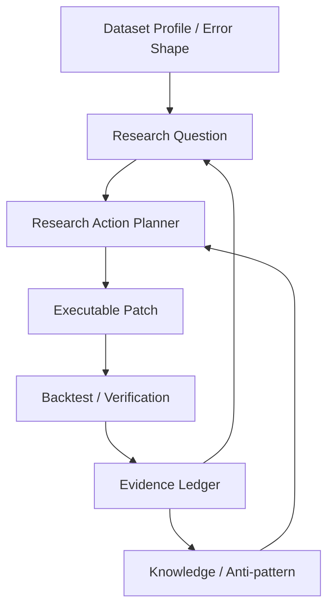

# AutoResearch 第六代演进 Plan

## Design

### 当前判断

第六代不应继续沿着“扩大参数枚举 + 多跑几轮”的方向推进。当前系统已经具备 AutoResearch 主循环、Candidate Planner、候选池、复验池、Evidence、KnowledgeLayer、Run Insight 等控制面能力；训练和复验也已经跑过，问题从“有没有闭环”转向“探索是否真的有效、是否新颖、是否能沉淀可信研究结论”。

最近 run 反映出的主要信号：

- `ares-6fd54813f76b` 是 `interrupted`，只能作为过程样本，不能当正式验收结论。
- 该 run 使用 3 个窗口，已有 `multi_window_confirmed=1`，但 `novelty_summary` 显示 `duplicate_count=4 / new_count=1`，重复探索仍偏高。
- planner 出现 `parameter_overdominance=true`，primary 方向里 parameter/risk 占主导，feature/model/data 没有稳定成为主探索方向。
- 历史强候选已有复验失败记录，说明单窗口或短 run 里的强候选不能直接 Promote。
- `load_forecast_v2` 已扩展模型超参和天气特征，但近期 v2 run 的正收益比例不高，说明继续堆离散参数不是主要突破口。

因此第六代目标应定义为：把 AutoResearch 从“自动调参/自动组合试验器”升级为“画像驱动、证据驱动、可避免重复探索的研究系统”。

### 核心设计

第六代主线采用五层闭环：

核心变化：

- Dataset Profile 不再只是展示字段，而是参与选择研究方向。
- Research Question 成为每次实验的上层对象，patch 只是它的执行形态。
- Search Space 从 flat registry 升级为 typed research actions。
- Novelty Audit 从事后审计前移为执行前门控。
- Evidence Ledger 成为候选池、复验池、问题生命周期和知识沉淀的单一事实来源。
- GLM 只负责提出研究问题、解释误差形态、生成实验意图；确定性 patch 生成、白名单、风险门控仍留在代码侧。

### Research Space V3

新增 `load_forecast_v3` 的重点不是继续加参数，而是把可探索项表达为 research action。

建议的 action 类型：

- `short_window_vs_long_window`：训练窗口缩短/拉长策略，验证过拟合或时变负荷假设。
- `calendar_feature_ablation`：节假日、工作日、差分、统计特征的开关消融。
- `rolling_window_family`：rolling window 组合、短期/长期统计特征族。
- `ensemble_weight_strategy`：`auto_rmse`、`upstream_oof_rmse`、`equal` 等权重策略。
- `model_regularization_profile`：XGB/LGB/CatBoost 的复杂度和学习率边界组合。
- `weather_sensitivity_probe`：只在画像显示天气敏感时启用天气列。
- `horizon_density_probe`：`daily_horizon`、`sliding_window.step`、样本密度和预测粒度实验。

每个 action 至少包含：

- `action_id`
- `target_direction`
- `applicable_profile`
- `patch_template`
- `max_changed_variables`
- `risk_level`
- `expected_evidence`
- `stop_conditions`
- `fallback_actions`
- `known_anti_patterns`

### Profile 驱动选路

Dataset Profile / Error Shape 应输出可用于 planner 的结构化信号：

- 波动强、峰谷切换明显：优先 rolling/stat/diff。
- 周末/节假日差异明显：优先 calendar feature ablation。
- 近期漂移强：优先短训练窗口和 decay/regularization。
- 天气相关强：才启用 weather probe。
- 数据短或噪声大：限制高复杂模型和大规模 auto tune。
- 某窗口异常大：先做 window diagnosis，不直接把收益写成通用知识。

这可以降低 feature/data 方向的盲试比例，也能解释为什么某些 action 不该在当前场景执行。

### Novelty 前置门控

当前 novelty 多在结果后审计，第六代应在执行前做 gating：

- 同 `patch_signature` 已跑过：跳过。
- 同 `changed_variables` 组合重复过多：降权或跳过。
- 近邻 patch 已有 `multi_window_rejected`：默认跳过，除非 profile 条件不同。
- 同一 run 内同 action 连续无效：触发 cooldown。
- action 只改了历史已知无效变量组合：不消耗回测资源。

输出应写入 planner reason，避免黑盒跳过。

### Evidence Ledger

Evidence Ledger 是第六代的中心事实表，不再让 candidate、question、knowledge 各自存一套不可对齐结论。

Evidence 需要统一记录：

- run / iteration / group / action_id
- research_question_id
- patch_fingerprint
- changed_variables
- profile_fingerprint
- windows_total / windows_challenger_better
- evidence_strength
- failure_reason
- novelty_result
- promoted / rejected / stale 状态

派生关系：

- Candidate Pool 从 positive evidence 派生。
- Verification Queue 从需要复验的 candidate evidence 派生。
- KnowledgeLayer 只从 `multi_window_confirmed` 或稳定重复证据升级。
- Research Question lifecycle 由 evidence 自动推进到 `resolved/stale/disproved`。

### 两级或三级实验调度

为了扩大探索宽度，同时控制复验成本，建议引入 staged evaluation：

- Stage A：cheap probe。低成本 1 窗口、低 trials、快速排除明显坏 action。
- Stage B：formal compare。3 窗口正式比较，生成候选证据。
- Stage C：verification。5 窗口复验，只有 passed 才允许 Promote 或 active knowledge。

Stage A 的输出不能进入 active knowledge，只能决定是否进入 Stage B。

### Agent / Service 分层

先不要大规模引入复杂 orchestration 框架。第六代可以先落成 4 个明确 service：

- `Analyst`：从 dataset profile、window error、历史 evidence 生成研究问题。
- `ResearchActionPlanner`：把研究问题映射成 action，并做 novelty/risk/cost 排序。
- `PatchCompiler`：把 action 编译成现有 runtime patch，负责白名单和结构合法性。
- `EvidenceCritic`：评价证据强度、失败原因、是否入复验、是否沉淀知识。

后续如果主循环拆分稳定，再考虑 LangGraph/StateGraph 把状态机显式化。

### 可能涉及文件

- `backend-service/data/autoresearch_search_registries/load_forecast_v3.json`
- `backend-service/services/autoresearch_candidate_planner.py`
- `backend-service/services/dataset_profiler.py`
- `backend-service/services/dataset_profiler_models.py`
- `backend-service/services/autoresearch_evidence.py`
- `backend-service/services/knowledge_layer.py`
- `backend-service/services/autoresearch_question_lifecycle.py`
- `backend-service/services/autoresearch_insight_builder.py`
- `backend-service/api/workflows_enhanced.py`
- `frontend-sevice/src/pages/WorkflowBaselineComparePage.tsx`
- `frontend-sevice/src/types/workflow-enhanced.ts`
- `frontend-sevice/src/services/workflowEnhancedApi.ts`

### 验证策略

第六代不是只看 MAPE，而要同时看研究质量指标：

- duplicate candidate ratio 下降。
- `new_count / total` 上升。
- 每个 action 有明确 reason 和 profile basis。
- feature/data/model/risk/parameter 的尝试不再靠硬轮转，而是能解释为什么选。
- `multi_window_confirmed` 来源不再集中在重复模型组合。
- `multi_window_rejected` 能反向抑制近邻重复实验。
- Research Question 能被 evidence 推动状态变化。
- Candidate Pool、Verification Queue、KnowledgeLayer 对同一 evidence 的状态一致。

### 风险和边界

- 不应一次性重写 `_run_autoresearch_task`，先通过 service 插入点渐进替换。
- 不应让 GLM 直接写可执行 patch；patch 仍需 deterministic compiler。
- 不应让 single-window positive 升级为 active knowledge。
- v3 registry 需要兼容 v1/v2，不要破坏历史 run 读取。
- 复验池和 AutoResearch 并行时仍要保留资源水位保护。
- 若 profile 数据质量不足，应降级到 conservative planner，而不是盲目启用天气/复杂模型。

## Task breakdown

- [ ] T1. 固化第六代成功标准
  - 依赖：确认最近 run 的验收口径仍以研究质量为主。
  - 产出：定义 `novelty_rate`、`action_success_rate`、`multi_window_confirmed_rate`、`duplicate_patch_rate`、`question_resolution_rate`。
  - 验证点：这些指标能从现有 snapshot/evidence/candidate pool 中计算或低成本补字段。
  - 停止条件：指标定义不依赖 UI，不依赖人工解释。

- [ ] T2. 设计 `ResearchAction` schema
  - 依赖：读取 v1/v2 registry 和当前 patch 编译规则。
  - 产出：`action_id`、`applicable_profile`、`patch_template`、`risk_level`、`expected_evidence`、`stop_conditions` 等字段定义。
  - 验证点：至少能表达训练窗口、rolling、calendar、ensemble、model regularization、weather、horizon 七类 action。
  - 停止条件：schema 能编译到现有 runtime patch，不要求立刻支持所有未来框架。

- [ ] T3. 新增 `load_forecast_v3` registry 草案
  - 依赖：T2。
  - 产出：新增 v3 JSON，不覆盖 v1/v2。
  - 验证点：JSON schema 可加载；每个 action 有清晰 target direction 和 max changed variables。
  - 停止条件：先覆盖最常见 15-25 个 action，不追求穷尽。

- [ ] T4. 增加 profile-to-action 规则
  - 依赖：Dataset Profile 字段可用性确认。
  - 产出：把波动、周末敏感、漂移、天气敏感、数据长度、异常窗口映射到 action 权重。
  - 验证点：profile 缺失时能降级；profile 有效时 planner reason 可解释。
  - 停止条件：不改训练逻辑，只影响候选选择。

- [ ] T5. 实现 novelty 前置门控
  - 依赖：patch fingerprint、changed_variables、candidate pool、evidence records 可读取。
  - 产出：执行前过滤或降权重复 patch / 近邻 rejected patch。
  - 验证点：同 signature 不再进入回测；跳过原因写入 planner reason。
  - 停止条件：默认只跳过强重复，避免误杀 profile 不同的实验。

- [ ] T6. 建立 Evidence Ledger 最小版本
  - 依赖：现有 `autoresearch_evidence.py` 和 candidate/verification 写入点。
  - 产出：统一 evidence 字段，补 `action_id`、`research_question_id`、`profile_fingerprint`、`novelty_result`。
  - 验证点：候选池、复验池、KnowledgeLayer 能引用同一 evidence id。
  - 停止条件：先保持 JSON 文件存储，不引入数据库迁移。

- [ ] T7. 引入 staged evaluation 策略
  - 依赖：Evidence Ledger 能区分 probe/formal/verification。
  - 产出：Stage A/B/C 的调度策略和证据升级规则。
  - 验证点：Stage A positive 不会进入 active knowledge；Stage C passed 才允许 Promote。
  - 停止条件：先支持配置开关，不强制替换全部 run。

- [ ] T8. 拆出四个第六代 service 雏形
  - 依赖：T2-T7 的数据结构稳定。
  - 产出：`Analyst`、`ResearchActionPlanner`、`PatchCompiler`、`EvidenceCritic` 的最小接口。
  - 验证点：主循环只调用接口，不把所有逻辑继续堆进 `_run_autoresearch_task`。
  - 停止条件：接口可被单元测试覆盖，不要求一次性完成 LangGraph 化。

- [ ] T9. 后端 focused tests
  - 依赖：T3-T8。
  - 产出：registry 加载、action 编译、novelty gate、evidence 状态升级、profile 选路测试。
  - 验证点：使用 `conda run -n aip_web pytest ... -q` 跑相关 focused tests。
  - 停止条件：不跑全量 pytest，除非改动影响面扩大。

- [ ] T10. 10 轮 smoke run
  - 依赖：后端 focused tests 通过。
  - 产出：一次 v3 smoke run。
  - 验证点：看 duplicate ratio、new action coverage、evidence strength、question lifecycle，不只看 best MAPE。
  - 停止条件：smoke 只验证链路和研究质量指标，不直接 Promote。

- [ ] T11. 3 窗口正式 run
  - 依赖：T10 显示探索质量改善。
  - 产出：一次 30-50 轮正式 run。
  - 验证点：至少产出若干可复验候选，且 novelty 不明显退化。
  - 停止条件：若重复率仍高，先修 planner/novelty，不继续加长 run。

- [ ] T12. 复验池闭环验证
  - 依赖：T11 产生候选。
  - 产出：将候选入复验池，按 5 窗口验证。
  - 验证点：passed evidence 能回写源 run、candidate pool、KnowledgeLayer。
  - 停止条件：没有 passed 也可接受，但必须能形成 rejected anti-pattern，指导下一轮避开。
