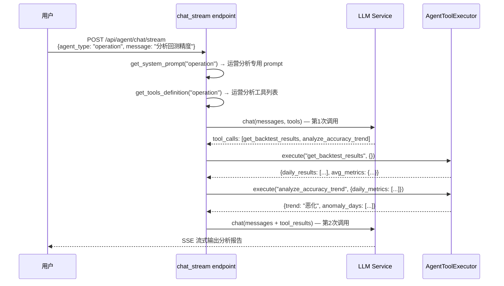
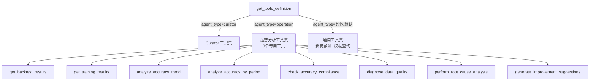

<!-- @AI_GENERATED -->
# 设计文档：运营分析 Agent（Operations Analysis Agent）

## 概述

运营分析 Agent 是 AIP 平台四个 Agent 之一（`agent_type="operation"`），专注于对负荷预测训练/回测结果进行精度分析和根因分析。

**核心设计决策**：采用 LLM + Function Calling 架构，复用现有 `algorithm_agent.py` 对话端点和 `AgentToolExecutor` 工具框架，通过新增运营分析专用工具和 system prompt 实现功能扩展。不新建独立 API 路由，不使用 Master Agent + Sub-Agent 架构。

**设计目标**：
- 8 个运营分析工具函数注册到 `AgentToolExecutor`，按 `agent_type` 隔离
- 运营分析专用 system prompt 指引 LLM 正确编排工具调用链
- 支持多步工具调用（先获取数据 → 分析 → 根因诊断 → 改进建议）
- 工具函数为纯计算逻辑，不依赖外部 API 调用，直接读取本地文件和内存数据

## 架构

### 整体架构



### 工具隔离机制



`get_tools_definition()` 函数将接受 `agent_type` 参数，当 `agent_type="operation"` 时仅返回 `OPERATION_AGENT_TOOLS` 列表，其他类型返回现有的 `AGENT_TOOLS` 列表。

### 多步工具调用

当前 `generate_llm_response` 仅支持单轮工具调用（LLM 调工具 → 结果回传 → LLM 生成回答）。需要扩展为循环模式：

```python
# 伪代码
max_rounds = 5
for round in range(max_rounds):
    response = await llm_service.chat(messages, tools)
    if not response.get("tool_calls"):
        break  # LLM 不再调用工具，输出最终回答
    # 执行所有 tool_calls，结果追加到 messages
    for tc in response["tool_calls"]:
        result = await tool_executor.execute(tc.name, tc.args)
        messages.append(tool_result_message)
```

最大轮次设为 5，防止无限循环。

## 组件和接口

### 1. 工具定义列表 — `OPERATION_AGENT_TOOLS`

新增独立的工具定义列表 `OPERATION_AGENT_TOOLS`，包含 8 个工具的 OpenAI Function Calling 格式定义。每个工具定义包含：
- `name`：工具名称（snake_case）
- `description`：中文描述，帮助 LLM 理解何时调用
- `parameters`：JSON Schema 格式的参数定义

### 2. 工具执行方法 — `AgentToolExecutor` 扩展

在现有 `AgentToolExecutor` 类中新增 8 个 async 方法，并在 `execute()` 路由中添加对应分支。

### 3. System Prompt — `AGENT_SYSTEM_PROMPTS["operation"]`

替换现有的简单 operation prompt，新增详细的运营分析专用 prompt，包含：
- Agent 角色定义（负荷预测运营分析专家）
- 能力范围（精度分析、根因分析、改进建议）
- 工具调用规则表（用户意图 → 推荐工具链）
- 回答格式要求（Markdown 表格、指标高亮）

### 4. `get_tools_definition()` 改造

```python
def get_tools_definition(agent_type: str = None) -> List[dict]:
    if agent_type == "operation":
        return OPERATION_AGENT_TOOLS
    return AGENT_TOOLS
```

### 5. `generate_llm_response()` 改造

- 传递 `agent_type` 给 `get_tools_definition()`
- 添加多步工具调用循环（最多 5 轮）

### 6. `chat_stream()` 改造

流式端点中，`agent_type="operation"` 走 LLM + Function Calling 路径（与现有非 curator 路径一致），但传递 `agent_type` 给 `get_tools_definition()` 以获取正确的工具集。

### 工具函数接口定义

#### get_backtest_results

```python
async def get_backtest_results(
    self,
    workflow_id: str = None,  # 可选，不指定则返回最近一次
    task_id: str = None,      # 可选，从 load_forecast task_store 查询
) -> Dict[str, Any]:
    """
    返回:
    {
        "task_type": "D",
        "date_range": {"start": "2025-01-01", "end": "2025-01-31"},
        "total_days": 31,
        "success_days": 28,
        "avg_metrics": {"smape": 4.2, "mae": 120.5, "rmse": 180.3},
        "daily_results": [
            {"date": "2025-01-01", "status": "success", "metrics": {"smape": 3.8, "mae": 110, "rmse": 165}, "y_true": [...], "y_pred": [...]},
            ...
        ]
    }
    """
```

数据来源优先级：
1. `task_store`（内存，load_forecast.py 的回测任务结果）
2. `_backtest_artifacts/` 目录下的 CSV 文件（持久化）
3. `workflows_enhanced` 执行结果

#### get_training_results

```python
async def get_training_results(
    self,
    workflow_id: str = None,
    task_id: str = None,
) -> Dict[str, Any]:
    """
    返回:
    {
        "model_id": "model-20250420-abc",
        "task_type": "D",
        "training_duration": 45.2,
        "feature_importance": [
            {"feature": "hour", "score": 0.15},
            {"feature": "load_lag_1d", "score": 0.12},
            ...  # Top-20, 按 score 降序
        ],
        "eval_metrics": {
            "train": {"smape": 3.1, "mae": 95, "rmse": 140},
            "val": {"smape": 4.0, "mae": 110, "rmse": 160}
        },
        "model_params": {"max_depth": 6, "learning_rate": 0.05, "n_estimators": 200, ...}
    }
    """
```

数据来源：`task_store` 中 `task_type="train"` 且 `status="success"` 的最近一条。

#### analyze_accuracy_trend

```python
async def analyze_accuracy_trend(
    self,
    daily_metrics: List[Dict] = None,  # 可选，不传则自动获取最近回测
    metric_name: str = "smape",        # 分析哪个指标
) -> Dict[str, Any]:
    """
    返回:
    {
        "metric_name": "smape",
        "overall": {"mean": 4.2, "std": 1.8, "max": 12.1, "max_date": "2025-01-15", "min": 1.5, "min_date": "2025-01-03"},
        "trend": {"slope": 0.05, "direction": "稳定", "description": "精度整体稳定，无明显恶化趋势"},
        "moving_average": [{"date": "2025-01-03", "value": 3.9}, ...],  # 3日移动平均
        "anomaly_days": [{"date": "2025-01-15", "smape": 12.1, "deviation": 4.4}]
    }
    """
```

计算逻辑：
- 线性回归斜率：`numpy.polyfit(x, y, 1)[0]`
- 异常日检测：`smape > mean + 2 * std`
- 移动平均：3 日滑动窗口

#### analyze_accuracy_by_period

```python
async def analyze_accuracy_by_period(
    self,
    daily_results: List[Dict] = None,
    group_by: str = "hour",  # "hour" | "weekday" | "month"
) -> Dict[str, Any]:
    """
    返回:
    {
        "group_by": "hour",
        "groups": [
            {"label": "00:00", "count": 30, "mean_smape": 3.2, "std": 0.8, "max": 5.1, "min": 1.8},
            {"label": "01:00", "count": 30, "mean_smape": 3.0, ...},
            ...
        ],
        "worst_period": {"label": "12:00", "mean_smape": 8.5},
        "best_period": {"label": "03:00", "mean_smape": 1.2}
    }
    """
```

分组逻辑：
- `hour`：需要逐点数据（y_true/y_pred），按 15 分钟间隔的小时分组，计算每小时的 SMAPE
- `weekday`：按日期的 weekday 分为工作日/休息日两组
- `month`：按日期的月份分组

#### check_accuracy_compliance

```python
async def check_accuracy_compliance(
    self,
    daily_metrics: List[Dict] = None,
    task_type: str = "D",
    threshold_override: float = None,
) -> Dict[str, Any]:
    """
    返回:
    {
        "task_type": "D",
        "threshold": 5.0,
        "avg_smape": 4.2,
        "compliant": True,
        "compliance_rate": 85.7,  # 百分比
        "total_days": 28,
        "compliant_days": 24,
        "non_compliant_days": [
            {"date": "2025-01-15", "smape": 12.1},
            {"date": "2025-01-22", "smape": 6.3},
            ...
        ]
    }
    """
```

默认阈值：`{"DI": 8.0, "D": 5.0, "WI": 10.0, "W": 10.0, "MI": 15.0, "M": 15.0}`

#### diagnose_data_quality

```python
async def diagnose_data_quality(
    self,
    daily_results: List[Dict] = None,
) -> Dict[str, Any]:
    """
    返回:
    {
        "overall_score": 82,
        "has_quality_issues": False,
        "dimensions": {
            "missing_ratio": {"score": 95, "detail": "缺失率 0.5%"},
            "outlier_ratio": {"score": 80, "detail": "异常值比例 2.1%"},
            "time_continuity": {"score": 90, "detail": "无时间断点"},
            "value_range": {"score": 85, "detail": "存在 3 个负值点"}
        },
        "correlation_with_anomaly": [
            {"date": "2025-01-15", "quality_issue": "缺失率 15%", "smape": 12.1}
        ]
    }
    """
```

评分逻辑：
- `missing_ratio`：`100 - missing_pct * 10`（缺失率每 1% 扣 10 分）
- `outlier_ratio`：`100 - outlier_pct * 5`（异常值每 1% 扣 5 分）
- `time_continuity`：有断点扣分，无断点 100 分
- `value_range`：有负值或极端值扣分
- `overall_score`：四个维度的加权平均（权重：0.3, 0.25, 0.25, 0.2）

#### perform_root_cause_analysis

```python
async def perform_root_cause_analysis(
    self,
    daily_results: List[Dict] = None,
    training_info: Dict = None,
) -> Dict[str, Any]:
    """
    返回:
    {
        "root_causes": [
            {
                "cause_type": "data_quality",
                "confidence": 0.85,
                "evidence": "2025-01-15 缺失率 15%，导致该日 SMAPE 达 12%",
                "impact": "high"
            },
            {
                "cause_type": "feature_coverage",
                "confidence": 0.6,
                "evidence": "特征重要性 Top-5 中无气象特征，极端天气日预测偏差大",
                "impact": "medium"
            }
        ],
        "summary": "主要根因：数据质量问题（置信度 85%）"
    }
    """
```

检查优先级：
1. `data_quality` — 数据质量评分 < 80 或异常日与数据问题重合
2. `feature_coverage` — 特征重要性中缺少关键特征类型（气象、日历）
3. `model_params` — 模型参数与推荐值偏差大（如 max_depth 过大可能过拟合）
4. `seasonal_change` — 训练数据未覆盖当前季节模式
5. `external_factors` — 无法归因到以上类别的异常

#### generate_improvement_suggestions

```python
async def generate_improvement_suggestions(
    self,
    root_causes: List[Dict] = None,
) -> Dict[str, Any]:
    """
    返回:
    {
        "suggestions": [
            {
                "action": "对缺失率 > 10% 的日期使用前向填充 + 周期性插值",
                "priority": "高",
                "expected_improvement": "SMAPE 预计降低 1-2%",
                "effort": "简单",
                "related_cause": "data_quality"
            },
            ...
        ]
    }
    """
```

建议映射规则：
- `data_quality` → 数据清洗策略（填充、插值、异常值处理）
- `feature_coverage` → 特征工程建议（添加气象、日历、滞后特征）
- `model_params` → 参数调优建议（调整 max_depth、learning_rate、n_estimators）
- `seasonal_change` → 重训策略（扩大训练窗口、增量训练）
- `external_factors` → 外部数据接入建议

优先级排序：`高 > 中 > 低`

## 数据模型

### 回测结果数据结构（已有）

```python
# load_forecast.py task_store 中的回测结果
{
    "task_id": "task-xxxx",
    "status": "success",
    "task_type": "backtest",
    "result": {
        "total_days": 31,
        "success_days": 28,
        "skipped_days": 2,
        "failed_days": 1,
        "duration_seconds": 1200.5,
        "daily_results": [
            {
                "date": "2025-01-01",
                "status": "success",
                "duration_seconds": 45.2,
                "forecast_timestamps": ["2025-01-01 00:00:00", ...],
                "forecast_values": [120.5, 118.3, ...],
                "point_count": 96
            }
        ]
    }
}
```

```python
# workflows_enhanced.py 回测结果
{
    "total_days": 31,
    "success_days": 28,
    "daily_results": [
        {
            "date": "2025-01-01",
            "status": "success",
            "duration": 45.2,
            "metrics": {"smape": 3.8, "mae": 110, "rmse": 165},
            "y_true": [120.5, 118.3, ...],
            "y_pred": [121.0, 117.8, ...],
            "point_count": 96
        }
    ],
    "avg_metrics": {"avg_smape": 4.2, "avg_mae": 120, "avg_rmse": 175}
}
```

### 训练结果数据结构（已有）

```python
# load_forecast.py task_store 中的训练结果
{
    "task_id": "task-xxxx",
    "status": "success",
    "task_type": "train",  # 或具体场景如 "D"
    "result": {
        "model_id": "model-xxxx",
        "duration_seconds": 45.2,
        "feature_importance": {"hour": 0.15, "load_lag_1d": 0.12, ...},
        "eval_metrics": {"smape": 3.1, "rmse": 140},
        "model_params": {"max_depth": 6, ...}
    }
}
```

### 运营分析工具输出数据结构（新增）

所有工具输出均为 JSON 可序列化的 `Dict[str, Any]`，错误时返回：

```python
{
    "error": True,
    "error_type": "not_found",  # not_found | invalid_params | computation_error
    "error_message": "未找到回测结果，请先执行回测"
}
```


## 正确性属性

*正确性属性是指在系统所有合法执行中都应成立的特征或行为——本质上是对系统应做什么的形式化陈述。属性是连接人类可读规格说明与机器可验证正确性保证之间的桥梁。*

### 属性 1：趋势分析统计计算正确性

*对于任意*非空的逐日 SMAPE 值序列，`analyze_accuracy_trend` 返回的均值、标准差、最大值、最小值应与 numpy 计算结果一致；最大值日期和最小值日期应对应正确的日期；移动平均窗口大小为 3。

**验证需求：4.1, 4.2**

### 属性 2：趋势方向分类正确性

*对于任意*线性回归斜率值，`analyze_accuracy_trend` 返回的趋势方向应满足：斜率 > 0.1 时为"恶化趋势"，斜率 < -0.1 时为"改善趋势"，其余为"稳定"。

**验证需求：4.3**

### 属性 3：异常日检测正确性

*对于任意*逐日 SMAPE 值序列，`analyze_accuracy_trend` 检测到的异常日集合应恰好等于 SMAPE > mean + 2 * std 的日期集合。

**验证需求：4.4**

### 属性 4：时段分组完整性与统计正确性

*对于任意*逐日结果数据和分组维度，`analyze_accuracy_by_period` 返回的所有分组的样本数之和应等于原始数据总量；每组的均值、标准差、最大值、最小值应与该组数据的 numpy 计算结果一致。

**验证需求：5.1, 5.5**

### 属性 5：精度达标判定正确性

*对于任意*逐日 SMAPE 值序列和精度阈值，`check_accuracy_compliance` 返回的不达标天数列表应恰好等于 SMAPE > threshold 的日期集合；达标率应等于 compliant_days / total_days × 100。

**验证需求：6.1, 6.3, 6.5**

### 属性 6：数据质量评分范围与阈值判定

*对于任意*数据质量各维度评分（每个维度 0-100），综合 Data_Quality_Score 应在 [0, 100] 范围内；`has_quality_issues` 应为 true 当且仅当 overall_score < 80。

**验证需求：7.3, 7.4**

### 属性 7：根因分析输出结构完整性

*对于任意* `perform_root_cause_analysis` 的返回结果，每个根因条目应包含 `cause_type`（字符串）、`confidence`（0 到 1 之间的浮点数）、`evidence`（字符串）和 `impact`（字符串）四个字段。

**验证需求：8.7**

### 属性 8：改进建议完整性与排序

*对于任意*非空的根因列表，`generate_improvement_suggestions` 返回的建议列表应非空；每条建议应包含 `action`、`priority`、`expected_improvement`、`effort` 四个字段；建议列表应按优先级降序排列（高 > 中 > 低）。

**验证需求：9.1, 9.2, 9.6**

### 属性 9：工具定义格式正确性

*对于任意* `OPERATION_AGENT_TOOLS` 中的工具定义，应包含 `type="function"`、`function.name`（非空字符串）、`function.description`（非空字符串）和 `function.parameters`（合法 JSON Schema）。

**验证需求：11.1**

### 属性 10：工具按 agent_type 隔离

*对于任意* `agent_type` 不等于 `"operation"` 的情况，`get_tools_definition(agent_type)` 返回的工具列表不应包含任何运营分析专用工具名称。

**验证需求：11.2**

### 属性 11：工具错误处理结构一致性

*对于任意*工具执行异常，返回的错误结果应包含 `error`（True）、`error_type`（字符串）和 `error_message`（字符串）三个字段。

**验证需求：1.7, 11.4**

### 属性 12：特征重要性排序不变量

*对于任意* `get_training_results` 返回的 `feature_importance` 列表，列表中每个元素的 `score` 应大于等于下一个元素的 `score`（降序排列）。

**验证需求：3.3**

## 错误处理

### 工具级错误处理

所有工具函数统一采用 try-except 包裹，异常时返回标准错误 JSON：

```python
async def some_tool(self, **kwargs) -> Dict[str, Any]:
    try:
        # 业务逻辑
        ...
    except FileNotFoundError:
        return {"error": True, "error_type": "not_found", "error_message": "数据文件不存在"}
    except ValueError as e:
        return {"error": True, "error_type": "invalid_params", "error_message": str(e)}
    except Exception as e:
        return {"error": True, "error_type": "computation_error", "error_message": f"计算异常: {str(e)}"}
```

### LLM 调用级错误处理

- LLM 不可用时：降级到规则响应（现有机制）
- 工具调用参数解析失败：返回错误 JSON，LLM 基于错误信息生成友好提示
- 多步调用超过最大轮次（5 轮）：强制终止，LLM 基于已有结果生成部分回答

### 数据缺失处理

- 无回测结果：返回错误信息 + 可用任务列表
- 无训练结果：返回错误信息 + 引导用户先执行训练
- 回测数据不完整（部分天失败）：仅基于成功天数进行分析，在结果中标注数据完整度

## 测试策略

### 属性测试（Property-Based Testing）

使用 `hypothesis` 库对 12 个正确性属性编写属性测试，每个属性至少 100 次迭代。

重点属性测试：
- **属性 1-3**（趋势分析）：生成随机 SMAPE 序列，验证统计计算、趋势分类、异常检测的正确性
- **属性 5**（达标判定）：生成随机 SMAPE 值和阈值，验证达标/不达标分类的正确性
- **属性 8**（改进建议排序）：生成随机根因列表，验证建议的完整性和排序

标签格式：`Feature: operations-analysis-agent, Property {N}: {property_text}`

### 单元测试

- 每个工具函数的正常路径和错误路径
- 工具定义格式验证
- System prompt 内容验证
- 工具隔离机制验证

### 集成测试

- 端到端对话流程（mock LLM）：用户提问 → 工具调用 → 结果生成
- 多步工具调用链：获取数据 → 趋势分析 → 根因分析 → 改进建议
- SSE 流式输出格式验证
<!-- @AI_GENERATED: end -->
