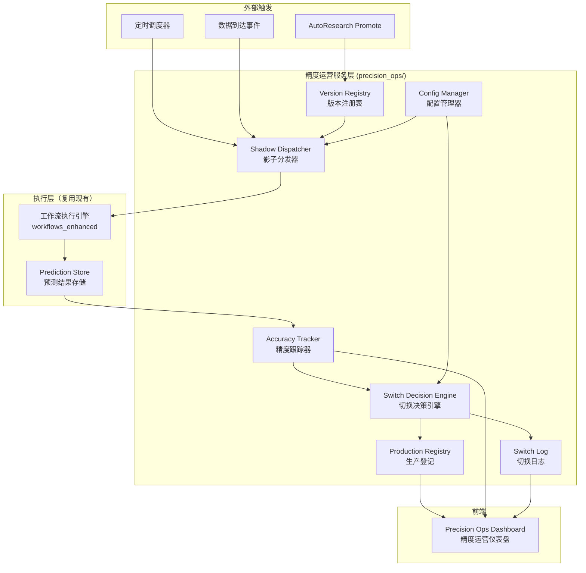
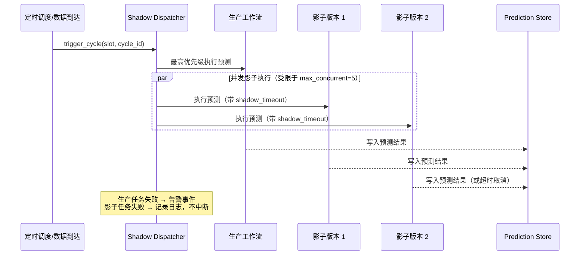
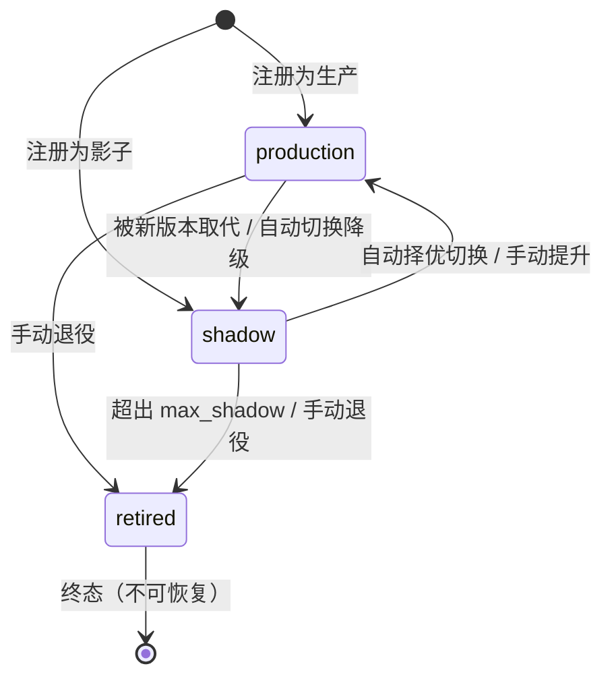

# 设计文档：预测工作流自动择优切换

## 概述（Overview）

本设计实现负荷预测"精度运营"模块中的**预测工作流自动择优切换**机制（Prediction Workflow Auto-Switch）。系统类似于预测服务的金丝雀/灰度发布：当前最优工作流（生产工作流）对外提供预测结果，同时让多个历史版本工作流以影子模式后台并行执行预测，持续积累真实精度数据。当精度监控发现生产版本在评估窗口内表现不如某个影子版本时，系统自动执行切换。

**与现有系统的关系：**
- AutoResearch 负责"离线搜优"（探索新配置）
- 本功能负责"在线保优"（实时精度守卫）
- AutoResearch Promote 的结论进入本系统，成为生产版本或影子版本之一

**核心设计原则：**
1. 不侵入现有工作流执行引擎，通过独立服务层实现
2. 生产工作流优先级最高，影子执行不得影响生产延迟
3. 所有切换操作原子性、可审计、可回滚
4. 配置热更新，无需服务重启


## 架构（Architecture）

### 系统整体架构



### 模块职责划分

| 模块 | 文件路径（计划） | 职责 |
|------|-----------------|------|
| Version Registry | `backend-service/services/precision_ops/version_registry.py` | 工作流版本注册、状态管理、生命周期转换 |
| Shadow Dispatcher | `backend-service/services/precision_ops/shadow_dispatcher.py` | 预测周期分发、并发控制、超时管理 |
| Accuracy Tracker | `backend-service/services/precision_ops/accuracy_tracker.py` | 精度指标计算、滚动窗口维护、排行榜 |
| Switch Decision Engine | `backend-service/services/precision_ops/switch_engine.py` | 切换决策逻辑、冷却期、后切换观察 |
| Switch Log | `backend-service/services/precision_ops/switch_log.py` | 仅追加切换审计日志 |
| Production Registry | `backend-service/services/precision_ops/production_registry.py` | 生产登记文件维护、原子更新、事件发送 |
| Config Manager | `backend-service/services/precision_ops/config_manager.py` | 每槽位配置加载、校验、热更新 |
| API Router | `backend-service/api/precision_ops.py` | REST 端点注册 |
| Frontend Page | `frontend-sevice/src/pages/PrecisionOpsDashboardPage.tsx` | 精度运营仪表盘页面 |


### 与现有系统的集成点

1. **AutoResearch Promote → 版本注册**：现有 `promote_tuning_candidate` 成功后，调用 Version Registry 注册新版本
2. **工作流执行引擎复用**：Shadow Dispatcher 调用已有的 `_execute_pipeline_sync` 执行预测
3. **生产登记兼容**：新 Production Registry 扩展现有 `_load_production_registry` / `_save_production_registry` 模式，增加精度运营元数据
4. **数据存储**：沿用 `backend-service/data/` 目录下 JSON 文件存储模式 + `_atomic_write_json` 原子写入

### 存储策略决策

| 数据类型 | 存储介质 | 理由 |
|---------|---------|------|
| Version Registry（版本注册表） | JSON 文件 | 条目少（每槽位 ≤ 20）、与现有模式一致 |
| Prediction Store（预测结果） | SQLite | 时序数据量大（每天 × 每版本 × 多时间点）、需高效范围查询 |
| Accuracy Metrics（精度指标） | JSON 文件 | 每槽位一个文件、条目有限、便于调试 |
| Switch Log（切换日志） | JSON Lines (`.jsonl`) | 仅追加、便于审计、无需复杂查询 |
| Slot Config（槽位配置） | JSON 文件 | 少量静态配置 |
| Production Registry（生产登记） | JSON 文件 | 兼容现有模式 |

存储基础路径：`backend-service/data/precision_ops/`（由部署配置决定相对位置）

## 组件与接口（Components and Interfaces）

### REST API 设计

所有精度运营 API 挂载在 `/api/precision-ops` 前缀下。

#### 版本管理

| 方法 | 路径 | 说明 |
|------|------|------|
| POST | `/api/precision-ops/{slot}/versions` | 注册新版本 |
| GET | `/api/precision-ops/{slot}/versions` | 列出槽位所有版本 |
| PATCH | `/api/precision-ops/{slot}/versions/{version_tag}/status` | 变更版本状态 |

#### 精度监控

| 方法 | 路径 | 说明 |
|------|------|------|
| GET | `/api/precision-ops/{slot}/leaderboard` | 排行榜（按 rolling_mape 升序） |
| GET | `/api/precision-ops/{slot}/metrics-history` | 多版本每日 MAPE 时序数据 |
| GET | `/api/precision-ops/{slot}/production` | 当前生产登记条目 |

#### 切换操作

| 方法 | 路径 | 说明 |
|------|------|------|
| POST | `/api/precision-ops/{slot}/switch` | 手动触发切换 |
| POST | `/api/precision-ops/{slot}/rollback` | 回滚最近一次切换 |
| GET | `/api/precision-ops/{slot}/switch-log` | 切换日志分页查询 |

#### 配置管理

| 方法 | 路径 | 说明 |
|------|------|------|
| GET | `/api/precision-ops/{slot}/config` | 获取槽位配置 |
| PUT | `/api/precision-ops/{slot}/config` | 更新槽位配置 |


### 核心接口签名（Python）

```python
# --- Version Registry ---
class VersionEntry(TypedDict):
    workflow_id: str          # 工作流模板 ID
    version_tag: str          # 版本标签，如 "v2026-06-08-ares-abc123"
    source_run_id: Optional[str]       # 来源 AutoResearch run ID
    source_candidate_id: Optional[str] # 来源候选 ID
    registered_at: str        # 注册时间 ISO 8601
    status: str               # "production" | "shadow" | "retired"
    slot: str                 # 槽位（分区键），默认 "default"
    baseline_mape: Optional[float]     # 注册时的历史基线 MAPE

class VersionRegistry:
    def register(self, entry: VersionEntry) -> VersionEntry: ...
    def get_production(self, slot: str) -> Optional[VersionEntry]: ...
    def list_shadows(self, slot: str) -> List[VersionEntry]: ...
    def transition_status(self, workflow_id: str, version_tag: str, new_status: str) -> VersionEntry: ...

# --- Accuracy Tracker ---
class RollingMetrics(TypedDict):
    rolling_mape: float       # 滚动 MAPE
    rolling_mae: float        # 滚动 MAE
    valid_cycle_count: int    # 有效周期数
    total_cycle_count: int    # 总周期数（含超时/失败）
    last_evaluated_at: str    # 最后评估时间
    status: str               # "active" | "insufficient_data"

class AccuracyTracker:
    def record_prediction(self, slot: str, workflow_id: str, cycle_id: str,
                         forecast_timestamp: str, predicted: float, actual: Optional[float]) -> None: ...
    def evaluate_cycle(self, slot: str, cycle_id: str) -> None: ...
    def get_leaderboard(self, slot: str) -> List[Dict[str, Any]]: ...
    def get_rolling_metrics(self, slot: str, workflow_id: str) -> Optional[RollingMetrics]: ...

# --- Switch Decision Engine ---
class SwitchDecision(TypedDict):
    should_switch: bool           # 是否应切换
    target_workflow_id: Optional[str]  # 切换目标
    reason: str                   # 决策原因
    suppressed: bool              # 是否被冷却期抑制
    source_mape: Optional[float]  # 原生产版本 MAPE
    target_mape: Optional[float]  # 目标版本 MAPE

class SwitchDecisionEngine:
    def evaluate(self, slot: str) -> SwitchDecision: ...
    def execute_switch(self, slot: str, target_workflow_id: str,
                      trigger_type: str, reason: str) -> Dict[str, Any]: ...
    def rollback(self, slot: str) -> Dict[str, Any]: ...
```


### Shadow Dispatcher 并发模型



### 切换执行原子性保证

切换操作采用"先写后重命名"（write-then-rename）模式确保原子性：

1. 计算目标状态（new_production, new_shadow）
2. 写入临时 Version Registry 文件
3. 写入临时 Production Registry 文件
4. `os.replace()` 原子替换 Version Registry
5. `os.replace()` 原子替换 Production Registry
6. 追加 Switch Log 记录
7. 发送变更事件

如果步骤 4-5 任一失败，回滚已替换文件到备份副本。

## 数据模型（Data Models）

### Version Registry 数据结构

存储路径：`data/precision_ops/{slot}/version_registry.json`

```json
{
  "slot": "default",
  "versions": [
    {
      "workflow_id": "workflow-load-forecast-prediction-v2",
      "version_tag": "v2026-06-08-ares-abc123",
      "source_run_id": "ares-9c429d5ed43c",
      "source_candidate_id": "cand-xyz789",
      "registered_at": "2026-06-08T10:30:00+08:00",
      "status": "production",
      "baseline_mape": 4.25
    }
  ],
  "max_shadow_versions": 5
}
```


**字段说明：**
- `workflow_id`（工作流模板 ID）— 对应 `data/workflows_enhanced/` 下的模板文件标识
- `version_tag`（版本标签）— 人类可读标识，最大 128 字符，同一 `workflow_id` 下唯一
- `source_run_id`（来源 AutoResearch run ID）— 可选，追溯该版本来自哪次自动实验
- `source_candidate_id`（来源候选 ID）— 可选，追溯该版本来自候选池中的哪个条目
- `registered_at`（注册时间）— ISO 8601 格式
- `status`（状态）— 取值 `production`（生产）/ `shadow`（影子）/ `retired`（退役）
- `baseline_mape`（基线 MAPE）— 注册时的历史精度基线，供退化检测使用

### Prediction Store 数据结构（SQLite）

数据库路径：`data/precision_ops/predictions.db`

```sql
CREATE TABLE predictions (
    id INTEGER PRIMARY KEY AUTOINCREMENT,
    slot TEXT NOT NULL,                    -- 槽位
    workflow_id TEXT NOT NULL,             -- 工作流模板 ID
    version_tag TEXT NOT NULL,            -- 版本标签
    prediction_cycle_id TEXT NOT NULL,    -- 预测周期 ID
    forecast_timestamp TEXT NOT NULL,     -- 预测目标时间戳（ISO 8601）
    predicted_value REAL NOT NULL,        -- 预测值
    actual_value REAL,                    -- 实际值（后补填）
    status TEXT DEFAULT 'predicted',      -- predicted / evaluated / actuals_missing
    created_at TEXT NOT NULL,             -- 记录创建时间
    evaluated_at TEXT,                    -- 实际值填入时间
    UNIQUE(slot, workflow_id, prediction_cycle_id, forecast_timestamp)
);

CREATE INDEX idx_pred_slot_cycle ON predictions(slot, prediction_cycle_id);
CREATE INDEX idx_pred_slot_wf_time ON predictions(slot, workflow_id, forecast_timestamp);
CREATE INDEX idx_pred_retention ON predictions(created_at);
```

### Accuracy Metrics 数据结构

存储路径：`data/precision_ops/{slot}/accuracy_metrics.json`

```json
{
  "slot": "default",
  "evaluation_window_days": 7,
  "metrics": {
    "workflow-load-forecast-prediction-v2": {
      "rolling_mape": 4.12,
      "rolling_mae": 15.3,
      "valid_cycle_count": 7,
      "total_cycle_count": 8,
      "last_evaluated_at": "2026-06-08T08:00:00+08:00",
      "status": "active"
    }
  },
  "updated_at": "2026-06-08T08:00:00+08:00"
}
```


### Switch Log 数据结构

存储路径：`data/precision_ops/{slot}/switch_log.jsonl`（仅追加，每行一条 JSON）

```json
{
  "event_id": "sw-evt-20260608-abc123",
  "timestamp": "2026-06-08T10:35:00+08:00",
  "slot": "default",
  "trigger_type": "automatic",
  "source_workflow_id": "workflow-load-forecast-prediction-v2",
  "target_workflow_id": "workflow-load-forecast-prediction-v3",
  "source_rolling_mape": 5.82,
  "target_rolling_mape": 4.12,
  "decision_reason": "生产版本 rolling_mape(5.82) 退化超阈值15%，影子版本 v3 mape(4.12) 优于生产版本超过10%分差"
}
```

**字段说明：**
- `event_id`（事件 ID）— 全局唯一标识，格式 `sw-evt-{date}-{short_hash}`
- `trigger_type`（触发类型）— `automatic`（自动决策）/ `manual`（手动操作）/ `rollback`（回滚）
- `source_workflow_id`（被替换的生产工作流 ID）— 切换前的生产版本
- `target_workflow_id`（新生产工作流 ID）— 切换后的生产版本
- `source_rolling_mape`（原生产版本滚动 MAPE）— 决策时的精度快照
- `target_rolling_mape`（目标版本滚动 MAPE）— 决策时的精度快照
- `decision_reason`（决策原因）— 人类可读文本，最大 500 字符

### Slot Config 数据结构

存储路径：`data/precision_ops/{slot}/config.json`

```json
{
  "slot": "default",
  "evaluation_window_days": 7,
  "degradation_threshold_pct": 15,
  "switch_margin_pct": 10,
  "cooldown_hours": 24,
  "min_valid_cycles": 3,
  "shadow_timeout_seconds": 300,
  "production_timeout_seconds": 120,
  "max_shadow_versions": 5,
  "rollback_window_hours": 48,
  "auto_switch_enabled": true,
  "prediction_retention_days": 90,
  "min_eval_points": 72,
  "post_switch_observation_points": 48,
  "eval_window_points": 168
}
```

**参数校验范围：**

| 参数 | 范围 | 默认值 | 含义 |
|------|------|--------|------|
| `evaluation_window_days` | [1, 30] | 7 | 评估窗口天数 |
| `degradation_threshold_pct` | [5, 50] | 15 | 退化阈值（相对百分比） |
| `switch_margin_pct` | [1, 30] | 10 | 切换分差（相对百分比） |
| `cooldown_hours` | [1, 168] | 24 | 冷却期小时数 |
| `min_valid_cycles` | [1, 30] | 3 | 最少有效周期数 |
| `shadow_timeout_seconds` | [10, 600] | 300 | 影子预测超时秒数 |
| `max_shadow_versions` | [2, 20] | 5 | 最大影子版本数 |
| `rollback_window_hours` | [1, 168] | 48 | 回滚窗口小时数 |


### Production Registry 数据结构

存储路径：`data/precision_ops/{slot}/production_registry.json`

**存什么：** 当前认定的生产基线对应哪一个工作流模板 ID + 版本标签。
**为什么单独存：** 作为下游预测服务查询"当前应使用哪个工作流"的唯一真源，与版本注册表解耦，确保并发读取不会观察到中间状态。
**按什么维度分区：** 按 `slot`（槽位），支持多场景/多区域独立管理。

```json
{
  "workflow_id": "workflow-load-forecast-prediction-v3",
  "version_tag": "v2026-06-08-ares-def456",
  "updated_at": "2026-06-08T10:35:00+08:00",
  "source_event_id": "sw-evt-20260608-abc123"
}
```

**字段说明：**
- `workflow_id`（当前生产工作流 ID）— 下游服务据此解析模板
- `version_tag`（版本标签）— 人类可读的版本标识
- `updated_at`（最后更新时间）— ISO 8601 格式
- `source_event_id`（来源切换事件 ID）— 导致本次登记更新的切换事件，便于审计追溯

## 核心算法

### 影子分发算法（Shadow Dispatch）

```python
async def dispatch_prediction_cycle(slot: str, cycle_id: str, input_data: Dict) -> None:
    """
    一个预测周期的完整分发流程。
    1. 生产工作流最高优先级执行
    2. 影子版本并发执行（受 max_concurrent=5 限制）
    3. 失败/超时不中断整体流程
    """
    config = load_slot_config(slot)
    production = version_registry.get_production(slot)
    shadows = version_registry.list_shadows(slot)

    # 1. 生产工作流执行（最高优先级）
    prod_result = await execute_with_timeout(
        production.workflow_id, input_data,
        timeout=config.production_timeout_seconds
    )
    if prod_result.failed:
        emit_alert("production_failed", slot=slot, cycle_id=cycle_id)
        mark_cycle_production_failed(slot, cycle_id)

    # 2. 影子版本分批并发执行
    semaphore = asyncio.Semaphore(5)  # 最多 5 个并发
    shadow_tasks = []
    for shadow in shadows:
        task = execute_shadow_with_limit(
            semaphore, shadow.workflow_id, input_data,
            timeout=config.shadow_timeout_seconds, cycle_id=cycle_id
        )
        shadow_tasks.append(task)
    await asyncio.gather(*shadow_tasks, return_exceptions=True)
```

### 精度计算算法

```python
def compute_rolling_mape(
    predictions: List[PredictionRecord],
    window_days: int
) -> Optional[float]:
    """
    计算滚动 MAPE。
    - 排除实际值为零的时间点（避免除零，记录警告）
    - 仅包含实际值已到达且预测覆盖率 ≥ 90% 的周期
    """
    cutoff = now() - timedelta(days=window_days)
    valid_records = [
        r for r in predictions
        if r.evaluated_at and r.forecast_timestamp >= cutoff
           and r.actual_value is not None
           and r.actual_value != 0.0  # 排除零值
    ]
    if not valid_records:
        return None
    errors = [abs(r.predicted_value - r.actual_value) / abs(r.actual_value)
              for r in valid_records]
    return sum(errors) / len(errors) * 100
```


### 切换决策算法

```python
def evaluate_switch_decision(slot: str) -> SwitchDecision:
    """
    切换决策逻辑：
    1. 检查冷却期
    2. 检查生产版本是否退化
    3. 寻找满足切换分差的最优影子版本
    """
    config = load_slot_config(slot)

    # Step 1: 冷却期检查
    last_switch = get_last_switch_event(slot)
    if last_switch and hours_since(last_switch.timestamp) < config.cooldown_hours:
        return SwitchDecision(should_switch=False, suppressed=True,
                             reason=f"冷却期内（距上次切换 {hours_since(last_switch.timestamp):.1f}h）")

    # Step 2: auto_switch_enabled 检查
    if not config.auto_switch_enabled:
        return SwitchDecision(should_switch=False, suppressed=True,
                             reason="自动切换已禁用")

    # Step 3: 生产版本退化检测
    production = version_registry.get_production(slot)
    prod_metrics = accuracy_tracker.get_rolling_metrics(slot, production.workflow_id)
    if prod_metrics is None or prod_metrics.status == "insufficient_data":
        return SwitchDecision(should_switch=False, reason="生产版本数据不足")

    baseline_mape = production.baseline_mape
    degradation_pct = (prod_metrics.rolling_mape - baseline_mape) / baseline_mape * 100
    if degradation_pct < config.degradation_threshold_pct:
        return SwitchDecision(should_switch=False,
                             reason=f"生产版本未退化（退化率 {degradation_pct:.1f}% < 阈值 {config.degradation_threshold_pct}%）")

    # Step 4: 寻找最优切换候选
    shadows = version_registry.list_shadows(slot)
    candidates = []
    for shadow in shadows:
        metrics = accuracy_tracker.get_rolling_metrics(slot, shadow.workflow_id)
        if metrics is None or metrics.status == "insufficient_data":
            continue
        if metrics.valid_cycle_count < config.min_eval_points:
            continue
        margin_pct = (prod_metrics.rolling_mape - metrics.rolling_mape) / prod_metrics.rolling_mape * 100
        if margin_pct >= config.switch_margin_pct:
            candidates.append((shadow, metrics, margin_pct))

    if not candidates:
        return SwitchDecision(should_switch=False,
                             reason="无影子版本满足切换分差要求")

    # Step 5: 选择最优（MAPE 最低；相同时选数据点更多的）
    candidates.sort(key=lambda x: (x[1].rolling_mape, -x[1].valid_cycle_count))
    best_shadow, best_metrics, best_margin = candidates[0]

    return SwitchDecision(
        should_switch=True,
        target_workflow_id=best_shadow.workflow_id,
        reason=f"生产退化 {degradation_pct:.1f}%，影子版本 {best_shadow.version_tag} "
               f"MAPE({best_metrics.rolling_mape:.4f}) 优于生产({prod_metrics.rolling_mape:.4f}) "
               f"分差 {best_margin:.1f}%",
        source_mape=prod_metrics.rolling_mape,
        target_mape=best_metrics.rolling_mape,
    )
```

### 状态转换规则



合法转换集合：`{production→shadow, production→retired, shadow→production, shadow→retired}`


## 正确性属性（Correctness Properties）

*正确性属性（Property）是在系统所有合法执行路径上都应成立的行为特征——本质上是对"系统应该做什么"的形式化声明。属性是人类可读规格与机器可验证正确性保证之间的桥梁。*

### Property 1: 版本注册往返一致性（Registration Round-Trip）

*对于任意*合法的 VersionEntry（包含所有必填字段且 version_tag 长度 ≤ 128），注册后通过 workflow_id + version_tag 查询应返回与输入完全相同的元数据字段值。

**Validates: Requirements 1.1**

### Property 2: 版本标签唯一性不变式（Version Tag Uniqueness Invariant）

*对于任意*已注册的 (workflow_id, version_tag) 组合，再次以相同组合注册应被拒绝，且版本注册表的条目总数不变。

**Validates: Requirements 1.2**

### Property 3: 单一生产版本不变式（Single Production Invariant）

*对于任意*槽位和任意注册/切换/降级操作序列，该槽位中 `status=production` 的版本数量应始终 ≤ 1。

**Validates: Requirements 1.3, 4.5**

### Property 4: 影子版本上限不变式（Shadow Cap Invariant）

*对于任意*槽位，当影子版本注册导致数量超过 `max_shadow_versions` 时，注册完成后该槽位的影子版本数量应等于 `max_shadow_versions`，且被退役的应是 `registered_at` 最早的版本。

**Validates: Requirements 1.5**

### Property 5: 状态转换合法性（State Transition Legality）

*对于任意*版本当前状态 S 和请求目标状态 T，状态转换成功当且仅当 (S, T) ∈ {(production, shadow), (production, retired), (shadow, production), (shadow, retired)}。

**Validates: Requirements 1.6**

### Property 6: 必填字段校验拒绝（Required Field Validation）

*对于任意*缺少 `workflow_id`、`version_tag`、`status` 或 `slot` 中至少一个字段的注册请求，系统应拒绝且版本注册表不发生任何变化。

**Validates: Requirements 1.7**

### Property 7: 预测存储往返一致性（Prediction Store Round-Trip）

*对于任意*合法的预测记录（包含 slot, workflow_id, prediction_cycle_id, forecast_timestamp, predicted_value），写入 prediction_store 后通过复合键查询应返回相同的 predicted_value。

**Validates: Requirements 2.5**

### Property 8: MAPE 计算正确性（含零值排除）

*对于任意*一组 (predicted, actual) 数据对，精度跟踪器计算的 MAPE 应等于手动计算值（排除 actual=0 的点），MAE 应等于手动计算值（包含 actual=0 的点）。

**Validates: Requirements 3.1, 3.6**

### Property 9: 评估窗口边界过滤（Window Boundary Filtering）

*对于任意*一组预测记录（时间戳分布在窗口内外），滚动指标计算应仅包含 `forecast_timestamp` 在 `[now - evaluation_window_days, now]` 范围内的记录。

**Validates: Requirements 3.2**

### Property 10: 数据充分性阈值判定（Sufficiency Threshold）

*对于任意*版本和任意 `valid_cycle_count` 值，当 `valid_cycle_count < min_valid_cycles` 时状态为 `insufficient_data`，否则为 `active`。

**Validates: Requirements 3.3**

### Property 11: 排行榜排序正确性（Leaderboard Ordering）

*对于任意*一组版本指标，排行榜输出应按 `rolling_mape` 升序排列；当 `rolling_mape` 相同（差异 < 0.0001）时按 `valid_cycle_count` 降序排列。且排行榜不应包含 `status=insufficient_data` 的版本。

**Validates: Requirements 3.5**

### Property 12: 切换资格判定（Switch Eligibility）

*对于任意* (prod_rolling_mape, baseline_mape, degradation_threshold_pct, shadow_rolling_mape, switch_margin_pct)，切换决策引擎应判定需要切换当且仅当：(1) `(prod_rolling_mape - baseline_mape) / baseline_mape * 100 >= degradation_threshold_pct` 且 (2) `(prod_rolling_mape - shadow_rolling_mape) / prod_rolling_mape * 100 >= switch_margin_pct`。

**Validates: Requirements 4.1, 4.2**

### Property 13: 最优候选选择（Best Candidate Selection）

*对于任意*满足切换分差的候选列表，切换决策引擎应选择 `rolling_mape` 最低的；若两个候选 `rolling_mape` 差异 < 0.0001，则选择 `valid_cycle_count` 更大的。

**Validates: Requirements 4.3**

### Property 14: 冷却期抑制（Cooldown Suppression）

*对于任意* (last_switch_timestamp, current_timestamp, cooldown_hours)，当 `current_timestamp - last_switch_timestamp < cooldown_hours` 时，自动切换应被抑制。

**Validates: Requirements 4.4**

### Property 15: 切换日志仅追加（Append-Only Log）

*对于任意*操作序列，Switch Log 的长度应单调递增，且已写入的记录内容不应被修改。

**Validates: Requirements 5.1**

### Property 16: 无效切换目标拒绝（Invalid Target Rejection）

*对于任意*不存在于目标槽位版本注册表中的 `target_workflow_id`，切换请求应被拒绝。

**Validates: Requirements 5.3**

### Property 17: 回滚恢复性（Rollback Restores Previous State）

*对于任意*刚执行过切换的槽位（在回滚窗口内），回滚操作应将该切换的 `source_workflow_id` 恢复为生产工作流。

**Validates: Requirements 5.4**

### Property 18: 回滚窗口时效性（Rollback Window Expiry）

*对于任意* (switch_timestamp, current_timestamp, rollback_window_hours)，当 `current_timestamp - switch_timestamp > rollback_window_hours` 时，回滚请求应被拒绝。

**Validates: Requirements 5.6**

### Property 19: 配置参数范围校验（Config Range Validation）

*对于任意*配置更新请求，若其中任一参数值超出允许范围，则整个更新应被拒绝，所有配置字段保持更新前的值不变。

**Validates: Requirements 6.4, 6.5**

### Property 20: 自动切换禁用时不执行（Disabled Auto-Switch No-Op）

*对于任意*会触发自动切换的精度场景，当 `auto_switch_enabled=false` 时，系统不应执行任何切换操作（版本状态不变）。

**Validates: Requirements 6.2**

### Property 21: 生产登记与切换同步（Production Registry Sync）

*对于任意*成功的切换操作（自动/手动/回滚），生产登记文件中的 `workflow_id` 应等于新生产版本的 `workflow_id`，且 `source_event_id` 应等于该次切换的 `event_id`。

**Validates: Requirements 7.1, 7.2**


## 错误处理（Error Handling）

### 错误分类与策略

| 错误类别 | 示例 | 处理策略 |
|---------|------|---------|
| 输入校验错误 | 缺少必填字段、参数超范围、无效状态转换 | 返回 400 + 结构化错误码，不持久化任何变更 |
| 存储 I/O 错误 | JSON 文件不可读/写、SQLite 锁超时 | 重试 1 次，仍失败则降级（使用默认值/内存缓存）并记录 warning |
| 切换原子性失败 | `os.replace()` 失败 | 回滚到备份状态，记录 `switch_failed` 事件 |
| 预测执行失败 | 工作流超时/异常 | 生产失败 → 告警；影子失败 → 记录日志，不中断 |
| 事件发送失败 | 目标不可达/5s 超时 | 不阻塞主流程，记录 `registry_event_delivery_failed` |
| 数据损坏 | production_registry 无法解析 | 回退到 version_registry 中的最新 production 条目 |

### 错误响应格式

```json
{
  "error": true,
  "code": "invalid_state_transition",
  "message": "不允许从 retired 状态转换到 production",
  "details": {
    "current_status": "retired",
    "requested_status": "production",
    "allowed_transitions": ["无（retired 为终态）"]
  }
}
```

### 降级策略

1. **配置不可读** → 使用硬编码默认值，记录 `degraded_config` 警告
2. **Prediction Store (SQLite) 不可写** → 跳过预测记录，记录错误，不影响预测执行本身
3. **Version Registry 不可读** → 仅执行已缓存的生产版本（内存中最后一次加载的），不分发影子任务
4. **切换日志写入失败** → 切换本身仍然执行（版本状态已更新），但补记一条 `log_write_failed` 到 stderr

### 并发安全

- 所有 JSON 文件写入使用 `_atomic_write_json`（先写临时文件后 `os.replace`）
- SQLite 使用 WAL 模式，写操作带 5s 超时
- 切换操作使用 per-slot 文件锁（`fcntl.flock`），防止并发切换导致状态不一致
- 影子分发使用 `asyncio.Semaphore(5)` 限制并发

## 测试策略（Testing Strategy）

### 测试分层

```
┌─────────────────────────────────┐
│  Property-Based Tests (21 个)    │  ← 核心逻辑正确性
├─────────────────────────────────┤
│  Unit Tests (Example-Based)     │  ← 边界条件、错误路径
├─────────────────────────────────┤
│  Integration Tests              │  ← API 端到端、存储交互
├─────────────────────────────────┤
│  Frontend Component Tests       │  ← 仪表盘渲染、交互
└─────────────────────────────────┘
```

### Property-Based Testing 配置

- **PBT 库**：`hypothesis`（Python，已在项目依赖中）
- **每个 Property 最少执行 100 次迭代**
- **每个 Property Test 文件头部标注对应的设计属性编号**

Tag 格式：
```python
# Feature: prediction-workflow-auto-switch, Property 3: 单一生产版本不变式
@given(st.lists(st.builds(make_version_entry), min_size=1, max_size=20))
@settings(max_examples=200)
def test_single_production_invariant(entries):
    ...
```

### 测试文件布局

```
backend-service/tests/precision_ops/
├── test_version_registry_props.py      # Properties 1-6
├── test_prediction_store_props.py      # Property 7
├── test_accuracy_tracker_props.py      # Properties 8-11
├── test_switch_engine_props.py         # Properties 12-14, 20
├── test_switch_log_props.py            # Properties 15-18
├── test_config_manager_props.py        # Property 19
├── test_production_registry_props.py   # Property 21
├── test_shadow_dispatcher_unit.py      # 影子分发 example-based
├── test_api_integration.py             # REST API 集成测试
└── conftest.py                         # 共用 fixtures、generators
```

### Unit Tests（Example-Based）覆盖范围

| 模块 | 测试重点 |
|------|---------|
| Version Registry | 退役版本停止接收任务、边界条件（空注册表） |
| Shadow Dispatcher | 失败隔离、超时取消、生产失败告警 |
| Accuracy Tracker | 48h 超时标记 actuals_missing、窗口滑动重算 |
| Switch Engine | 切换失败回滚、后切换观察告警 |
| Config Manager | 存储不可用降级、auto_switch 状态转换重置冷却 |
| Production Registry | 损坏恢复、事件发送失败不阻塞 |

### Integration Tests

- **API 端到端**：注册版本 → 触发预测周期 → 填入实际值 → 验证排行榜 → 触发切换 → 验证切换日志
- **与 AutoResearch Promote 集成**：模拟 Promote 操作，验证版本自动注册
- **前端构建验证**：`npm run build` 确保新页面编译通过

### 运行命令

```bash
# Property-based tests（精度运营模块）
cd backend-service
PYTHONPATH=. conda run -n aip_web pytest tests/precision_ops/ -q --tb=short

# 仅跑 property tests
PYTHONPATH=. conda run -n aip_web pytest tests/precision_ops/ -k "props" -q

# 语法检查
PYTHONPATH=. conda run -n aip_web python -m py_compile services/precision_ops/version_registry.py
PYTHONPATH=. conda run -n aip_web python -m py_compile services/precision_ops/switch_engine.py
PYTHONPATH=. conda run -n aip_web python -m py_compile api/precision_ops.py
```
