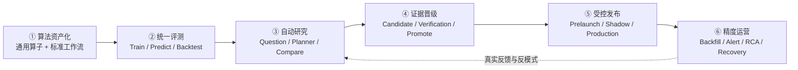
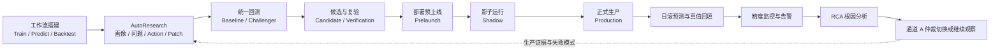
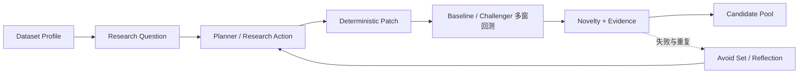
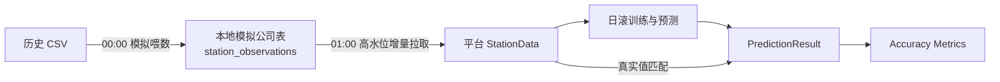
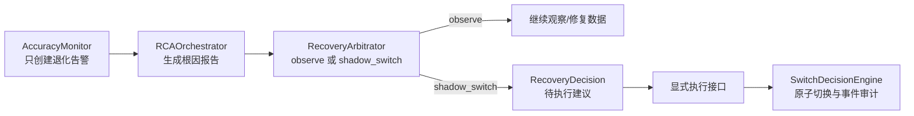

<!-- @AI_GENERATED -->
# AIP 平台负荷预测整体框架、技术链路与 AutoResearch 演进报告

**报告对象**：AIP 平台负荷预测算法全生命周期链路  
**正式业务槽位**：`load_forecast` — 正式负荷预测数据、部署版本与精度运营资产的分区键  
**当前阶段**：正式日滚与精度运营链路已运行；AutoResearch V4/P0.7 后控制面已形成；V6 已部分接入但尚未完成统一证据与分级调度验收  
**报告目的**：从整体框架、核心技术契约、业务闭环、AutoResearch 迭代和专利亮点五个方面建立统一汇报口径

> **事实边界**：本文依据 2026 年 8 月仓库中的现行代码、配置、规格文档与已落盘实验记录编写；其中槽位、调度和任务运行状态快照截至 2026 年 8 月 12 日。文中明确区分“已实现”“部分实现”“设计目标”，不以规格文档或任务勾选状态代替代码事实，也不把演练槽位 `load_forecast_e2e_demo` 当作正式生产链路。

---

## 一、建设背景与核心问题

负荷预测项目的目标并不止于训练一个离线误差较低的模型。生产场景中的数据持续到达，季节、天气、节假日和生产节奏不断变化，模型性能会随时间漂移；与此同时，每次模型调整都可能影响正式业务。因此，项目必须同时解决算法开发、可信评测、自动优化、发布治理和上线后精度运营问题。

传统“人工改参数—单次回测—选择最优结果—直接上线”的方式存在四类结构性缺陷：

1. **算法资产不可复用**：数据处理、特征工程和训练逻辑散落在专项脚本中，难以复现、组合和版本化。
2. **评测结果不可完全信任**：训练、预测和回测边界不清时，容易发生未来数据泄漏；不同实验若使用不同窗口或指标，也无法横向比较。
3. **单次最优无法代表长期稳定**：一个候选可能只在单个历史窗口上表现较好，跨季节、跨窗口或真实调度下并不稳定。
4. **生产变更缺少治理闭环**：如果候选发现、生产切换和精度告警由同一模块直接完成，就难以保证审批、审计和回滚安全。

因此，AIP 负荷预测建设的核心命题是：

> **将一次性的算法开发活动，转化为可复现、可评测、可研究、可发布、可运营的算法生命周期系统。**

---

## 二、建设目标与设计原则

### 2.1 建设目标

整套负荷预测链路需要达到五个目标：

1. **算法资产化**：把数据接入、特征工程、模型训练和评价能力沉淀为标准工作流与通用算子。
2. **评测标准化**：统一训练、预测和回测语义，以固定评测量约比较不同候选。
3. **研究自动化**：由 AutoResearch 组织候选生成、对比回测、问题归因和策略调整，降低人工试错成本。
4. **证据分级化**：区分单窗口信号、候选、多窗口复验、影子证据和生产结论，避免偶然收益直接上线。
5. **生产可运营**：持续回填真实值、监控版本级精度，并通过告警、根因分析、恢复决策、切换和回滚实现长期治理。

### 2.2 设计原则

- **工作流是算法载体**：上线对象应是可版本化的标准工作流、模型资产和部署配置，不是临时实验脚本。
- **回测是独立评分器**：AutoResearch 负责生成被测方案，回测负责固定评分；优化过程不能改变自己的评价标准。
- **时间因果优先**：训练标签和特征只能使用预测时刻之前真实可观测的数据，历史回放与在线任务执行同一因果契约。
- **证据强度决定权限**：单窗口正收益只能进入候选阶段，多窗口复验通过才具备晋级资格，改变生产还需真实运行证据和显式决策。
- **研究与发布解耦**：研究系统可以自动生成和复验候选，但不能直接修改正式生产身份。
- **失败同样沉淀**：重复组合、失败窗口和拒绝原因进入反模式与后续规划，避免无证据地重复消耗回测资源。

---

## 三、整体框架：围绕算法生命周期组织六段闭环

AIP 没有把负荷预测拆成若干彼此独立的功能页面，而是围绕一个算法版本从产生到持续运营的生命周期组织能力。



六段链路的职责和交付物如下：

| 生命周期阶段 | 核心职责 | 主要交付物 | 明确边界 |
|---|---|---|---|
| 算法资产化 | 将专项算法拆解为平台能力 | 通用算子、工作流模板、模型与执行元数据 | 不负责判断候选是否优于基线 |
| 统一评测 | 建立训练、推理与历史回测契约 | 模型工件、预测结果、可比回测指标 | 不负责生成研究策略 |
| 自动研究 | 产生问题、方向和可执行候选 | Challenger 补丁、实验记录、初步证据 | 不直接修改生产版本 |
| 证据晋级 | 评估新颖性、稳定性与可复验性 | 候选记录、多窗口复验结论 | 单窗口结果不能直接 Promote |
| 受控发布 | 管理预上线、影子、生产与退役状态 | 完整版本身份、切换与回滚事件 | 不自行解释精度退化原因 |
| 精度运营 | 使用真实值评价线上版本 | 版本级指标、告警、RCA 与恢复建议 | 监控任务不自动切换生产 |

### 3.1 业务链与技术支撑层的对应关系

生命周期链由以下技术层共同支撑，但技术分层服务于业务闭环，而不是独立存在：

| 技术层 | 关键能力 | 在故事线中的作用 |
|---|---|---|
| 交互与控制面 | 工作流编辑器、Research Cockpit、部署与精度运营页面 | 让算法工程师、研究人员和运维人员查看同一条生命周期链 |
| API 与编排层 | 工作流执行、Baseline/Challenger 对比、AutoResearch、调度、部署与精度运营接口 | 组织跨模块流程并维护状态 |
| 算子执行层 | 路由、配置注入、数据适配、输入输出校验 | 确保工作流节点以统一契约执行 |
| 研究与证据层 | Research Question、Planner、Novelty、Evidence、Candidate、Verification、Knowledge | 组织实验并判断结论可信度 |
| 发布与运营层 | 槽位、版本状态机、真值回填、告警、RCA、切换与回滚 | 把实验结论安全转化为生产版本 |
| 持久化层 | 实测数据、预测结果、指标、run/trial、候选、复验、知识和部署登记 | 保证过程可恢复、可审计、可追溯 |

---

## 四、端到端生命周期：从工作流搭建到精度恢复

负荷预测主链不是“训练完成即上线”，而是一个由研究证据和生产证据逐级放权的生命周期：



这条链路包含三类不可混淆的判断：AutoResearch 判断“离线实验是否值得复验”，Prelaunch 判断“候选能否在真实调度中稳定运行”，Shadow 与精度运营判断“候选是否具备替换 Production 的生产证据”。

### 4.1 工作流搭建：先把算法变成可执行资产

平台首先把负荷预测拆成标准算子，再由工作流连接为 Train、Predict 和 Backtest 三类模板。

| 工作流 | 主要职责 | 输出 | 关键边界 |
|---|---|---|---|
| Train — 训练工作流 | 读取历史数据，完成清洗、特征、切分、调参和模型训练 | 模型工件、模型引用、训练与验证指标 | 产出可复用模型，不承担正式日滚调度 |
| Predict — 推理工作流 | 读取明确的模型和未来输入，执行在线推理 | 带时间戳的预测序列 | `model_ref` — 模型引用必须由调用方或部署版本显式提供，普通推理路径不得隐式重训 |
| Backtest — 回测工作流 | 在历史时点按训练窗和预测窗重复训练、预测、评分 | 分窗指标、聚合分数和候选证据 | 是 AutoResearch 的固定评分器，不是生产任务 |

算子统一遵循：

```text
execute(params, inputs) -> dict
```

其中 `params` — 节点参数；`inputs` — 上游输入；返回值是供下游消费的结构化结果。在线和离线执行主要由以下组件协作：

| 内部符号 | 输入与输出 | 生命周期职责 |
|---|---|---|
| `OperatorRouter` — 算子路由器 | 输入 `functionId` — 算子标识、参数和上游输出，返回算子执行结果 | 扫描并分发标准算子，是工作流逐节点运行的入口 |
| `GlobalConfigInjector` — 全局配置注入器 | 输入节点参数和 `metadata.global_config` — 工作流全局配置，输出合并后的参数 | 注入时区、运行模式和业务时间；节点显式参数优先 |
| `run_prediction()` — 在线工作流执行函数 | 输入工作流、历史/未来数据、版本补丁和节点覆盖，输出预测结果与执行上下文 | 日滚任务用它应用部署版本补丁、拓扑执行并跳过在线评分节点 |
| `SchemaValidator` / `DataAdapter` — 校验与适配组件 | 输入算子数据，输出校验或适配结果 | 已作为执行框架能力存在，但当前在线 `run_prediction()` 并未在每个节点强制调用，不能表述为在线全链强校验 |

工作流资产化的意义是：AutoResearch 不需要生成平台外脚本，而是在同一模板上形成参数覆盖、节点参数补丁和结构开关；进入部署后，同一补丁还能随 Prelaunch、Shadow 和 Production 继续执行。

### 4.2 训练与回测参数：哪些参数真正决定模型行为

标准训练模板的主链为：数据读取 → 行过滤与重采样 → 异常和缺失处理 → 时间/节假日/工作日特征 → 滞后与滚动特征 → 时间序列切分 → 调参 → XGBoost 训练 → 指标评价。

#### 标准训练模板的关键参数

| 参数 | 当前模板值 | 作用 |
|---|---:|---|
| 数据粒度 | 15 分钟 | 一天形成 96 个预测点 |
| 异常检测 | z-score 阈值 6、窗口 96 | 用最近一天尺度识别异常值 |
| `window_sizes` — 滚动窗口步数 | 24、48、96、168 点 | 构造 6 小时、12 小时、1 天和 42 小时统计特征 |
| `statistics` — 滚动统计量 | mean、std | 描述局部水平和波动 |
| `lags` — 滞后步数 | 1、24、168 | 构造短周期和跨日历史依赖 |
| `window_size` — 滑动样本窗口 | 96 | 以一天 96 点形成监督学习样本 |
| `forecast_steps` — 预测步数 | 96 | 一次预测下一自然日 96 个点 |
| `strategy` — 多步策略 | recursive | 递归生成多步结果 |
| `n_trials` — 调参次数 | 30 | 自动调参搜索预算 |
| `cv_folds` — 交叉验证折数 | 5 | 时间序列交叉验证规模 |
| `metric` — 调参目标 | RMSE | 自动调参的优化指标 |
| `n_estimators` — 树数量 | 200 | 标准 XGBoost 主模型默认规模 |
| `auto_tune` — 主训练自动调参 | false | 主训练节点默认消费已确定参数，不重复调参 |
| `sample_weight_decay` — 样本时间衰减 | 0.99 | 让近期样本具有更高权重 |
| 全局时区 | Asia/Shanghai | 统一特征和业务时间解释 |

标准 Backtest 模板为了防止数据穿越，使用更严格的回看和滚动合同：`lag_days` — 日滞后集合为 1—7、14、21、28 天，`horizon_per_day=96` — 每日预测 96 点，滚动特征 `base_shift=96` — 至少后移一天；默认 `backtest_train_days=30` — 每个历史时点训练 30 天，并以 `rolling_retrain` — 滚动重训方式评价。模板还可并行训练 XGBoost、LightGBM、CatBoost 和 Ridge，再按上游 OOF RMSE 形成集成权重。

这些值是模板默认值，不是所有部署版本的永久常量。AutoResearch 或部署 `experiment_patch` — 实验补丁可以改变 `train_days`、模型参数、特征节点和集成方式；正式日滚每次都从当前 Production 工作流及版本补丁重新推导有效参数。

### 4.3 AutoResearch：从工作流产生受控 Challenger

AutoResearch 读取 Baseline 工作流、数据画像、研究问题、搜索注册表和固定评测量约，循环生成 Challenger。当前主线同时保留：

- V4 Candidate Planner：根据历史尝试、方向覆盖和失败记录，在 parameter、feature、model、data、risk 等方向分配实验槽位；
- V6 Research Action Planner：根据画像和 Research Question 选择预注册 Action，再由 Patch Compiler 确定性编译补丁；
- GLM Questioner：只能提出问题、假设和实验意图，不能直接写可执行补丁；
- 参数饱和判断、失败回避集、历史记忆、每 5 轮控制组以及 Baseline 内容哈希缓存。

每轮实际执行的仍是同尺对比：Baseline 固定，Challenger 只叠加本轮参数或结构补丁，两者使用同一 `evaluation_contract` — 评测量约。



批量比较以 `candidate_score` — 候选标准化分数判断高低：优先使用 `100 - avg_smape`，缺少 SMAPE 时才用 RMSE 衰减映射；因此 `score_advantage` — Challenger 与 Baseline 的分差为正才代表改善，它不是 MAPE 差值本身。

| 比较字段 | 中文含义 | 当前判断方式 |
|---|---|---|
| `comparison_id` | 异步比对任务 ID | 创建后用于轮询状态和窗口进度 |
| `aggregate_method` | 跨窗口聚合方法 | 支持 mean、median、trimmed_mean；默认 mean |
| `score_margin` | 最小聚合分差 | 默认 0；Challenger 聚合分减 Baseline 聚合分需达到该值 |
| `min_windows_challenger_better` | 最少优胜窗口数 | 配置后，Challenger 得分更高的窗口数必须达标 |
| `meets_score_margin` | 是否达到分差 | 分差门槛的独立判断 |
| `meets_win_count` | 是否达到优胜窗数 | 胜窗门槛的独立判断 |
| `eligible_for_pool` | 是否满足候选准入 | 仅当上述两项同时为 true 才成立 |

相同补丁不会无限新增候选：`patch_fingerprint` — 单次实验补丁指纹用于 Evidence 和问题生命周期，`candidate_signature` — 候选有效配置签名用于 Candidate Pool 与 Verification Queue 去重，`scenario_condition_hash` — 场景条件哈希用于 Knowledge 的摄入和跨场景检索。

### 4.4 多窗口复验与 Promote：离线证据如何交给部署

满足入池条件只表示“值得复验”。候选进入 Verification Queue 后，默认采用 mean 聚合、`score_margin=0` 和至少 2 个 Challenger 优胜窗口；复验按候选 ID 或签名去重，并由独立单活线程池串行执行。只有比较成功且 `eligible_for_pool=true`，复验状态才是 passed；有来源 run 和轮次时，结果还会回写 `multi_window_confirmed` — 多窗口确认等级的 Evidence。

Promote 的主要合同如下：

| 字段 | 中文含义 | 当前语义 |
|---|---|---|
| `candidate_id` | 候选记录 ID | Promote 路径参数，定位 Challenger 和实验补丁 |
| `force` | 人工强制 Promote | 默认 false；非强制时必须已有 passed 复验，强制操作当前日志未单列保存该值 |
| `set_as_production` | 是否更新研究/精度侧生产登记 | 默认 false；为 true 时登记 `challenger_workflow_id`，但不改变部署槽位 Production |
| `production_slot` | 登记使用的槽位 | Promote 默认 `load_forecast`，调用方应显式传值 |
| `enter_prelaunch` | 是否同步进入部署 Prelaunch | 默认 false；为 true 时携带候选补丁进入预上线观察 |
| `prelaunch_slot` | Prelaunch 目标槽位 | 缺省跟随 `production_slot` |

这里必须区分两种“登记”：AutoResearch Promote 更新的是研究和精度兼容登记；正式发布身份由 `DeploymentSlotStore` — 部署槽位存储维护。`set_as_production=true` 不会修改 `DeploymentSlotStore.production_model`，因此不等于候选已经成为正式 Production。真正推荐的交接方式是：复验 passed → Promote → `enter_prelaunch=true` → 进入部署生命周期。

每次 Promote 都会向 `backend-service/data/autoresearch/candidate_pool/baseline_comparison_promotions_log.json` — 候选晋级审计日志追加记录；该日志保存候选、Baseline/Challenger、是否登记生产、目标槽位和时间，用于审计而不是正式部署真源。

### 4.5 部署状态机：Prelaunch、Shadow、Production 与 Retired

部署层以 `slot` — 槽位隔离产品线和环境，并使用四种状态管理完整版本：

| 状态 | 生命周期含义 | 是否参与日滚 | 是否参与正式输出 |
|---|---|---:|---:|
| Prelaunch | 新候选的真实调度观察期 | 是 | 否 |
| Shadow | 已通过预上线、与 Production 并行比较 | 是 | 否 |
| Production | 当前正式生产版本 | 是，且优先执行 | 是 |
| Retired | 被淘汰或被替换的历史版本 | 否 | 否 |

同一工作流可以同时存在多个版本，所有生产数据必须使用：

```text
version_key = workflow_id + "@" + version_tag
```

`workflow_id` — 工作流 ID，`version_tag` — 部署版本标签，`prediction_cycle_id` — 一轮 96 点预测的周期 ID。完整身份贯穿预测记录、滚动指标、告警、恢复决策和切换事件；带版本查询未命中时采用 fail-closed — 失败关闭，不回退到无版本历史数据。

部署真源为 `backend-service/data/deployment/slots.json` — 部署槽位登记文件。它按 `slot` 分区，保存 Production、Shadow、Prelaunch、容量、观察天数、冷却期和切换开关，供日滚、部署 API、精度运营和 UI 共同读取。

#### 当前正式槽位快照

| 角色 | 完整版本身份 | 当前用途 |
|---|---|---|
| Production | `workflow-20260511-optimal-505@optimal-505-production` | 正式生产版本 |
| Shadow | `workflow-20260511-optimal-505@shadow-run7-generic-mape4109` | 候选真实并行评估 |
| Shadow | `workflow-20260511-optimal-505@shadow-run43-mape4109` | 候选真实并行评估 |
| Prelaunch | `workflow-load-forecast-backtest-v2@e2e-prelaunch-369ed87351eb` | 实验补丁的预上线观察 |

当前容量为最多 5 个 Shadow、2 个 Prelaunch；`switch_observation_days=7` — 常规 Shadow 观察天数，`cooldown_hours=24` — 切换冷却期，`auto_switch_enabled=false` — 禁止回填任务自动修改 Production。

### 4.6 Prelaunch：进入条件、日滚观察与毕业判断

Prelaunch 不是一次离线回测，而是让候选在不影响正式输出的前提下，进入与 Production 相同的数据库、调度、业务日和工作流执行环境。

#### 进入 Prelaunch 的条件

部署接口接收以下关键字段：

| 字段 | 中文含义 | 默认值或限制 |
|---|---|---|
| `candidate_id` | 来源候选 ID | 必填，用于追溯和补丁回填 |
| `workflow_id` | 待观察工作流 ID | 必填 |
| `version_tag` | 预上线版本标签 | 缺省为 `prelaunch-{candidate_id前12位}` |
| `observation_days` | 观察期天数 | 默认 7，允许 1—90 |
| `graduate_tolerance_pct` | 相对 Production 的毕业容差 | 默认 5%，允许 0—50% |
| `experiment_patch` | AutoResearch 实验补丁 | 可直接传入；缺省时按候选 ID 回填 |
| `source_run_id` | 来源 AutoResearch run ID | 可选，用于审计 |

入池时只检查：槽位存在、活跃 Prelaunch 未达到容量、同一 `workflow_id+version_tag` 未重复。当前直接 Prelaunch API 不读取 Verification Queue 验证 passed；因此“复验通过才能预上线”只在 Promote 联动路径中得到间接保证，直接调用接口仍可能绕过，这属于现行治理缺口。

入池后记录 `baseline_mape_at_entry` — 入池时 Production MAPE、开始时间、观察期、容差、来源候选和补丁。下一次 `lf_daily_rolling` 才开始实际运行，不会在入池动作中立即完成生产验证。

#### 自动毕业判断

每次精度回填后，Prelaunch 生命周期服务读取 Production 和候选滚动 MAPE：

```text
尚未达到 observation_days
    → 继续 prelaunch

达到观察期，但 Production 或 Prelaunch MAPE 缺失
    → 继续等待，不做乐观毕业

prelaunch_mape <= production_mape × (1 + graduate_tolerance_pct / 100)
    → graduate，转入 Shadow

否则
    → fail，转为 Retired
```

默认 5% 容差表示预上线模型不要求立即优于 Production，但观察期结束时不能比 Production 劣化超过 5%。毕业只意味着“具备进入 Shadow 的资格”，不会自动成为 Production。平台也保留人工 cancel 和人工 graduate，但人工 graduate 会跳过剩余观察期，应作为显式治理动作审计。

当前槽位快照还暴露出一项需要复验的状态一致性问题：现有 Prelaunch 的 `observation_days=7`、`evaluated_cycles=18` — 已累计评估周期数为 18，记录的 MAPE 约为 10.0736，Production 约为 10.2140，按 5% 容差公式应满足毕业条件，但条目仍保持 prelaunch。该现象可能来自调度后处理未执行、指标未进入当轮 `latest_metrics` — 当轮最新指标集合或状态持久化未完成；在运行日志和接口实测确认前，不能宣称自动毕业链已经通过生产验收。

现行实现还存在一个版本身份风险：部分毕业/失败辅助逻辑按 `workflow_id` 定位，而入池允许同一工作流的不同 `version_tag` 并存；多版本场景下后续应统一按完整版本键处理。

### 4.7 数据库接入：当前是模拟公司源到平台库的增量链路

现行数据链不是生产外部公司库直连，而是用于端到端演练的数据库化模拟链：



`StationDataSource.pull_latest(station_id, since_timestamp)` — 站点数据源增量接口，输入站点和上次高水位，输出严格满足 `timestamp > since_timestamp` 的新记录。当前装配为 `CsvMockCompanyFeeder` — CSV 模拟喂数器与 `LocalDbMockDataSource` — 本地数据库模拟公司源；尚未找到真实外部公司 MySQL、Oracle 或其他专用适配器，因此报告不能表述为“真实公司库已经完成接入”。

`LoadForecastRepository` — 负荷预测数据库仓储，由调度任务调用，负责平台实测数据、预测结果和精度记录的数据库 CRUD：

| 数据对象 | 主要内容 | 生命周期用途 |
|---|---|---|
| `StationData` | 槽位、站点、特征、UTC 时间戳、实测值 | 平台训练真源和后续真值回填来源 |
| `PredictionResult` | 完整版本、预测周期、目标时间、预测值、实际值、状态 | 保存 Production/Shadow/Prelaunch 的逐点结果 |
| `AccuracyMetric` | 版本键、滚动 MAPE、MAE、周期数和状态 | 数据库侧的版本精度摘要 |

每次数据拉取先查询平台最大时间戳作为高水位，再从模拟公司源拉取新增记录，之后预测任务只读平台 `StationData`，不直接读原始 CSV。需要注意：当前批量写入使用 INSERT IGNORE，但 ORM 模型未明确提供业务唯一约束；如果底层表也没有唯一键，重复拉取不能仅靠 IGNORE 保证业务幂等。

当前仍是数据库与文件并存：实测、预测和部分精度摘要主要进入数据库；部署槽位、scheduler 登记、AutoResearch 和部分精度文件仍保留 JSON 主存或兼容读写。不同模块的双写开关尚未由一个统一配置完全控制，不能笼统宣称平台已经全面数据库化。

### 4.8 定时调度：从模拟喂数到告警的每日生产节拍

当前调度快照按以下顺序运行：

| 任务 | cron | 输入 | 输出与职责 |
|---|---|---|---|
| `mock_data_feed` — 模拟喂数 | `0 0 * * *`，00:00 | 历史 CSV 的下一业务日 | 向本地模拟公司表暴露一天数据；接入真实公司源后不再是必要依赖 |
| `lf_data_pull` — 数据拉取 | `0 1 * * *`，01:00 | 模拟公司表和平台高水位 | 增量写入平台 `StationData` |
| `lf_daily_rolling` — 日滚预测 | `30 1 * * *`，01:30 | 部署槽位、平台历史数据、工作流和补丁 | 运行 Production、Shadow、Prelaunch，预测 T+1 |
| `lf_accuracy_backfill` — 精度回填 | `0 4 * * *`，04:00 | 已产生预测和已到达实测值 | 回填 actual 并生成最近 7 天版本级指标 |
| `lf_accuracy_monitor` — 精度监控 | `5 4 * * *`，04:05 | 部署身份、版本指标和发布基线 | 判断退化并创建告警，不切换模型 |

五个任务主要依靠时间顺序形成依赖，不是一个带强依赖校验的 DAG。当前 scheduler 使用 `catchup=false` — 错过计划时间不自动补跑；运维需通过任务状态、最近结果和数据水位确认链路是否真正完成。`backend-service/data/scheduler/tasks.json` — 调度任务登记文件保存 UI 和运行状态快照，但启动配置和热更新接口也可注册 cron，因此它不是脱离运行时配置的唯一真源。

### 4.9 按日滚动预测：业务日、训练窗口和版本并行执行

`lf_daily_rolling` 的核心不是“每天取最近 N 天训练”，而是先建立一个对所有版本一致的因果时钟，再按各部署版本的有效补丁运行。

#### 日滚执行步骤

1. **解析部署身份**：优先从 `DeploymentSlotStore.production_model` 读取 Production；精度侧旧登记只作为兼容回退。
2. **确定业务日 T**：读取平台 `StationData` 最大实测时间戳，以其日期作为 T，不使用服务器墙钟日期。
3. **推导历史需求**：从 Production 工作流读取训练天数、每日步数和全部特征最大回看长度，得到“预热期 + 正式训练期”。
4. **历史完整性门禁**：要求所需历史日期连续，且标准 15 分钟数据每天完整 96 点；不满足则跳过本轮，实验模式显式放宽时除外。
5. **建立因果边界**：训练标签和全部特征上下文硬截止 T-1 23:59:59.999；T 日实测值也不进入本轮训练。
6. **构造预测目标**：生成 T+1 全天 96 个 15 分钟时间点。未来行复制最后观测值只作为 lag/rolling 管线占位，并带在线标记，不能成为训练标签。
7. **并行版本执行**：依次运行 Production、按误差从低到高排序的 Shadow、按入池时间排序的 Prelaunch；每个版本应用自己的 `experiment_patch`。
8. **结果校验与持久化**：每个版本必须精确返回 96 个预测值；成功写 96 条 `PredictionResult`，失败写失败状态。完整版本和目标开始时间共同形成幂等周期 ID，已有周期则跳过重复执行。

核心时间合同为：

```text
平台数据水位决定业务日 T
训练标签与特征上下文上限 = T-1 23:59:59.999
T 日真实值不进入本轮输入
预测目标 = T+1 全天 96 点
T+1 真实值到达后，才允许在后续 backfill 中参与评价
```

#### 训练窗口和参数的实际真源

| 参数来源 | 决定内容 | 当前行为 |
|---|---|---|
| Production 工作流 `backtest_train_days` | 正式训练天数 | 标准 V2 回测合同为 30 天 |
| 工作流特征最大 lookback | 特征预热天数 | 标准 V2 最大日滞后为 28 天 |
| 版本 `experiment_patch` | 候选训练天数、节点参数、结构和集成方式 | 可按版本覆盖，例如改变 `train_days` |
| `train_test_split_ts.mode` | 在线切分方式 | 日滚强制为 `online_forecast` |
| `online_training_start/end` | 监督训练标签边界 | 日滚动态注入，保证预热数据只做特征、不进入正式训练标签 |
| 槽位 `training_window_days` | 历史展示/兼容配置 | 当前不作为日滚训练窗真源；槽位中的 365 天不能覆盖工作流推导结果 |

当前 Production 工作流确实配置 30 天训练和最大 28 天日滞后，因此共享历史门禁需要约 58 个连续完整业务日。当前两个 Shadow 的 `train_days` 分别覆盖为 21 和 75，Prelaunch 也请求 75 天；但日滚目前先按 Production 的 30 天训练合同加载共享历史，再逐版本调整 `online_training_start`。因此请求 75 天的版本可能拿不到完整 75 天监督样本，实际可用数据受共享加载范围限制。后续应按所有活跃 Production/Shadow/Prelaunch 的最大历史需求取并集，而不是只按 Production 推导。

### 4.10 真值回填与指标：按完整版本计算七日滚动精度

预测产生时没有 T+1 实测值。04:00 回填任务以平台 actual 水位作为窗口终点，只在槽位、站点、特征和时间戳完全匹配时写回 `actual_value` — 实际值；随后按 `(workflow_id, version_tag)` 分组，避免同工作流多个部署版本串账。

| 指标 | 计算口径 | 生命周期用途 |
|---|---|---|
| daily MAPE | 单个预测周期内，对实际值非零点的绝对百分比误差取均值 | 形成每日可比较精度 |
| `rolling_mape` | 最近最多 7 个业务日 daily MAPE 的中位数；同日多周期先求日均值 | 当前主滚动 MAPE，降低单日极端值影响 |
| `rolling_mape_pooled` | 窗口内全部实际值非零点直接合并计算 MAPE | 主口径无法计算时的回退和诊断参考 |
| `rolling_wmape` | `Σ|预测-实际| / Σ|实际| × 100%` | 监控和 RCA 通道 A 优先比较的业务量权重误差 |
| `rolling_mae` | 所有已评价点绝对误差均值 | 反映绝对量级偏差 |
| `coverage_rate` | 已匹配 actual 的预测点数 / 窗口总预测点数 | 判断真值覆盖是否充分 |
| `valid_cycle_count` | 至少存在一个 actual 的不同预测周期数 | 判断独立预测周期是否充分，不等同于点数 |

版本指标进入 `active` — 可用于监控和仲裁的条件是：

```text
valid_cycle_count >= min_valid_cycles
并且
coverage_rate >= 0.90
```

现行配置 `evaluation_window_days=7`、`min_valid_cycles=1`；配置读取失败时代码回退为 3。`min_eval_points=72` 虽存在于配置中，但当前新版回填的 active 分支直接使用“有效周期数 + 90% 覆盖率”，不能把 72 点写成已经生效的第三个 active 门槛。

### 4.11 Shadow：常规候选判断、显式切换与回滚

Shadow 与 Production 使用相同的数据水位、T/T-1/T+1 时间边界和日滚执行器，只是不参与正式输出。每次回填后：

```text
shadow.rolling_mape < production.rolling_mape
    → consecutive_better_days += 1
否则
    → consecutive_better_days = 0
```

`SwitchDecisionEngine` — 部署切换引擎负责常规切换资格和状态转换。它输入槽位、目标完整版本、触发类型、原因和 force，输出 `SwitchEvent` — 切换审计事件。常规资格判断为：

1. 仅考虑状态为 Shadow 的版本；
2. 先按 `consecutive_better_days` — 连续优胜天数降序，再按 MAPE 升序选候选；
3. 连续优胜天数至少达到 `switch_observation_days=7`；
4. Shadow MAPE 必须低于 Production MAPE；
5. 实际执行时必须通过 `cooldown_hours=24` 冷却检查，`force=true` 可显式绕过；
6. 同一工作流有多个 Shadow 时必须提供 `target_version_tag`，禁止只凭工作流 ID 猜版本。

当前 `auto_switch_enabled=false`，新版回填任务只更新指标和连续优胜天数，不自动调用切换。人工部署接口或 RCA 通道 A 仍可显式执行切换；该开关不是对所有显式动作的总禁令。

切换成功后，目标 Shadow 变为 Production，原 Production 变为 Retired 并保留在槽位中；`SwitchEventLog` — 切换事件日志以 append-only 方式记录来源版本、目标版本、原因、时间和回滚关系。回滚必须从最近一条未回滚切换事件找到前 Production，并确认对应 Retired 版本仍存在，不能仅按“当前第二名”猜测回滚目标。

### 4.12 精度运营与 RCA 通道 A：告警、根因、仲裁、执行四段分离

用户口径中的“总裁切换”在代码中实际是“仲裁切换”。通道 A 的正式名称为 `shadow_switch` — Shadow 切换通道，核心服务是 `RecoveryArbitrator` — 恢复仲裁器。



#### 第一步：监控只发现退化

`AccuracyMonitor` — 精度监控器由 04:05 任务调用，读取 Production/Shadow 的 active 指标和发布基线；Prelaunch 只进入状态快照，不直接产生退化告警。两侧 WMAPE 都有效时优先使用 WMAPE，否则回退 MAPE：

```text
degradation_pct = (current_metric - baseline_metric) / baseline_metric × 100%
```

现行 `degradation_threshold_pct=15`：达到 15% 创建 warning，达到两倍门槛可标记 critical；同一完整版本已有 open 告警时不重复创建。监控不自动运行 RCA，也不直接选 Shadow。

#### 第二步：RCA 形成根因报告

`RCAOrchestrator` — 根因分析编排器接收 `AccuracyAlert` — 精度告警、槽位指标和触发类型，调用 RCA Skill，输出 `RCAReport` — 根因报告，内容包括根因、置信度、推理过程、证据、误差画像、数据诊断、洞察、恢复策略和产物。当前 RCA 由接口显式触发，不是 cron 自动阶段；非人工触发还受告警冷却约束。

#### 第三步：RecoveryArbitrator 只做仲裁，不直接切换

`RecoveryArbitrator.decide()` 输入成功的 RCA 报告、关联告警、部署版本和精度配置，输出并保存 `RecoveryDecision` — 恢复决策：

- RCA `confidence < 0.6` 或根因未确定 → observe；
- 根因包含 external → observe，避免把外部波动误判为模型问题；
- 已有执行中的通道 A 建议 → observe，防止并发切换；
- 没有满足数据门槛和改善幅度的 Shadow → observe；
- 其余情况才生成 `shadow_switch` 待执行建议。

通道 A 选择 Shadow 时要求 Production 和 Shadow 指标都为 active，Shadow `valid_cycle_count` 达到 `min_valid_cycles`；两侧有 WMAPE 时比较 WMAPE，否则比较 MAPE。改善率为：

```text
margin_pct = (production_metric - shadow_metric) / production_metric × 100%
```

只有 `margin_pct >= switch_margin_pct` 才合格；当前门槛为 10%。多个合格 Shadow 先选误差最低者，同误差再选有效周期更多者。仲裁结果只处于 pending，不会在 `decide()` 中修改部署槽位。

#### 第四步：显式执行通道 A

只有执行恢复接口后，`RecoveryArbitrator.execute_switch()` 才把已批准的 `shadow_switch` 决策交给 `SwitchDecisionEngine`。切换引擎再次检查目标状态和 24 小时冷却期，随后原子更新 Production/Shadow/Retired、写入 `switch_event_id` — 切换事件 ID，并把告警置为 recovering；失败则决策置为 failed、告警恢复 open。

常规部署切换和 RCA 通道 A 使用两组不同证据门槛：

| 路径 | 候选门槛 | 是否自动执行 |
|---|---|---|
| 常规部署资格 | 连续优于 Production 至少 7 天，且 MAPE 更低 | 否，需显式部署切换 |
| RCA 通道 A 仲裁 | RCA 置信门通过；指标 active；有效周期达标；Shadow 至少改善 10% | 否，仲裁只产出决策，仍需显式执行 |

当前通道 A 仲裁本身不检查 `consecutive_better_days`，而执行函数也不会重新调用常规资格判断，只检查目标状态和冷却期。因此两套门槛尚未完全统一，这是需要后续收敛的治理风险；报告不能把“连续 7 天 + 改善 10%”写成当前已经同时执行的单一门槛。

### 4.13 生命周期闭环与现行边界

生产证据最终回流 AutoResearch：多窗口和真实运行都成立的候选可提升知识置信度；Prelaunch 或 Shadow 失败形成反模式；RCA 识别的数据、外部和模型问题转成新的 Research Question；重复补丁、失败窗口和切换结果用于后续 Planner 降权或回避。

当前闭环已经具备主体能力，但仍需保留以下事实边界：

1. 当前“公司库”是本地数据库模拟源，不是真实外部公司数据库适配器；
2. AutoResearch Promote 与部署 Production 是两套状态，`set_as_production` 不等于正式切换；
3. 直接 Prelaunch API 尚未强制验证候选复验 passed；
4. Prelaunch 可自动毕业到 Shadow，但不会自动进入 Production；
5. 新版回填只计算指标和更新状态，不自动切换；
6. 常规 Shadow 切换与 RCA 通道 A 的资格门槛尚未统一；
7. 文件、数据库和兼容双写仍并存，部分模块尚未完成单一事实源收敛；
8. 当前仓库没有可核实的正式切换事件文件，不能据此宣称已完成真实切换与回滚演练。

由此，完整故事线可归纳为：工作流把算法变成资产，AutoResearch 把资产变成候选，复验把候选变成可部署结论，Prelaunch 和 Shadow 把离线结论变成生产证据，精度运营与 RCA 再决定继续观察、切换或回滚。

---

## 五、AutoResearch 代际演进与最新版本现状

AutoResearch 的演进不是单纯增加搜索参数，而是逐步补齐研究问题、工程可靠性、过程可观测性和结论可信度。

### 5.1 代际演进概览

| 代际 | 核心问题 | 主要能力 | 本代遗留问题 |
|---|---|---|---|
| V1 | 人工调参效率低、结论无法复用 | 自动采样、回测、诊断、建议、跨 run 经验 | 仍以被动试参为主，不清楚在研究什么 |
| V2 | 假设缺少问题牵引 | 数据画像、研究问题、知识分层、反思、多 Agent 设计 | 主要是规划蓝图，工程复杂度上升 |
| V3 | 长 run 易卡死、状态丢失、难恢复 | run 快照、trial/decision 账本、服务拆分、自愈和扩展点 | 过程和结论仍缺少统一控制面 |
| V4 | 实验过程不透明、候选不能严格晋级 | Candidate Planner、Research Cockpit、Novelty、Evidence、Verification、Promote | 方向仍偏粗，画像未真正选路，结论质量未明显提升 |
| V6 | 盲搜、重复探索、证据分散 | 画像驱动 Research Action、确定性 Patch Compiler、Evidence Ledger、A/B/C 分级实验设计 | 已部分接入，统一证据和分级调度尚未闭环 |
| V7 | AutoResearch 与平台生命周期入口割裂 | 将自动化回测接入算法管理、开发、运营和部署工作台 | 是平台前端产品化，不是研究算法新一代 |

> 仓库没有独立第五代，第四代之后直接进入第六代设计与实现。

### 5.2 V4/P0.7：控制面建立后的真实验收

V4 建立三条相互关联的链路：

1. **实验执行链**：Planner → Patch → Baseline/Challenger Compare；
2. **候选晋级链**：Candidate → Verification → Promote；
3. **研究认知链**：Question → Hypothesis → Evidence → Knowledge → Reflection。

50 轮 run `ares-9c429d5ed43c` 的复盘结果如下：

| 验收维度 | 结果 | 含义 |
|---|---|---|
| 多方向探索覆盖 | 通过 | parameter、feature、model、data、risk 均有尝试 |
| 主候选长期固定 parameter | 已改善 | 最长连续 parameter streak 降低 |
| Research Question 去重 | 通过 | 从大量无状态问题收敛为少量带生命周期问题 |
| Evidence 落账 | 通过 | 实验按方向记录证据 |
| Top 候选新颖性 | 未通过 | 最优 MAPE 是历史重复配置，不是新突破 |
| 多窗口证据 | 未通过 | 当时证据仍以 insufficient_evidence 为主 |
| Reflection 消费真实证据 | 未通过 | coverage 未正确反映 scoreboard |
| Knowledge 置信度治理 | 未通过 | 单 run claim 置信度偏高 |

这次验收的核心结论是：

> **V4 改善了研究过程质量，但尚未证明最终结论质量同步提升。**

随后补充了 Novelty Audit、Evidence Contract、Reflection 证据消费、`profile_quality` — 画像质量标记、统一场景指纹以及 GLM/Research Question 来源解释等修正。

### 5.3 V6：从方向覆盖升级为画像与证据驱动

V6 针对 V4 复盘暴露的三类问题进行设计：

1. **画像参与选路**：波动、周末差异、近期漂移、天气相关性和数据质量不再只用于展示，而是决定优先研究方向。
2. **研究动作语义化**：Search Space 从扁平参数集合升级为 typed Research Action，每个 Action 包含适用画像、补丁模板、风险等级、预期证据、停止条件、回退动作和反模式。
3. **证据统一与分级**：设计 Evidence Ledger 统一候选、复验、问题和知识状态，并将实验划分为 Stage A 低成本探针、Stage B 正式比较、Stage C 完整复验。

V6 继续保持两条安全边界：GLM 只能生成问题、解释和实验意图；可执行补丁必须由确定性编译器生成。单窗口正收益不能直接升级为 active knowledge 或生产结论。

### 5.4 最新版本现状

“最新版本”需要按稳定主线、研发版本和平台集成三个层次表述。

#### 5.4.1 当前稳定主线：V4/P0.7 后闭环

已经形成并可在现行代码中确认的能力包括：

- 多方向 Candidate Planner；
- Research Cockpit 五类控制面信息；
- 候选签名与新颖性审计；
- Candidate Pool → Verification Queue → Promote 门控；
- Baseline 内容哈希缓存；
- 复验独立执行资源与轻量资源水位保护；
- 画像质量、场景指纹、问题来源和 Reflection 的可解释字段。

该主线可以支撑候选发现和复验闭环，但不能据此宣称系统已经稳定发现全新的高质量方案。

#### 5.4.2 最新研发版本：V6 部分工程接入

已经落地或有运行记录的部分：

- 负荷预测 V3 research registry 已包含静态 Research Actions；
- Profile Signal、Research Action、Evidence Ledger Entry 等数据模型已经定义；
- Analyst、Research Action Planner、Patch Compiler 已接入 AutoResearch 主循环；
- 选择带 Actions 的注册表时可自动启用 V6/V3 Planner；
- run 快照中已出现非空 `action_id`、`variant_index` 和画像选路信息。

尚未完整闭环的部分：

- Evidence Ledger 尚未成为 Candidate、Verification、Question、Knowledge 的生产级单一事实源；
- Evidence Critic 虽已有服务定义，但尚未确认形成完整主循环调用闭环；
- Stage A/B/C 已存在设计与配置，但尚未驱动完整的分级调度和自动晋级状态机；
- 现有 run 只能证明部分新链路开始工作，不能代替完整 smoke、正式长 run 和多窗口验收。

准确口径是：

> **V6 已完成“画像驱动 Action 规划 + 确定性补丁编译”的部分工程接入，正在向“统一证据 + 分级验证”演进，尚未完成整个研究闭环的正式验收。**

#### 5.4.3 平台集成版本：V7

V7 重构的是平台前端信息架构，把行业场景、算法管理、工作流开发、自动化回测、精度运营和部署入口组织为统一生命周期工作台。它代表 AutoResearch 的产品化接入，不代表出现了第七代研究算法；当前也仍有多个后续阶段未完成。

---

## 六、项目技术亮点与专利挖掘方向

> **说明**：以下内容用于识别可形成专利交底书的技术方案，不代表已经通过新颖性或创造性检索。正式申请前仍需结合公开时间、现有技术和权利要求范围进行检索判断。

### 6.1 数据水位驱动的因果滚动训练与预测

- **技术问题**：按服务器时间切分数据，在历史回放、数据延迟和补录场景下可能误用尚不可观测的数据。
- **核心机制**：以平台实测数据水位确定业务日，自动推导工作流所需训练与预热区间；训练与特征上下文硬截止 T-1，T+1 行只参与推理。
- **技术效果**：真实数据、历史回放和模拟数据共享同一因果契约，避免墙钟时间差异导致未来泄漏。
- **当前状态**：正式日滚链路已实现，成熟度高。

### 6.2 面向同工作流多版本的身份隔离与精度归属

- **技术问题**：同一工作流的 Production、Shadow 和 Prelaunch 若只按工作流聚合，会造成预测、指标和切换目标串账。
- **核心机制**：使用 `workflow_id@version_tag` 完整身份贯穿预测、回填、指标、告警和切换；带版本查询采用 fail-closed。
- **技术效果**：多个版本可在同一数据和时间环境下并行运行且互不污染，并可依据切换事件准确恢复前 Production。
- **当前状态**：版本级主链已实现。

### 6.3 基于证据强度的候选晋级机制

- **技术问题**：单窗口偶然收益容易被误认为稳定结论。
- **核心机制**：建立“单窗口信号 → Candidate → 多窗口 Verification → Prelaunch/Shadow → Production”的分级证据链，并加入候选签名与新颖性审查。
- **技术效果**：把验证成本与结论权限绑定，阻止弱证据直接影响生产。
- **当前状态**：主链已实现，统一 Evidence Ledger 仍在演进。

### 6.4 画像驱动的 Research Action 与确定性补丁编译

- **技术问题**：随机或按覆盖率选方向缺少场景依据；GLM 直接生成补丁又难以控制和复验。
- **核心机制**：将数据画像转为 Profile Signal，结合 Research Question 选择预注册 Action，再由 Patch Compiler 按白名单和工作流结构生成补丁。
- **技术效果**：实验方向具有数据依据和语义解释，同时隔离生成式推理与生产执行。
- **当前状态**：部分实现，有真实 run 记录，完整验收未完成。

### 6.5 新颖性前置门控与实验预算控制

- **技术问题**：自动研究容易重复执行历史上已运行、已失败或相近的组合。
- **核心机制**：利用补丁指纹、候选签名、近邻失败证据和 Action 冷却，在回测前跳过或降权重复方向，并记录跳过原因。
- **技术效果**：在昂贵回测前减少重复实验，把预算集中到新的、有画像依据的方向。
- **当前状态**：V4 已实现事后审计；前置门控与冷却属于 V6 演进方向。

### 6.6 基于证据权限的 A/B/C 分级实验调度

- **技术问题**：所有候选直接执行完整复验成本过高，单窗口实验又不足以形成可信结论。
- **核心机制**：Stage A 低成本探针只决定是否继续，Stage B 多窗口正式比较形成候选证据，Stage C 完整复验通过后才允许 Promote 或升级高置信知识。
- **技术效果**：按证据价值分配回测资源，同时阻止低成本实验越权成为生产结论。
- **当前状态**：设计与配置已具备，完整调度尚未闭环。

### 6.7 监控、RCA、仲裁与发布解耦的精度恢复

- **技术问题**：精度下降可能来自模型、数据或外部环境，监控直接切换会造成误操作风险。
- **核心机制**：将告警、根因分析、恢复决策和部署切换拆成独立步骤；只有显式执行才改变生产身份，并通过 append-only 事件支持回滚。
- **技术效果**：异常发现与生产动作解耦，切换原因、目标和回滚关系可审计。
- **当前状态**：主链已实现，默认保持显式治理。

### 6.8 推荐优先组合的申请主题

| 优先级 | 建议主题 | 组合亮点 | 推荐理由 |
|---|---|---|---|
| 高 | 一种数据水位驱动的负荷预测因果滚动训练与预测方法、系统及介质 | 6.1 | 技术问题明确、正式链路成熟，容易形成完整步骤与边界条件 |
| 高 | 一种面向多部署版本的负荷预测精度评估与安全恢复方法、系统及介质 | 6.2 + 6.7 | 可围绕多版本串账、误告警和误切换形成完整技术方案 |
| 中高 | 一种画像驱动且基于分级证据的负荷预测自动研究方法、系统及介质 | 6.3 + 6.4 + 6.5 + 6.6 | 差异化最强，但建议先补齐统一证据和分级调度的完整实现证据 |

---

## 七、当前成果、事实冲突与谨慎口径

### 7.1 当前可以确认的成果

- 正式槽位 `load_forecast` 已形成数据拉取、日滚预测、真实值回填和精度监控的定时链路；当前任务配置显示相关任务处于运行状态，最近执行结果为 success。
- Production、两个 Shadow 和一个 Prelaunch 已按完整版本身份登记，并带来源候选或实验补丁信息。
- 回填按完整版本分组，监控按版本读取指标，带标签读取采用 fail-closed。
- 候选池、复验池和 Promote 门控已形成，单窗口结果默认不能直接晋级。
- V4/P0.7 已有 50 轮复盘，能够区分“过程质量改善”和“结论质量尚未改善”。
- V6 的 Action Planner 与 Patch Compiler 已部分进入真实主循环，但统一证据与分级调度尚未完成。

### 7.2 文档与现行实现之间需要统一的口径

| 主题 | 旧口径或容易误解的表述 | 当前应采用的口径 |
|---|---|---|
| 精度回填时间 | 部分旧材料写 03:00 | 当前调度为 04:00 回填、04:05 监控 |
| 公司数据库接入 | “已接入真实外部公司库” | 当前是历史 CSV → 本地模拟公司表 → 平台表；真实外部数据源适配器尚未核实存在 |
| Prelaunch 自动毕业 | “观察期和精度达标后已稳定自动转 Shadow” | 代码具备毕业判断，但当前持久化快照按公式应毕业却仍为 prelaunch，需结合日志和接口实测验收 |
| 多版本训练窗口 | “每个 Shadow/Prelaunch 都会完整获得自己的 `train_days` 历史” | 当前共享历史先按 Production 合同加载；请求 75 天的候选可能受 30 天 Production 加预热范围限制 |
| 生产切换 | “监控自动选择更优 Shadow” | `auto_switch_enabled=false`；监控只告警，切换走 RCA、仲裁与显式执行 |
| 切换资格 | “连续优胜 7 天并改善 10% 是统一门槛” | 常规资格使用连续 7 天和更低 MAPE；RCA 通道 A 使用 active、有效周期和至少 10% 改善，两套门槛尚未合并 |
| 最少有效周期 | 正式链路旧说明为 3 | 当前部署配置 `min_valid_cycles=1`；代码读取配置，配置失败才回退 3 |
| 在线数据切分模式 | 旧说明使用 `all_train` | 当前正式日滚使用 `online_forecast` 并显式注入训练起止边界 |
| 训练窗口 | 槽位固定 365 天 | 槽位保留窗口配置，但正式任务从 Production 工作流推导实际训练与预热需求 |
| Shadow 排序 | “精度降序” | `accuracy_score` — 当前用于排序的误差型精度分数，越低越好；代码按升序选择 |
| Promote 登记槽位 | Promote 与通用登记默认槽位相同 | Promote 的 `production_slot` 默认 `load_forecast`，通用登记默认 `default`；业务调用应显式传槽位，后续宜统一默认值 |
| MySQL 迁移 | “AutoResearch 已全面数据库化” | 当前为文件、数据库和双写/兼容读取并存，尚未完成统一权威化 |
| V6 状态 | “纯规划”或“已经完整完成” | 已部分接入主循环，但 Evidence Ledger、Evidence Critic 和 Stage A/B/C 尚未闭环 |
| V7 定位 | “AutoResearch 第七代算法” | 平台前端和生命周期工作台版本，不是研究算法代际 |

### 7.3 尚未验证的内容

- 当前未以完整 V6 链路完成 30—50 轮正式 run 与多窗口验收，不能声称 V6 已提升最终研究质量。
- Verification passed 后向源 run、Candidate、Knowledge 的证据同步仍需用真实通过记录验证一致性。
- 当前 TrainProfile 的部分画像仍可能来自回测窗口或降级数据源，完整训练集画像接入仍需加强。
- 精度运营门槛目前 `min_valid_cycles=1`，虽然符合当前部署配置，但从统计稳定性角度是否足够仍需业务验收。
- 当前 Prelaunch 快照与毕业公式不一致，尚未通过一次“回填 → 自动毕业 → 转入 Shadow”的运行时闭环验收。
- RCA 通道 A 尚无可核实的正式切换事件文件，未验证仲裁决策、冷却检查、Production 替换和回滚能否在当前数据状态下连续完成。
- 文件与数据库并存期间，服务重启、双写失败和读切换的一致性仍需持续验证。

---

## 八、下一阶段建设重点

### 8.1 完成统一证据闭环

让 Candidate、Verification、Research Question 和 Knowledge 共同引用 Evidence Ledger 中的同一证据记录，避免不同模块对同一次实验形成不一致状态。

### 8.2 将 A/B/C 从配置转化为真实调度状态机

明确各阶段的窗口数量、试验预算、晋级条件、失败去向和权限边界。Stage A 不得形成 active knowledge，Stage B 只形成候选，Stage C passed 才允许 Promote。

### 8.3 完成 Evidence Critic 主循环调用

在回测和复验完成后统一输出证据强度、失败原因、新颖性结论、复验建议和知识沉淀建议，并写回统一账本。

### 8.4 按三层验收推进

1. **字段链 smoke**：验证 Action、Patch、Evidence、Candidate 和 Verification 状态能够完整流转；
2. **正式研究 run**：验证重复率下降、画像选路有效、新候选比例上升；
3. **真实发布验证**：通过多窗口复验、Prelaunch 和 Shadow 观察确认离线结论能够迁移到正式调度。

验收指标不应只看最低 MAPE，还应包含候选重复率、新颖候选比例、各 Action 的画像依据、Research Question 的状态推进、跨模块证据一致性以及多窗口通过候选中的真实新组合比例。

---

## 九、结论

AIP 负荷预测项目已经从单一模型开发扩展为一套算法生命周期系统。其主线可以概括为：

```text
通用算子与标准工作流
→ Train / Predict / Backtest 统一契约
→ AutoResearch 自动研究
→ Candidate / Verification 证据晋级
→ Prelaunch / Shadow / Production 受控发布
→ 真值回填、精度监控、RCA、切换与回滚
→ 真实证据反哺下一轮研究
```

该项目的核心价值不在于某一个模型或某一组最优参数，而在于建立了三类可持续能力：

1. **算法能力可沉淀**：专项经验可以转化为可复用、可版本化的工作流资产；
2. **研究结论可取信**：固定评测量约、候选新颖性、多窗口复验和真实影子证据共同约束结论权限；
3. **生产版本可治理**：完整版本身份贯穿预测、指标、告警和切换，监控与发布职责分离，并保留审计与回滚路径。

AutoResearch 的演进也体现了相同路线：V1 解决自动试验，V2 引入问题驱动，V3 补齐可靠运行，V4 建立可观测控制面与复验闭环，V6 进一步转向画像驱动、语义化动作、统一证据与分级验证。

当前最重要的工作不是继续扩大功能数量，而是完成 V6 的统一证据和分级调度闭环，并通过正式长 run、多窗口复验和真实影子运行证明：系统不仅能够组织更多实验，也能够减少重复探索、提高方向选择质量，并形成可迁移到生产的可信结论。

---

## 附录：主要资料与实现依据

- `docs/load_forecast/AIP_PROJECT_PRESENTATION.md` — 项目级汇报总览，提供平台定位、业务价值和算法生命周期主线；部分历史示例需结合现行实现校正。
- `docs/load_forecast/负荷预测正式链路_字段流转与精度运营深度讲解.md` — 正式槽位从调度、预测、回填到告警、RCA、切换和回滚的字段级说明，是生产链路的主要设计依据。
- `docs/load_forecast/迭代历程详版.md` — AutoResearch 各代问题、设计、实现和复盘记录，是代际演进与验收结论的主要依据。
- `docs/load_forecast/spec/load_forecast/load-forecast-operator-integration/` — 通用算子执行框架、数据契约和 Train/Predict/Backtest 模板的需求、设计与任务资料。
- `docs/load_forecast/spec/load_forecast/algorithm-deployment-refactor/` — 部署槽位、时间因果边界、Prelaunch、Shadow、切换和回滚治理规格。
- `docs/load_forecast/spec/load_forecast/data-pipeline-db-integration/` — 多数据源接入、槽位隔离、高水位增量拉取和数据库集成规格。
- `docs/load_forecast/spec/load_forecast/load-forecast-training-ui/` — 训练页面、参数配置、进度与结果展示规格。
- `docs/load_forecast/spec/autoresearch/` — 下一代 AutoResearch、V6 Research Action/Evidence Ledger/分级实验、V7 工作台和 MySQL 迁移资料。
- `backend-service/services/scheduler/tasks/load_forecast_tasks.py` — 正式负荷预测日滚、预测持久化、版本级精度回填和只告警监控的现行执行逻辑。
- `backend-service/api/workflows_enhanced.py` — Baseline/Challenger、AutoResearch 主循环、V6 Planner、Candidate Pool 和 Verification Queue 的核心实现。
- `backend-service/data/deployment/slots.json` — 部署槽位登记文件，保存正式槽位的 Production、Shadow、Prelaunch 身份、容量和治理配置。
- `backend-service/data/precision_ops/load_forecast/config.json` — 正式负荷预测精度运营配置，保存评价窗口、退化阈值、切换分差和冷却期。
- `backend-service/data/scheduler/tasks.json` — 调度任务登记文件，保存正式链任务的 cron、状态和最近执行结果。

<!-- @AI_GENERATED: end -->