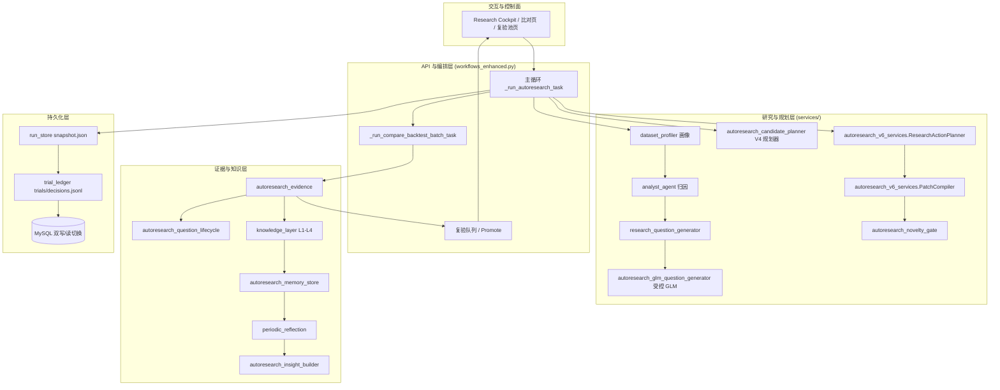
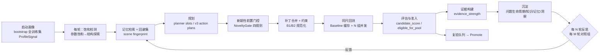
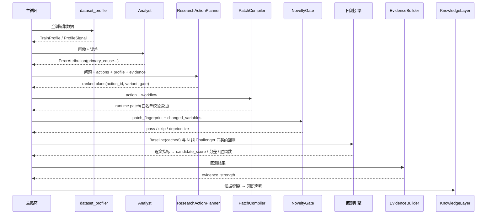

# 负荷预测 AutoResearch 全面讲解（代码实现版）

> **本文定位**：把 AIP 负荷预测里的 AutoResearch 从「整体架构 → 主循环 → 关键机制 → 数据结构 → 边界与演进」讲透。
> **事实基准**：全部结论来自**现有代码**（`backend-service/`），关键处标注 `文件:行` 或符号名；设计文档（`spec/autoresearch/`）只作背景，**不当已实现事实**。
> **阅读线**：想先看全貌读 §1–§2；想对照实现读 §3；想追某个机制读 §4；想写交底/专利读 §6、§8。

---

## 1. 宏观定位

### 1.1 它解决什么问题

负荷预测的痛点不是「训不出一个好模型」，而是：

- **算法资产散**：数据处理/特征/训练散在专项脚本里，难复现、难组合、难版本化；
- **评测不可信**：训练/预测/回测边界不清会未来泄漏；不同实验窗口/指标不一致，无法横向比较；
- **单次最优 ≠ 长期稳定**：某个候选只在单个历史窗口好，跨季节/跨窗口/真实调度未必稳；
- **变更无治理**：候选发现、上线切换、精度告警若由同一模块直连，就没有审批、审计与回滚。

AutoResearch 的命题是：**把一次性的算法调参活动，变成可复现、可评测、可研究、可发布、可运营的研究系统**。

### 1.2 它在算法生命周期中的位置

AIP 负荷预测围绕算法版本的生命周期组织六段闭环（见《整体故事线》），AutoResearch 是第三段「自动研究」：

```
①算法资产化 → ②统一评测 → ③自动研究 → ④证据晋级 → ⑤受控发布 → ⑥精度运营
                              ↑ 本文范围
```

- **上游**：标准工作流（Train/Predict/Backtest）把算法变成可执行资产；回测是**固定评分器**。
- **本段**：AutoResearch 生成候选（Challenger），在**不改变评分规则**的前提下与 Baseline 同尺对比。
- **下游**：候选进入复验池→Promote→预上线（Prelaunch）→影子（Shadow）→生产（Production）；真实反馈再回流研究。
- **关键边界**：AutoResearch **不直接改写正式生产版本**；研究系统可以自动生成与复验候选，但不能自动改生产身份。

### 1.3 术语表

| 术语 | 含义 | 代码锚点 |
|---|---|---|
| 固定评测契约 evaluation_contract | 运行前冻结的窗口/指标/聚合/数据边界；候选不得改写切分与评分规则 | `_ALLOWED_EVAL_PATCH_KEYS:4973`，校验 `:7645` |
| ProfileSignal 画像信号 | 从数据画像提取的结构化信号（波动/周末/漂移/天气/噪声/异常窗） | `autoresearch_research_action.py` `ProfileSignal` |
| ResearchAction 研究动作 | 带语义的实验单元（适用画像、补丁模板、风险、期望证据、停止条件、降级动作） | 同上 `ResearchAction` |
| 确定性补丁 | 由代码而非生成式模型产出的可执行配置（全局参数/节点参数/结构开关） | `PatchCompiler` |
| 新颖性前置门控 | 回测**执行前**做的去重/降权/跳过/冷却 | `autoresearch_novelty_gate.py` |
| 证据强度 evidence_strength | 五级：单窗正/单窗负/多窗确认/多窗拒绝/证据不足 | `autoresearch_evidence.py` |
| 候选准入 eligible_for_pool | 「分差达标 ∧ 优胜窗口数达标」同时成立 | `workflows_enhanced.py:9680` |
| 分级实验调度 Stage A/B/C | 单窗探针 / 三窗正式 / 五窗复验 | `load_forecast_v3.json#staged_evaluation` |
| Promote | 把通过复验的候选登记为研究/预上线资格（≠ 部署 Production） | `promote_tuning_candidate` |

---

## 2. 整体架构

### 2.1 分层视图



### 2.2 主循环总览

主循环是 `workflows_enhanced.py:11135` 的 `_run_autoresearch_task`。它按「轮」推进，每轮做一次：**画像 → 规划 → 门控 → 编译 → 同尺回测 → 证据 → 沉淀**。



### 2.3 两条规划路径（V4 规划器 与 V6 动作规划器）

系统同时保留两条规划路径，按注册表类型自动选择：

| 维度 | V4 `AutoResearchCandidatePlanner` | V6 `ResearchActionPlanner` |
|---|---|---|
| 规划对象 | 5 类**方向标签**（parameter/feature/model/data/risk） | **有语义的 research action**（如 `calendar_feature_ablation`） |
| 决策依据 | layer scoreboard 的 `coverage_gap` / 偏科 | 画像信号 + 研究问题 + 证据 + novelty/risk/cost |
| 选择入口 | `build_slots()` 给并发组分配角色 | `plan()` 选 action 并展开 variant |
| 触发条件 | 默认 | 注册表含 `actions` 字段（如 `load_forecast_v3`）**自动启用** |

**V4 规划器的默认调度**（`build_slots`）：`batch_size≥5` 一轮覆盖五方向；`=3` 用 `exploit / diversify / explore_risk` 三角色；`=2` 主组 exploit + 一个 gap 最大方向；`=1` 关闭多方向。角色与来源（`primary/planner/registry_targeted/memory_random`）都写入 `planner_reason`，不黑盒。

**V4 的去偏**：`exploration_health()` 计算 `parameter_overdominance = 总主组≥4 且 parameter 占比≥0.6`；若成立则把推荐层追加进 `force_activate`（`:11370-11395`），避免主组永远在 `train_days` 上打转。

### 2.4 端到端数据流



---

## 3. 主循环逐步详解

> 每小节给出：**做什么 / 关键函数 / 代码锚点 / 失败与降级**。

### 3.1 启动与画像 bootstrap

- 若 `state.dataset_profile.train_profile.profile_quality.source != "full_training_dataset"`，调用 `_bootstrap_train_profile_at_run_start` 用**完整训练集**重建画像，落 `state["dataset_profile"]`。避免用回测窗口的降级画像做研究。
- 画像质量字段 `profile_quality`（`source/point_count/source_days/has_real_load_curve/has_periodicity_signal/has_weekday_weekend_signal`）让下游能判断「画像是真实的还是空壳」。

### 3.2 每轮开始：饱和检测 / 激活层 / 去偏

- **饱和检测**：`_is_parameter_saturated(iterations, k=saturation_k, threshold=saturation_threshold)`（默认 `k=4, threshold=0.05`）。饱和则 `state["phase"]="structure_exploration"` 并把 `feature_recipe_id` 注入 search_space。
- **激活层**：`autoresearch_registry_service.get_active_layers(registry, state)` 按层的 `activation_order` **级联激活**——当前层饱和才放开下一层；并有 per-layer 强制饱和上限 `_LAYER_MAX_ITERATIONS = {training:12, feature:16, model:20, data:20}`（防止 training 层因 `train_days` 总能产生 >5% 变化而永不饱和）。
- **去偏**：见 §2.3。

### 3.3 记忆检索与回避集

- `_retrieve_memory_cases(workflow, scenario_tags, limit=8, query_fingerprint=...)` 取历史相似 run 的案例。
- **回避集**：把历史 `outcome.improved=False` 的 override 中、且字段属于当前搜索空间的，收集成 `_avoid_set`，采样时回避。

### 3.4 采样与规划

- **注册表采样**：`_sample_from_registry(registry, layers, diagnosis, memory_cases, avoid_set, rng, locked_params, research_focus)` → `_sample_to_patches(...)`。`locked_params` 来自 `_build_locked_params_from_runtime_patch`，保证已 apply 的参数不被覆盖。
- **V6 动作计划**：若注册表含 `actions`，`_prepare_v3_autoresearch_plans` 调 `AnalystService.generate_questions` → `ResearchActionPlanner.plan` → `PatchCompiler.compile_runtime_patch`，产出 `plans` 与 `runtime_patches`（同时落 `state.v3_planner_profile_signal/questions/plans`）。
- **规划槽位**：`AutoResearchCandidatePlanner.build_slots()` 给并发组分配方向与角色；主组（group 0）优先聚焦 `target_layer` 采样。

### 3.5 新颖性前置门控

`AutoResearchNoveltyGate.evaluate()` 在**回测前**判四件事（详见 §4.5），输出 `pass / skip / deprioritize` 与**人类可读 reason**（写入 `planner_reason`）。

### 3.6 补丁合并与约束（B1/B2）

- 合并：`global_config_patch`（白名单键）、`node_param_patches`（functionId→node_id）、`structure_patch.node_switches`、`model_focus`。
- **B1**：非 `parameter` 方向**剔除** `train_days / backtest_train_days`（避免特征/数据组又被训练参数污染）。
- **B2**：`feature` 方向最多保留 2 个节点参数变更（单变量控制）。
- 去重：`_seen_override_keys` 以规范化 JSON 键去重，重复则重采样（最多 5 次）。

### 3.7 对照组机制

`_is_control_round = (iteration % control_group_interval == 0)`（默认 5）。对照组用**空覆盖**回测，与第 1 轮 baseline 比，检测数据漂移（漂移 >1% 触发告警）。

### 3.8 基线锚定与缓存

- `anchor_baseline_contract`（默认 True）：Baseline 合同**每轮相同**，Challenger 只在此基础上叠加 `{train_days, auto_tune_n_trials, cv_folds}` 的 delta。
- **Baseline 缓存**：`_baseline_cache_key` + `_baseline_cache_is_valid`；第 1 轮跑完缓存逐窗 baseline，后续轮直接注入、跳过 Baseline 回测（省算力，且保证同尺）。

### 3.9 并发批次执行

`_run_compare_backtest_batch_task(comparison_id, baseline_workflow_id, challenger_workflow_ids, windows, evaluation_contract, score_margin, min_windows_challenger_better, ...)`：

1. 逐窗口跑 Baseline（或命中缓存）与每个 Challenger；
2. 每个窗口算 `challenger_score / baseline_score`，`cs > bs` 记一个胜窗；
3. 跨窗聚合（`mean/median/trimmed_mean`）后算 `score_advantage`；
4. 判定准入（§3.10）；
5. 实时 `live_update_hook` 把窗口进度推给前端。

### 3.10 候选准入判定（核心公式）

```python
score_advantage = aggregate_challenger_score - aggregate_baseline_score
meets_score_margin = score_advantage >= score_margin            # 默认 0
meets_win_count    = wins_challenger >= min_windows_challenger_better  # 默认 2
eligible_for_pool  = meets_score_margin and meets_win_count
```
（`workflows_enhanced.py:9676-9680`）可比较窗口数 `comparable_windows<=0` 时强制 `eligible_for_pool=False`，`failure_reason="no_comparable_windows"`。

### 3.11 评估与排序

- `AutoResearchEvaluator.evaluate_candidate`：`mape_improvement = baseline_mape - challenger_mape`；policy 约束 `min_mape_improvement / max_abs_bias / max_p95_ape` → `meets_constraints`。
- `rank_key`：先 `meets_constraints`，再 `challenger_mape + variance_penalty`（**方差惩罚 = 跨窗 challenger_score 方差 × 0.5**，偏爱稳定候选），再 rmse、分差、相对改善。
- `compute_pareto_frontier`：多目标 (mape, rmse, duration) 的帕累托前沿，top_k。

### 3.12 证据构建

`AutoResearchEvidenceBuilder` 从候选/回测产出 `ExperimentEvidence`，并判定 `evidence_strength`（§4.6）与 `needs_multi_window_confirmation`；`patch_fingerprint = sha256(...)[:16]`。

### 3.13 假设验证与洞察

`AutoResearchHypothesisTracker.verify()` 拿本轮 `evaluation` 与上一提案 `expected_outcome{metric,direction,threshold}` 比对 → `verified`；更新 `insights.effective_directions / ineffective_directions`、`disproved_hypotheses`（FIFO 20）、`consecutive_type_count`。

### 3.14 问题生命周期

`AutoResearchQuestionLifecycle` 给每个问题算 `question_key=sha256(规范化文本)[:16]`，状态机 `open → testing → resolved/stale`；`apply_evidence` 用证据推进（多窗确认→resolved；持续负证据且≥3 轮→stale）。

### 3.15 阶段性反思

`PeriodicReflection`（默认每 20 轮，区间 5–50）：`reflect()` 算趋势/覆盖度/前瞻预测，输出 `decision ∈ continue_current / shift_focus / expand_registry / early_stop`；`shift_focus` 会写 `current_research_focus` 并对 `priority_layers` 采样概率 ×2、`avoid_layers` ×0.5；`_meta_warning` 在连续 3 次建议未被采纳时告警。

### 3.16 收敛 / 饱和监控

- `AutoResearchConvergenceMonitor.check_convergence`：最近 5 轮 MAPE 方差 < 0.01 判收敛。
- `is_parameter_saturated`：最近 4 轮改善均 < 0.05 判饱和。

### 3.17 沉淀

- **知识层** `KnowledgeLayer`：从 run insight / 证据 ingest 成 L1–L4 知识声明（§4.8）。
- **run 洞察** `AutoResearchInsightBuilder`：产出 `scenario_fingerprint / data_profile / exploration_summary / learned_rules / ineffective_attempts / recommended_starting_config_for_similar`。
- **记忆** `AutoResearchMemoryStore`：按场景指纹加权检索历史案例（§4.9）。

### 3.18 复验与晋级

复验队列按 `candidate_id`/`candidate_signature` 去重、**串行执行**（同一时间一条 running），并可被活跃 AutoResearch run 阻止（保资源）；复验 passed 后反写证据 `multi_window_confirmed`（`:9927-9957`）。`promote_tuning_candidate` 默认要求至少一条 passed，人工跳过须显式 `force=true`。

---

## 4. 关键机制深挖

### 4.1 数据画像与画像信号

`dataset_profiler.py` 产出：
- **TrainProfile**：`load_curve_stats`(mean/std/skew/kurt)、`peak_valley_distribution`（用 `scipy.signal.find_peaks`）、`data_quality`(missing_rate/outlier_ratio/max_consecutive_missing)、`periodicity_strength`(daily/weekly autocorr)、`period_distribution`、`dominant_pattern`、`weekday_weekend_gap`、`train_fit_mape`、`profile_quality`。
- **ValidationProfile**：`overfit_indicator`（avg_gap/avg_train 比 >0.5→high，0.2–0.5→moderate，<0.2→low）。
- **TestProfile**：`overall_mape/rmse`、`period_error_breakdown`（含 worst_period）、`peak_error_ratio/valley_error_ratio`、`high_error_at_extremes`。
- **TriDatasetDiagnosis**：`pattern_consistency`（训练主导模式 vs 测试日类型）、`overfit_detection`（`test_mape > cv_val_mape×1.5` → confirmed_overfit）、`generalization_assessment`。
- **CrossWindowPattern**：`consistently_bad_periods`（某时段在 >60% 窗口 MAPE > 全日均值×1.5）、`drift_signal`、`error_trend`。

`ProfileSignal.from_train_profile` 把画像压成选路信号：`volatility_level`（cv>0.3→high）、`weekend_sensitive`（gap>0.1）、`drift_strength`、`noise_level`（missing>0.05→high）、`weather_correlated`。

### 4.2 误差归因

- **规则归因** `AnalystAgent.PRIORITY`（优先级从高到低）：`pattern_mismatch > confirmed_overfit > drift_signal > peak_valley_concentration > period_specific_error > model_divergence > parameter_saturation`。输出 `ErrorAttribution(primary_cause, contributing_factors, evidence)`。
- **运行期诊断** `AutoResearchDiagnostics.compute_error_diagnosis` 的 `primary_error_source`：`model_divergence`（per-model SMAPE 分歧 >3.0）、`weekend_pattern_shift`（gap>0.05）、`data_coverage_insufficient`（成功率<0.7）、`outlier_days`（max_daily > 2×avg）、`parameter_saturation`（兜底）；置信度由数据充分度（≥14 天且≥10 成功→high）。

### 4.3 研究问题生成

- **规则生成** `ResearchQuestionGenerator`：worst_period 连续≥3 窗 / confirmed_overfit / drift_signal>0 / 知识冲突 → 生成 1–3 个问题；关键词重叠 >0.8 标 `recurring`；查 L3 反模式补 `candidate_causes`。
- **受控 GLM** `AutoResearchGLMQuestionGenerator`：GLM **只能输出研究问题**（系统提示明确「不允许直接写 patch」）；`audit_candidates` 逐条审计（接受≤3、拒绝≤10），必填 `question/target_direction/next_experiment_goal/evidence_refs`；`disabled_reason`、`source` 标注 `rule/glm/glm_fallback`，避免把规则候选误当 LLM 推理。

### 4.4 研究动作与确定性补丁编译

- **ResearchAction** 字段：`action_id / action_type / target_direction / target_layer / description / applicable_profile / patch_template / max_changed_variables / risk_level / expected_evidence / stop_conditions / fallback_actions / known_anti_patterns / cooldown_iterations / stage`。
- **Plan 流程**（`ResearchActionPlanner.plan`）：画像适用过滤 → 问题匹配打分 → novelty gate（skip 丢弃 / deprioritize ×0.5）→ `next_untested_variant` 选未见变体（全测完则 exhausted）→ 风险降权（low 1.0/medium 0.85/high 0.7）→ 排序 → batch 选（优先不同 action；若第一名 priority ≥ 第二 2× 允许同 action 占多槽）→ exhausted 走 `fallback_actions` 补位。
- **PatchCompiler**：`_ALLOWED_GLOBAL_KEYS`（train_days/daily_horizon/ensemble_mode/XGB-LGB-CB 超参等）、`_ALLOWED_NODE_FUNCTIONS`（auto_tune_xgboost/create_lag_features/rolling_statistics/sliding_window/ensemble_forecast/load_csv/holiday_features/workday_features/diff_features/extract_statistical_features）；**笛卡尔积 → 混合进制解码** `_decode_variant_index`；超过 `max_changed_variables` 抛错；`expand_variants` >20 组合时用 LHS 采样；`variant_fingerprint=sha256[:16]`；`next_untested_variant` 找第一个未测指纹。

### 4.5 新颖性前置门控（四规则）

```
Rule1 同 patch_fingerprint 已在 evidence/pool → SKIP(精确重复, confidence=1.0)
Rule2 同 changed_variables 组合累计 ≥ max_same_variables_count(默认4) → DEPRIORITIZE ×0.5
Rule3 同变量组合近邻已 multi_window_rejected 且 profile_fingerprint 相同 → SKIP
Rule4 同 action 连续 ≥ cooldown_threshold(默认3) 轮无正收益 → COOLDOWN
否则 → PASS
```
默认只跳过强重复，避免误杀 profile 不同的实验；跳过原因写入 `planner_reason`。

### 4.6 固定评测契约与证据分级

**证据强度**（`AutoResearchEvidenceBuilder.evidence_strength`）：

| 条件 | strength |
|---|---|
| 非 success / 改善 None / 胜窗≤0 | `insufficient_evidence` |
| 正收益 且 多窗（总≥2 且胜≥2） | `multi_window_confirmed` |
| 正收益 单窗 | `single_window_positive` |
| 多窗 但非正 | `multi_window_rejected` |
| 其他 | `single_window_negative` |

`needs_multi_window_confirmation`：success ∧ 正收益 ∧ 总窗≤1。

**候选分数**：`candidate_score = 100 − SMAPE`（缺 SMAPE 时 `100·exp(−RMSE/10000)`）。

### 4.7 分级实验调度（Stage A/B/C）

来自 `load_forecast_v3.json#staged_evaluation`：

| 阶段 | 窗口数 | 其他 | 晋级条件 |
|---|---|---|---|
| A 探针 | 1 | `auto_tune_n_trials_override=5` | `mape_improvement>0 OR inconclusive` → B |
| B 正式 | 3 | 标准配置 | `eligible_for_pool AND novelty=novel` → C |
| C 复验 | 5 | — | `passed AND multi_window_confirmed` → 可 Promote / active knowledge |

铁律：**Stage A 的正收益只能决定是否进 B，不能升级为 active knowledge**。

### 4.8 知识层 L1–L4

- 分层：L1 原始案例 / L2 规律 / L3 反模式 / L4 假设模板。
- **注入权重** = `层权(L1 0.5/L2 1.0/L3 1.5/L4 2.0) × 类型倍率(causal 2.0/anti_pattern 1.5/hypothesis_template 2.0/correlational 1.0) × 场景匹配(匹配 1.0，不匹配 0.3；stale ×0.5，candidate ×0.65，conflicted ×0.25)`。
- **置信度**：`evidence≥3 且 counter=0 → 0.85`；否则 `e/(e+c)`；文本型 target 且证据<2 → 0.2。
- **衰减**：L2/L4 每满 30 天未验证 −0.1，`confidence<0.3 → stale`。
- **冲突解决**：`condition 更具体 > last_validated_at 更近 > confidence 更高`；无法判定则双方标 `conflicted`。

### 4.9 跨 run 记忆与场景指纹

`scenario_fingerprint`：`granularity/span_days/load_type/seasonality/weekend_sensitivity/anomaly_ratio/backtest_mode/train_days`。**检索加权**：`0.20·tag + 0.15·fingerprint_similarity + 0.15·diagnosis + 0.25·improved + 0.15·delta + 0.05·constraints + 0.05·freshness`，时效 `exp(−days/45)`。

### 4.10 自动应用策略与自愈

- **自动应用** `AutoResearchAutoApplyPolicy`：`skip_reason ∈ {no_recommended_proposal, auto_apply_disabled, validator_failed, risk_exceeds_threshold}`；连续 3 次被拦且 `risk_max=low` → 提档 `medium`（只放宽自动应用门槛，不绕过 validator）。
- **自愈** `AutoResearchSelfHeal`：无测试数据→关窗口过滤/目标掩码；训练不足→`train_days/backtest_train_days` 降到 `max(14, x−7)`；平台期（近 3 轮极差≤0.05）→**只扩 `auto_tune_n_trials`**；**`train_days` 属结构参数，不自动改，仅追加人工建议**（Strategy C）。

### 4.11 多保真与可选采样后端

- **ASHA** `AutoResearchMultiFidelityScheduler`：初筛取前 `ceil(n×0.5)` 窗（≥1），按 `score_advantage` 晋级前 `ceil(len/reduction_factor)`，其余标 `pruned`；仅当 `multi_fidelity_enabled/asha_enabled` 且 batch>1 且窗>1。
- **Optuna** `AutoResearchOptunaSampler`：可选 TPE 后端（每 run 一个 study，`suggest/report`）。

---

## 5. 数据结构与持久化

### 5.1 核心数据结构

| 结构 | 要点 | 文件 |
|---|---|---|
| `ResearchAction` | 见 §4.4 | `autoresearch_research_action.py` |
| `ProfileSignal` / `ProfileCondition` | 画像信号 / 条件(eq/gt/lt/in/not_in) | 同上 |
| `EvidenceLedgerEntry` | 统一证据条目（run/iter/group/action_id/patch_fingerprint/windows_*/strength/novelty） | 同上 |
| `ExperimentEvidence` | 证据构建产物 | `autoresearch_evidence.py` |
| `KnowledgeClaim / ClaimKey` | 知识声明与键(target_param/recommended_value/direction/metric) | `knowledge_layer.py` |
| `ReflectionDecision / ReflectionResult` | 反思决策与结果 | `periodic_reflection.py` |
| `ExperimentQuality` | 实验质量五维 + 综合分 | `experiment_quality.py` |
| `AgentTrace` | 智能体审计记录 | `agent_orchestrator.py` |

### 5.2 持久化布局与断点恢复

- `data/autoresearch/runs/{run_id}/snapshot.json`（run 快照，原子写）、`trials.jsonl`、`decisions.jsonl`。
- `data/autoresearch/{knowledge,insights,memory,registries,candidate_pool,production}`。
- **断点恢复**：`AutoResearchRunStore.load_for_status / mark_interrupted / scan_and_mark_interrupted` 把 `pending/running/waiting_review/cancelling` 在服务重启时标 `interrupted` 且 `recoverable=True`。

### 5.3 JSON → MySQL 迁移

`autoresearch-mysql-migration/`：目前 **Phase1 双写**（写完 JSON 再 upsert `experiment_run/experiment_trial/experiment_decision/knowledge_claim/candidate_pool`）+ **Phase2 DB 优先读**（`is_db_read_enabled()` 开则读 DB，miss 回落 JSON）。即「文件、数据库、双写读切换并存」尚未完全收敛为单一事实源。

---

## 6. 关键不变量与安全边界

1. **GLM 只出意图**：生成式模型只产问题/假设/实验意图，**可执行补丁必须由确定性编译器生成**（`autoresearch_glm_question_generator` 系统提示；`PatchCompiler` 白名单）。
2. **单窗口不可信**：单窗正收益 ≠ 候选准入；须 `eligible_for_pool`（分差 ∧ 胜窗）且多窗复验 passed 才能 Promote / 升 active knowledge。
3. **固定评测契约**：窗口/指标/聚合/数据边界运行前冻结，候选不得改写评分规则（`_ALLOWED_EVAL_PATCH_KEYS` 白名单极小）。
4. **结构参数不自动改**：`train_days` 属结构参数，自动研究默认不变，仅追加人工建议。
5. **研究资格 ≠ 生产身份**：Promote 只形成研究/预上线资格，不直接改写正式 Production。
6. **Baseline 同尺**：`anchor_baseline_contract=True` 时 Baseline 每轮相同并可缓存，保证对比公平。
7. **失败同样沉淀**：重复组合、失败窗口、拒绝原因进反模式与下一轮规划，避免无证据地重复消耗回测资源。

---

## 7. 代际演进 V1 → V7

| 代际 | 解决的问题 | 主要能力 | 本代遗留 |
|---|---|---|---|
| V1 | 人工调参效率低、结论不可复用 | 自动采样/回测/诊断/建议、跨 run 经验 | 被动试参，不知在研究什么 |
| V2 | 假设缺问题牵引 | 数据画像、研究问题、知识分层、反思、多 Agent 规划 | 多为蓝图，工程复杂度上升 |
| V3 | 长 run 卡死、状态丢失 | run 快照、trial/decision 账本、服务拆分、自愈 | 过程与结论缺统一控制面 |
| V4 | 过程不透明、候选不能严格晋级 | Candidate Planner、Research Cockpit、Novelty、Evidence、Verification、Promote | 方向偏粗、画像未真正选路 |
| V6 | 盲搜、重复探索、证据分散 | 画像驱动 Research Action、确定性 Patch Compiler、Evidence、A/B/C 分级 | 统一证据与分级调度尚未全闭环 |
| V7 | AutoResearch 与生命周期入口割裂 | 平台前端工作台（「自动化回测」接入算法管理/运营/部署） | 平台产品化，非研究算法新一代 |

> 无第五代，第四代之后直接进入第六代设计与实现。

---

## 8. 质量度量与验收

第六代不以 MAPE 为唯一标准，还看研究质量（`ResearchQualityMetrics`）：

- `novelty_rate = new_count / total_candidates`（重复率下降）
- `action_success_rate = positive_evidence / total_evidence`
- `multi_window_confirmed_rate = confirmed / total_evidence`
- `duplicate_patch_rate = duplicate_count / total_candidates`
- `question_resolution_rate = resolved / total_questions`

验收分三层：**字段链 smoke**（Action/Patch/Evidence/Candidate/Verification 状态流转）→ **正式研究 run**（重复率下降、画像选路有效、新候选比例上升）→ **真实发布验证**（多窗口复验 + Prelaunch/Shadow 观察）。

---

## 9. 已知局限与改进方向

- **JSON/DB 并存**：文件、数据库、双写读切换尚未收敛为单一事实源（§5.3）。
- **V6 未全闭环**：Evidence Ledger 尚未成为 Candidate/Verification/Question/Knowledge 的生产级单一事实源；Evidence Critic 主循环调用与 Stage A/B/C 真实调度待完整验收。
- **画像质量依赖**：`TrainProfile` 部分字段可能来自回测窗口或降级数据；已用 `profile_quality` 标记，但完整训练集画像仍需加强。
- **结构参数探索受限**：`train_days` 走手动运营决策（Strategy C），自动研究不覆盖，可能错过结构层机会。
- **统计稳定性门槛**：`min_valid_cycles` 等阈值需业务验收确认。

---

## 10. 附录

### 10.1 代码地图（services/，行数为当前工作树）

| 文件 | 行 | 职责 |
|---|---:|---|
| `autoresearch_candidate_planner.py` | 383 | V4 候选规划器（5 方向 / scoreboard / slots） |
| `autoresearch_research_action.py` | 340 | ResearchAction / ProfileSignal / EvidenceLedgerEntry |
| `autoresearch_v6_services.py` | 846 | Analyst / ResearchActionPlanner / PatchCompiler / EvidenceCritic |
| `autoresearch_novelty_gate.py` | 167 | 新颖性前置门控（四规则） |
| `autoresearch_evidence.py` | 292 | 证据强度判定 / 指纹 |
| `autoresearch_evaluator.py` | 206 | 候选评估 / 排序 / Pareto |
| `autoresearch_proposal_manager.py` | 409 | 提案评分/排名/合并/假设链 |
| `autoresearch_question_lifecycle.py` | 187 | 问题生命周期状态机 |
| `autoresearch_glm_question_generator.py` | 290 | 受控 GLM 问题生成与审计 |
| `research_question_generator.py` | 189 | 规则研究问题生成 |
| `autoresearch_diagnostics.py` | 180 | 误差画像 / 诊断五分类 |
| `autoresearch_hypothesis_tracker.py` | 177 | 假设验证 / 否证集 |
| `autoresearch_convergence_monitor.py` | 82 | 收敛 / 饱和监控 |
| `autoresearch_insight_builder.py` | 155 | run 洞察 |
| `autoresearch_memory_store.py` | 256 | 场景指纹 / 跨 run 记忆 |
| `autoresearch_auto_apply_policy.py` | 219 | 自动应用策略 / 风险提档 |
| `autoresearch_self_heal.py` | 172 | 运行时自愈（Strategy C） |
| `autoresearch_multifidelity_scheduler.py` | 84 | ASHA 多保真 |
| `autoresearch_optuna_sampler.py` | 92 | Optuna TPE 后端 |
| `autoresearch_batch_selector.py` | 28 | 批次最优选择 |
| `autoresearch_registry_service.py` | 222 | 注册表加载 / 级联激活 / 饱和 |
| `autoresearch_trial_ledger.py` | 378 | trial/decision 账本 |
| `autoresearch_run_store.py` | 446 | run 快照 / 断点恢复 |
| `autoresearch_persister.py` | 111 | 持久化门面 |
| `autoresearch_paths.py` | 182 | 路径解析 |
| `autoresearch_job_queue.py` | 331 | 任务队列 |
| `dataset_profiler.py` | 442 | 三集画像 |
| `analyst_agent.py` | 89 | 规则归因 |
| `knowledge_layer.py` | 521 | L1–L4 知识层 |
| `periodic_reflection.py` | 285 | 阶段性反思 |
| `experiment_quality.py` | 201 | 实验质量 / 信息增益 / 交互约束 |
| `agent_orchestrator.py` | 187 | 多/单智能体编排 |
| `api/workflows_enhanced.py` | 14438 | 主循环与 API 编排 |

### 10.2 关键函数索引（file:line）

| 符号 | 位置 |
|---|---|
| `_run_autoresearch_task` | `api/workflows_enhanced.py:11135` |
| `_prepare_v3_autoresearch_plans` | `:8365` |
| `_run_compare_backtest_batch_task` | `:9397` 起 |
| `eligible_for_pool` 判定 | `:9676-9680` |
| `_build_candidate_score` | `:3851` |
| `_ALLOWED_EVAL_PATCH_KEYS` | `:4973`（校验 `:7645`） |
| 对照组 `_is_control_round` | `:11633` |
| `anchor_baseline_contract` | `:11648` |
| 复验反写 `multi_window_confirmed` | `:9927-9957` |

---

*本文依据 `backend-service/` 现行代码整理；行号随工作树变动，若与最新代码不符以代码为准。*
