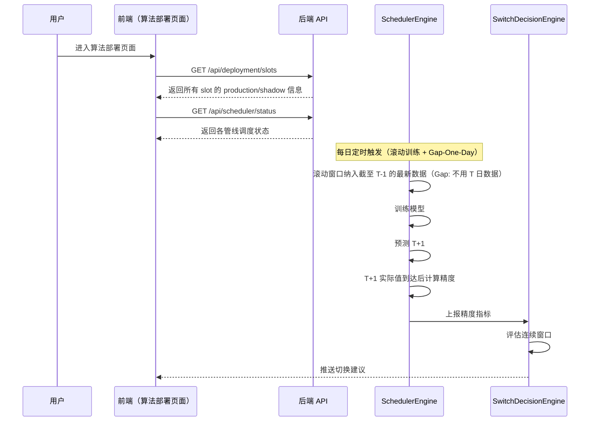
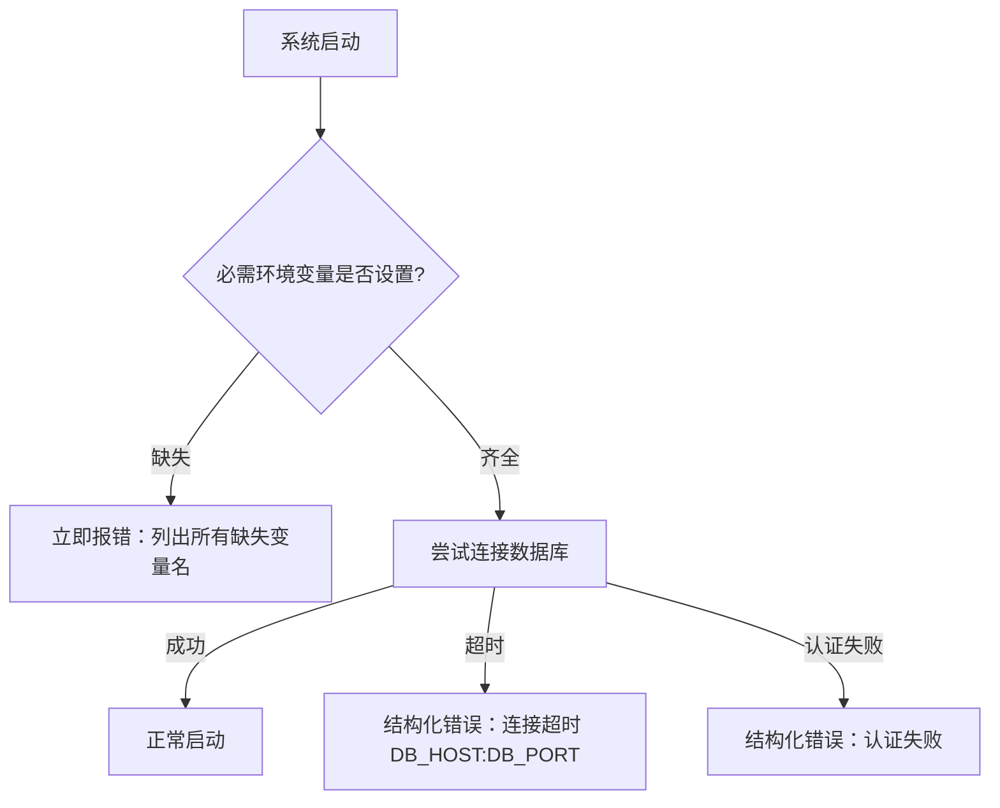

<!-- @AI_GENERATED -->
# 设计文档：算法部署重构与工作流版本管理修复

## Overview

本次重构将"算法部署"模块升级为模型全生命周期管理中心，整合数据管线、定时调度、生产/影子模型管理和精度维护切换能力。同时修复工作流版本管理中"新建"行为不统一的问题，并确保数据库连接配置的跨环境可移植性。

### 设计目标

1. **统一管理入口**：数据管线和定时调度从分散页面迁入算法部署，实现"数据拉取 → 模型训练 → 预测 → 精度评估 → 切换"的闭环操作
2. **生产/影子模型管理**：复用系统中已有的 Slot（槽位）概念，每个 slot 维护一个 Production_Model 和多个 Shadow_Model
3. **滚动训练调度策略（含 Gap-One-Day）**：实现滚动窗口训练——训练窗口持续纳入截至 T-1 的最新数据（Gap 约束：绝不使用触发当日数据），预测 T+1 目标，T+1 实际数据到达后自动评估精度
4. **精度维护自动化**：基于评估窗口的自动切换 + 手动切换 + 回滚
5. **算法运营瘦身**：原"算法运营"仅保留精度展示和归因分析的只读视图
6. **工作流版本修复**：统一"新建"行为——任何"创建新"操作（从模板/空白）产生独立新工作流；"编辑已有"产生版本递增
7. **数据库连接可移植性**：复用现有 `services/db/config.py` 的环境变量 + YAML 配置机制，确保跨机器部署无需改代码

### 关于 Slot（槽位）——已有概念复用

**Slot 是系统中已有的多环境/多产品线分区概念**，并非本次重构引入的新定义。当前代码库中的使用情况：

- 数据库表：`version_registry`、`candidate_pool`、`prediction_result`、`accuracy_metric`、`station_data` 均包含 `slot` 列（默认值 `"default"`）
- 前端：`PrecisionOpsDashboardPage.tsx` 提供槽位选择器（Slot Selector）
- 后端 API：`precision_ops` 路由使用 `/{slot}/` 路径参数

本设计复用该已有 Slot 基础设施，算法部署的模型管理按 slot 分区，与精度运营、版本注册表等模块天然对齐。

### 架构约束

- 后端框架：FastAPI + Python，复用现有 `services/precision_ops/` 和 `services/scheduler/` 架构
- 前端框架：React + TypeScript + Ant Design，页面位于 `frontend-sevice/src/pages/`
- 持久化：JSON 文件存储（`backend-service/data/deployment/`），遵循项目现有模式
- 路径规范：全部使用相对路径，不写死绝对路径
- 数据库配置：复用 `services/db/config.py`（已支持 `DB_CONNECTION_URL` 环境变量 + `configs/db.yaml` + 代码默认值三级优先级）

## Architecture

### 模块关系图

```mermaid
graph TB
    subgraph 前端
        AD[算法部署页面<br/>AlgorithmDeploymentPage]
        AO[算法运营页面<br/>AlgorithmOpsPage]
        WE[工作流编辑器<br/>WorkflowEditorPage]
        WL[工作流列表<br/>WorkflowListPage]
    end

    subgraph 后端 API 层
        DA[/api/deployment<br/>部署 API]
        SA[/api/scheduler<br/>调度器 API]
        PO[/api/precision-ops<br/>精度运营 API]
        WA[/api/workflows-enhanced<br/>工作流 API]
    end

    subgraph 后端 Service 层
        SE[SchedulerEngine<br/>调度引擎（滚动训练）]
        SW[SwitchDecisionEngine<br/>切换决策引擎]
        VR[VersionRegistry<br/>版本注册表]
        AT[AccuracyTracker<br/>精度追踪器]
        PR[ProductionRegistry<br/>生产登记]
        PM[PrelaunchManager<br/>预上线管理]
        DBC[DBConfig<br/>数据库配置（已有）]
    end

    subgraph 数据层
        DF[data/deployment/<br/>部署数据]
        DS[data/scheduler/<br/>调度数据]
        DP[data/precision_ops/<br/>精度数据]
        DW[data/workflows_enhanced/<br/>工作流 JSON]
    end

    AD --> DA
    AD --> SA
    AD --> PO
    AO --> PO
    WE --> WA
    WL --> WA

    DA --> DF
    SA --> SE
    PO --> SW
    PO --> VR
    PO --> AT
    PO --> PR
    PO --> PM
    WA --> DW

    SE --> DS
    SE --> DBC
    SW --> DP
    VR --> DP
    AT --> DP
    PR --> DP
```

### 请求流转



### 数据库连接配置架构

复用现有 `services/db/config.py`（`DBConfig` 数据类），加载优先级：

```
环境变量 > configs/db.yaml > 代码内默认值
```

关键环境变量：
- `DB_CONNECTION_URL`（完整连接字符串）— 最高优先级，一个变量即可完成连接配置
- `DB_ENGINE`（引擎类型）— 默认 `mysql`
- `DB_POOL_MAX`（最大连接数）— 范围 [1, 100]
- `DB_ENABLED`（总开关）— `false` 时退化到纯文件存储

启动时连通性验证流程：



## Components and Interfaces

### 后端新增/改造接口

#### 1. 部署槽位管理 API（`/api/deployment`）

| 端点 | 方法 | 用途 |
|------|------|------|
| `/api/deployment/slots` | GET | 获取所有部署槽位及其 production/shadow 模型 |
| `/api/deployment/slots/{slot}/versions` | GET | 获取某槽位的版本历史列表 |
| `/api/deployment/slots/{slot}/switch` | POST | 执行切换（shadow → production） |
| `/api/deployment/slots/{slot}/rollback` | POST | 回滚到前一 production 版本 |
| `/api/deployment/slots/{slot}/switch-log` | GET | 获取切换日志 |
| `/api/deployment/slots/{slot}/config` | GET/PUT | 获取/更新自动切换配置 |

**`GET /api/deployment/slots` 返回体**：

```json
{
  "slots": {
    "load_forecast": {
      "slot": "load_forecast",
      "production_model": {
        "workflow_id": "wf-xxx",
        "version_tag": "v2.1",
        "deployed_at": "2026-06-01T10:00:00",
        "latest_mape": 4.21
      },
      "shadow_models": [
        {
          "workflow_id": "wf-yyy",
          "version_tag": "v2.2-shadow",
          "accuracy_score": 3.98,
          "status": "shadow",
          "consecutive_better_days": 5
        }
      ],
      "auto_switch_enabled": true,
      "evaluation_window_days": 7
    }
  }
}
```

- `slot`（槽位名称）— 部署分区键，复用系统已有的 slot 概念，如 `load_forecast`、`pv_fault`
- `production_model`（当前生产模型）— 线上承载预测服务的模型
- `shadow_models`（影子模型列表）— 按 `accuracy_score`（精度评分）降序排列
- `auto_switch_enabled`（是否启用自动切换）— 布尔值
- `evaluation_window_days`（评估窗口天数）— 连续多少天影子优于生产才触发切换建议
- `consecutive_better_days`（连续优于天数）— 当前影子模型已连续优于生产的天数

**`POST /api/deployment/slots/{slot}/switch` 请求体**：

```json
{
  "target_workflow_id": "wf-yyy",
  "trigger_type": "manual",
  "reason": "影子模型连续7天MAPE优于生产模型"
}
```

- `target_workflow_id`（目标模型 workflow_id）— 必填，要提升为 production 的影子模型 ID
- `trigger_type`（触发类型）— `"manual"` | `"auto"`
- `reason`（切换原因）— 可选，人类可读备注

#### 2. 定时调度任务 API（`/api/scheduler`）

在现有 scheduler API 基础上扩展：

| 端点 | 方法 | 用途 |
|------|------|------|
| `/api/scheduler/tasks` | GET | 列出所有调度任务及状态摘要 |
| `/api/scheduler/tasks` | POST | 创建新的调度任务 |
| `/api/scheduler/tasks/{task_id}` | GET | 获取单个任务详情 |
| `/api/scheduler/tasks/{task_id}/start` | POST | 启动任务 |
| `/api/scheduler/tasks/{task_id}/stop` | POST | 停止任务 |
| `/api/scheduler/{pipeline}/start` | POST | 启动管线（保持向后兼容） |
| `/api/scheduler/{pipeline}/stop` | POST | 停止管线（保持向后兼容） |
| `/api/scheduler/status` | GET | 获取管线状态（保持向后兼容） |

**`GET /api/scheduler/tasks` 响应（摘要模式）**：

```json
{
  "tasks": [
    {
      "task_id": "sched-001",
      "name": "负荷预测每日滚动训练",
      "pipeline": "load_forecast",
      "schedule_type": "rolling_daily",
      "status": "running",
      "last_execution": "success",
      "last_execution_time": "2026-06-07T02:00:00",
      "next_scheduled_time": "2026-06-08T02:00:00",
      "max_window_days": 365
    }
  ]
}
```

- `task_id`（任务 ID）— 唯一标识
- `schedule_type`（调度策略类型）— `"rolling_daily"` | `"cron"` | `"interval"`
- `status`（运行状态）— `"running"` | `"stopped"` | `"failed"`
- `last_execution`（上次执行结果）— `"success"` | `"failed"` | `"skipped"`
- `max_window_days`（最大窗口天数）— 滚动训练窗口的最大长度，超出则移除最早数据

#### 3. 工作流版本管理——统一新建行为（`/api/workflows-enhanced`）

**核心原则：任何"创建新"操作均产生新的 workflow_id + version=1；"编辑已有"操作（URL 带已有 ID）产生版本递增。**

修改现有 `save_workflow` 和 `clone_workflow` 逻辑：

**创建方式统一**：
- `POST /api/workflows-enhanced`：保存新工作流（无论来源是模板还是空白画布）。新增 `source_template_id` 字段标记来源
- `POST /api/workflows-enhanced/{workflow_id}/save`：保存已有工作流的修改（版本递增）
- `POST /api/workflows-enhanced/create-from-template`：**新接口** — 从模板创建独立工作流

**`POST /api/workflows-enhanced/create-from-template` 请求体**：

```json
{
  "template_id": "wf-template-001",
  "name": "我的负荷预测工作流"
}
```

- `template_id`（源模板 ID）— 必填，作为创建起点的工作流 ID
- `name`（新工作流名称）— 必填，必须与模板名称不同

**响应**：返回一个全新的 `EnhancedWorkflow`，具有：
- 独立的 `id`（新 workflow_id）
- `version` = 1
- `source_template_id`（源模板 ID）= 请求的 `template_id`
- 独立的 `version_group_id`（不继承模板的 version_group）

**"编辑已有"模式**：当 URL 包含已有工作流 ID 参数时，加载该工作流内容，保存时调用 `POST /api/workflows-enhanced/{workflow_id}/save`，产生版本递增。

#### 4. 数据库连接验证 API（复用 `services/db/config.py`）

| 端点 | 方法 | 用途 |
|------|------|------|
| `/api/system/db-health` | GET | 验证数据库连通性，返回结构化状态 |

**响应体**：

```json
{
  "status": "healthy",
  "engine": "mysql",
  "connection_url_masked": "mysql+pymysql://root@***:3306/aip_algo_platform",
  "latency_ms": 12
}
```

**错误响应**（连接失败时）：

```json
{
  "status": "unhealthy",
  "error_type": "connection_timeout",
  "message": "连接超时：无法连接到 localhost:3306",
  "missing_vars": []
}
```

**错误响应**（环境变量缺失时）：

```json
{
  "status": "config_error",
  "error_type": "missing_env_vars",
  "message": "缺少必需环境变量",
  "missing_vars": ["DB_PASSWORD", "DB_HOST"]
}
```

### 前端页面改造

#### 算法部署页面（AlgorithmDeploymentPage）

替代现有占位页 `AlgorithmDeploymentPlaceholderPage.tsx`，新页面包含三个 Tab：

1. **模型管理** — 展示 slot 列表，每个 slot 显示 production/shadow 模型卡片
2. **数据管线** — 从 `DataPipelineManagementPage` 迁入，展示管线启停控制
3. **定时调度** — 展示调度任务列表（仅摘要：状态、上次结果、下次时间）

#### 算法运营页面（AlgorithmOpsPage）

保留精度时序图和归因分析，移除：
- 调度任务管理（迁入算法部署）
- A/B 测试配置
- 自动重训触发

新增：操作类按钮跳转到算法部署页面。

#### 工作流列表页面（WorkflowListPage）

修复"创建空白工作流"逻辑：
- `handleCreate()` 导航到 `/workflow/editor`（无 ID 参数）— 触发"新建"行为
- 从模板创建使用新的 `create-from-template` API — 也触发"新建"行为
- 打开已有工作流导航到 `/workflow/editor/{id}` — 触发"编辑已有"行为

#### 工作流编辑器页面（WorkflowEditorPage）

- 无 ID 参数时：展示空白画布（"新建"模式）
- 有 ID 参数时：加载对应工作流（"编辑已有"模式）
- 首次保存空白/模板工作流时：调用 `POST /api/workflows-enhanced` 生成新 ID + version=1
- 后续保存：调用 `POST /api/workflows-enhanced/{workflow_id}/save` 递增版本号

### 路由变更

| 旧路由 | 新路由 | 说明 |
|--------|--------|------|
| `/industry-data/pipelines` | `/algorithm-deployment?tab=pipeline` | 重定向 |
| `/algorithm-ops/scheduler` | `/algorithm-deployment?tab=scheduler` | 重定向 |
| `/algorithm-deployment` | `/algorithm-deployment` | 保持不变，页面内容升级 |

## Data Models

### 部署槽位数据模型

存储路径：`data/deployment/slots.json`

```python
# @AI_GENERATED
class DeploymentSlot(BaseModel):
    """部署槽位 — 管理一个 production + 多个 shadow 模型
    
    slot 复用系统已有概念，与 version_registry、candidate_pool、
    prediction_result、accuracy_metric 等表的 slot 列对齐。
    """
    slot: str                          # 槽位名称（如 "load_forecast"），复用已有 slot 分区概念
    production_model: Optional[ModelVersion]  # 当前生产模型
    shadow_models: List[ModelVersion]  # 影子模型列表，按精度降序
    auto_switch_enabled: bool = False  # 是否启用自动切换
    evaluation_window_days: int = 7    # 评估窗口天数
    cooldown_hours: int = 48           # 切换后冷却期（小时）
    threshold_mape: Optional[float] = None  # 精度阈值（低于此值触发回滚）
    updated_at: str                    # 最后更新时间 ISO8601


class ModelVersion(BaseModel):
    """模型版本信息"""
    workflow_id: str                    # 关联的工作流 ID
    version_tag: str                   # 版本标签（如 "v2.1"）
    status: str                        # "production" | "shadow" | "retired"
    deployed_at: str                   # 部署/注册时间
    accuracy_score: Optional[float] = None  # 最新精度评分
    consecutive_better_days: int = 0   # 连续优于 production 的天数
    source_run_id: Optional[str] = None     # 来源实验 run ID
    source_candidate_id: Optional[str] = None  # 来源候选 ID
# @AI_GENERATED: end
```

### 切换事件日志

存储路径：`data/deployment/switch_log.json`（append-only，只追加不可篡改）

```python
# @AI_GENERATED
class SwitchEvent(BaseModel):
    """切换事件日志条目 — 只追加，不可篡改"""
    event_id: str                      # 事件唯一 ID
    slot: str                          # 槽位（复用已有 slot 概念）
    trigger_type: str                  # "auto" | "manual"
    switch_time: str                   # 切换时间 ISO8601
    from_workflow_id: str              # 原 production workflow_id
    from_version_tag: str              # 原 production 版本标签
    to_workflow_id: str                # 新 production workflow_id
    to_version_tag: str                # 新 production 版本标签
    pre_switch_mape: Optional[float]   # 切换前精度（MAPE）
    post_switch_mape: Optional[float]  # 切换后精度（MAPE）
    reason: str = ""                   # 切换原因备注
    rollback_of: Optional[str] = None  # 若为回滚，指向被回滚的 event_id
# @AI_GENERATED: end
```

### 定时调度任务配置

存储路径：`data/scheduler/tasks.json`

```python
# @AI_GENERATED
class ScheduledTask(BaseModel):
    """定时调度任务配置 — 支持滚动训练调度"""
    task_id: str                       # 任务唯一 ID
    name: str                          # 任务名称
    pipeline: str                      # 所属管线（如 "load_forecast"）
    schedule_type: str                 # "rolling_daily" | "cron" | "interval"
    cron_expr: Optional[str] = None    # cron 表达式（用于 cron 类型）
    trigger_time: str = "02:00"        # 每日触发时间 HH:MM
    max_window_days: Optional[int] = 365  # 滚动窗口最大长度（天数），None 表示不限制
    slot: str = "default"              # 关联的部署槽位（复用已有 slot 概念）
    status: str = "stopped"            # "running" | "stopped" | "failed"
    last_execution_time: Optional[str] = None
    last_result: Optional[str] = None  # "success" | "failed" | "skipped"
    next_scheduled_time: Optional[str] = None
    retry_on_failure: bool = True      # 失败后是否自动重试
    max_retries: int = 3               # 最大重试次数
    created_at: str
    updated_at: str
# @AI_GENERATED: end
```

**滚动训练窗口语义（Rolling + Gap-One-Day）**：
- `schedule_type = "rolling_daily"` 时，每日触发后训练窗口自动纳入截至 T-1 的所有数据
- **Gap-One-Day 约束（必须保持）**：在 T 日执行时，训练数据只能使用到 T-1 日（含），绝不能使用 T 日当天数据。这是防止数据穿越的核心时序约束，代码中一直存在此策略
- `max_window_days` 控制窗口最大长度：若历史数据超过该天数，则从最早端截断
- 预测目标为 T+1 日，待 T+1 日实际值到达后计算精度
- 窗口示例：若 T=2026-06-08，`max_window_days=365`，训练数据范围为 `[2025-06-09, 2026-06-07]`（最多 365 天，截至 T-1=06-07），预测目标为 2026-06-09（T+1）
- 时序链路：`数据截止 T-1 → T 日训练 → 预测 T+1 → T+1 实际到达后评估精度`

### 工作流元数据扩展

在 `EnhancedWorkflow` 模型中新增字段：

```python
# @AI_GENERATED
# 新增字段（在现有 EnhancedWorkflow 基础上）
source_template_id: Optional[str] = None   # 创建来源模板 ID（"新建"时记录溯源）
version_group_id: Optional[str] = None     # 版本组 ID（同组内版本递增共享此 ID）
version: int = 1                           # 当前版本号
parent_version_id: Optional[str] = None    # 父版本 ID（同组内递增时使用）
# @AI_GENERATED: end
```

**版本管理语义——统一"新建"vs"编辑"**：
- **新建（create）**：无论从模板还是空白创建，均分配全新 `workflow_id` + 全新 `version_group_id`，`version=1`。从模板创建时 `source_template_id` 记录来源
- **编辑已有（edit/save）**：同 `version_group_id` 内递增版本号，`parent_version_id` 指向前一版本

### 数据库配置模型（已有，复用 `services/db/config.py`）

`DBConfig` 数据类已实现以下能力，本设计直接复用：

- 三级配置加载优先级：环境变量 > `configs/db.yaml` > 代码默认值
- 整型字段范围校验（超出范围抛 `ValidationError`）
- 布尔字段灵活解析（`"1"/"true"/"yes"/"on"` 均视为 True）
- 关键字段：`DB_CONNECTION_URL`、`DB_ENGINE`、`DB_POOL_MAX`、`DB_POOL_IDLE_TIMEOUT`、`DB_ENABLED`、`DB_DUAL_WRITE`

**新增启动验证逻辑**（在现有 `DBConfig` 基础上扩展）：

```python
# @AI_GENERATED
class DBConnectivityValidator:
    """数据库连通性验证器 — 启动阶段主动校验"""
    
    REQUIRED_VARS = ["DB_CONNECTION_URL"]  # 最低必需变量
    
    def validate_config(self, config: DBConfig) -> ValidationResult:
        """校验配置完整性 + 连通性
        
        Returns:
            ValidationResult with status, error_type, message, missing_vars
        """
        # 1. 检查必需环境变量
        # 2. 尝试建立连接
        # 3. 返回结构化结果
        ...
# @AI_GENERATED: end
```

## Correctness Properties

*A property is a characteristic or behavior that should hold true across all valid executions of a system—essentially, a formal statement about what the system should do. Properties serve as the bridge between human-readable specifications and machine-verifiable correctness guarantees.*

### Property 1: 滚动训练窗口正确性（含 Gap-One-Day 约束）

*For any* valid trigger date T, pipeline configuration with `max_window_days = M`, and available historical data set D, the scheduler engine SHALL select training data satisfying: (a) training end date = T-1 (gap-one-day: 绝不使用 T 日当天数据), (b) training data includes all available records from D with date ≤ T-1, (c) if the available data span exceeds M days then only the most recent M days are included (window start = T-1-M+1), (d) prediction target date = T+1, (e) when new data arrives before the next trigger, the next execution automatically includes it without reconfiguration, (f) no record with date ≥ T shall appear in training data (gap enforcement).

**Validates: Requirements 2.3, 4.2, 4.3, 4.4, 4.7**

### Property 2: 精度指标计算正确性

*For any* pair of prediction values array and actual values array (both non-empty, same length, actual values non-zero for MAPE), the computed MAPE and RMSE SHALL match the standard mathematical formulas: MAPE = mean(|actual - predicted| / |actual|) × 100, RMSE = sqrt(mean((actual - predicted)²)).

**Validates: Requirements 4.5**

### Property 3: 影子模型列表排序

*For any* deployment slot containing multiple shadow models with distinct accuracy scores, the returned shadow model list SHALL be sorted in descending order by `accuracy_score`.

**Validates: Requirements 3.4**

### Property 4: 切换资格检测

*For any* deployment slot with auto-switch enabled, and *for any* sequence of daily metric comparisons where the shadow model's MAPE is lower than production's for at least `evaluation_window_days` consecutive days, the system SHALL flag the shadow model as eligible for switch.

**Validates: Requirements 5.1, 5.4**

### Property 5: 模型切换状态转换正确性

*For any* deployment slot with a valid production model P and shadow model S, after executing a switch operation targeting S, the slot's production model SHALL be S (status = "production") and P's status SHALL be "retired".

**Validates: Requirements 5.2**

### Property 6: 切换事件日志完整性

*For any* switch event (auto or manual), the persisted log record SHALL contain non-null values for: `trigger_type`, `switch_time`, `from_workflow_id`, `to_workflow_id`, `pre_switch_mape`.

**Validates: Requirements 5.3**

### Property 7: 回滚恢复正确性

*For any* deployment slot that has undergone a switch within the cooldown period, executing a rollback SHALL restore the previous production model to "production" status and demote the current production model to "retired".

**Validates: Requirements 5.5**

### Property 8: 统一新建工作流元数据正确性

*For any* valid "create new" action (whether from a template T or from blank canvas), the resulting workflow SHALL have: (a) a unique `workflow_id` ≠ any existing workflow ID, (b) `version` = 1, (c) an independent `version_group_id` ≠ any existing version_group_id, (d) if created from template then `source_template_id` = T.id, otherwise `source_template_id` = null.

**Validates: Requirements 7.1, 7.2**

### Property 9: 工作流版本隔离

*For any* workflow W (created via any "create new" path), and *for any* sequence of N save operations on W (N ≥ 1), after all saves: W.version = 1 + N, and all other workflows' (including the source template's) versions remain unchanged from their values at the time W was created.

**Validates: Requirements 7.4, 7.5**

### Property 10: 数据库连接验证正确性

*For any* configuration state (complete valid config, partial config with missing required vars, or config with unreachable host), the DB connectivity validator SHALL: (a) if required vars are missing, immediately report all missing variable names without attempting connection, (b) if connection fails, return structured error identifying the failure type (timeout / auth failure / unreachable), (c) if connection succeeds, report healthy status.

**Validates: Requirements 8.4, 8.5, 8.6**

## Error Handling

### 调度任务错误处理

| 错误场景 | 处理方式 | 用户反馈 |
|----------|----------|----------|
| 数据拉取超时 | 记录失败原因，标记 `last_result="failed"`，下次周期重试 | 状态显示"上次执行失败" |
| 模型训练异常 | 捕获异常、记录堆栈，不影响现有 production 模型 | 前端展示错误摘要 |
| 精度评估无实际值 | 跳过本次评估，`last_result="skipped"` | 状态显示"已跳过（数据未到达）" |
| 重试次数耗尽 | 停止任务，标记 `status="failed"` | 前端红色告警 |
| 滚动窗口数据不足 | 使用所有可用数据训练（不足 max_window_days 时不报错） | 正常执行，日志记录实际窗口大小 |

### 模型切换错误处理

| 错误场景 | 处理方式 | 用户反馈 |
|----------|----------|----------|
| 切换目标不存在 | 返回 404，不执行切换 | "目标模型不存在" |
| 切换目标不是 shadow 状态 | 返回 400，`code="invalid_state_transition"` | "只能切换 shadow 状态的模型" |
| 冷却期内重复切换 | 返回 409，`code="cooldown_active"` | "切换后冷却期内，请等待 N 小时" |
| 自动切换被禁用 | 忽略切换信号，仅记录日志 | 无前端提示 |
| 回滚时无前版本 | 返回 400，`code="no_previous_version"` | "当前无可回滚版本" |

### 工作流版本错误处理

| 错误场景 | 处理方式 | 用户反馈 |
|----------|----------|----------|
| 模板 ID 不存在 | 返回 404 | "源模板不存在" |
| 名称与模板相同 | 返回 400，`code="name_conflict"` | "请输入新的工作流名称以区分模板" |
| 保存时 ID 冲突 | 重新生成 UUID，重试一次 | 透明处理，用户无感知 |
| URL 带 ID 但 ID 不存在 | 返回 404 | "工作流不存在" |

### 数据库连接错误处理

| 错误场景 | 处理方式 | 用户反馈 |
|----------|----------|----------|
| 必需环境变量缺失 | 启动阶段立即抛出结构化错误，列出所有缺失变量 | 日志 + API 返回 `missing_vars` 列表 |
| 连接超时 | 返回 `error_type="connection_timeout"`，附带 host:port | "连接超时：无法连接到 {host}:{port}" |
| 认证失败 | 返回 `error_type="auth_failure"` | "数据库认证失败，请检查 DB_USER/DB_PASSWORD" |
| 数据库不存在 | 返回 `error_type="database_not_found"` | "数据库 {db_name} 不存在" |
| `DB_ENABLED=false` | 跳过连接验证，退化到文件存储 | 日志记录"DB 已禁用，使用文件存储" |

## Testing Strategy

### 测试框架

- **后端单元测试**：`pytest` + `pytest-asyncio`（已有环境）
- **后端属性测试**：`hypothesis`（项目中已安装，见 `.hypothesis/` 目录）
- **前端构建验证**：`npm run build`（TypeScript 类型检查 + 打包验证）

### 测试分层

#### Property-Based Tests（属性测试）

使用 `hypothesis` 库，每个 property test 最少运行 100 次迭代：

| Property | 测试文件 | 说明 |
|----------|----------|------|
| Property 1 | `tests/test_rolling_training_window.py` | 生成随机日期 + max_window_days + 数据可用性，验证窗口边界和 Gap-One-Day 约束 |
| Property 2 | `tests/test_precision_metrics.py` | 生成随机预测/实际值数组，验证 MAPE/RMSE |
| Property 3 | `tests/test_shadow_model_sorting.py` | 生成随机 shadow 模型列表，验证降序 |
| Property 4 | `tests/test_switch_eligibility.py` | 生成随机指标序列 + 窗口大小，验证切换判定 |
| Property 5 | `tests/test_model_switch.py` | 生成随机 slot 状态，验证切换状态转换 |
| Property 6 | `tests/test_switch_log.py` | 生成随机切换事件，验证日志字段完整性 |
| Property 7 | `tests/test_rollback.py` | 生成随机切换历史，验证回滚正确性 |
| Property 8 | `tests/test_workflow_unified_creation.py` | 生成随机模板/空白创建请求，验证新工作流元数据 |
| Property 9 | `tests/test_workflow_version_isolation.py` | 生成随机保存序列，验证版本隔离 |
| Property 10 | `tests/test_db_connection_validation.py` | 生成随机配置状态（缺失变量/无效连接），验证错误报告 |

每个测试标注引用：

```python
# Feature: algorithm-deployment-refactor, Property 1: 滚动训练窗口正确性
@given(
    trigger_date=st.dates(min_value=date(2020, 1, 2), max_value=date(2030, 12, 30)),
    max_window_days=st.integers(min_value=7, max_value=730),
    available_data_days=st.integers(min_value=1, max_value=1000),
)
@settings(max_examples=100)
def test_rolling_training_window(trigger_date, max_window_days, available_data_days):
    ...
```

```python
# Feature: algorithm-deployment-refactor, Property 10: 数据库连接验证正确性
@given(
    missing_vars=st.lists(st.sampled_from(["DB_CONNECTION_URL", "DB_HOST", "DB_PORT"]), min_size=0, max_size=3),
    host_reachable=st.booleans(),
)
@settings(max_examples=100)
def test_db_connection_validation(missing_vars, host_reachable):
    ...
```

#### Unit Tests（单元测试）

| 测试点 | 对应需求 |
|--------|----------|
| 旧路由 `/industry-data/pipelines` 重定向 | 需求 1.3 |
| 前端空白工作流创建导航无 ID | 需求 7.3 |
| 编辑器无 ID 时展示空白画布 | 需求 7.3 |
| 编辑器有 ID 时加载工作流 | 需求 7.7 |
| 从模板新建时名称冲突校验 | 需求 7.6 |
| 调度任务失败重试 | 需求 4.6 |
| 算法运营页面无调度/A/B/重训入口 | 需求 6.4 |
| `.env.example` 包含所有必需变量 | 需求 8.3 |
| `DB_ENABLED=false` 时跳过连接验证 | 需求 8.2 |

#### Integration Tests（集成测试）

| 测试点 | 说明 |
|--------|------|
| 完整切换流程 | 注册 shadow → 上报精度 → 达到窗口 → 切换 → 验证状态 |
| 调度引擎端到端 | 创建任务 → 启动 → 等待触发 → 验证滚动窗口选取 + 预测产物 |
| 工作流统一新建完整流程 | 从模板创建 / 空白创建 → 修改 → 保存 → 验证版本独立 |
| 数据库连通性端到端 | 配置正确连接 → 验证启动通过；故意配错 → 验证错误消息 |

### 测试命令

```bash
# 后端属性测试
cd backend-service
PYTHONPATH=. conda run -n aip_web pytest tests/test_rolling_training_window.py tests/test_precision_metrics.py tests/test_shadow_model_sorting.py tests/test_switch_eligibility.py tests/test_model_switch.py tests/test_switch_log.py tests/test_rollback.py tests/test_workflow_unified_creation.py tests/test_workflow_version_isolation.py tests/test_db_connection_validation.py -v

# 前端构建验证
cd frontend-sevice
npm run build
```
<!-- @AI_GENERATED: end -->
