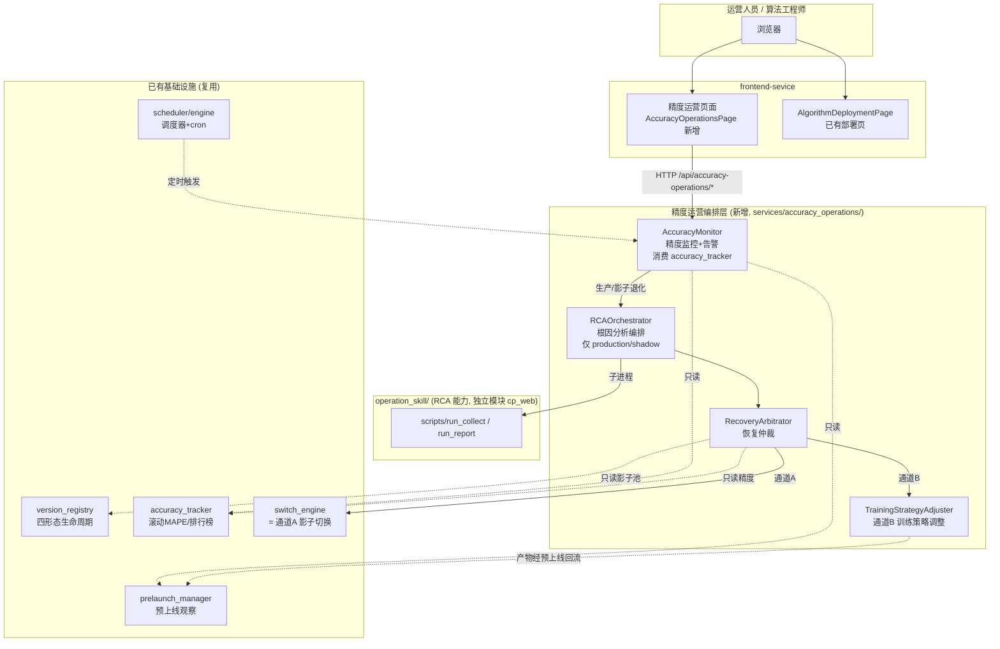
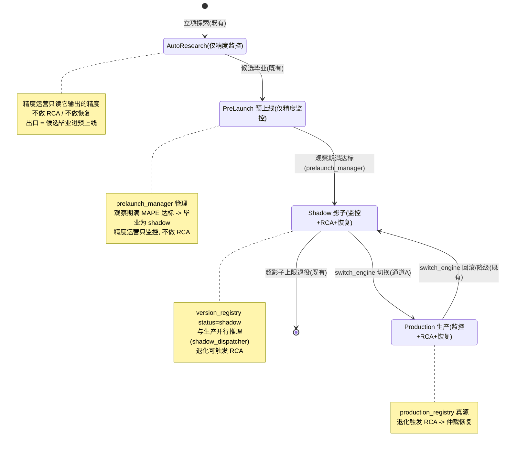
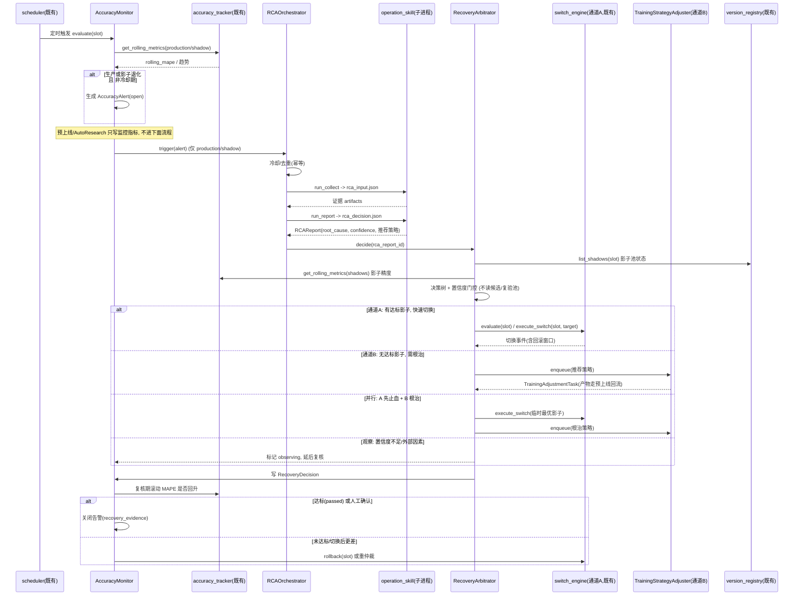

<!-- @AI_GENERATED -->
# 设计文档：精度运营（accuracy-operations）

## Overview（概述）

「精度运营」是负荷预测算法平台的**上层运营编排层**，叠加在**已有的部署 / 调度 / 精度基础设施**之上。它不重复造轮子，而是：

1. **复用**已有的调度器（`services/scheduler`）、版本注册与四形态生命周期（`services/precision_ops/version_registry`、`prelaunch_manager`）、影子切换引擎（`services/precision_ops/switch_engine`）、精度跟踪（`services/precision_ops/accuracy_tracker`）；
2. **新增**三样目前空白的能力：
   - **预测结果可视化界面**（多形态预测曲线 vs 真值、误差分布、滚动 MAPE 趋势、异常窗口标注、精度监控面板）；
   - **根因分析（RCA）**：把根目录 `operation_skill/` 融合为后端可调用的根因分析能力；
   - **恢复仲裁协同层**：在「影子模型切换（通道A，已有 `switch_engine`）」与「训练策略调整（通道B，`operation_skill` 输出的策略）」两条恢复通道之间，用 RCA 结论做仲裁。

### 关键范围约定（本轮明确，务必遵守）

- **RCA + 恢复动作只作用于「生产（production）」与「影子（shadow）」两种形态**。
- **「预上线（prelaunch）」与「AutoResearch」只做精度监控**，不做 RCA、不做恢复仲裁。AutoResearch 接入精度运营的**唯一出口就是预上线**（候选毕业 → 预上线观察 → 影子），它内部的候选池 / 复验池**不属于精度运营的读取范围**。
- **恢复仲裁器（RecoveryArbitrator）不读 AutoResearch 的候选池 / 复验池 / 知识层**。它只读运营侧的 `version_registry`（影子池状态）与 `accuracy_tracker`（滚动精度）。
- **「打通跑起来」= 让已有的四形态与调度 cron 真正带着内容运行**（每种形态都有已注册模型、cron 定时产出预测与真值、精度被持续评估），不是再设计一套新调度器。

### 工程约束（贯穿全文）

- 所有代码/数据一律相对路径，禁止 `os.path.abspath()` 写持久化，统一 `os.path.relpath(path, start=backend_service_dir)`。
- AI 生成 Markdown 顶/底加 `@AI_GENERATED` 标记；JSON 用 `_comment` 字段。
- 后端 FastAPI + Python（conda `aip_web`）；前端 React + Vite + AntD（目录拼写 `frontend-sevice` 不改）。
- 精度运营域数据落在已有的 per-slot 目录树下（`{BASE_DATA_DIR}/{slot}/accuracy_ops/`，`BASE_DATA_DIR` 定义在 `services/precision_ops/utils.py`）。

---

## 现有基础设施盘点（复用清单）

设计前先明确「哪些已经有了、直接复用」，避免重复建设。每条附相对路径与中文职责。

### 后端已有（复用，不重建）

| 路径 | 中文职责 | 精度运营如何复用 |
|---|---|---|
| `backend-service/services/scheduler/engine.py` | 调度器引擎（APScheduler，按管线 `load_forecast`/`pv_fault` 独立启停，含重叠保护、失败重试、catch-up） | 精度监控与 RCA 触发挂成新的定时任务，不新建调度器 |
| `backend-service/api/scheduler.py` | 调度器状态/启停 REST（`/api/scheduler/status`、`/{pipeline}/start|stop`） | 运营总览读取任务运行状态 |
| `backend-service/services/precision_ops/version_registry.py` | 版本注册表：production/shadow/retired 状态机，单生产不变式，影子上限 | 四形态视图与影子池来源；仲裁器读 `list_shadows()` |
| `backend-service/services/precision_ops/accuracy_tracker.py` | 精度跟踪：滚动 MAPE/MAE、排行榜、`get_rolling_metrics()` | 精度监控与告警的**数据底座**，直接消费，不重算 |
| `backend-service/services/precision_ops/prelaunch_manager.py` | 预上线观察→毕业/失败/取消，自动评估 | 预上线形态的监控数据来源（只监控，不 RCA） |
| `backend-service/services/precision_ops/switch_engine.py` | **影子切换引擎（= 通道A）**：退化检测 `evaluate()`、执行切换 `execute_switch()`、回滚 `rollback()`、切换后观察 `evaluate_post_switch()` | 仲裁选中通道A时**直接调用**，不再造 `ShadowPromotionManager` |
| `backend-service/services/precision_ops/switch_log.py` | 切换审计日志（append-only） | 恢复决策与切换事件的审计溯源 |
| `backend-service/services/precision_ops/production_registry.py` | 生产登记真源（当前生产是哪个 workflow_id） | 四形态视图与回滚基准 |
| `backend-service/services/precision_ops/shadow_dispatcher.py` | 影子并行推理分发 | 影子形态预测数据来源 |
| `backend-service/services/precision_ops/config_manager.py` | 槽位配置（`degradation_threshold_pct`/`switch_margin_pct`/`cooldown_hours`/`auto_switch_enabled` 等） | 复用退化阈值与冷却期，避免精度运营自定义一套阈值 |
| `backend-service/services/precision_ops/daily_prediction_worker.py` | 每日滚动预测模拟 worker（生产+预上线同跑、回填真值、算 MAPE、判毕业） | 「打通跑起来」的现成模拟器；可作为 demo 数据源 |
| `backend-service/services/deployment/` + `backend-service/api/deployment.py` | 部署槽位、`ModelVersion`、`PrelaunchMeta`、切换/回滚/预上线池 REST | 四形态视图与切换动作的既有 API |

### 前端已有（复用/扩展）

| 路径 | 中文职责 |
|---|---|
| `frontend-sevice/src/services/deploymentApi.ts` | 部署槽位 + 调度任务 + 预上线 API 客户端 |
| `frontend-sevice/src/services/schedulerApi.ts` | 管线级调度启停 API 客户端 |
| `AlgorithmDeploymentPage`（模型管理/数据管线/定时调度/预上线 四 Tab） | 已有部署页；精度运营页面与之并列，或作为其新增 Tab |

### 结论：精度运营真正要新建的

1. **前端**：一个「精度运营」可视化页面（预测曲线对比、误差分布、滚动 MAPE 趋势、异常窗口、精度监控与告警面板）。
2. **后端 RCA**：`operation_skill/` 融合封装 + RCA 编排（仅 production/shadow）。
3. **后端仲裁**：RCA 结论驱动的「通道A（复用 switch_engine）vs 通道B（训练策略调整）」仲裁与协同。

---

## Architecture（高层设计 High-Level Design）

### 1. 系统上下文图（System Context）



**边界说明**：
- 精度运营层对 `accuracy_tracker`/`version_registry`/`prelaunch_manager` **只读消费**；
- 通道A 通过调用已有 `switch_engine.execute_switch()` 落地（写动作走既有引擎，不绕过其冷却/回滚语义）；
- 通道B 产出的新模型经**已有预上线→影子**管道回流，**精度运营不直接读 AutoResearch 候选池/复验池**。

### 2. 四形态状态机（复用 version_registry + prelaunch_manager）

四形态的状态迁移**已由现有模块实现**，本设计不改其语义，只在图上标出精度运营的介入点（RCA/仲裁仅落在 production/shadow）。



### 3. 精度退化主流程（监控 → 告警 → RCA → 仲裁 → 恢复 → 复核）

只针对 production / shadow；仲裁只读影子池与精度，不碰候选池/复验池。



### 4. 组件划分（Components）

| 组件（英文）| 中文职责 | 与已有模块的关系 |
|---|---|---|
| `AccuracyMonitor` | 精度监控：消费 `accuracy_tracker` 滚动指标，判定生产/影子退化并生成 `AccuracyAlert`；预上线/AutoResearch 只写监控快照不告警；负责关闭前恢复复核。 | **消费** `accuracy_tracker`/`prelaunch_manager`；不重算精度 |
| `RCAOrchestrator` | RCA 编排：仅对 production/shadow 告警，做冷却/去重（幂等），子进程调 `operation_skill` 采集证据并推理，落 `RCAReport`。 | 新增；子进程调用 `operation_skill/scripts/*` |
| `RecoveryArbitrator` | 恢复仲裁：读影子池（`version_registry.list_shadows`）+ 影子精度（`accuracy_tracker`），按 RCA 结论走决策树，输出 `RecoveryDecision`（通道A/B/并行/观察）。**不读候选池/复验池**。 | 新增；调用 `switch_engine`（A）与 `TrainingStrategyAdjuster`（B） |
| `TrainingStrategyAdjuster` | 通道B：把 RCA 推荐策略转成训练调整任务并入队；产物经**已有预上线→影子**管道回流。 | 新增；产物走 `prelaunch_manager` 回流，不直接写 AutoResearch 池 |
| 通道A（无新类）| 影子切换：**直接复用** `switch_engine.SwitchDecisionEngine` 的 `evaluate`/`execute_switch`/`rollback`。 | **复用**，不新建 |
| `AccuracyOperationsPage` | 前端精度运营页：预测曲线对比、误差分布、滚动 MAPE 趋势、异常窗口、告警面板、RCA 报告查看、恢复决策面板。 | 新增；复用 `deploymentApi`/`schedulerApi` 部分数据 |


## Data Models（数据模型）

### 5. 精度运营新增数据模型

所有持久化路径均相对 `backend-service/`，落在 `data/precision_ops/{slot}/accuracy_ops/`。

#### 5.1 `AccuracyAlert` — 精度告警（仅 production / shadow 触发）

存储：`data/precision_ops/{slot}/accuracy_ops/alerts/{alert_id}.json`

| 字段 | 中文含义（类型 / 来源）|
|---|---|
| `alert_id` | 告警唯一 ID（str / 生成，格式 `alert-{8hex}`）|
| `slot` | 槽位名称（str / 监控输入）|
| `model_form` | 触发告警的形态（enum: `production`/`shadow`，**不含 prelaunch/autoresearch**）|
| `workflow_id` | 退化版本的 workflow_id（str / version_registry）|
| `version_tag` | 退化版本的 version_tag（str / version_registry）|
| `baseline_mape` | 注册时的基线 MAPE（float / version_registry.baseline_mape）|
| `current_rolling_mape` | 当前滚动 MAPE（float / accuracy_tracker）|
| `degradation_pct` | 退化百分比（float / `(current - baseline) / baseline * 100`）|
| `degradation_trend` | 衰减趋势（enum: `sudden`/`gradual`/`stable` / 监控判定）|
| `severity` | 严重级别（enum: `warning`/`critical` / 按 degradation_pct 分级）|
| `status` | 状态（enum: `open`/`rca_running`/`recovering`/`observing`/`closed`）|
| `cooldown_until` | 冷却截止时间（str ISO / 同 alert 冷却期内不重复 RCA）|
| `rca_report_id` | 关联 RCA 报告 ID（str? / RCA 产出后回填）|
| `recovery_decision_id` | 关联恢复决策 ID（str? / 仲裁后回填）|
| `recovery_evidence` | 恢复证据（`{type: "passed"/"manual_close", ref, at}`? / 关闭前必填）|
| `created_at` / `updated_at` | 时间戳（str ISO）|

#### 5.2 `RCAReport` — 根因分析报告

存储：`data/precision_ops/{slot}/accuracy_ops/rca/{rca_report_id}.json`
Artifacts：`data/precision_ops/{slot}/accuracy_ops/rca/{rca_report_id}/`

| 字段 | 中文含义（类型 / 来源）|
|---|---|
| `rca_report_id` | 报告 ID（str / `rca-{8hex}`）|
| `alert_id` | 来源告警 ID（str）|
| `trigger_type` | 触发方式（enum: `scheduled`/`alert`/`manual`）|
| `root_cause` | 根因结论（str / skill `rca.root_cause`）|
| `confidence` | 置信度（float 0..1 / skill）|
| `reasoning` | 推理过程（str / skill）|
| `supporting_evidence` | 支撑证据（list[str] / skill）|
| `undetermined` | 无法定论（bool / skill；true 时仲裁走观察+人工）|
| `candidate_strategies` | 候选恢复策略列表（list / skill）|
| `recommended_strategy_id` | 推荐策略 ID（str / skill）|
| `artifacts_dir` | artifacts 相对目录（str / 相对 backend-service）|
| `status` | 状态（enum: `running`/`succeeded`/`failed`/`timeout`）|
| `created_at` | 时间戳（str ISO）|

#### 5.3 `RecoveryDecision` — 恢复决策

存储：`data/precision_ops/{slot}/accuracy_ops/recovery/{decision_id}.json`

| 字段 | 中文含义（类型 / 来源）|
|---|---|
| `decision_id` | 决策 ID（str / `rec-{8hex}`）|
| `alert_id` | 来源告警 ID（str）|
| `rca_report_id` | 引用的 RCA 报告 ID（str / **必须引用已存在 RCAReport**）|
| `channel` | 选定通道（enum: `shadow_switch`(A) / `training_adjust`(B) / `parallel` / `observe`）|
| `decision_reason` | 决策理由（str）|
| `confidence_gate_passed` | 是否过置信度门控（bool）|
| `switch_event_id` | 通道A产出的切换事件 ID（str? / 来自 switch_engine）|
| `training_task_id` | 通道B产出的训练任务 ID（str?）|
| `sla_deadline` | SLA 截止时间（str ISO）|
| `rollback_of` | 若回滚，指向被回滚的 decision_id（str?）|
| `status` | 状态（enum: `pending`/`executing`/`succeeded`/`failed`/`rolled_back`）|
| `created_at` / `updated_at` | 时间戳（str ISO）|

#### 5.4 `TrainingAdjustmentTask` — 训练策略调整任务（通道B产物）

存储：`data/precision_ops/{slot}/accuracy_ops/training_tasks/{task_id}.json`

| 字段 | 中文含义（类型 / 来源）|
|---|---|
| `task_id` | 任务 ID（str / `tadj-{8hex}`）|
| `decision_id` | 来源恢复决策 ID（str）|
| `rca_report_id` | 来源 RCA 报告 ID（str）|
| `recipe_patch` | 训练配方补丁（dict / RCA 推荐策略转成）|
| `target_workflow_id` | 目标训练模板 ID（str）|
| `status` | 状态（enum: `queued`/`running`/`prelaunch_observing`/`passed`/`failed`）|
| `prelaunch_id` | 预上线项 ID（str? / 进入预上线后回填）|
| `created_at` / `updated_at` | 时间戳（str ISO）|

---

### 6. 协同决策矩阵（RCA 结论 × 影子池状态 → 通道）

**仲裁器只读**：`version_registry.list_shadows(slot)` + `accuracy_tracker.get_rolling_metrics(slot, shadow_wf_id)`。
**不读**：AutoResearch 候选池、复验池、知识层。

置信度门控前提：`RCAReport.confidence >= 0.6`；`undetermined=true` 或未过门控一律落「观察 + 人工」。

影子是否「达标」的判定复用已有 `config_manager` 里的 `switch_margin_pct`：
- 影子 MAPE 比生产低 ≥ `switch_margin_pct`（默认 10%）→ 达标
- 有效周期数 ≥ `min_valid_cycles`（默认 3）→ 数据充足

| RCA 根因类型 | 有达标影子 | → 决策通道 | SLA | 理由 |
|---|---|---|---|---|
| 数据缺失/特征失效 | 是 | **通道A（影子切换）** | 2h | 快速止血，复用 switch_engine |
| 数据缺失/特征失效 | 否 | **通道B（训练策略调整）** | 3d | 无可切换影子，产新配方经预上线回流 |
| 模型衰退/配方过时 | 是 | **并行**（A止血 + B根治）| 3d | 影子临时顶，B 根治 |
| 模型衰退/配方过时 | 否 | **通道B** | 3d | 只能训练调整 |
| 外部因素/事件突变 | 任意 | **观察** | 12h | 大概率自愈 |
| undetermined / 置信度不足 | 任意 | **观察 + 人工** | 12h | 证据不足 |
| 已有通道A在执行且未达 SLA | — | **禁止再触发A**，可并行B | — | A/B 不可对同一形态同时写 |

---

## Low-Level Design（低层设计）

### 7. 后端模块目录结构

精度运营**新增**的文件。已有模块（`precision_ops/switch_engine` 等）不改动，直接调用。

| 路径（相对项目根） | 中文职责 |
|---|---|
| `backend-service/services/accuracy_operations/__init__.py` | 包入口 |
| `backend-service/services/accuracy_operations/monitor.py` | `AccuracyMonitor`：消费 `accuracy_tracker` 数据，判定 production/shadow 退化 → 生成 AccuracyAlert；预上线/AutoResearch 只输出监控快照不告警 |
| `backend-service/services/accuracy_operations/rca_orchestrator.py` | `RCAOrchestrator`：冷却/去重(幂等)，子进程调 `operation_skill`，落 RCAReport |
| `backend-service/services/accuracy_operations/rca_skill_client.py` | RCA skill 调用契约封装：拼输入 JSON、起子进程(`conda run -n cp_web`)、收 artifacts、失败重试 |
| `backend-service/services/accuracy_operations/arbitrator.py` | `RecoveryArbitrator`：读影子池(version_registry) + 影子精度(accuracy_tracker)，走决策树，输出 RecoveryDecision；不读候选池/复验池 |
| `backend-service/services/accuracy_operations/training_adjuster.py` | `TrainingStrategyAdjuster`：通道B，把 RCA 推荐策略转 recipe，走 prelaunch_manager 入预上线 |
| `backend-service/services/accuracy_operations/store.py` | 运营域持久化读写（alerts/rca/recovery/training_tasks），统一相对路径 |
| `backend-service/services/accuracy_operations/models.py` | Pydantic 数据模型（§5 全部实体） |
| `backend-service/api/accuracy_operations.py` | HTTP 路由层（`/api/accuracy-operations/*`）|

### 8. 关键接口 Python 伪代码

```python
# backend-service/services/accuracy_operations/monitor.py
class AccuracyMonitor:
    """消费 accuracy_tracker，不重算精度。"""

    def __init__(self, accuracy_tracker, version_registry, config_manager):
        self._acc = accuracy_tracker
        self._vr = version_registry
        self._cfg = config_manager

    def evaluate(self, slot: str) -> list[AccuracyAlert]:
        """
        对 production 和 shadow 做退化检测。
        预上线/AutoResearch 只写监控快照(返回空告警列表)。
        复用 config_manager 里的 degradation_threshold_pct。
        """
        config = self._cfg.load_config(slot)
        alerts = []
        # 检查生产
        prod = self._vr.get_production(slot)
        if prod:
            metrics = self._acc.get_rolling_metrics(slot, prod["workflow_id"])
            if metrics and metrics["status"] == "active":
                baseline = prod.get("baseline_mape") or metrics["rolling_mape"]
                deg_pct = (metrics["rolling_mape"] - baseline) / baseline * 100
                if deg_pct >= config.degradation_threshold_pct:
                    alerts.append(self._build_alert(slot, "production", prod, metrics, deg_pct))
        # 检查影子
        for shadow in self._vr.list_shadows(slot):
            metrics = self._acc.get_rolling_metrics(slot, shadow["workflow_id"])
            if metrics and metrics["status"] == "active":
                baseline = shadow.get("baseline_mape") or metrics["rolling_mape"]
                deg_pct = (metrics["rolling_mape"] - baseline) / baseline * 100
                if deg_pct >= config.degradation_threshold_pct:
                    alerts.append(self._build_alert(slot, "shadow", shadow, metrics, deg_pct))
        return alerts
```

```python
# backend-service/services/accuracy_operations/arbitrator.py
class RecoveryArbitrator:
    """
    仲裁器。只读 version_registry（影子池）+ accuracy_tracker（精度）。
    不读候选池、不读复验池、不读知识层。
    通道A 直接调 switch_engine.execute_switch()。
    """

    CONF_GATE = 0.6
    SLA = {"shadow_switch": "PT2H", "training_adjust": "P3D", "parallel": "P3D", "observe": "PT12H"}

    def __init__(self, version_registry, accuracy_tracker, config_manager,
                 switch_engine, training_adjuster, store):
        self._vr = version_registry
        self._acc = accuracy_tracker
        self._cfg = config_manager
        self._sw = switch_engine       # 已有，直接注入
        self._train = training_adjuster
        self._store = store

    def decide(self, slot: str, rca_report_id: str) -> RecoveryDecision:
        rca = self._store.get_rca(rca_report_id)
        if rca is None:
            raise ValueError(f"RCA 报告不存在: {rca_report_id}")

        # 置信度门控
        if rca.undetermined or rca.confidence < self.CONF_GATE:
            return self._observe(rca, "置信度不足或无法定论")

        # 读影子池 + 精度（不读候选池/复验池）
        config = self._cfg.load_config(slot)
        shadows = self._vr.list_shadows(slot)
        qualified_shadow = self._find_qualified_shadow(slot, shadows, config)

        cause = self._classify_cause(rca.root_cause)
        return self._decision_tree(slot, rca, cause, qualified_shadow)

    def _find_qualified_shadow(self, slot, shadows, config):
        """找满足 switch_margin_pct + min_valid_cycles 的最优影子"""
        prod = self._vr.get_production(slot)
        if not prod:
            return None
        prod_metrics = self._acc.get_rolling_metrics(slot, prod["workflow_id"])
        if not prod_metrics or prod_metrics["status"] != "active":
            return None

        best = None
        for shadow in shadows:
            m = self._acc.get_rolling_metrics(slot, shadow["workflow_id"])
            if not m or m["status"] != "active":
                continue
            if m["valid_cycle_count"] < config.min_valid_cycles:
                continue
            margin = (prod_metrics["rolling_mape"] - m["rolling_mape"]) / prod_metrics["rolling_mape"] * 100
            if margin >= config.switch_margin_pct:
                if best is None or m["rolling_mape"] < best[1]["rolling_mape"]:
                    best = (shadow, m)
        return best[0] if best else None

    def _decision_tree(self, slot, rca, cause, qualified_shadow):
        if cause == "external":
            return self._observe(rca, "外部因素，大概率自愈")
        if cause in ("data_gap", "feature_broken"):
            if qualified_shadow:
                return self._channel_a(slot, rca, qualified_shadow)
            return self._channel_b(rca)
        if cause == "model_decay":
            if qualified_shadow:
                return self._parallel(slot, rca, qualified_shadow)
            return self._channel_b(rca)
        return self._observe(rca, "未匹配规则")

    def _channel_a(self, slot, rca, shadow):
        """直接调用已有 switch_engine"""
        event = self._sw.execute_switch(
            slot=slot,
            target_workflow_id=shadow["workflow_id"],
            trigger_type="automatic",
            reason=f"精度运营仲裁: RCA={rca.rca_report_id}, 通道A影子切换",
        )
        return RecoveryDecision(channel="shadow_switch", switch_event_id=event["event_id"], ...)
```

### 9. RCA skill 调用契约

**调用方式**：子进程（`conda run -n cp_web python scripts/run_collect.py` + `run_report.py`）。

- 工作目录：项目根 `operation_skill/`
- 输入：按 `examples/rca_input_sample.json` schema 拼 JSON，写到 skill 工作目录
- 输出：skill 产出 `rca_decision.json` + HTML 报告，拷回 `data/precision_ops/{slot}/accuracy_ops/rca/{id}/`
- 超时 900s，重试 2 次（5s/15s 退避），仍失败置 `RCAReport.status=timeout`

### 10. HTTP API 列表

前缀 `/api/accuracy-operations`。

| 方法 | 路径 | 用途 | 请求 | 响应 |
|---|---|---|---|---|
| GET | `/overview` | 运营总览（四形态+精度快照） | query: `slot` | `{ forms[], open_alerts, active_recoveries }` |
| GET | `/alerts` | 告警列表 | query: `slot`, `status?` | `{ alerts: AccuracyAlert[] }` |
| POST | `/alerts/{alert_id}/rca` | 触发 RCA（幂等） | `{ trigger_type }` | `RCAReport` |
| GET | `/rca/{rca_report_id}` | RCA 报告详情 | — | `RCAReport + artifacts 路径` |
| POST | `/recovery/decide` | 触发仲裁 | `{ slot, rca_report_id }` | `RecoveryDecision` |
| POST | `/recovery/shadow-switch` | 手动执行通道A | `{ slot, shadow_workflow_id, decision_id }` | 切换事件 |
| POST | `/recovery/training-adjust` | 手动执行通道B | `{ slot, rca_report_id, decision_id }` | `TrainingAdjustmentTask` |
| GET | `/models/lifecycle` | 四形态生命周期视图 | query: `slot` | `{ nodes[], edges[] }` |
| GET | `/monitoring/snapshot` | 精度监控快照（含预上线/AutoResearch，仅监控） | query: `slot` | `{ production, shadows[], prelaunches[], autoresearch_score? }` |

### 11. 仲裁算法伪代码（决策树 + 规则表）

```python
# 常量（复用 config_manager 的值）
CONF_GATE = 0.6
SLA = {"shadow_switch": "PT2H", "training_adjust": "P3D", "parallel": "P3D", "observe": "PT12H"}

def decide(slot, rca):
    if rca.undetermined or rca.confidence < CONF_GATE:
        return observe("置信度不足")

    cause = classify_cause(rca.root_cause)  # data_gap / model_decay / external
    qualified_shadow = find_qualified_shadow(slot)  # 只看 version_registry + accuracy_tracker

    if cause == "external":
        return observe("外部因素自愈", sla=SLA["observe"])
    if cause in ("data_gap", "feature_broken"):
        if qualified_shadow:
            return channel_A(switch_engine.execute_switch(slot, qualified_shadow.workflow_id))
        return channel_B(training_adjuster.enqueue(rca.recommended_strategy))
    if cause == "model_decay":
        if qualified_shadow:
            return parallel(channel_A + channel_B)
        return channel_B(...)
    return observe("未匹配")

def should_rollback(decision):
    """SLA 超时或切换后精度更差 → 触发 switch_engine.rollback()"""
    if now > decision.sla_deadline and not recovered:
        return True
    if decision.channel == "shadow_switch":
        post_alert = switch_engine.evaluate_post_switch(slot)
        if post_alert:
            return True
    return False
```

**冷却/互斥**：
- 同一 alert 冷却期内不重复 RCA（复用 `config_manager.cooldown_hours`）
- 通道A/B 不可对同一 slot 同时执行写操作
- 回滚复用 `switch_engine.rollback(slot)`（已有回滚窗口检查）

### 12. 持久化 schema（相对 `backend-service/`）

| 路径 | 内容 |
|---|---|
| `data/precision_ops/{slot}/accuracy_ops/alerts/{alert_id}.json` | 单条告警 |
| `data/precision_ops/{slot}/accuracy_ops/rca/{rca_report_id}.json` | RCA 报告元数据 |
| `data/precision_ops/{slot}/accuracy_ops/rca/{rca_report_id}/` | RCA artifacts |
| `data/precision_ops/{slot}/accuracy_ops/recovery/{decision_id}.json` | 恢复决策 |
| `data/precision_ops/{slot}/accuracy_ops/training_tasks/{task_id}.json` | 训练任务 |

既有文件（不动）：
- `data/precision_ops/{slot}/version_registry.json` — 版本注册表
- `data/precision_ops/{slot}/accuracy_metrics.json` — 精度指标
- `data/precision_ops/{slot}/config.json` — 槽位配置
- `data/precision_ops/{slot}/switch_log.json` — 切换审计日志

### 13. 前端页面结构

**路由**：`/accuracy-operations`（新增页面，与 AlgorithmDeploymentPage 并列）

**组件树**：
```
AccuracyOperationsPage (pages/AccuracyOperationsPage.tsx)
├─ ModelLifecycleCard        四形态生命周期卡 (GET /models/lifecycle)
├─ AccuracyTrendChart        滚动 MAPE 趋势 + 多形态对比 (ECharts)
│  ├─ PredictionVsActual     预测值 vs 真值曲线
│  └─ ErrorDistribution      误差分布(直方图/箱线)
├─ MonitoringPanel           精度监控面板 (GET /monitoring/snapshot)
│  └─ 含预上线/AutoResearch 只读精度展示
├─ AlertPanel                告警面板 (GET /alerts, 仅 production/shadow)
├─ RCAReportViewer           RCA 报告查看 (GET /rca/{id})
├─ RecoveryDecisionPanel     恢复决策面板 (POST /recovery/decide)
├─ ShadowSwitchModal         影子切换确认弹窗 (POST /recovery/shadow-switch)
└─ TrainingAdjustModal       训练调整弹窗 (POST /recovery/training-adjust)
```

**状态管理**：`frontend-sevice/src/stores/accuracyOperationsStore.ts`（Zustand）
**API client**：`frontend-sevice/src/services/accuracyOperationsApi.ts`
**类型**：`frontend-sevice/src/types/accuracy-operations.ts`

### 14. 失败与边界处理

| 场景 | 处理 |
|---|---|
| RCA 超时（900s） | `RCAReport.status=timeout`，不触发恢复，落「观察+人工」 |
| 影子池空（无达标影子） | 仲裁跳过通道A，走通道B |
| 通道B 产物经预上线失败 | `TrainingAdjustmentTask.status=failed`，告警保持 open |
| 双通道均失败 | `RecoveryDecision.status=failed`，告警保持 open，需人工介入 |
| 告警去重 | 同 slot + model_form + workflow_id 已有 open alert 则不重复生成 |
| 冷却期内重复触发 RCA | 幂等返回既有 RCAReport |
| switch_engine 回滚窗口已过 | 回滚失败，记录 warning，建议走通道B |
| 预上线/AutoResearch 退化 | 只写监控快照到 `/monitoring/snapshot` 响应，不生成 alert |

---

## Correctness Properties（可执行正确性属性）

*A property is a characteristic or behavior that should hold true across all valid executions of a system—essentially, a formal statement about what the system should do. Properties serve as the bridge between human-readable specifications and machine-verifiable correctness guarantees.*

### Property 1: 告警仅限 production/shadow 形态

*For any* AccuracyAlert 实例, 其 model_form 字段必须属于 {"production", "shadow"}；对于任何 prelaunch 或 AutoResearch 形态的输入，AccuracyMonitor 不会产出 AccuracyAlert。

**Validates: Requirements 1.4, 1.5**

### Property 2: 退化阈值触发正确性

*For any* slot 配置（含 baseline_mape、current_rolling_mape、degradation_threshold_pct），当且仅当 (current_rolling_mape - baseline_mape) / baseline_mape * 100 >= degradation_threshold_pct 时，AccuracyMonitor 产出告警；否则不产出。

**Validates: Requirement 1.2**

### Property 3: 告警去重（幂等性）

*For any* 已存在 open 状态 AccuracyAlert 的 (slot, model_form, workflow_id) 组合，再次调用 evaluate 不会产生新的重复告警，告警总数不增加。

**Validates: Requirement 1.3**

### Property 4: RCA 冷却期幂等性

*For any* AccuracyAlert 处于 cooldown_until 冷却期内，重复触发 RCA 请求应幂等返回既有 RCAReport，同一 alert 在冷却窗口内的 RCAReport 数量 ≤ 1。

**Validates: Requirements 2.2, 7.2**

### Property 5: 仲裁决策树正确性

*For any* 合法的 (RCAReport, 影子池状态) 组合：
- confidence < 0.6 或 undetermined=true → channel=observe
- root_cause ∈ {data_gap, feature_broken} ∧ 存在达标影子 → channel=shadow_switch
- root_cause ∈ {data_gap, feature_broken} ∧ 不存在达标影子 → channel=training_adjust
- root_cause = model_decay ∧ 存在达标影子 → channel=parallel
- root_cause = model_decay ∧ 不存在达标影子 → channel=training_adjust
- root_cause = external → channel=observe

**Validates: Requirements 3.3, 3.4, 3.5, 3.6, 3.7, 3.8**

### Property 6: 影子达标判定正确性

*For any* 影子模型的 (rolling_mape, valid_cycle_count) 和生产模型的 (prod_rolling_mape)，以及配置 (switch_margin_pct, min_valid_cycles)：影子达标当且仅当 (prod_rolling_mape - shadow_rolling_mape) / prod_rolling_mape * 100 >= switch_margin_pct 且 valid_cycle_count >= min_valid_cycles。当存在多个达标影子时，选出的必为 rolling_mape 最低者。

**Validates: Requirements 4.1, 4.2, 4.3**

### Property 7: RecoveryDecision 必引用已存在 RCAReport

*For any* RecoveryDecision 实例, store.get_rca(d.rca_report_id) 必须非 None；不存在引用无效 rca_report_id 的决策记录。

**Validates: Requirement 3.9**

### Property 8: 通道 A/B 同 slot 互斥

*For any* 系统状态，不存在同一 slot 下两条 RecoveryDecision 同时处于 pending 或 executing 的写操作状态（通道A 和通道B 不可对同一 slot 同时写）。

**Validates: Requirements 5.4, 7.1**

### Property 9: 告警关闭必须有 recovery evidence

*For any* AccuracyAlert 其 status 为 closed，recovery_evidence 字段必须非空且 type ∈ {"passed", "manual_close"}。

**Validates: Requirements 8.4, 8.5**

### Property 10: 告警状态迁移合法性

*For any* AccuracyAlert 状态迁移序列，合法路径为：open → rca_running → recovering/observing → closed。RCA 开始时状态为 rca_running，RecoveryDecision 执行时为 recovering，observe 通道时为 observing。不存在跳跃或逆向迁移。

**Validates: Requirements 8.1, 8.2, 8.3**

### Property 11: 持久化路径均为相对路径

*For any* 精度运营模块写入磁盘的路径字段（包括 RCAReport.artifacts_dir、所有 JSON 文件路径），均满足 not os.path.isabs(path)，且路径前缀为 data/precision_ops/{slot}/accuracy_ops/。

**Validates: Requirements 9.1, 9.4**

### Property 12: 仲裁器依赖隔离

*For any* RecoveryArbitrator 实例，其依赖注入和方法调用中不包含 candidate_pool（候选池）、verification_queue（复验池）、knowledge_layer（知识层）的任何引用。TrainingStrategyAdjuster 同样不直接写入候选池或复验池。

**Validates: Requirements 3.2, 6.3**

### Property 13: RCA 输入 schema 合规性

*For any* 合法的告警数据输入，RCAOrchestrator 拼接的 rca_input JSON 必须符合 examples/rca_input_sample.json 定义的 schema 结构。

**Validates: Requirement 12.1**

### Property 14: 数据模型序列化 round-trip

*For any* 合法的 AccuracyAlert / RCAReport / RecoveryDecision / TrainingAdjustmentTask 实例，序列化为 JSON 再反序列化应产出等价对象（Pydantic model round-trip）。

**Validates: Requirements 13.1, 13.2, 13.3, 13.4, 13.5**

---

## Testing Strategy（测试策略）

- **单元测试**：`tests/test_accuracy_operations_*.py` — monitor 退化判定各分支、arbitrator 决策树、store 相对路径
- **属性测试（hypothesis）**：实现 Property 1-8
- **集成测试**：mock `operation_skill` 子进程（桩数据），跑「告警→RCA→仲裁→通道A(switch_engine)/B」
- **前端**：`npm run build` 类型校验；API client 与后端 schema 对齐
- **Bootstrap 验证**：`scripts/bootstrap_load_forecast_slot.py` 成功后调 `/api/deployment/slots` 确认 load_forecast 槽位有 production + shadow

## Dependencies（依赖）

**复用（不新增）**：
- `services/precision_ops/switch_engine` — 通道A
- `services/precision_ops/accuracy_tracker` — 精度数据底座
- `services/precision_ops/version_registry` — 影子池来源
- `services/precision_ops/prelaunch_manager` — 通道B 产物回流入口
- `services/precision_ops/config_manager` — 退化阈值/冷却期/切换分差
- `services/scheduler/engine` — 精度监控定时触发

**新增**：
- `operation_skill/`（独立 conda `cp_web`，子进程调用）
- 前端新页面 + API client

**不依赖**（明确排除）：
- `candidate_pool.json`（AutoResearch 候选池）
- `candidate_verification_queue.json`（AutoResearch 复验池）
- `knowledge_layer.py`（AutoResearch 知识层）
<!-- @AI_GENERATED: end -->
