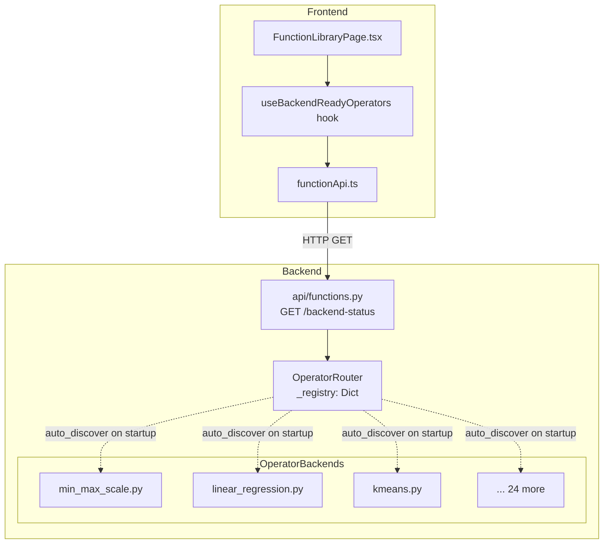

<!-- @AI_GENERATED -->
# Design Document

## Overview

本次改动分成两个大块：**后端算子实现** 和 **前端可视标记**。

**后端**：在 `backend-service/services/operator_backends/` 下新增 27 个 P0 级算子模块，每个模块导出 `OPERATOR_ID` 常量与 `execute(params, inputs)` 函数，交由已有的 `OperatorRouter` 自动发现注册。同时在 `backend-service/api/functions.py` 新增只读接口 `/api/functions/backend-status`，返回当前已注册（有真实后端）的算子 ID 列表，供前端标记使用。

**前端**：在 `frontend-sevice/src/pages/FunctionLibraryPage.tsx` 中调用上述后端状态接口，把返回的算子 ID 集合缓存在页面状态里；渲染算子卡片时，若卡片 `id` 命中集合，就贴一个绿色 "可执行" 徽标，否则贴灰色 "仅定义" 徽标。同时提供三态筛选（全部 / 仅可执行 / 仅定义）。

**关键约束**：
- 后端算子实现严格复用已有模式，不引入新框架、不重构 OperatorRouter。
- 前端徽标数据源来自后端接口，**不改动静态 `basicModuleFunctions.ts`**（这样后续新增算子无需同步前端数据）。
- 所有路径遵循 `.kiro/steering/relative-paths-only.md`，禁止在持久化数据中写入绝对路径。

## Steering Document Alignment

### Technical Standards

- **AGENTS.md — 算子实现约定**：后端算子写在 `backend-service/services/operator_backends/`，每个模块导出 `OPERATOR_ID`（字符串）和 `execute(params, inputs)`（返回 dict）；由 `OperatorRouter.auto_discover()` 在启动时自动扫描注册。本设计完全沿用此约定。
- **file-path-and-symbol-annotations.md — 路径与符号说明**：本文档所列每一个新增文件都会在下方"关键文件索引"表格里附一句中文说明其职责，避免"只有文件名不知道干嘛"。
- **relative-paths-only.md — 相对路径强制**：`export_csv`、`export_excel` 等数据输出算子的默认保存目录为 `backend-service/data/exports/`（相对路径），持久化字段用 `os.path.relpath()` 输出，不写 `os.path.abspath()`。
- **ai-coding.md — AI 生成代码标注**：所有新增/修改的代码块用 `# @AI_GENERATED` / `# @AI_GENERATED: end`（Python）或 `// @AI_GENERATED` / `// @AI_GENERATED: end`（TS）包裹。

### Project Structure

新增/修改文件遵循现有目录约定：

```
backend-service/
├── api/
│   └── functions.py                        # 新增 GET /api/functions/backend-status 接口
└── services/
    └── operator_backends/                  # 新增 27 个算子模块（每个一个 .py 文件）
        ├── min_max_scale.py
        ├── z_score_scale.py
        ├── column_select.py
        ├── ...
        └── prophet.py

frontend-sevice/
└── src/
    ├── hooks/
    │   └── useBackendReadyOperators.ts    # 新增：拉取并缓存后端可执行算子集合
    ├── services/
    │   └── functionApi.ts                  # 新增或扩展：封装 /api/functions/backend-status
    └── pages/
        └── FunctionLibraryPage.tsx         # 修改：读徽标、渲染徽标、加筛选按钮
```

## Code Reuse Analysis

### Existing Components to Leverage

- **`OperatorRouter`**（`backend-service/services/operator_execution/router.py`）：算子路由器。**输入**：算子 ID + params + inputs；**输出**：execute() 的返回 dict；**职责**：本次新增算子完全依赖它做自动发现、注册、分派，不修改它。
- **`OperatorExecutionError`**（同上模块）：统一错误类型。新增算子在参数错误、输入错误、文件找不到等场景都抛这个类，携带 `operator_id`、`error_type`、`message`。
- **`get_function_library_service()`**（`backend-service/services/function_library_service.py`）：函数库服务的单例入口，`api/functions.py` 里其他接口都通过它读元数据。新接口 `/api/functions/backend-status` 不依赖它，但 API 位置对齐同一路由前缀 `/api/functions`。
- **既有算子模板参考**：
  - `label_encode.py` — 简单无状态转换算子的模板（参数校验 → 数据校验 → 单次转换 → 返回）。
  - `random_forest_classifier.py` — 训练/预测双模式算子的模板（模型保存到 `data/models/`，返回 `model_id`、`feature_list`、`predictions`）。
  - `load_csv.py` — 数据源算子的相对路径解析模板（依次搜索 workspace_root → aip_dir → backend_dir → cwd）。

### Integration Points

- **`OperatorRouter.auto_discover()`**：本方法在 backend 启动时被 `api/workflows_enhanced.py` 与 `services/scheduler/tasks/workflow_predictor.py` 调用一次，扫描 `services/operator_backends/` 下所有 `.py` 文件，识别 `OPERATOR_ID` 常量并注册。**新增算子只需 drop-in 一个新 `.py` 文件即可被工作流引擎识别**，无需改动任何路由或注册中心代码。
- **`/api/functions` 路由前缀**：新接口 `GET /api/functions/backend-status` 挂在同一路由下，前端复用现有的 axios baseURL 配置。
- **前端 i18n**：徽标文案 `"可执行"`、`"仅定义"`、筛选按钮等文本走 `useTranslation`，与页面现有其他文本一致。

## Architecture

整体调用链路：

```
前端 FunctionLibraryPage
    │
    │ 1. 页面加载时调用 useBackendReadyOperators()
    ▼
functionApi.getBackendStatus()  ──HTTP──►  GET /api/functions/backend-status
                                                    │
                                                    │ 2. 后端读 OperatorRouter._registry
                                                    ▼
                                            OperatorRouter.list_operators()
                                                    │
                                                    │ 3. 返回 {total_registered, registered_operators}
                                                    ▼
    ┌──────────────────────────────────────────────┘
    ▼
useBackendReadyOperators() 返回 Set<string>
    │
    │ 4. 渲染时对每个卡片：
    ▼
if (readySet.has(fn.id)) → 绿色徽标 "可执行"
else                     → 灰色徽标 "仅定义"
```

后端算子调用链路（工作流运行时，与本次改动关系不大，仅供参考）：

```
工作流引擎  ──►  OperatorRouter.execute(op_id, params, inputs)
                        │
                        ▼
                self._registry[op_id](params, inputs)  # 分派到具体算子模块
                        │
                        ▼
                min_max_scale.execute(params, inputs) → {"data": DataFrame}
```

### Modular Design Principles

- **Single File Responsibility**：每个算子一个 `.py` 文件，文件名等于 `OPERATOR_ID`。
- **无状态优先**：无状态算子（如 scaling、column_select、聚类）直接返回结果；有状态算子（分类/回归训练）沿用 `random_forest_classifier` 的 train/predict 双模式 + `model_id` 磁盘持久化。
- **参数容错**：所有算子对 `params` 用 `.get(key, default)` 取值，对类型用 `int()/float()/str()` 强转并 try/except，非法值统一抛 `OperatorExecutionError`。



## Components and Interfaces

### Component 1: Backend Status API

- **Purpose:** 暴露一个只读 HTTP 接口，返回当前 `OperatorRouter` 已注册（有真实后端实现）的算子 ID 列表，供前端徽标使用。
- **Location:** `backend-service/api/functions.py`（在已有 router 上加 endpoint，不新建文件）。
- **Interfaces:**
  - `GET /api/functions/backend-status`
    - **Query params**: 无
    - **Response** (200 OK):
      ```json
      {
        "total_registered": 46,
        "registered_operators": ["auto_tune_catboost", "catboost_forecast", "load_csv", "..."]
      }
      ```
      - `total_registered` — 已注册算子总数（整数）
      - `registered_operators` — 已注册算子 ID 数组（字符串数组，字典序）
    - **Response** (500 Internal Server Error): 与其他 endpoint 一致的 HTTPException 错误结构
- **Dependencies:**
  - 复用 `OperatorRouter` 单例（通过 `api/workflows_enhanced.py::_get_operator_router_cached()` 或直接 lazy init，二选一，见 Design Decisions）。
- **Reuses:** `services/operator_execution/router.py::OperatorRouter.list_operators()`

### Component 2: Data Preprocessing Operators (5 个)

- **Purpose:** 常用数据清洗、变换算子。
- **Modules:**
  - `min_max_scale.py` — Min-Max 归一化到 [0, 1]。
  - `z_score_scale.py` — Z-Score 标准化到均值 0、方差 1。
  - `column_select.py` — 按列名列表选择/删除列。
  - `data_merge.py` — 按 key 合并两个 DataFrame（inner/left/right/outer）。
  - `remove_duplicates.py` — 删除重复行。
- **Interfaces:** 每个算子都遵循 `execute(params, inputs) -> dict`，具体入参见 requirements Requirement 2。
- **Dependencies:** `pandas`、`sklearn.preprocessing.MinMaxScaler`、`sklearn.preprocessing.StandardScaler`
- **Reuses:** 参数解析和错误处理模式来自 `label_encode.py`。

### Component 3: Feature Engineering Operator (1 个)

- **Purpose:** 降维。
- **Modules:**
  - `pca.py` — 主成分分析，返回 `PC_1..PC_n` 列 + `explained_variance_ratio`。
- **Dependencies:** `sklearn.decomposition.PCA`
- **Reuses:** 无状态算子模板；对非数值列自动跳过并 warn（与 `label_encode` 的日志风格一致）。

### Component 4: Classification Operators (3 个)

- **Purpose:** 常用分类算法。
- **Modules:**
  - `logistic_regression.py` — 逻辑回归（支持 L2/L1、多类）。
  - `svm_classifier.py` — SVM（kernel: linear/rbf/poly，C 可调）。
  - `decision_tree_classifier.py` — 决策树（max_depth、min_samples_split 可调）。
- **Interfaces:** 每个模块 `execute(params, inputs)` 支持 `mode="train"` 与 `mode="predict"`：
  - train mode: inputs 需 `features` (DataFrame) 与 `target` (array-like)；输出 `model`、`model_id`、`feature_list`、`predictions`（holdout 20%）、`y_true`、`feature_importances`（coef 或 tree importance）。
  - predict mode: inputs 需 `model` 或 `params["model_id"]` + `predict_features`；输出 `predictions`、`confidences`（如支持 predict_proba）、`model_id`。
- **Dependencies:** `sklearn.linear_model.LogisticRegression`、`sklearn.svm.SVC`、`sklearn.tree.DecisionTreeClassifier`
- **Reuses:** 完整复用 `random_forest_classifier.py` 的训练/预测/持久化模式（80/20 holdout、全量重训、pickle 保存到 `data/models/` 相对路径）。

### Component 5: Regression Operators (3 个)

- **Purpose:** 常用回归算法。
- **Modules:**
  - `linear_regression.py` — 普通线性回归。
  - `lasso_regression.py` — L1 正则化线性回归，alpha 可调。
  - `elastic_net.py` — 弹性网络回归，alpha + l1_ratio 可调。
- **Interfaces:** 与 Component 4 同样支持 train/predict 双模式；输出增加 `coefficients` 与 `intercept`（供解释性展示）。
- **Dependencies:** `sklearn.linear_model.LinearRegression/Lasso/ElasticNet`
- **Reuses:** 复用 `random_forest_classifier.py` 的模式，但把持久化前缀改成 `pv_reg_<模型名>_<timestamp>_<uuid>` 以便区分。

### Component 6: Clustering Operators (2 个)

- **Purpose:** 无监督聚类。
- **Modules:**
  - `kmeans.py` — K-Means 聚类。
  - `dbscan.py` — 密度聚类。
- **Interfaces:** inputs 只需 `data` (DataFrame)；params 见 requirements Requirement 6；输出 `labels` (array)、`cluster_centers` (KMeans 独有)、`inertia` (KMeans 独有)、`n_clusters_found` (DBSCAN 独有，排除噪声)。
- **Dependencies:** `sklearn.cluster.KMeans`、`sklearn.cluster.DBSCAN`
- **Reuses:** 无状态算子模板。

### Component 7: Anomaly Detection Operators (2 个)

- **Purpose:** 异常检测。
- **Modules:**
  - `isolation_forest.py` — 孤立森林。
  - `one_class_svm.py` — 单类 SVM。
- **Interfaces:** 支持 `mode="fit_predict"` 与 `mode="predict"`（后者需 model_id）；输出 `labels`（-1 异常 / 1 正常）+ `scores`（异常分数 / decision_function）。
- **Dependencies:** `sklearn.ensemble.IsolationForest`、`sklearn.svm.OneClassSVM`
- **Reuses:** 混合了 `label_encode.py`（无状态）和 `random_forest_classifier.py`（模型可选择保存）的模式。

### Component 8: Evaluation Metric Operators (3 个)

- **Purpose:** 评估指标。
- **Modules:**
  - `r2_score.py` — R² 决定系数。
  - `mape_score.py` — MAPE，自动排除 y_true=0 的行并 warn。
  - `roc_auc.py` — ROC AUC，多类使用 ovr + macro。
- **Interfaces:** inputs 只需 `y_true`、`y_pred`（或 `y_score`）；输出 `{"score": float}` 或 `{"score": float, "excluded_zero_count": int}`（mape 独有）。
- **Dependencies:** `sklearn.metrics.r2_score/roc_auc_score`；MAPE 手写（避免 sklearn 版本兼容性）。
- **Reuses:** 参考已有 `smape_score.py`、`mse_rmse_mae.py` 的风格（简单，无副作用）。

### Component 9: Visualization Operators (3 个)

- **Purpose:** 生成 ECharts option JSON，供前端渲染。
- **Modules:**
  - `line_chart.py` — 折线图。
  - `scatter_chart.py` — 散点图。
  - `histogram.py` — 直方图，支持 bin 数配置。
- **Interfaces:** inputs 只需 `data` (DataFrame)；params 提供 `x_column`、`y_column`（histogram 只需 `target_column`、`bins`）；输出 `{"chart_option": dict, "chart_type": str}`，`chart_option` 是符合 ECharts 5 规范的 option 对象。
- **Dependencies:** 无外部依赖（纯 Python 构造 dict）。
- **Reuses:** 全新模式，写完后可作为后续更多图表算子的模板。

### Component 10: Data Output Operators (2 个)

- **Purpose:** 导出数据到文件。
- **Modules:**
  - `export_csv.py` — 导出 CSV。
  - `export_excel.py` — 导出 Excel（.xlsx）。
- **Interfaces:** inputs 需 `data` (DataFrame)；params 提供 `output_path`（可选，默认 `data/exports/export_YYYYMMDD_HHMMSS.<ext>`）；输出 `{"output_path": str, "rows_written": int}`，`output_path` 是**相对于 `backend-service/` 的相对路径**。
- **Dependencies:** `pandas` (to_csv, to_excel)；Excel 需 `openpyxl`（已在依赖里）。
- **Reuses:** 相对路径写入约定来自 `stratified_cv_eval.py` 的 `os.path.relpath(path, start=backend_service_dir)` 模式。

### Component 11: Time Series Operators (2 个)

- **Purpose:** 经典时序预测算法。
- **Modules:**
  - `arima.py` — ARIMA(p, d, q) 模型。
  - `prophet.py` — Prophet 模型。
- **Interfaces:** inputs 需时序 DataFrame；params 提供 `timestamp_column`、`value_column`、`forecast_horizon`；ARIMA 额外需 `p`、`d`、`q`；输出 `{"forecast": array, "forecast_dates": array, "forecast_lower": array (prophet only), "forecast_upper": array (prophet only)}`。
- **Dependencies:** `statsmodels.tsa.arima.model.ARIMA`（已在依赖）；`prophet`（可选依赖，若未装则抛 `DependencyError`）。
- **Reuses:** 已有 `xgboost_forecast.py`、`ridge_forecast.py` 等时序算子的输入 shape 约定。

### Component 12: Data Source Operators (2 个)

- **Purpose:** 支持 Parquet、JSON 数据源。
- **Modules:**
  - `load_parquet.py` — 读取 .parquet 文件。
  - `load_json.py` — 读取 .json / .jsonl 文件。
- **Interfaces:** 与 `load_csv.py` 完全一致的参数结构，最少必填 `file_path`；输出 `{"data": DataFrame}`。
- **Dependencies:** `pandas.read_parquet`（需 `pyarrow` 或 `fastparquet`）；`pandas.read_json`。
- **Reuses:** 复用 `load_csv.py` 的相对路径搜索逻辑（workspace_root → aip_dir → backend_dir → cwd）。**实际上 `load_csv.py` 已经支持 .parquet 后缀**（见其 execute 里 `if ext == ".parquet": pd.read_parquet(...)`），但需要注册一个独立的 `OPERATOR_ID = "load_parquet"` 模块，让前端和工作流可以显式选择该算子。

### Component 13: Frontend Backend-Ready Badge

- **Purpose:** 前端从后端拉取已实现算子集合，在算子卡片上贴徽标；支持筛选。
- **Files:**
  - `frontend-sevice/src/services/functionApi.ts`（新增或扩展）— 封装 `GET /api/functions/backend-status`。
  - `frontend-sevice/src/hooks/useBackendReadyOperators.ts`（新增）— React hook：拉数据、缓存到 sessionStorage、返回 `{ readySet: Set<string>, loading: boolean, error: Error | null }`。
  - `frontend-sevice/src/pages/FunctionLibraryPage.tsx`（修改）— 在卡片右上角贴徽标；在页面顶部加"实现状态"筛选按钮组（`全部 / 仅可执行 / 仅定义`）。
- **Interfaces:**
  - `useBackendReadyOperators(): { readySet: Set<string>; total: number; loading: boolean; error: unknown }`
- **Dependencies:** `axios`（已有）、Ant Design `Tag` / `Badge`（已用）、`react-i18next`（已用）。
- **Reuses:** 现有 axios 实例 `frontend-sevice/src/services/api.ts` 的 baseURL 配置和拦截器。

## Data Models

### BackendStatusResponse (后端 → 前端接口响应)

```python
# @AI_GENERATED
class BackendStatusResponse(BaseModel):
    total_registered: int              # 已注册算子总数
    registered_operators: List[str]    # 已注册算子 ID 数组（字典序）
# @AI_GENERATED: end
```

### OperatorResult (算子执行返回)

各算子返回一个 `dict[str, Any]`，key 为输出端口名。约定：
- **数据流输出**：`"data"` (pd.DataFrame) — 数据预处理/特征工程/清洗类算子的主输出。
- **模型输出**：`"model"` (对象)、`"model_id"` (str)、`"feature_list"` (list[str]) — 训练类算子。
- **预测输出**：`"predictions"` (np.ndarray)、`"confidences"` (np.ndarray, optional)。
- **评估输出**：`"score"` (float)。
- **可视化输出**：`"chart_option"` (dict)、`"chart_type"` (str)。
- **文件输出**：`"output_path"` (str, 相对路径)、`"rows_written"` (int)。

### 前端徽标状态

```typescript
// @AI_GENERATED
export interface BackendReadyState {
  readySet: Set<string>;   // 已实现算子 id 集合
  total: number;           // 已注册算子总数
  loading: boolean;        // 初次拉取是否完成
  error: unknown | null;   // 拉取失败时的错误对象，用于降级到"无徽标"
}

export type BackendReadyFilter = 'all' | 'ready' | 'definition-only';
// @AI_GENERATED: end
```

## Error Handling

### Backend Operator Errors

所有新增算子统一抛 `OperatorExecutionError(operator_id, error_type, message)`，`error_type` 使用以下约定：

| error_type | 触发场景 | 例子 |
|------------|----------|------|
| `ParameterError` | params 缺失、类型非法、值超出范围 | `min_max_scale` 收到非数值列名 |
| `InputError` | inputs 缺失、类型非法、数据为空 | 分类器 target 为空、mape 的 y_true/y_pred 长度不一致 |
| `ColumnNotFoundError` | 指定列名不在 DataFrame 中 | `column_select` 指定不存在的列 |
| `FileNotFoundError` | `load_parquet` / `load_json` 找不到文件 | 与 `load_csv` 一致 |
| `DependencyError` | 缺少可选依赖（如 prophet） | `prophet.py` 未装 `prophet` |
| `MappingError` | 数据到期望结构的映射失败 | 保留 `label_encode` 的用法 |

上层 `OperatorRouter.execute()` 会捕获所有非 `OperatorExecutionError` 异常并包装成 `OperatorExecutionError`（保持与现有行为一致，不改）。

### Backend Status API Errors

- **500 Internal Server Error**：`OperatorRouter` 初始化失败时抛 HTTPException(500, detail=...)。前端 hook 会捕获并降级到"不显示徽标"。
- **无网络 / CORS 失败**：前端 axios 拦截器已有默认处理；hook 在 catch 里把 `error` 传出，UI 层判断 `error !== null` 时不显示徽标并 `console.warn`。

### Frontend Filter Behavior

- 初次加载失败：所有卡片按"仅定义"渲染（灰色徽标）？→ **NO**，按需求 13.5 应"不显示徽标"，仅在开发者控制台 warn；筛选按钮此时禁用。
- SessionStorage 缓存策略：缓存 key `aip:backend-ready-operators`，页面每次挂载读缓存并异步刷新，刷新后写回。避免每次进入页面都等一次网络请求。

## Design Decisions

### Decision 1: 后端徽标数据源——动态接口 vs 静态标记

**选定：动态接口（`GET /api/functions/backend-status`）**

**替代方案：** 在 `basicModuleFunctions.ts` 上加 `implemented: boolean` 字段。

**理由：**
- 后续每次新增算子，静态标记方案要求同步改前端 TS 文件，容易漏改。
- 动态接口方案让 `OperatorRouter._registry` 成为**唯一真源**（single source of truth）：一个算子只要 drop-in 到 `operator_backends/` 目录，前后端徽标状态自动一致。
- 网络请求成本可忽略（一次拉取几十个字符串），且可缓存到 sessionStorage。

### Decision 2: OperatorRouter 单例的复用方式

**选定：** 在 `api/functions.py` 里 lazy init 一个模块级 `_router: Optional[OperatorRouter] = None`，第一次调用 `/backend-status` 时执行 `auto_discover(_OPERATOR_BACKENDS_DIR)`。

**替代方案：** 从 `api/workflows_enhanced.py` 里导出 `_get_operator_router_cached()` 共享。

**理由：**
- `workflows_enhanced.py` 是一个巨型模块，跨文件共享会引入不必要的耦合。
- 独立 lazy init 逻辑简单，成本低（一次目录扫描，约 46+27=73 个模块导入）。
- 后续可以抽取到 `services/operator_execution/singleton.py`，本次不做，保持改动最小。

### Decision 3: 训练类算子的模型持久化前缀

**选定：** 用 `<algo_short>_<timestamp>_<uuid6>` 命名，如 `logreg_1735000000_a1b2c3.pkl`。

**替代方案：** 沿用 `pv_fault_rfc_...` 前缀（`random_forest_classifier` 的现有约定）。

**理由：**
- `pv_fault_rfc_` 前缀是历史遗留的负荷预测/故障诊断领域名，通用算子不应绑死。
- 新前缀避免与旧模型撞名，同时保持简短便于识别。
- 前缀映射表放在每个模块本地常量 `_MODEL_PREFIX`，未来若要抽取共用可平滑迁移。

### Decision 4: Visualization 算子返回 ECharts option 而非直接渲染

**选定：** 后端返回 ECharts option JSON，前端负责渲染。

**替代方案：** 后端用 matplotlib 生成 PNG。

**理由：**
- 前端已有 ECharts 集成（负荷预测页、Research Cockpit 都用）。
- JSON 结构比二进制图片更适合走 HTTP、更容易被工作流下游节点消费（如导出 JSON、写入报告）。
- 保持后端"计算"、前端"渲染"的职责分离。

### Decision 5: `load_parquet` 和 `load_csv` 复用问题

**选定：** `load_parquet.py` 独立实现，内部可 `import` 或复用 `load_csv.py` 的路径解析函数。

**替代方案：** 在 `load_csv.py` 的 OPERATOR_ID 上额外注册 alias `load_parquet`。

**理由：**
- OperatorRouter 目前不支持 alias 注册（一个模块 → 一个 OPERATOR_ID）。
- 独立模块可以让 `load_parquet` 未来支持 parquet 独有参数（如 `columns` 投影、`filters` 谓词下推），不受 CSV 参数结构约束。
- 参考 `load_csv.py` 拆出一个 `_resolve_relative_path()` 辅助函数放到 `services/operator_backends/_path_utils.py`（新建，下划线开头，`auto_discover` 会跳过），供 `load_csv.py`、`load_parquet.py`、`load_json.py` 共用。

### Decision 6: 分批实现，先接通 API 与前端

**选定：** 先实现"后端状态 API + 前端徽标 + 5 个数据预处理算子"作为最小闭环，验证链路，再滚动实现其他 22 个。

**理由：**
- 最小闭环上线后，用户能立刻看到"哪些算子已实现"的可视反馈，即使后续算子未完成也能看到进度。
- 避免一次性 27 个算子改动堆在一起 review 困难。
- 与 AGENTS.md "小步验证" 原则一致。

## 关键文件索引

| 文件路径 | 中文职责说明 |
|----------|--------------|
| `backend-service/api/functions.py` | 函数库 HTTP 接口（新增 `GET /backend-status`：返回已注册算子 ID 列表和总数，供前端徽标使用） |
| `backend-service/services/operator_backends/_path_utils.py` | 新增私有工具模块：抽取 `load_csv.py` 的相对路径搜索逻辑，供 `load_csv/load_parquet/load_json` 共用。下划线开头文件名不会被 `OperatorRouter.auto_discover()` 扫描 |
| `backend-service/services/operator_backends/min_max_scale.py` | Min-Max 归一化算子 |
| `backend-service/services/operator_backends/z_score_scale.py` | Z-Score 标准化算子 |
| `backend-service/services/operator_backends/column_select.py` | 列选择/删除算子 |
| `backend-service/services/operator_backends/data_merge.py` | 两个 DataFrame 按 key 合并算子（inner/left/right/outer） |
| `backend-service/services/operator_backends/remove_duplicates.py` | 删除重复行算子 |
| `backend-service/services/operator_backends/pca.py` | PCA 主成分分析降维算子 |
| `backend-service/services/operator_backends/logistic_regression.py` | 逻辑回归分类算子（train/predict 双模式） |
| `backend-service/services/operator_backends/svm_classifier.py` | SVM 分类算子（train/predict 双模式） |
| `backend-service/services/operator_backends/decision_tree_classifier.py` | 决策树分类算子（train/predict 双模式） |
| `backend-service/services/operator_backends/linear_regression.py` | 线性回归算子（train/predict 双模式） |
| `backend-service/services/operator_backends/lasso_regression.py` | Lasso 回归算子（train/predict 双模式） |
| `backend-service/services/operator_backends/elastic_net.py` | 弹性网络回归算子（train/predict 双模式） |
| `backend-service/services/operator_backends/kmeans.py` | K-Means 聚类算子 |
| `backend-service/services/operator_backends/dbscan.py` | DBSCAN 密度聚类算子 |
| `backend-service/services/operator_backends/isolation_forest.py` | 孤立森林异常检测算子（fit_predict/predict 双模式） |
| `backend-service/services/operator_backends/one_class_svm.py` | 单类 SVM 异常检测算子（fit_predict/predict 双模式） |
| `backend-service/services/operator_backends/r2_score.py` | R² 决定系数指标 |
| `backend-service/services/operator_backends/mape_score.py` | MAPE 指标（自动排除 y_true=0 的行） |
| `backend-service/services/operator_backends/roc_auc.py` | ROC AUC 指标（多类 ovr/macro） |
| `backend-service/services/operator_backends/line_chart.py` | 折线图 ECharts option 生成器 |
| `backend-service/services/operator_backends/scatter_chart.py` | 散点图 ECharts option 生成器 |
| `backend-service/services/operator_backends/histogram.py` | 直方图 ECharts option 生成器 |
| `backend-service/services/operator_backends/export_csv.py` | 导出 CSV 文件算子（默认路径 `data/exports/export_<timestamp>.csv`，返回相对路径） |
| `backend-service/services/operator_backends/export_excel.py` | 导出 Excel 文件算子（同上，`.xlsx`） |
| `backend-service/services/operator_backends/arima.py` | ARIMA 时序预测算子 |
| `backend-service/services/operator_backends/prophet.py` | Prophet 时序预测算子（可选依赖，未装时抛 DependencyError） |
| `backend-service/services/operator_backends/load_parquet.py` | Parquet 文件加载算子（复用 `_path_utils` 的路径解析） |
| `backend-service/services/operator_backends/load_json.py` | JSON/JSONL 文件加载算子（复用 `_path_utils` 的路径解析） |
| `frontend-sevice/src/services/functionApi.ts` | 前端算子相关 HTTP 客户端（新增 `getBackendStatus()` 方法调用 `/api/functions/backend-status`） |
| `frontend-sevice/src/hooks/useBackendReadyOperators.ts` | React hook：拉取后端可执行算子集合，缓存到 sessionStorage，返回 `{ readySet, total, loading, error }` |
| `frontend-sevice/src/pages/FunctionLibraryPage.tsx` | 算子库页面（改动：调用 hook、渲染徽标、加实现状态筛选） |

## Testing Strategy

### Unit Tests

- **后端算子**：`backend-service/tests/test_operator_backends/` 目录下每个算子一个测试文件。测试内容：
  - 正常路径（happy path）：给定合法输入，验证输出结构和数值。
  - 参数错误：验证抛出 `OperatorExecutionError` + 正确的 `error_type`。
  - 输入错误：空 DataFrame、缺列、类型不对。
  - 训练/预测双模式算子额外测试：模型保存 → `model_id` 返回 → 用 `model_id` 加载 → 预测结果与训练时的 in-memory model 一致。
- **后端 API**：`test_functions_api.py` 加一个 `test_get_backend_status()`，用 `TestClient` 请求 `/api/functions/backend-status`，断言响应形状 + 至少包含一个已知算子 ID（如 `load_csv`）。

### Integration Tests

- **算子在工作流中运行**：造一个 mini 工作流 JSON，串接 `load_csv → column_select → min_max_scale → linear_regression (train) → r2_score`，通过 `OperatorRouter` 逐节点执行，断言最终 R² 分数存在且为 float。
- **前端 hook**：`useBackendReadyOperators` 用 React Testing Library + msw mock `/api/functions/backend-status`，验证：初次加载 loading=true → 拉取完毕 readySet 命中已知 ID → sessionStorage 有缓存。

### End-to-End Tests

- **前端徽标可视化**：手动测试（本次不引入 Playwright 类框架）：
  1. 启动 backend + frontend，打开 `FunctionLibraryPage`。
  2. 验证 `load_csv`、`min_max_scale`、`linear_regression` 卡片右上角显示绿色"可执行"徽标。
  3. 验证 `load_hdf5`、`load_mat` 等未实现的卡片显示灰色"仅定义"徽标。
  4. 点击"仅可执行"筛选按钮，验证只显示带绿徽标的卡片；点击"仅定义"，只显示灰徽标；"全部"恢复。
  5. 停掉 backend，刷新页面，验证所有卡片无徽标 + 控制台有 warn。
<!-- @AI_GENERATED: end -->

<!-- @AI_GENERATED -->
## Correctness Properties

以下是各算子应满足的**不变量属性**，供后续加 property-based testing（如 hypothesis）时参考。这些属性不是 unit test 的替代，而是描述"对任意合法输入，算子返回的结果都应满足的关系"。

### Property 1: min_max_scale idempotence within [0,1]

对已经在 [0,1] 内的列再执行 `min_max_scale`，输出仍在 [0,1] 内；且对任意有 max/min 差异的数值列 X，`min_max_scale(X)` 的 max == 1.0、min == 0.0（浮点误差内）。

**Validates: Requirements 2.1**

### Property 2: z_score_scale zero-mean unit-variance

对任意非常数数值列 X，`z_score_scale(X)` 的均值 ≈ 0.0，标准差 ≈ 1.0（浮点误差内）。

**Validates: Requirements 2.2**

### Property 3: column_select preserves row count

`column_select(df, cols)` 的行数等于 `len(df)`；输出列数等于 `|cols ∩ df.columns|`。

**Validates: Requirements 2.3, 2.6**

### Property 4: data_merge inner join subset

`data_merge(A, B, key, how="inner")` 的结果行数 ≤ min(len(A), len(B))，且所有 key 值同时存在于 A[key] 和 B[key]。

**Validates: Requirements 2.4**

### Property 5: remove_duplicates idempotence

`remove_duplicates(remove_duplicates(df))` 与 `remove_duplicates(df)` 逐行相等（幂等）。

**Validates: Requirements 2.5**

### Property 6: pca variance ordering and bound

`explained_variance_ratio` 按降序排列，且 `sum(explained_variance_ratio) ≤ 1.0`（浮点误差内）。

**Validates: Requirements 3.1, 3.2**

### Property 7: train-predict consistency

对任意分类器/回归器算子，训练完成后立刻用同一份 features 做 predict，结果长度等于 features 行数，dtype 与训练时的 target 一致（分类为 int、回归为 float）。

**Validates: Requirements 4.5, 5.4**

### Property 8: model_id round-trip

对任意训练/预测双模式算子：保存 → 用 `model_id` 加载 → 预测，与 in-memory model 的预测结果**逐元素相等**。

**Validates: Requirements 4.5, 5.4**

### Property 9: holdout predictions length

训练模式返回的 `predictions` 长度等于 `y_true` 长度，两者都等于 `ceil(0.2 * n_total)`（80/20 holdout split）。

**Validates: Requirements 4.5**

### Property 10: kmeans labels and centers shape

`labels` 中的每个值 ∈ [0, n_clusters - 1]；`cluster_centers` 形状为 `(n_clusters, n_features)`。

**Validates: Requirements 6.1, 6.3**

### Property 11: dbscan noise label semantics

若 `labels` 结果包含 -1，则 -1 表示噪声点；其他标签 ∈ [0, n_clusters_found - 1]。

**Validates: Requirements 6.2, 6.3**

### Property 12: anomaly labels binary set

`isolation_forest` 与 `one_class_svm` 的 `labels` 取值集合 ⊆ {-1, 1}；`len(scores) == len(input_data)`。

**Validates: Requirements 7.1, 7.2**

### Property 13: r2_score bound and perfect fit

R² ≤ 1.0；当 `y_pred == y_true` 时，R² == 1.0（浮点误差内）。

**Validates: Requirements 8.1**

### Property 14: mape_score non-negative and perfect fit

MAPE ≥ 0.0；当 `y_pred == y_true` 且 y_true 不含零时，MAPE == 0.0。

**Validates: Requirements 8.2, 8.5**

### Property 15: roc_auc bound

0.0 ≤ roc_auc ≤ 1.0;random guess 约为 0.5。

**Validates: Requirements 8.3, 8.6**

### Property 16: chart_option is valid ECharts

`chart_option` 至少包含 `series` 数组；每个 series 有 `type` 字段；`chart_type` 与 `series[0].type` 语义一致。

**Validates: Requirements 9.1, 9.2, 9.3, 9.4**

### Property 17: output_path is relative

`export_csv`、`export_excel` 返回的 `output_path` 不以 `/` 或 Windows 盘符（如 `C:`）开头；`rows_written == len(input_df)`。

**Validates: Requirements 10.1, 10.2, 10.4**

### Property 18: load_parquet round-trip

若 parquet 文件由 `df.to_parquet()` 生成，`load_parquet` 读回的 DataFrame 与原 df **逐列相等**（dtype 可能有微调但 values 相等）。

**Validates: Requirements 12.1**

### Property 19: load_json empty file

空 JSON 数组 `[]` 加载后返回 0 行 DataFrame，不报错。

**Validates: Requirements 12.2**

### Property 20: readySet ⊆ registered operators

前端 `readySet` 永远是后端接口返回的 `registered_operators` 的子集（前端不能凭空造徽标）。

**Validates: Requirements 1.3, 13.1, 13.2**

### Property 21: filter mode consistency

当前端筛选模式为 `ready` 时，展示的卡片 id 全部在 `readySet` 内；当为 `definition-only` 时，全部不在 `readySet` 内。

**Validates: Requirements 13.4**

### Property 22: failure downgrade

当后端 API 请求失败时，`readySet.size == 0` 且 `error !== null`，此时不渲染任何徽标（绿灰都不渲染）。

**Validates: Requirements 13.5**
<!-- @AI_GENERATED: end -->
