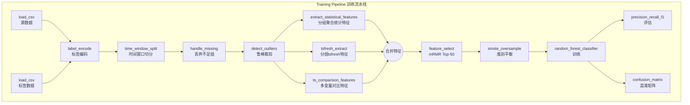
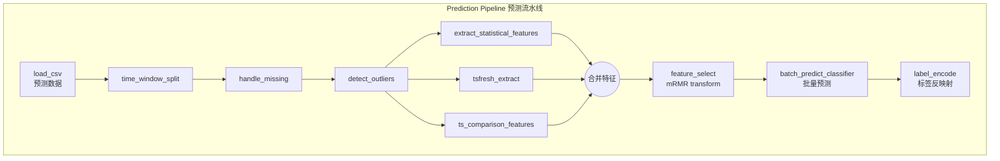

<!-- @AI_GENERATED -->
# 设计文档：基于 AIP 通用算子填充实现光伏故障诊断流水线

## Overview

本设计文档描述将光伏故障诊断算法（`fault-diag-algo-release-3.1`）的各步骤逻辑映射并填充到 AIP 平台通用算子中的完整技术方案。核心设计理念是**复用优先 + 最小扩展**：优先复用已注册算子（`random_forest_classifier`、`smote_oversample`、`label_encode`、`precision_recall_f1`、`feature_select` 等），对部分算子扩展新方法/模式，仅新增 3 个不可替代的算子。

### 设计范围

1. **新增 3 个算子注册**：`time_window_split`、`ts_comparison_features`、`batch_predict_classifier` 的 `functions.json` 定义和后端实现
2. **扩展 4 个已有算子**：`detect_outliers`(+robust_clip)、`handle_missing`(+drop_insufficient)、`feature_select`(+mrmr)、`extract_statistical_features`(+groupby_aggregate)
3. **填充 5 个已有算子后端逻辑**：`random_forest_classifier`、`smote_oversample`、`label_encode`(+decode)、`precision_recall_f1`、`confusion_matrix`
4. **流水线模板**：训练模板和预测模板的 JSON 定义
5. **数据契约**：算子间数据传递的 Schema 定义

### 技术栈

- **后端**：Python 3.10+ / FastAPI / pandas / scikit-learn / mrmr-selection / tsfresh / tslearn / scipy
- **前端**：复用现有 WorkflowEditorPage 和 OperatorConfigPanel，无需新增前端组件
- **算子执行框架**：复用负荷预测已建立的 `operator_execution/` 框架

### 设计决策

| 决策 | 选择 | 理由 |
|------|------|------|
| 新增算子数量 | 仅 3 个 | 已有 814 个算子中可复用/扩展 9 个，最小化注册表膨胀 |
| 特征工程拆分 | `extract_statistical_features` + `tsfresh_extract` + `ts_comparison_features` 三算子并行 | 复用已有的统计和 tsfresh 算子，仅新增对比特征算子 |
| mRMR 特征选择 | 扩展已有 `feature_select` 而非新建 | 统一特征选择入口，`method` 参数枚举新增 `mrmr` |
| 批量预测 | 新增 `batch_predict_classifier` | 分批+重试的编排逻辑无法用单个分类器算子表达 |
| 数据清洗 | 扩展已有算子而非新建 | `robust_clip` 和 `drop_insufficient` 是通用方法，未来可用于风电等场景 |
| 标签编码 | 扩展 `label_encode` + decode 模式 | 训练/预测共用同一算子，通过 mode 区分方向 |

## Architecture

### 整体架构





### 文件结构

```
backend-service/
├── services/operator_backends/
│   ├── time_window_split.py          # 新增：时间窗口切分
│   ├── ts_comparison_features.py     # 新增：多变量对比特征
│   ├── batch_predict_classifier.py   # 新增：批量分类预测
│   ├── detect_outliers.py            # 扩展：+robust_clip 方法
│   ├── handle_missing.py             # 扩展：+drop_insufficient 方法
│   ├── feature_select.py             # 扩展：+mrmr 方法
│   ├── extract_statistical_features.py # 扩展：+groupby_aggregate 模式
│   ├── tsfresh_extract.py            # 扩展：+id_fields 分组
│   ├── random_forest_classifier.py   # 填充：训练+预测后端逻辑
│   ├── smote_oversample.py           # 填充：SMOTE 后端逻辑
│   ├── label_encode.py               # 扩展：+decode 模式
│   ├── precision_recall_f1.py        # 填充：分类指标后端逻辑
│   └── confusion_matrix.py           # 填充：混淆矩阵后端逻辑
├── data/
│   ├── functions.json                # 扩展：新增 3 个算子定义
│   └── workflows_enhanced/
│       ├── workflow-pv-fault-diag-training-v1.json   # 训练模板
│       └── workflow-pv-fault-diag-prediction-v1.json # 预测模板
└── tests/
    └── test_pv_fault_diag_operators.py  # 算子单元测试
```

## Components

### 组件 1：time_window_split 算子

**职责**：按可配置的诊断窗口将连续时序数据切分为独立诊断单元，每个设备×窗口为一行。

**接口**：

```python
def execute(params: dict, inputs: dict) -> dict:
    """
    params:
        window: str        # 窗口大小，如 "1d", "1w", "12h"
        id_fields: list    # 分组字段，默认 ["site_id", "device_id", "branch_id"]
        time_field: str    # 时间列名，默认 "time"
    inputs:
        data: pd.DataFrame # 输入时序数据
    returns:
        {"data": pd.DataFrame}  # 新增 time_window 列
    """
```

**核心逻辑**（移植自 `utils/time.py` 的 `set_time_window`）：

```python
def _split_time_window(df, id_fields, time_field, window):
    # 1. 解析窗口频率字符串（"1d" → pandas freq "1d"）
    freq = _parse_freq(window)  # 处理 m→t, w→w-mon 映射
    
    # 2. 自动检测实际存在的 id_fields
    actual_fields = [f for f in id_fields if f in df.columns]
    
    # 3. 按设备分组，resample 分配 time_window
    results = []
    for key, group in df.groupby(actual_fields):
        tmp = group.copy()
        tmp[time_field] = pd.to_datetime(tmp[time_field])
        tmp = tmp.set_index(time_field).sort_index()
        resampled = tmp.resample(freq, label='left').asfreq()
        resampled['time_window'] = resampled.index
        tmp = pd.merge_asof(tmp, resampled[['time_window']],
                           left_index=True, right_index=True)
        results.append(tmp.reset_index())
    
    return pd.concat(results)
```

### 组件 2：ts_comparison_features 算子

**职责**：对多个数值变量两两计算相关性和距离特征。

**接口**：

```python
def execute(params: dict, inputs: dict) -> dict:
    """
    params:
        id_fields: list       # 分组字段
        value_fields: list    # 数值列名列表
        options: str (JSON)   # {"compute_correlation": true, "compute_distance": true, "compute_regression": true}
    inputs:
        data: pd.DataFrame
    returns:
        {"data": pd.DataFrame}  # 每行一个分组，列为对比特征
    """
```

**核心逻辑**（移植自 `features/feature_engineer.py` 的 `get_compare_features`）：

```python
def _compute_comparison(df, id_fields, value_fields, options):
    groups = df.groupby(id_fields)
    combinations = list(itertools.combinations(value_fields, 2))
    
    results = {}
    for key, group in groups:
        row = {}
        for col1, col2 in combinations:
            if options.get("compute_correlation", True):
                row[f'{col1}_{col2}_spearman'] = spearmanr(group[col1], group[col2])[0]
                row[f'{col1}_{col2}_pearson'] = pearsonr(group[col1], group[col2])[0]
            if options.get("compute_distance", True):
                row[f'{col1}_{col2}_euclidean'] = np.linalg.norm(group[col1] - group[col2])
                row[f'{col1}_{col2}_dtw'] = dtw(group[col1].values, group[col2].values)
            if options.get("compute_regression", True):
                row[f'{col1}_{col2}_slope'] = _linear_slope(group[col1], group[col2])
            # 差值统计
            diff = group[col1] - group[col2]
            row[f'diff_{col1}_{col2}_max'] = diff.max()
            row[f'diff_{col1}_{col2}_std'] = diff.std()
            row[f'diff_{col1}_{col2}_median'] = diff.median()
        results[key] = row
    
    return pd.DataFrame(results).T
```

### 组件 3：batch_predict_classifier 算子

**职责**：对大量设备分批执行分类预测，支持失败重试。

**接口**：

```python
def execute(params: dict, inputs: dict) -> dict:
    """
    params:
        batch_size: int     # 每批对象数，默认 10000
        id_fields: list     # 分组字段
    inputs:
        model: object           # 训练好的分类器
        predict_features: pd.DataFrame  # 特征数据（含 id_fields 索引）
    returns:
        {"predictions": pd.DataFrame,  # id_fields + predict_label
         "failure_count": int}
    """
```

**核心逻辑**（移植自 `fault_main.py` 的批量预测循环）：

```python
def _batch_predict(model, features_df, id_fields, batch_size=10000):
    unique_ids = features_df.index  # multi-index by id_fields
    total = len(unique_ids)
    
    results = []
    failed_ids = []
    
    for start in range(0, total, batch_size):
        batch_ids = unique_ids[start:start+batch_size]
        batch_df = features_df.loc[batch_ids]
        try:
            preds = model.predict(batch_df)
            batch_result = batch_df.index.to_frame()
            batch_result['predict_label'] = preds
            results.append(batch_result)
        except Exception:
            failed_ids.extend(batch_ids)
    
    # 重试失败的，逐条执行
    failure_count = 0
    for obj_id in failed_ids:
        try:
            pred = model.predict(features_df.loc[[obj_id]])
            row = pd.DataFrame([obj_id], columns=id_fields)
            row['predict_label'] = pred[0]
            results.append(row)
        except Exception:
            failure_count += 1
    
    return pd.concat(results), failure_count
```

### 组件 4：detect_outliers 扩展 — robust_clip 方法

**新增逻辑**（追加到现有 `detect_outliers.py`）：

```python
def _robust_clip(df, id_fields, value_fields):
    """移植自 DataCleaner.get_robust_data"""
    result_dfs = []
    for col in value_fields:
        # 仅在组内数据量 > 24 时执行
        group_counts = df.groupby(id_fields).count().median()
        if group_counts[col] > 24:
            df = df.groupby(id_fields).apply(_clip_one_col, col)
    return df

def _clip_one_col(group, value_col):
    """按差分排序，去首尾极值"""
    data = group.copy()
    data[f'{value_col}_diff'] = data[value_col].diff()
    data = data.sort_values(by=f'{value_col}_diff')
    new_val = [np.nan] + data[value_col].iloc[1:-2].tolist() + [np.nan, np.nan]
    data[value_col] = new_val
    return data.sort_index().drop(columns=[f'{value_col}_diff'])
```

### 组件 5：handle_missing 扩展 — drop_insufficient 方法

**新增逻辑**（追加到现有 `handle_missing.py`）：

```python
def _drop_insufficient(df, id_fields, value_fields, keep_threshold=0.75):
    """移植自 DataCleaner.check_missing"""
    groupby_series = [df[col] for col in id_fields]
    not_null_count = df[value_fields].notnull().groupby(groupby_series).sum()
    not_null_count_median = not_null_count.median()
    min_keep_len = not_null_count_median * keep_threshold
    
    check_df = (not_null_count < min_keep_len).any(axis=1)
    keep_df = check_df[~check_df].reset_index()
    keep_index = keep_df[id_fields]
    
    return df.merge(keep_index, on=id_fields, how='right')
```

### 组件 6：feature_select 扩展 — mRMR 方法

**新增逻辑**（追加到现有 `feature_select.py`）：

```python
def _mrmr_select(X, y, k=50, mode='fit', feature_list=None):
    """
    mode='fit': 计算 mRMR 并返回 selected_features + feature_list
    mode='transform': 按已有 feature_list 筛选列
    """
    if mode == 'transform':
        if feature_list is None:
            raise ValueError("transform mode requires feature_list")
        return X[feature_list], feature_list
    
    # fit mode
    from mrmr import mrmr_classif
    selected = mrmr_classif(X=X, y=y, K=min(k, len(X.columns)))
    if not selected:
        raise ValueError("mRMR feature selection returned empty list")
    return X[selected], selected
```

### 组件 7：extract_statistical_features 扩展 — groupby_aggregate 模式

**新增逻辑**（追加到现有 `extract_statistical_features.py`）：

```python
def _groupby_aggregate(df, id_fields, value_fields, options):
    """移植自 FeatureEngineer.get_basic_features"""
    from scipy.stats import kurtosis, skew
    
    data = df.dropna(subset=value_fields, how='any')
    groups = data.groupby(id_fields)
    
    # 基础统计
    stat_funcs = [np.nanmax, np.nanmin, np.nanmean, np.nanmedian, 
                  np.nanstd, kurtosis, skew]
    stat_fe = groups[value_fields].agg(stat_funcs)
    stat_fe.columns = [f'{col}_{func.__name__}' for col, func in stat_fe.columns]
    
    merge_list = [stat_fe]
    
    # 分位数（仅在 avg_count >= 48 时）
    avg_count = groups[value_fields].count().mean().mean()
    if avg_count >= 48 and options.get("compute_quantile", True):
        quantiles = options.get("quantiles", [0.15, 0.25, 0.35, 0.65, 0.75, 0.85, 0.95])
        q_fe = groups[value_fields].agg([lambda x, q=q: np.nanquantile(x, q) for q in quantiles])
        merge_list.append(q_fe)
    
    # 自相关
    if options.get("compute_autocorrelation", True):
        # autocorrelation lag 1/2/3
        ...
    
    # 差分特征
    if options.get("compute_diff", True):
        diff_data = groups[value_fields].diff()
        diff_stat = diff_data.groupby(id_fields).agg(stat_funcs)
        merge_list.append(diff_stat)
    
    return pd.concat(merge_list, axis=1).fillna(0)
```

### 组件 8：流水线模板 JSON

**训练模板** (`workflow-pv-fault-diag-training-v1.json`)：

```json
{
  "id": "workflow-pv-fault-diag-training-v1",
  "name": "光伏故障诊断 - 训练",
  "description": "基于时序统计特征 + 随机森林的光伏设备故障分类训练流水线",
  "category": "fault_diagnosis",
  "metadata": {
    "global_config": {
      "time_zone": "Asia/Shanghai",
      "scene": "solar",
      "device_type": "combinerbox"
    }
  },
  "nodes": [
    {"id": "n1", "operator_id": "load_csv", "config": {"label": "源数据"}},
    {"id": "n2", "operator_id": "load_csv", "config": {"label": "标签数据"}},
    {"id": "n3", "operator_id": "label_encode", "config": {"mode": "encode"}},
    {"id": "n4", "operator_id": "time_window_split", "config": {"window": "1d"}},
    {"id": "n5", "operator_id": "handle_missing", "config": {"method": "drop_insufficient", "keep_threshold": 0.75}},
    {"id": "n6", "operator_id": "detect_outliers", "config": {"method": "robust_clip"}},
    {"id": "n7", "operator_id": "extract_statistical_features", "config": {"mode": "groupby_aggregate", "compute_diff": true}},
    {"id": "n8", "operator_id": "tsfresh_extract", "config": {}},
    {"id": "n9", "operator_id": "ts_comparison_features", "config": {}},
    {"id": "n10", "operator_id": "feature_select", "config": {"method": "mrmr", "k": 50, "mode": "fit"}},
    {"id": "n11", "operator_id": "smote_oversample", "config": {"limit": 500}},
    {"id": "n12", "operator_id": "random_forest_classifier", "config": {"n_estimators": 80, "mode": "train"}},
    {"id": "n13", "operator_id": "precision_recall_f1", "config": {"average": "macro"}},
    {"id": "n14", "operator_id": "confusion_matrix", "config": {}}
  ],
  "edges": [
    {"source": "n1", "target": "n3"},
    {"source": "n2", "target": "n3"},
    {"source": "n3", "target": "n4"},
    {"source": "n4", "target": "n5"},
    {"source": "n5", "target": "n6"},
    {"source": "n6", "target": "n7"},
    {"source": "n6", "target": "n8"},
    {"source": "n6", "target": "n9"},
    {"source": "n7", "target": "n10"},
    {"source": "n8", "target": "n10"},
    {"source": "n9", "target": "n10"},
    {"source": "n10", "target": "n11"},
    {"source": "n11", "target": "n12"},
    {"source": "n12", "target": "n13"},
    {"source": "n12", "target": "n14"}
  ]
}
```

## Data Models

### 算子间数据流 Schema

| 阶段 | 输出类型 | Schema |
|------|----------|--------|
| load_csv → label_encode | MATRIX | `time`(datetime), `site_id`(str), `device_id`(str), `[branch_id]`(str), `custom_label_id`(str), value_cols(float) |
| label_encode → time_window_split | MATRIX | 同上 + `label`(int), 去除原标签列 |
| time_window_split → handle_missing | MATRIX | 同上 + `time_window`(datetime) |
| handle_missing → detect_outliers | MATRIX | 同上，已丢弃不足组 |
| detect_outliers → 特征算子 | MATRIX | 同上，极值位置为 NaN |
| 特征算子 → feature_select | MATRIX | index=id_fields(MultiIndex), columns=feature_names(float), + `label`(int) |
| feature_select → smote_oversample | OBJECT | `selected_features`(MATRIX, float), `target`(ARRAY, int), `feature_list`(ARRAY, str) |
| smote_oversample → random_forest_classifier | OBJECT | `features`(MATRIX, float), `target`(ARRAY, int) |
| random_forest_classifier → 评估 | OBJECT | `model`(object), `predictions`(ARRAY, int), `y_true`(ARRAY, int), `feature_importances`(ARRAY, float) |

### functions.json 新增定义

```json
[
  {
    "id": "time_window_split",
    "name": "时间窗口切分",
    "name_en": "Time Window Split",
    "category": "data_preprocessing",
    "description": "按诊断窗口将时序数据分组，每个设备×窗口为一个独立诊断单元",
    "parameters": [
      {"name": "window", "type": "STRING", "required": true, "description": "窗口大小：1d/1w/12h/30m", "default": "1d"},
      {"name": "id_fields", "type": "ARRAY", "required": false, "description": "分组字段列表", "default": "[\"site_id\",\"device_id\",\"branch_id\"]"},
      {"name": "time_field", "type": "STRING", "required": false, "description": "时间列名", "default": "time"}
    ],
    "return_type": "MATRIX",
    "examples": ["data_with_window = time_window_split(data, '1d')"]
  },
  {
    "id": "ts_comparison_features",
    "name": "多变量对比特征",
    "name_en": "Time Series Comparison Features",
    "category": "feature_engineering",
    "description": "对多个数值变量两两计算相关性和距离特征（Spearman/Pearson/DTW/欧氏距离/回归斜率）",
    "parameters": [
      {"name": "id_fields", "type": "ARRAY", "required": true, "description": "分组字段"},
      {"name": "value_fields", "type": "ARRAY", "required": true, "description": "数值列名列表"},
      {"name": "options", "type": "STRING", "required": false, "description": "JSON配置", "default": "{\"compute_correlation\":true,\"compute_distance\":true,\"compute_regression\":true}"}
    ],
    "return_type": "MATRIX",
    "examples": ["features = ts_comparison_features(data, id_fields=['site_id','device_id'], value_fields=['current_1','current_2'])"]
  },
  {
    "id": "batch_predict_classifier",
    "name": "批量分类预测",
    "name_en": "Batch Predict Classifier",
    "category": "model_training",
    "description": "对大量设备分批执行分类预测，支持失败重试",
    "parameters": [
      {"name": "batch_size", "type": "NUMBER", "required": false, "description": "每批对象数", "default": "10000"},
      {"name": "id_fields", "type": "ARRAY", "required": true, "description": "分组字段"}
    ],
    "return_type": "OBJECT",
    "examples": ["result = batch_predict_classifier(model, features, batch_size=10000)"]
  }
]
```

## Key Flows

### 训练流水线执行流

```
1. load_csv(源数据) + load_csv(标签数据)
   ↓ MATRIX: time, site_id, device_id, [branch_id], value_cols, custom_label_id
2. label_encode(mode='encode', label_map={...})
   ↓ MATRIX: 同上 + label(int)
3. time_window_split(window='1d')
   ↓ MATRIX: 同上 + time_window(datetime)
4. handle_missing(method='drop_insufficient', keep_threshold=0.75)
   ↓ MATRIX: 丢弃数据不足的设备×窗口组
5. detect_outliers(method='robust_clip')
   ↓ MATRIX: 极值已裁剪
6. [并行] extract_statistical_features(mode='groupby_aggregate')
         + tsfresh_extract(id_fields=...)
         + ts_comparison_features(value_fields=...)
   ↓ MATRIX: 每行=一个设备×窗口，列=所有特征 + label
7. feature_select(method='mrmr', k=50, mode='fit')
   ↓ OBJECT: {selected_features, target, feature_list}
8. smote_oversample(limit=500)
   ↓ OBJECT: {features(平衡后), target(平衡后)}
9. random_forest_classifier(n_estimators=80, mode='train')
   ↓ OBJECT: {model, predictions, y_true, feature_importances}
10. precision_recall_f1(average='macro') + confusion_matrix()
    ↓ 评估结果
```

### 预测流水线执行流

```
1. load_csv(预测数据)
   ↓ MATRIX
2. time_window_split(window='1d')
   ↓ MATRIX + time_window
3. handle_missing(method='drop_insufficient')
   ↓ MATRIX
4. detect_outliers(method='robust_clip')
   ↓ MATRIX
5. [并行] 特征提取（同训练）
   ↓ MATRIX: 特征
6. feature_select(method='mrmr', mode='transform', feature_list=[...])
   ↓ MATRIX: 筛选后特征
7. batch_predict_classifier(model=..., batch_size=10000)
   ↓ OBJECT: {predictions(id_fields + predict_label), failure_count}
8. label_encode(mode='decode', label_map={...})
   ↓ MATRIX: id_fields + predict_label_id(业务标签)
```

## Correctness Properties

### 属性 1：标签映射双向一致性

```
∀ label ∈ label_map.keys():
  decode(encode(label)) == label
```

encode 后 decode 应恢复原始业务标签。

### 属性 2：时间窗口完整覆盖

```
∀ record ∈ input_data:
  ∃ exactly one time_window w such that record.time ∈ [w, w + window)
```

每条记录恰好属于一个时间窗口，无遗漏无重叠。

### 属性 3：特征矩阵行数 = 唯一分组数

```
|output_features| == |unique(id_fields × time_window)|
```

特征提取后的行数应等于设备×窗口的唯一组合数。

### 属性 4：mRMR 选择特征数 ≤ k

```
|feature_list| == min(k, |input_features.columns|)
```

选择的特征数不超过 k 且不超过可用特征数。

### 属性 5：批量预测完整性

```
|predictions| + failure_count == |unique_objects|
```

成功预测数 + 失败数 = 总输入对象数。

### 属性 6：SMOTE 后类别均衡

```
∀ class c: |samples_c_after| >= |samples_c_before|
且 |samples_c_after| <= limit (对少数类)
```

SMOTE 只增加少数类样本数，不减少多数类。
