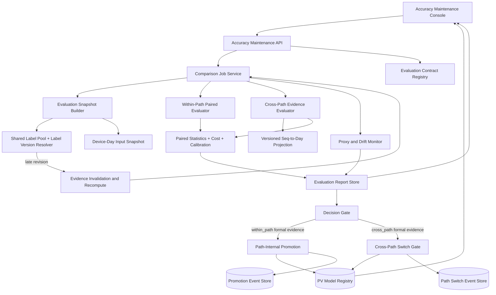
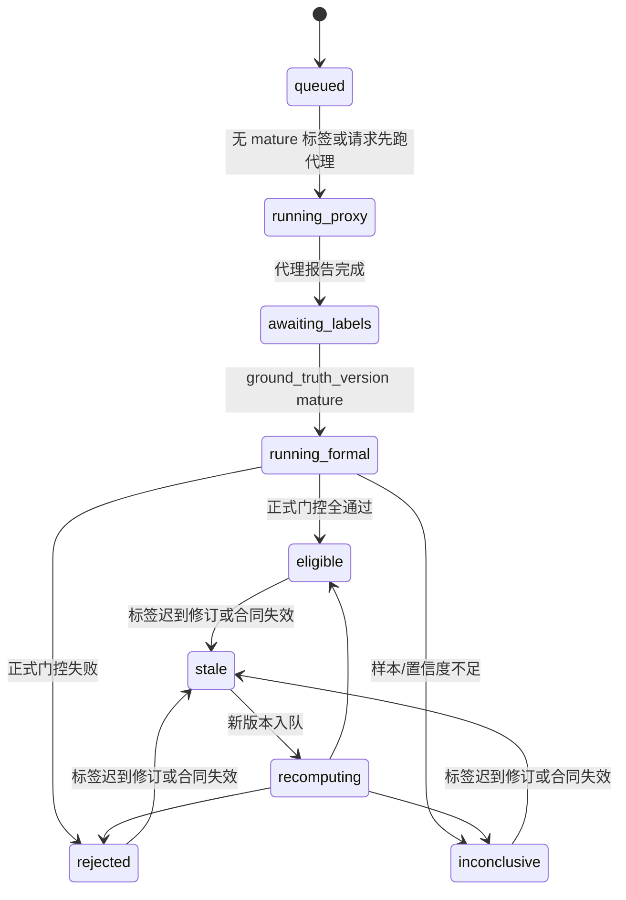
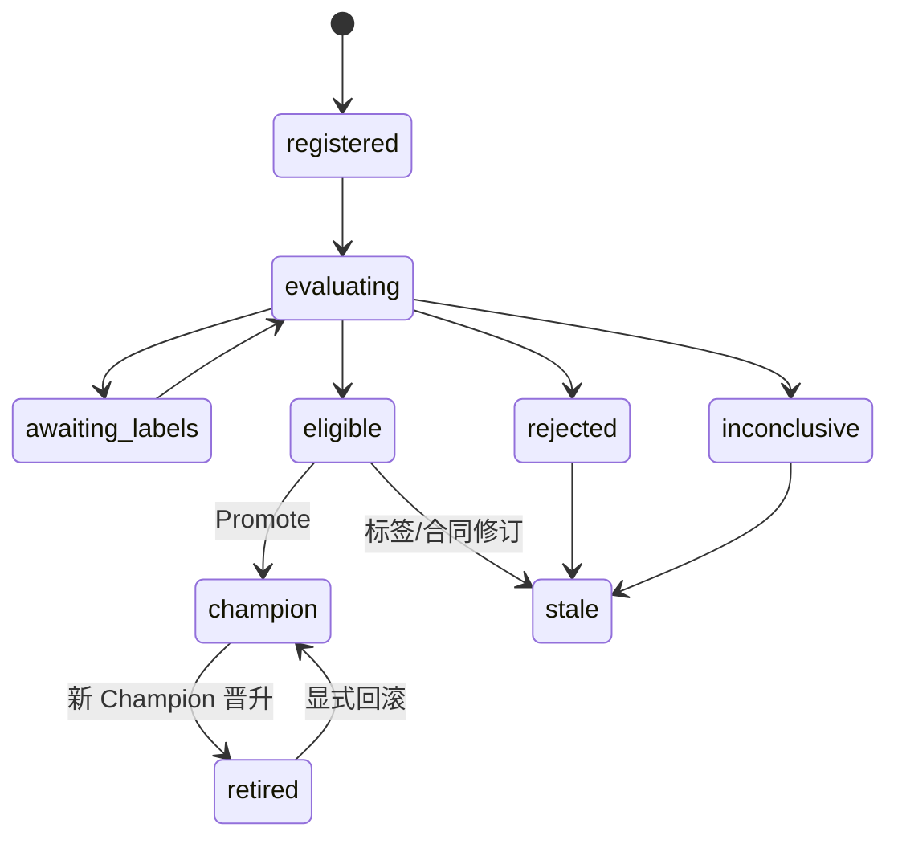

<!-- @AI_GENERATED -->
# 光伏故障诊断双路径精度维护专项技术设计

> 所属规格：`pv-fault-dual-path-serving` — 光伏故障诊断双路径生产接入  
> 文档类型：Feature / Technical Design（同时包含 High-Level Design 与 Low-Level Design）  
> 文档状态：Draft / 待评审 / 未实施  
> 影响范围：双路径离线评测、延迟真值监控、路径内晋升、跨路径切换、模型登记、审计和前端证据展示  
> 不修改：主 `requirements.md`、主 `design.md`、主 `tasks.md`、业务代码、模型训练结构与既有运行产物

## Overview

### 0. 结论先行

本设计把“光伏故障诊断精度维护”拆成两个不能混用的比较层级：

1. **同路径纵向维护**：`legacy_day` 的 Champion 只能与 `legacy_day` Challenger 比，`seq_annotation` 的 Champion 只能与 `seq_annotation` Challenger 比。两边必须使用同一冻结评测合同、同一批样本、同一划分、同一随机种子、同一标签版本与成熟度，并通过配对多窗口、置信区间、非劣门槛、最小收益门槛、覆盖率与运行约束后，才允许 Path-Internal Promotion — 路径内晋升。
2. **跨路径横向维护**：Legacy 输出天级标签，Seq 输出 288 点逐点标签，不能直接比较各自原生 macro-F1。必须先在同一 `Device_Day` — 设备日配对集合上，用版本化 `projection_rule` — Seq 逐点到天级的投影规则构造共同天级口径；再单独保留 Seq 原生逐点/故障段收益层和生产运行代价层。Cross-Path Shadow Report — 跨路径影子报告只产证据，Cross-Path Switch — 跨路径切换仍需人工确认。
3. **延迟真值双通道**：无成熟真值时只运行代理监控通道，观察输入漂移、置信度漂移、模型分歧、覆盖率、失败率和校准代理；它只能产生预警或要求复核，不能晋升或切换。真值成熟后，以冻结的 `ground_truth_version` — 真值版本和 `evaluation_cutoff` — 评测截止时刻重算正式指标，正式证据才可驱动治理。
4. **精度不是唯一门**：故障漏报成本、误报成本、覆盖率、门禁顺延、推理失败、延迟、日容量、模型加载、校准以及设备/站点/季节切片稳定性均进入门控。任何单一 macro-F1 点估计都不能独立决定晋升或切换。
5. **两种写入语义严格分离**：同路径 Promote 只改该路径的 Champion/Challenger/Retired 生命周期并追加 Promotion Event，不改 `production_path`；跨路径 Switch 只在合格正式报告、启用边界与人工确认齐全时改 `production_path`、建立 Activation Epoch 并追加 Path Switch Event。

### 1. 范围与非目标

本专项设计消费现有模型工件和标签闭环，不重新设计 RandomForest、BiLSTM + Attention、训练样本切分或特征工程。它解决以下问题：

- 如何让每条路径与自己的历史 Champion 做公平、可复现、可回滚的纵向比较；
- 如何在输出粒度不同的情况下公平比较两条路径；
- 如何处理人工审核真值延迟、成熟和迟到修订；
- 如何把统计证据、运行代价和业务成本变成可审计决策；
- 如何通过异步任务、登记、审计和前端完整展示落地。

不在本专项范围：自动修改模型训练代码、自动开启生产流量、实现写接口鉴权、替换现有 PV Model Registry、清理脏工作区、把 Legacy 预测当作真值。

### 2. 当前代码事实与缺口

以下结论来自现有仓库代码，不是目标态假设：

1. `AccuracyGatedRetrainer` — 输入 Challenger 登记、单个 `gate_metric_value` 与 `EvaluationContract`，输出登记/晋升结果，由累计训练完成链路调用。当前虽检查 `sample_digest`、`split_digest`、`random_seed`、`metric_name`、生产契约摘要，但最终晋升仍由单一指标点值与 `promotion_margin` 决定；没有多窗口配对差值、置信区间、类别成本、校准、覆盖率或切片稳定性门控。
2. `ShadowCompareRunner` — 输入日期范围、设备范围和 PV Model Registry 中两条路径当前 Champion，输出三层 Shadow 报告，由 `/api/scheduler/pv-dual-path/shadow-compare` 调用。当前 Seq 到天级使用多数票投影；该规则可能把短而高风险的故障段淹没。若无 ground truth，`common_metrics.reference` 会退化为 `pairwise_legacy_as_reference`，这只能描述两模型相对差异，不能被解释成准确率，更不能把 Legacy 当真值。
3. `CrossPathSwitchGate` — 输入目标 Champion、Shadow 报告、启用模式、设备范围和人工确认，输出九项条件。当前第 5 项主要检查 `comparable_total`、`coverage_rate`、三层字典存在及 Seq 原生层未伪造横向结论；尚未验证 ground truth 是否成熟、正式报告是否统计显著、共同口径是否真正非劣/优越、业务成本是否降低、切片是否稳定。
4. `CrossPathSwitchCoordinator._switch_simple()` — 输入 `switch_mode=simple|lab` 的请求，仅检查目标 Champion 存在和 `confirm=true`，输出直接改主线的 Path Switch Event；它绕过 Shadow、完整九项门控和生产 Epoch。`PvDualPathConsole.PathSwitchCard` 默认走该简化模式，`PvFaultModelingPathOpsPanel.handleSetProduction()` 也发送 `switch_mode=simple`、`operator=lab`。这是生产治理收敛前必须移除或限制到明确非生产环境的缺口。
5. `POST /shadow-compare` 当前同步执行并立即返回 `status=completed`，没有 queued/running/awaiting_labels/recomputing 状态、任务租约、进度、取消与幂等键，不适合大样本、多窗口和迟到真值重算。
6. 现有 `PVModelRegistry` 已具备每路径 `champion` / `challengers` / `retired` 生命周期和相对路径归一化，是本设计继续沿用的 PV 唯一可写真相；不另造第二套模型主登记。
7. `PromotionEventStore` 与 `PathSwitchEventStore` 已分开，只追加语义正确；本设计在其上补充 `comparison_id`、评测合同摘要、标签版本、决策快照和回滚关联，不合并两类事件。

### 3. 调研结论

- [Minitab Model Ops Champion/Challenger](https://support.minitab.com/en-us/model-ops/import-and-deploy-models/use-champion-challenger-models-in-a-deployment/)强调同一部署只有一个生产 Champion，Challenger 使用相同生产数据回放，并要求响应变量和共享特征类型一致。这支持“同路径同合同配对回放、只在证据充分后人工晋升”。
- [DataRobot Challengers](https://docs.datarobot.com/11.0/en/docs/mlops/monitor/challengers.html)把 Challenger 作为已登记模型版本，回放存储的生产请求，并要求目标类型兼容、模型唯一、输入特征并集可满足。这支持模型登记、输入合同校验与异步回放任务分离。
- [PV 故障诊断综述](https://link.springer.com/10.1007/s43937-026-00136-5)把检测、分类与定位视为不同诊断层，并指出不同故障和部署条件下鲁棒性仍是核心挑战。因此 Seq 的逐点/故障段定位收益必须保留，不能被一个天级指标吞并；同时漏报的安全与发电损失成本必须进入业务门。
- [延迟真值下的证据充分性研究](https://arxiv.org/abs/2604.15740)讨论真值延迟期间治理证据会随时间和缺失机制退化。本设计据此把代理证据与正式真值证据分层，并禁止代理证据直接触发晋升。
- [无标签模型分歧监控研究](https://arxiv.org/html/2506.05047v4)把模型分歧定位为无标签期间的早期退化告警信号，并强调需要控制非退化漂移下的误报。本设计只让 disagreement 触发 alert/review，不把一致率或分歧率当作真实准确率。

上述资料只提供设计原则；最终阈值必须由本项目历史回放和业务损失校准。

### 4. 术语与不可混淆边界

| 术语 | 含义 |
|---|---|
| `comparison_kind` — 比较类型 | `within_path` 同路径纵向比较，或 `cross_path` 跨路径横向比较 |
| `evaluation_contract` — 冻结评测合同 | 固定样本资格、窗口、划分、标签版本、指标、阈值和投影规则的“尺子”，不是模型内部结构 |
| `label_maturity` — 标签成熟度 | `unlabeled` 无标签、`provisional` 暂定标签、`mature` 成熟真值；治理只接受 mature |
| `ground_truth_version` — 真值版本 | 对本次标签快照的不可变版本 ID；迟到修订产生新版本，不覆盖旧报告 |
| `evaluation_cutoff` — 评测截止时刻 | 只纳入此时刻前已到达、满足资格且标签状态符合合同的数据，防止未来信息泄漏 |
| `comparison_id` — 比对任务 ID | 异步比较任务的幂等身份和轮询主键 |
| `decision` — 比较决策 | `alert_only`、`awaiting_labels`、`inconclusive`、`reject`、`eligible_for_promotion`、`eligible_for_switch`、`stale` |
| `paired_set` — 配对集合 | 同一 Device Day 上两模型均按同一合同成功产出，且正式评估时具有同一成熟真值的样本集合 |
| `uncomparable_items` — 不可比样本 | 任一路径未产出、门禁顺延、工件失败、标签不成熟或合同不一致的设备日及原因 |

`agreement_rate` — 两模型天级标签一致率只能说明输出相似程度；无 mature ground truth 时不能称为 accuracy，也不能把任一模型当 reference truth。

## Architecture

### 5. High-Level Design（HLD）



### 5.1 三层证据模型

1. **共同正式证据层**：两模型在相同 mature ground truth 的 Device Day 配对集合上比较。Within Path 保持路径原生标签粒度；Cross Path 使用版本化 Seq-to-Day 投影后比较共同天级指标。
2. **路径原生收益层**：Legacy 记录天级分类和成本；Seq 额外记录逐点 macro-F1、故障类召回、故障段 IoU、边界偏差、短故障段召回、夜间误报和 288 点合同通过率。该层不能强行产生 Legacy 对应值。
3. **运行与业务代价层**：覆盖率、门禁顺延、推理失败、工件加载、p50/p95 延迟、日容量、漏报成本、误报成本、人工复核负担。

### 5.2 延迟真值双通道



`running_proxy` 的输出只允许 `decision=alert_only|awaiting_labels`。只有 `running_formal` 使用 `label_maturity=mature` 且冻结 `ground_truth_version` 后，才允许产生 `eligible_for_promotion` 或 `eligible_for_switch`。

## Components and Interfaces

### 6. 组件边界

#### 6.1 `EvaluationContractRegistry`

输入：创建/读取请求和合同字段。输出：不可变 `evaluation_contract_id` — 评测合同 ID、合同摘要和版本。由 Comparison Job Service 在任务创建时调用。

合同至少冻结：

- `comparison_kind` — 比较类型；
- `modeling_path` — 同路径比较目标路径，跨路径时为空；
- `window_spec` — 时间窗口和最少窗口数；
- `sample_policy` — Device Day 资格、设备/站点/季节分层和排除规则；
- `split_digest` — 划分摘要；
- `random_seed` — 随机种子；
- `label_maturity` — 要求的标签成熟度；
- `ground_truth_version` — 真值版本；
- `evaluation_cutoff` — 评测截止时刻；
- `metric_suite_version` — 指标套件版本；
- `projection_rule_version` — 跨路径投影规则版本；同路径为空；
- `threshold_profile_version` — 阈值配置版本；
- `cost_profile_version` — 漏报/误报业务成本版本；
- `bootstrap_iterations` — 配对 Bootstrap 次数，建议默认 2000；
- `confidence_level` — 置信水平，建议默认 0.95。

合同创建后不可修改；调整规则必须创建新版本。旧请求若只传旧 `sample_digest/split_digest/random_seed/metric_name`，兼容层可生成 `legacy_contract_v1`，但该合同最高只能输出 `decision=inconclusive`，不能用于生产晋升。

#### 6.2 `EvaluationSnapshotBuilder`

输入：冻结合同、模型引用、评测截止时刻。输出：相对路径快照引用、样本摘要、标签版本和排除原因。它负责：

- 以 Event Time 和 evaluation cutoff 截断输入；
- 从 Shared Label Pool 解析指定 ground truth version；
- 保证 Champion 与 Challenger 使用相同 Device Day、特征可用时点和标签；
- 生成 `sample_digest`、`label_digest` 和 `feature_availability_digest`；
- 标记迟到数据，不把 cutoff 后信息回填进旧报告；
- 防止同一设备日或同一故障段跨训练/评测划分泄漏。

#### 6.3 `WithinPathPairedEvaluator`

输入：同一路径 Champion、Challenger 和 Evaluation Snapshot。输出：逐窗口、逐切片配对差值与统计摘要。由 Comparison Worker 调用。

Legacy 和 Seq 分开配置原生指标，但共享以下准入原则：

- 所有关键指标使用配对样本差值，而不是两个独立均值；
- 至少四个非重叠时间窗口，建议周/月窗口并覆盖工作日、季节与站点差异；
- 先通过关键安全指标非劣，再要求至少一个主收益指标达到最小收益；
- 所有窗口都报告，不允许只挑最好窗口；
- 切片最小样本不足时标记 evidence gap，不把空切片当通过。

#### 6.4 `CrossPathEvidenceEvaluator`

输入：双 Champion、同一 Device Day 快照、版本化投影规则。输出：共同天级层、Seq 原生层、运行代价层、不可比样本与选择偏差诊断。

配对集合定义：

```text
paired_set = candidate_device_days
             ∩ legacy_success
             ∩ seq_success
             ∩ mature_ground_truth_available
             ∩ same_ground_truth_version
             ∩ same_evaluation_cutoff
```

报告必须同时给出：候选总数、两路各自产出数、paired set 数、门禁顺延数、模型失败数、标签未成熟数、按路径/原因的不可比清单。只在 paired set 上计算配对正式指标，但覆盖率与不可比率使用候选全集作分母。

缺失机制处理：

- `deferred_by_design` — Seq 因完整性门禁顺延，属于路径机制差异，计入运行代价和选择偏差；
- `execution_failure` — 工件或推理失败，blocking；
- `label_not_mature` — 标签未成熟，只进入代理通道；
- `missing_not_at_random_suspected` — 不可比率在故障类型、站点或季节切片显著不均衡，正式决策降级为 inconclusive；
- 报告同时展示 paired-complete 指标和全候选覆盖/成本，禁止只展示成功子集。

#### 6.5 `VersionedProjectionService`

输入：Seq 288 点概率/标签和 `projection_rule_version`。输出：天级标签、投影解释和敏感性结果。Cross Path Evaluator 调用。

不继续把简单多数票作为唯一生产规则。建议初始候选规则 `pv-day-fault-v1`：若任一高风险故障类连续达到 `k` 个槽，或全天故障概率加权和超过阈值，则天级判故障；否则正常。`k`、概率阈值和类别权重属于规则版本，不写死在代码。

正式报告至少计算主投影和一个敏感性投影。若切换结论对合理投影变化不稳定，`decision=inconclusive`。多数票可保留为历史对照，但必须标注“可能掩盖短故障段”，不能作为唯一准入规则。

#### 6.6 `PairedStatisticsService`

输入：逐 Device Day 配对结果、窗口和切片。输出：点估计、95% CI、显著性/非劣结论、校准和业务成本。

推荐算法：

- 分类指标差值使用按 Device Day 分层、按设备簇重采样的 paired bootstrap，建议 2000 次；
- 成对错误差异可补充 McNemar 检验；多类别采用按类别配对差异与 bootstrap，不只给总体 p 值；
- 置信区间优先于仅报告 p value，并对多切片比较做 FDR 控制；
- 校准使用 Brier score、Expected Calibration Error 和可靠性曲线；没有概率输出的旧 Legacy 模型标记 unavailable，不伪造；
- 所有指标同时报告 micro、macro、故障类加权和按业务成本加权结果。

设样本 i 上 Challenger 与 Champion 的损失分别为 `L_i^c` 和 `L_i^p`，成本差为：

```text
Delta_cost = mean(L_i^c - L_i^p)
```

对于“越高越好”的指标 M：

```text
Delta_M = M_challenger - M_champion
non_inferior iff lower_CI(Delta_M) >= -delta_non_inferiority
minimum_gain iff lower_CI(Delta_primary) >= epsilon_min_gain
```

对于“越低越好”的成本或延迟：

```text
Delta_C = C_challenger - C_champion
non_inferior iff upper_CI(Delta_C) <= delta_cost_tolerance
minimum_gain iff upper_CI(Delta_primary_cost) <= -epsilon_cost_reduction
```

#### 6.7 `DecisionGate`

输入：正式/代理报告和阈值配置。输出：decision、逐项 gate conditions 和可行动原因。它不直接写 Registry。

建议默认阈值仅作冷启动基线，必须用至少 3–6 个月历史回放校准后形成 `threshold_profile_version`：

| 门 | 冷启动建议 | 说明 |
|---|---:|---|
| 成熟 paired Device Day | ≥ 500 | 跨路径切换可先沿用现有最低 200，但生产建议提高；按故障稀有度校准 |
| 独立时间窗口 | ≥ 4 | 每窗至少包含足够故障样本 |
| 95% CI | 0.95 | paired cluster bootstrap |
| 关键故障召回非劣差 | 下界 ≥ -1 个百分点 | 高风险故障可要求 0 退化 |
| 主收益最小增益 | 下界 ≥ +1 个百分点 | 或业务成本上界下降 ≥ 2% |
| 覆盖率退化容忍 | 下界 ≥ -1 个百分点 | 跨路径还需总覆盖率建议 ≥ 90% |
| 推理失败率增量 | 上界 ≤ +0.5 个百分点 | blocking failure 单独限制 |
| p95 延迟增量 | ≤ +20% | 同时满足 SLO 绝对上限 |
| 日容量退化 | 不低于 -10% | 且高于峰值需求安全系数 |
| ECE 退化 | ≤ +0.02 | 仅概率可比时适用 |
| 关键切片 | 不允许显著灾难性退化 | 设备、站点、季节、故障类型 |

阈值不是最终业务承诺，禁止作为不可配置常量散落在服务代码中。

### 7. 指标矩阵

| 层级 | Legacy 同路径 | Seq 同路径 | 跨路径共同层 | Seq 原生增益层 | 运行/业务层 |
|---|---|---|---|---|---|
| 主指标 | 天级 fault-weighted macro-F1、故障召回 | 点级 macro-F1、故障类召回、段 IoU | 投影后天级故障召回、误报率、成本 | 短故障段召回、段 IoU、边界偏差 | 覆盖、失败、p95 延迟、容量 |
| 次指标 | Accuracy、每类 precision/recall | 点级 Accuracy、夜间误报 | agreement 仅辅助 | 288 合同、校准 | 门禁顺延、加载成功率 |
| 安全门 | 高风险故障漏报成本 | 高风险点/段漏报成本 | 共同业务成本不得恶化 | 不能以原生收益掩盖共同层退化 | SLO 和容量不得破坏 |
| 统计 | 配对多窗口 CI | 配对多窗口 CI | 同 Device Day 配对 CI | Seq 内部 CI | 窗口/切片稳定性 |

### 8. 窗口、分层与泄漏防护

#### 8.1 窗口策略

- 默认使用最近 8 个完整周构造 4 个双周窗口；数据季节性强时扩展为跨季节滚动窗口；
- 窗口必须在合同创建时冻结，不能根据结果改窗；
- Champion 和 Challenger 必须在每个窗口处理完全相同的 Device Day；
- 报告给出每窗差值、聚合 median、最差窗和赢窗数；不只给全量 pooled 指标；
- 建议 `min_windows_non_inferior=4`，`min_windows_positive=3`，最终由历史基线校准。

#### 8.2 样本分层

至少按以下维度报告，且高风险切片可配置为 blocking：

- `site_id` — 站点；
- `device_family` — 设备家族/逆变器类型；
- `season` — 季节与辐照区间；
- `fault_class` — 故障类别；
- `day_night` — 白天/夜间；
- `completeness_band` — 完整性区间；
- `label_source` — 人工、规则、导入等标签来源；
- `revision_age` — 标签从首次裁决到成熟的时长。

#### 8.3 数据泄漏防护

1. 以设备或故障段为 group 划分，禁止同一段跨训练与评测；
2. evaluation cutoff 后到达的测点、标签和人工修订不得进入旧快照；
3. 阈值、投影规则和成本权重只能由评测期之前的校准集确定；
4. 同一评测报告不得用其结果反向挑选“有利窗口”；
5. 训练快照、评测快照、标签快照分别保存 digest；
6. Seq 插值只使用该 Device Day 合同允许的信息，不读取未来日；
7. 跨路径共同真值来自 Shared Label Pool 的指定版本，绝不来自 Legacy 或 Seq 预测。

### 9. 决策矩阵

#### 9.1 同路径 Path-Internal Promotion

| 正式证据 | 运行门 | 结果 |
|---|---|---|
| 主收益达到最小增益，关键指标均非劣，关键切片稳定 | 全通过 | `eligible_for_promotion`，等待人工 Promote 或受控自动策略 |
| 主收益未达最小增益但均非劣 | 全通过 | `inconclusive`，保留 Challenger，不晋升 |
| 任一关键故障召回/成本显著退化 | 任意 | `reject` |
| 标签非 mature 或版本缺失 | 任意 | `awaiting_labels` 或 `alert_only` |
| 统计样本/故障数不足 | 任意 | `inconclusive` |
| 精度通过但失败率、延迟或容量不通过 | 不通过 | `reject` 或 `inconclusive`，不得用精度覆盖运行风险 |

#### 9.2 Cross-Path Switch

| 共同天级层 | Seq 原生层 | 运行代价层 | 结果 |
|---|---|---|---|
| 非劣且业务成本改善 | 有稳定原生收益 | 满足 SLO/容量 | `eligible_for_switch`，仍需人工确认和 Activation Epoch |
| 非劣 | 原生收益不稳定 | 满足 | `inconclusive` |
| 共同层退化 | 任意 | 任意 | `reject`，不能用 Seq 原生 F1 抵消共同业务退化 |
| 无 mature ground truth，仅 agreement/分歧 | 任意 | 任意 | `alert_only`，禁止切换 |
| paired set 覆盖低或怀疑 MNAR | 任意 | 任意 | `inconclusive`，要求补标签或修复门禁偏差 |
| 指标通过 | 有收益 | 运行失败/容量不足 | `reject` |

### 10. 状态机与治理动作

#### 10.1 Challenger 生命周期



#### 10.2 Promote 与 Switch 写入差异

- Path-Internal Promotion：`candidate_id` — Challenger 候选 ID 指向同一 modeling path 的模型；`set_as_production=true` — 在本产品中表示把该 Challenger 写成**该路径 Champion**，旧 Champion 移入 retired。即使该路径当前不是 `production_path`，也不切换路径。写 PV Model Registry + Promotion Event。
- Cross-Path Switch：`comparison_id` — 合格跨路径正式报告 ID 指向双 Champion 证据；写 `production_path`、Path Activation Epoch、Path Switch Event。它不把任一 Challenger 直接晋升，报告中的两个 `model_ref` 必须仍等于两路径当前 Champion。

## REST API Design

### 11. 异步比较任务

#### 11.1 POST `/api/accuracy-maintenance/comparisons`

用途：Console、CLI 或定时维护任务创建同路径/跨路径异步比较。该接口只创建任务，不晋升、不切换。

请求关键字段：

- `comparison_kind` — 必填，`within_path` 或 `cross_path`；
- `slot` — 可选，槽位，默认 `pv_fault`；
- `modeling_path` — 同路径时必填；
- `champion_model_ref` — 可选，默认从 PV Model Registry 冻结读取；传入值必须等于当前 Champion；
- `challenger_candidate_id` — 同路径时必填，指向该路径 Challenger；
- `evaluation_contract_id` — 推荐必填，冻结合同 ID；
- `evaluation_contract` — 仅创建临时新合同时传入的完整合同对象；与 ID 二选一；它固定的是评测“尺子”，不是被测模型内部结构；
- `aggregate_method` — 跨窗口聚合方式，取 `median`、`mean` 或 `weighted_mean`，建议默认 `median`，实际默认由合同版本固定；
- `score_margin` — 主收益指标最小分差门槛；建议冷启动为 +1 个百分点或成本下降 2%，必须由历史基线校准；
- `min_windows_challenger_better` — Challenger 最少优胜窗口数；四窗口冷启动建议为 3；
- `min_windows_non_inferior` — 关键指标最少非劣窗口数；四窗口冷启动建议为 4；
- `start_date` / `end_date` — 评测日期范围；必须与合同窗口一致；
- `device_scope` — 可选设备范围；
- `idempotency_key` — 必填，调用方幂等键；
- `requested_by` — 必填，操作者；
- `reason` — 必填，创建原因。

返回：

- `comparison_id` — 比对任务 ID，轮询主键；
- `status` — `queued`；
- `evaluation_contract_id` — 实际冻结合同 ID；
- `decision` — 初始为 `pending`；
- `created_at` — UTC 创建时间；
- `duplicate_of` — 幂等重放时返回原 comparison ID。

#### 11.2 GET `/api/accuracy-maintenance/comparisons/{comparison_id}`

用途：UI/CLI 轮询任务和证据成熟状态；只读。

返回 `status` — queued/running_proxy/awaiting_labels/running_formal/completed/failed/cancelled/stale/recomputing，`progress` — 进度，`label_maturity` — 当前标签成熟度，`ground_truth_version` — 正式真值版本，`decision` — 当前决策，`eligible_for_governance` — 是否具备进入对应治理动作的资格，`meets_score_margin` — 是否满足主收益分差，`meets_win_count` — 是否满足最少优胜窗数，`meets_non_inferiority` — 是否满足全部关键非劣条件，`gate_conditions` — 其余分项门控，`report_ref` — 相对路径报告引用，`error` — 可诊断错误。`eligible_for_governance` 必须由全部分项条件合取得出，不能只复制任一单项结果。

#### 11.3 POST `/api/accuracy-maintenance/comparisons/{comparison_id}/recompute`

用途：标签版本成熟或 late revision 后基于新 ground truth version 重算。请求包含 `ground_truth_version` — 新真值版本、`evaluation_cutoff` — 新截止时刻、`idempotency_key` — 重算幂等键、`reason` — 原因。旧报告标 stale 并保留，不覆盖。

### 12. 合同登记 API

#### GET `/api/accuracy-maintenance/evaluation-contracts/{evaluation_contract_id}`

用途：UI 展示、比较任务预填与审计复现；无写副作用。返回完整冻结合同、`contract_digest` — 合同摘要、`created_by` — 创建者、`created_at` — 创建时间和 `supersedes_contract_id` — 被替代旧合同 ID。

#### POST `/api/accuracy-maintenance/evaluation-contracts`

语义：创建不可变合同版本，不覆盖旧版本。若相同 digest 已存在则幂等返回原 ID。请求体字段见 6.1；所有关键英文字段均需由 Pydantic/TypeScript 合同显式类型化。

### 13. Path-Internal Promotion API

建议收敛现有 `POST /cumulative-training/modeling-paths/{modeling_path}/promote`：

- `candidate_id` — 必填，同路径 Challenger 候选 ID；
- `comparison_id` — 必填，正式 `within_path` 报告 ID；
- `set_as_production` — 必填 boolean；为 true 时写成**该 modeling path 的 Champion**，不修改 `production_path`；
- `production_slot` — 可选，默认 `pv_fault`；名称为兼容旧接口保留，语义实际是 PV Registry slot；
- `expected_registry_version` — 必填，乐观锁版本；
- `confirm` — 必填 JSON boolean true；
- `operator` — 必填；
- `reason` — 必填。

服务必须验证报告为 formal、label maturity=mature、decision=eligible_for_promotion、候选和当前 Champion 引用未变化、合同未过期。成功后只写 PV Model Registry 生命周期和 Promotion Event；失败全不写。

### 14. Cross-Path Switch API

继续使用 `PUT /cumulative-training/modeling-paths`，但生产环境废弃 `switch_mode=simple|lab`：

- `modeling_path` — 必填，目标路径；
- `comparison_id` — 必填，正式 cross_path 报告；
- `activation_mode` — 必填；
- `backfill_days` — recent_window 时必填；
- `confirm` — 必须为 JSON boolean true；
- `expected_registry_version` — 必填；
- `operator` / `reason` — 必填；
- `device_scope` — 设备范围；
- `note` — 可选备注。

新增门控在现有九项之前或合并为版本化 gate profile：报告 formal + mature；共同层非劣；最小业务收益满足；统计 CI 充分；关键切片无灾难性退化；覆盖/失败/延迟/容量通过；报告模型引用仍为当前双 Champion；projection rule 和阈值版本仍有效。成功写 production path + Activation Epoch + Path Switch Event，不写 Promotion Event。

### 15. 只读 Registry 与审计 API

`GET /cumulative-training/modeling-paths` 继续作为 PV Model Registry 只读视图，返回 `path_models` — 各路径 Champion/Challenger/Retired、`production_path` — 当前生产路径、`registry_version` — 乐观锁版本、`active_activation_epoch_id` — 当前启用周期。

Promotion Event 和 Path Switch Event 均只追加、不可通过普通 API 修改或删除。每条 Promotion Event 新增 `comparison_id` — 同路径正式报告、`evaluation_contract_id` — 冻结合同、`ground_truth_version` — 真值版本、`decision_snapshot` — 决策快照、`rollback_of_event_id` — 回滚关联。Path Switch Event 对应新增同类证据引用，但保持 `from_path` / `to_path` / `activation_epoch_id` 字段。

## Low-Level Design（LLD）

### 16. 核心接口

```python
class EvaluationSnapshotBuilder:
    def build(self, contract_id: str, model_refs: list[str]) -> "EvaluationSnapshot":
        contract = contract_registry.get_immutable(contract_id)
        labels = label_resolver.resolve(
            ground_truth_version=contract.ground_truth_version,
            required_maturity=contract.label_maturity,
            cutoff=contract.evaluation_cutoff,
        )
        samples = sample_repository.select(contract.sample_policy, contract.window_spec)
        return freeze_snapshot(samples, labels, model_refs, contract)

class WithinPathPairedEvaluator:
    def evaluate(self, snapshot: "EvaluationSnapshot") -> "EvaluationReport":
        paired_predictions = replay_same_inputs(snapshot)
        window_metrics = compute_paired_window_metrics(paired_predictions)
        slice_metrics = compute_required_slices(paired_predictions)
        statistics = paired_statistics.bootstrap(window_metrics, cluster="device_key")
        return decision_gate.decide_within_path(statistics, slice_metrics, snapshot.contract)

class CrossPathEvidenceEvaluator:
    def evaluate(self, snapshot: "EvaluationSnapshot") -> "EvaluationReport":
        legacy, seq = replay_current_champions(snapshot)
        projected_seq = projection_service.apply(seq, snapshot.contract.projection_rule_version)
        paired = intersect_by_device_day(legacy, projected_seq, snapshot.mature_labels)
        missingness = analyze_uncomparable(snapshot.candidates, legacy, seq, paired)
        common = compute_common_ground_truth_metrics(paired)
        native = compute_seq_native_metrics(seq, snapshot.mature_labels)
        runtime = compute_runtime_and_business_cost(snapshot.candidates, legacy, seq)
        return decision_gate.decide_cross_path(common, native, runtime, missingness)
```

### 17. 决策伪算法

```text
function decide_formal(report, contract):
  require report.label_maturity == mature
  require report.ground_truth_version == contract.ground_truth_version
  require report.evaluation_cutoff == contract.evaluation_cutoff
  require report.sample_digest == contract.resolved_sample_digest

  if report.paired_total < thresholds.min_paired_total:
      return inconclusive("insufficient_paired_samples")
  if report.missingness.mnar_suspected:
      return inconclusive("selection_bias_risk")
  if any critical_slice has insufficient evidence:
      return inconclusive("critical_slice_evidence_gap")
  if any safety_metric fails non_inferiority_CI:
      return reject("safety_non_inferiority_failed")
  if any runtime_gate fails:
      return reject("runtime_gate_failed")
  if no primary_gain reaches minimum_gain_CI:
      return inconclusive("minimum_gain_not_proven")
  if comparison_kind == within_path:
      return eligible_for_promotion
  return eligible_for_switch
```

### 18. Projection Rule 版本合同

每个规则版本至少记录 `rule_id` — 规则 ID、`definition` — 人类可读定义、`fault_class_weights` — 类别权重、`min_consecutive_slots` — 最短连续故障槽、`probability_thresholds` — 类别概率阈值、`night_policy` — 夜间策略、`calibrated_on_snapshot` — 校准快照、`created_at` — 创建时间。规则只读版本化；报告必须嵌入 rule ID 和 digest。

### 19. 幂等、并发和安全回滚

- 创建比较任务以 `slot + idempotency_key` 唯一；同键同 payload 返回原任务，同键不同 payload 返回 409；
- Worker 以租约领取 comparison ID，租约到期可恢复；同一任务同一 phase 只允许一个 running worker；
- 报告以 `comparison_id + evidence_phase + ground_truth_version` 唯一；代理与正式报告不互相覆盖；
- late revision 只把旧报告标 stale 并创建新正式版本；已基于旧报告执行的治理事件不删除，追加 evidence-invalidated 告警和回滚评估；
- Promote 使用 `expected_registry_version` 和当前 Champion/Candidate 引用 compare-and-swap；写 Registry 与 Promotion Event 全成全败；
- Switch 使用 Registry、Activation Epoch、Path Switch Event 的现有补偿事务，并增加 comparison report version 校验；
- 回滚是新的显式治理动作：路径内回滚把 retired Champion 恢复为 Champion并追加 Promotion Event，production path 不变；跨路径回滚仍是新的 Cross-Path Switch，必须引用可用证据或进入受控紧急流程；
- 所有模型、快照、报告路径持久化为项目根或 `backend-service/` 相对路径，不写绝对路径。

## Data Models

### 20. 登记与持久化四件事

#### 20.1 Evaluation Contract Registry

- **存什么**：不可变评测合同、版本、摘要、创建者和替代关系。
- **为什么单独存**：把“尺子”与模型、任务和结果分开，保证历史报告可复现，禁止评测后改规则。
- **分区维度**：`slot + evaluation_contract_id`。
- **路径/介质**：由部署配置决定；推荐数据库主表，测试文件存储使用 `backend-service/data/pv_dual_path/evaluation_contracts/` 相对目录。

#### 20.2 Comparison Job Store

- **存什么**：comparison ID、幂等键、状态、phase、进度、合同 ID、双模型快照、错误和租约。
- **为什么单独存**：多窗口回放是异步长任务，不能依赖 HTTP 请求生命周期。
- **分区维度**：`slot + comparison_id`。
- **路径/介质**：数据库；大报告仅存相对 `report_ref`。

#### 20.3 Evaluation Report Store

- **存什么**：代理/正式指标、窗口/切片、置信区间、不可比样本、decision 与 gate snapshot。
- **为什么单独存**：报告是治理证据，不应混入 PV Model Registry 的当前状态快照。
- **分区维度**：`comparison_id + evidence_phase + ground_truth_version`。
- **路径/介质**：部署配置决定；建议 `backend-service/data/pv_dual_path/accuracy_reports/` 相对目录或对象存储相对 key。

#### 20.4 PV Model Registry 与审计

- **存什么**：PV 当前 production path、fallback、每路径 Champion/Challenger/Retired、Registry version；Promotion 与 Path Switch 分别只追加事件。
- **为什么单独存**：它是调度器实际读取的 PV 唯一可写真相；评测报告只提供证据，不成为第二份生产指针。
- **分区维度**：Registry 按 `slot + modeling_path`；事件按 `slot + event_type`。
- **路径/介质**：沿用部署配置与现有相对目录，不写 `slots.json` 第二份 PV 真相。

### 21. 核心实体

#### `evaluation_contracts`

| 字段 | 说明 |
|---|---|
| `evaluation_contract_id` | 不可变评测合同 ID |
| `contract_version` | 合同版本 |
| `comparison_kind` | within_path / cross_path |
| `contract_payload` | 完整类型化合同 JSON |
| `contract_digest` | 规范化 SHA-256 |
| `supersedes_contract_id` | 被替代合同 ID |
| `created_by` / `created_at` | 创建者与 UTC 时间 |

#### `comparison_jobs`

| 字段 | 说明 |
|---|---|
| `comparison_id` | 比对任务 ID |
| `slot` | PV 槽位 |
| `idempotency_key` | 调用幂等键 |
| `comparison_kind` | 比较类型 |
| `status` | 异步状态 |
| `evidence_phase` | proxy / formal |
| `evaluation_contract_id` | 冻结合同 ID |
| `champion_snapshot` | Champion 引用与 Registry version |
| `challenger_snapshot` | 同路径 Challenger；跨路径为空 |
| `label_maturity` | unlabeled / provisional / mature |
| `ground_truth_version` | 真值版本 |
| `evaluation_cutoff` | 评测截止时刻 |
| `decision` | 当前决策 |
| `report_ref` | 相对报告路径 |
| `lease_owner` / `lease_expires_at` | Worker 租约 |
| `created_at` / `updated_at` | UTC 时间 |

#### `evaluation_reports`

| 字段 | 说明 |
|---|---|
| `comparison_id` | 任务关联 |
| `report_version` | 报告版本 |
| `evidence_phase` | proxy / formal |
| `sample_digest` / `label_digest` | 样本与标签摘要 |
| `ground_truth_version` | 正式真值版本 |
| `paired_total` / `candidate_total` | 配对与候选样本数 |
| `window_metrics` / `slice_metrics` | 多窗口与切片结果 |
| `confidence_intervals` | 置信区间 |
| `uncomparable_items` | 不可比样本及原因 |
| `missingness_analysis` | 缺失机制与选择偏差 |
| `decision` / `gate_conditions` | 决策和逐项门 |
| `supersedes_report_version` | 迟到修订后的旧报告版本 |
| `generated_at` | UTC 生成时间 |

### 22. 标签成熟与迟到修订模型

Shared Label Pool 每个标签事实需可解析 `label_maturity`、`ground_truth_version`、`effective_at` — 标签生效时刻、`supersedes_label_id` — 被修订标签 ID、`label_source` — 来源。规则：

- unlabeled：只做代理监控；
- provisional：可做分析预览，但 decision 最高为 awaiting_labels；
- mature：可进入正式评估；
- mature 标签被修订时产生新 ground truth version，旧报告 stale，新报告重算；
- 不允许在原 report version 内原地改指标。

## Frontend Information Architecture

### 23. 精度维护控制台

建议在现有 PV 双路径控制台增加“精度维护”页签，而不是继续把比较、换将和换路径压在同一个按钮中。

1. **Evidence Summary Card — 证据总览卡**：展示 proxy/formal phase、label maturity、ground truth version、evaluation cutoff、paired coverage、decision 和证据过期时间。
2. **Within-Path Comparison Card — 同路径比较卡**：分别选择 Legacy 或 Seq 的 Challenger，展示逐窗口配对差值、CI、非劣门、最小收益门、校准、成本和关键切片。
3. **Cross-Path Evidence Card — 跨路径证据卡**：共同天级层、Seq 原生层、运行代价层分栏；agreement 明确标“无标签分歧信号”，没有 mature truth 时隐藏准确率结论和 Switch 按钮。
4. **Label Maturity Card — 标签成熟卡**：展示 unlabeled/provisional/mature 数量、版本、预计成熟时间、late revision 和需重算报告。
5. **Governance Action Card — 治理动作卡**：同路径 Promote 与跨路径 Switch 两个独立区域，使用不同文案、字段、确认和权限；不得再用“设为主线”同时表达两者。
6. **Audit and Rollback Card — 审计回滚卡**：Promotion Event 与 Path Switch Event 分栏，显示 comparison ID、合同、标签版本、操作者、原因和 rollback 关联。

### 23.1 完整 UI 状态

- **加载态**：合同、任务、报告、Registry 分请求 skeleton；一个区域超时不阻塞其他区域。
- **空态**：无 Challenger、无 mature label、无正式报告、无可比设备日分别给出可行动提示。
- **错误态**：显示错误码、失败 phase、最近成功刷新时刻和安全重试按钮。
- **禁用态**：报告 stale/expired、decision 非 eligible、Registry version 变化、模型引用变化、鉴权不足时禁用治理按钮并展示具体门。
- **证据不足态**：使用独立黄色状态，列出缺失样本、故障类、窗口、切片或标签成熟度；不得显示成“模型较差”。
- **冲突态**：409 version conflict 后刷新 Registry/报告，不自动重放旧 Promote/Switch。
- **部分可用态**：代理报告可见但治理按钮禁用；正式报告失败不清除代理趋势。

### 23.2 前端收敛要求

- 删除生产 UI 中默认 `strictMode=false` 的路径；生产 Cross Path 表单始终要求 comparison ID、Activation Mode、operator、reason 和二次确认。
- `PvFaultModelingPathOpsPanel` 的“设为主线”改为跳转治理页，不直接发送 `switch_mode=simple`。
- 非生产实验环境若保留 simple/lab，必须由后端环境策略和独立权限共同开放，并在 UI 固定显示“实验环境，不形成生产证据”。
- UI 只展示 API 返回的 `decision` 与 gate conditions，不在浏览器根据 macro-F1 自行推导 eligible。

## Field Traceability

### 24. `evaluation_contract` — 冻结评测合同

```text
UI 选择合同或填写合同草案
→ POST /api/accuracy-maintenance/comparisons.evaluation_contract_id/evaluation_contract
→ API Handler 校验二选一并创建/读取不可变合同
→ Comparison Context 固定 contract_id + contract_digest
→ Snapshot Builder 按合同冻结样本/标签/cutoff
→ Evaluator 按合同计算窗口、指标、阈值与投影
→ Evaluation Report 写 contract_id + digest
→ Promotion/ Switch Gate 复核合同仍有效
→ UI 展示合同版本与复现入口
```

- **不传默认**：新接口不允许两者都不传；HTTP 422。定时任务可由服务端显式配置默认合同 ID，不使用隐式代码常量。
- **旧请求兼容**：只有旧 digest/seed/metric 字段时生成 `legacy_contract_v1`，允许出分析报告但 decision 最高为 inconclusive。
- **最终行为分支**：`if report.contract_digest != frozen_contract.digest`，拒绝正式决策；`if contract.legacy_compatibility_mode`，禁止 eligible。

### 25. `comparison_id` — 比对任务 ID

```text
UI 创建请求
→ POST comparisons 返回 comparison_id
→ API Handler/Job Store 以 comparison_id 记录状态
→ Worker Lease 领取同一 comparison_id
→ Report Store 以 comparison_id + phase + truth_version 存报告
→ Promote 或 Switch 请求引用 comparison_id
→ Registry Event 保存 comparison_id
→ UI 从审计事件反查报告
```

- **不传默认**：创建任务时由服务生成；Promote/Switch 时必填，不自动选择“最近报告”。
- **旧请求兼容**：旧 Shadow 同步接口返回的 comparison ID 可只读迁移为 `legacy_shadow_v1`，不能直接满足新正式门。
- **最终行为分支**：`if comparison_id does not resolve to eligible formal report`，治理写入全拒绝。

### 26. `label_maturity` — 标签成熟度

```text
UI 展示成熟状态/筛选
→ HTTP 合同要求 required_label_maturity
→ API Handler 只接受 unlabeled/provisional/mature
→ Label Resolver 按 ground_truth_version 和 cutoff 解析
→ Comparison Context 选择 proxy 或 formal phase
→ Evaluator 决定允许的指标和 decision 上限
→ Report/Event 固化 label_maturity
→ UI 启禁 Promote/Switch
```

- **不传默认**：交互式新合同默认 `mature`；若实际 mature 标签不足，任务进入 awaiting_labels，而不是自动降级后仍晋升。
- **旧请求兼容**：缺字段视为 `unlabeled`，只允许 proxy，避免把未知成熟度误当 mature。
- **最终行为分支**：`if label_maturity != mature`，decision 只能 alert_only/awaiting_labels/inconclusive；不得 eligible。

### 27. `decision` — 比较决策

```text
UI 只读展示
← GET comparison/report.decision
← Decision Gate 基于正式证据与版本化阈值产生
→ Report Store 固化 decision + gate_conditions
→ Promote/Switch API 读取并二次验证
→ Governance Event 保存 decision_snapshot
→ UI 刷新 Registry 与审计结果
```

- **不传默认**：任务创建时为 `pending`；客户端不能提交 decision 覆盖服务端结果。
- **旧请求兼容**：旧报告无 decision 时映射为 `inconclusive`，不得按 UI 猜测。
- **最终行为分支**：Within Path 仅 `eligible_for_promotion` 可 Promote；Cross Path 仅 `eligible_for_switch` 可 Switch。

## Migration Strategy

### 28. P0–P3 路线

#### P0：证据语义止血

- 文档和 API 响应把无标签 `agreement_rate` 改名/标注为 disagreement signal，不再称准确率；
- Cross Path 正式结论禁止 `pairwise_legacy_as_reference`；
- 生产环境关闭 simple/lab 绕过，前端两个入口只跳转严格治理；
- 新增 decision/evidence phase/label maturity 的只读字段，旧报告默认 inconclusive；
- 保留所有旧文件和事件，不清理、不覆盖。

#### P1：冻结合同与异步任务

- 建 Evaluation Contract Registry、Comparison Job Store、Report Store；
- Shadow/Within Path 比较改异步 queued/running/failed/retry；
- 实现 snapshot digest、ground truth version、evaluation cutoff 与代理/正式双报告；
- 现有 Shadow Report 只读迁移为 legacy proxy report。

#### P2：统计、成本和版本化投影

- 实现多窗口配对 bootstrap、类别/切片、校准和业务成本；
- Projection Rule Registry 版本化并增加短故障段敏感性；
- Decision Gate 从“单指标点值”升级为正式多门决策；
- Accuracy Gated Retrainer 改为消费 eligible formal within-path report，不再自行用单个 gate metric 判断。

#### P3：治理事务、回滚与运营前端

- Promote 强制 comparison ID、Registry version、confirm、operator/reason；
- Switch Gate 增加正式优越性、CI、成本、切片和运行门；
- 完成证据失效、late revision 重算、回滚事件和告警；
- 上线前完成 modeling-paths、Challenger、Promote、fallback、Shadow 创建等写接口鉴权与权限审计；鉴权变更需另行获得用户显式授权。

### 28.1 兼容原则

- 旧 Registry 模型生命周期不重建，只补 evidence references；
- 旧 Promotion/Path Switch Event 保持只读，不伪造新字段；
- 旧报告标 `legacy_evidence=true`，不能直接满足生产门；
- 所有新表和文件路径通过配置和相对路径管理；
- 数据迁移幂等，以 source digest 标识已迁移版本。

## Correctness Properties

*A property is a characteristic or behavior that should hold true across all valid executions of a system—essentially, a formal statement about what the system should do. Properties serve as the bridge between human-readable specifications and machine-verifiable correctness guarantees.*

### Property 1: 冻结合同同一性

*For any* 正式同路径或跨路径比较，只有 Champion 与对手的 sample digest、split digest、random seed、ground truth version、label maturity、evaluation cutoff 和合同摘要全部相同，任务才可进入正式评估；任一项不同都不得产生 eligible 决策。

**Validates: Requirements 1, 2, 3, 6**

### Property 2: 配对集合与候选划分守恒

*For any* 跨路径候选 Device Day 集合，paired set 必须精确等于两路成功、成熟真值可用、真值版本与 cutoff 相同的交集；comparable 与 uncomparable 集合互斥且并集等于候选全集，覆盖率分母始终是候选全集。

**Validates: Requirements 2**

### Property 3: 标签成熟度决定证据权限

*For any* 指标、agreement 或漂移信号组合，当 label maturity 不是 mature 时，decision 只能是 alert_only、awaiting_labels 或 inconclusive，永远不能是 eligible for promotion/switch；Legacy 预测不得作为 ground truth。

**Validates: Requirements 2, 3, 7**

### Property 4: 正式治理决策是全门合取

*For any* 正式报告，eligible 当且仅当样本/窗口充分、关键指标非劣、至少一项主收益达到最小收益、关键切片稳定、校准/覆盖/失败/延迟/容量/顺延/业务成本等适用门全部通过；任一 blocking 门失败都必须阻止 eligible 并保留失败原因。

**Validates: Requirements 1, 4**

### Property 5: 投影规则稳定性

*For any* 跨路径正式报告，报告必须记录确定的 projection rule version 与 digest；若主规则和合同要求的敏感性规则产生相反治理结论，则 decision 必须是 inconclusive，不能 eligible for switch。

**Validates: Requirements 2, 6**

### Property 6: 时间和分组防泄漏

*For any* evaluation cutoff、设备和故障段集合，cutoff 后到达的数据/标签不得出现在旧评测快照中，同一设备组或故障段不得跨越合同禁止的训练/评测边界，规则阈值不得使用评测结果反向校准。

**Validates: Requirements 6**

### Property 7: 同路径晋升不改变生产路径

*For any* 合格 Within Path Promote，目标 Challenger 成为该路径唯一 Champion、旧 Champion 进入 retired、只新增 Promotion Event，且 production path、另一条路径生命周期和 Path Switch Event 数量保持不变。

**Validates: Requirements 1, 5**

### Property 8: 跨路径切换不伪装成模型晋升

*For any* 合格 Cross Path Switch，只更新 production path、建立 Activation Epoch、追加 Path Switch Event；两条路径各自 Champion/Challenger/Retired 和 Promotion Event 数量保持不变。

**Validates: Requirements 2, 5**

### Property 9: 真值修订不可变重算

*For any* 已完成报告，当 mature label 发生 late revision 并产生新 ground truth version 时，旧报告内容保持不变并标 stale，新正式报告使用新版本且通过 supersedes relation 指向旧报告。

**Validates: Requirements 3, 5**

### Property 10: 持久化路径恒为相对路径

*For any* 跨平台输入路径，合同、快照、模型和报告的持久化引用都必须归一化为项目根或 backend-service 相对路径，落盘值不得以 Unix 根目录或 Windows 盘符开头。

**Validates: Requirements 5, 9**

## Error Handling

### 29. 错误分类与处理

| 错误 | HTTP/任务状态 | 状态变化 | 治理影响 |
|---|---|---|---|
| 合同缺失/字段非法 | 422 | 不创建任务 | 无 |
| 幂等键同键异参 | 409 | 返回冲突 | 无 |
| Champion/Challenger 引用变化 | stale/409 | 报告失效 | 禁止治理 |
| ground truth 未成熟 | awaiting_labels | 保留 proxy 报告 | 禁止治理 |
| 标签版本被修订 | stale → recomputing | 旧报告保留 | 暂停未执行治理 |
| 样本不足/切片证据不足 | completed + inconclusive | 报告正常落盘 | 禁止治理 |
| 单模型推理失败 | completed 或 failed | 记录 uncomparable/blocking | 按阈值拒绝或失败 |
| Worker 崩溃/租约过期 | queued retry | 从幂等中间产物恢复 | 无重复报告 |
| Report Store 写失败 | failed | Job 不标 completed | 无 |
| Promote Registry/Event 任一写失败 | 409/500 | 补偿到写前状态 | Champion 不变 |
| Switch Registry/Epoch/Event 任一写失败 | 409/500 | 补偿到写前状态 | production path 不变 |
| Registry version conflict | 409 | 要求刷新 | 不自动重试旧请求 |
| simple/lab 在生产请求 | 403/422 | 拒绝 | 无 |

### 29.1 迟到真值后的已执行治理

若 late revision 使曾用于治理的报告 stale：

1. 不删除原 Promotion/Path Switch Event；
2. 追加 `evidence_invalidated` — 证据失效审计，关联旧 comparison ID 和新 truth version；
3. 自动创建高优先级重算；
4. 若新结果仍通过，关闭告警；
5. 若新结果不通过，生成 rollback recommendation；
6. 回滚仍需显式事务和审计，不静默改 Registry。

## Testing Strategy

### 30. 双重测试策略

使用 Python Hypothesis 实现属性测试，每个 Property 1–10 对应一个独立测试，最少 100 次生成；配对 bootstrap 的统计稳定性测试使用固定 seed 和更高迭代。测试注释格式：`Feature: pv-fault-dual-path-serving, Property N: <属性标题>`。不自实现随机测试框架。

### 30.1 单元测试

- 合同规范化、digest、legacy compatibility 降级；
- paired set 交集与 uncomparable 原因分类；
- label maturity 到 evidence phase/decision 上限的映射；
- 非劣/最小收益/运行门的组合决策；
- paired cluster bootstrap、McNemar 输入和 FDR 调整；
- projection rule 短故障段、平票、夜间与敏感性；
- 业务成本矩阵、校准指标和缺失值；
- cutoff、设备组、故障段泄漏防护；
- 相对路径归一化。

### 30.2 集成测试

1. 同路径 4 窗配对：一个高均值但最差窗退化的 Challenger 不得晋升。
2. 类别不平衡：Accuracy 上升但高风险故障召回下降，decision=reject。
3. 无标签：agreement 很高或分歧突增都只能 alert/awaiting labels。
4. 真值成熟：同 comparison ID 进入 formal phase，输出正式报告和 eligible/reject。
5. late revision：旧报告 stale、新版本重算、旧治理事件不删除。
6. 跨路径多数票对短故障段漏检：敏感性规则结论不稳时 inconclusive。
7. MNAR 风险：Seq 门禁顺延集中于特定站点/季节时不能只用 paired complete 结果切换。
8. Promote：临时 Registry/事件存储验证只改同路径生命周期。
9. Switch：验证正式证据、Activation Epoch、Path Switch Event 原子写入。
10. 故障注入：在 Registry、Epoch、Event、Report 每一步失败，验证无部分写。
11. 并发：同幂等键并发创建、同任务并发领取、Registry version 冲突。
12. 生产 simple/lab：后端拒绝且前端无直接入口。

### 30.3 API 与前端测试

- POST comparison 返回 queued 和稳定 comparison ID；GET 状态完整；
- 新字段必填、旧请求降级、字符串真值拒绝；
- UI 对 loading/empty/error/disabled/evidence-insufficient/conflict 状态逐一测试；
- UI 不自行计算 decision；
- Promote 与 Switch 表单字段和确认文案不混用；
- stale/expired/Registry version changed 时按钮禁用；
- comparison ID 可从事件追溯回合同和报告。

### 30.4 性能与恢复测试

- 500、5000、50000 Device Day 的快照构建和回放容量；
- 多窗口 Seq 288 点结果的内存上限和分批执行；
- Worker 重启、租约恢复和幂等中间结果；
- 报告大字段分页/对象存储，API 不一次返回全部 point predictions；
- 评测任务不得抢占生产预测预留容量。

## Acceptance Criteria

### 31. 验收清单

1. Legacy/Seq 同路径比较均能证明合同、样本、划分、seed、truth version、maturity 和 cutoff 完全一致。
2. 任一正式报告至少有逐窗口、聚合、95% CI、故障类、关键切片、校准适用性、覆盖、失败、延迟、容量与业务成本。
3. 单个 macro-F1 点值不能直接产生 eligible。
4. 无 mature truth 时任何 agreement/分歧/漂移组合都不能 Promote/Switch。
5. 跨路径 paired set 与不可比项总数守恒；Legacy 不作为 truth。
6. Projection Rule 有版本、定义、digest 与敏感性；短故障段不被静默多数票吞没。
7. late revision 保留旧报告并创建新 truth version 报告。
8. 同路径 Promote 不改变 production path，只写 Promotion Event。
9. Cross Path Switch 不改变模型生命周期，只写 Path Switch Event 和 Activation Epoch。
10. 生产 simple/lab 绕过关闭；两个前端入口不再直接简化切换。
11. 所有持久化引用为相对路径；所有写操作幂等且失败无部分写。
12. 前端具备加载、空、错误、禁用、证据不足、冲突和 stale 状态。
13. comparison ID、合同 ID、truth version 和 decision 可从 UI 追踪到报告、Registry 和审计。
14. 建议阈值全部来自版本化 profile，标注“需历史基线校准”，未硬编码为最终业务承诺。

## Expected Repository Changes

### 32. 后续实施预计涉及路径

以下只列目标态预计修改；本次只创建设计文档：

- `docs/specs/pv-fault-dual-path-serving/accuracy-maintenance-design.md` — 本专项设计，统一 HLD、LLD、字段链路、迁移与验收。
- `backend-service/services/iterative_labeling/accuracy_gated_retrainer.py` — 现有同路径重训协调器；后续改为消费正式 within-path comparison decision，而非单指标点值直接晋升。
- `backend-service/services/iterative_labeling/pv_model_registry.py` — PV 唯一模型真相；增加 Registry version、证据引用和受控回滚，不改变 production path 与 Champion 生命周期的职责边界。
- `backend-service/services/iterative_labeling/pv_governance_events.py` — Promotion/Path Switch 只追加事件；补 comparison、合同、truth version 和 rollback 关联。
- `backend-service/services/scheduler/pv_dual_path/shadow_compare.py` — 当前双 Champion 同步对比；后续拆为跨路径 Evaluator，禁止无真值把 Legacy 当 reference truth，升级投影和统计。
- `backend-service/services/scheduler/pv_dual_path/cross_path_switch_gate.py` — 当前九项门控；增加正式证据、CI、收益、切片、成本和运行准入。
- `backend-service/services/scheduler/pv_dual_path/cross_path_switch_coordinator.py` — 当前切换事务；生产环境移除 simple/lab 绕过并接 Registry version。
- `backend-service/services/accuracy_maintenance/evaluation_contracts.py` — 建议新增，负责不可变评测合同、版本和 digest。
- `backend-service/services/accuracy_maintenance/comparison_jobs.py` — 建议新增，负责异步任务、租约、幂等、状态机和恢复。
- `backend-service/services/accuracy_maintenance/evaluators.py` — 建议新增，承载同路径/跨路径配对评估、统计、成本和 decision gate。
- `backend-service/services/accuracy_maintenance/projection_rules.py` — 建议新增，承载 Seq-to-Day 版本化投影和敏感性。
- `backend-service/api/iterative_labeling.py` — 现有 Registry、Promote、Switch API；收紧 comparison/Registry version/confirm 合同。
- `backend-service/api/pv_dual_path.py` — 现有 Shadow API；迁移到异步 comparison 创建/查询或保留兼容只读转发。
- `backend-service/api/accuracy_maintenance.py` — 建议新增，提供合同、异步比较、重算和报告 API。
- `backend-service/tests/pv_dual_path/test_shadow_compare.py` — 现有 Shadow 行为测试；补真值、不可比、投影与不污染生产事实。
- `backend-service/tests/pv_dual_path/test_accuracy_maintenance.py` — 建议新增，覆盖属性、统计决策、标签成熟和治理原子性。
- `frontend-sevice/src/pages/PvDualPathConsole.tsx` — 当前路径切换与证据页面；移除生产简化切换，增加精度维护证据状态。
- `frontend-sevice/src/pages/accuracy-operations/PvFaultModelingPathOpsPanel.tsx` — 当前仍可直接 simple/lab 设主线；改为只展示并跳转严格治理。
- `frontend-sevice/src/services/pvDualPathApi.ts` — 前端现有 PV API 客户端；增加异步比较、合同和正式治理类型化调用。
- `frontend-sevice/src/types/pvDualPath.ts` — 前端现有合同；增加 evidence phase、label maturity、decision、CI、窗口/切片和 Registry version 类型。

## Risks and Open Decisions

### 33. 需业务确认但不阻塞架构的参数

1. 高风险故障类别和每类漏报/误报成本；
2. 标签从 provisional 到 mature 的规则和最短等待期；
3. 站点/设备/季节哪些切片为 blocking；
4. 最少 mature 故障样本和窗口数；
5. Projection Rule 的连续槽数、概率阈值和夜间策略；
6. 是否允许 eligible within-path 自动 Promote；本设计默认仍需人工或独立策略授权；
7. 紧急跨路径回退是否允许在完整正式证据过期时走 break-glass；若允许，必须单独权限、双人确认和事后补证。

## Sources

- [Detection, classification, and localization of faults and failures in photovoltaic arrays: a review, comparative analysis, and path forward](https://link.springer.com/10.1007/s43937-026-00136-5)
- [Evidence Sufficiency Under Delayed Ground Truth: Proxy Monitoring for Risk Decision Systems](https://arxiv.org/abs/2604.15740)
- [Minitab Model Ops: Use champion/challenger models in a deployment](https://support.minitab.com/en-us/model-ops/import-and-deploy-models/use-champion-challenger-models-in-a-deployment/)
- [DataRobot: Challengers tab](https://docs.datarobot.com/11.0/en/docs/mlops/monitor/challengers.html)
- [Reliably Detecting Model Failures in Deployment Without Labels](https://arxiv.org/html/2506.05047v4)

外部资料内容均已为许可合规目的重新表述；本设计未逐字复制来源内容。研究论文与产品文档只作为设计参考，项目正式门槛仍需以本地历史基线、业务损失和上线验证校准。
<!-- @AI_GENERATED: end -->