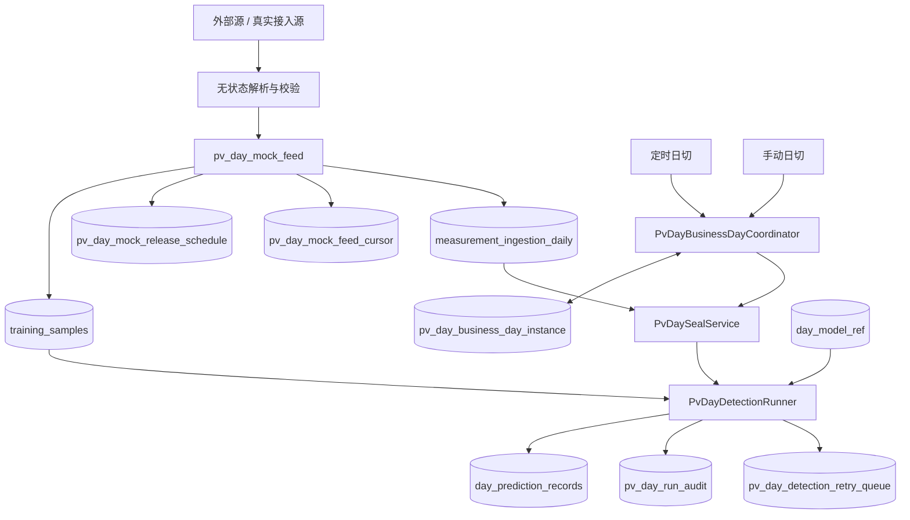

<!-- @AI_GENERATED -->
# PV Legacy 天路径业务日、设备就绪与日级检测设计

> 所属规格：`pv-fault-dual-path-serving` — 光伏故障诊断双路径生产接入
> 文档状态：Design Approved / 实施基线
> 设计日期：2026-08-20
> 影响范围：Legacy 天路径 Mock 喂数、业务日控制、设备到达、封账、日级检测、结果、审计、重试与到达看板
> 不包含：实时点路径的逐点回放、点水位、Causal TCN、实时点结果与告警；这些由 `docs/specs/pv-fault-realtime-point-path-redesign/design.md` 负责

---

## 0. 结论先行

本设计只负责 **Legacy 天路径 POC**，不再把实时点路径临时塞入同一业务日、封账或检测入口。

最终边界如下：

```text
允许有限共享的喂数上游
  外部源文件 / 真实设备接入源
  无状态解析、字段标准化、schema 校验
  数据库 session、批量插入、事务 helper
                    │
                    ▼
Legacy 天路径专属流水线
  pv_day_mock_feed
  → training_samples
  → measurement_ingestion_daily
  → pv_day_business_day_instance
  → 封账
  → pv_day_prediction
  → day_prediction_records
  → pv_day_run_audit
  → pv_day_detection_retry_queue
```

关键决策：

1. **只在喂数上游有限共享。** 两条 POC 可以读取同一个外部源，并复用无状态解析和底层数据库工具，但不能共享平台内测量目标表、任务、释放计划、游标或事务。
2. **天路径运行链路物理隔离。** `training_samples` — 天路径测量表、`measurement_ingestion_daily` — 天路径设备日到达表、业务日状态、模型指针、结果、审计和重试均只属于天路径。
3. **封账只判断天路径完整性。** 不读取实时点路径水位，不根据 `production_path` 在两种场景之间切换，也不使用点路径 173 槽门槛。
4. **检测只运行 Legacy 日级模型。** `pv_day_prediction` — 天路径日级检测任务输入已封账且 ready 的设备日，输出 `day_prediction_records`；不存在统一 Runner。
5. **一台设备缺失不阻塞其他设备。** 封账时逐设备标记 ready / partial / missing / dropped；检测只领取 ready 设备。
6. **业务日只管理天路径。** 实时点路径不读取或更新天路径 collecting / sealed / late_arrival 状态。
7. **自动和手动动作调用同一服务。** 通过 `generation` — 业务日乐观锁版本防止重复封账或日切。
8. **正式实施保持相对路径。** 数据和模型引用不得持久化开发机绝对路径。

---

## 1. 设计范围与隔离边界

### 1.1 天路径拥有的运行真相

| 实体 | 中文职责 | 隔离要求 |
|---|---|---|
| `training_samples` | 天路径测量事实 | 只由天 feeder 写，只被天路径读取 |
| `pv_day_mock_release_schedule` | 天路径 Mock 设备日释放计划 | 不与点回放计划共表 |
| `pv_day_mock_feed_cursor` | 天路径已完成释放日期游标 | 不推进点路径回放进度 |
| `measurement_ingestion_daily` | 天路径设备日到达与封账状态 | 不作为点路径 input watermark |
| `pv_day_business_day_instance` | 天路径业务日状态 | 点路径不读不写 |
| `day_model_ref` | 天路径生产模型引用 | 不与点模型共用生产指针 |
| `day_prediction_records` | 天路径设备日诊断结果 | 不写逐点结果或实时告警 |
| `pv_day_run_audit` | 天路径只追加运行审计 | 不混入点路径微批审计 |
| `pv_day_detection_retry_queue` | 天路径检测失败重试队列 | 不领取点路径失败项 |

以上实体可以位于同一数据库的不同表，但不能仅靠 `modeling_path` — 建模路径字段在同一运行表中做逻辑分区。

### 1.2 喂数有限共享的精确定义

允许共享：

- 外部 parquet、CSV 或真实设备接入源；
- 无状态源解析器；
- 字段名映射、类型转换、单位标准化和 schema 校验；
- 数据库连接、session、批量插入、事务和重试 helper；
- 站点、设备、支路主数据；
- 标签空间和故障类别字典。

禁止共享：

- feeder 任务和调度 ID；
- feeder repository 和目标测量表；
- 释放计划、source cursor 和业务状态；
- 一次跨路径事务；
- 封账、检测、模型指针、结果、告警、审计和失败队列。

公共 helper 必须是无状态的。调用天路径 repository 时，目标表固定为天路径表，不能通过 `feed_mode` — 喂数模式在运行时切换目标。

### 1.3 与实时点路径的关系

实时点路径使用独立的：

```text
pv_point_mock_feed
point_measurements
point_mock_release_schedule
point_mock_feed_cursor
point_replay_session
point_ingestion_watermarks
point_detection_watermarks
pv_realtime_point_prediction
point_prediction_events
point_alarm_states / point_alarm_events
point_run_audit
point_detection_retry_queue
```

天路径不得查询或更新上述实体。两条 POC 可以同时运行，也可以独立暂停、重置和回放。

---

## 2. 当前代码事实与目标映射

| 当前能力 | 当前符号或介质 | 目标处理 |
|---|---|---|
| Mock 整设备日释放 | `PvFaultMockFeeder.release_next_batch_tick()` | 保留行为，逐步收敛到 `PvDayMockFeeder` |
| 人工整日喂数 | `PvFaultMockFeeder.feed_manually()` | 改为“快速完成当前天路径业务日”，不隐式跨日 |
| 测量写入 | `training_samples` | 明确为天路径专属 |
| 到达统计 | `MeasurementIngestionDaily` | 明确为天路径专属并增加封账字段 |
| 释放计划 | `PvMockReleaseSchedule` | 迁移命名为 `pv_day_mock_release_schedule` |
| feed cursor | `pv_mock_feed_cursor` | 迁移命名为 `pv_day_mock_feed_cursor` |
| 检测任务 | `pv_prediction` | 迁移为 `pv_day_prediction`，只执行天路径 |
| 双路径分发 | `DualPathScheduler.dispatch()` | 不作为目标天路径入口；目标 Runner 不读取点路径选择 |

`DualPathScheduler.dispatch()` — 当前双路径分发函数，输入全局 `production_path`，每轮只运行一条路径。目标设计不继续扩展它来承担新实时点路径；迁移期可以保留旧入口兼容，但新任务必须直接调用各自场景 Runner。

---

## 3. 时间语义与处理粒度

| 字段或概念 | 中文含义 | 用途 |
|---|---|---|
| `event_time` | 测量事件时间 | 决定数据属于哪个天路径业务日 |
| `ingested_at` | 平台入库时间 | 到达延迟、迟到和审计 |
| `business_date` | 天路径业务日期 | 设备日、封账和结果分区键 |
| `scheduled_at` | 调度触发时间 | 区分 scheduled / manual |
| `executed_at` | 实际执行时间 | 运行性能和失败排查 |

处理粒度：

- 喂数计划：`Device_Day` — 设备日，即设备三元组加业务日期；
- 到达与封账：逐设备日；
- 业务日推进：逐业务日实例；
- 模型执行：可批量领取多个 ready 设备日，但结果和失败状态逐设备日落账。

批量执行只是效率优化，不形成“全站所有设备必须到齐”的 barrier。

---

## 4. 天路径目标架构



`PvDayBusinessDayCoordinator` — 天路径业务日协调器，输入 expected generation、触发来源和原因，输出封账/日切结果；由定时任务和人工 API 共同调用。

`PvDayDetectionRunner` — 天路径日级检测执行器，输入已封账业务日和可选设备范围，读取天路径测量与 `day_model_ref`，输出逐设备日结果、审计和失败重试项。

---

## 5. 业务日实例

### 5.1 `pv_day_business_day_instance` — 天路径业务日实例

存什么：当前天路径正在接收哪个业务日、该日是否封账、设备状态汇总、封账采用的模型和门禁版本，以及日切乐观锁。

为什么单独存：不能从最大测量日期、feed cursor 或预测结果反推当前业务日；自动和手动日切需要同一个持久化真相。

分区维度：`slot` — 产品槽位、`source_kind` — 数据源类型、`business_date` — 业务日期。默认 `slot=pv_fault_day`。

介质：由部署配置决定，推荐数据库表；文件测试替身只能保存项目相对路径。

| 字段 | 中文说明 |
|---|---|
| `day_instance_id` | 业务日实例唯一标识 |
| `slot` | 天路径产品槽位，默认 `pv_fault_day` |
| `source_kind` | 数据源类型：mock / production |
| `business_date` | 业务日期 |
| `status` | planned / collecting / ready_to_seal / sealed / late_arrival |
| `window_start` | 业务日事件时间起点 |
| `window_end` | 业务日事件时间终点，使用半开区间 |
| `opened_at` | 开始接收时间 |
| `ready_to_seal_at` | 首次满足可封账条件时间 |
| `sealed_at` | 实际封账时间 |
| `watermark_at` | 封账采用的数据截止时间 |
| `day_model_ref_at_seal` | 封账时天路径模型引用快照 |
| `day_gate_profile_version` | 天路径完整性门禁版本 |
| `expected_device_count` | 预期设备数 |
| `ready_device_count` | ready 设备数 |
| `partial_device_count` | partial 设备数 |
| `missing_device_count` | missing 设备数 |
| `dropped_device_count` | dropped 设备数 |
| `generation` | 乐观锁版本 |
| `advanced_by` | scheduled / manual / migration |
| `advance_reason` | 人类可读原因 |
| `source_digest` | 外部源稳定摘要 |
| `created_at` | 创建时间 |
| `updated_at` | 更新时间 |

状态机：

```text
planned → collecting → ready_to_seal → sealed
              └──────────────────────→ sealed
sealed → late_arrival
```

`collecting` 只表示仍允许天 feeder 写入，不表示点路径状态。

---

## 6. Mock 整设备日喂数

### 6.1 自动任务

```text
task_id = pv_day_mock_feed
cron = */12 * * * *
handler = PvDayMockFeeder.release_next_batch_tick()
```

每次 tick：

1. 读取唯一 collecting 的天路径业务日；
2. 没有 active day 时返回 `waiting_for_active_day`；
3. 只释放该日下一批设备日；
4. 写入 `training_samples`；
5. 更新 `measurement_ingestion_daily`；
6. 更新天路径释放计划和 cursor；
7. 非 dropped 设备全部释放后标记 ready_to_seal；
8. 不自行激活下一日，不触发点路径，不触发检测。

### 6.2 人工动作

| 动作 | 业务语义 | 明确不做什么 |
|---|---|---|
| 释放下一批 | 模拟一次天 feeder tick | 不封账、不检测、不跨日 |
| 快速完成当前日 | 放完当前日剩余非 dropped 设备 | 不封账、不检测、不跨日 |
| 封账当前日 | 固化设备日状态 | 不运行模型、不激活下一日 |
| 检测已封账日 | 运行 ready 设备日 | 不改变业务日、不触发点路径 |
| 推进下一业务日 | 封账当前日并激活下一源日期 | 不立即写入下一日全部数据 |

### 6.3 feed complete 不是全站检测 barrier

feed complete 只表示所有非 dropped 设备均已执行释放计划。封账后每台设备独立定性，partial / missing / dropped 不阻塞 ready 设备进入检测。

---

## 7. 天路径到达与封账

### 7.1 `measurement_ingestion_daily` — 天路径设备日到达表

新增或明确字段：

| 字段 | 中文说明 |
|---|---|
| `site_id` | 站点标识 |
| `device_id` | 设备标识 |
| `branch_id` | 支路标识 |
| `business_date` | 天路径业务日期 |
| `point_count` | 已到达测量点数 |
| `expected_point_count` | 预期测量点数 |
| `is_complete` | 是否满足基础完整性 |
| `first_seen_at` | 首点入库时间 |
| `last_seen_at` | 最后一点入库时间 |
| `seal_status` | NULL / ready / partial / missing / dropped |
| `sealed_at` | 设备日封账时间 |
| `gate_profile_version` | 封账门禁版本 |
| `input_fingerprint` | 封账输入指纹 |
| `updated_at` | 更新时间 |

该表不保存实时点路径 `input_watermark`，也不被点微批读取。

### 7.2 封账规则

封账服务只读取版本化的天路径完整性配置，例如：

```text
minimum_point_count = 260
minimum_coverage_ratio = 0.90
```

实际阈值由 `day_gate_profile_version` 指向的配置决定；配置缺失时 fail closed，不能回退到点路径门槛。

逐设备定性：

```text
is_dropped                           → dropped
point_count >= minimum_point_count   → ready
0 < point_count < minimum_point_count→ partial
point_count = 0                      → missing
```

封账不读取全局 `production_path`，也不判断 Seq/TCN 是否可运行。

### 7.3 迟到

- collecting 期间正常累加；
- sealed 后新数据将业务日标记为 late_arrival；
- 不静默覆盖既有结果；
- 人工确认后可 force reseal，并创建新检测 revision；
- 点路径的迟到修订不影响天路径业务日。

---

## 8. 天路径日级检测

### 8.1 独立任务

```text
task_id = pv_day_prediction
cron = 0 18 * * *
timezone = UTC
```

对应 Asia/Shanghai 次日 02:00。scheduler 统一使用 UTC 配置，页面展示时转换为业务时区。

### 8.2 执行流程

```text
1. 查询待检测且已 sealed 的天路径业务日
2. 领取 seal_status=ready 的设备日
3. 加载 day_model_ref
4. 从 training_samples 构建全天统计特征
5. 批量推理，但逐设备日落账
6. 写 day_prediction_records
7. 成功后标记该设备日完成
8. 失败时写 pv_day_detection_retry_queue，不推进完成状态
9. 写 pv_day_run_audit
```

### 8.3 `day_model_ref` — 天路径模型登记

存什么：当前天路径生产模型工件 ID、模型类型、版本、相对工件引用和启用时间。

为什么单独存：天路径模型生命周期和实时点模型不同，不能由一个 `production_path` 在两种场景间互斥选择。

分区维度：`slot` — 模型槽位，默认 `pv_fault_day`；可按站点或设备族扩展子槽位。

介质：由部署配置决定，可使用数据库 registry 或相对配置目录中的登记文件；模型引用必须是相对路径或工件 ID。

### 8.4 `day_prediction_records` — 天路径结果表

| 字段 | 中文说明 |
|---|---|
| `prediction_id` | 结果唯一标识 |
| `site_id` | 站点标识 |
| `device_id` | 设备标识 |
| `branch_id` | 支路标识 |
| `business_date` | 诊断业务日 |
| `predicted_label` | 天级预测标签 |
| `confidence` | 预测置信度 |
| `model_version_id` | 天路径模型版本 |
| `input_fingerprint` | 输入指纹 |
| `revision` | 迟到或人工重跑修订号 |
| `run_id` | 所属运行 ID |
| `created_at` | 创建时间 |

自然幂等范围为模型版本、设备三元组、业务日期和输入指纹；相同输入不重复写，输入变化创建新 revision。

---

## 9. 重试与审计

### 9.1 `pv_day_detection_retry_queue` — 天路径重试队列

| 字段 | 中文说明 |
|---|---|
| `retry_id` | 重试项唯一标识 |
| `business_date` | 失败业务日 |
| `site_id` | 站点标识 |
| `device_id` | 设备标识 |
| `branch_id` | 支路标识 |
| `run_id` | 首次失败运行 ID |
| `attempt_count` | 已尝试次数 |
| `max_attempts` | 最大尝试次数 |
| `next_attempt_at` | 下次允许重试时间 |
| `status` | queued / claimed / succeeded / dead_letter / cancelled |
| `claim_owner` | 当前领取 worker |
| `claim_expires_at` | 领取租约到期时间 |
| `last_error_code` | 最近错误码 |
| `last_error_message` | 最近错误摘要 |
| `created_at` | 创建时间 |
| `updated_at` | 更新时间 |

采用有限次数指数退避。达到最大次数进入 dead_letter，不阻塞其他设备，也不推进该设备日完成状态。

### 9.2 `pv_day_run_audit` — 天路径只追加审计

存什么：feed、seal、detect、retry、advance 的运行范围、触发来源、模型版本、设备汇总、输入水位、结果和错误。

为什么单独存：为天路径重放和事故排查提供不可变证据，不与业务结果表或点路径审计混淆。

分区维度：按 `business_date` 和 `run_id` 查询；可按部署配置进行物理分区。

介质：推荐数据库 append-only 表；应用层不提供更新或删除接口。

关键字段：

| 字段 | 中文说明 |
|---|---|
| `audit_id` | 审计记录唯一标识 |
| `run_id` | 运行 ID |
| `action` | feed / seal / detect / retry / advance |
| `business_date` | 业务日期 |
| `trigger_type` | scheduled / manual / migration |
| `day_model_version_id` | 天路径模型版本 |
| `device_summary` | ready / partial / missing / dropped / failed 汇总 |
| `result` | succeeded / partial / failed / skipped |
| `operator` | 操作者或服务身份 |
| `reason` | 人类可读原因 |
| `created_at` | 只追加时间戳 |

---

## 10. cron 与时序

统一采用 UTC scheduler 配置：

| `task_id` — 任务 ID | cron | Asia/Shanghai 时间 | 职责 |
|---|---|---|---|
| `pv_day_mock_feed` | `*/12 * * * *` | 每 12 分钟 | 释放当前天路径业务日下一批设备日 |
| `pv_day_business_day_seal` | `50 17 * * *` | 次日 01:50 | 封账当前天路径业务日 |
| `pv_day_prediction` | `0 18 * * *` | 次日 02:00 | 检测已封账且 ready 的设备日 |
| `pv_day_business_day_rollover` | `5 18 * * *` | 次日 02:05 | 激活下一源业务日 |
| `pv_day_detection_retry` | `*/5 * * * *` | 每 5 分钟 | 领取到期重试项 |

时序固定为封账 → 检测 → 日切，不保留“可合并或分开”的双重口径。

---

## 11. REST API

所有接口只操作天路径，不接受 `modeling_path` 或 `feed_mode` 来切换场景。

### 11.1 查询业务日状态

```http
GET /api/pv-fault/day/business-days/status
```

用途：天路径到达看板和运维 CLI 查询当前 collecting 日、最近 sealed 日和下一调度时间。只读，无副作用。

返回关键字段：

| 字段 | 中文说明 |
|---|---|
| `active_day` | 当前 collecting 的天路径业务日实例 |
| `last_sealed_day` | 最近封账业务日 |
| `day_model_ref` | 当前天路径模型登记摘要 |
| `day_gate_profile_version` | 天路径完整性门禁版本 |
| `next_seal_at` | 下一封账时间 |
| `next_detection_at` | 下一检测时间 |
| `release_progress` | 当前日释放进度 |
| `generation` | 当前乐观锁版本 |

### 11.2 查询设备到达明细

```http
GET /api/pv-fault/day/ingestion/devices?site_id={site_id}&business_date={business_date}
```

查询参数：

| 参数 | 中文说明 |
|---|---|
| `site_id` | 必填，站点标识 |
| `business_date` | 必填，天路径业务日期 |

返回每台设备的 `device_id` — 设备标识、`branch_id` — 支路标识、`point_count` — 到达点数、`expected_point_count` — 预期点数、`seal_status` — 封账状态、`last_seen_at` — 最后到达时间。

### 11.3 释放下一批

```http
POST /api/pv-fault/day/business-days/current/release-next-batch
```

请求体：

| 字段 | 中文说明 |
|---|---|
| `expected_generation` | 必填，调用方看到的业务日版本 |
| `reason` | 必填，人工操作原因 |

副作用：只运行一次天 feeder tick。

### 11.4 快速完成当前日

```http
POST /api/pv-fault/day/business-days/current/complete-release
```

请求体同上。副作用：释放当前日剩余非 dropped 设备，不封账、不检测、不跨日。

### 11.5 手动封账

```http
POST /api/pv-fault/day/business-days/seal
```

| 字段 | 中文说明 |
|---|---|
| `expected_generation` | 必填，业务日版本 |
| `reason` | 必填，封账原因 |
| `force` | 可选，是否基于当前输入创建新封账 revision，默认 false |

### 11.6 手动检测

```http
POST /api/pv-fault/day/runs
```

| 字段 | 中文说明 |
|---|---|
| `business_date` | 必填，已封账业务日期 |
| `device_ids` | 可选，限制设备范围 |
| `reason` | 必填，运行原因 |
| `force_rescore` | 可选，是否允许相同范围重新评分，默认 false |

副作用：只运行天路径，不触发点微批或日切。

### 11.7 推进下一业务日

```http
POST /api/pv-fault/day/business-days/advance
```

| 字段 | 中文说明 |
|---|---|
| `expected_generation` | 必填，业务日版本 |
| `trigger_type` | 必填，manual / scheduled |
| `reason` | 必填，推进原因 |
| `force` | 可选，是否允许处理异常状态，默认 false |

语义：幂等封账当前日并激活外部源中的下一业务日期，不机械执行日期加一天，也不立即写入新日全部数据。

### 11.8 查询与操作重试项

```http
GET  /api/pv-fault/day/retries?status={status}&business_date={business_date}
POST /api/pv-fault/day/retries/{retry_id}/retry
POST /api/pv-fault/day/retries/{retry_id}/cancel
```

- `status` — 重试状态，可选；
- `business_date` — 业务日期，可选；
- `retry_id` — 路径参数，重试项唯一标识；
- retry 接口重新入队单个失败设备日；
- cancel 接口取消尚未成功的重试项；
- 两个写接口均要求权限和 `reason` — 操作原因，并写只追加审计。

### 11.9 查询审计

```http
GET /api/pv-fault/day/audit?run_id={run_id}&business_date={business_date}
```

`run_id` — 运行 ID和 `business_date` — 业务日期均为可选过滤条件。只读，无副作用。

---

## 12. 前端天路径看板

页面只展示天路径业务日：

- collecting 期间每 30 秒刷新设备日到达；
- sealed 后显示只读封账快照；
- 显示 ready / partial / missing / dropped 设备数；
- 显示天模型版本和门禁配置版本；
- 显示 feed、封账、检测、日切和重试状态；
- 不显示点路径水位，不允许切换到实时点模式；
- 实时点结果在独立页面展示，聚合页面只能只读并排呈现。

状态必须覆盖：加载、空态、错误、权限不足、操作禁用、generation conflict 和源耗尽。

---

## 13. 字段全链路

### 13.1 `point_count` — 天路径设备日到达点数

```text
pv_day_mock_feed
→ 写 training_samples
→ 更新 measurement_ingestion_daily.point_count
→ 天路径看板展示
→ PvDaySealService 与天门禁比较
→ 写 seal_status
→ PvDayDetectionRunner 只领取 ready 设备日
```

### 13.2 `generation` — 业务日乐观锁版本

```text
GET business-days/status 返回 generation
→ UI 在 seal / advance 请求中传 expected_generation
→ Coordinator 执行 compare-and-swap
→ 成功后 generation + 1
→ 旧请求返回 generation_conflict，不自动重放
```

### 13.3 `seal_status` — 天路径封账定性

```text
PvDaySealService 读取天路径设备日到达
→ 使用 day_gate_profile_version
→ 写 ready / partial / missing / dropped
→ PvDayDetectionRunner 只读 ready
→ 天路径看板和审计展示
```

### 13.4 `day_model_ref` — 天路径模型引用

```text
天路径模型登记
→ 封账时记录 day_model_ref_at_seal
→ 日级 Runner 加载相同模型版本
→ 结果写 model_version_id
→ 审计记录模型版本
```

缺省回退：

- 未提供 expected_generation：拒绝写操作；
- 门禁配置缺失：封账失败，不使用点路径阈值；
- 天模型引用缺失：检测失败并记录审计，不回退到点模型；
- 某设备失败：写入天路径重试队列，不阻塞其他设备。

---

## 14. 幂等、并发与恢复

- 封账以业务日、generation 和输入指纹防重；
- 日级结果以模型版本、设备三元组、业务日期和输入指纹防重；
- 同一重试项通过 claim owner 和租约避免多 worker 重复消费；
- 结果提交和设备日成功状态在同一事务内；
- 检测失败不推进成功状态；
- 服务重启从 `pv_day_business_day_instance`、释放计划、cursor 和 retry queue 恢复，不从最大数据日期猜状态；
- 天路径恢复流程不查询或修复点路径状态。

---

## 15. 迁移与兼容

现有运行数据不删除、不重置：

1. 将旧 `pv_mock_data_feed` 注册迁移为 `pv_day_mock_feed`，迁移期保留旧 ID 到新 handler 的显式兼容映射；
2. 将旧释放计划和 cursor 解释为天路径历史状态，后续新写只进入带 day 前缀实体；
3. `training_samples` 和 `measurement_ingestion_daily` 保留并声明为天路径专属；
4. 新增业务日实例时，根据既有 feed 状态生成迁移快照，不反向修改历史测量；
5. 旧 `pv_prediction` 手动入口仅可映射到天路径检测，不再按 `production_path` 分发新点路径；
6. 历史结果迁移到 `day_prediction_records` 时保留原主键、模型版本和审计引用；
7. 所有模型和数据引用持久化为项目或后端目录相对路径。

---

## 16. 分阶段实施

### P0：停止跨场景分发，建立天路径命名边界

1. 新增 `pv_day_mock_feed` 和 `pv_day_prediction` 任务 ID；
2. 为旧任务保留可观察的兼容映射；
3. 新天路径入口不读取 `production_path`；
4. 单元验证两条 POC 的任务、目标表和 cursor 不交叉。

### P1：业务日与封账

1. 新增 `pv_day_business_day_instance`；
2. 增加 `seal_status`、`sealed_at`、门禁版本和输入指纹；
3. 实现 Coordinator、generation CAS 和封账服务；
4. Mock 完成当前日后停在 ready_to_seal，不隐式跨日。

### P2：日级检测、结果、审计与重试

1. 实现 `PvDayDetectionRunner`；
2. 接入独立 `day_model_ref`；
3. 写入 `day_prediction_records`；
4. 落地只追加审计和独立重试队列；
5. 验证单设备失败不阻塞批次其余设备。

### P3：API 与前端

1. 接入 day 命名空间 API；
2. 拆分释放、封账、检测和日切操作；
3. 展示业务日、设备状态、失败和重试；
4. 补齐加载、空态、错误、禁用和冲突状态。

### P4：迟到与历史补跑

1. sealed 后迟到标记；
2. force reseal 和结果 revision；
3. 独立日期范围 backfill；
4. backfill 不改变在线 active day 或点路径进度。

---

## 17. 验收标准

### 17.1 喂数隔离

1. 天 feeder 可以复用公共解析 helper，但只能写天路径目标表。
2. 天 feeder 不读取或推进点路径 release schedule、cursor 或 session。
3. 天路径重置不会删除或回滚点路径测量与水位。
4. 两条 POC 可以从同一外部源独立回放。

### 17.2 业务日与封账

1. planned → collecting → ready_to_seal → sealed 可持久化恢复。
2. 封账只使用天路径门禁配置。
3. partial / missing / dropped 不阻塞 ready 设备。
4. 自动和手动并发最多成功推进一次 generation。
5. 点路径运行不改变天路径业务日状态。

### 17.3 日级检测

1. `pv_day_prediction` 只加载 `day_model_ref`。
2. 只处理已封账且 ready 的设备日。
3. 结果只写 `day_prediction_records`。
4. 失败设备写独立重试队列且不推进成功状态。
5. 相同输入重复运行保持幂等。
6. 不存在由统一 Runner 切换到实时点路径的分支。

### 17.4 API、审计与前端

1. API 全部位于 day 命名空间。
2. 写接口要求 generation 或明确幂等键、权限和 reason。
3. 审计只追加且可按 run_id / business_date 查询。
4. 看板覆盖加载、空态、错误、禁用、冲突和源耗尽。
5. 页面不把点水位或点告警解释为天路径状态。

### 17.5 路径规范

1. 持久化结果不包含开发机绝对路径。
2. 模型工件和测试数据使用相对引用。
3. 新 import、任务 ID 和 API 路由均有真实注册入口。

---

## 18. 测试策略

文档实施时至少验证：

- 公共 parser 被两条 feeder 复用，但 repository 和目标表固定；
- 天 feeder 无 active day 时安全跳过；
- 设备错峰释放、快速完成、封账、检测和日切按固定时序执行；
- 封账配置缺失时 fail closed；
- generation 并发冲突；
- ready / partial / missing / dropped 计数守恒；
- 单设备检测失败不阻塞其他设备；
- 重试 claim、退避、dead-letter 和人工 retry/cancel；
- 服务重启恢复业务日、cursor 和重试队列；
- 迟到输入创建 revision 而不覆盖历史；
- 天路径任务不读写 point 表和点水位；
- 所有持久化路径保持相对路径。

---

## 19. 最终决策摘要

```text
共享范围：外部源、无状态解析/校验、数据库底层 helper、设备主数据、标签字典
天 feeder：pv_day_mock_feed
天测量表：training_samples
天到达表：measurement_ingestion_daily
天业务日：pv_day_business_day_instance
封账门禁：版本化天路径配置；缺失时 fail closed
天模型：day_model_ref
天检测：pv_day_prediction / PvDayDetectionRunner
天结果：day_prediction_records
天审计：pv_day_run_audit，只追加
天重试：pv_day_detection_retry_queue
实时点路径：完全独立，不读写上述运行状态
禁止：feed_mode、单一 production_path、统一 Runner 跨场景切换
```

本设计把“喂数代码可以复用”与“两个 POC 共用运行状态”明确区分：前者允许，后者禁止。
<!-- @AI_GENERATED: end -->