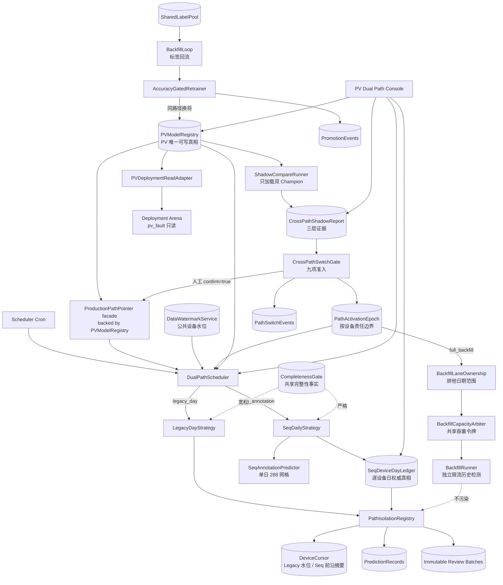
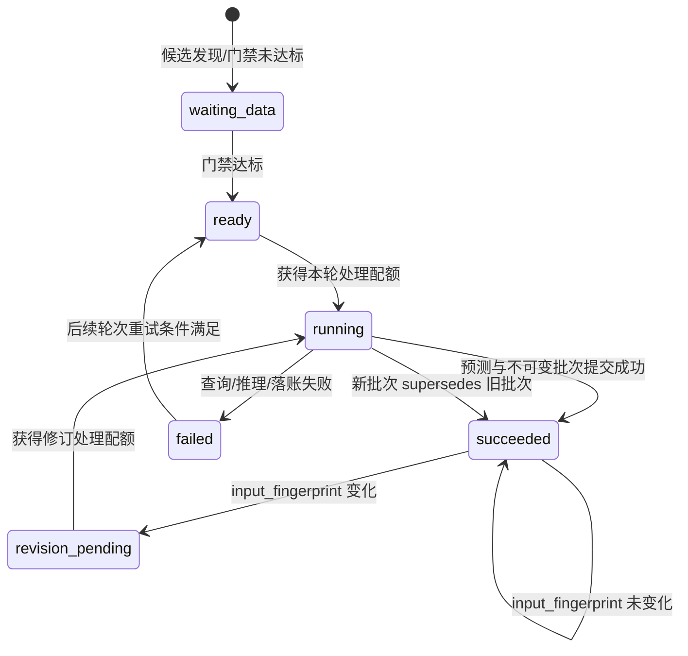
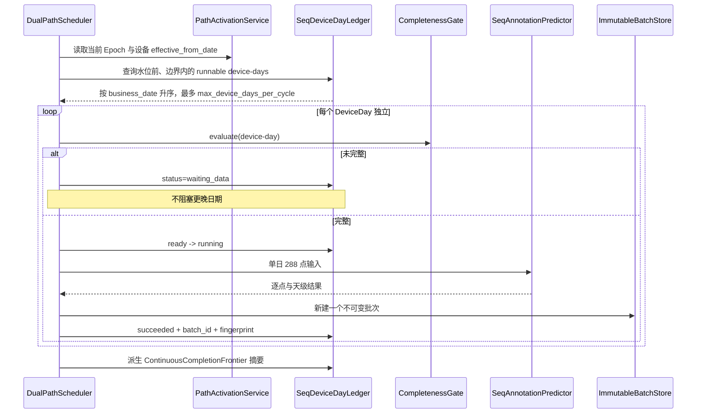
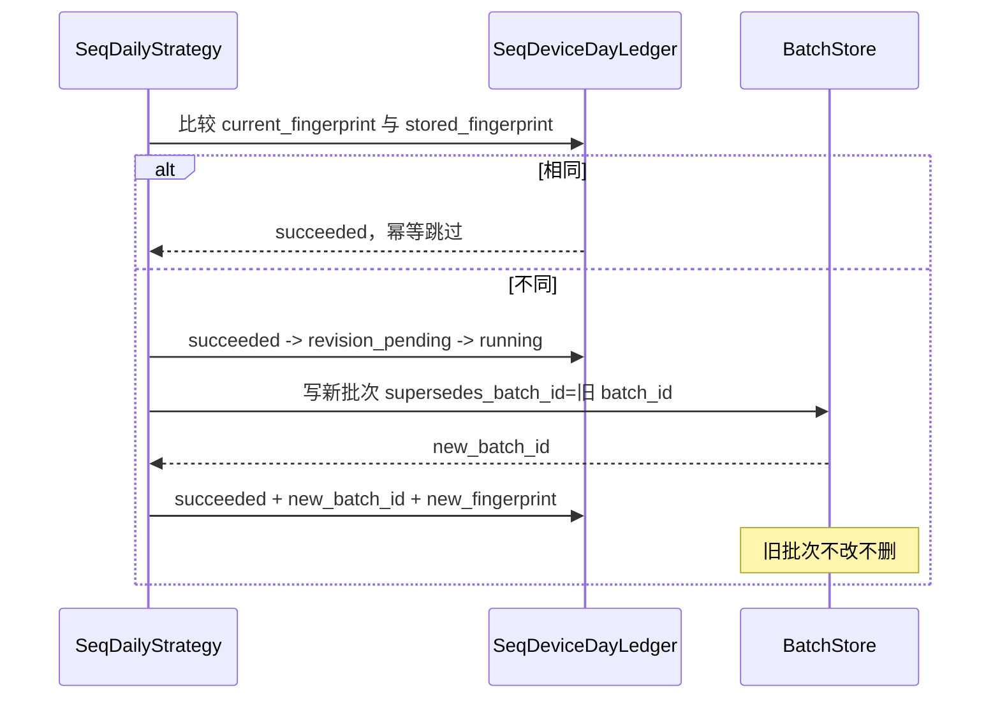
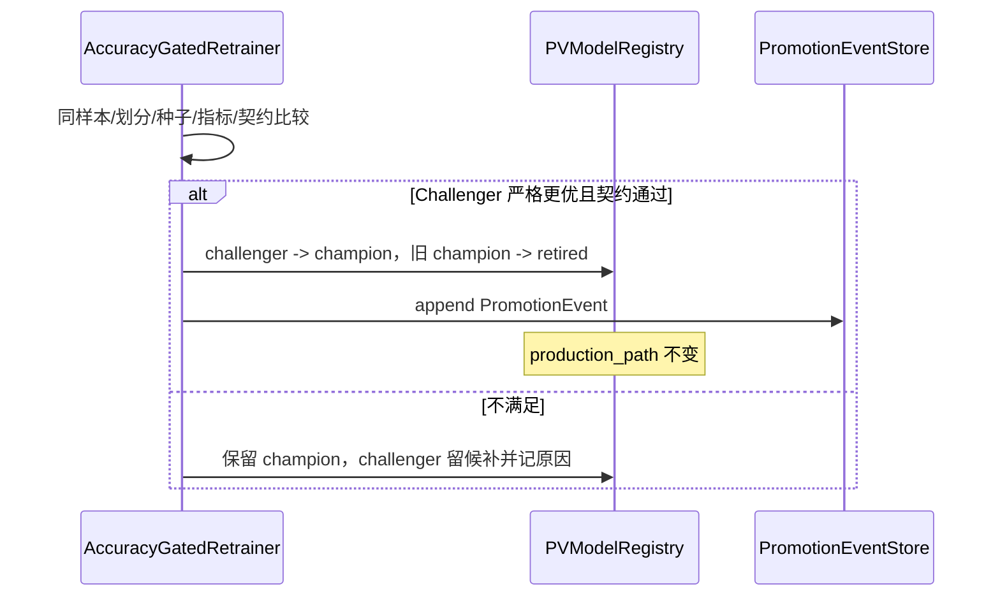
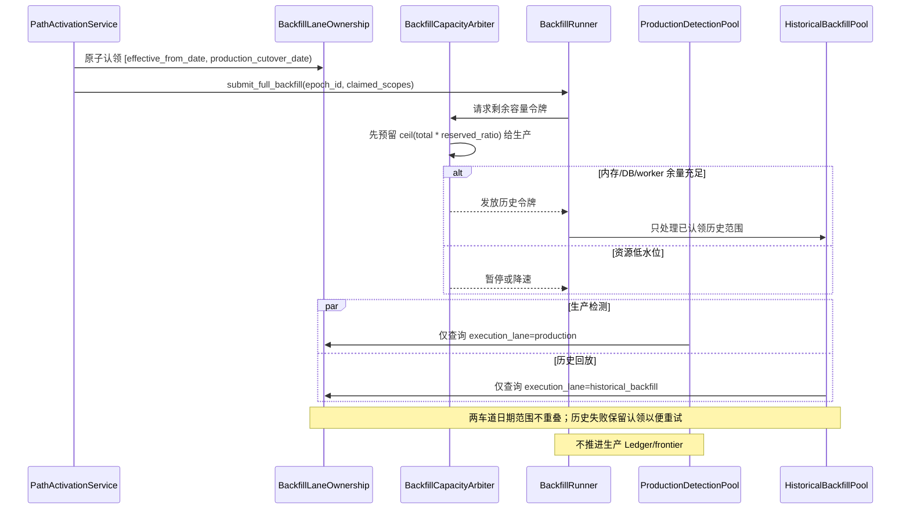

<!-- @AI_GENERATED -->
# Design Document

光伏故障诊断双路径生产接入（pv-fault-dual-path-serving）

## Overview

本设计把光伏故障诊断已训练完成的两条检测路径接入生产：`legacy_day` — 传统按天路径（RandomForest，天级输出，可消费当天已到达增量）与 `seq_annotation` — 全天序列路径（BiLSTM + Attention，288 点逐点输出，只消费近完整历史整天）。本 spec 只消费 `pv-fault-timeseries-diagnosis` 产出的模型工件，不重复设计训练集构建、模型结构或超参数。

本轮设计同步 requirements.md 的 Req13–15 与 R1–R5，形成五个不可混淆的真相层：

1. **公共到达真相**：`Data_Watermark` — 数据到达水位与 `measurement_ingestion_daily` — 设备日完整性表由两条路径只读共享，不按路径复制，也不使用墙钟推进。
2. **检测处理真相**：Legacy 继续使用按路径隔离的 `Device_Cursor` — 设备预测游标；Seq 改用 `Seq_Device_Day_Ledger` — 序列设备日记账作为是否处理过某个独立自然日的唯一权威真相。Seq 的 Device_Cursor 仅保存 `Continuous_Completion_Frontier` — 连续完成前沿摘要。
3. **生产责任真相**：每次跨路径启用或重新启用都建立 `Path_Activation_Epoch` — 路径启用周期；`effective_from_date` — 生产责任起始日决定本周期从哪里开始，不复制另一条路径游标，也不默认从最早历史重跑。
4. **模型身份真相**：`PV_Model_Registry` — 光伏模型登记是 `pv_fault` 槽位唯一可写真相；每条路径分别维护 `champion` — 当前冠军、`challengers` — 候补模型列表、`retired` — 可回滚历史冠军列表。`Production_Path_Pointer` — 生产路径指针不是第二份存储，只是读写 PVModelRegistry 内 `production_path` 字段的门面。
5. **治理审计真相**：`Promotion_Event` — 路径内晋升事件与 `Path_Switch_Event` — 跨路径切换事件分开、只追加。路径内换将不改变 `production_path` — 当前生产路径；跨路径换班组必须引用合格 Shadow 报告、通过九项准入并由人工确认。

### 关键设计结论

- 两条路径共用 Data_Watermark，但有意保留不同窗口粒度：Legacy 可处理水位当天增量；Seq 只处理水位自然日之前、通过完整性门禁的整天。
- Seq 不再使用“首个未完整日阻塞后续日期”。每个 `Device_Day` — 设备日独立记账、独立建 288 点网格、独立预测、独立写批次；较早日期 `waiting_data` — 等待数据或 `failed` — 失败，不阻塞更晚完整日期。
- 切换路径不等于全量回放。默认 `activation_mode=cutover_only` — 仅从最近已结束设备日开始；`recent_window` — 有限回看；`full_backfill` — 全量历史仅人工显式选择，并由独立 `Backfill_Runner` — 历史回放执行器限流。
- `Backfill_Runner` 与 Req12 的 `BackfillLoop` — 人工审核标签回流器职责不同：前者回放历史检测，后者把审核标签回流到共享标签池并维护重训消费水位。
- Shadow 只产证据，绝不自动切换。跨路径证据包括共同天级口径、Seq 原生增益、生产运行指标三层；只比较两条路径各自当前 Champion。

### 调研依据

设计沿用 requirements.md 已记录的研究结论：Champion–Challenger/Shadow 要隔离生产副作用；事件时间和水位适合处理历史回放与晚到数据；流批分工允许不同路径服务不同时间粒度。来源见 [MetricGate Champion-Challenger](https://metricgate.com/blogs/champion-challenger-model-testing/)、[Apache Flink Event Time](https://nightlies.apache.org/flink/flink-docs-stable/docs/concepts/time/) 与 [RisingWave 流批对账](https://risingwave.com/blog/risingwave-streaming-batch-reconciliation/)。内容已作合规改写。

## 需求到组件映射（Requirement → Component）

| 需求 | 主要承载组件 | 设计落点 |
|---|---|---|
| Req1 双路径分派 | `DualPathScheduler`、`DetectionStrategy` | 每轮读取生产路径，互斥分派并输出可审计 `CycleResult` |
| Req2 Legacy 事件时间语义 | `LegacyDayStrategy`、`DataWatermarkService` | `(cursor, watermark]` 增量、按自然日分组、游标单调 |
| Req3 Seq 整天语义 | `SeqDailyStrategy`、`SeqAnnotationPredictor` | 水位前整天、288 网格、跨日拒绝、逐日独立 |
| Req4 完整性闸门 | `CompletenessGate`、`DualPathConfig` | Seq 严格，Legacy 宽松，共享完整性事实 |
| Req5 路径隔离 | `PathIsolationRegistry` | 游标、记录、批次按 `slot + modeling_path` 分区 |
| Req6 自由切换 | `ProductionPathPointer`、`PathActivationService` | 九项准入、人工确认、成功后原子建立 Epoch |
| Req7 并排对比 | `ShadowCompareRunner` | 双 Champion、只读、三层证据报告 |
| Req8 Mock 到达 | `PvFaultMockFeeder` | 设备级错峰与业务日确定性种子 |
| Req9 前端同步 | `PvDualPathConsole` | 路径状态、逐日账本、模型治理、Shadow、切换确认 |
| Req10 非功能 | 全组件 | 相对路径、原子写、严格布尔、脏工作区保护 |
| Req11 精度守门重训 | `AccuracyGatedRetrainer` | 同路径 Champion/Challenger 严格更优才晋升 |
| Req12 标签回流 | `BackfillLoop`、`SharedLabelPool` | 单一标签真相、按路径粒度投影和重训水位 |
| Req13 序列设备日记账 | `SeqDeviceDayLedgerRepository` | 六元组键、状态机、指纹修订、单轮上限 |
| Req14 路径启用周期 | `PathActivationService`、`BackfillRunner` | 按设备生效边界、三种启用模式、生产容量预留 |
| Req15 双层模型治理 | `PVModelRegistry`、`PVDeploymentReadAdapter`、两类事件仓储 | 路径内换将与跨路径换班组分层，PV 单一可写真相 |

## Architecture



### 写边界

- `PVModelRegistry` 是 `pv_fault` 的唯一写入口。`DeploymentSlotStore` — 通用部署槽位存储与 `SwitchEngine` — 通用切换引擎收到 `slot=pv_fault` 的写请求时必须拒绝，并提示改用 PV 模型登记接口；非 `pv_fault` 槽位保持现有行为。
- Shadow、Deployment Arena 适配器、前端展示接口均只读 PVModelRegistry。
- BackfillRunner 的历史回放结果使用独立命名空间，不推进生产 Seq Ledger、生产 Continuous Completion Frontier，也不计入本次 Epoch 生产责任统计。

## Components and Interfaces

### 1. 调度与公共契约

`DualPathScheduler.dispatch(slot)` — 双路径调度入口，输入 `slot` — 槽位；在 5 秒内读取 ProductionPathPointer，验证路径和当前 Champion 后构造上下文并恰好调用一个策略。失败返回跳过状态，不猜默认路径。

上下文字段先行说明：`modeling_path` — 本轮检测路径；`champion_model_ref` — 本轮路径当前冠军模型引用；`activation_epoch_id` — 本轮适用的启用周期标识；`started_at` — 本轮墙钟启动时刻（只供审计，不参与检测窗口）。结果字段：`strategy_name` — 实际策略名称；`window_start` / `window_end` — Event_Time 窗口起止；`points_detected` — 已检测点数；`points_deferred` — 顺延点数；`device_days_processed` — 独立完成设备日数；`batch_ids` — 新建批次 ID 列表；`status` — success/skipped/failed 状态；`reason` — 跳过或失败原因。

```python
@dataclass(frozen=True)
class CycleContext:
    slot: str
    modeling_path: Literal["legacy_day", "seq_annotation"]
    champion_model_ref: str
    activation_epoch_id: str
    started_at: datetime

@dataclass(frozen=True)
class CycleResult:
    modeling_path: str
    strategy_name: str
    window_start: str | None
    window_end: str | None
    points_detected: int
    points_deferred: int
    device_days_processed: int
    batch_ids: list[str]
    status: Literal["success", "skipped", "failed"]
    reason: str | None
```

### 2. DataWatermarkService 与两条策略

`DataWatermarkService.device_watermark(device_key)` — 输入设备三元组，返回已入库且 Event_Time 可解析的数据点最大业务时间。该值是公共到达事实，不含 `modeling_path`。

**LegacyDayStrategy**：

- 从本路径 Device_Cursor 读取水位，查询 `(cursor, data_watermark]`；只纳入本轮启动前已可读的数据点。
- 按 Event_Time 自然日拆分后检测，不把相邻日期拼成一个样本。
- 记录和批次提交成功后，游标推进到本轮实际完成检测点的最大 Event_Time；无新点、坏时间点或写失败均不推进。
- 不把 CompletenessGate 作为放行前置条件。

**SeqDailyStrategy**：

- 候选必须满足 `business_date < watermark_date` 且 `business_date >= effective_from_date`；每个 Device_Day 独立过门禁。
- 候选发现与“是否处理过”只查询 SeqDeviceDayLedger。Device_Cursor 中的 Continuous Completion Frontier 只能缩小查询范围，不能排除 Ledger 仍需处理的设备日。
- 每个设备日独立拉整日、建 288 点网格、调用一次 predictor、写一个不可变审核批次。单轮多个日期绝不合并输入。
- 单轮按 `business_date` — 业务日期升序选取前 `max_device_days_per_cycle` — 单轮设备日上限（默认 50，合法范围 1–1000）；配置解析器收到范围外整数时拒绝该配置、记录 `invalid_max_device_days_per_cycle` — 单轮上限非法错误，并把本轮有效值回退为 50。剩余 `ready` — 就绪记录顺延，并在 CycleResult 记录“分批消化积压”。

两条生产策略在日期/点候选查询时都必须联查 `PathActivationLaneClaim` — 启用周期车道范围认领；凡业务时间落入 `lane=historical_backfill` 的半开区间均由生产查询排除。Legacy 不得仅凭 Cursor 重取该历史范围，Seq 不得仅凭 `business_date >= effective_from_date` 重取该历史范围。

### 3. SeqDeviceDayLedgerRepository（Req13）

```python
class SeqDeviceDayLedgerRepository:
    def upsert_candidate(self, key: DeviceDayKey, fingerprint: str) -> LedgerRecord: ...
    def list_runnable(self, slot: str, limit: int) -> list[LedgerRecord]: ...
    def mark_running(self, key: DeviceDayKey) -> LedgerRecord: ...
    def mark_succeeded(self, key: DeviceDayKey, batch_id: str, fingerprint: str) -> LedgerRecord: ...
    def mark_failed(self, key: DeviceDayKey, error: str) -> LedgerRecord: ...
    def compute_frontier(self, device_key: DeviceKey, epoch_id: str) -> date | None: ...
```

`DeviceDayKey` — 设备日键由 `slot` — 槽位、`modeling_path` — 路径、`site_id` — 站点、`device_id` — 设备、`branch_id` — 支路、`business_date` — 业务日六项组成。

**状态机：**



- `input_fingerprint` — 输入数据指纹：把该设备日所有 `(event_time, value)` 按时间和稳定次序规范化后计算 SHA-256；相同集合得到相同摘要。
- 成功记录指纹不变时幂等跳过；指纹变化时进入 `revision_pending` — 待修订，新批次的 `supersedes_batch_id` — 被取代批次标识指向旧 `batch_id` — 原审核批次标识，旧批次内容不修改、不删除。
- `attempt_count` — 尝试次数仅在实际处理失败时增加；失败写入 `last_error` — 最近失败原因，后续轮次可重新进入 ready。
- 较早日期 waiting_data/failed 不阻塞更晚日期；调度器只对每条记录独立判定。

### 4. CompletenessGate 与配置

`CompletenessGate.evaluate(device_day)` 读取 `measurement_ingestion_daily`，计算 `point_count / expected_point_count`。`completeness_ratio` — 完整性比例默认 0.9，合法范围 0–1；`expected_point_count` — 期望点数默认 288，合法范围 1–288。越界配置回退默认值并记录配置错误。首次达标写 `is_complete=true` 与 UTC `completed_at`，后续不重写完成时刻。

缺字段时返回 `is_complete=false` 和可诊断错误，不修改原记录。Seq 必须达标；Legacy 对已到达增量宽松放行。

### 5. PathActivationService 与 BackfillRunner（Req14）

```python
class PathActivationService:
    def preview(self, request: CrossPathSwitchRequest) -> ActivationPreview: ...
    def create_epoch(self, request: CrossPathSwitchRequest) -> PathActivationEpoch: ...
    def effective_from(self, mode: str, device_watermark: date | None,
                       earliest_arrival: date | None, backfill_days: int | None) -> date | None: ...

class BackfillRunner:
    def submit_full_backfill(self, epoch_id: str, device_scopes: list[DeviceActivationScope]) -> str: ...
```

三种 `activation_mode` — 启用模式：

- `cutover_only` — 仅切换点接管，默认值；每台设备从其 `activation_watermark` — 启用时数据水位推得的最近已结束设备日开始。
- `recent_window` — 有限回看；在最近已结束设备日基础上减 `backfill_days` — 回看天数，范围 1 至 `max_backfill_days` — 最大回看天数（默认 14）。
- `full_backfill` — 全量历史回放；仅人工显式选择，`effective_from_date` 记录该设备最早到达日，`production_cutover_date` 取该设备最近已结束设备日；早于 production_cutover_date 的历史范围交给 BackfillRunner，在线生产从 production_cutover_date 接管。

每台设备分别保存 `activation_watermark` 和 `effective_from_date`。无数据设备暂不设 effective_from_date，首次数据到达时以到达日建立。重新启用同一路径必须创建新的 Epoch；另一条路径值班期间的日期不属于本周期责任，不计积压或漏检。

为避免 full_backfill 被生产车道和历史车道重复认领，设备范围保存 `production_cutover_date` — 生产在线车道起始日；独立 `PathActivationLaneClaim` 保存 `lane` — 执行车道、`range_start` — 范围起点、`range_end` — 不含的范围终点、`claim_status` — 认领状态与 `backfill_task_id` — 历史任务 ID。full_backfill 时固定历史 claim 为 `[effective_from_date, production_cutover_date)`、生产 claim 为 `[production_cutover_date, +∞)`；两段不得重叠或留空档，生产候选查询必须排除 historical_backfill claim，BackfillRunner 也只消费自己已原子认领的日期。cutover_only/recent_window 只创建 production claim。

BackfillRunner 使用独立队列/线程池和独立运行命名空间，但独立线程池本身不等于容量保障。`BackfillCapacityArbiter` — 历史回放容量仲裁器维护两条执行池共享的逻辑容量令牌：总令牌由可用 worker、数据库连接、内存水位与模型加载槽位共同给出；生产预留令牌数为 `ceil(total_tokens * production_capacity_reserved_ratio)`，BackfillRunner 只能领取剩余令牌。可用内存或数据库连接低于配置水位时，仲裁器暂停/降速历史任务并优先归还生产令牌。`production_capacity_reserved_ratio` — 生产容量预留比例默认 0.8、范围 0–1，因此历史回放不得使生产可用容量低于该比例。

历史任务失败时保留车道认领并记录可重试状态，避免日期重新落入生产积压；只有人工取消并执行显式释放操作后才释放认领。历史结果可按 backfill_task_id 查询，不写生产 Seq Ledger，不推进生产 frontier，也不计入生产责任统计。BackfillRunner 与 BackfillLoop 完全不同：BackfillRunner 回放**历史检测**，BackfillLoop 回流**人工标签**。

### 6. PathIsolationRegistry

| 登记 | 存什么 | 为什么单独存 | 分区维度 | 路径/介质 |
|---|---|---|---|---|
| Device Cursor | Legacy 业务时间水位；Seq 连续完成前沿摘要 | 两路径进度语义不同 | `slot + modeling_path + device` | 数据库，连接由部署配置决定 |
| Prediction Record | 输入摘要、标签、置信度、批次 | 消费方需唯一识别来源路径 | `slot + modeling_path + device_day` | 数据库 |
| Review Batch | 不可变预测与修订链 | 审核与恢复必须保留历史 | `slot + modeling_path` | 部署配置决定的相对目录 JSON |
| Seq Device Day Ledger | Seq 每个设备日状态与指纹 | 解决越洞漏检和队头阻塞 | 六元组设备日键 | 数据库 |
| Path Activation Epoch | 每次启用的生产责任边界 | 切换不应自动重放全部历史 | `slot + activation_epoch_id`，设备明细另表 | 数据库或部署配置决定的登记介质 |
| Backfill Lane Ownership | full_backfill 的排他日期范围、任务与状态 | 防止生产/历史车道重复认领 | `activation_epoch_id + device + date_range` | 数据库，和 Epoch 同事务 |
| Production Path Pointer | 当前生产路径 | 与各路径模型身份分离；仅是 PVModelRegistry 字段门面 | `slot` | PV Model Registry 状态，不另建存储 |

任一分区写失败必须原子回滚该写，不改变其他路径。缺少 Device Cursor 时，以当前 Epoch 对该设备的 effective_from_date 作为固定初始边界，绝不读取另一条路径游标，也不回退到最早历史日。

### 7. PVModelRegistry 与 Deployment Arena 只读适配（Req15）

`PVModelRegistry` — 光伏模型登记存储 `pv_fault` 当前生产路径、fallback、每路径模型生命周期与两类审计事件；单独存放是因为调度器必须有唯一可写真相，避免通用部署槽位与光伏累计训练状态互相冲突；按 `slot + modeling_path` 分区；介质和相对路径由部署配置决定。

```python
class PVModelRegistry:
    def get_slot(self, slot: str = "pv_fault") -> PVSlotState: ...
    def register_challenger(self, modeling_path: str, model: ModelRegistration) -> None: ...
    def promote_within_path(self, modeling_path: str, evaluation_id: str) -> PromotionEvent: ...
    def switch_path(self, request: CrossPathSwitchRequest) -> PathSwitchEvent: ...

class PVDeploymentReadAdapter:
    def get_slot_view(self, slot: str = "pv_fault") -> DeploymentSlotView: ...
```

`ProductionPathPointer.get(slot)` — 生产路径读取门面与 `ProductionPathPointer.switch(request)` — 生产路径切换门面都直接委托 PVModelRegistry；它们没有独立文件、表或缓存真相。调度器读取、PUT 写入、fallback 切换与 Deployment Arena 展示最终都访问同一个 Registry 状态。任何实现若需要缓存，只能使用可失效只读缓存，不得作为写入成功依据。

每条路径的 `path_models` — 路径模型登记迁移为：

- `champion` — 当前冠军，最多一个；
- `challengers` — 尚未晋升的候补列表；
- `retired` — 被替换且可回滚的历史冠军列表。

每个登记至少包含 `model_ref` — 模型工件引用、`evaluation_id` — 评估标识、`gate_metric_value` — 守门指标值、`registered_at` — UTC 登记时刻。路径内晋升把 Challenger 变为 Champion、旧 Champion 移入 retired，且不修改 ProductionPathPointer。

`PVDeploymentReadAdapter` 只把 PVModelRegistry 映射成 Deployment Arena 展示模型；DeploymentSlotStore/SwitchEngine 对 `pv_fault` 的 create/update/switch 写操作返回 `pv_fault_registry_read_only` — PV 槽位只读错误。其他槽位仍以通用部署存储为可写真相。

### 8. ProductionPathPointer REST 与九项切换准入

**GET `/cumulative-training/modeling-paths` — 只读路径与模型登记**

用途：Console、调度器和 Deployment Arena 只读适配器查询。返回：`production_path` — 当前生产路径；`fallback_path` — 回退路径；`path_models` — 每路径 champion/challengers/retired；`active_activation_epoch` — 当前启用周期；`updated_at` — 最后更新时间；`note` — 人类备注。GET 无写副作用。

**PUT `/cumulative-training/modeling-paths` — 覆盖生产路径登记**

同路径请求只更新允许的备注/登记字段，不创建 Epoch。跨路径请求体首次字段说明：

- `modeling_path` — 必填，目标路径；
- `slot` — 可选槽位，长度 1–64，缺省值为 `default`；本产品线调用方应显式传 `pv_fault`；
- `note` — 可选备注，最长 500；
- `comparison_id` — 必填，引用 Cross-Path Shadow 报告；
- `activation_mode` — 必填，三种启用模式之一；
- `backfill_days` — recent_window 时必填；
- `confirm` — 必填人工二次确认，仅接受 JSON boolean `true`；
- `operator` — 必填操作人标识；
- `reason` — 必填切换原因。

跨路径写入前 `CrossPathSwitchGate` 逐项验证：①目标 Champion 存在且可加载；②目标路径生产契约通过；③报告两侧 model_ref 与当前双 Champion 一致；④报告未超过默认 14 天有效期；⑤ comparable_total ≥ 默认 200 且 coverage_rate ≥ 默认 0.9；⑥无 blocking 不可比项；⑦ activation_mode 合法；⑧可计算 effective_from_date；⑨ confirm 为 JSON true。任一失败返回全部失败条件编号，指针、Epoch、事件均不变。全部通过后在一个事务中更新指针、建立 Epoch、追加 PathSwitchEvent；不得追加 PromotionEvent。

### 9. ShadowCompareRunner 与三层证据（Req7、Req15）

ShadowCompareRunner 只加载 `legacy_day.champion` 与 `seq_annotation.champion`。任一路径无 Champion 或工件不可加载即拒绝，不用 Challenger、retired 或通用 Deployment Arena 中的副本替代。

报告 `CrossPathShadowReport` — 跨路径影子报告按部署配置写相对路径，只产证据。核心字段：

| 字段 | 中文含义 |
|---|---|
| `comparison_id` | 对比任务 ID，供查询和切换引用 |
| `legacy_model_ref` / `seq_model_ref` | 两条路径参与对比的 Champion 引用 |
| `device_day_total` | 候选设备日总数 |
| `comparable_total` | 两路均成功的设备日数 |
| `agreement_rate` | 天级标签一致率 |
| `diff_items` | 标签不同设备日及双方标签 |
| `uncomparable_items` | 不可对比项；含失败路径、原因、`severity` — blocking/deferred 严重级别 |
| `coverage_rate` | 已产出结果数 / 应产出结果数 |
| `deferred_rate` | 因门禁顺延数 / 候选总数 |
| `projection_rule` | Seq 逐点结果聚合为天级结果的规则标识和定义 |
| `common_metrics` | 共同天级口径：准确率、故障召回率、误报率、一致率、覆盖率 |
| `seq_native_metrics` | Seq 原生：逐点 F1、故障段 IoU、边界偏差、夜间误报、288 点契约 |
| `runtime_metrics` | 运行指标：延迟、顺延率、失败率、日容量、工件加载成功率 |
| `generated_at` | UTC 报告生成时刻 |

Seq 原生指标在 Legacy 无对应值时明确标记“无 Legacy 对应值”，不制造横向结论。报告不改游标、记录、批次、PVModelRegistry、ProductionPathPointer、Epoch 或任何事件。仅凭 Seq 宏平均 F1 更高而缺少三层证据时，切换门控拒绝。

### 10. AccuracyGatedRetrainer 与 BackfillLoop

AccuracyGatedRetrainer 在同一 modeling_path 内处理 Champion–Challenger：使用同一合法样本、同一划分、同一随机种子、同一守门指标和同一生产契约；任一口径不一致就拒绝晋升。Challenger 严格优于 Champion 至少 `promotion_margin` — 晋升边际后才调用 `PVModelRegistry.promote_within_path()`。Legacy 不再重训完成即自动晋升；Seq 继续额外通过 288 点生产契约。晋升不改 production_path。

BackfillLoop 把人工审核的天级裁决和逐点标注写入唯一 SharedLabelPool。Seq 快照只消费逐点标签；Legacy 消费天级标签或逐点聚合的天级投影；仅天级标签不得铺满 288 点供 Seq。`retrain_watermarks[modeling_path]` — 按路径重训消费水位独立统计 change_units；一条路径重训完成只推进自身水位。

### 11. 两类只追加审计事件与退化恢复

**PromotionEvent — 路径内晋升事件**至少含：`promotion_event_id` — 事件 ID、`modeling_path` — 路径、`champion_model_ref` — 晋升后 Champion、`challenger_model_ref` — 被评估 Challenger、`evaluation_id` — 评估 ID、`promoted_at` — UTC 晋升时刻。

**PathSwitchEvent — 跨路径切换事件**至少含：`path_switch_event_id` — 事件 ID、`from_path` / `to_path` — 切换前后路径、`comparison_id` — Shadow 报告 ID、`activation_epoch_id` — 新 Epoch、`effective_from_date` — 全部非空设备边界中的最早日期（稳定取 `min`；若全为空则九项准入第 8 项失败）、`device_scope_digest` — 把 DeviceScope 与对应 LaneClaim 按 `(site_id, device_id, branch_id, lane, range_start, range_end)` 排序序列化后的 SHA-256、`device_scope_count` — 设备范围条数、`activation_mode` — 启用模式、`operator` — 操作人、`reason` — 原因、`switched_at` — UTC 切换时刻。逐设备完整边界只存于 activation_epoch_id 指向的不可变 DeviceScope 明细；事件用 min 日期 + digest + count 稳定审计，不内嵌可变摘要文本。

两类日志分开存储、只追加、不可互相冒充。恢复决策顺序：

1. 当前路径精度退化且有合格 Challenger：先 PathInternalPromotion，不切路径。
2. 只有当前路径整体不可用才允许评估 fallback 切换。整体不可用包括：无合格 Challenger、Champion 不可加载、CompletenessGate 连续默认 24 轮无覆盖、生产契约失败、或路径连续默认 3 轮 failed。
3. fallback 切换仍须走跨路径九项准入与人工确认，不得绕过 Shadow 证据。

### 12. Mock 与前端 Console

PvFaultMockFeeder 保留设备级错峰：延迟设备 4%–6%，当天缺失 0.5%–1.5%；写 `label=NULL`、`data_source=mock`，并用业务日作为确定性随机种子。点级错峰仅作为 Legacy 的低优先可选能力。

前端在 `frontend-sevice/src/` 设计以下区域：

- `PathSwitchCard` — 展示当前路径、双 Champion、当前 Epoch；跨路径时要求选择 activation_mode，recent_window 输入 backfill_days，选择 full_backfill 时提示独立限流，展示九项准入和人工确认。
- `SeqDeviceDayLedgerCard` — 按设备日展示 waiting_data/ready/running/succeeded/failed/revision_pending、input_fingerprint 变化、batch_id 与 supersedes_batch_id；明确较早未完整日不阻塞较晚日期。
- `PathDetectionStatusCard` — 分路径展示运行状态、各自 DeviceCursor 与最近审核批次；默认展示最近 10 个批次并支持分页。Seq 的 DeviceCursor 标注为“连续完成前沿摘要，不是权威处理真相”。
- `IngestionCompletenessCard` — 按设备日展示 `point_count / expected_point_count` 完整性进度与 CompletenessGate 放行/未放行状态，达标状态使用独立视觉标识。
- `ModelGovernanceCard` — 每路径展示 Champion、Challengers、Retired；“路径内换将”与“跨路径换班组”使用不同按钮、不同确认文案。
- `ShadowCompareCard` — 分三层展示共同指标、Seq 原生指标、运行指标，并显示报告有效期、Champion 引用、blocking/deferred 不可比项、差异双方标签与逐类别混淆计数。
- `ActivationEpochCard` — 展示每次 Epoch、按设备 effective_from_date、模式及 BackfillRunner 状态。
- `AuditEventsCard` — PromotionEvent 与 PathSwitchEvent 分栏，禁止混在同一“切换日志”里。

任一区域不可用只显示本区空态；写请求失败保持当前 UI 真相不变。切换成功后三秒内刷新 GET 登记。Deployment Arena 的 pv_fault 卡片明确“只读，模型治理请前往 PV 双路径控制台”。

## Data Models

### 1. 数据库表

**`device_prediction_cursor` — 设备预测游标**

主键为 `(slot, modeling_path, site_id, device_id, branch_id)`。Legacy 的 `last_predicted_time` 表示 Event_Time 消费水位；Seq 表示派生的 Continuous Completion Frontier 对应日末摘要。字段新增 `cursor_semantics` — 游标语义，取 `event_time_watermark` 或 `continuous_completion_frontier`，避免消费方误用。

**`prediction_records` — 预测记录**

新增非空 `slot` 与 `modeling_path`，并建立 `(slot, modeling_path, site_id, device_id, branch_id, business_date)` 索引。历史记录回填 legacy_day。

**`seq_device_day_ledger` — 序列设备日记账（新增）**

| 字段 | 类型 | 中文说明 |
|---|---|---|
| `slot`、`modeling_path`、`site_id`、`device_id`、`branch_id`、`business_date` | 复合主键 | 六元组设备日唯一键；modeling_path 当前固定 seq_annotation，但保留路径维度 |
| `activation_epoch_id` | String | 所属生产启用周期 |
| `status` | Enum | waiting_data/ready/running/succeeded/failed/revision_pending |
| `input_fingerprint` | String(64) | 规范化输入 SHA-256 |
| `batch_id` | String nullable | 最新成功不可变批次 ID |
| `attempt_count` | Integer | 非负尝试次数 |
| `last_error` | Text nullable | 最近可诊断失败原因 |
| `processed_at` | DateTime UTC | 最近状态推进时刻 |
| `created_at` / `updated_at` | DateTime UTC | 创建/更新时间 |

**`path_activation_epochs` — 路径启用周期（新增）**

存 `activation_epoch_id`、`slot`、`modeling_path`、`activation_mode`、`backfill_days`、`activated_at`、`note`、`comparison_id`、`operator`。一个 Epoch 对应多台设备。

**`path_activation_device_scopes` — 启用周期设备范围（新增）**

以 `(activation_epoch_id, site_id, device_id, branch_id)` 为主键，存该设备 `activation_watermark`、`effective_from_date` 与 `production_cutover_date`。无数据设备的 effective_from_date 可空，首次到达后原子补齐。

**`path_activation_lane_claims` — 启用周期执行车道认领（新增）**

以 `(activation_epoch_id, site_id, device_id, branch_id, lane, range_start)` 为主键，存 `range_end` — 半开区间终点（生产无限上界可空）、`claim_status` — claimed/running/succeeded/failed/cancelled、`backfill_task_id` — 历史任务 ID。Epoch、DeviceScope 与 LaneClaim 在同一事务建立；生产候选查询通过 LaneClaim 排除历史车道。

### 2. 不可变批次与修订链

审核批次按部署配置的相对目录保存，payload 含 `slot`、`modeling_path`、`business_date`、`input_fingerprint`、`supersedes_batch_id`。首次批次 supersedes 为空；修订批次指向前一批次。写入使用临时文件、fsync、原子 replace；旧批次永不覆盖。

### 3. PV Model Registry 状态

PVModelRegistry 按 `slot=pv_fault` 保存 `production_path`、`fallback_path`、`path_models`、`active_activation_epoch_id`。每条 path_models 包含 champion/challengers/retired。模型路径只存相对路径或稳定 ID，不持久化绝对路径。

### 4. Shadow 报告与事件存储

CrossPathShadowReport 存在部署配置决定的相对目录，按 comparison_id 检索。PromotionEventStore 与 PathSwitchEventStore 是两个独立 append-only 介质；它们是治理审计，不替代模型登记主状态。

## Migration Strategy

迁移脚本必须幂等、事务化，不删除既有运行产物或未跟踪文件。

1. 为 cursor/records 增加 slot、modeling_path 和必要索引；历史预测记录回填 legacy_day。
2. 新建 seq_device_day_ledger、path_activation_epochs、path_activation_device_scopes、path_activation_lane_claims；DeviceScope 保存 production_cutover_date，LaneClaim 保存 lane/range/status/backfill_task_id，以便 full_backfill 迁移后生产/历史车道排他认领。旧 Seq 成功批次可按不可变批次事实回填为 succeeded；无法确定的日期不猜测成功，按当前 Epoch 重新发现候选。
3. 不把旧单一 DeviceCursor 迁成 Seq 权威进度。Seq cursor 改标 continuous_completion_frontier，并由 Ledger 重新派生。
4. 建立初始 Epoch：当前生产路径使用 `cutover_only`，按每台设备当前 DataWatermark 计算最近已结束设备日；没有数据的设备保持 effective_from_date 为空。不得把固定初始水位设为最早历史日。
5. 把旧 `path_models[path] = latest_model` 迁为 `path_models[path].champion`；旧登记作为当前 Champion，challengers/retired 初始为空。若工件或生产契约无法确认，则登记为 Challenger 并阻止生产切换，不能猜成合格 Champion。
6. 将旧 `path_switch_audit` 按可判定语义迁移：明确同路径模型替换的记录转入 PromotionEvent；明确 production_path 变化的记录转入 PathSwitchEvent；语义不明的保留为 `legacy_audit` — 旧审计只读区，不伪造新事件。
7. Deployment Arena 为 pv_fault 安装只读适配器；在 DeploymentSlotStore/SwitchEngine 写入口增加 pv_fault 拒绝门。ProductionPathPointer 收敛为 PVModelRegistry 内 production_path 字段的无状态门面，不迁移或保留第二份指针存储。非 pv_fault 数据和行为不迁移。
8. 旧全局 pending_change_count 演进为按 modeling_path 的 retrain_watermarks；共享标签池不复制。
9. 所有落盘路径相对化；绝对路径先转换为相对路径，无法安全转换则拒绝。

## Sequence Diagrams

### 1. Seq 多日积压逐日独立处理



### 2. 晚到数据触发修订批次



### 3. 路径内换将



### 4. 双 Champion Shadow 与跨路径换班组

```mermaid
sequenceDiagram
    participant U as Operator
    participant S as ShadowCompareRunner
    participant R as PVModelRegistry
    participant G as CrossPathSwitchGate
    participant P as ProductionPathPointer
    participant A as PathActivationService
    participant E as PathSwitchEventStore
    S->>R: 只读加载 legacy champion + seq champion
    S->>S: 同批完整历史设备日对跑
    S-->>U: 三层证据 CrossPathShadowReport
    U->>G: comparison_id + activation_mode + confirm=true
    G->>R: 校验报告模型仍等于当前双 Champion
    G->>G: 校验九项准入
    alt 全部通过
        G->>P: 更新 production_path
        G->>A: 建立新 Epoch 与按设备边界
        G->>E: append PathSwitchEvent
    else 任一失败
        G-->>U: 全部失败条件编号
        Note over P,A,E: 均不变化
    end
```

### 5. full_backfill 与生产容量隔离



## Correctness Properties

*A property is a characteristic or behavior that should hold true across all valid executions of a system—essentially, a formal statement about what the system should do. Properties serve as the bridge between human-readable specifications and machine-verifiable correctness guarantees.*

> Property 1–27 保留原编号；本轮只修订 Property 8，并从 Property 28 起增加 Req13–15 属性。外部执行池、真实数据库与 Deployment Arena 写路由使用集成测试，不伪装成属性测试。

### Property 1: 分派正确且互斥
*For any* 合法 modeling_path，调度器恰好调用对应策略一次且不调用另一策略。
**Validates: Requirements 1.2, 1.3**

### Property 2: 非法路径一律跳过
*For any* 非法或空路径值，调度器不分派策略并返回 `status=skipped, reason=invalid_modeling_path`。
**Validates: Requirements 1.4**

### Property 3: 周期结果条数守恒
*For any* 一轮候选集合，`points_detected + points_deferred` 等于被评估候选总数，且两者非负。
**Validates: Requirements 1.6, 1.7**

### Property 4: Legacy 游标单调不减
*For any* Legacy 设备轮次，新游标不小于旧游标；无新点时不变。
**Validates: Requirements 2.2, 2.6**

### Property 5: Legacy 晚到点最终被纳入
*For any* Event_Time 大于当前游标且已到达的点，后续轮次将其纳入且无需人工干预。
**Validates: Requirements 2.3, 2.7**

### Property 6: 事件时间上界且不跨日拼接
*For any* Legacy 样本，其点不超过 DataWatermark 且属于同一自然日。
**Validates: Requirements 2.5, 2.9**

### Property 7: 无效事件时间被拒且不推进
*For any* 无效 Event_Time，点被拒绝、设备游标不变且返回错误标识。
**Validates: Requirements 2.8**

### Property 8: Seq 设备日独立准入且不发生队头阻塞
*For any* 同一设备的一组候选 DeviceDay，Seq 只处理 `business_date < watermark_date`、位于当前 Epoch 责任边界内且通过完整性门禁的设备日；任一较早日期处于 waiting_data 或 failed 时，所有较晚且 ready 的日期仍可独立进入 running/succeeded，且每个日期使用独立 288 点输入与批次。
**Validates: Requirements 3.1, 3.2, 3.3, 3.9, 3.11, 3.12, 4.3, 13.3, 13.4, 13.7**

### Property 9: 序列拒绝跨日网格
*For any* 含多个自然日的单批输入，Seq 不把它们覆盖到同一 288 点网格，并记录跨日原因。
**Validates: Requirements 3.5, 3.6**

### Property 10: 完整性比例与配置回退
*For any* 合法计数，完整性等价于比例达到有效阈值；非法阈值回退 0.9/288。
**Validates: Requirements 4.1, 4.2, 4.5**

### Property 11: 首达完整幂等
*For any* 到达序列，completed_at 只在首次达标时写入一次。
**Validates: Requirements 4.6**

### Property 12: 分区写入隔离
*For any* 一个路径分区的写入，其他路径分区数值与数量不变。
**Validates: Requirements 5.1, 5.3, 5.5**

### Property 13: 缺分区使用本 Epoch 初始边界
*For any* 缺游标分区，初始边界来自该路径当前 Epoch 的设备 effective_from_date，不读取另一条路径游标。
**Validates: Requirements 5.6, 5.8**

### Property 14: 分区写失败无部分写
*For any* 分区写失败，所有相关状态回滚且其他路径不变。
**Validates: Requirements 5.7, 10.5**

### Property 15: 切换覆盖写与非法拒绝
*For any* 合法请求，指定 slot 指针更新；非法路径或超长字段保持原值。
**Validates: Requirements 6.1, 6.4, 6.5**

### Property 16: 路径切换审计只追加
*For any* 成功跨路径切换，审计新增恰好一条且历史不变。
**Validates: Requirements 6.3**

### Property 17: 对比每设备日每路各一结果
*For any* 合法且两路均具备产出条件的 Shadow 输入，每个设备日由每条路径各产出且恰好产出一个结果。
**Validates: Requirements 7.1**

### Property 18: 一致率与差异划分正确
*For any* 对比结果，一致率公式正确，差异和不可比项完整且互斥。
**Validates: Requirements 7.4, 7.5, 7.6**

### Property 19: Shadow 不污染生产检测事实
*For any* Shadow 执行，生产游标、记录和审核批次不变。
**Validates: Requirements 7.2, 7.3**

### Property 20: Mock 释放计划确定性
*For any* 业务日，相同种子重复生成的设备集合、归类和顺序完全相同。
**Validates: Requirements 8.6**

### Property 21: 同路径晋升当且仅当严格更优且过契约
*For any* Champion/Challenger 评估，仅在同口径且 Challenger 严格达到晋升边际并通过生产契约时晋升；同一评估不重复晋升。
**Validates: Requirements 11.2, 11.3, 11.4, 11.6, 11.9, 11.11**

### Property 22: 按路径独立累计与门控
*For any* 一条路径的 change_units、重训和晋升，不改变另一条路径模型或水位。
**Validates: Requirements 11.1, 11.5**

### Property 23: 持久化路径恒为相对路径
*For any* 持久化路径输入，最终落盘值为项目根或 backend-service 相对路径。
**Validates: Requirements 10.1, 10.2**

### Property 24: 失败后从最后确认事实恢复
*For any* 中途失败，重启后不重复已确认记录、不跳过未确认记录；Seq 以 Ledger/不可变批次恢复，Legacy 以游标恢复。
**Validates: Requirements 10.6, 13.5, 13.13**

### Property 25: 审计布尔严格 JSON
*For any* 审计布尔输入，仅 JSON boolean 被接受，字符串真值被拒绝。
**Validates: Requirements 10.7**

### Property 26: 回流单一真相与按路径水位
*For any* 回流，只写一份标签真相；一条路径重训只推进自身消费水位。
**Validates: Requirements 12.1, 12.4, 12.5, 12.6, 11.5**

### Property 27: 天级标注不供序列训练
*For any* 仅天级标注，Seq 快照不把它铺成 288 点；Legacy 可消费其天级投影。
**Validates: Requirements 12.2, 12.3**

### Property 28: Ledger 六元组唯一且记录有效
*For any* Ledger 记录集合，只有六元组键完全相同才构成同一记录；所有记录状态属于规定集合、attempt_count 非负且必备字段满足状态约束。
**Validates: Requirements 13.1, 13.2**

### Property 29: 设备日独立推进
*For any* 同设备乱序日期集合，较早 waiting_data/failed 不改变较晚 ready 日期被选择和成功的能力。
**Validates: Requirements 13.3, 13.4**

### Property 30: 输入指纹幂等与不可变修订
*For any* succeeded 设备日，相同规范化输入不重复检测；任一输入变化产生不同指纹、进入 revision_pending 并创建指向旧 batch_id 的新批次，旧批次不变。
**Validates: Requirements 3.7, 13.5, 13.6**

### Property 31: 按设备日隔离并按有效上限分批
*For any* 待处理设备日集合和任意整数配置值，若配置在 1–1000 内则有效上限等于该值，否则配置被拒且有效上限回退 50；本轮按 business_date 升序选择前 min(有效上限,total) 条，每条恰好一次网格/预测/批次，其余保持 ready，任何两个日期不合并。
**Validates: Requirements 13.7, 13.8, 13.9, 13.10**

### Property 32: Continuous Completion Frontier 仅为摘要
*For any* frontier 与 Ledger 冲突的状态，候选判定和是否已处理结论以 Ledger 为准；frontier 不能排除非 succeeded 设备日。
**Validates: Requirements 3.13, 13.11**

### Property 33: Ledger 失败原子且可重试
*For any* Ledger 写失败，所有设备日记录保持写前状态且错误包含六元组键；预测失败时仅目标记录变为 failed、attempt_count 加一并可在后续重试。
**Validates: Requirements 13.12, 13.13**

### Property 34: Epoch 按设备限定生产责任
*For any* Epoch 和设备水位映射，只有各设备 effective_from_date 起的日期属于本周期责任；边界前日期不计漏检、不写逐条跳过、不复制另一条路径事实；重新启用创建新 Epoch 并排除另一条路径值班期间日期。
**Validates: Requirements 14.1, 14.2, 14.3, 14.8, 14.9, 14.10, 14.11**

### Property 35: 三种启用模式计算正确
*For any* 合法设备水位与回看参数，cutover_only、recent_window、full_backfill 分别按规定公式得到 effective_from_date；超出 max_backfill_days 的请求被拒且不建立 Epoch。
**Validates: Requirements 14.4, 14.12**

### Property 36: 九项跨路径准入全真且原子
*For any* 九项准入条件组合，跨路径切换当且仅当全部为真；任一失败时指针、Epoch、事件不变并返回全部失败条件编号；成功时原子更新指针、建立 Epoch、只追加 PathSwitchEvent。
**Validates: Requirements 6.8, 6.9, 6.10, 14.6, 14.7**

### Property 37: 每路径模型生命周期与路径内换将
*For any* 路径内严格更优且同口径合格的 Challenger，晋升后它成为唯一 Champion，旧 Champion 进入 retired，production_path 不变；不合格 Challenger 不得替换 Champion。
**Validates: Requirements 11.10, 11.11, 11.12, 11.13, 11.14, 15.1, 15.4**

### Property 38: Shadow 只使用双 Champion 且完全只读
*For any* 模型登记，只有两路径均有可加载 Champion 时可生成报告，且加载对象只能是两边 Champion；执行前后 Registry、Pointer、Epoch 和两类事件完全不变。
**Validates: Requirements 7.9, 7.14, 15.5, 15.6, 15.13**

### Property 39: Shadow 三层证据完整且口径不伪造
*For any* 成功报告，必须包含共同天级口径、Seq 原生指标和生产运行指标；无 Legacy 对应值的 Seq 原生项不得产生横向结论；缺任一层时不可用于切换。
**Validates: Requirements 7.10, 7.11, 7.12, 7.13, 7.15**

### Property 40: 晋升与切换事件分离且只追加
*For any* 路径内晋升，仅 PromotionEventStore 增一条；*for any* 跨路径切换，仅 PathSwitchEventStore 增一条；历史事件均不变且两类事件字段不可互换。
**Validates: Requirements 6.10, 11.10, 15.7, 15.8, 15.9**

### Property 41: 退化恢复优先同路径换将
*For any* 当前路径退化状态，只要存在合格 Challenger，恢复决策必须是路径内晋升而非跨路径切换；仅满足整路径不可用定义时才可进入 fallback 跨路径准入流程。
**Validates: Requirements 15.10, 15.11, 15.12**

### Property 42: full_backfill 车道排他且生产容量受保护
*For any* full_backfill 设备范围，historical_backfill 与 production 两车道认领的日期集合交集为空且并集覆盖本 Epoch 应处理范围；*for any* 总容量令牌数和合法预留比例，生产保留令牌不少于 `ceil(total_tokens * production_capacity_reserved_ratio)`，历史任务只能消费剩余令牌。
**Validates: Requirements 14.5, 14.13**

## Error Handling

- 指针超时/非法：本轮 skipped，不分派，不回退猜测路径。
- Legacy：无效 Event_Time、无新点或落盘失败均不推进游标；先提交记录与批次，再推进游标。
- Seq：Ledger 是处理真相。门禁未过写 waiting_data；运行失败写 failed/attempt_count/last_error；任何日期失败不阻塞其他日期。max_device_days_per_cycle 越界时拒绝原配置、记录诊断错误并使用有效值 50，不让错误值进入截断逻辑。
- Ledger 写失败：目标事务整体回滚，错误包含六元组键；不能只写批次不写 Ledger。若批次已原子落盘而 Ledger 提交失败，恢复时按 batch_id/fingerprint 对账并补齐 Ledger，不重复推理。
- 修订失败：旧 succeeded 记录和旧批次保持可读；新批次未完整提交则不替换 batch_id。
- Epoch 建立失败：跨路径指针保持原值，PathSwitchEvent 不追加。指针、Epoch、事件必须同事务或用可恢复事务日志保证全成全败。
- full_backfill 资源不足：容量仲裁器暂停或降速历史任务并归还令牌，不抢占生产预留；历史车道认领保留为可重试状态，不得因失败重新落入生产候选。只有显式取消释放认领后才允许重新分派。
- Shadow 单路推理失败：写 uncomparable item；工件加载失败标 blocking，门禁顺延标 deferred。报告仍不写生产事实。
- 路径内晋升失败：Champion、production_path 与历史事件不变；Challenger 保留并记录原因。
- Deployment Arena 绕写：pv_fault 写请求明确拒绝，不静默双写；非 pv_fault 保持原逻辑。
- 恢复决策：先检查同路径可恢复性，再评估整路径不可用，最后才允许进入 fallback 九项准入。

## Testing Strategy

后端测试在 conda 环境 `cp_web` 下执行；本任务只改设计文档，不运行代码测试。

**属性测试**：使用 Python Hypothesis，每个 Property 1–42 对应一个测试、至少 100 次迭代，不自实现随机框架。标签格式：`Feature: pv-fault-dual-path-serving, Property N: <属性标题>`。纯逻辑包括 Ledger 状态机、日期调度、指纹、Epoch 日期计算、full_backfill 车道分区与容量令牌、九项门控、模型生命周期、事件分离。

**示例与边界测试**：

- max_device_days_per_cycle 测 0、-1、1、1000、1001，非法回退 50（Req13.9）。
- 无数据设备首次到达后补 effective_from_date（Req14.9）。
- max_backfill_days 与 production_capacity_reserved_ratio 端点/越界（Req14.12）。
- backlog > limit 时运行状态出现“分批消化积压”（Req13.10）。
- UI 各状态、空态、失败保持原值、三秒刷新用组件/交互测试。

**集成测试**：

1. 较早未完整日 + 较晚完整日：验证较晚日成功、两天不拼接、frontier 仅摘要。
2. succeeded 设备日输入变化：验证修订批次 supersedes 链和旧批次不可变。
3. full_backfill 与生产并行：验证历史/生产日期范围排他、失败保留认领不回流生产、共享容量令牌满足生产预留，以及生产 Ledger/frontier 不变（Req14.5、14.13）。
4. PVModelRegistry 写后 Deployment Arena 可见；DeploymentSlotStore/SwitchEngine 写 pv_fault 被拒；非 pv_fault 写仍成功（Req15.2、15.3）。
5. 双 Champion Shadow 生成三层证据；九项任一失败拒绝切换，全部通过且 confirm=true 才更新指针、建 Epoch、追加 PathSwitchEvent。
6. 路径内晋升只追加 PromotionEvent 且 production_path 不变；整路径不可用的 fallback 仍经过跨路径门控。

**前端验证**：运行 `npm run build`；组件测试覆盖 Ledger 多状态、Model Governance 三层模型、Shadow 三层证据、Epoch 预览、两类事件分栏、pv_fault 只读提示。已知 Tailwind 无 utility class 与 chunk size 告警为既有告警，需与本次新增错误区分。

## 非功能与上线阻断

- 所有持久化路径只存相对项目根或 backend-service 的路径；代码解析时再基于配置根目录定位。
- 新增/修改代码实施时按仓库规则加 AI 生成标记；本设计文档整体由顶尾标记覆盖，不嵌套。
- modeling-paths、register-model、switch-fallback 三写接口仍缺鉴权，列为上线阻断；未获用户显式授权不得顺手改鉴权。
- 不清理、不重置、不删除脏工作区产物。
<!-- @AI_GENERATED: end -->