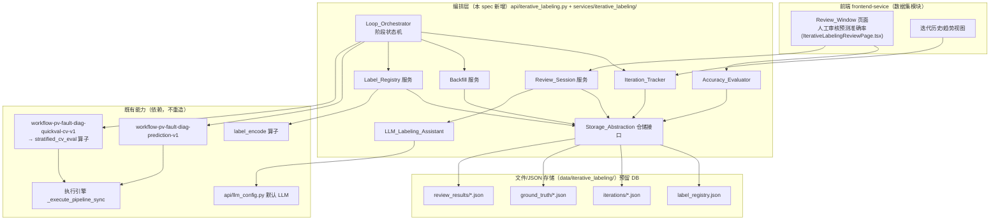
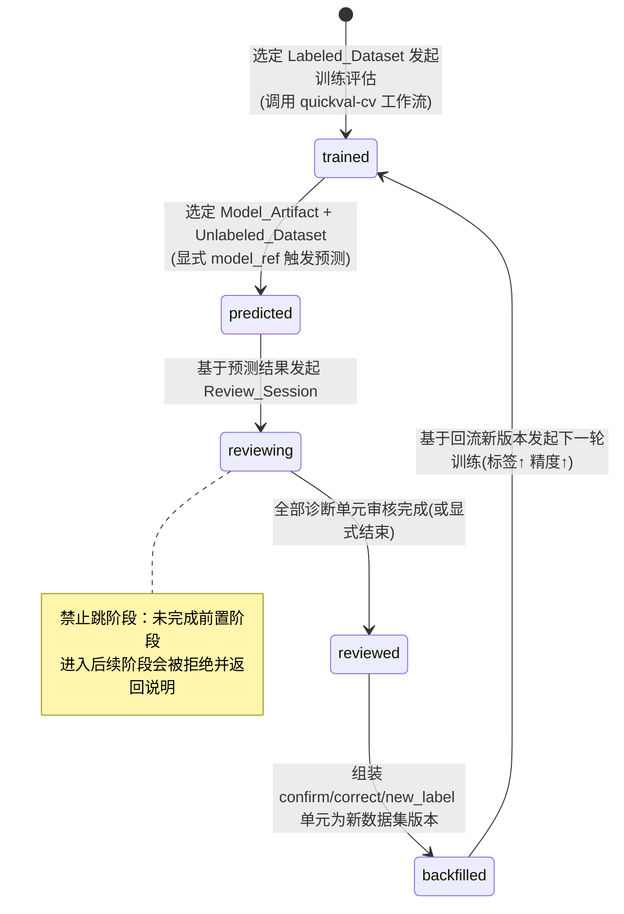
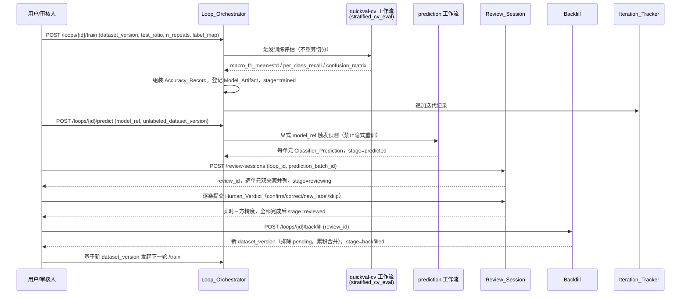
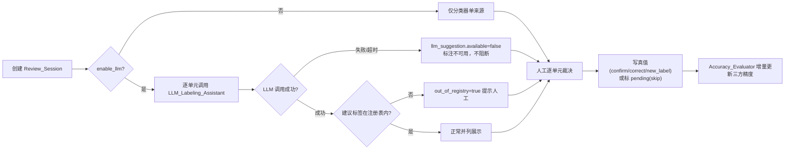
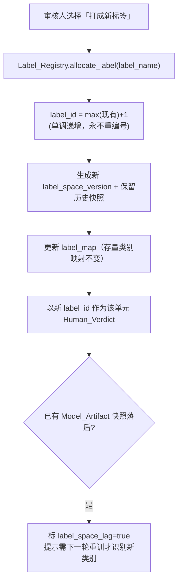
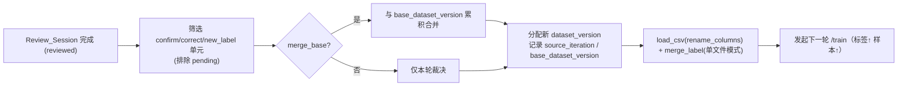

<!-- @AI_GENERATED -->
> **⚠️ 已被取代（2026-07-30）**：本目录文档已被 [`docs/specs/pv-fault-label-segment-redesign/`](../pv-fault-label-segment-redesign/) 取代。与 `solar_mode` 切分模型、`time_window` 字符串语义、逐点 `training_samples.label` 同表存储相关的章节已作废；文件保留供历史对账，勿再按本 spec 实现新功能。

# 设计文档：光伏故障人机协同迭代标注闭环

## Overview

本设计描述一个**建立在已交付光伏故障诊断工作流之上**的人机协同闭环迭代标注与重训练系统。它是一个**编排层（orchestration layer）**：自身不实现任何模型逻辑、特征工程、切分算法，而是把已实现的训练评估工作流、预测工作流、`label_encode` 算子串成一个可推进的闭环状态机，并在其上叠加「人工审核窗口 + 三方精度对比 + 标签注册表版本管理 + 打标回流 + 迭代追踪 + 存储抽象」六类新能力。

核心设计理念是**复用优先 + 编排不重造 + 存储抽象先行**：

- 训练/预测/切分评估全部委托给 `pv-fault-diagnosis-integration` spec 已交付的算子与模板（详见「依赖与边界」），本 spec 只触发、传参、收集结果、推进状态。
- 审核结果、真值标签、迭代历史、标签注册表当前阶段只定义抽象存取接口（`Storage_Abstraction`），用文件/JSON 落地，预留数据库（DB）接入点。**落库为后续阶段，当前仅为抽象接口 + 文件实现。**

### 设计范围

本 spec **新增**以下能力，**不重新定义**任何算子或流水线：

1. **闭环编排器（Loop_Orchestrator）**：迭代阶段状态机（`trained → predicted → reviewing → reviewed → backfilled`）+ 新增 REST 接口，触发既有训练评估/预测工作流。
2. **人工审核窗口（Review_Window）**：数据集模块新增前端页面 + 后端审核会话 API（逐诊断单元审核、双来源并列、不一致高亮、会话恢复）。
3. **LLM 辅助打标（LLM_Labeling_Assistant）**：复用 `api/llm_config.py` 默认配置生成建议标签，受当前标签注册表约束，失败容错，绝不写真值。
4. **审核期精度评估器（Accuracy_Evaluator）**：三方精度实时增量对比（分类器/LLM/人工核对）。
5. **标签注册表（Label_Registry）**：`label_id` 稳定分配 + `label_space_version` 快照 + 与 `label_encode` 兼容的 Label_Map + 「标签空间落后」检测。
6. **打标回流（Backfill）**：把人工裁决组装为新 `Labeled_Dataset` 版本，累积合并，允许下一轮重训。
7. **迭代追踪（Iteration_Tracker）**：append-only 迭代历史 + 排序视图 + 趋势。
8. **存储抽象层（Storage_Abstraction）**：四类数据的仓储接口 + 文件/JSON 实现 + 原子写 + 槽位分区 + DB 迁移边界标注。

### 不在本 spec 范围（依赖项，复用不重造）

| 复用对象 | 标识 | 由谁交付 | 本 spec 如何使用 |
|----------|------|----------|------------------|
| 训练评估工作流 | `workflow-pv-fault-diag-quickval-cv-v1`（光伏故障诊断快速验证/重复分层交叉评估模板） | `pv-fault-diagnosis-integration` | 编排器以显式参数触发，读取其输出组装 `Accuracy_Record` |
| 分层重复留出评估算子 | `stratified_cv_eval`（`services/operator_backends/stratified_cv_eval.py`，注册在 `functions.json` 的 `evaluation_metrics` 分类下） | 同上 | 不重新实现切分/mRMR/SMOTE/训练/评分，直接消费其返回的 `macro_f1_mean ± macro_f1_std` 等 |
| 训练模板 | `workflow-pv-fault-diag-training-v1` | 同上 | 产出可复用模型工件 |
| 预测模板 | `workflow-pv-fault-diag-prediction-v1` | 同上 | 编排器以显式 `model_ref` 触发批量预测 |
| 标签编解码算子 | `label_encode`（`encode`/`decode`） | 同上 | Label_Registry 维护与之兼容的 Label_Map |
| 数据装载算子 | `load_csv`（支持 `rename_columns`） | 同上 | 回流数据集装载 |
| 标签合并算子 | `merge_label`（支持单文件模式：源 CSV 已含标签列） | 同上 | 回流数据集训练前合并 |
| 指标映射 | `backend-service/api/workflows_enhanced.py` 内 `stratified_cv_eval` 输出 → 标准指标键的映射（约 2312~2336 行） | 同上 | 直接复用，前端 `TrainingResultDashboard.tsx` 零改动渲染 |

### 技术栈

- **后端**：Python 3.10+ / FastAPI / pandas；conda 环境 `aip_web`。新增编排与服务模块复用现有执行引擎（`_execute_pipeline_sync`、`load_workflow_from_file`、`_collect_upstream_inputs`，均在 `backend-service/api/workflows_enhanced.py`）。
- **前端**：React 18 + TypeScript + Vite + Ant Design 5，目录 `frontend-sevice/`（拼写保持 `sevice`，不改名）。审核窗口为数据集模块（`DatasetPage.tsx` 同级）新增页面。
- **存储**：当前阶段文件/JSON，注册表持久化在 `backend-service/data/iterative_labeling/` 下（精度对标已有 `data/autoresearch/candidate_pool.json` 等 JSON 注册表先例）。
- **LLM**：复用 `backend-service/api/llm_config.py` 的默认配置（`GET /llm/default`，由 `data/llm_configs.json` 的 `default_config_id` 决定），不新增密钥管理。

### 设计决策

| 决策 | 选择 | 理由 |
|------|------|------|
| 训练/预测/切分是否自实现 | 否，全部委托既有工作流与算子 | 遵守编排 vs 评分边界；避免切分/泄漏逻辑出现第二份事实来源 |
| 精度主口径 | `macro_f1`（均值 ± 标准差），与 `stratified_cv_eval` 一致 | 跨轮可比；不虚高；审核期 `Accuracy_Evaluator` 同样给 macro precision/recall/f1 |
| 存储方案 | 抽象仓储接口 + 文件/JSON 实现，预留 DB | 需求 11 明确「落库为后续阶段」；接口签名稳定，调用方切后端零改动 |
| `label_id` 分配 | 单调递增、永不重编号 | 历史真值标注引用的编码必须稳定，否则旧标注失真（需求 8.5） |
| 真值唯一来源 | 仅 `Human_Verdict` 可写真值；分类器/LLM 均为建议 | 人工最终裁决（需求 4.3、5、7.4） |
| `pending` 单元处理 | 不写真值、不计精度、不进回流 | 存疑跳过不应污染精度统计与训练集（需求 5.4、6.2、9.5） |
| 状态机推进 | 严格前置校验，禁止跳阶段 | 闭环可推进、可定位当前步（需求 12.1、12.2） |
| LLM 越界标签 | 标注 `out_of_registry` 提示人工，不自动采纳 | LLM 不得扩充标签空间，只有人工 `new_label` 才扩充（需求 7.3、8） |
| 数据集版本 | `dataset_version` 单调、记录来源血缘 | 可追溯、累积合并（需求 9.2、9.3、10） |

## 依赖与边界

遵守 `AGENTS.md` 的三类工作流边界，本 spec 落点如下：

| 边界 | 约束 | 本系统落点 |
|------|------|-----------|
| Train（训练） | 产出可复用模型工件 + 训练元数据 | 编排器附加 `accuracy_record` + `dataset_version` 引用，登记为 `Model_Artifact` |
| Predict（预测） | 消费显式 `model_ref`，禁止隐式重训 | 编排器预测前强校验 `model_ref`，缺失即拒绝 |
| Backtest（回测） | 历史窗口评分器 | 本系统「精度」= 测试折评估，**不**混淆为回测 |
| 编排 vs 评分 | 闭环是编排层 | 训练/预测仍以 AIP 工作流方式执行，编排器只触发/传参/收集/推进 |

## Architecture

### 整体架构（闭环编排层 叠加在 既有工作流之上）



### 闭环阶段状态机



### 模块文件结构

```
backend-service/
├── api/
│   └── iterative_labeling.py                  # 新增：本 spec 全部 HTTP 接口（编排/审核/标签/迭代/回流），main.py 注册
├── services/
│   └── iterative_labeling/                    # 新增：编排与领域服务包
│       ├── __init__.py
│       ├── orchestrator.py                    # 新增：Loop_Orchestrator，阶段状态机 + 触发既有工作流
│       ├── review_session.py                  # 新增：审核会话装配、动作处理、进度
│       ├── llm_labeling_assistant.py          # 新增：复用 llm_config 生成 LLM_Suggestion
│       ├── accuracy_evaluator.py              # 新增：三方精度增量计算
│       ├── label_registry.py                  # 新增：label_id 稳定分配 + 版本快照 + Label_Map
│       ├── backfill.py                        # 新增：人工裁决 → 新 Labeled_Dataset 版本
│       ├── iteration_tracker.py               # 新增：append-only 迭代历史 + 趋势
│       └── storage/                           # 新增：存储抽象层
│           ├── __init__.py
│           ├── interfaces.py                  # 新增：四类仓储抽象接口（预留 DB）
│           └── file_backend.py                # 新增：文件/JSON 实现 + 原子写 + 槽位分区
└── data/
    └── iterative_labeling/                    # 新增：注册表与历史持久化根目录（路径由部署配置决定）
        ├── label_registry.json                # 新增：标签注册表（当前版本 + 历史快照）
        ├── iterations/                        # 新增：迭代历史（append-only）
        ├── review_results/                    # 新增：审核结果（含 Human_Verdict）
        └── ground_truth/                      # 新增：固化真值标签

frontend-sevice/
└── src/
    ├── pages/
    │   └── IterativeLabelingReviewPage.tsx    # 新增：人工审核预测准确率页面（数据集模块）
    └── services/
        └── iterativeLabelingApi.ts            # 新增：审核/编排/迭代 API 客户端
```

各路径职责（交接友好）：

- `backend-service/api/iterative_labeling.py` — 本 spec 的全部 HTTP 接口集中于此；编排推进、审核会话、标签注册、迭代历史、回流都在这里暴露为 REST，由 `main.py` 注册路由。
- `backend-service/services/iterative_labeling/orchestrator.py` — 闭环编排核心：维护每轮 `Iteration_Loop` 的阶段状态机，调用既有训练评估/预测工作流，收集结果，登记 `Model_Artifact`，通知 `Iteration_Tracker`。
- `backend-service/services/iterative_labeling/review_session.py` — 审核会话装配（按 `Diagnosis_Unit` 逐条加载）、四类审核动作处理（confirm/correct/new_label/skip）、进度统计、断点恢复。
- `backend-service/services/iterative_labeling/llm_labeling_assistant.py` — 复用 `api/llm_config.py` 默认配置，为待审核单元生成 `LLM_Suggestion`；越界标签标 `out_of_registry`，调用失败置缺失不中断。
- `backend-service/services/iterative_labeling/accuracy_evaluator.py` — 以已固化 `Human_Verdict` 为真值，增量计算三方精度与 macro precision/recall/f1，排除 `pending`。
- `backend-service/services/iterative_labeling/label_registry.py` — `label_id` 单调分配（永不重编号）、`label_space_version` 快照、与 `label_encode` 兼容的 Label_Map、标签空间落后检测。
- `backend-service/services/iterative_labeling/backfill.py` — 把 `confirm/correct/new_label` 单元的裁决组装为新 `Labeled_Dataset` 版本，累积合并，排除 `pending`。
- `backend-service/services/iterative_labeling/iteration_tracker.py` — append-only 迭代历史读写 + 按轮次排序的趋势视图。
- `backend-service/services/iterative_labeling/storage/interfaces.py` — 四类数据的仓储抽象接口定义（审核结果/真值标签/迭代历史/标签注册表），DB 迁移的唯一边界。
- `backend-service/services/iterative_labeling/storage/file_backend.py` — 当前阶段文件/JSON 实现：写-then-replace 原子写、按 `slot` 槽位分区、路径由部署配置决定。
- `backend-service/data/iterative_labeling/` — 注册表与历史的持久化根目录；具体路径由部署配置注入，不在业务代码写死绝对路径。
- `frontend-sevice/src/pages/IterativeLabelingReviewPage.tsx` — 数据集模块新增「人工审核预测准确率」页面：双来源并列、不一致高亮、四类动作、三方精度面板、进度与恢复。
- `frontend-sevice/src/services/iterativeLabelingApi.ts` — 上述页面的 API 客户端，封装审核/编排/迭代相关请求。

## Components and Interfaces

> 约定：以下接口路径前缀统一为 `/api/iterative-labeling`；请求/响应字段首次出现均以 **`field_name` — 中文含义** 注解。所有写入类接口经 `Storage_Abstraction` 落地（文件/JSON，原子写）。

### 组件 1：Loop_Orchestrator（闭环编排器）

**职责**：维护每轮 `Iteration_Loop` 的阶段状态机（`trained → predicted → reviewing → reviewed → backfilled`），触发既有训练评估/预测工作流，收集结果并推进状态。本身不实现模型逻辑。映射需求 1、2、9、12。

**模块**：`services/iterative_labeling/orchestrator.py`；HTTP 暴露于 `api/iterative_labeling.py`。

**内部符号 `_advance_stage(loop_id, target_stage)`**：输入当前迭代轮标识与目标阶段，校验前置阶段是否满足；满足则迁移状态并通知 `Iteration_Tracker` 追加记录，不满足则抛阶段不满足错误。被所有推进类接口调用。

**关键接口**：

`POST /api/iterative-labeling/loops` — 创建/开启一轮迭代闭环
- 请求体：
  - `base_dataset_version` — 可选，本轮训练所基于的基线数据集版本（首轮可空）
  - `slot` — 可选，槽位（多产品线/多环境分区键），默认 `default`（默认槽）
- 响应体：
  - `loop_id` — 迭代闭环唯一标识
  - `iteration_round` — 迭代轮次（从 1 起）
  - `stage` — 当前阶段（初始为空，训练后置 `trained`）

`POST /api/iterative-labeling/loops/{loop_id}/train` — 触发训练评估（阶段 → `trained`）
- 请求体：
  - `dataset_version` — 必填，选定的有真值数据集版本
  - `model_params` — 可选，透传给训练评估工作流的参数对象，含 `test_ratio`（测试集占比，默认 0.2）、`n_repeats`（重复次数，默认 10）、`random_state`（随机种子基值，默认 90）、`k`（mRMR 特征数）、`label_map`（标签映射，供 `label_encode`）
- 行为：以 `model_params` 为参数调用 `workflow-pv-fault-diag-quickval-cv-v1`（内部走 `stratified_cv_eval`），**不**在本系统重算切分；读取输出组装 `Accuracy_Record`，登记 `Model_Artifact`。
- 响应体：
  - `model_ref` — 模型引用（预测时显式指定）
  - `accuracy_record` — 精度记录（见 Data Models）
  - `label_space_snapshot` — 本次训练的标签空间快照（`label_space_version` + 类别集合）
- 失败：`IF` 数据集缺真值标签列 `THEN` 返回 `422` + `missing_columns` — 缺失列说明（对应需求 1.10）。

`POST /api/iterative-labeling/loops/{loop_id}/predict` — 触发预测（阶段 `trained → predicted`）
- 请求体：
  - `model_ref` — 必填，使用的模型引用
  - `unlabeled_dataset_version` — 必填，待预测的无真值数据集版本
- 行为：以显式 `model_ref` 调用 `workflow-pv-fault-diag-prediction-v1`；为每个 `Diagnosis_Unit` 产出 `Classifier_Prediction`。
- 失败：`IF` `model_ref` 缺失或无效 `THEN` 返回 `400`，禁止任何隐式重训（需求 2.2）。
- 响应体：`prediction_batch_id` — 本次预测批次标识；`unit_count` — 诊断单元数。

`GET /api/iterative-labeling/loops/{loop_id}` — 读取某轮闭环状态（只读，供 UI 展示当前处于哪一步）
- 响应体：`loop_id`、`iteration_round`、`stage`、`dataset_version`、`model_ref`、`label_space_snapshot`、`label_space_lag` — 是否标签空间落后（布尔，模型快照落后于注册表当前版本时为真，需求 8.4）。

`POST /api/iterative-labeling/loops/{loop_id}/backfill` — 触发回流（阶段 `reviewed → backfilled`，见组件 6）。

### 组件 2：Review_Session 服务 + Review_Window 前端

**职责**：基于某次预测结果创建审核会话，以 `Diagnosis_Unit` 为最小粒度逐条审核，双来源并列展示、不一致高亮、四类动作、断点恢复。映射需求 3、4、5。

**模块**：后端 `services/iterative_labeling/review_session.py`；前端 `pages/IterativeLabelingReviewPage.tsx`。

**关键接口**：

`POST /api/iterative-labeling/review-sessions` — 创建审核会话
- 请求体：
  - `loop_id` — 所属迭代闭环
  - `prediction_batch_id` — 基于哪一批预测结果
  - `enable_llm` — 可选，是否启用 LLM 辅助打标，默认 `true`
- 行为：装配待审核单元；若 `enable_llm` 为真，触发 `LLM_Labeling_Assistant` 为每个单元生成建议（异步、失败容错）。
- 响应体：`review_id` — 审核会话唯一标识（主键，便于将来 DB 映射）；`total_count` — 待审核单元总数。

`GET /api/iterative-labeling/review-sessions/{review_id}` — 读取会话与进度（支持中断后恢复）
- 响应体：
  - `review_id`、`status` — 会话状态（`reviewing`/`reviewed`）
  - `reviewed_count` — 已审核数；`total_count` — 总数
  - `units` — 待审核单元数组，每项含 `unit_key`、`classifier_prediction`、`llm_suggestion`、`disagreement` — 是否双来源分歧（布尔，`predicted_label != suggested_label` 时为真，需求 4.2）、`current_verdict` — 已提交裁决（断点恢复用，未审核为空）

`POST /api/iterative-labeling/review-sessions/{review_id}/verdicts` — 提交一条人工裁决
- 请求体：
  - `unit_key` — 诊断单元标识（`site_id × device_id ×（可选 branch_id）× time_window`）
  - `action_type` — 动作类型，枚举 `confirm`（确认正确）/`correct`（纠正为已有标签）/`new_label`（打成新标签）/`skip`（存疑跳过）
  - `verdict_label` — 裁决标签：`confirm` 时取分类器 `predicted_label`；`correct` 时取注册表已有类别；`new_label` 时走标签扩充（组件 5）；`skip` 时为空
  - `reviewer` — 审核人
- 行为：`confirm/correct/new_label` 写入真值标签并经 `Storage_Abstraction` 持久化；`skip` 标 `pending`，不写真值（需求 5.6）。提交后触发 `Accuracy_Evaluator` 增量更新。
- 响应体：`accepted` — 是否接受；`accuracy_snapshot` — 当前三方精度快照（见组件 4）。

前端 `IterativeLabelingReviewPage.tsx` 要点：
- 复用数据集/上传接口（`api/upload.py` 的 `GET /api/upload/file/{file_id}/preview`）获取被审核数据集的预览与样本，**不另起数据通道**（需求 3.5）。
- 每个单元并列展示分类器预测（`predicted_label` + `confidence`）与 LLM 建议（`suggested_label` + `reason`），分歧高亮；两来源均标注「辅助建议」，只有人工裁决写真值（需求 4.1~4.3）。
- LLM 缺失时展示分类器单来源并标「LLM 建议不可用」，不阻断（需求 4.4）。

### 组件 3：LLM_Labeling_Assistant（LLM 辅助打标）

**职责**：为每个待审核单元生成 `LLM_Suggestion`（建议标签 + 理由），受当前 `Label_Registry` 约束，失败容错，绝不写真值。映射需求 7。

**模块**：`services/iterative_labeling/llm_labeling_assistant.py`。

**内部符号 `generate_suggestion(unit, label_registry, llm_config)`**：输入单个诊断单元的时序上下文摘要、当前标签注册表、默认 LLM 配置；输出一条 `LLM_Suggestion` 或缺失标记。被 `Review_Session` 创建会话时逐单元调用。

**关键逻辑**：
- 复用 `api/llm_config.py` 的默认配置（`GET /llm/default`，由 `data/llm_configs.json` 的 `default_config_id` 决定），记录 `llm_config_ref` — 所用 LLM 配置引用；不新增独立密钥管理（需求 7.2）。
- 约束 `suggested_label` 取值来自当前注册表已有类别；`IF` LLM 给出注册表外标签 `THEN` 标注 `out_of_registry`（疑似新类别）提示人工，不自动采纳（需求 7.3）。
- 禁止把建议写入真值（需求 7.4）。
- `IF` 调用失败/超时 `THEN` 记录失败原因，置该单元 `llm_suggestion` 为缺失，不中断审核（需求 7.5）。

### 组件 4：Accuracy_Evaluator（审核期三方精度评估器）

**职责**：以已固化 `Human_Verdict` 为真值，实时增量计算三方精度对比。映射需求 6。

**模块**：`services/iterative_labeling/accuracy_evaluator.py`。

**关键接口**：

`GET /api/iterative-labeling/review-sessions/{review_id}/accuracy` — 读取当前三方精度
- 响应体：
  - `classifier_accuracy` — 分类器原始预测精度（已审核单元中分类器预测命中人工裁决的比例）
  - `llm_accuracy` — LLM 建议精度（仅在有 LLM 建议的单元上计算，剔除缺失）
  - `human_verified_accuracy` — 人工核对后精度基线（已审核单元的 100% 一致口径）
  - `llm_coverage` — LLM 覆盖率（有 LLM 建议的已审核单元 / 已审核单元总数）
  - `macro` — macro 口径对象，含 `precision`/`recall`/`f1`，与训练 `Accuracy_Record` 口径一致（需求 6.3）
  - `counted_units` — 纳入统计的单元数（仅 `confirm/correct/new_label`，排除 `pending`，需求 6.2）

**内部符号 `update_incremental(state, new_verdict)`**：输入当前累计计数状态与一条新裁决；输出更新后的三方精度。每提交一条 `Human_Verdict` 触发，增量更新而非重算全量（需求 6.4）。增量结果与全量重算等价（见 Correctness Property 4）。

### 组件 5：Label_Registry（标签注册表）服务

**职责**：登记全部故障标签类别及其编码，支持标签扩充与版本管理，保证 `label_id` 稳定，维护与 `label_encode` 兼容的 Label_Map。映射需求 8。

**模块**：`services/iterative_labeling/label_registry.py`。

**内部符号 `allocate_label(label_name)`**：输入新标签业务名；输出新分配的 `label_id`（取 `max(现有 label_id) + 1`，单调递增，永不复用/重编号），并生成新的 `label_space_version` 快照。被审核动作 `new_label` 调用。

**关键接口**：

`GET /api/iterative-labeling/label-registry` — 读取当前标签注册表（只读，供 UI 预填与审核选择）
- 响应体：
  - `label_space_version` — 当前标签空间版本号
  - `labels` — 标签数组，每项 `label_id`（标签编码，主键）、`label_name`（标签业务名）、`created_at`
  - `label_map` — 与 `label_encode` 兼容的业务标签 → 数值类别字典

`POST /api/iterative-labeling/label-registry/labels` — 新增标签类别（标签扩充）
- 请求体：`label_name` — 必填，新标签业务名
- 行为：分配唯一 `label_id`、生成新 `label_space_version`、保留历史快照；存量类别的 `encode`/`decode` 映射保持不变（需求 8.3、8.5）。
- 响应体：`label_id`、`label_space_version`。

`GET /api/iterative-labeling/label-registry/versions` — 读取历史版本快照列表（只读，审计/追溯）。

**标签空间落后检测**：编排器读取某 `Model_Artifact` 的 `label_space_snapshot` 与当前注册表 `label_space_version` 比较；不一致则标 `label_space_lag = true`，提示新类别需下一轮重训才被模型识别（需求 8.4）。

### 组件 6：Backfill（打标回流）服务

**职责**：把审核固化的真值组装为新 `Labeled_Dataset` 版本，累积合并，允许下一轮重训。映射需求 9。

**模块**：`services/iterative_labeling/backfill.py`。

**接口**（即组件 1 的 `POST /loops/{loop_id}/backfill`）：
- 请求体：
  - `review_id` — 来源审核会话
  - `merge_base` — 可选，是否与基线数据集累积合并，默认 `true`（需求 9.3）
- 行为：取 `confirm/correct/new_label` 单元及其 `Human_Verdict` 组装；排除 `pending`（需求 9.5）；分配新 `dataset_version`，记录 `source_iteration`（来源迭代轮次）、`base_dataset_version`（基线数据集版本）。回流数据集的标签列与 `label_encode` 的 Label_Map 兼容，可经 `load_csv`（`rename_columns`）+ `merge_label`（单文件模式）直接进入下一轮训练。
- 响应体：`dataset_version` — 新数据集版本；`unit_count` — 纳入回流的单元数。
- 阶段：成功后 `reviewed → backfilled`；用户可基于新 `dataset_version` 调 `/train` 进入下一轮（需求 9.4）。

### 组件 7：Iteration_Tracker（迭代追踪）

**职责**：append-only 记录每轮迭代的数据集版本、模型版本、精度、标签空间快照，提供排序视图与趋势。映射需求 10。

**模块**：`services/iterative_labeling/iteration_tracker.py`。

**关键接口**：

`GET /api/iterative-labeling/iterations` — 读取迭代历史（按 `iteration_round` 排序，含趋势）
- 查询参数：`slot` — 可选，槽位，默认 `default`
- 响应体：`iterations` — 迭代记录数组（见 Data Models）；`trend` — 趋势对象，含 `macro_f1_by_round`（各轮 macro_f1 均值）、`label_count_by_round`（各轮标签类别数），用于验证「标签越来越多、精度越来越好」。

**append-only 语义**：`Iteration_Tracker` 只追加，已写历史条目不被覆盖或删除（需求 10.4）；每条记录有 `iteration_id` — 迭代记录主键（便于将来 DB 映射）。

### 组件 8：Storage_Abstraction（存储抽象层）

**职责**：为四类数据定义读写接口，当前文件/JSON 实现，预留 DB。映射需求 11。

**模块**：`services/iterative_labeling/storage/interfaces.py`（接口）+ `file_backend.py`（实现）。

**四类仓储接口**（`interfaces.py`，DB 迁移的唯一边界）：

```python
class ReviewResultRepository:      # 审核结果（含 Human_Verdict）
    def save_verdict(self, slot: str, review_id: str, verdict: dict) -> None: ...
    def load_session(self, slot: str, review_id: str) -> dict: ...

class GroundTruthRepository:       # 固化真值标签
    def append_labels(self, slot: str, dataset_version: str, labels: list) -> None: ...
    def load_labels(self, slot: str, dataset_version: str) -> list: ...

class IterationHistoryRepository:  # 迭代历史（append-only）
    def append(self, slot: str, record: dict) -> None: ...
    def list_sorted(self, slot: str) -> list: ...

class LabelRegistryRepository:     # 标签注册表（当前版本 + 历史快照）
    def load_current(self, slot: str) -> dict: ...
    def save_new_version(self, slot: str, registry: dict) -> None: ...
```

**文件实现要点**（`file_backend.py`）：
- **存什么**：四类数据各自的 JSON 文件/目录（审核结果、真值标签、迭代历史、标签注册表）。
- **为什么单独存**：与平台主业务库未打通前的约定真源，供 UI 预填、审核恢复、迭代追溯；与既有 `data/autoresearch/*.json` 注册表先例一致。
- **按什么维度分区**：按 `slot`（槽位）分区，默认 `default`（默认槽）；多产品线/多环境时切换槽位。
- **路径/介质**：由部署配置决定（注入根目录 `data/iterative_labeling/`），**不写死**仅适用于某次克隆的绝对路径（需求 11.3）。
- **原子写**：写-then-replace（先写临时文件，`fsync` 后原子 `os.replace` 覆盖目标），避免会话中断导致记录损坏（需求 11.5）。

**DB 迁移边界标注（明确交代）**：

| 数据类 | 当前实现 | 后续迁移 DB | 受影响访问层边界 | 主键字段 |
|--------|----------|-------------|------------------|----------|
| 审核结果（含 Human_Verdict） | `review_results/{slot}/{review_id}.json` | 是（量大、需查询） | `ReviewResultRepository` | `review_id` |
| 固化真值标签 | `ground_truth/{slot}/{dataset_version}.json` | 是（训练集血缘） | `GroundTruthRepository` | `dataset_version`（+ `unit_key`） |
| 迭代历史 | `iterations/{slot}/*.json` | 是（追溯/趋势） | `IterationHistoryRepository` | `iteration_id` |
| 标签注册表 | `label_registry.json` + 历史快照 | 视情况（小、版本化） | `LabelRegistryRepository` | `label_id`（+ `label_space_version`） |

> **本节明确标注：落库为后续阶段，当前为抽象接口 + 文件实现。** 业务调用方只依赖 `interfaces.py` 的抽象接口，后续新增 DB 实现时调用方无需修改（需求 11.4、11.6）。

## Data Models

> 所有 JSON 字段首次出现均以 `字段名 — 中文含义` 注解。这些是编排层自身管理的数据契约；训练/预测产物仍由既有工作流定义，本系统只引用其 `model_ref` 与读取其输出。

### Model_Artifact（模型工件）

```jsonc
{
  "model_ref": "mdl-2026round3-a1b2",   // 模型引用 — 预测时显式指定的唯一标识（主键）
  "iteration_round": 3,                  // 迭代轮次 — 本工件所属的迭代轮
  "dataset_version": "ds-v3",            // 数据集版本 — 训练所用 Labeled_Dataset 版本引用
  "accuracy_record": { /* 见下 */ },     // 精度记录 — 以 macro_f1 均值±标准差为主口径
  "label_space_snapshot": {              // 标签空间快照 — 本次训练时的标签空间
    "label_space_version": "ls-v5",      //   标签空间版本号
    "label_ids": [0, 1, 2, 10, 20]       //   该快照包含的标签编码集合
  },
  "created_at": "2026-06-08T12:00:00"    // 创建时间
}
```

### Accuracy_Record（精度记录，复用 stratified_cv_eval 输出口径）

```jsonc
{
  "macro_f1_mean": 0.8123,               // 宏平均F1均值 — 主口径，跨 n_repeats 次重复
  "macro_f1_std": 0.0214,                // 宏平均F1标准差 — 主口径波动
  "accuracy_mean": 0.8556,               // 整体正确率均值 — 仅参考
  "accuracy_std": 0.0188,                // 整体正确率标准差
  "macro_precision_mean": 0.80,          // 宏平均精确率均值
  "macro_recall_mean": 0.79,             // 宏平均召回率均值
  "per_class_recall_mean": {             // 各类别召回率均值 — 键为 label_id 字符串
    "0": 0.91, "1": 0.74, "20": 0.66
  },
  "per_repeat_macro_f1": [0.80, 0.83],   // 每次重复的宏F1 — 长度=实际有效重复数
  "confusion_matrix": {                  // 代表性混淆矩阵 — 跨重复累计的测试折矩阵
    "labels": ["0", "1", "20"],          //   行列标签顺序
    "data": [[10, 1, 0], [2, 8, 1], [0, 1, 9]]  // 行=真实，列=预测
  },
  "warnings": ["class_5_only_1_sample_train_only", "smote_skipped_class_3"]  // 告警列表 — 边缘情况
}
```

> 说明：上述键与 `stratified_cv_eval.execute()` 返回完全对齐；`workflows_enhanced.py` 已有的指标映射（约 2312~2336 行）会把这些键转换为标准指标供前端 `TrainingResultDashboard.tsx` 渲染，本系统直接读取这些键登记 `accuracy_record`，**不**重新计算。

### Classifier_Prediction（分类器预测，每个诊断单元一条）

```jsonc
{
  "unit_key": "siteA|dev12|br3|2026-06-01",  // 诊断单元标识 — site_id|device_id|(branch_id)|time_window
  "predicted_label": 1,                       // 预测标签 — label_id
  "confidence": 0.87,                         // 置信度 — 0~1
  "prediction_batch_id": "pred-r3-001",       // 预测批次标识 — 关联本次预测
  "model_ref": "mdl-2026round3-a1b2"          // 模型引用 — 产生该预测的模型
}
```

### LLM_Suggestion（LLM 建议标签）

```jsonc
{
  "unit_key": "siteA|dev12|br3|2026-06-01",  // 诊断单元标识
  "suggested_label": 1,                       // 建议标签 — 受当前注册表约束的 label_id；缺失时为 null
  "reason": "电流曲线在午后骤降且与相邻支路背离，疑似组串失配", // 建议理由
  "out_of_registry": false,                   // 疑似新类别 — LLM 给出注册表外标签时为 true，提示人工
  "llm_config_ref": "llm-default",            // LLM配置引用 — 所用默认配置 id
  "generated_at": "2026-06-08T12:05:00",      // 生成时间
  "available": true                           // 是否可用 — 调用失败/超时置 false（不阻断审核）
}
```

### Review_Result / Human_Verdict（审核结果 / 人工裁决）

```jsonc
{
  "review_id": "rev-r3-77",                   // 审核会话标识 — 主键
  "loop_id": "loop-2026-03",                  // 所属迭代闭环
  "status": "reviewing",                      // 会话状态 — reviewing / reviewed
  "verdicts": [                               // 人工裁决数组
    {
      "unit_key": "siteA|dev12|br3|2026-06-01", // 诊断单元标识
      "verdict_label": 1,                       // 裁决标签 — skip 时为 null
      "action_type": "confirm",                 // 动作类型 — confirm/correct/new_label/skip
      "is_ground_truth": true,                  // 是否写入真值 — skip 为 false，其余为 true
      "reviewer": "operator_zhang",             // 审核人
      "reviewed_at": "2026-06-08T12:06:00"      // 审核时间
    }
  ]
}
```

> 真值固化口径：`action_type ∈ {confirm, correct, new_label}` → `is_ground_truth = true`；`action_type == skip` → `pending`，`is_ground_truth = false`，不写真值、不计精度、不进回流。

### Label_Registry entry + label_space_version（标签注册表项 + 版本）

```jsonc
{
  "label_space_version": "ls-v5",             // 标签空间版本号 — 每次标签变更递增
  "labels": [                                 // 标签数组
    { "label_id": 0,  "label_name": "正常",        "created_at": "2026-05-01T00:00:00" }, // label_id 为主键，永不重编号
    { "label_id": 1,  "label_name": "组串失配",     "created_at": "2026-05-01T00:00:00" },
    { "label_id": 20, "label_name": "suite-0",     "created_at": "2026-06-01T00:00:00" }
  ],
  "label_map": {                              // 标签映射 — 与 label_encode 兼容的 业务名→数值类别
    "正常": 0, "组串失配": 1, "suite-0": 20
  },
  "history": [                                // 历史版本快照 — append-only
    { "label_space_version": "ls-v4", "label_ids": [0, 1], "snapshot_at": "2026-05-20T00:00:00" }
  ]
}
```

### Iteration history record（迭代历史记录，append-only）

```jsonc
{
  "iteration_id": "iter-2026-03-r3",          // 迭代记录主键 — 便于将来 DB 映射
  "iteration_round": 3,                       // 迭代轮次
  "dataset_version": "ds-v3",                 // 数据集版本
  "model_version": "mdl-2026round3-a1b2",     // 模型版本 / model_ref
  "accuracy_record": { /* 见上 */ },          // 精度指标
  "label_space_version": "ls-v5",             // 标签空间版本
  "label_count": 5,                           // 标签类别数 — 该轮注册表类别总数
  "created_at": "2026-06-08T12:10:00"         // 创建时间
}
```

### Labeled_Dataset version（回流数据集版本血缘）

```jsonc
{
  "dataset_version": "ds-v4",                 // 数据集版本 — 单调，新回流分配
  "source_iteration": 3,                      // 来源迭代轮次 — 由哪一轮审核回流而来
  "base_dataset_version": "ds-v3",            // 基线数据集版本 — 累积合并的基线
  "unit_count": 142,                          // 单元数 — 纳入回流的 confirm/correct/new_label 单元数
  "created_at": "2026-06-08T12:09:00"         // 创建时间
}
```

## Key Flows

### 闭环主流程（训练 → 预测 → 审核 → 回流 → 重训）



### 审核会话与 LLM 辅助打标流



### 标签扩充流（new_label → 注册表版本递增）



### 回流 → 重训流



## Correctness Properties

*属性（property）是系统在所有合法执行下都应成立的特征或行为——一种关于"系统应当做什么"的形式化陈述。属性是人类可读规格与机器可验证正确性保证之间的桥梁。*

> 范围说明：本节属性只覆盖**本 spec 自身的编排与治理逻辑**。需求 1.2~1.8（重复分层留出、无泄漏、SMOTE/mRMR 折内 fit、边缘告警等）是 `stratified_cv_eval` 算子的内部算法，由 `pv-fault-diagnosis-integration` spec 交付并测试，本系统仅消费其输出，故不在此重复立属性。

### Property 1: 登记记录字段完整性

*For any* 合法的 `stratified_cv_eval` 输出、预测工作流输出或一轮迭代上下文，本系统装配出的 `Model_Artifact` / `Classifier_Prediction` / 迭代历史记录都应包含其对应数据契约定义的全部必填字段，且 `accuracy_record` 中的 `macro_f1_mean`/`macro_f1_std` 等键的值与算子输出逐键一致（搬运不丢不改）。

**Validates: Requirements 1.9, 2.3, 10.2**

### Property 2: 缺有效 model_ref 必拒预测且不触发训练

*For any* 缺失或无效 `model_ref` 的预测请求，系统都应拒绝该请求并返回错误，且绝不触发任何训练/重训动作。

**Validates: Requirements 2.2**

### Property 3: 审核会话单元数与预测单元一致

*For any* 预测批次，基于其创建的 `Review_Session` 的 `total_count` 应等于该批次中唯一 `Diagnosis_Unit` 的数量（不漏不重）。

**Validates: Requirements 3.1**

### Property 4: 审核结果持久化往返

*For any* 已提交的人工裁决序列，经 `Storage_Abstraction` 持久化后重新载入会话，恢复的裁决集合（含 `unit_key`/`verdict_label`/`action_type`/`reviewer`/`reviewed_at`）应与提交时完全一致。

**Validates: Requirements 3.4, 5.5, 11.5**

### Property 5: 双来源分歧标志正确

*For any* 一个诊断单元的 `(predicted_label, suggested_label)` 取值，当且仅当两者都存在且不相等时，`disagreement` 标志为真；任一来源缺失时不标分歧。

**Validates: Requirements 4.2**

### Property 6: 动作类型决定真值固化

*For any* 审核动作 `(action_type, label)`，`is_ground_truth` 为真当且仅当 `action_type ∈ {confirm, correct, new_label}`；`action_type == skip` 时该单元标 `pending` 且不产生任何真值标签。

**Validates: Requirements 5.1, 5.2, 5.3, 5.4, 5.6**

### Property 7: 人工最终权威（真值仅来自人工裁决）

*For any* 审核会话状态，最终固化的真值标签集合中每一条都可溯源到一条 `Human_Verdict`；不存在仅由 `Classifier_Prediction` 或 `LLM_Suggestion` 来源而无人工裁决产生的真值标签。

**Validates: Requirements 4.3, 7.4**

### Property 8: pending 既不计精度也不进回流

*For any* 含任意比例 `pending` 单元的会话，三方精度的统计分母（`counted_units`）与回流组装的单元集合都不包含任何 `pending` 单元。

**Validates: Requirements 6.2, 9.5**

### Property 9: 三方精度增量更新与全量重算等价

*For any* 人工裁决提交序列，逐条增量更新得到的 `classifier_accuracy`/`llm_accuracy`/`human_verified_accuracy`（含 macro precision/recall/f1 与 `llm_coverage`），应等于对同一最终裁决集合做全量重算的结果。

**Validates: Requirements 6.1, 6.4, 6.5**

### Property 10: LLM 越界标签被标注且不可被直接采纳

*For any* LLM 给出的原始建议标签与任意当前注册表，`out_of_registry` 为真当且仅当该标签不在注册表已有类别中；越界建议不会进入「可一键确认」的可选真值集合。

**Validates: Requirements 7.3**

### Property 11: label_id 稳定且唯一

*For any* 任意次序的标签扩充操作序列，已存在的每个 `label_id → label_name` 映射在后续所有版本中保持不变，所有 `label_id` 互不重复，且新分配的 `label_id` 严格大于历史最大值（永不复用、永不重编号）。

**Validates: Requirements 8.1, 8.5**

### Property 12: 注册表版本 append-only 且存量映射稳定

*For any* 标签扩充序列，每次扩充都生成一个新的 `label_space_version` 且历史快照集合只增不改；对扩充前已存在的存量类别，`decode(encode(label)) == label` 在扩充前后保持一致。

**Validates: Requirements 8.2, 8.3**

### Property 13: 标签空间落后判定正确

*For any* `(模型 label_space_snapshot 版本, 注册表当前 label_space_version)` 对，`label_space_lag` 为真当且仅当模型快照版本落后于注册表当前版本。

**Validates: Requirements 8.4**

### Property 14: dataset_version 单调且血缘正确

*For any* 多轮回流序列，新分配的 `dataset_version` 相对其 `base_dataset_version` 严格递增（单调），且 `source_iteration`/`base_dataset_version` 正确指向产生它的审核轮次与基线版本；累积合并后的单元规模等于「基线单元 ∪ 本轮非 pending 真值单元」的去重规模。

**Validates: Requirements 9.2, 9.3**

### Property 15: 迭代历史 append-only 且按轮次有序

*For any* 任意顺序的迭代记录追加序列，每次追加后的历史都是前一状态的超集（既有条目不被覆盖或删除），且 `list_sorted` 视图按 `iteration_round` 非降序排列。

**Validates: Requirements 10.3, 10.4**

### Property 16: 阶段状态机只允许相邻且前置完成的迁移

*For any* `(当前阶段, 目标阶段)` 迁移请求，仅当目标阶段是当前阶段在 `trained → predicted → reviewing → reviewed → backfilled`（及 `backfilled → trained` 进入下一轮）中的合法直接后继、且前置阶段已完成时才被接受；任何跳阶段或前置未完成的请求都被拒绝并返回阶段不满足说明。

**Validates: Requirements 12.1, 12.2**

### Property 17: 历史轮次定位往返

*For any* 已登记的若干轮迭代，按任一 `iteration_round` 定位返回的 `(dataset_version, model_version, label_space_version)` 三元组应与该轮登记时的值完全一致。

**Validates: Requirements 12.5**

## Error Handling

| 场景 | 处理 | 对应需求 |
|------|------|----------|
| 选定数据集缺真值标签列 | `/train` 返回 `422` + `missing_columns`（缺失列说明），不触发训练 | 1.10 |
| 预测请求缺/无效 `model_ref` | `/predict` 返回 `400`，拒绝并禁止任何隐式重训 | 2.2 |
| LLM 调用失败/超时 | 记录失败原因，置该单元 `llm_suggestion.available=false`，会话继续不阻断 | 7.5 |
| LLM 返回注册表外标签 | 标 `out_of_registry=true` 提示人工，不自动采纳为真值 | 7.3 |
| 审核动作为 `skip` | 标 `pending`，不写真值、不计精度、不进回流 | 5.4, 6.2, 9.5 |
| 跳阶段/前置未完成的推进请求 | 拒绝并返回阶段不满足说明（当前阶段 + 需先完成的前置） | 12.2 |
| 模型标签空间落后于注册表 | 不报错，标 `label_space_lag=true` 并提示需下一轮重训才识别新类别 | 8.4 |
| 文件写入中断 | 写-then-replace：临时文件写完 `fsync` 后才 `os.replace`，目标文件不出现半截内容 | 11.5 |
| 标签扩充并发/重复名 | `allocate_label` 取 `max(label_id)+1` 单调分配；同名标签按业务策略复用既有 `label_id` 或拒绝（不新建重复编码） | 8.1, 8.5 |
| 三方精度无已审核单元 | 分母为 0 时返回 `null`/`0` 占位并标 `counted_units=0`，不抛异常 | 6.1 |

通用约定：编排层对既有工作流的调用异常（执行引擎报错、超时）应捕获并以结构化错误返回，记录所属 `loop_id`/`stage`，不让单次工作流失败破坏闭环状态机（失败阶段保持原状态，可重试）。

## Testing Strategy

### 双重测试策略

- **属性测试（property-based）**：覆盖上述 17 条 Correctness Properties，验证编排/治理逻辑在大量随机输入下的普适正确性。
- **单元/示例测试**：覆盖具体接口契约、错误分支、UI 渲染相关行为（标为 EXAMPLE/EDGE_CASE 的验收项）。
- **集成/冒烟测试**：覆盖「委托既有工作流」的接线（标为 INTEGRATION/SMOKE 的验收项），用 1~3 个代表性示例验证 `/train`、`/predict` 确实触发既有 `quickval-cv` / `prediction` 工作流，且本系统未自实现切分。

### 属性测试配置

- 选用目标语言成熟的属性测试库（Python 后端用 **Hypothesis**），**不**自行实现属性测试框架。
- 每条属性测试最少运行 **100** 次迭代（随机化）。
- 每条属性测试以注释标注其对应设计属性，标签格式：
  `# Feature: pv-fault-iterative-labeling-loop, Property {number}: {property_text}`
- 每条 Correctness Property 用**单个**属性测试实现。

### 关键属性的测试要点

- **Property 9（增量==全量）**：生成随机裁决序列，逐条 `update_incremental` 与末态全量重算对比，是发现精度计数错误最有价值的 model-based 测试。
- **Property 11/12（label_id 稳定 + 版本 append-only）**：生成任意「新增标签」操作序列，断言历史映射不变、id 唯一单调、存量类别 encode/decode 往返稳定。
- **Property 16（状态机）**：对全部 `(当前阶段, 目标阶段)` 组合穷举/随机，断言仅相邻且前置完成的迁移被接受。
- **Property 4/11.5（持久化往返 + 原子写）**：生成任意 JSON 可序列化裁决数据，写入后读回断言相等；并模拟写入中途中断，断言目标文件要么是旧完整内容、要么是新完整内容，不出现半截。

### 依赖项不重复测试

需求 1.1~1.8、2.1、7.1 等属于 `stratified_cv_eval` / 预测工作流 / 外部 LLM 的行为，由其各自 owner 测试；本 spec 仅以 1~3 个集成示例验证「调用与参数传递正确」，不重复测试其内部算法。

### 验证命令（conda 环境 aip_web）

```bash
conda activate aip_web
cd backend-service
# 本 spec 属性 + 单元测试（实现期补全）
PYTHONPATH=. pytest tests/test_iterative_labeling_*.py -q
# 语法/导入检查
PYTHONPATH=. python -m py_compile api/iterative_labeling.py services/iterative_labeling/*.py services/iterative_labeling/storage/*.py
```

```bash
cd frontend-sevice
npm run build   # 已知 Tailwind / chunk size warning 为既有警告，非本次失败
```

## 需要新增 / 修改的文件清单

**后端新增**：
- `backend-service/api/iterative_labeling.py` — 本 spec 全部 HTTP 接口（编排/审核/标签/迭代/回流），由 `main.py` 注册路由。
- `backend-service/services/iterative_labeling/orchestrator.py` — 闭环编排器：阶段状态机 + 触发既有训练评估/预测工作流。
- `backend-service/services/iterative_labeling/review_session.py` — 审核会话装配、四类动作处理、进度与断点恢复。
- `backend-service/services/iterative_labeling/llm_labeling_assistant.py` — 复用 `llm_config` 生成 LLM 建议，越界标注、失败容错。
- `backend-service/services/iterative_labeling/accuracy_evaluator.py` — 三方精度增量计算。
- `backend-service/services/iterative_labeling/label_registry.py` — `label_id` 稳定分配 + 版本快照 + Label_Map + 落后检测。
- `backend-service/services/iterative_labeling/backfill.py` — 人工裁决组装为新数据集版本，排除 pending，累积合并。
- `backend-service/services/iterative_labeling/iteration_tracker.py` — append-only 迭代历史 + 排序趋势视图。
- `backend-service/services/iterative_labeling/storage/interfaces.py` — 四类数据仓储抽象接口（DB 迁移唯一边界）。
- `backend-service/services/iterative_labeling/storage/file_backend.py` — 文件/JSON 实现 + 原子写 + 槽位分区。

**后端修改**：
- `backend-service/main.py` — 注册 `iterative_labeling` 路由（仅新增一行 include_router，最小改动）。
- 复用（**不修改**）`backend-service/api/workflows_enhanced.py` 的执行引擎与既有 `stratified_cv_eval` 指标映射；复用 `api/llm_config.py`、`api/upload.py`。

**前端新增**：
- `frontend-sevice/src/pages/IterativeLabelingReviewPage.tsx` — 数据集模块「人工审核预测准确率」页面。
- `frontend-sevice/src/services/iterativeLabelingApi.ts` — 审核/编排/迭代 API 客户端。
- 在前端路由（`src/App.tsx`）与数据集模块入口挂载该页面（最小改动）。

**数据/注册表新增**（路径由部署配置决定，对标 `data/autoresearch/*.json` 先例）：
- `backend-service/data/iterative_labeling/label_registry.json` — 标签注册表（当前版本 + 历史快照）。
- `backend-service/data/iterative_labeling/iterations/` — 迭代历史目录（append-only）。
- `backend-service/data/iterative_labeling/review_results/` — 审核结果目录（含 Human_Verdict，按 slot 分区）。
- `backend-service/data/iterative_labeling/ground_truth/` — 固化真值标签目录（按 slot 分区）。

**明确不改动**：`pv-fault-diagnosis-integration` spec 交付的全部算子（`stratified_cv_eval`、`label_encode`、`load_csv`、`merge_label` 等）与工作流模板，本 spec 只编排/消费，不修改其内部逻辑。
