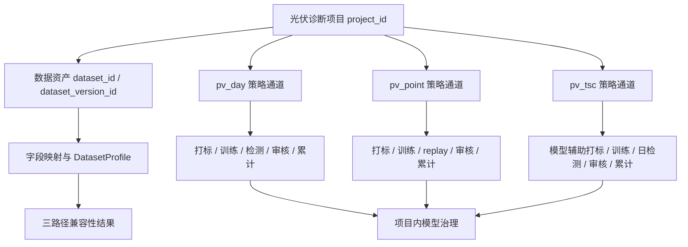

<!-- @AI_GENERATED -->
# 光伏故障诊断多数据集三路径闭环产品设计

> **文档状态**：Draft / 待产品评审，不代表代码已经实现。  
> **版本日期**：2026-09-08。  
> **覆盖范围**：`pv_day`、`pv_point`、`pv_tsc` 三条光伏故障诊断主线，以及新数据集接入、工作流运行、模型治理、滚动检测、人工审核和累计重训。  
> **核心决策**：当前阶段以产品故事线、功能完整性、状态可解释性和用户体验为主，不以继续提升离线模型精度为主线。  
> **事实基线**：
> - 当前仓库代码 — 三路径页面、API、工作流和持久化能力的实际实现。
> - `docs/project/pv_fault/AGENTS.md` — 光伏三路径产品现状、已验证事实和红线总览。
> - `docs/project/pv_fault/PV_TSC_E2E_VALIDATION_HANDOFF_2026-09-08.md` — 最新 TSC strict-10 与后续浏览器验收交接。
> - `.kiro/specs/pv-three-chain-product-validation/` — 当前三链浏览器故事线和安全验收规格。
>
> **与现有规格的关系**：现有三链验证规格侧重当前链路的安全验收；本文进一步定义“多项目、多数据集、三路径共用产品工作台”的目标产品形态。

---

## 0. 一句话产品定义

光伏故障诊断产品应当让用户不进入终端、不修改 JSON、不手写服务器路径，就能把一个新的光伏数据集接入平台，并在浏览器里完成：

```text
创建项目 → 接入数据 → 字段映射与质量检查 → 选择诊断路径
→ 搭建或复用工作流 → 打标 / 训练 → 模型候选与复验
→ 沙箱回放或生产滚动检测 → 人工审核 → 回流累计训练集
→ 冻结新快照 → 再训练 → 选择下一轮检测模型
```

产品不是为了证明某一个模型永远精度最高，而是为了让不同数据、不同算法路径和不同运行阶段都能被用户**操作、理解、追踪、复现和治理**。

---

## 1. 背景与方向调整

### 1.1 为什么现在不继续把“提精度”作为主线

当前仓库验证和 PVDAQ 等外部数据实验共同说明：

- 三条路径具备真实建模与运行价值，不是空壳演示；
- 数据集的日期覆盖、标签质量、设备覆盖和尺度口径会显著影响指标；
- 在数据本身不专业、标签不充分时，继续围绕小幅指标提升投入，产品收益较低；
- 平台真正缺少的是一条普通用户能独立完成的浏览器故事线。

因此，模型指标从“产品目标”调整为“产品证据和安全护栏”：

1. 指标来源、样本范围和评测合同必须说清楚；
2. 数据不足或指标较差时必须如实呈现；
3. 不得通过标签泄漏、降低隔离门槛或伪造生产状态换取漂亮数字；
4. 指标不足可以保留实验结果，但不能自动获得生产资格。

### 1.2 当前产品的主要问题

现有系统已经拥有工作流、打标、审核、累计账本、训练、候选、复验、registry、调度和精度运营等大量能力，但它们仍表现为多个功能入口，而不是一条连续用户旅程：

- 用户需要记住不同页面和 URL，不知道下一步去哪里；
- “训练成功、候选登记、复验通过、滚动模型、Champion”容易被混成“已部署”；
- 新数据集主要以文件路径进入工作流，缺少项目级数据资产和兼容性说明；
- 当前持久化主要按 `slot` — 产品策略槽位分区，同一条路径接入第二个独立数据集时可能串累计账本、`registry` — 当前模型指针登记真源、水位、游标或标签空间；
- 正式 verification（模型复验）→ Promote（晋升/采纳）→ 滚动指针的后端能力存在，但当前可达 UI 不完整；
- 三条路径有真实业务差异，却没有一套统一、可理解的产品语言。

### 1.3 本设计要解决的问题

本设计要把光伏故障能力从“按功能组织”改为“按项目生命周期组织”：

- 一个光伏诊断项目可以接入一个或多个数据版本；
- 同一项目下可启用 `pv_day`、`pv_point`、`pv_tsc` 三条策略通道；
- 三条通道共享数据资产和产品骨架，但各自保持标签粒度、模型、调度与证据差异；
- 用户始终知道当前项目、当前数据、当前通道、当前阶段和下一步动作；
- 第二个外部数据集能够通过前端重新走完整闭环，而不是由开发人员写一套新脚本。

---

## 2. 产品目标、非目标与成功标准

### 2.1 产品目标

1. **多数据集可迁移**：新数据集通过配置和字段映射接入，不因文件名、机器路径或固定客户数据而修改代码。
2. **三条主线完整**：`pv_day`、`pv_point`、`pv_tsc` 都能走完与自身粒度匹配的产品闭环。
3. **浏览器可操作**：核心路径不依赖终端、手工 API、手改 JSON 或直接操作数据目录。
4. **状态可解释**：每个阶段都显示状态、证据、阻断原因和下一步。
5. **数据和治理隔离**：不同项目、数据集和路径不能互相污染累计数据、模型、审核或游标。
6. **实验与生产分离**：数据不足仍可实验，但无法伪装成可生产模型。
7. **运行可恢复**：长任务离开页面后可继续查询；失败后保留上下文并给出可执行的恢复路径。
8. **证据可追踪**：数据版本、工作流、execution、快照、模型、复验和检测结果可以互相回查。

### 2.2 非目标

- 本阶段不以提高 BA、Macro-F1、PR-AUC 或召回率作为主要交付。
- 不要求三个模型使用相同算法、相同标签粒度或相同调度方式。
- 不为了页面统一而把逐点 replay 改造成伪日批处理。
- 不开放 TSC 生产观测台的伪造“推进一天”能力。
- 不用 validation execution 或历史缺失 provenance 的候选强制 Promote。
- 不在第一阶段重写所有历史数据；历史数据先以兼容项目只读承接。
- 不把原始 JSON、文件目录或内部 ID 堆叠当成用户体验。

### 2.3 产品成功标准

产品成功不由单一精度数字定义，而由以下可验证指标定义：

| 维度 | 成功标准 |
|---|---|
| 浏览器闭环 | 用户可从新项目创建走到再训练，不需要终端或开发人员代操作。 |
| 新数据集接入 | 每条路径至少使用一套通过前端新接入的数据集完成一次产品复验；可以共用一套同时满足三条路径合同的数据，也可以分别选用满足各路径合同的数据集。 |
| 无代码适配 | 新数据集只做注册、字段映射和合同配置，不新增写死文件名或客户专用分支。 |
| 状态透明 | 所有空、加载、错误、禁用、数据不足、只读和成功状态均有明确文案与下一步。 |
| 隔离安全 | 两个独立项目并存运行时，累计账本、候选、registry、审核、游标和检测结果零串场。 |
| 证据完整 | 每个模型结果都可追溯到项目、数据版本、工作流、execution 和快照。 |
| 失败恢复 | 页面刷新或跳转后仍能恢复长任务状态；可恢复错误保留重试入口。 |
| 决策诚实 | 实验成功不等于生产可用；生产资格和指标限制在界面中明确区分。 |

---

## 3. 用户与核心任务

### 3.1 目标用户

| 角色 | 到达产品时的主要问题 | 主要动作 |
|---|---|---|
| 产品经理 | 整条故事线是否跑通、卡在哪里、能否给客户演示？ | 创建项目、查看总览、走读闭环、查看风险和证据。 |
| 算法工程师 | 数据是否满足建模合同、工作流是否真实执行、结果能否复现？ | 字段映射、搭工作流、预检、运行训练、分析 execution 和实验结果。 |
| 交付实施人员 | 新客户数据怎么接、哪些路径能用、失败后怎么处理？ | 接入数据、修正映射、运行兼容性检查、配置回放与调度。 |
| 运营人员 | 当前检测使用哪个模型、哪些日期失败、下一步处理什么？ | 查看运行状态、触发允许的任务、进入审核、处理异常。 |
| 审核人员 | 审核对象来自哪里、按什么粒度判断、审核后会写到哪里？ | 确认、纠正、暂缓、完成并准入。 |
| 发布负责人 | 候选是否经过正式复验、切换会影响哪个项目和路径？ | 发起复验、查看证据、指定滚动模型、必要时 Promote。 |

### 3.2 主要用户心智

用户不应该先理解所有后端名词。产品首先回答五个问题：

1. 我现在在哪个光伏项目里？
2. 我正在处理哪个数据版本和哪条诊断路径？
3. 这条路径现在走到哪一步？
4. 为什么能继续或为什么被阻断？
5. 下一步应该点什么，动作会影响什么？

内部 ID 和原始证据作为二级信息保留，不能取代上述一级结论。

---

## 4. 核心产品模型

### 4.1 对象关系



### 4.2 核心字段词典

| 字段 | 中文含义与产品用途 |
|---|---|
| `project_id` | 光伏诊断项目唯一标识，是客户/交付实例的硬隔离边界。 |
| `project_name` | 用户可读的项目名称，例如“PVDAQ 六个月复验项目”。 |
| `slot` | 项目中的诊断策略通道，有效值为 `pv_day`、`pv_point`、`pv_tsc`。它不再独自承担项目隔离。 |
| `dataset_id` | 项目内逻辑数据资产 ID，例如一套历史训练数据或一套后续到数源。 |
| `dataset_version_id` | 数据资产的不可变版本 ID，用于复现一次训练或回放。 |
| `dataset_profile_id` | 字段映射、时间语义、实体键、采样和标签语义的版本化画像 ID。 |
| `workflow_id` | 工作流/画布唯一标识，说明本次运行采用哪张图。 |
| `execution_id` | 单次工作流执行证据 ID，用于查看节点进度、日志、输入、输出和错误。 |
| `snapshot_id` | 人工确认数据累计后冻结得到的不可变训练快照 ID。 |
| `model_candidate_id` | 模型候选记录 ID，必须关联来源 execution、快照、模型工件和评测合同。 |
| `verification_id` | 正式复验记录 ID；只有 `passed=true` 才能进入受治理的指针或 Promote 流程。 |
| `registry_version` | 模型登记真源的乐观并发版本，用于防止多人覆盖写。 |
| `rolling_detect_model` | 明确指定给下一轮检测消费的模型指针。它不等于最近训练模型，也不等于 Challenger。 |
| `evaluation_contract` | 固定评测量尺，例如样本表示、切分、设备/日期隔离和重复次数。 |
| `production_contract_valid` | 生产评测合同是否完整有效；不等于业务精度足够，也不等于应该 Promote。 |
| `governance_eligible` | execution 是否允许进入模型候选与生产治理；validation 必须为 `false`。 |
| `run_mode` | 本次动作模式：`experiment`（实验）、`validation`（受控验证）或 `production`（生产写入）。 |

### 4.3 分区规则

目标数据边界至少是：

```text
(project_id, slot)
```

数据版本、运行、审核和模型再在该边界下继续分区：

```text
(project_id, slot, dataset_id, dataset_version_id)
(project_id, slot, workflow_id, execution_id)
(project_id, slot, model_candidate_id)
(project_id, slot, review_id)
```

关键规则：

- 不把项目编码为 `slot=customerA_pv_day`，三条固定 `slot` 语义保持稳定；
- 新项目请求必须显式携带 `project_id`，缺失时返回可读错误，不静默写入历史数据；
- 历史 slot-only 数据统一映射到 `project_id=legacy` 的兼容项目；
- 只有 legacy 项目可以读取旧目录回退，新项目找不到数据时不能读取 legacy；
- 同一项目可以拥有多个数据版本；只有用户明确“纳入累计”时才合并，而不是因 slot 相同自动混合。

---

## 5. 三种运行模式

数据质量不足不能让产品故事线彻底停摆，但也不能放宽生产门槛。产品必须显式区分三种模式。

| 模式 | 用途 | 允许动作 | 禁止副作用 | 用户看到的主文案 |
|---|---|---|---|---|
| `experiment` | 新数据试跑、工作流探索、沙箱回放 | 搭图、运行、查看指标、保留实验工件、沙箱检测 | 不改正式游标，不自动设滚动模型，不自动 Promote | “实验结果可用于分析，但尚未取得生产资格。” |
| `validation` | 验证冻结图、合同、execution 和隔离 | 受控运行并持久化 execution | `governance_eligible=false`；不得登记正式候选或改 registry | “验证成功只说明流程和证据合同成立。” |
| `production` | 正式累计训练、复验、滚动检测和治理 | 准入、freeze、治理候选、正式复验、指针和 Promote | 不得跨项目/跨槽；必须满足来源与人工确认门禁 | “此操作将改变项目的正式数据或模型状态。” |

页面右上角持续显示当前模式。生产写入动作必须再次显示目标项目、路径和影响范围。

---

## 6. 三条路径的统一与差异

### 6.1 统一的是生命周期，不是算法实现

三条路径共用下面的产品阶段：

```text
数据准备 → 工作流配置 → 执行 → 实验结果 / 候选
→ 复验 → 滚动检测 → 人工审核 → 累计数据 → 再训练
```

但每条路径保留真实业务差异：

| 维度 | `pv_day` | `pv_point` | `pv_tsc` |
|---|---|---|---|
| 诊断粒度 | 设备日 | 真实测量点 | 设备日 |
| 典型模型 | RandomForest | BiLSTM / CausalTCN | MultiRocket |
| 输入表示 | 一天聚合统计特征 | 当前点结束的因果窗口 | 288×3 clock-grid |
| 标签粒度 | 设备日标签 | 点级/区间真值 | 设备日标签 |
| 运行时钟 | 按日 | event-time replay / 实时点 | 按日 |
| 审核对象 | 设备日结论 | 点或故障区间 | 设备日结论 + 窗口投票证据 |
| 演示能力 | 可 Sandbox 推进天 | 可按点 replay | 生产观测只读；Sandbox 单独隔离 |
| 当前实现提醒 | 日检测仍有 quickval 兼容链 | replay、loop-demo、告警状态尚未完全同源 | 训练/预测主链较完整，正式治理和产品 UI 仍需补齐 |

### 6.2 数据集兼容性状态

每个数据版本对每条路径独立给出状态：

| 状态 | 含义 | 用户动作 |
|---|---|---|
| `ready` | 满足当前实验与训练输入合同 | 可以创建工作流或开始运行。 |
| `experiment_only` | 可以试跑，但数据/评测不足以获得生产资格 | 允许实验，生产动作禁用并说明门槛。 |
| `needs_mapping` | 缺少字段映射、单位或时间语义 | 返回字段映射步骤修正。 |
| `needs_labels` | 可形成样本，但没有满足该路径粒度的标签 | 进入提案与人工审核。 |
| `insufficient_data` | 日期、设备、类别或采样覆盖不足 | 显示具体不足；可保留数据画像，不能伪造训练成功。 |
| `unsupported` | 当前数据不具备该路径不可替代的基础条件 | 说明缺少什么以及可使用的其他路径。 |

兼容性是“数据版本 × 路径”的结果，不给整个项目简单贴一个“可用/不可用”标签。

---

## 7. 产品信息架构

### 7.1 一级结构

新增“光伏故障项目”作为行业产品入口。用户先选择项目，再进入生命周期，而不是先在全局菜单中寻找某个功能。

```text
光伏故障项目
├── 项目列表
└── 项目工作台
    ├── 总览
    ├── 数据与兼容性
    ├── 工作流与运行
    ├── 模型与治理
    ├── 检测与回放
    ├── 审核与精度
    └── 累计训练集
```

### 7.2 建议路由

| 目标路由 | 页面职责 |
|---|---|
| `/pv-fault/projects` | 光伏诊断项目列表、创建项目和最近活动。 |
| `/pv-fault/projects/{project_id}/overview` | 三路径生命周期总览、阻断项和下一步。 |
| `/pv-fault/projects/{project_id}/data` | 数据资产、版本、字段映射、质量和路径兼容性。 |
| `/pv-fault/projects/{project_id}/workflows` | 三路径工作流、模板、草稿和运行入口。 |
| `/pv-fault/projects/{project_id}/runs` | execution 列表、运行进度、失败与证据。 |
| `/pv-fault/projects/{project_id}/models` | 候选、复验、registry、滚动模型和 Promote 审计。 |
| `/pv-fault/projects/{project_id}/operations` | Sandbox 回放、正式调度、日历、水位、游标和结果。 |
| `/pv-fault/projects/{project_id}/reviews` | 三路径审核队列、审核详情、精度与完成准入。 |
| `/pv-fault/projects/{project_id}/cumulative` | 累计事件、freeze、快照、再训练和版本差异。 |

现有全局页面继续保留，第一阶段通过带 `project_id` 和 `slot` 的深链接复用；项目工作台逐步成为主入口，不一次性删除旧路由。

### 7.3 项目工作台布局

视觉方向遵循现有 PRODUCT.md：克制、专业、可靠，采用 Restrained 色彩策略。使用现有黑/橙/白 PV 主题，橙色只用于主动作、当前选择和关键状态，不做装饰性大面积渐变。

**使用场景句**：算法工程师和交付人员在白天办公室的 13–27 英寸屏幕上，专注地核对复杂状态和推进任务；界面应高密度但稳定、明亮、可扫读。

**参考锚点**：

- Linear：状态、负责人和下一动作靠近任务；
- GitLab Pipeline：运行节点、日志和失败恢复清晰；
- MLflow：实验、数据、模型和 lineage 可追踪。

主界面采用“项目上下文栏 + 生命周期导航 + 内容区 + 下一步栏”，避免卡片墙：

```text
┌──────────────────────────────────────────────────────────────────────┐
│ 项目：PVDAQ 复验   数据版本：v3   模式：实验   最近更新：10:32       │
├──────────────┬───────────────────────────────────────┬───────────────┤
│ 总览         │ 三路径状态矩阵 / 当前页面主体         │ 下一步        │
│ 数据         │                                       │ 阻断原因      │
│ 工作流与运行 │ 选择：全部 | pv_day | pv_point | tsc │ 影响范围      │
│ 模型治理     │                                       │ 证据摘要      │
│ 检测与回放   │                                       │ [主动作]      │
│ 审核与精度   │                                       │ [次动作]      │
│ 累计训练集   │                                       │               │
└──────────────┴───────────────────────────────────────┴───────────────┘
```

- 左侧导航表达生命周期，不重复全局功能菜单；
- 中间区域承担数据表、运行图、时间轴和审核内容；
- 右侧动作栏始终解释“为什么能做、会写到哪里、下一步是什么”；
- 原始 JSON、完整路径和内部日志位于抽屉式“诊断详情”，不占据主信息层；
- 1280px 以下右侧动作栏折叠为页内固定动作区；移动端只保证查看和进入关键动作，不要求编辑复杂画布。

---

## 8. 页面与交互设计

### 8.1 项目列表与创建项目

#### 页面目标

让用户从“客户/数据场景”进入产品，而不是从算法功能入口开始猜。

#### 项目列表字段

- 项目名称；
- 当前数据版本；
- 已启用路径；
- 路径健康状态；
- 待审核数量；
- 当前滚动模型数量；
- 最近运行和最近失败；
- 项目负责人和最后更新时间。

#### 创建项目流程

1. 输入项目名称、说明和负责人；
2. 选择“新项目”或“从现有项目结构复制”；
3. 创建后进入数据接入，不自动继承任何历史 Champion、Challenger、累计账本或游标；
4. 系统生成 `project_id`，后续页面 URL 和请求都携带该值。

#### 状态

- 空态：“还没有光伏诊断项目。创建项目后可以接入数据并选择诊断路径。”
- 创建中：按钮 loading，禁止重复提交；
- 名称冲突：保留表单并解释冲突；
- 创建成功：展示下一步“接入第一个数据集”。

### 8.2 数据接入与兼容性

#### 用户旅程

```text
选择来源 → 上传/连接 → 预览 → 字段映射 → 数据质量 → 路径兼容性 → 发布版本
```

#### 来源方式

- 上传 CSV / Parquet；
- 选择已有平台数据资产；
- 注册数据库或对象存储 connector；
- 复用当前项目中的历史版本。

用户选择的是数据资产，不输入后端文件路径。持久化只保存相对工件引用或 connector ID。

#### 字段映射

公共候选字段包括：时间、站点、设备、支路、实测电流、期望电流、标签、标签粒度、额定功率和补充元数据。系统自动建议映射，但用户必须确认：

- 时间列、时区和采样频率；
- `site_id` / `device_id` / `branch_id` 的实体语义；
- `value` 与 `i_cal` 的物理含义和单位；
- 标签是点级、区间级还是设备日级；
- 空值、重复点和异常时间处理策略。

#### 数据质量页面

质量结果按“事实—影响—建议”展示，而不是只给红绿分数：

| 检查 | 示例结论 | 产品影响 |
|---|---|---|
| 日期覆盖 | 671 天跨度内只有 35 个实际日期 | TSC strict 日期隔离可能不稳定。 |
| 设备覆盖 | 某设备从未进入测试侧 | 泛化结论不完整，但仍可做实验。 |
| 采样完整率 | 白天占用低于 80% | 设备日可能进入等待或拒绝。 |
| 标签分布 | 部分类别样本极少 | 生产复验受阻，实验仍可保留。 |
| `i_cal` 可用性 | 缺失或尺度差异过大 | `pv_day` / `pv_tsc` 需要明确校准合同。 |
| 点级真值 | 只有设备日标签 | `pv_point` 不能把整日标签冒充逐点真值。 |

#### 发布数据版本

用户确认映射后发布不可变数据版本。发布成功展示：

- `dataset_id`；
- `dataset_version_id`；
- `dataset_profile_id`；
- 内容摘要和相对工件引用；
- 三条路径兼容性；
- 下一步“为可用路径创建工作流”。

### 8.3 项目总览

总览核心不是 KPI 卡，而是三条路径的生命周期矩阵：

| 路径 | 数据 | 工作流 | 最近训练 | 候选/复验 | 滚动模型 | 检测 | 待审核 | 累计快照 | 下一步 |
|---|---|---|---|---|---|---|---|---|---|
| `pv_day` | 可实验 | 已配置 | 成功 | 待复验 | 未设置 | 未开始 | 0 | v2 | 发起复验 |
| `pv_point` | 缺点级标签 | 草稿 | — | — | — | — | 12 | v1 | 完成审核 |
| `pv_tsc` | 数据稀疏 | 已配置 | validation 成功 | 无可治理候选 | 未设置 | 只读待运行 | 3 | v2 | 发起正式重训 |

每个单元格包含文字状态和图标；颜色只是辅助。点击单元格进入对应证据，不弹出无上下文的通用 Modal。

总览顶部只显示少量真正重要的项目状态：

- 是否已有已发布数据版本；
- 三路径各自的最短阻断项；
- 是否存在运行失败或审核积压；
- 下一轮检测分别会使用哪个模型；
- 最近一次累计闭环推进到哪里。

### 8.4 工作流与运行

#### 创建工作流

用户可以：

1. 从三条路径的 canonical 模板创建项目工作流；
2. 复制项目内已有工作流；
3. 从空白画布搭建；
4. 选择数据版本并绑定到加载节点；
5. 保存为项目内工作流版本。

模板是起点，不是只能使用的固定流程。用户修改节点参数时保存的是项目工作流版本，不能覆盖共享模板。

#### 执行前预检

点击运行后先进入内联预检，不立即启动计算：

- 当前项目、路径、数据版本和运行模式；
- 必填字段与数据表示；
- 标签粒度；
- 样本、日期、设备和类别覆盖；
- 工作流端口与节点合同；
- 评测合同；
- 预估资源和长任务提示；
- 当前是否只能 `experiment`。

预检结果分为：

- 阻断：无法形成输入或工作流结构无效；
- 警告：可实验，但不可获得生产资格；
- 通过：可以按所选模式运行。

#### 运行中心

运行后自动进入 execution 详情：

```text
运行状态：运行中 · 节点 2/5 · 已用 04:32
数据：PVDAQ v3    路径：pv_tsc    模式：实验

[加载数据 ✓] → [构建 288×3 ✓] → [训练与评测 ●] → [保存模型] → [登记结果]

当前节点：训练与评测
最近日志：seed 4/10 completed
```

必须覆盖：pending、running、success、failed、cancelled、页面刷新恢复、长时间无更新和后端记录不存在。

成功后不要只显示“运行成功”，而是给出结果去向：

- 仅实验工件；
- validation execution；
- 可治理模型候选；
- 打标提案；
- 预测批次和待审核会话。

### 8.5 模型与治理

#### 页面层级

1. **当前检测模型**：下一轮到底消费哪个模型；
2. **待处理候选**：哪些候选缺复验、复验失败或可以继续；
3. **实验结果**：未取得治理资格的运行；
4. **治理历史**：verification 和 Promote 审计。

不得把所有模型工件放在同一张表里只显示一个模糊“状态”。

#### 候选到滚动模型

```text
训练成功
→ provenance 完整的 model candidate
→ 正式 verification
→ verification passed
→ 显式设置 rolling_detect_model
→ 观察运行
→ 必要时 Promote 为 Champion
```

按钮名称必须直接表达语义：

- “登记为实验结果”；
- “发起正式复验”；
- “设为下一轮检测模型”；
- “晋升为生产 Champion”。

不再使用一个含义不清的“设为生产”覆盖所有动作。

#### registry 说明

目标 registry 按 `(project_id, slot)` 分区，保存当前 Champion、Challenger、`rolling_detect_model`、`registry_version`、最后更新时间和变更说明。

它单独存在是因为训练成功和当前生产选择是两个事实：

- candidate 历史保存所有候选；
- registry 只保存当前选择；
- verification 保存复验证据；
- promotion log 保存治理操作历史。

建议介质仍由部署配置决定；文件模式下使用相对目录，例如：

```text
backend-service/data/slot_governance/projects/{project_id}/{slot}/registry.json
```

#### verification 交互

发起异步复验时，界面显示：

- `model_candidate_id` — 待复验候选；
- `evaluation_contract` — 固定评测量尺；
- 当前 registry 版本；
- 数据与时间范围；
- 是否会产生生产副作用（默认不会）。

任务返回 `comparison_id` — 异步复验任务 ID，页面通过它轮询状态。如果正式复验采用多窗口对比，结果还需要分别展示：

- `eligible_for_pool` — 是否满足进入受治理候选池的条件；
- `meets_score_margin` — 是否达到分差门槛；
- `meets_win_count` — 是否达到最少优胜窗口数；
- `score_margin` — 分差门槛；
- `aggregate_method` — 跨窗口聚合方式；
- `min_windows_challenger_better` — 最少优胜窗口数。

即使产品最终采用不同字段名，也必须保留“总结果 + 分项门槛”的可解释结构。非多窗口复验则按自身 `evaluation_contract` 展示对应分项条件，不强行套用上述字段。

#### Promote 交互

Promote 是高风险治理动作，确认区必须说明：

- `model_candidate_id` — 被晋升的候选记录 ID；
- `verification_id` — 已通过的正式复验证据；
- `set_as_production` — 是否同时写 Champion；
- `production_slot` — 目标路径，默认候选自身 `slot`；
- `expected_registry_version` — 写入前读取的 registry 版本；
- 写入的是该候选自身的 `source_workflow_id` — 来源工作流 ID，以及对应模型工件，不是在 baseline/challenger workflow 中猜一个；
- 是否改变下一轮检测模型；若没有同步改变，必须明确说明。

`promotions_log` 是 append-only（只追加）审计日志，每条记录保存候选 ID、复验 ID、是否设为生产、目标项目/路径、前后 registry 版本、操作者、原因和时间。它只用于追责与回看，不代替 registry 当前指针。

### 8.6 检测与回放

#### 统一入口

项目级“检测与回放”页面先选择模式：

- Sandbox 回放；
- Validation 观察；
- Production 调度。

再选择路径、数据版本/到数源和时间范围。

#### Sandbox 回放

Sandbox 用于产品演示和新数据复验：

- 用户选择不可变数据版本和日期范围；
- 选择回放速度：单步、10 点、50 点、一天或自动；
- 所有水位、游标、审核和结果写入项目内 sandbox run；
- 不改变生产调度游标、registry 或正式精度；
- 同一批原始数据可分别送入三条已启用路径。

路径行为保持真实：

- `pv_day` 按完整设备日形成结果；
- `pv_point` 按事件时间逐点推进并展示因果窗口；
- `pv_tsc` 的生产观测仍只读，但允许在隔离 Sandbox 中按设备日运行冻结预测图。

#### Production 调度

生产页面显示：

- 当前模型及来源候选；
- 调度任务与下一运行时间；
- 数据到达水位；
- 设备×日期状态；
- 成功、等待、不完整、失败和跳过原因；
- 失败是否推进游标；
- 产生的预测批次和审核会话。

生产 TSC 不提供“手工伪造推进一天”。允许的人工动作是“触发正式调度任务”，且必须使用真实到数和真实模型。

### 8.7 审核与精度

#### 统一审核队列

队列按 `project_id + slot` 分区，并显示：

- 来源：提案、检测批次或模型辅助打标；
- 单位粒度：设备日、点或区间；
- 数据版本、模型和 execution；
- 审核进度；
- 是否可完成并准入。

#### 审核详情

- `pv_day`：设备日曲线、聚合特征摘要和预测；
- `pv_point`：原始点、因果上下文、故障区间和逐点结果；
- `pv_tsc`：288 点网格、窗口投票、置信度和模型窗口合同。

统一动作：确认、纠正、新标签、暂缓。颜色不作为唯一信息来源。

#### 完成并准入

单条 verdict 只更新审核状态。只有所有要求单元完成后，用户点击“完成并准入”，系统才：

1. 生成确认标签版本；
2. 写累计 inclusion event；
3. 区分 learning 与 holdout；
4. 明确提示“已入账，尚未 freeze”；
5. 提供下一步“查看累计训练集”。

#### 精度页面

精度必须带上下文：

- 统计范围；
- 人工真值数量；
- 类别支持度；
- 指标口径；
- 数据与模型版本；
- 不可比较原因。

没有有效真值时显示“未产出”，不能显示 0%。低精度是证据状态，不自动触发调参或 Promote。

### 8.8 累计训练集与再训练

累计页面分为三层，而不是混在一个数字里：

1. **已准入事件**：哪些审核/金标版本进入累计；
2. **已冻结快照**：哪个截止时间、哪些事件组成不可变训练集；
3. **训练与模型结果**：哪个工作流和 execution 消费了该快照。

freeze 确认区显示：

- 当前项目和路径；
- `reviewed_at_cutoff` — 审核时间上界；
- 将纳入的事件和将排除的事件；
- 标签/设备/日期分布；
- 输出快照类型；
- 是否重复已有相同输入。

路径特有说明：

- `pv_point` 必须说明整日聚类盒子不会进入点级训练真值；
- `pv_tsc` 必须显示原始行数、设备日数、288×3 合格样本、拒绝数和离散日期覆盖；
- `pv_day` 显示设备日样本与特征可生成性。

freeze 完成后，用户可从该快照创建训练运行。训练成功仍需经过候选与治理阶段，不能自动改当前检测模型。

---

## 9. 统一生命周期状态模型

### 9.1 路径阶段

每个 `(project_id, slot)` 维护可计算的生命周期摘要：

```text
UNCONFIGURED
→ DATA_NEEDS_MAPPING | DATA_INSUFFICIENT | DATA_READY
→ WORKFLOW_DRAFT | PREFLIGHT_BLOCKED | READY_TO_RUN
→ RUNNING | RUN_FAILED | EXPERIMENT_RESULT | GOVERNANCE_CANDIDATE
→ VERIFYING | VERIFICATION_FAILED | VERIFIED
→ ROLLING_MODEL_SELECTED
→ DETECTING | DETECTION_BLOCKED
→ REVIEW_PENDING | REVIEW_COMPLETED
→ ADMITTED
→ SNAPSHOT_READY
→ RETRAINING
→ ...进入下一轮
```

这是展示摘要，不取代各业务对象的真实状态。页面由证据计算阶段，不单独保存一个容易漂移的“当前步骤”。

### 9.2 通用动作状态

| 状态 | 页面表现 | 下一步 |
|---|---|---|
| 初始空态 | 说明缺少哪种对象以及为什么需要它 | 创建项目、接入数据或选择路径。 |
| 加载态 | 区块 Skeleton，清空旧项目/旧 slot 内容 | 等待当前请求完成。 |
| 可开始 | 说明前置条件已满足和将产生的结果 | 展示唯一主动作。 |
| 等待人工 | 显示未完成数量、负责人和影响 | 进入审核或等待审批。 |
| 门控阻断 | 原因、门槛、当前值、最短修复路径 | 修复映射、补证据或发起复验。 |
| 数据不足 | 显示缺少日期/设备/标签/采样 | 继续收集、仅实验或切换路径。 |
| 只读 | 说明谁能推进以及本页不会写什么 | 查看证据或进入授权页面。 |
| 可恢复失败 | 保留输入、execution 和重试按钮 | 同参数重试或修改配置后新跑。 |
| fail-closed | 明确不可越过的安全原因 | 修复证据/输入后才能继续。 |
| 完成 | 展示真实产物和下一阶段 | 进入下一步而非停留在成功 toast。 |

### 9.3 文案示例

推荐：

- “训练已完成，但本次为 validation，不能登记模型候选。”
- “审核已全部完成并入账；当前累计数据尚未 freeze。”
- “候选尚无 passed verification，不能设为下一轮检测模型。”
- “该数据版本缺少点级真值，`pv_point` 仅可进行无标签预览，不能训练。”
- “TSC 生产观测只读；如需演示，请创建隔离 Sandbox 回放。”

禁止：

- “操作失败”；
- “暂无数据”；
- “已部署”（但实际只是训练完成）；
- “精度 0%”（实际没有有效真值）；
- “设为生产”（没有说明是滚动指针还是 Champion）。

---

## 10. 关键字段全链路

### 10.1 `project_id` 字段流转

```text
UI 项目路由与项目选择器
→ HTTP path/body 中的 project_id
→ API Handler 校验项目存在与权限
→ execution context / review context / scheduler binding
→ 数据集、累计账本、候选、registry 和游标仓储的 scoped path/key
→ API 响应回传 project_id
→ UI 校验响应项目与当前路由一致后渲染
```

缺省规则：

- 新项目 API 不传 `project_id` 时返回 422，不自动落到某个 slot；
- 旧 API 在兼容期映射到 `legacy` 项目，但页面明确显示“历史兼容项目”；
- 真正改变行为的是 scoped 仓储、查询和游标键，不能只把 `project_id` 写进 JSON 而仍共用旧文件。

### 10.2 `dataset_version_id` 字段流转

```text
UI 选择不可变数据版本
→ workflow execute body
→ 训练来源解析
→ execution state/history
→ snapshot / candidate lineage
→ 检测或复验输入证据
→ 结果页和模型详情回显
```

工作流加载节点最终获得运行时相对工件路径，但用户和 API 主合同使用数据版本 ID；不能把机器绝对路径当成产品字段。

### 10.3 三个关键默认问题

| 问题 | 设计答案 |
|---|---|
| 不传 `project_id` 默认是什么？ | 新产品 API 不允许缺省；旧 API 仅兼容映射为 `legacy`。 |
| 旧请求还能用吗？ | 能读取 legacy 项目；生产写入迁移后逐步要求显式项目。 |
| 实验开关默认什么？ | 新数据第一次运行默认 `experiment`；生产模式必须由用户显式选择并满足门禁。 |

---

## 11. 目标接口与持久化方向

> 本节定义产品合同方向，不锁死最终 URL；实施前应结合现有 FastAPI 路由做最小兼容设计。

### 11.1 项目与总览接口

- `POST /api/pv-projects`：创建项目，返回 `project_id`、名称、负责人和状态；
- `GET /api/pv-projects`：项目列表；
- `GET /api/pv-projects/{project_id}/overview`：返回三路径生命周期摘要、阻断和下一步；
- `GET /api/pv-projects/{project_id}/activity`：按时间返回运行、审核、freeze 和治理事件。

总览返回的每条路径必须带自身 `project_id` 和 `slot`，前端拒绝渲染上下文不一致的数据。

### 11.2 数据接口

- 创建/注册数据资产；
- 上传并生成数据版本；
- 保存字段映射和 DatasetProfile；
- 运行质量画像；
- 查询三路径 readiness；
- 发布不可变数据版本。

新接口只接收相对工件引用或 connector ID。运行时可以解析为绝对路径，但不得将绝对路径写回 execution、registry、snapshot、review 或前端响应。

### 11.3 现有接口的 scope 化

下列能力保留现有语义，但增加显式项目上下文：

- 工作流异步执行与 execution 查询；
- proposal、review、complete-and-admit；
- cumulative ledger、freeze 和 snapshot chain；
- model candidate、verification、registry 和 Promote；
- scheduler binding、watermark、cursor、receipt 和 run-status。

服务端必须校验请求项目、路径和对象自身 scope 一致，不能只相信前端传参。

### 11.4 目标相对目录

文件型持久化阶段建议按项目与路径分区：

| 相对路径 | 职责 |
|---|---|
| `backend-service/data/pv_projects/{project_id}/project.json` | 项目元数据：项目名称、负责人、状态和创建时间。 |
| `backend-service/data/slot_datasets/projects/{project_id}/{slot}/...` | 项目内指定路径的数据版本、累计账本和快照。 |
| `backend-service/data/slot_governance/projects/{project_id}/{slot}/...` | 项目内指定路径的候选、复验、registry 和治理审计。 |
| `backend-service/data/iterative_labeling/projects/{project_id}/{slot}/...` | 项目内指定路径的审核、真值和迭代记录。 |
| `backend-service/data/execution_history/by_id/{execution_id}.json` | 按 execution ID 保存单次工作流执行证据。 |

execution by-id 继续全局唯一，但记录中必须保存 `project_id`、`slot`、数据来源和运行模式。按 workflow 的 latest 不能作为治理真源；项目页面应查询 scoped latest 或 execution 列表。

### 11.5 registry 的四项说明

1. **存什么**：当前项目和路径认定的 Champion、Challenger、滚动检测模型及版本；
2. **为什么单独存**：防止“训练成功”被误认为“已经采纳”；UI、调度器和治理接口读取同一指针；
3. **按什么分区**：按 `(project_id, slot)` 分区；不再只有全局 slot；
4. **路径/介质**：由部署配置决定；文件模式使用项目内相对目录，后续可以迁移到数据库。

---

## 12. 权限与安全体验

### 12.1 建议权限

| 动作 | 建议角色 |
|---|---|
| 查看项目、数据、运行和证据 | 所有项目成员 |
| 上传数据、修改字段映射 | 算法工程师、交付人员 |
| 保存工作流、运行实验 | 算法工程师 |
| 提交人工 verdict | 审核人员 |
| 完成并准入、freeze | 审核负责人、算法工程师 |
| 发起正式 verification | 算法工程师、发布负责人 |
| 设置滚动模型 | 发布负责人 |
| Promote Champion | 发布负责人，必须二次确认 |

第一阶段即使权限系统暂未细化，界面也要把动作影响和操作者写入审计。

### 12.2 高风险动作

以下动作必须显示内联影响说明和确认区：

- 完成并准入；
- freeze；
- 正式累计重训；
- 发起正式复验；
- 设置滚动检测模型；
- Promote；
- 重置 Sandbox；
- 修改生产调度绑定。

除 Promote 和不可逆删除外，优先使用页面内确认区，不把 Modal 当作默认交互。

### 12.3 项目隔离保护

- UI 切换项目时立即清空上一个项目的可见状态；
- 请求返回后再次校验 `project_id + slot`；
- 后端对 candidate、verification、registry、review 和 cursor 做 scope 一致性校验；
- 新项目不能继承 legacy registry 或游标；
- Sandbox 与 production 使用不同运行域和状态根；
- 所有写操作记录操作者、原因、时间和目标 scope。

---

## 13. 视觉与交互规范

### 13.1 视觉策略

- 采用现有 PV 黑/橙/白主题，整体为浅色工作台；
- 信息密度高，但通过表格、分区、层级和留白控制，不用层层嵌套卡片；
- 统一使用一种 UI 字体和紧凑字号层级；
- 状态色必须配文字和图标；
- 主动作每个区域最多一个，橙色只服务主动作和当前选择；
- 不使用渐变文字、装饰性玻璃、巨大指标数字或无意义动画；
- 运行节点与状态变化使用 150–250ms 过渡，并支持 `prefers-reduced-motion`。

### 13.2 组件选择

| 内容 | 推荐组件 |
|---|---|
| 三路径生命周期 | 高密度矩阵表 / 横向阶段轨道，不使用三排重复卡片。 |
| 长任务执行 | 节点时间线 + 进度 + 当前日志 + execution 抽屉。 |
| 数据质量 | 分组检查表，展示事实、影响和修复动作。 |
| 兼容性 | 路径 readiness 表，避免只给总分。 |
| 模型治理 | 当前指针区 + 待处理候选表 + 审计时间线。 |
| 审核 | 主证据画布 + 右侧裁决区 + 底部批次进度。 |
| 空态 | 解释缺少什么并提供上游入口，不只显示 Empty 图标。 |
| 错误 | 内联 Alert + 重试 + execution/网络诊断，不仅 toast。 |

### 13.3 可访问性与响应式

- 正文和状态文字满足 WCAG AA 对比度；
- 键盘可以访问路径切换、表格行、步骤和主要按钮；
- 表格在笔记本宽度保持关键列固定，其余横向滚动；
- 1440px 为主要设计宽度，1280px 可完整操作；
- 移动端支持查看状态、审核简单单元和进入关键详情，不承诺完整画布编辑；
- 所有图表提供文字摘要和数据表入口。

---

## 14. 分阶段实施方案

### Phase 0：多项目隔离基础

目标：解决“第二个独立数据集进入同一 slot 会串场”的根问题。

- 建立 `project_id` 和项目目录；
- 扩展 DatasetProfile、execution、review、snapshot、candidate、registry 和 scheduler scope；
- legacy 数据只读映射；
- 新项目不允许 silent fallback；
- 增加两个项目并行的隔离测试。

完成标准：项目 A/B 在同一 `pv_day` 下运行，累计、候选、registry 和游标完全分离。

### Phase 1：项目工作台与数据接入

- 项目列表和项目上下文栏；
- 数据上传/注册、字段映射、质量画像；
- 三路径兼容性；
- 项目总览生命周期矩阵；
- 从数据版本进入工作流。

完成标准：用户能用 UI 创建项目并发布一个新数据版本，不填写文件路径。

### Phase 2：`pv_day` 黄金路径

先用结构最简单、现有能力相对成熟的 `pv_day` 验证公共骨架：

```text
数据 → 工作流 → 训练 → 实验候选 → Sandbox 日回放
→ 审核 → 准入 → freeze → 再训练
```

同时补齐正式治理 UI，而不是继续使用含义模糊的“设为生产”。

### Phase 3：`pv_point` 逐点语义接入

- 把 replay session、binding、cursor、outcome 和告警组织成一个可理解页面；
- 统一 loop-demo 与真实 replay 的产品说明；
- 明确点级真值和整日标签边界；
- 验证未来数据变化不会改变当前点的因果结果。

完成标准：公共工作台能承载逐点路径，而不是把它伪装为按日分类。

### Phase 4：`pv_tsc` 时序分类接入

- canonical TSC 模型辅助打标 UI；
- 288×3 数据合同和质量说明；
- strict 评测、实验结果、可治理候选的分层；
- Sandbox 日回放与生产只读调度分离；
- 新 provenance 候选 → verification → rolling pointer 的正式 UI。

完成标准：TSC 不依赖历史候选或终端操作走完产品闭环。

### Phase 5：跨数据集产品复验

- 每条路径选择至少一个非内置数据集；
- 只通过前端完成项目创建、映射、工作流、运行、回放、审核和累计；
- 同时保留项目 A/B，验证所有数据与治理状态隔离；
- 记录浏览器截图、console/page error、失败网络请求和持久化证据；
- 精度只做事实展示，不作为产品闭环通过的唯一标准。

---

## 15. 跨数据集产品验收脚本

### 15.1 黄金验收场景

验收人员从空项目开始：

1. 创建“外部数据集复验项目”；
2. 上传或注册新数据；
3. 完成字段映射并发布版本；
4. 查看三路径兼容性；
5. 为兼容路径从模板创建工作流，并至少修改一个可见参数；
6. 完成执行前预检；
7. 启动实验并在运行中心查看进度；
8. 查看模型/提案结果和限制；
9. 创建 Sandbox 回放；
10. 如果当前数据版本同时兼容三条路径，则依次查看 `pv_day` 日结果、`pv_point` 点 replay 和 `pv_tsc` 设备日结果；若不兼容，则在同一验收批次中分别使用满足各路径合同的数据版本完成覆盖；
11. 进入人工审核并完成一组受控样本；
12. 完成并准入；
13. freeze 新累计快照；
14. 从新快照再次训练；
15. 查看新旧模型及 provenance；
16. 在具备条件时发起 verification；
17. 不具备条件时，验证滚动指针按钮正确禁用并说明原因。

### 15.2 硬性通过条件

- 全流程不使用终端、手工 API 或手改 JSON；
- UI 不要求用户输入机器文件路径；
- 所有页面保留正确 `project_id + slot`；
- 刷新页面后长任务仍可恢复；
- 每个失败都能进入具体证据；
- 数据不足时允许实验但阻断生产；
- 项目 A/B 的累计、候选、registry、审核和游标无交叉；
- 三条路径分别保留真实粒度和调度语义；
- 没有有效人工真值时不显示 0% 精度；
- 没有 passed verification 时不能设置正式滚动指针或 Promote；
- 所有持久化路径均为项目内相对路径。

### 15.3 不作为失败的情况

- 模型精度不高，但指标和限制展示正确；
- 某数据版本不支持某条路径，且系统准确解释原因；
- 数据不足导致正式复验阻断，但实验闭环可运行；
- TSC 生产观测不能人工推进，但 Sandbox 可安全演示。

---

## 16. 当前实现到目标产品的差距

| 领域 | 当前事实 | 目标差距 |
|---|---|---|
| 项目隔离 | 主要按 `slot` 分区 | 增加项目硬边界，并迁移累计、治理与游标 scope。 |
| 数据接入 | 有数据集、上传和 DatasetProfile 零件 | 统一成项目内接入向导和三路径 readiness。 |
| 工作流 | 三条路径模板和编辑器存在 | 数据版本直接绑定、项目版本化、统一预检与运行结果去向。 |
| 打标 | 三槽 canonical UI 代码已接；旧 shortcut 仍在 | 统一来源说明；真实验收 TSC canonical；隐藏/降级旧歧义入口。 |
| 累计训练 | ledger、freeze、snapshot 已存在 | 项目 scope、阶段解释和从准入到再训练的连续导航。 |
| 候选与治理 | 后端 candidate/verification/Promote 能力存在 | 正式治理组件挂到可达页面；补 rolling pointer UI；消除含义模糊的兼容写入口。 |
| `pv_day` 检测 | 可运行，但仍有 quickval 兼容图 | 后续迁移专用 predict 图；迁移前先在 UI 如实说明。 |
| `pv_point` 检测 | replay、loop-demo、告警零件分散 | 统一运行会话和证据语言，保留逐点因果语义。 |
| `pv_tsc` 检测 | 冻结 predict workflow 和 fail-closed 已存在 | 新项目调度 scope、Sandbox 体验、正式新候选治理闭环。 |
| 审核/精度 | 三槽审核和持久化重建存在 | 项目 scope、来源上下文、跨页面下一步和统一空/错误状态。 |
| 视觉 | 有 PV 主题，但页面壳和信息密度不一致 | 项目工作台统一壳；减少卡片堆叠；状态和动作语言统一。 |

---

## 17. 风险与缓解

| 风险 | 影响 | 缓解方式 |
|---|---|---|
| 给现有服务增加 `project_id` 改动面大 | 容易出现部分仓储仍按 slot 写入 | 先建立统一 ScopeContext/路径 helper；逐服务迁移并做项目 A/B 隔离测试。 |
| legacy 历史数据可能已混入多来源 | 无法自动准确拆分 | legacy 只读承接；依赖 execution、source digest、版本和人工映射逐步迁移。 |
| 三路径一次性重做导致周期过长 | 公共骨架和业务细节相互阻塞 | 先建公共基础，再按 day → point → TSC 纵向验收；范围仍覆盖三条路径。 |
| 产品为了演示放松生产门禁 | 造成错误模型或假证据进入生产 | Sandbox/validation/production 三模式硬隔离，写操作服务端校验。 |
| 数据质量差导致流程频繁阻断 | 用户误认为平台不可用 | 将数据质量变成可解释产品能力；允许 experiment-only，不伪造 production-ready。 |
| 长训练使用户以为页面卡死 | 重复提交或中途放弃 | execution 持久化、可恢复轮询、离开页面提示和通知。 |
| 文件型 JSON 多项目并发写 | 可能发生 lost update | 近期统一原子写和锁；中期将 registry、candidate、cursor 等迁入带唯一约束的数据库。 |
| 页面继续堆叠内部字段 | 非技术用户无法理解 | 一级中文结论与下一步；ID 和 JSON 二级化。 |

---

## 18. 产品决策待确认

本设计已经给出默认建议，产品评审重点确认以下三项：

1. **项目边界**：是否同意用 `project_id` 作为独立客户/交付实例的硬隔离，而不是继续只依赖 `slot`？本文建议同意，这是多数据集产品化的前置条件。
2. **主入口**：是否同意新增“光伏故障项目工作台”，并逐步把现有数据集、工作流、部署、精度和审核页面作为项目内深链接复用？本文建议同意，避免再做三套独立页面。
3. **实施顺序**：是否同意先建设公共基础和 `pv_day` 黄金路径，再用 `pv_point`、`pv_tsc` 验证公共骨架？本文建议同意；这是实施顺序，不是缩减三路径范围。

评审通过后，下一份落地文档应拆为：

- 产品需求与验收标准；
- 多项目 scope 技术设计；
- 页面信息架构与交互稿；
- 分阶段任务清单；
- 跨数据集浏览器 E2E 验收方案。

---

## 19. 产品设计自检清单

- [x] 三条路径均进入统一产品故事线，且保留各自真实粒度和调度差异。
- [x] 新数据集可以通过项目、数据版本和字段映射接入，不依赖绝对路径。
- [x] 实验、validation 和生产模式明确分开。
- [x] 空态、加载态、错误态、只读态、禁用态、数据不足和成功态均有设计。
- [x] 打标、审核、准入、freeze、训练、候选、复验、滚动模型和 Promote 没有混为一步。
- [x] registry 的用途、分区、介质和与候选/审计的区别已说明。
- [x] Promote、verification 和异步比对关键字段带中文解释。
- [x] `project_id` 和 `dataset_version_id` 至少各追踪了一条全链路。
- [x] 当前实现事实与目标产品能力明确区分。
- [x] 产品成功标准以闭环、可迁移、可解释和隔离为主，不以模型精度为唯一标准。

<!-- @AI_GENERATED: end -->