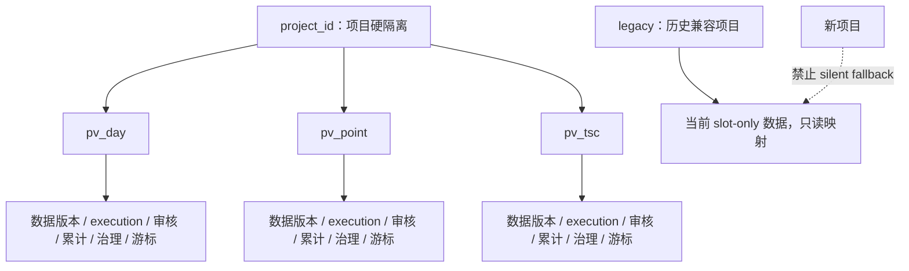
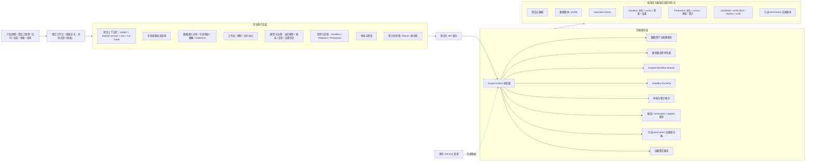
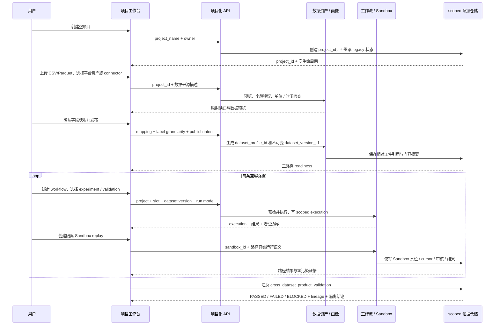

<!-- @AI_GENERATED -->
# 设计文档：pv-three-chain-product-validation（光伏三链产品建设与跨数据集验收）

> 规格类型：Build a Feature / Design-First。
> 设计范围：`pv_day`（设备日 RF）、`pv_point`（真实点 replay TCN）、`pv_tsc`（设备日 MultiRocket）三条产品链的项目化工作台、浏览器数据接入、逐页交互体验，以及通过浏览器接入非内置数据集完成跨数据集产品复验的目标能力。
> 设计状态：待实施。本文同时记录“当前已验证事实”和“目标产品设计”；目标能力不得被表述为当前已经实现。
> 规格收口边界：`design.md` — 设计文档、`requirements.md` — 需求文档 与 `tasks.md` — 实施任务文档 已统一收口；本规格仍处于待实施状态，不修改业务代码、数据、registry、candidate、游标或运行状态。
>
> **定位调整（重要）**：本规格的重心是**产品建设**，不是模型评测科学。用户已与业务负责人对齐方向——数据集质量本身不过关、团队做的是产品而不是 ML 评测科学，继续深挖精度收益很低。因此本文的主题是：**产品故事线的完整性、前后端功能对应、用户交互体验**。跨数据集验证只是**验收手段**，用来证明“迁移性、交互、执行与隔离成立”，不是本规格的主题；模型精度从“产品目标”降级为“产品证据与安全护栏”。
>
> 事实来源优先级：
> 1. `docs/project/pv_fault/PV_TSC_E2E_VALIDATION_HANDOFF_2026-09-08.md` — strict-10 与真实验收交接；它是 2026-09-08 的专项增量事实，针对 strict-10 是否完成及 `exec-validation-d741dc207593` 的状态，覆盖 2026-09-07 事实总览中的旧结论。
> 2. `docs/project/pv_fault/AGENTS.md` — 光伏三路径当前实现事实总览（三路径现状、TSC canonical 打标 UX 缺口、pv_point replay/loop-demo/告警分散、红线），用于约束除上述专项增量外的平台当前事实。
> 3. `docs/project/pv_fault/spec/pv-fault-multi-dataset-product-loop/product-design.md` — 多项目、多数据集目标产品 Draft，是本次产品故事线与逐页 UX 的**对齐基准**（§7 信息架构、§8 逐页交互、§9 生命周期状态、§12 权限、§13 视觉、§16 差距表）。
> 4. `docs/project/pv_fault/PVDAQ_ICAL_LEAKAGE_SAFE_BRIEF_2026-09-07.md` — 已执行 PVDAQ 外部数据 `i_cal` 泄漏安全 benchmark 简报，仅作为**一个只读离线证据案例**的事实来源，不再是全篇最重的一块。
>
> 事实型来源（1、2、4）高于产品 Draft（3）；同类事实冲突时，以日期更晚且范围更具体的证据为准。PVDAQ 离线 benchmark 已执行不等于平台三路径产品闭环已经验收。

## 导读：按角色应该读哪几节

全文分五段：**Overview（§1–5，定位与红线）→ Core Concepts（§6–8，隔离与运行语义）→ Architecture 与 IA（§9–11，架构与信息架构）→ 页面与交付合同（§12–30）→ 平台旅程（§31–39，跨模块连贯性）**。所有角色都应先读 §1 重心声明、§2 三类证据区分和 §5 当前事实红线，这三节决定其余内容的解释方式。

**§31–39 是平台级章节**，范围大于 pv 三链：它定义行业场景、算法方案、算法管理、工作流编排、回测、部署、精度运营之间的统一主干与上下文合同，pv-fault 工作台是这条主干上的第一个纵向样例。若只关心 pv 三链本身，可先读 §1–30；若要动导航、跳转参数或新建工作流入口，必须先读 §31–33。

| 角色 | 必读 | 可跳过 |
|---|---|---|
| 产品经理 / 业务负责人 | §1–5、§11 信息架构、§12–21 逐页故事线、§23 逐页状态合同、§24.1 角色矩阵、§30.2 实施顺序、§31 现状诊断、§34 三个入口、§35 逐段旅程 | §26 接口与数据模型、§29 测试分层 |
| 算法工程师 | §1–8、§15 运行、§16 治理、§19 累计、§20 TSC canonical、§25 readiness、§26.3 数据模型、§30.1 证据边界、§38 真实状态来源 | §28 视觉与响应式细则、§36 效率层 |
| 前端工程师 | §11 信息架构与现有组件归属、§22 状态模型、§23 逐页状态合同、§26.1 组件边界、§26.5 错误响应、§26.6 分页与恢复、§28 视觉 / 响应式 / 可访问性与文案、§32–37 主干 / 上下文 / 入口 / 效率 / 可达性 | §30.1 离线证据细则 |
| 后端工程师 | §6–8 隔离与运行语义、§25 readiness、§26 组件 / 接口 / 数据模型 / 字段流 / 错误 / 分页、§27.3 零污染、§29.1 正确性属性、§32 主干语义、§38 真实状态来源 | §12–14 页面视觉细节、§36 效率层 |
| 验收 / 交付实施 | §3 产品成功定义、§17 检测与回放、§18 审核与精度、§27 跨数据集验收、§29.2 测试分层、§30.3 交付检查清单、§34 三个入口、§37 可达性规则 | §26.2 REST 合同方向 |

三处“成功 / 完成”清单各管一件事，不可互相替代：**§3 产品成功定义** 是整个功能的产品目标；**§27.2 结果判定** 是单个跨数据集验收批次的 PASSED / FAILED / BLOCKED 口径；**§30.3 交付检查清单** 是每次交付前的自查项。判断“功能是否达标”看 §3，判断“这一批验收结论”看 §27.2，判断“这次改动能否交付”看 §30.3。

## Overview

### 1. 设计目标与重心：产品优先

本功能把光伏故障能力从“按功能入口组织”改造成“按项目生命周期组织”的连续产品旅程，并让第二个非内置数据集能够只通过浏览器走完整条闭环。它包含两条互补主线，但两者都服务于产品建设：

1. **产品建设主线（重心）**：让产品经理、算法工程师、交付实施、运营、审核、发布负责人在浏览器中完成
   ```text
   创建项目 → 接入数据 → 字段映射与质量检查 → 选择诊断路径
   → 搭建或复用工作流 → 打标 / 训练 → 模型候选与复验
   → 沙箱回放或生产滚动检测 → 人工审核 → 回流累计训练集
   → 冻结新快照 → 再训练 → 选择下一轮检测模型
   ```
   每个阶段都有清晰的信息架构、逐页交互、状态文案和下一步指引。这是本次交付的主体。

2. **跨数据集验收主线（手段）**：用一个非内置数据集验证上述产品故事线的迁移性、交互、执行与隔离是否真正成立。它是验收方式，不是规格主题。跨数据集产品复验成功只证明“产品能迁移、能操作、能隔离”，不自动证明模型达到生产精度，也不自动产生生产治理资格。

**重心声明**：本文用于评审和实施的核心产物是——**统一项目工作台信息架构、逐页交互设计、统一生命周期状态模型、两条产品故事线缺口（TSC canonical 打标 UX 与 pv_point 页面收敛）的一等交付、视觉与权限体验规范**。PVDAQ `i_cal` 校准评测只作为“跨数据集验收”里的一个只读离线证据案例出现，附带诚实护栏，不构成独立主线。

### 2. 三类证据与“复验”必须严格区分（诚实护栏，红线）

即使降低了评测科学的篇幅，下面这条诚实护栏不弱化：三类“复验/证据”不可互换，且只有正式候选复验有治理效力。

| 概念 | 中文定义 | 治理效力 |
|---|---|---|
| `offline_benchmark_evidence` — 离线 benchmark 证据 | 在固定数据 universe、标签顺序和 split 下执行的离线算法/校准比较。PVDAQ `i_cal` 消融属于此类；它证明了若干离线事实，但未证明平台 UI、API、workflow、Sandbox 或治理闭环 | **none**：不能自动成为 candidate、正式 verification、滚动指针或 Promote 证据 |
| `cross_dataset_product_validation` — 跨数据集产品复验 | 用非内置数据验证项目创建、接入映射、路径兼容性、工作流运行、Sandbox 回放、页面交互、证据 lineage 和项目隔离是否成立 | **none**：不得自动登记 candidate、创建正式 verification、设置滚动指针或 Promote |
| `verification_id` — 正式模型候选复验记录 ID | 对一个 provenance 完整、可治理的 `model_candidate_id` — 模型候选记录 ID 按固定 `evaluation_contract` — 评测量尺 执行的正式治理复验 | 只有 `passed=true` 才是后续滚动指针或 Promote 的必要证据，且仍需人工确认与 scope 校验 |

命名与 UI 必须避免把三者都显示成模糊的“复验成功”：离线结果用“benchmark 证据 / 校准消融”；跨数据集页面用“产品复验 / 迁移验证”；模型治理页面用“候选正式复验”。`cross_dataset_product_validation_id` — 跨数据集产品复验批次 ID 不得填入 `verification_id` 字段；`offline_benchmark_evidence` 不得被治理服务接受为替代证据。

### 3. 产品成功定义

产品成功不由单一精度数字定义，而由以下可验证维度定义（对齐 Draft §2.3）：

| 维度 | 成功标准 |
|---|---|
| 浏览器闭环 | 用户可从新项目创建走到再训练，不需要终端、手工 API、手改 JSON 或填写服务器文件路径。 |
| 新数据集接入 | 每条路径至少使用一套通过前端新接入的数据集完成一次产品复验；可共用一套同时满足三条路径合同的数据，也可分别选用满足各路径合同的数据集。 |
| 无代码适配 | 新数据集只做注册、字段映射和合同配置，不新增写死文件名或客户专用分支。 |
| 状态透明 | 所有空态、加载态、错误态、禁用态、数据不足、只读和成功状态均有明确中文文案与下一步。 |
| 隔离安全 | 两个独立项目并存运行时，累计账本、候选、registry、审核、游标和检测结果零串场。 |
| 证据完整 | 每个模型结果都可追溯到项目、数据版本、工作流、execution 和快照。 |
| 失败恢复 | 页面刷新或跳转后仍能恢复长任务；可恢复错误保留重试入口。 |
| 决策诚实 | 实验成功不等于生产可用；生产资格和指标限制在界面中明确区分；无有效真值显示“未产出”而非 0%。 |

### 4. 非目标

- **不以提升 BA、Macro-F1、PR-AUC、召回率或替换模型作为交付主线。** 精度只作为产品证据和安全护栏。
- 不把 PVDAQ 离线 benchmark、`history_past_only` 的相对优势或任一高分合同解释为平台闭环已验收、production-ready 或正式治理已通过。
- 不把 `leaky_device_ical` — 使用评估期标签和测试设备拟合的泄漏上界合同 用于 production、candidate、正式 verification、滚动指针或 Promote；该合同只允许 diagnostic experiment。
- 不把继续调模型、`history_nonnegative`、`history_robust_envelope`、残差/比例通道或阈值调优列入本规格范围；它们属于未来独立实验，不在本产品规格内定义。
- 不要求三条路径使用同一种模型、标签粒度、调度方式或 execution 组织方式。
- 不把跨数据集产品复验成功解释为正式候选通过、生产可用或已 Promote。
- 不降低 `min_test_samples` — strict 单轮最少测试样本数、不关闭设备/日期隔离、不减少 `n_repeats` — strict 重复次数，以制造更好看的结果。
- 不把 `pv_point` 的真实点因果 replay 改造成伪日批处理；不开放 TSC 生产观测台的“推进一天”或手工伪造检测。
- 不在第一阶段重写所有历史 slot-only 数据；历史数据通过只读 `legacy` — 历史兼容项目 映射承接。
- 不给历史 TSC candidate 手工补 provenance，不强制 Promote，不用 validation execution 登记正式 candidate。

### 5. 必须保留的当前事实基线（红线）

下列事实属于当前实现与真实证据，不因目标产品设计而改变：

- `pv_day` 当前检测仍使用无 slot 的 quickval predict 图，不得描述为已经迁移到 `workflow-pv-day-predict-v1` — day 专用预测工作流。
- `pv_point` 当前仍由 `SeqDailyStrategy` — 点路径逐点 replay 策略 直连 predictor；不得伪造冻结 predict workflow execution provenance。
- `pv_tsc` 的 canonical label UI 尚未完成真实浏览器 E2E；旧 KMeans REST shortcut 即使成功，也不得冒充 `workflow-pv-tsc-label-v1` — TSC 规范模型辅助打标工作流 成功。
- 当前 TSC 累计 freeze 含 1,056,806 行，但只有 35 个离散可信标签日期；它们跨越 671 天，不是连续 35 天，也不等于原始业务库只有 35 天。
- `exec-validation-d741dc207593` — 已真实完成 strict-10 的 TSC validation execution，10/10 split 成功，`production_contract_valid=true` 只说明合同完整；其 `governance_eligible=false`，不能登记 candidate、设置 `rolling_detect_model` — 下一轮滚动检测模型指针，或 Promote。
- strict-10 的隔离、10 repeats 和最少测试样本门槛不得因低 `macro_f1_mean` — 固定标签空间平均 Macro-F1 或数据稀疏而降低。
- TSC 生产观测保持只读；隔离 Sandbox 可运行冻结预测图，但不能改变 production 水位、游标、审核或精度证据。
- validation / Sandbox 必须对 candidate、registry 和适用 proposal 真源执行 SHA256 零污染断言。
- 当前历史 TSC Challenger provenance 不完整、无正式 verification 和 rolling pointer；不得反向补写来源字段或强制 Promote。
- PVDAQ `i_cal` 消融已完成一次固定 10 折设备隔离 benchmark，是已执行的外部数据离线事实，不是平台三路径产品 E2E、工作流接入或治理验收。
- PVDAQ `pv_day` 当前 quickval、`pv_point` 直连 predictor 的事实同样适用于 PVDAQ 数据；PVDAQ 当前设备日标签不能作为 `pv_point` 点级 supervised truth，5 分钟原始点只可支撑无标签 Sandbox 因果 replay。

## Core Concepts and Scope

### 6. 核心字段与对象词典

| 字段 / 对象 | 中文含义与产品用途 |
|---|---|
| `project_id` | 客户 / 交付项目硬隔离键。新产品 API、URL、execution context 和各 scoped 仓储必须显式携带。 |
| `project_name` | 用户可读的项目名称，例如“外部电站 A 三路径复验”。不承担隔离职责。 |
| `slot` | 项目内诊断策略通道，固定为 `pv_day`、`pv_point`、`pv_tsc`；历史 `pv_fault` 仅只读兼容。 |
| `dataset_id` | 项目内逻辑数据资产 ID；一个资产可有多个不可变版本。 |
| `dataset_version_id` | 已发布的不可变数据版本 ID；绑定 workflow、execution、replay、审核和证据 lineage。 |
| `dataset_profile_id` | 版本化数据画像 ID，保存字段映射、时间语义、实体键、单位、采样、标签粒度以及可支持的校准语义。 |
| `i_cal_contract` | 期望电流参照的生成 / 拟合边界合同；使用 `i_cal` 时必须随数据版本、execution 与证据持久化。诚实护栏见第 30 节。 |
| `run_mode` | 运行目的枚举：`experiment`、`validation`、`production`。不表示运行域或页面权限。 |
| `run_domain` | 运行域，例如 `production` 或 `sandbox`；决定状态根、游标、审核和结果写到哪里。 |
| `sandbox_id` | 隔离 Sandbox 实例 ID；所有 Sandbox 水位、cursor、审核和结果必须以它分区。 |
| `cross_dataset_product_validation_id` | 跨数据集产品复验批次 ID，用于聚合多个项目 / 数据版本 / 路径场景与证据包，不是正式 `verification_id`。 |
| `workflow_id` | 冻结工作流或项目内工作流版本 ID。 |
| `execution_id` | 单次工作流执行证据 ID；可回查图摘要、输入版本、节点状态、输出、时间和运行模式。 |
| `review_id` | 审核会话 ID；必须携带项目、路径、数据版本、来源 execution / 检测批次。 |
| `review_slot` | 审核队列按路径过滤的槽位参数，例如 `review_slot=pv_tsc`。 |
| `snapshot_id` | 按项目和路径累计后 freeze 得到的不可变训练快照 ID。 |
| `model_candidate_id` | 模型候选记录 ID；必须来自成功且可治理的 production execution，并关联项目、路径、快照和评测合同。 |
| `verification_id` | 与正式模型候选绑定的治理复验 ID；不得由产品复验批次 ID 替代。 |
| `comparison_id` | 异步复验 / 多窗口比对任务 ID，用于前端轮询状态。 |
| `registry_version` | registry 乐观并发版本，用于防止多人覆盖当前模型选择。 |
| `rolling_detect_model` | registry 中显式指定给下一轮检测消费的模型 / 候选引用；不等于最近训练模型或 Challenger。 |
| `labeling_mode` | 打标来源模式；canonical 画布产出与历史 REST shortcut（`labeling_mode=shortcut`）必须区分，shortcut 不得冒充 canonical。 |
| `governance_eligible` | execution 是否允许进入正式候选与治理；validation 必须为 `false`。 |
| `evaluation_contract` | 固定评测量尺，定义表示、切分、隔离、重复次数等；不是被测 workflow 结构。 |
| `production_contract_valid` | 生产评测合同是否完整有效；不等于精度达标，不自动允许 Promote。 |

### 7. 目标 scope 与 legacy 兼容

目标最低隔离键是：

```text
(project_id, slot)
```

数据、运行和业务对象继续细分：

```text
(project_id, slot, dataset_id, dataset_version_id)
(project_id, slot, workflow_id, execution_id)
(project_id, slot, review_id)
(project_id, slot, snapshot_id)
(project_id, slot, model_candidate_id, verification_id)
(project_id, slot, run_domain, sandbox_id, cursor_key)
```



兼容规则：

1. 当前按 `slot` 分区的数据是现状，不在本功能中伪造项目来源；统一只读映射为 `project_id=legacy`。
2. 新项目 API 缺少 `project_id` 时 fail-closed，返回可读 4xx；不得静默落到 `legacy`、`pv_day`、`pv_point` 或 `pv_fault`。
3. 新项目找不到 scoped 对象时返回“当前项目未产出”，不得读取 legacy 同槽数据补位。
4. 只有显式进入历史兼容项目的只读页面可读取旧目录；legacy 不承接新项目的准入、freeze、candidate、registry 或 cursor 写入。
5. 不把客户编码进 `slot`，例如禁止创建 `customer_a_pv_day`；路径语义保持稳定，项目隔离由 `project_id` 承担。

### 8. 运行模式、运行域与交互状态

这三个维度彼此正交，不得合并成一个枚举（红线）：

#### 8.1 `run_mode` — 运行目的

| 值 | 中文目的 | 默认治理资格 | 用户看到的主文案 |
|---|---|---|---|
| `experiment` | 实验运行 | 默认不可自动治理 | “实验结果可用于分析，但尚未取得生产资格。” |
| `validation` | 受控验证 | 强制 `governance_eligible=false` | “验证成功只说明流程和证据合同成立。” |
| `production` | 正式产品运行 | 仍需逐项门控 | “此操作将改变项目的正式数据或模型状态。” |

新数据第一次运行默认 `experiment`。`production` 必须由用户显式选择，并通过项目、路径、数据版本、来源、权限、评测和人工意图门禁。

#### 8.2 `run_domain` — 状态写入域

- `production`：写正式项目状态根；只有 production run_mode 且通过门禁的动作可以使用。
- `sandbox`：写隔离状态根；可承载 experiment 或 validation，但永远不得写 production 水位、cursor、review、candidate、registry 或精度真源。

Sandbox 不是第四种 `run_mode`。例如“Sandbox 中的 validation”同时满足 `run_mode=validation` 与 `run_domain=sandbox`。

#### 8.3 read-only — 交互权限 / 页面状态

read-only 表示当前页面或角色只能读取，不决定 execution 运行目的。例如 TSC production 观测页是 read-only；用户仍可从授权入口创建独立 Sandbox experiment。read-only 也不是 `run_mode`。

## Architecture

### 9. 目标高层架构



架构原则：

- 浏览器不直接读取磁盘路径或猜测历史状态；页面结论来自显式 scoped API 或证据聚合响应。
- 所有响应回显 `project_id + slot`；涉及数据的响应还回显 `dataset_version_id`。UI 在渲染前二次校验响应 scope。
- 项目、slot 或数据版本切换时，前端立即清空上一个上下文的可见状态、请求缓存和可写动作，不能让旧数据在新上下文加载期间继续显示。
- execution 全局 ID 可保持唯一，但其记录必须保存项目、路径、数据版本、运行模式与运行域；“某 workflow 的 latest”不能替代 scoped latest。

### 10. 数据接入与跨数据集复验主序列



## Product Information Architecture

### 11. 项目工作台一级结构与路由

新增**平台级“项目工作台”**作为目标一级入口，它**领域无关**：用户先进入某个项目，再处理该项目的数据与路径生命周期，而不是先在全局菜单里找功能。工作台壳、项目上下文栏、生命周期阶段带、下一步栏与 scope 清空规则由平台统一提供；每个业务领域（光伏故障诊断、后续的负荷预测等）通过 §11.5 的**解决方案能力适配层**声明自己的诊断路径集合、生命周期阶段、readiness 合同与要内嵌的现有面板。

**范围红线**：本规格只实现**领域无关的工作台壳**与**光伏故障诊断适配器**（诊断路径 `pv_day` / `pv_point` / `pv_tsc`）。负荷预测等其他领域是后续独立工作，本规格不实现其业务；但工作台壳必须做到——新增一个领域只需注册一个适配器，**不改动壳、路由骨架、上下文栏或 scope 规则**。左侧只保留一个“项目工作台”入口，绝不为每个领域各建一个一级项。

```text
项目工作台（领域无关，单一一级入口）
├── 项目列表（跨领域：光伏故障、负荷预测…）
└── 单项目工作台（按项目绑定的 scenario_id + solution_id 选用领域适配器）
    ├── 总览
    └── 若干生命周期阶段（阶段集合由领域适配器提供）
```

每个项目自带 `scenario_id` — 行业场景 与 `solution_id` — 算法方案，据此选用对应领域适配器渲染阶段与内容。光伏故障适配器提供的阶段序列为：数据与兼容性 › 工作流与运行 › 模型与治理 › 检测与回放 › 审核与精度 › 累计训练集；负荷预测等领域可声明不同的阶段集合与是否包含审核 / 累计阶段。

路由采用**领域无关**前缀 `/projects/*`，不把领域名写进路径；领域由项目记录的 `solution_id` 解析，而不是 URL 段：

| 目标路由（领域无关） | 页面职责 |
|---|---|
| `/projects` | 跨领域项目列表、创建项目、最近活动和历史兼容项目入口。 |
| `/projects/{project_id}/overview` | 按项目绑定解决方案渲染生命周期矩阵、最短阻断项、当前数据版本与下一步。 |
| `/projects/{project_id}/data` | 数据上传 / 注册、平台资产、connector、字段映射、画像、readiness 和版本发布。 |
| `/projects/{project_id}/workflows` | 项目工作流、模板复制、数据版本绑定、预检和运行入口。 |
| `/projects/{project_id}/runs` | scoped execution 列表、运行恢复、失败和证据详情。 |
| `/projects/{project_id}/models` | 当前检测模型、待处理候选、实验结果、正式 verification、registry 和治理历史。 |
| `/projects/{project_id}/operations` | 检测与回放：Sandbox 回放、Validation 观察与 Production 观测；路径保持真实运行语义。 |
| `/projects/{project_id}/reviews` | 按项目与路径分区的审核队列、来源证据、精度和可选准入（是否适用由领域适配器声明）。 |
| `/projects/{project_id}/cumulative` | 入账事件、freeze、snapshot、再训练和版本差异（是否适用由领域适配器声明）。 |
| `/projects/{project_id}/validations/{cross_dataset_product_validation_id}` | 跨数据集产品复验批次、路径覆盖、截图、网络 / console、SHA256 与隔离结论。 |

> 兼容说明：本规格早期示例与已提交的交互 Demo 使用 `/pv-fault/demo`；正式实现改用领域无关的 `/projects/*`，`/pv-fault/*` 仅保留为 Demo 与历史兼容，不作为生产项目工作台入口。

#### 11.1 工作台布局：沿用现有全局壳，生命周期改为横向阶段带

视觉方向遵循现有 PRODUCT.md：克制、专业、可靠。**使用场景句**：算法工程师和交付人员在白天办公室的 13–27 英寸屏幕上，专注地核对复杂状态和推进任务；界面应高密度但稳定、明亮、可扫读。**参考锚点**：Linear（状态、负责人和下一动作靠近任务）、GitLab Pipeline（运行节点、日志和失败恢复清晰）、MLflow（实验、数据、模型和 lineage 可追踪）。

**布局约束（已定）**：**沿用 `frontend-sevice/src/components/MainLayout.tsx` 现有全局布局壳**，不替换、不新建第二套 shell。现有壳子提供固定左侧全局菜单（宽度可拖拽 180–420px 并持久化）、顶部条与移动端抽屉，且已针对 pv-fault 路由切换为深色侧栏加橙色选中态。因此**生命周期导航不做成第二条左侧竖导航**——双竖导航会挤压密集表格并造成"我该点左边哪一栏"的困惑。生命周期改为**内容区顶部的横向阶段带**。

工作台在现有壳子的内容区内自上而下分四层：

```text
┌────────────┬──────────────────────────────────────────────────────────┐
│ 全局菜单   │ ① 项目上下文栏（复用 .pv-page-header）                    │
│（现有壳，  │    项目 PVDAQ 复验 · 数据版本 v3 · 路径 pv_tsc            │
│  深色侧栏，│    · 模式 实验 · 域 sandbox · 10:32      [切换路径 ▾]     │
│  宽度可拖）├──────────────────────────────────────────────────────────┤
│            │ ② 生命周期阶段带（横向 6 段，复用 story rail）             │
│ 行业服务   │    数据 › 工作流与运行 › 模型与治理 › 检测与回放           │
│ 项目工作台 │    › 审核与精度 › 累计训练集      每段带状态色与文字        │
│  ◀ 当前    ├──────────────────────────────────────────────────────────┤
│            │ ③ 下一步条（通栏，唯一主动作 + 原因 + 影响 + 次动作）      │
│ 算法开发   ├──────────────────────────────────────────────────────────┤
│  算法部署  │ ④ 内容区（三路径矩阵 / 数据表 / 节点时间线 / 审核证据）    │
│  精度运营  │                                                          │
└────────────┴──────────────────────────────────────────────────────────┘
```

- **① 项目上下文栏**复用现有 `.pv-page-header`（左标题右动作的既有页头样式），持续显示 `project_name`、`dataset_version_id`、`slot`、`run_mode`、`run_domain` 和最近更新时间；它**吸收现有页面右上角的槽位下拉**，不再另设一处路径选择器。使用期望电流参照时附带 `i_cal_contract`，查看 benchmark 时显示证据类型与版本。
- **② 生命周期阶段带**表达"数据→工作流→模型→检测→审核→累计"的顺序，每段显示阶段名、一句状态说明和状态标签，点击进入该阶段页面。它同时承担"我在哪一步"和"哪一步卡住"，因此不再需要竖向导航。总览是项目首页（承载阶段带与三路径矩阵），不算第七个阶段。
- **③ 下一步条**改为**通栏条带而非右侧竖栏**：现有壳子已占用左侧固定宽度，再切一条右栏会让密集表格无处安放；且现有 pv-fault 页面本就把动作放在页头行。下一步条固定解释"为什么能做、会写到哪里、下一步是什么"，只提升一个主动作。仅当内容区可用宽度 ≥1400px 时，允许把下一步条改为右侧常驻栏作为增强。
- **④ 内容区**承担数据表、运行图、节点时间线和审核内容。原始 JSON、完整路径和内部日志位于抽屉式"诊断详情"，不占据主信息层。
- 断点按**内容区可用宽度**判定，不按视口宽度，因为全局侧栏宽度由用户拖拽决定（详见 §28.2）。

#### 11.2 现有页面渐进复用

现有全局页面继续承担兼容职责，第一阶段通过带上下文的深链接渐进复用，不一次性推倒重做。项目工作台生成的深链接至少携带 `project_id + slot`，涉及数据时同时携带 `dataset_version_id`：

- `/algorithm-deployment?project_id={project_id}&slot={slot}&dataset_version_id={dataset_version_id}` — 模型与治理兼容页。
- `/accuracy-operations?project_id={project_id}&slot={slot}&dataset_version_id={dataset_version_id}` — 精度与证据兼容页。
- `/iterative-labeling?project_id={project_id}&tab=review&review_slot={slot}&dataset_version_id={dataset_version_id}` — 审核兼容页。
- `/datasets/cumulative-training?project_id={project_id}&slot={slot}&dataset_version_id={dataset_version_id}` — 累计与 freeze 兼容页。
- `/workflow/editor/{workflow_id}?project_id={project_id}&slot={slot}&dataset_version_id={dataset_version_id}` — 工作流编辑兼容页。

兼容页在迁移完成前可针对 `project_id=legacy` 只读展示当前 slot-only 事实；任何新项目写操作必须走 scoped API，不能因旧页面缺少参数而回落旧真源。

#### 11.3 项目切换与 scope 清空

项目、slot 或数据版本切换时：

1. 立即取消或忽略旧 scope 的在途读取；
2. 清空旧项目表格、图表、按钮上下文和错误；
3. 新响应到达后校验 `project_id + slot + dataset_version_id`；
4. 不一致响应进入 `scope_mismatch` 错误态，不得渲染。

#### 11.4 现有组件归属：包装优先，不重写已工作的面板

现有 pv_fault 页面已承载可用的三槽业务内容。本设计采用**包装优先**策略：新项目工作台负责 scope 上下文、统一状态壳、唯一主动作和下一步栏；内容区第一阶段内嵌现有面板，等 §22–§23 的状态合同稳定后再逐个抽取为共享组件。禁止在第一阶段并行新建一套功能重复的面板。

| 现有文件 | 当前职责 | 目标归属 | 第一阶段动作 |
|---|---|---|---|
| `frontend-sevice/src/components/MainLayout.tsx` — 全局导航与布局壳、语言切换、运行中浮标 | 全站一级菜单与响应式抽屉 | 保留为全局壳；新增**领域无关的“项目工作台”**单一一级入口（不叫“光伏故障项目”，不为每个领域各建入口） | 只加入口和 `/projects/*` 路由，不改现有分组结构与既有菜单项 |
| `frontend-sevice/src/pages/IterativeLabelingListPage.tsx` — 标注工作台 tab、三槽审核选择、天 / 点打标入口 | 审核与打标入口 | 拆为项目内“审核与精度”（§18）与 TSC canonical 打标入口（§20） | 保留页面并接受 `project_id` 深链接；新工作台内嵌其审核队列区块 |
| `frontend-sevice/src/components/slot/SlotLabelProposalReviewPanel.tsx` — 三槽提案审核，TSC 展示设备日时序与重叠窗口证据 | 审核详情主证据区 | 直接复用为 §18 审核详情内容区 | 不重写；只补 scope 入参与统一状态壳 |
| `frontend-sevice/src/pages/AccuracyOperationsPage.tsx` — 按 slot 分发三条路径精度面板 | 精度运营 | 并入项目内“审核与精度”的精度区块（§18） | 保留页面；新工作台内嵌，精度只读不与裁决争主动作 |
| `frontend-sevice/src/components/slot/PvTscAccuracyOpsPanel.tsx` — TSC 运行状态、审核精度、候选评估与观测 | TSC 精度与运行观测 | 拆分：精度进 §18，运行观测进 §17，候选评估进 §16 | 第一阶段整体内嵌；抽取放到 TSC 任务里做 |
| `frontend-sevice/src/pages/AlgorithmDeploymentPage.tsx` — 模型部署、治理与调度总入口 | 治理与调度 | 拆为项目内“模型与治理”（§16）与“检测与回放”的 Production 观测（§17） | 保留为兼容页；新治理页按四层重建结构，内容区复用其治理子组件 |
| `frontend-sevice/src/components/slot/SlotDeployedModelPanel.tsx` — 已部署模型、治理状态与操作入口 | 当前模型与治理动作 | 归入 §16 的“当前检测模型”层 | 复用展示；按 §16 替换含义模糊的动作名，并接受 `expected_registry_version` |
| `frontend-sevice/src/components/pv-fault/ModelPathManager.tsx` — Champion / Challenger 等路径模型管理 | 模型角色管理 | 归入 §16 的“待处理候选”与“治理历史”层 | 复用；补 provenance 缺口展示与禁用原因分类 |
| `frontend-sevice/src/pages/CumulativeTrainingLedgerPage.tsx` — 累计入账、freeze 与重训状态 | 累计训练集 | 直接对应 §19 累计三层 | 保留页面并接受 `project_id`；新工作台内嵌并补 freeze 确认区 |
| `frontend-sevice/src/pages/WorkflowEditorPage.tsx` — 工作流画布编辑 | 画布编辑 | 保持独立页；由 §15 通过深链接进入 | 只补 scope 参数透传，不在工作台内重建画布 |

新建而非包装的部分只有四处，因为现有代码里没有对应实现：项目列表与创建（§12）、数据接入向导（§13）、项目总览生命周期矩阵（§14）、共享运行中心（§15）。`pv_point` 运行会话页（§21）属于**收敛重组**：复用现有 replay、cursor、outcome 与告警数据源，但按 §23.1 重建为单一会话页面。

判断标准：**能用现有组件回答用户五问的，包装；不能回答的，才新建。** 抽取共享组件的前提是至少两个页面已经在用同一状态合同，避免过早抽象。

#### 11.5 解决方案能力适配层（让工作台领域无关）

项目工作台壳必须**领域无关**，这样后续接入负荷预测等领域时不改壳。领域差异全部收敛到一个**解决方案能力适配器** `SolutionCapabilityAdapter` — 按 `solution_id` 提供某业务领域在工作台内的全部差异化配置；壳只依赖该接口，不出现任何 `if (solution === 'pv_fault')` 式硬编码分支。

**适配器职责（输入 `solution_id`，输出领域配置）**：

| 适配器提供项 | 含义 | 光伏故障适配器取值 |
|---|---|---|
| `paths` | 该领域的诊断路径集合及展示词 | `pv_day` / `pv_point` / `pv_tsc`（UI 显示“诊断路径”） |
| `lifecycleStages` | 生命周期阶段集合、顺序与标签 | 数据 › 工作流与运行 › 模型与治理 › 检测与回放 › 审核与精度 › 累计训练集 |
| `readinessContract` | 每条路径的 readiness 判定输入与结论枚举（§25） | 三路径各自的 readiness 规则 |
| `stagePanels` | 每个阶段内嵌的现有面板 / 页面（§11.4 归属表） | 审核内嵌 `SlotLabelProposalReviewPanel` 等 |
| `capabilities` | 该领域是否包含审核、累计训练集、canonical 打标等可选阶段 | 均包含 |
| `stateVocabulary` | 领域特有状态文案键（在 §28.4 集中词汇之上扩展） | pv_point 因果、TSC 288×3 等术语 |

**壳与适配器的边界（红线）**：

1. 工作台壳只负责 scope 上下文栏、阶段带渲染、下一步栏框架、路由骨架与 §11.3 的 scope 清空；**所有领域语义来自适配器**。
2. 新增领域 = 新增一个适配器注册项 + 该领域自己的后端 scoped 能力；**不得修改壳、`/projects/*` 路由骨架、上下文栏或 scope 规则**。
3. 若某领域未注册适配器，项目工作台对该项目显示“该解决方案尚未接入工作台”，而不是回落到光伏配置或报错崩溃。
4. **本规格只交付光伏故障适配器**；负荷预测适配器只在此定义接口位置，不在本规格实现，也不因此在壳里预埋负荷预测专用分支。

这样，“项目工作台”这一名称与实现都不绑定光伏；光伏三链是第一个、也是本规格唯一实现的适配器样例。

## Page and Interaction Design

> 本章是本次交付重心，逐页交互对齐 Draft §8。每页统一回答用户五问：我在哪个项目、处理哪个数据版本和路径、走到哪一步、为什么能继续或被阻断、下一步点什么与影响什么。内部 ID 和原始证据是二级信息，不取代一级结论。

### 12. 项目列表与创建项目

**页面目标**：让用户从“客户 / 数据场景”进入产品，而不是从算法功能入口开始猜。

**项目列表字段**：项目名称、当前数据版本、已启用路径、路径健康状态、待审核数量、当前滚动模型数量、最近运行和最近失败、项目负责人、最后更新时间。

**创建项目流程**：

1. 输入项目名称、说明和负责人；
2. 选择“新项目”或“从现有项目结构复制”；
3. 创建后进入数据接入，不自动继承任何历史 Champion、Challenger、累计账本或游标；
4. 系统生成 `project_id`，后续页面 URL 和请求都携带该值。

**状态**：

- 空态：“还没有项目。创建项目后先选择行业场景与算法方案，再接入数据并选择诊断路径。”（项目列表跨领域，不写死某个业务领域）
- 创建中：按钮 loading，禁止重复提交；
- 名称冲突：保留表单并解释冲突，不清空已填内容；
- 创建成功：展示下一步“接入第一个数据集”。

### 13. 数据接入向导

**用户旅程**（对齐 Draft §8.2）：

```text
选择来源 → 上传 / 连接 → 预览 → 字段映射 → 数据质量 → 路径兼容性 → 发布版本
```

**第 1 步 选择来源**：上传 CSV / Parquet；选择已有平台数据资产；注册数据库或对象存储 connector；复用当前项目中的历史版本。用户选择的是数据资产，不输入后端文件路径；持久化只保存相对 `artifact_ref` — 工件引用 或 `connector_id` — 数据连接器 ID，不在页面或证据中暴露凭据。

**第 2 步 上传 / 连接**：浏览器显示文件名、大小和预览；connector 预览限制行数和时间范围，完整物化异步执行。

**第 3 步 预览**：展示样例行、列类型和基本统计，帮助用户判断映射。

**第 4 步 字段映射**（用户必须确认，不能只依赖自动猜测）：

| 映射维度 | 必须确认的内容 | 对路径的影响 |
|---|---|---|
| 时间 | 时间列、时区、格式、采样频率、重复点和迟到点策略 | 决定日边界、point event-time 顺序和 TSC 288 格点 |
| 实体 | `site_id` — 站点、`device_id` — 设备、`branch_id` — 支路 的列与业务含义 | 决定去重、设备隔离、游标和审核单位 |
| 测量 | `value` — 实测电流、`i_cal` — 期望电流参照、`rated_power_kw` — 额定功率、`is_measured` — 实测掩码 的物理含义与单位 | 决定 day 特征、point 因果窗口、TSC 通道；`i_cal` 不是 ground truth |
| 标签 | 标签列、标签字典、未知标签策略 | 决定监督训练与审核展示 |
| 标签粒度 | 点级、区间级或设备日级 | 禁止把设备日标签冒充 `pv_point` 点级真值 |
| 质量策略 | 空值、异常时间、重复、采样空洞和设备日拒绝策略 | 形成数据画像与路径 readiness |

**第 5 步 数据质量**（按“事实 → 影响 → 建议”展示，而不是只给红绿分数）：

| 检查 | 示例结论 | 产品影响 |
|---|---|---|
| 日期覆盖 | 671 天跨度内只有 35 个实际日期 | TSC strict 日期隔离可能不稳定。 |
| 设备覆盖 | 某设备从未进入测试侧 | 泛化结论不完整，但仍可做实验。 |
| 采样完整率 | 白天占用低于 80% | 设备日可能进入等待或拒绝。 |
| 标签分布 | 部分类别样本极少 | 生产复验受阻，实验仍可保留。 |
| `i_cal` 可用性 | 缺失或尺度差异过大 | `pv_day` / `pv_tsc` 需要明确校准语义。 |
| 点级真值 | 只有设备日标签 | `pv_point` 不能把整日标签冒充逐点真值。 |

“105 万行”之类数值必须同时给出设备日和离散日期解释；不得从行数推断连续日期覆盖。

**第 6 步 路径兼容性**：对每条路径独立返回 readiness（详见第 25 节），说明事实、影响和修复动作，不给项目一个模糊的总分。

**第 7 步 发布版本**：用户确认映射后发布不可变数据版本，展示 `dataset_id`、`dataset_version_id`、`dataset_profile_id`、内容摘要和相对工件引用、三条路径兼容性，以及下一步“为可用路径创建工作流”。

### 14. 项目总览：三路径生命周期矩阵

总览核心不是 KPI 卡，而是三条路径的生命周期矩阵（对齐 Draft §8.3）。每个单元格包含文字状态和图标，颜色只是辅助；点击单元格进入对应证据，不弹出无上下文的通用 Modal。

| 路径 | 数据 | 工作流 | 最近训练 | 候选 / 复验 | 滚动模型 | 检测 | 待审核 | 累计快照 | 下一步 |
|---|---|---|---|---|---|---|---|---|---|
| `pv_day` | 可实验 | 已配置 | 成功 | 待复验 | 未设置 | 未开始 | 0 | v2 | 发起复验 |
| `pv_point` | 缺点级标签 | 草稿 | — | — | — | — | 12 | v1 | 完成审核 |
| `pv_tsc` | 数据稀疏 | 已配置 | validation 成功 | 无可治理候选 | 未设置 | 只读待运行 | 3 | v2 | 发起正式重训 |

总览顶部只显示少量真正重要的项目状态：是否已有已发布数据版本、三路径各自最短阻断项、是否存在运行失败或审核积压、下一轮检测分别使用哪个模型、最近一次累计闭环推进到哪里。

### 15. 工作流与运行：创建 + 执行前预检 + 运行中心

**创建工作流**：用户可从三条路径的 canonical 模板创建项目工作流、复制项目内已有工作流、从空白画布搭建，并选择数据版本绑定到加载节点，保存为项目内工作流版本。模板是起点，不是只能使用的固定流程；修改节点参数保存的是项目工作流版本，不覆盖共享模板。

**执行前预检**（点击运行后先进入内联预检，不立即启动计算）覆盖：当前项目 / 路径 / 数据版本 / 运行模式、必填字段与数据表示、标签粒度、样本 / 日期 / 设备 / 类别覆盖、工作流端口与节点合同、评测合同、预估资源和长任务提示、当前是否只能 `experiment`。结果分三类：

- **阻断**：无法形成输入或工作流结构无效；
- **警告**：可实验，但不可获得生产资格；
- **通过**：可以按所选模式运行。

**运行中心**（运行后自动进入 execution 详情，用节点时间线而非单个“运行中”文案）：

```text
运行状态：运行中 · 节点 2/5 · 已用 04:32
数据：PVDAQ v3    路径：pv_tsc    模式：实验

[加载数据 ✓] → [构建 288×3 ✓] → [训练与评测 ●] → [保存模型] → [登记结果]

当前节点：训练与评测
最近日志：seed 4/10 completed
```

必须覆盖：pending、running、success、failed、cancelled、页面刷新恢复、长时间无更新、后端记录不存在。成功后不要只显示“运行成功”，而是给出**结果去向**：仅实验工件 / validation execution / 可治理模型候选 / 打标提案 / 预测批次和待审核会话。

### 16. 模型与治理：四层结构与直白动作

页面按四层组织（对齐 Draft §8.5），不得把所有模型工件放在同一张表里只显示一个模糊“状态”：

1. **当前检测模型**：下一轮到底消费哪个模型（读 `rolling_detect_model` / `champion`）；
2. **待处理候选**：哪些候选缺复验、复验失败或可以继续；
3. **实验结果**：未取得治理资格的运行（`governance_eligible=false`）；
4. **治理历史**：verification 和 Promote 审计。

**候选到滚动模型的顺序**：

```text
训练成功
→ provenance 完整的 model candidate
→ 正式 verification
→ verification passed
→ 显式设置 rolling_detect_model
→ 观察运行
→ 必要时 Promote 为 Champion
```

**按钮名称必须直接表达语义**（废掉含义模糊的“设为生产”）：

- “登记为实验结果”；
- “发起正式复验”；
- “设为下一轮检测模型”；
- “晋升为生产 Champion”。

**registry 说明（四件事）**：

1. **存什么**：当前项目和路径认定的 `champion` — 当前生产模型、`challenger` — 当前挑战者、`rolling_detect_model`、`registry_version`、`updated_at` — 最后更新时间 和 `note` — 人类可读备注。
2. **为什么单独存**：训练成功、candidate 历史和当前模型选择是不同事实；UI、调度器与治理 API 需读取同一个当前指针，不能从最近训练历史猜测。
3. **按什么分区**：目标按 `(project_id, slot)` 分区；当前 slot-only 文件只读映射到 legacy 项目。
4. **路径 / 介质**：由部署配置决定；文件模式目标相对目录可为 `backend-service/data/slot_governance/projects/{project_id}/{slot}/registry.json`，后续可迁移数据库，合同不变。

**verification 交互**：发起异步复验时显示 `model_candidate_id`、`evaluation_contract`、当前 registry 版本、数据与时间范围、是否产生生产副作用（默认不会）。任务返回 `comparison_id`，页面通过它轮询。若正式复验采用多窗口对比，还需分别展示：`eligible_for_pool` — 是否满足入受治理候选池条件、`meets_score_margin` — 是否达到分差门槛、`meets_win_count` — 是否达到最少优胜窗口数、`score_margin` — 分差门槛、`aggregate_method` — 跨窗口聚合方式、`min_windows_challenger_better` — 最少优胜窗口数。非多窗口复验按自身 `evaluation_contract` 展示对应分项条件，不强套上述字段，但必须保留“总结果 + 分项门槛”的可解释结构。

**Promote 交互**（高风险治理动作，确认区必须说明）：`model_candidate_id` — 被晋升的候选记录 ID、`verification_id` — 已通过的正式复验证据、`set_as_production` — 是否同时写 Champion、`production_slot` — 目标路径（默认候选自身 `slot`）、`expected_registry_version` — 写入前读取的 registry 版本；写入的是该候选自身的 `source_workflow_id` — 来源工作流 ID 及对应模型工件，不是在 baseline / challenger workflow 中猜一个；是否改变下一轮检测模型，若没有同步改变必须明确说明。`promotions_log` 是 append-only 审计日志，只追加不修改，保存候选 ID、复验 ID、是否设为生产、目标项目 / 路径、前后 registry 版本、操作者、原因和时间；它只用于追责与回看，不代替 registry 当前指针。

### 17. 检测与回放：统一入口

项目级“检测与回放”页面先选择模式，再选择路径、数据版本 / 到数源和时间范围（对齐 Draft §8.6）：

- **Sandbox 回放**；
- **Validation 观察**；
- **Production 调度 / 观测**。

**Sandbox 回放**（用于产品演示和新数据复验）：用户选择不可变数据版本和日期范围，选择回放速度（单步、10 点、50 点、一天或自动）；所有水位、游标、审核和结果写入项目内 sandbox run，不改变生产调度游标、registry 或正式精度。路径行为保持真实：

- `pv_day` 按完整设备日形成结果；
- `pv_point` 按事件时间逐点推进并展示因果窗口；
- `pv_tsc` 的生产观测仍只读，但允许在隔离 Sandbox 中按设备日运行冻结预测图。

**Production 调度 / 观测**：显示当前模型及来源候选、调度任务与下一运行时间、数据到达水位、设备 × 日期状态、成功 / 等待 / 不完整 / 失败 / 跳过原因、失败是否推进游标、产生的预测批次和审核会话。生产 TSC 不提供“手工伪造推进一天”；允许的人工动作是“触发正式调度任务”，且必须使用真实到数和真实模型（红线）。

### 18. 审核与精度

**统一审核队列**（按 `project_id + review_slot` 分区）显示：来源（提案 / 检测批次 / 模型辅助打标）、单位粒度（设备日 / 点 / 区间）、数据版本 / 模型 / execution、审核进度、是否可完成并准入。

**审核详情按路径差异展示**：

- `pv_day`：设备日曲线、聚合特征摘要和预测；
- `pv_point`：原始点、因果上下文、故障区间和逐点结果；
- `pv_tsc`：288 点网格、窗口投票、置信度和模型窗口合同。

统一动作：确认、纠正、新标签、暂缓；颜色不作为唯一信息来源。

**完成并准入**：单条 verdict 只更新审核状态。只有所有要求单元完成后，用户点击“完成并准入”，系统才：(1) 生成确认标签版本；(2) 写累计 inclusion event；(3) 区分 learning 与 holdout；(4) 明确提示“已入账，尚未 freeze”；(5) 提供下一步“查看累计训练集”。

**精度页面**必须带上下文：统计范围、人工真值数量、类别支持度、指标口径、数据与模型版本、不可比较原因。没有有效真值时显示“未产出”，不能显示 0%（红线）。低精度是证据状态，不自动触发调参或 Promote。

### 19. 累计训练集与再训练

累计页面分三层，而不是混在一个数字里（对齐 Draft §8.8）：

1. **已准入事件**：哪些审核 / 金标版本进入累计；
2. **已冻结快照**：哪个截止时间、哪些事件组成不可变训练集；
3. **训练与模型结果**：哪个工作流和 execution 消费了该快照。

**freeze 确认区**显示：当前项目和路径、`reviewed_at_cutoff` — 审核时间上界（不是原始数据时间上界）、将纳入 / 排除的事件、标签 / 设备 / 日期分布、输出快照类型、是否重复已有相同输入。路径特有说明：

- `pv_point` 必须说明整日聚类盒子不会进入点级训练真值；
- `pv_tsc` 必须显示原始行数、设备日数、288×3 合格样本、拒绝数和离散日期覆盖；
- `pv_day` 显示设备日样本与特征可生成性。

freeze 完成后，用户可从该快照创建训练运行；训练成功仍需经过候选与治理阶段，不能自动改当前检测模型。

### 20. pv_tsc canonical 打标产品故事线（一等交付缺口）

当前事实：`pv_tsc` 的模型辅助打标只有 REST KMeans shortcut 会真正执行，canonical 画布 `workflow-pv-tsc-label-v1` 的浏览器 E2E 尚未完成；审核 UI 存在，但没有一条与天 / 点路径同样清晰的“选数据 → 执行 → 审核”入口。本规格把它写成**要交付的产品故事线**：

```text
选择无标签数据（dataset_version_id）
→ 执行 canonical 画布 workflow-pv-tsc-label-v1
   （tsc_predict → emit_tsc_label_proposal，labeling_mode=canonical）
→ 进入提案审核队列（review_slot=pv_tsc，展示设备日时序 + 重叠窗口证据）
→ 人工确认 verdict
→ 完成并准入 → 写累计 inclusion event
```

产品要求：

1. **入口清晰**：数据与兼容性页对 `needs_labels` 的 TSC 数据版本提供“启动 TSC 模型辅助打标”主动作，直接绑定 canonical 画布，不跳到天 / 点打标 tab。
2. **画布真实执行**：canonical 打标执行 `tsc_predict → emit_tsc_label_proposal`，持久化 execution / proposal lineage；失败不产提案（fail-closed）。
3. **与历史 shortcut 明确区分**：历史 KMeans REST shortcut 仍可用于天 / 点语义，但产出标 `labeling_mode=shortcut`，UI 明确标注“非 TSC 规范模型辅助打标”，不得冒充 canonical；`preferred_labeling_workflow_id` — 推荐的 canonical 打标工作流 ID 只做记录，不据此让 shortcut 执行画布。
4. **状态诚实**：在真实浏览器 E2E 完成前，页面显示“TSC canonical 打标 UI 待验收”，不表述为已完成（红线）。

**运行状态覆盖**：选数据空态、画布运行中节点时间线、执行失败可恢复、提案生成后进入审核、审核完成后入账提示。

### 21. pv_point 运行会话页收敛（一等交付缺口）

当前事实：`pv_point` 的 replay session、loop-demo、cursor、outcome 和告警分散在多个零件，没有一套统一、可理解的产品语言；检测仍由 `SeqDailyStrategy` 直连 predictor。本规格把它收敛成**一个可理解的运行会话页面**：

- **统一运行会话**：把 replay session、binding、cursor、outcome 和告警组织进一个页面，顶部显示会话来源（真实 replay / loop-demo 演示）、当前 cursor、数据版本和运行域；中部是逐点时间线与因果窗口；右侧是 pending point / outcome / 告警。
- **逐点因果语义保留**（红线）：当前点的预测只依赖 committed history（当前点之前已提交的历史），未来数据变化不得改变当前点结果；不得包装成伪日批处理。
- **loop-demo 与真实 replay 的产品说明统一**：明确标注哪些是演示喂数（不写累计账本），哪些是真实到数 replay，避免用户混淆。
- **点级真值边界**：整日聚类盒子在 freeze 时被排除，不进入点级训练真值；设备日标签下 supervised 训练 / 精度返回 `needs_labels`。
- **当前实现事实保留**：页面如实标注“当前 `SeqDailyStrategy` 直连 predictor”，冻结 predict workflow 迁移另立回归任务，不伪造冻结 execution provenance（红线）。

## Product State, Safety, and Delivery Contracts

### 22. 统一生命周期状态模型

每个 `(project_id, slot)` 的阶段由真实对象和证据**计算**得出，不额外保存一个容易漂移的“当前步骤”。阶段摘要只用于导航和解释，不覆盖 dataset、execution、review、snapshot、candidate、verification 或 registry 各自的状态。

```text
UNCONFIGURED
→ DATA_NEEDS_MAPPING | DATA_NEEDS_LABELS | DATA_INSUFFICIENT | DATA_READY
→ WORKFLOW_DRAFT | PREFLIGHT_BLOCKED | READY_TO_RUN
→ RUNNING | RUN_FAILED | EXPERIMENT_RESULT | GOVERNANCE_CANDIDATE
→ VERIFYING | VERIFICATION_FAILED | VERIFIED
→ ROLLING_MODEL_SELECTED
→ DETECTING | DETECTION_BLOCKED
→ REVIEW_PENDING | REVIEW_COMPLETED
→ ADMITTED → SNAPSHOT_READY → RETRAINING
→ ...进入下一轮
```

`run_mode`、`run_domain` 与 read-only 是阶段转换的正交 guard，不并入上述单一枚举。同一个 `RUNNING` 可以是 Sandbox validation；同一个 `DETECTING` 页面也可能因角色或 TSC production 约束处于 read-only。

下列三个状态**横切所有阶段**，可以叠加在任一阶段上，因此不进入上面的线性主链，但页面必须能表达：

| 横切状态 | 含义 | 阶段影响 |
|---|---|---|
| `CANCELLED` — 已取消 | 用户或系统主动终止了当前任务 / execution | 阶段回到取消前的上一个稳定阶段；已产生的部分证据保留且标注取消，不算失败也不算完成。 |
| `STALE` — 结论已过期 | 阶段结论依赖的数据版本、画像、路径合同或调度回执已更新 | 阶段值保留但必须标注过期与过期原因，禁止把过期结论当作当前事实驱动治理动作。 |
| `BACKEND_RECORD_MISSING` — 后端记录缺失 | 前端持有 ID，但对应 task / execution / review 记录读不到 | 进入 `fail_closed`，不猜测阶段，不用相邻对象补位，提供重新读取与上报入口。 |

#### 22.1 通用动作状态

| 动作状态 | 页面表现 | 允许动作与恢复 |
|---|---|---|
| `initial_empty` — 初始空态 | 说明缺少的上游对象、为什么需要它以及入口 | 只提供一个能补齐前置项的主动作。 |
| `loading` — 加载态 | 当前 scope 区块显示 Skeleton，旧 scope 内容已清空 | 等待、取消读取或返回上级；不得用旧数据继续操作。 |
| `ready` — 可开始 | 显示前置条件、运行目的、写入域和预期产物 | 显示唯一主动作；production 动作仍需独立门禁。 |
| `waiting_human` — 等待人工 | 显示未完成数量、负责人和影响 | 进入审核或等待审批，不重复启动计算。 |
| `blocked` — 门控阻断 | 显示原因码、当前值、门槛和最短修复路径 | 只允许修复上游或查看证据。 |
| `insufficient_data` — 数据不足 | 显示缺少的日期、设备、标签或采样事实 | 可继续收集或改走 experiment / Sandbox，不伪装 production-ready。 |
| `read_only` — 只读 | 说明由角色、legacy 还是 TSC production 约束导致 | 查看证据或前往授权入口；本页无写动作。 |
| `recoverable_failure` — 可恢复失败 | 保留输入、任务 / execution、失败节点和诊断入口 | “按原输入重试”创建新 attempt；“修改后重跑”创建新 execution。 |
| `fail_closed` — 安全失败 | 显示 scope、证据或治理冲突，不渲染可疑结果 | 修复冲突后重新读取，不提供绕过按钮。 |
| `completed` — 已完成 | 展示真实产物、写入位置、未发生的副作用和下一阶段 | 进入下一步；成功提示不能替代持久化证据。 |

#### 22.2 状态转换与并发规则

| 当前状态 | 触发 | Guard | 目标状态与副作用 |
|---|---|---|---|
| `DATA_NEEDS_MAPPING` | 保存映射草稿 | 字段可解析且用户有编辑权限 | 仍为草稿，不发布版本。 |
| `DATA_NEEDS_MAPPING` | 发布版本 | 映射、来源与内容摘要完整 | `DATA_READY` 或路径级受限状态；创建新的不可变版本。 |
| `READY_TO_RUN` | 确认运行 | scope、readiness、权限与预检通过 | `RUNNING`；创建持久化 task / execution。 |
| `RUN_FAILED` | 原输入重试 | 原输入仍可解析且无在途重复 attempt | 新 attempt；旧失败证据不被覆盖。 |
| `EXPERIMENT_RESULT` | 登记候选 | production execution、provenance 与合同完整 | 可成为 `GOVERNANCE_CANDIDATE`；experiment / validation 被拒绝。 |
| `GOVERNANCE_CANDIDATE` | 发起正式复验 | 候选 scope 与评测合同完整 | `VERIFYING`；不改 registry。 |
| `VERIFIED` | 设为下一轮检测模型 | 同 scope、`passed=true`、registry 版本匹配 | `ROLLING_MODEL_SELECTED`；更新 scoped registry 并记审计。 |
| `REVIEW_COMPLETED` | 完成并准入 | 全部要求单元已 verdict 且 scope 一致 | `ADMITTED`；写 inclusion event，不自动 freeze。 |
| `ADMITTED` | freeze | cutoff、输入事件与权限确认 | `SNAPSHOT_READY`；相同输入幂等命中。 |

并发冲突统一使用乐观版本或幂等键：registry 版本冲突、审核被他人改判、freeze 已完成或 Sandbox cursor 已推进时，页面必须重新读取并展示差异，不得静默覆盖。

### 23. 逐页交互与状态合同

所有页面遵循同一结构：**一级中文结论 → 当前 scope 与证据 → 一个主动作 → 原因 / 影响 / 下一步 → 二级诊断详情**。每页必须实现空、加载、错误、禁用、成功和恢复，不允许仅复用一个“暂无数据”或通用 toast。

**状态命名约束（重要）**：下表用业务语言描述每页要覆盖的情形，但实现时**每一种情形都必须归到 §22.1 的十个枚举之一**，不允许各页自行发明新状态名。归类规则如下：

| 页面上的情形 | 归到的 §22.1 枚举 |
|---|---|
| 从未产出、队列为空、无 Sandbox、无入账事件、无候选 | `initial_empty` |
| 首次读取中、切换 scope 后重新读取、轮询中 | `loading` |
| 前置齐备且当前无在途作业，可点主动作 | `ready` |
| 等待他人审核、等待审批、等待到数 | `waiting_human` |
| 无权限、provenance 缺失、复验未通过、版本冲突、发布冲突、映射未确认 | `blocked` |
| 日期 / 设备 / 类别 / 采样 / 标签覆盖不足 | `insufficient_data` |
| 角色只读、legacy 兼容项目、TSC production 观测 | `read_only` |
| 上传或解析失败、execution 失败、connector 超时、日志读取失败、草稿保存失败、cursor 冲突 | `recoverable_failure` |
| scope mismatch、证据冲突、后端记录缺失、lineage 冲突 | `fail_closed` |
| 已产出真实产物并可进入下一阶段、幂等命中已有结果 | `completed` |

`CANCELLED` 与 `STALE` 是横切标注，叠加在上述枚举之上显示，不替换枚举本身。

| 页面 | 唯一主动作 | 必须覆盖的状态与禁用原因 | 成功产物、恢复与下一步 | 窄屏策略 |
|---|---|---|---|---|
| 项目列表 / 创建 | 创建项目 | 列表空 / 加载 / 读取失败、无创建权限、名称冲突、重复提交；“从现有项目结构复制”只复制结构，不复制数据、registry、审核或 cursor | 创建后得到空生命周期并进入数据接入；失败保留输入并可重试 | 收起次要列，仅保留项目名、阻断项、负责人和最近活动 |
| 数据接入向导 | 发布数据版本 | 上传进度与取消、解析失败、connector 授权 / 超时、画像长任务恢复、映射未确认、发布冲突、无权限 | 生成不可变 profile / version，展示三路径 readiness 并进入工作流 | 每次只展示当前步骤；预览与统计横向滚动 |
| 项目总览 | 处理当前最短阻断项 | 无数据版本、局部区块失败、stale、scope mismatch、只读；矩阵不得用颜色代替文字 | 单元格进入带 scope 的证据页；右栏只提升一个优先动作 | 固定路径列，矩阵横向滚动，右栏转 sticky 动作区 |
| 工作流与运行 | 预检通过后运行 | 预检加载 / 失败 / 阻断 / 警告、无权限、运行中重复提交、取消确认、日志读取失败、后端记录不存在 | 持久化 execution 并给出结果去向；刷新可恢复；原输入重试与修改后新跑分开 | 节点时间线纵向排列，日志默认折叠 |
| 模型与治理 | 当前阶段唯一治理动作 | registry 不存在 / 结构错误、候选空态、provenance 缺失、复验轮询失败、版本冲突、无权限、validation 不可治理 | 明确前后模型指针、审计事件以及是否改变下一轮检测模型；冲突后重新读取 | 四层改分段导航，当前模型与阻断项常驻 |
| 检测与回放 | 创建或继续运行会话 | 无 Sandbox、创建中、运行 / 暂停、等待到数、连接中断、结果失败、生产只读、重置无权限 | 恢复原会话；重置只作用于目标 Sandbox；进入结果或审核 | 先选模式与路径，再渐进展示路径专属控制 |
| 审核与精度 | 提交当前 verdict 或完成并准入 | 队列空 / 加载 / 失败、草稿保存失败、并发改判、部分完成、准入禁用、无权限、无有效真值 | verdict 不入账；准入后提示“已入账，尚未 freeze”并进入累计页 | 证据在上、裁决 sticky；精度摘要不与裁决争主动作 |
| 累计训练集 | freeze 或从快照训练 | 无入账事件、加载失败、freeze queued / running / failed / cancelled、幂等命中、无权限 | 展示 snapshot lineage；训练成功仍进入候选治理，不改当前检测模型 | 三层摘要垂直排列，事件明细按需展开 |
| TSC canonical 打标 | 启动 TSC 模型辅助打标 | 无兼容版本、无可用模型、预检阻断、运行中、execution 失败、提案为空或部分产出、lineage 冲突、无权限 | canonical execution → proposal → 审核 → 入账；浏览器验收前持续标“待验收” | 线性步骤视图，不叠加 benchmark 指标 |
| point 运行会话 | 启动或继续逐点 replay | 无会话、连接中、运行、暂停、等待点、outcome 失败、告警写入失败、cursor 冲突、恢复中、完成、无点级真值 | 原会话按 cursor 恢复；结果进入审核或仅保留无标签 Sandbox 证据 | 时间线与 pending / outcome / 告警改为上下结构 |

#### 23.1 `pv_point` 会话动作合同

point 会话控制固定为“启动、暂停、单步、前进 10 点、前进 50 点、自动、停止”；只有 Sandbox 提供“重置会话”，且重置前展示目标 `sandbox_id` — Sandbox 实例 ID、当前 cursor、将删除的隔离结果，以及“production 状态不受影响”。

- 单步与批量推进都按 event-time 串行提交 outcome；某点失败时 cursor 停在该失败点之前。
- 刷新页面后按 `project_id + sandbox_id + slot` 恢复会话，不依赖前端内存猜测进度。
- cursor 冲突返回最新 cursor 与冲突点；用户只能“刷新并继续”或创建新 Sandbox，不允许覆盖写。
- `loop_demo` 标注“演示喂数，不写累计账本”；真实 replay 标注来源数据版本与 event-time 范围。
- 告警写入失败不得伪装成预测失败；页面分别显示 prediction outcome 与告警投递状态。

### 24. 权限、安全体验与高风险动作

#### 24.1 角色矩阵

| 动作 | 项目成员 / 产品经理 | 算法工程师 | 交付人员 | 审核人员 / 审核负责人 | 发布负责人 |
|---|---|---|---|---|---|
| 查看项目、运行与证据 | 允许 | 允许 | 允许 | 允许 | 允许 |
| 上传数据、修改字段映射 | 不允许 | 允许 | 允许 | 不允许 | 允许 |
| 保存工作流、运行 experiment | 不允许 | 允许 | 按授权 | 不允许 | 允许 |
| 提交人工 verdict | 不允许 | 不允许 | 不允许 | 允许 | 允许 |
| 完成并准入、freeze | 不允许 | 按授权 | 不允许 | 审核负责人允许 | 允许 |
| 发起正式 verification | 不允许 | 允许 | 不允许 | 不允许 | 允许 |
| 设置 `rolling_detect_model` | 不允许 | 不允许 | 不允许 | 不允许 | 允许 |
| Promote Champion | 不允许 | 不允许 | 不允许 | 不允许 | 允许，需二次确认 |
| 重置 Sandbox | 不允许 | 允许 | 允许 | 不允许 | 允许 |
| 修改 production 调度绑定 | 不允许 | 不允许 | 不允许 | 不允许 | 允许 |

第一阶段若权限系统粒度不足，服务端仍必须校验项目成员关系与高风险角色；UI 不得把“后端暂未细分”解释为所有人可写。

#### 24.2 禁用原因必须分类

| 类型 | 表现 | 恢复方式 |
|---|---|---|
| 无权限 | 403，说明缺少的角色 | 申请授权；不显示业务修复建议误导用户。 |
| 业务门禁 | 409 / 422，给出当前值与缺失证据 | 补映射、标签、复验或 provenance。 |
| read-only | 页面状态说明来源约束 | 转到 Sandbox 或授权写入口。 |
| Sandbox-only | 明示只写隔离域 | 可继续实验，production 动作保持禁用。 |
| scope mismatch | fail-closed，拒绝渲染与写入 | 清空旧状态并重新读取当前项目。 |

完成并准入、freeze、正式累计重训、发起正式复验、设置滚动检测模型、Promote、重置 Sandbox 和修改 production 调度绑定必须使用页内确认区，展示目标 scope、影响对象、可回滚性、将写入的真源与操作者原因；除 Promote 和不可逆删除外，不把 Modal 当默认交互。

所有产品写操作记录 `operator` — 操作者、`reason` — 操作原因、`occurred_at` — 发生时间、目标 scope、前后版本和幂等键。审计日志只追加，不代替当前业务真源。

### 25. 数据 readiness 合同

`PathReadiness` — 路径兼容性结果 由已发布 `dataset_version_id` 与版本化画像推导，每条路径独立返回，不给项目一个模糊总分。

| 字段 | 中文含义 |
|---|---|
| `project_id` | 当前项目硬隔离键。 |
| `slot` | 被评估的诊断路径。 |
| `dataset_version_id` | 被评估的不可变数据版本。 |
| `dataset_profile_id` | 产生本次事实的字段映射 / 画像版本。 |
| `status` | `ready`、`experiment_only`、`needs_mapping`、`needs_labels`、`insufficient_data` 或 `unsupported`。 |
| `facts` | 可核查事实，含数值、单位、来源与产品影响。 |
| `blockers` | 决定性阻断列表，每项含 `reason_code` — 原因码、严重度、当前值和所需条件。 |
| `allowed_run_modes` | 当前允许的运行目的集合；不替代 production 服务端门禁。 |
| `primary_blocker` | 由后端按当前路径合同选出的首要阻断，不由 UI 自行猜测。 |
| `next_action` | 最短可执行修复动作及目标路由。 |

状态语义：

- `ready`：只表示当前路径输入与预检合同可用，不表示 candidate、production 或 Promote 资格。
- `experiment_only`：允许 experiment 或适用 Sandbox 动作，production 保持禁用。
- `needs_mapping`：字段、时区、实体、单位或标签粒度尚未确认。
- `needs_labels`：可形成样本但缺少当前路径粒度真值；TSC 可进入 canonical 打标，point 只能做无标签 replay。
- `insufficient_data`：日期、设备、类别或采样覆盖不足；说明可实验边界，不降低 strict 合同。
- `unsupported`：缺少当前路径不可替代的基础条件；给出换数据或换路径建议。

多个 blocker 同时存在时，服务端返回全部决定性事实，并按路径合同中的显式优先级产出 `primary_blocker`；前端不得维护第二套隐式全局排序。profile 或路径合同变化必须生成新的 readiness 结论，旧结论标记为 stale。

### 26. 组件、接口、数据模型与字段流

#### 26.1 目标组件边界

| 组件 / 服务 | 输入 | 输出与职责 |
|---|---|---|
| `ProjectScopeGuard` | URL、项目成员关系、响应 scope | 清空旧 scope、丢弃迟到与冲突响应，为页面提供已校验上下文。 |
| `DatasetOnboardingService` | 上传 / 平台资产 / connector、映射草稿 | 不可变 profile 与数据版本、画像任务、相对工件引用。 |
| `PathReadinessEvaluator` | 数据版本、画像、路径合同 | 三路径独立 readiness、事实、阻断与下一步。 |
| `ScopedWorkflowRunner` | scope、workflow、数据版本、运行目的与运行域 | 持久化 task / execution、节点状态与结果去向。 |
| `SandboxRuntime` | 项目、Sandbox、路径、数据版本 | 隔离水位、cursor、审核、精度与结果；永不写 production 状态根。 |
| `ReviewAndCumulativeService` | 来源证据、verdict、cutoff | 审核状态、inclusion event、snapshot lineage。 |
| `ModelGovernanceService` | candidate、正式 verification、registry 版本 | 候选门控、复验、滚动指针、Promote 与只追加审计。 |
| `EvidenceAggregationService` | execution、页面证据、SHA256、隔离结果 | 产品复验证据包与 PASSED / FAILED / BLOCKED 结论，治理效力固定 none。 |

#### 26.2 目标 REST 合同方向

> 本节定义合同方向，不锁死最终 URL；实施时应结合现有 FastAPI 路由做最小兼容设计，但语义与门禁不得弱化。

- `POST /api/pv-projects` — 创建空项目；请求含 `project_name`、`owner` — 项目负责人，响应返回新 `project_id`，不继承 legacy 状态。
- `GET /api/pv-projects/{project_id}/overview` — 读取三路径生命周期摘要；每条路径回显 `project_id` 与具体 `slot`。
- `POST /api/pv-projects/{project_id}/datasets` — 上传或注册数据资产；只接收文件上传、`asset_id` — 平台资产 ID 或 `connector_id`，不接收服务器绝对路径。
- `POST /api/pv-projects/{project_id}/dataset-versions/{dataset_version_id}/publish` — 发布不可变版本；返回内容摘要、画像版本与三路径 readiness。
- `POST /api/pv-projects/{project_id}/slots/{slot}/runs/preflight` — 执行前预检；返回阻断、警告、资源估计与允许运行模式。
- `POST /api/pv-projects/{project_id}/slots/{slot}/runs` — 创建持久化 execution；请求显式携带 `dataset_version_id`、`workflow_id`、`run_mode` 与 `run_domain`。
- `GET /api/pv-projects/{project_id}/slots/{slot}/registry` — 只读当前模型登记；返回 `champion`、`challenger`、`rolling_detect_model`、`registry_version`、`updated_at` 与 `note`。
- `POST /api/pv-projects/{project_id}/slots/{slot}/verifications` — 发起正式候选复验；返回 `comparison_id` 供轮询，默认不产生生产副作用。
- `PUT /api/pv-projects/{project_id}/slots/{slot}/rolling-model` — 覆盖该项目与路径的下一轮检测指针；请求含 `model_candidate_id`、`verification_id` 与 `expected_registry_version`，只写候选自身的模型引用。
- `POST /api/pv-projects/{project_id}/slots/{slot}/candidates/{model_candidate_id}/promote` — Promote；`set_as_production=true` 时写入候选自身 `source_workflow_id` 与模型工件为 Champion，`production_slot` 默认等于候选自身 `slot`。
- `POST /api/pv-projects/{project_id}/sandboxes` — 创建隔离运行域；重置、恢复与结果查询始终携带 `sandbox_id`。
- `POST /api/pv-projects/{project_id}/reviews/{review_id}/complete-and-admit` — 完成并准入；只写 inclusion event，不自动 freeze。
- `POST /api/pv-projects/{project_id}/slots/{slot}/snapshots` — freeze；按 `reviewed_at_cutoff` 与有序输入摘要幂等生成 snapshot。
- `POST /api/pv-project-validations` — 创建跨数据集产品复验批次；返回 `cross_dataset_product_validation_id`，治理效力固定为 none。

服务端不能只相信 path 或 body；每个 handler 必须重新读取目标对象并校验对象自身 scope。

#### 26.3 最小数据模型

| 对象 | 必需字段 |
|---|---|
| `DatasetVersion` — 数据版本 | `project_id`、`dataset_id`、`dataset_version_id`、`dataset_profile_id`、相对 `artifact_ref`、内容摘要、来源说明、发布时间。 |
| `ExecutionTrace` — 执行证据 | `project_id`、`slot`、`dataset_version_id`、`workflow_id`、`execution_id`、`run_mode`、`run_domain`、节点状态、输入与输出相对引用、`governance_eligible`。 |
| `ReviewSession` — 审核会话 | `project_id`、`slot`、`dataset_version_id`、`review_id`、来源 execution 或检测批次、单位粒度、进度与终态。 |
| `Snapshot` — 冻结快照 | `project_id`、`slot`、`snapshot_id`、`reviewed_at_cutoff`、有序 inclusion events、内容摘要、相对工件引用。 |
| `ModelCandidate` — 模型候选 | `project_id`、`slot`、`model_candidate_id`、来源数据版本 / workflow / execution / snapshot、`model_artifact_ref`、`evaluation_contract`、治理资格。 |
| `Verification` — 正式复验 | `verification_id`、同 scope 同候选绑定、评测 execution、固定合同、状态、分项门槛与 `passed`。 |
| `Registry` — 当前模型登记 | `(project_id, slot)`、Champion、Challenger、`rolling_detect_model`、`registry_version`、更新时间与备注。 |
| `ValidationEvidenceBundle` — 产品复验证据包 | 批次 ID、三路径数据分配、readiness、execution、Sandbox 结果、浏览器证据、SHA256、项目隔离结论、未执行的写入动作、治理效力 none。 |

#### 26.4 字段全链路

```text
UI 项目路由 / 项目选择器中的 project_id
→ HTTP path / query / body
→ API Handler 校验项目与角色
→ execution / review / scheduler context
→ scoped repository key 与相对目录
→ 响应回显 project_id
→ UI 与当前路由二次比对后渲染
```

```text
UI 选择 dataset_version_id
→ preflight / execution body
→ workflow 数据绑定
→ execution history
→ review / snapshot / candidate lineage
→ 结果页与模型详情回显
```

缺省规则：新产品 API 不允许缺失 `project_id`；旧请求只在显式 legacy 兼容页读取；新数据首次运行默认 `run_mode=experiment`；`production` 必须由用户显式选择。真正改变行为的是 scoped 查询、仓储与游标键，而不是只给旧 JSON 增加字段。

#### 26.5 统一错误响应

错误响应至少包含 `reason_code` — 稳定原因码、`message` — 中文说明、`next_action` — 最短下一步、`scope` — 请求 scope、`retryable` — 是否可按原输入重试、`correlation_id` — 诊断关联 ID；涉及门槛时补充 `current_value` — 当前值 与 `required_value` — 所需值。凭据、机器绝对路径与堆栈不进入普通响应。

#### 26.6 有界查询、分页与长任务恢复

页面必须先可用再详尽：主页面只加载当前 scope 的状态摘要与关联 ID，详细 execution、画像、逐设备日结果和原始证据按需展开，避免大 payload 让状态面板不可用。

| 场景 | 有界策略 |
|---|---|
| execution 列表与 TSC 每设备日 execution | 按项目、数据版本、日期与设备分页；默认只取最近一页并显式返回总量或“更多”游标。 |
| 检测结果与设备 × 日期日历 | 按时间窗口和设备集合分块查询，不一次拉取全量历史。 |
| 审核队列与审核单元 | 按 `review_slot` 与批次分页；单条 verdict 不触发整队列重载。 |
| 累计 inclusion events 与 snapshot 输入 | 默认显示摘要与分布，明细按需分页展开。 |
| 数据预览与画像 | connector 与上传预览限制行数与时间范围，完整物化异步执行。 |
| 离线 benchmark 证据 | 只读摘要面板；成员、fold 与设备明细分页，不加载冻结工件全文。 |

长任务（画像、freeze、训练、正式复验、connector 物化、Sandbox 会话）必须持久化 `project_id`、适用 `slot` 与 `dataset_version_id`、任务 ID、`execution_id` 和状态，使用户刷新或跳转后按同一 scope 重新读取进度，而不依赖前端内存。轮询使用退避间隔，长时间无更新显式提示，不把“无更新”渲染成失败。

文件型持久化阶段的并发写入必须使用原子写（先写临时文件再替换）加按 `(project_id, slot)` 的写锁，并对 registry、审核改判、freeze 与 Sandbox cursor 使用乐观版本或幂等键；多项目并发下不得出现覆盖丢失。后续迁移到带唯一约束的数据库时，上述合同不变。

### 27. 跨数据集产品复验与黄金验收

跨数据集验收只验证产品可迁移、可操作、可恢复、可追溯与可隔离。低精度可以被记录为限制，但不能单独让产品复验失败；反之，高精度也不能让缺少 scope、lineage 或零污染证据的批次通过。

#### 27.1 黄金旅程

1. 从不继承 legacy 状态的空项目 A 开始；
2. 通过浏览器接入非内置 CSV / Parquet、平台资产或已授权 connector；
3. 完成预览、字段映射、质量画像、发布不可变版本与三路径 readiness；
4. 为每条路径绑定兼容数据版本，可共用一版，也可分路径各选一版；
5. 完成工作流预检与 experiment 或 validation execution；
6. 在隔离 Sandbox 中按 day 设备日、point event-time 逐点、TSC 设备日冻结图的真实语义回放；
7. 使用 Sandbox review 或只读历史证据走审核页面，不自动制造 production 真值；
8. 记录 lineage、页面状态、恢复行为、console / network / page error 与 production 真源前后 SHA256；
9. 创建项目 B，在相同 slot 重复最小场景，证明 A/B 零串场；
10. 汇总 `ValidationEvidenceBundle`，并明确列出跳过的准入、freeze、正式重训、正式 verification、滚动指针与 Promote。

#### 27.2 结果判定

| 结论 | 条件 |
|---|---|
| `PASSED` | 三路径均由至少一个非内置数据版本完成要求场景；scope 与 lineage 完整；适用页面状态可见；Sandbox 与 production 隔离；A/B 零串场；治理效力保持 none。 |
| `FAILED` | 出现跨项目或跨槽读写、production 真源污染、伪造证据、路径语义被改变、未授权产品写入或治理越级升级。 |
| `BLOCKED` | 环境、依赖、数据合同或授权导致场景无法执行；记录具体 blocker 与下一步，不伪造通过或失败。 |

#### 27.3 零污染证据

适用真源包括 candidate、registry、proposal、production cursor、review、累计账本、snapshot、accuracy 与 Promote 审计。每项在运行前后记录相对引用与 SHA256；真源不存在记录 `MISSING`，场景不适用记录 `NOT_APPLICABLE`。任何预期外变化都使批次失败，不得因“接口返回成功”而忽略。

### 28. 视觉、响应式与可访问性规范

#### 28.1 视觉与组件

- 采用现有 PV 黑 / 橙 / 白浅色工作台，整体保持 Restrained；橙色只用于主动作、当前选择与关键状态。
- 每个页面区域最多一个主动作；同一层级不并列 5 个以上选择，超出则分组或渐进披露。
- 使用高密度表格、阶段矩阵、节点时间线与审计时间线；不堆叠卡片墙，不使用巨大指标数字、渐变文字或装饰性玻璃效果。
- 原始 JSON、完整路径与内部日志进入“诊断详情”抽屉；一级内容只保留结论、证据摘要、影响与下一步。
- 加载使用结构化 Skeleton；空态解释缺少什么并提供上游入口；错误使用内联 Alert 加重试与诊断入口，不只用 toast。
- hover、focus、active、disabled、loading、error、selected 状态在全产品统一；状态变化使用 150–250ms 过渡，不做装饰性页面编舞。

#### 28.2 响应式

| 宽度 | 行为 |
|---|---|
| 1440px 及以上 | 上下文栏、生命周期导航、内容区与右侧下一步栏完整显示。 |
| 1280–1439px | 右栏缩窄；表格固定关键列，其余横向滚动；全部核心动作仍可用。 |
| 768–1279px | 右栏转为页内 sticky 动作区；生命周期导航可折叠；矩阵与治理表横向滚动。 |
| 小于 768px | 只保证状态查看、简单审核与进入关键详情；复杂画布、批量字段映射与高级治理保持只读并提示改用桌面端。 |

point 会话在窄屏改为“会话摘要 → 逐点时间线 → pending / outcome → 告警”的上下结构；审核页把裁决区固定在证据下方。任何响应式变体都不得隐藏当前 scope、阻断原因或高风险影响说明。

#### 28.3 可访问性

- 正文、状态与按钮文本满足 WCAG AA 对比度；状态色必须同时配文字和图标。
- 路径切换、向导步骤、表格行、抽屉与主要按钮均可键盘访问，focus 可见。
- 禁用原因必须是可聚焦的相邻文本或说明触发器，不能只存在于不可聚焦 tooltip。
- 表格提供 caption 与表头关联；图表提供文字摘要与数据表入口。
- 长任务进度、完成与错误通过 `aria-live` 或等价机制播报；字段错误与对应输入关联。
- 支持 `prefers-reduced-motion`；自动推进的回放不抢夺键盘焦点。

#### 28.4 文案、状态词汇与多语言

**当前事实**：前端已有可用的中英切换（`frontend-sevice/src/i18n.ts` — i18next 初始化与初始语言解析，`zh` / `en` 两套资源，`fallbackLng: 'zh'`），`MainLayout.tsx` 提供语言切换按钮。但现有 pv_fault 页面（`AccuracyOperationsPage.tsx`、`IterativeLabelingListPage.tsx`、`CumulativeTrainingLedgerPage.tsx`、`SlotDeployedModelPanel.tsx`）**全部为硬编码中文，未接入 i18n**。

**本规格的决定**：pv_fault 项目工作台按**中文优先**交付，与相邻现有页面保持一致，不在本期承担全量翻译成本；但必须让后续 i18n 迁移是机械替换而非重写。因此：

1. **明确声明范围**：本工作台第一阶段为中文界面。切换到英文时该区域仍显示中文，这是**已知且已声明的行为**，不作为缺陷；不得在交付说明中把它描述为已支持多语言。
2. **共享状态词汇必须集中**：§22.1 的十个动作状态名、§22 的横切状态、§24.2 的五类禁用原因、§25 的六个 readiness 状态、§22 的阶段名，其**展示文案必须集中在单一文案模块**（例如 `frontend-sevice/src/pv-fault/copy/stateVocabulary.ts`），页面通过键引用，不在各组件内散落字符串字面量。同一状态在不同页面必须显示同一措辞。
3. **预留命名空间**：迁移时在 `locales/zh.json` 与 `locales/en.json` 增加顶层键 `pvFaultProject`，与现有按页面分区的命名习惯（如 `deployment`、`dataset`、`baselineComparePage`）一致；集中文案模块的键结构应与该命名空间同形，使迁移只需搬移而不需重构。
4. **不改动既有翻译资源**：本期不新增或修改 `zh.json` / `en.json`，避免与其他页面的翻译工作冲突。
5. **原因码与展示文案分离**：`reason_code` 是稳定英文机器码，用于日志、测试与追踪；中文说明是展示层映射。禁止用中文文案做条件判断。

集中词汇同时解决三个问题：状态措辞跨页一致、自动化测试可按状态名断言、后续 i18n 迁移成本可控。

### 29. 正确性属性、测试策略与追踪

#### 29.1 正确性属性

| ID | 属性 | 不变量 |
|---|---|---|
| `P-SCOPE-01` | 项目与路径复合隔离 | 两个项目在相同 slot 的读写、缓存、迟到响应与持久化互不串用。 |
| `P-LEGACY-01` | 新项目无 legacy 回退 | 缺失对象返回当前项目空态或 fail-closed，不读取或写入 legacy 补位。 |
| `P-LINEAGE-01` | 不可变版本 lineage | execution、review、snapshot、candidate 与证据的 scope 和版本关联可连续回查，内容摘要稳定。 |
| `P-SANDBOX-01` | Sandbox 与 validation 零污染 | 只写隔离域和 execution 证据；适用 production 真源前后摘要不变。 |
| `P-GOV-01` | 产品复验不升级治理 | 离线证据 ID 与产品复验 ID 不能替代 candidate 或 verification，也不改变 registry。 |
| `P-PATH-01` | 三路径真实语义 | day 保留 quickval 当前事实、point 保留 event-time 因果 replay、TSC production 保持只读。 |
| `P-POINT-01` | 逐点因果性 | 当前点结果只依赖严格早于当前点的 committed history；未来点变化不改变当前结果。 |
| `P-TSC-01` | canonical 与 shortcut 分离 | canonical 必须具备真实 workflow execution 与 proposal lineage；shortcut 始终显式标记且不得冒充。 |
| `P-GOV-02` | 治理转换完整 | 只有同 scope、provenance 完整、正式复验通过且 registry 版本匹配的候选可改变模型指针。 |
| `P-UX-01` | 页面状态完整且可恢复 | 十类页面均可观察空、加载、错误、禁用与成功状态，长任务刷新后从持久化状态恢复。 |

#### 29.2 测试分层

- **后端单元与 property**：scope、相对路径、readiness、幂等、逐点因果、证据类型、registry 乐观锁与零污染。
- **API 集成**：字段沿 HTTP → handler → context → service → repository → response 同值传递；跨 scope 与治理负向调用不产生部分写入。
- **前端组件**：通用动作状态、scope 切换清空、迟到响应丢弃、禁用原因分类、逐页主动作与响应式降级。
- **浏览器 E2E**：项目创建、数据向导、运行中心、治理四层、day 黄金路径、point 会话、TSC canonical、审核、累计与 A/B 隔离。
- **可访问性**：axe 或等价自动检查、键盘主旅程、focus、`aria-live`、reduced motion、表格与图表语义。
- **静态与构建**：Python 语法与 focused pytest、TypeScript 检查、前端生产构建、相对路径扫描、AI marker 配对、路由与 import 可解析、`git diff --check`。

自动化 E2E 默认 `production_writes_authorized=false`；真实准入、freeze、正式 verification、滚动指针与 Promote 只做禁用态、mock、Sandbox 或负向验证，除非另获明确人工授权。

#### 29.3 Design 与 Requirements、Tasks 的追踪

| Design ID | 设计主题 | 对应需求 | 对应实施任务 |
|---|---|---|---|
| `D-SCOPE-01` | scope、legacy 只读、切换清空 | R1、R13、NFR1、NFR2 | 任务 1 |
| `D-STATE-01` | 生命周期状态与逐页状态合同 | R2、NFR3、NFR4 | 任务 2、任务 3 |
| `D-DATA-01` | 数据接入向导与 readiness | R13 | 任务 2 |
| `D-RUN-01` | 预检、执行与运行中心 | R7、R11 | 任务 3 |
| `D-GOV-01` | 治理四层、审核与累计 | R3、R5、R6、R8、R9 | 任务 4 |
| `D-PATH-01` | day / point / TSC 真实语义 | R4、R7、R10 | 任务 5、任务 6、任务 7 |
| `D-SANDBOX-01` | 跨数据集复验与零污染 | R11、R14 | 任务 8 |
| `D-EVIDENCE-01` | 离线证据诚实护栏 | R15 | 任务 8 |
| `D-UX-01` | 权限、视觉、响应式、可访问性 | R2、NFR2、NFR3、NFR4 | 任务 2、任务 3、任务 4、任务 9 |
| `D-JOURNEY-01` | 平台主干、上下文合同、三入口、可达性、真实状态（§31–39） | R1、R2、NFR2、NFR3 | 任务 10 |

每条需求验收标准至少映射一个任务和一份可观察证据；任务必须反向标注 Design ID。规格内不得引用不存在的章节。

`D-JOURNEY-01` 是平台级条目：它的需求映射复用 R1（上下文连续性与 scope 一致）与 R2（阶段可解释性）的既有边界，不新增需求条目；若平台旅程全量铺开到其他行业场景，应在独立 spec 中补充其自身需求。

### 30. 证据诚实边界、实施顺序与交付检查

#### 30.1 PVDAQ 只读离线证据案例

PVDAQ `i_cal` 消融只以 `offline_benchmark_evidence` 形式出现，作用是给“跨数据集验收”提供一个真实的外部数据证据案例，不构成本规格主线。展示要求：

- 登记证据类型、不可变证据版本、相对来源引用、内容摘要与登记时间；冻结工件保持只读，不覆盖、不补写、不原地修改。
- 显示所用 `i_cal_contract` 与是否为泄漏上界；`leaky_device_ical` 永久标记 diagnostic experiment 且 `governance_eligible=false`。
- 缺少正类样本的范围显示 N/A 并说明原因，不按 0 参与均值、门槛或胜负结论。
- 明确 `i_cal` 是期望电流参照而非 ground truth；缺少经验证换算合同时，`rated_power_kw` 只作辅助元数据。
- 校准合同、审计标识或来源摘要缺失、冲突或不可解析时 fail-closed 标记 blocked，不回退默认合同，不产生 workflow execution、candidate、registry 或 Promote 副作用。
- 具体逐 split 指标、配对身份与设备覆盖细节留在既有只读简报与冻结工件，本产品主线不新建配对评测工作台。

#### 30.2 实施顺序

```text
项目 scope 与 legacy 只读
→ 项目工作台与统一状态组件
→ 数据接入向导与三路径 readiness
→ 共享运行中心与治理 / 审核 / 累计 UX
→ pv_day 黄金路径
→ pv_point 运行会话收敛
→ pv_tsc canonical 打标与只读生产
→ 跨数据集浏览器验收与只读离线证据
→ 回归、构建与仓库完整性检查
```

顺序原因：先建立隔离与状态语言，再复用到三条路径；`pv_day` 结构最简单，适合验证公共骨架；`pv_point` 和 `pv_tsc` 用来证明骨架能承载真实差异语义。这是实施顺序，不是缩减三路径范围。继续调模型、调阈值或替换特征不在本规格范围内。

#### 30.3 交付检查清单

- 三路径都进入统一产品故事线，且各自真实粒度、调度差异与当前实现事实被如实展示。
- 十类页面均定义唯一主动作与空、加载、错误、禁用、成功、恢复状态。
- 数据接入不要求用户填写服务器路径；持久化只保存相对引用或 `connector_id`。
- `run_mode`、`run_domain`、read-only 保持正交；Sandbox 不是第四种运行目的。
- 打标、审核、准入、freeze、训练、候选、正式复验、滚动指针与 Promote 保持独立阶段，按钮语义直白。
- registry 的存储内容、单独存在原因、分区维度与介质约定已说明，并与候选历史、审计日志区分。
- `project_id` 与 `dataset_version_id` 各有一条完整字段链路。
- 权限矩阵、高风险确认区、视觉、响应式与可访问性均有可核查规范。
- 三类证据不可互换，产品复验与离线 benchmark 治理效力均为 none。
- 全文使用相对路径，未写入机器绝对路径或凭据。
- 目标能力标记为待实施，不表述为当前已实现。

## Platform Journey and Cross-Module Continuity

> **范围声明**：本章是**平台级**旅程与导航设计，覆盖行业场景、算法方案库、算法管理、工作流编排、自动化回测、算法部署、精度运营、数据与标注之间的连贯性。它比本规格标题（pv 三链）更宽，写在这里的原因是：pv-fault 是第一个走完整闭环的纵向业务，它的项目工作台必须挂在一条正确的平台主干上，否则会变成第三条互不相认的旅程。**若平台旅程要全量铺开到其他行业场景，建议另立独立 spec**；本章负责定义主干、命名与合同，并让 pv-fault 成为第一个落地样例。

### 31. 现状诊断：不连贯的根因不是缺页面

平台已经有全部能力页面，断点在**主干重复**和**上下文丢失**，不在功能缺失。下列均为代码事实：

| # | 断点 | 事实 | 用户感受 |
|---|---|---|---|
| 1 | **两条互不相认的"场景"主干** | `scenario_id` 来自 `backend-service/data/industry_scenarios.json`（光伏制造等行业场景）；`slot` 来自 `frontend-sevice/src/config/slotProductConfig.ts`，值域 `pv_day` / `pv_point` / `pv_tsc` 等，且该文件把用户可见词定义为"场景"。两者没有任何互相映射的代码。 | 同一个词"场景"在不同页面指不同东西，用户无法把行业场景和产品线对上。 |
| 2 | **方案到工作流没有数据级关联** | 算法方案的 `default_workflows` 只有 `profile` / `name` / `layers`，**没有 `workflow_id`**。 | 场景详情页方案卡上"2 工作流模板"的标签点不动，是装饰。 |
| 3 | **进入编排丢全部上下文** | 场景详情页跳 `/algorithm-dev/workflow-editor?template=…&scenario=…`，但编辑器只读 `id` / `dataset_id` / `slot`。 | 从场景点"进入工作流编排"得到一张空白画布，页面上没有任何"我属于哪个场景/方案"的痕迹。 |
| 4 | **重定向吞掉参数** | 算法管理跳 `/algorithm-dev/ops?workflowId=…`，而该路由是不带 query 的 `Navigate` 到 `/accuracy-operations`。 | 点"算法运营"后到了一个与刚才那个算法无关的页面。 |
| 5 | **目标页不读已传参数** | 算法管理跳部署带 `workflowId` / `workflowName` / `scenarioName` / `version` 四个参数，部署页只读 `slot` 和 `tab`；真正读这四个参数的页面没有接路由。 | 点"算法部署"后看到的是默认产品线，不是刚选的算法。 |
| 6 | **参数命名不统一** | 场景侧用 `?scenario=`，工作流列表的场景筛选读 `?scene=`，且其场景值来自对名称/ID 的关键词猜测。 | 同一个筛选在两个页面结果不一致。 |
| 7 | **方案 id 被塞进搜索框** | 场景详情页跳算法管理时把方案 id 放进自由文本搜索框，而过滤匹配的是 `id + name + description + scenarioName`。 | 多数情况匹配不到，用户看到空列表，误判"这个场景没有算法"。 |
| 8 | **生命周期状态是字符串猜的** | `inferLifecycleStatus()` 与 `inferAutoresearchStatus()` 对 `id + name + description` 做关键词匹配得出"开发中 / 待运营 / 待部署"和"未回测 / 候选中 / 已复验"，与真实的候选池、复验池、registry 完全无关。 | 列表状态和统计条的"待运营/待部署"是虚构的，用户按它决策会错。 |
| 9 | **新建向导无法预填** | 创建向导的 props 只有 `open` / `onClose` / `onCreated`，没有初始场景与初始方案；且第一步只展示前 6 个场景，第二步按 `scenario_id` 过滤工作流。 | 即使从场景进来，向导也要用户重新选一次场景；且很容易看到"该场景下暂无可用模板"。 |
| 10 | **死胡同与不可达页面** | `/data-sources` 只能从全局菜单进入；`/accuracy-operations` 仅有一处页面内入口；`/algorithm-solutions/accuracy` 与 `/applications` 菜单里没有、页面内也搜不到跳转。 | 用户在旅程中走不到数据与精度环节；两个页面事实上只能手输 URL。 |

**结论**：要做的不是"再加页面"，而是**统一主干、统一参数、让每一跳都携带并显示上下文、让状态来自真实证据**。

### 32. 统一主干：场景 → 方案 → 诊断路径，项目为交付实例

必须先消除"两个场景"的歧义。本设计固定下列四层语义，各层回答一个不同的问题：

| 层 | 键 | 回答的问题 | 举例 | 用户可见词 |
|---|---|---|---|---|
| 行业场景 | `scenario_id` | 这是什么行业问题？ | 光伏制造、负荷预测 | **行业场景** |
| 算法方案 | `solution_id` | 用什么方法解？ | 隐裂缺陷检测、光伏故障诊断 | **算法方案** |
| 诊断路径 | `slot` | 走哪条技术路径？ | `pv_day` / `pv_point` / `pv_tsc` | **诊断路径**（不再叫"场景"，红线） |
| 交付实例 | `project_id` | 给哪个客户 / 哪份数据做？ | PVDAQ 复验、外部电站 A | **项目** |

层级关系：

```text
行业场景 scenario_id
└── 算法方案 solution_id            （一个场景多个方案）
    └── 诊断路径 slot               （一个方案可有多条技术路径）
        └── 工作流 workflow_id      （一条路径多个工作流版本）

项目 project_id  ——（正交）——  选定一组 (scenario, solution, slot) 并绑定自己的数据版本
```

三条收口规则：

1. **`slot` 在 UI 上一律显示为"诊断路径"**，`slotProductConfig.ts` 里把用户可见词定义为"场景"的约定必须改掉；URL 与 API 仍用 `slot`，只改展示词。
2. **方案与工作流必须建立数据级关联**：方案的 `default_workflows` 需要补 `workflow_id`（或提供 `scenario_id + solution_id → workflow_id[]` 的挂载表并真正被接口读取）。在关联建立前，方案卡上的工作流标签**必须显示为不可点并注明"未关联具体工作流"**，不允许保留看似可点实际无效的装饰标签。
3. **不把行业场景与诊断路径混成一个下拉**。需要同时选时用两级选择器，且第二级的可选值由第一级决定。

### 33. 上下文传递合同

#### 33.1 参数命名唯一化

| 概念 | 唯一参数名 | 废弃写法 |
|---|---|---|
| 行业场景 | `scenario_id` | `?scenario=`、`?scene=`、`scenarioName` |
| 算法方案 | `solution_id` | `?template=`（当前指方案 id，语义冲突） |
| 诊断路径 | `slot` | 以"场景"为名的 slot 选择器 |
| 交付实例 | `project_id` | — |
| 工作流 | `workflow_id` | `?from=`、`?challenger=` 单独使用时保留其回测语义，但必须同时携带主干 |
| 数据版本 | `dataset_version_id` | 仅传 `dataset_id` 而丢版本 |

同一概念在 URL、请求体、响应体、store 中使用同一名字；前端局部变量可用 camelCase，但**不得出现第二个语义相同而名字不同的参数**。

#### 33.2 三条传递规则

1. **携带**：任何跨页跳转必须携带调用方当前已解析出的全部主干参数，缺失的层留空而不是编造。
2. **显示**：目标页必须在上下文栏显示收到的主干，即使本页不用其中某一层。收到但不显示等同于丢失。
3. **透传**：目标页不消费的参数必须保留在自身 URL 中，并在继续向下跳转时一起带走。**禁止用不保留 query 的重定向承接带参链接**——现有 `/algorithm-dev/ops` 的 `Navigate` 就是此类缺陷，必须改为保留 search 的重定向或直接指向真实页面。

#### 33.3 上下文解析优先级

```text
URL 参数（最高，保证深链接可分享）
→ 页面内选择器的本次选择
→ journeyContextStore 中的上次上下文（localStorage 持久化）
→ 空态：要求用户显式选择，不猜、不默认落到某个 slot
```

复用现有已被证明可行的机制：`frontend-sevice/src/stores/workflowRunNavStore.ts` 与 `MainLayout` 右下角"返回运行中"浮标已经实现了一次成功的跨页上下文传递（写入 `returnHref` 后在任意页面可跳回）。新增 `journeyContextStore` 沿用同一思路，保存 `scenario_id` / `solution_id` / `project_id` / `slot` / 最近访问列表，并像现有侧栏宽度那样持久化到 `localStorage`。

#### 33.4 路由元数据表取代标题三元链

当前 `MainLayout` 用约 60 行 `location.pathname === '…' && '…'` 的三元链拼页面标题，新增页面必须手改该处，且面包屑各页各写一份。改为**单一路由元数据表**，每条路由声明：标题、所属分组、面包屑父链、需要的主干参数、缺参时的行为。

```text
route: '/algorithm-dev/workflow-editor/:id'
title: '工作流编排'
group: '算法开发'
crumbs: [行业场景?, 算法方案?, 诊断路径?, 工作流]
context: { scenario_id: optional, solution_id: optional, slot: optional, workflow_id: required }
onMissingContext: '显示"未归属"并提供归属选择，不阻断编辑'
```

面包屑与上下文栏都由该表生成，页面不再各自实现，标题也不再靠 pathname 比较。

### 34. 三个入口，一条主干

用户不会都从场景开始。设计必须承认三种真实入口，并让它们**汇聚到同一条主干和同一个上下文栏**，这才是"连贯性"与"便携性"的实质。

| 入口 | 谁在用 | 起点 | 路径 |
|---|---|---|---|
| **A. 场景优先** | 新用户、交付实施、产品经理 | 首页 / 行业场景 | 行业场景 → 场景详情 → 选算法方案 → 新建或复用工作流 → 编排 → 运行 |
| **B. 资产优先** | 算法工程师日常 | 算法管理 | 算法管理（按场景 / 路径 / 状态筛选）→ 直接编排或回测 → 部署 → 精度运营 |
| **C. 续接优先** | 所有回头用户 | 首页"继续上次" / 最近访问 / 运行中浮标 | 直接回到上次中断的阶段，上下文自动还原 |

**入口 C 是当前完全缺失、但对日常效率影响最大的一条**：现在用户每次登录都要重新从菜单找路。首页应提供"继续上次"卡片（显示上次的场景 / 方案 / 路径 / 项目与所处阶段），以及最近访问列表。

无论从哪个入口进入，页面顶部都显示同一条上下文栏：

```text
行业场景 光伏制造 › 算法方案 光伏故障诊断 › 项目 PVDAQ 复验 › 诊断路径 pv_tsc        [切换]
```

每一段可点（回到该层的页面），也可原地切换（下拉换一个同级对象）。原地切换遵循 §11.3 的 scope 清空规则：立即清空下游可见状态，不让旧对象数据在新上下文加载期间继续显示。参考成熟做法：主流云控制台用顶部的范围选择器切换项目并让视图跟随该项目及其子资源，[Google Cloud Console 的 scope picker](https://github.com/GoogleCloudPlatform/cloud-shell-tutorials/blob/master/cloud-console-tutorials/console_tour_nav/console_tour_nav-en.md) 与 [SaaS 工作区切换器模式](https://www.saasui.design/blog/saas-workspace-organization-switcher-ux-patterns) 都是这一形态；面包屑负责回答"我在层级里的哪一层、上一级怎么回去"，见 [SaaS 面包屑模式](https://www.saasui.design/blog/saas-breadcrumb-navigation-ux-patterns)。侧栏承担能力索引、顶部承担全局上下文与搜索，也是[侧栏与顶栏组合的常见分工](https://www.saasui.design/blog/saas-navigation-ux-patterns)。（以上外部来源内容已改写以符合授权要求。）

**全局左侧菜单的定位随之明确**：它是**能力索引**（"平台有什么"），不是旅程（"我该先干什么"）。因此菜单结构保持现状不动，旅程由上下文栏 + 阶段带 + 每页的下一步承担。这样既不破坏老用户的肌肉记忆，也不需要重构导航树。

### 35. 逐段旅程设计

#### 35.1 首页：从"功能门户"变成"继续工作"

首页至少给三块：**继续上次**（上下文 + 阶段 + 主动作）、**我的最近访问**（场景 / 方案 / 工作流 / 项目混合列表）、**按行业场景进入**（保留现有场景卡）。首次登录无历史时只显示第三块并配一句引导，不显示空的"继续上次"骨架。

#### 35.2 行业场景 → 场景详情

场景详情页当前只有"场景算法方案"和"相关基础模块"两个 Tab，且相关模块是前端硬编码常量。补齐三件事：

1. **方案卡给出真实可执行的下一步**：三个动作分别是"新建工作流（从本方案模板）"、"查看该方案下的工作流（带筛选）"、"查看该方案的精度与应用"。当前"进入工作流编排"直接开空白画布是错的——它应先进入创建向导并预填场景与方案。
2. **补上通往数据与运营的口子**：场景详情页应能到达该场景的数据源、数据集、标注审核、精度运营，而不是让用户回全局菜单。
3. **硬编码的"相关基础模块"标注为静态推荐**，或改为按方案的 `layers` 生成；不得让用户以为它反映真实关联。

#### 35.3 新建 vs 复用工作流（关键节点）

创建入口必须接受预填，并提供三种模式，措辞直接表达差异：

| 模式 | 何时用 | 结果 |
|---|---|---|
| **从方案推荐模板创建**（默认推荐） | 已知场景与方案，想快速开始 | 克隆 canonical 模板为项目内新版本，保留 `source_template_id` 与主干归属 |
| **复制已有工作流** | 在现有版本上迭代 | 克隆指定 `workflow_id`，版本号递增，归属继承 |
| **空白画布** | 专家自建 | 空图，但仍要求确认归属（场景 / 方案 / 路径），不允许产生"未归属"资产 |

向导必须支持 `initialScenarioId` / `initialSolutionId` 预填，从场景详情或算法管理带参进入时**跳过已确定的步骤**，不让用户重选一遍。

**空态不许是死胡同**：当某场景下没有已打标 `scenario_id` 的工作流时，不显示"该场景下暂无可用模板"就结束，而要依次给出：该方案的 canonical 模板、跨场景搜索模板、空白创建。同时第一步的场景列表**不做只显示前 6 个的截断**，改为可搜索的完整列表。

#### 35.4 工作流编排：必须显示归属

编辑器需要读取并显示 `scenario_id` / `solution_id` / `slot` / `project_id`，在画布上方以上下文栏呈现；缺失时显示"未归属"并提供一键归属，而不是静默留空。保存时把归属写入工作流自身（`scenario_id` 已有字段，`solution_id` 需新增），使算法管理列表的"所属场景"不再依赖猜测。

编辑器同时是运行入口：运行 / 回测时沿用现有 `workflowRunNavStore.setActiveRun(returnHref, …)`，让用户离开后能通过浮标回到运行中。

#### 35.5 算法管理：资产总表，也是旅程的第二入口

保留现有列表形态（这是全站空态与筛选写得最完整的页面之一），但做四处修正：

1. 筛选维度从"场景 + 生命周期"扩为"行业场景 + 算法方案 + 诊断路径 + 真实状态"，且这些值来自数据而非关键词猜测。
2. 从场景详情带 `solution_id` 进入时，应作用于**方案筛选器**，而不是塞进自由文本搜索框。
3. "编排 / 回测 / 部署 / 运营"四个动作全部携带主干参数，且目标页必须读取（见 §33.2）。
4. 统计条的口径改为真实状态计数；在真实状态不可得之前显示"未知"，不显示猜出来的数字。

#### 35.6 回测 → 部署 → 精度运营：让链路可反查

- 从算法管理或编辑器进入自动化回测时，`challenger` 必须是当前资产自身，不允许出现与当前方案无关的硬编码工作流 ID（现有场景详情页的"自动化回测"按钮就是硬编码常量，须改为按当前方案解析）。
- 部署页必须显示"当前模型来自哪个工作流 / 哪次 execution / 哪个方案与场景"，并允许一键跳回去。
- 精度运营页必须能反查"这个精度对应哪个模型、哪个数据版本、哪个审核会话"，并提供回到累计训练集与标注审核的下一步。

#### 35.7 回流闭环

精度与审核结果回到累计训练集与再训练，构成闭环；每一步的写入语义与门禁沿用本规格 §16、§18、§19。平台旅程只负责**把这几段串起来并显示上下文**，不改变任何治理门禁。

### 36. 效率层：便携性

| 能力 | 设计要求 | 现状 |
|---|---|---|
| **全局搜索 / 命令面板** | `Ctrl+K` / `Cmd+K` 打开，可按名称或 ID 直达场景、方案、工作流、项目、execution；结果分组并显示所属主干；支持最近项 | 缺失。顶栏右侧只有语言切换与用户菜单 |
| **最近访问** | 持久化最近 N 条，含主干与阶段，首页与命令面板共用 | 缺失，`stores/` 下无 recents |
| **收藏** | 常用场景 / 方案 / 工作流可收藏并置顶 | 缺失 |
| **可分享深链接** | 每个旅程页面的 URL 完整编码其上下文，粘贴给同事能复现同一视图 | 部分可用，多处跳转丢参 |
| **进行中任务** | 现有"返回运行中"浮标扩为可展开列表，显示多个在跑任务及其主干 | 已有单任务浮标，可直接扩展 |

命令面板遵循通用键盘约定：`Ctrl+K` / `Cmd+K` 从任意位置唤起（包括输入框内），`Esc` 关闭并归还焦点，方向键在列表中移动高亮而文本焦点保留在输入框，`Enter` 执行高亮项；实现上用 `aria-activedescendant` 而不是把焦点移入列表，以保证可访问性。参考 [命令面板模式](https://uxpatterns.dev/patterns/advanced/command-palette) 与 [Cmd-K、最近项与动作的实现约定](https://21st.dev/blog/react-command-palette-components)。（外部来源内容已改写。）

### 37. 可达性与死胡同规则

1. **旅程阶段页面不得只能从全局菜单进入**。当前 `/data-sources` 与 `/accuracy-operations` 违反此条，必须从场景详情、算法管理或项目工作台可达。
2. **不允许存在不可达路由**。`/algorithm-solutions/accuracy` 与 `/algorithm-solutions/applications` 当前既不在菜单也无页面内跳转，必须补入口或移除路由，不留只能手输 URL 的页面。
3. **每个终点至少给一个前进动作**。任何空态、失败态、只读态都必须提供下一步；"暂无数据"不能是句号。
4. **同一能力只保留一个规范入口**，其余为兼容重定向且必须保留 query。当前多条路由指向同一组件（工作流列表、编辑器、回测、部署各有两到三个路径），应明确哪个是规范路径，其余重定向且不丢参。
5. **重定向必须保留 search**，否则视为丢失上下文的缺陷。

### 38. 状态必须来自真实证据

算法管理的"生命周期"与"自动化回测"两列、以及统计条的"待运营 / 待部署"，当前由 `inferLifecycleStatus()` 和 `inferAutoresearchStatus()` 对 `id + name + description` 做关键词匹配得出，与真实的候选池、复验池、registry、execution 历史无关。**旅程的每个"下一步"都依赖状态，状态是猜的则整条旅程的引导都是错的。**

| 展示项 | 必须的真实来源 |
|---|---|
| 生命周期阶段 | 该工作流最近一次成功 execution、是否已产生可治理候选、registry 是否指向它 |
| 回测 / 复验状态 | AutoResearch 候选池与复验池记录（`backend-service/data/autoresearch/candidate_pool.json`、`candidate_verification_queue.json`） |
| 是否已部署 | scoped registry 的 `champion` / `rolling_detect_model` 指针 |
| 精度 | 已完成审核会话重建的指标；无有效真值显示"未产出" |

**过渡期规则（红线）**：真实状态接口就绪前，这些列显示 `未知` 并说明原因，**不显示由字符串猜测得到的状态**，也不据此计算统计数字。宁可空着，不可误导。

### 39. 平台旅程与本规格的关系及实施顺序

pv-fault 项目工作台是这条主干上的**第一个纵向样例**：它把 `project_id` 引入平台，并第一次把"场景 → 方案 → 诊断路径 → 项目 → 工作流 → 运行 → 治理 → 审核 → 累计"走完整。因此实施顺序是：

```text
① 主干与命名收口（scenario / solution / slot / project 四层语义，slot 改称诊断路径）
② 上下文合同与路由元数据表（参数唯一化、携带 / 显示 / 透传、面包屑与标题统一生成）
③ journeyContextStore + 上下文栏（三入口汇聚，深链接可分享）
④ 创建向导预填与三种创建模式（消除空白画布断点与空态死胡同）
⑤ 真实状态替换字符串推断（先让状态可信，再谈引导）
⑥ 跨页动作参数修正与可达性修复（含重定向保留 query）
⑦ 效率层：最近访问 → 命令面板 → 收藏
⑧ pv-fault 项目工作台按 §11–§30 落地，作为主干的第一个完整纵向验证
```

①②③ 是地基，必须先做；⑤ 优先于任何"智能推荐下一步"的功能，因为状态不可信时推荐只会放大错误。⑦ 可以在 ①–⑥ 之后独立增量交付。

本章不改变本规格已定的任何治理门禁、隔离红线与证据合同；它只负责让用户在正确的上下文里到达这些门禁。

### 40. 前后端入口对照：现状与目标

本节给每个设计环节标注**当前前端入口文件、当前后端接口、以及是真实还是 mock**，供实施时直接定位。所有"当前"列均为代码事实。

#### 40.1 数据接入现状：为什么 §13 是重写而不是微调

用户问得最多的一环，先单独讲清。**当前平台没有"先接数据再搭工作流"这条路，实际是"先搭工作流，再在算子参数里指定数据"，而且多数情况只能手填路径字符串。**

| 环节 | 当前前端入口 | 当前后端接口 | 真实性 |
|---|---|---|---|
| 数据源（MySQL / PG / API） | `frontend-sevice/src/pages/DataSourcePage.tsx` — 数据源管理页 | **无** | ❌ 全页 mock：数据来自模块常量，新增 / 删除只改内存，"测试连接"是定时器后无条件置为已连接，刷新即丢，且**配好的数据源不参与任何工作流执行** |
| 数据集列表 | `frontend-sevice/src/pages/DatasetPage.tsx` — 数据集管理页 | **无** | ❌ 开源 / 私有两个列表都是硬编码常量，列表里的 `version` 是写死的展示字段 |
| 上传数据集按钮 | 同上，上传弹窗 | **未接** | ❌ 假上传：`beforeUpload` 直接 `return false`，只弹"开发中"提示，不发请求 |
| 真实文件上传 | `src/components/DatasetPanel.tsx`、`src/components/slot/SlotStoryLoopPanel.tsx`、`src/components/FunctionExecutor.tsx` | `POST /api/upload/file` — `backend-service/api/upload.py` 的 `upload_file()` | ✅ 真实：白名单 `.csv/.xlsx/.xls/.tsv`，限 100MB，落盘到 `backend-service/data/uploads/`，同时写 sidecar 元数据并自动分析列类型与推荐时间列。**但数据集管理页没有用它** |
| pv 数据登记（唯一真实闭环起点） | `DatasetPage.tsx` 内的 `PvTrainingDatasetCard` | `GET /api/iterative-labeling/data-preview`、`POST /api/iterative-labeling/cumulative-training/imports`、`POST /api/iterative-labeling/clustering/runs`、`.../runs/{id}/confirm` | ⚠️ 接口真实，但**起点是"数据集路径"输入框手填相对路径**，不是选文件 |
| 工作流消费数据 | `src/components/workflow-enhanced/PropertyPanelV2.tsx` 的 `renderTrainableFilePathField()` | 下拉数据来自 `GET /api/workflows/enhanced/datasets/trainable?slot=` | ⚠️ 下拉 + 手填并存，且**下拉只在 slot 属于 pv_day / pv_point / pv_tsc 时出现**；否则整块换成一句 Alert，用户只能手填 |
| 算子实际读文件 | — | `backend-service/services/operator_backends/load_csv.py` 的 `execute()` | ✅ 真实：`file_path` 必填，按 workspace_root → 项目根 → `backend-service/` → cwd 四级搜相对路径；`rename_columns` 提供有限的列改名 |
| 按 ID 加载 | — | `backend-service/services/operator_backends/load_labeled_dataset.py` | ✅ 真实：接受 `dataset_id`，经 `dataset_resolver.resolve_curated_dataset` 解析，仅限 pv 三槽 |
| 数据版本实体 | — | `backend-service/services/slot_datasets/labeled_versions.py` 的 `publish_labeled_version()`；落盘 `data/slot_datasets/{slot}/labeled_versions.json` | ✅ 真实且**已有版本与内容哈希概念**，但只在 pv 三槽存在，且只能作为"聚类确认 / 提案确认"的副作用产生，没有独立的发布入口 |
| 可训清单登记 | — | `backend-service/services/slot_datasets/canvas_datasets.py` 的 `register_trainable_dataset()`；落盘 `trainable_datasets.json` | ✅ 真实 |
| 预填到画布 | `src/pages/WorkflowEditorPage.tsx` 读 `?dataset_id=` 与 `?slot=` | 同可训清单接口 | ✅ 真实：把画布上所有 `load_csv` / `load_labeled_dataset` 节点的 `file_path` / `dataset_id` / `trainable_file_path` 三个键写好，但**只改前端节点状态，不写回模板 JSON**，且要求 slot 属于 pv 三槽 |
| 执行时覆写训练源 | — | `backend-service/services/slot_datasets/train_source.py` 的 `apply_train_source_to_workflow()` | ✅ 真实，且是个**容易踩的坑**：pv 三槽的 train_eval 工作流在执行时可能把训练源改成最新累计冻结版，除非用户选的路径已指向 `slot_datasets/` |

**一份新 CSV 想跑训练，当前实际步骤**（通用非 pv 场景）：

```text
1. 手工把文件放进后端能搜到的目录（离开浏览器；上传按钮是假的）
2. 打开工作流编辑器 → 点中 load_csv 节点
3. 在右侧属性面板手填相对路径字符串（无下拉，因为非 pv slot）
4. 列名不匹配时，还要在同一面板手写 rename_columns 的 JSON
5. 保存节点 → 执行；路径拼错要等执行时以 FileNotFoundError 暴露
```

**§13 的七步向导正是要替掉这一段**：把"手填路径 + 手写列映射 + 执行时才报错"换成"选数据资产 → 确认映射 → 看质量事实 → 看三路径 readiness → 发布不可变版本"，并把版本与画像概念从 pv 三槽推广为平台通用能力。目标态下，工作流的加载节点从**输入路径**变为**选择已发布数据版本**，路径由后端解析、不出现在产品合同里。

#### 40.2 全环节入口对照表

| 设计环节 | 目标前端落点 | 目标后端接口（§26.2 方向） | 当前前端入口 | 当前后端接口 | 差距 |
|---|---|---|---|---|---|
| §12 项目列表与创建 | 新建领域无关 `/projects` | `POST /api/pv-projects`、`GET /api/pv-projects` | **无** | **无** | 全新建 |
| §13 数据接入向导 | 新建 `/projects/{id}/data` | `POST .../datasets`、`.../dataset-versions/{id}/publish` | `DatasetPage.tsx`（列表 mock、上传假）、`PvTrainingDatasetCard`（手填路径） | `POST /api/upload/file`（真实但未接入该页）、`/api/iterative-labeling/data-preview` | 上传要接真接口；映射与画像要新建；版本发布要从 pv 三槽推广 |
| §14 项目总览矩阵 | 新建 `/projects/{id}/overview` | `GET .../overview` | 无（`PvFaultStoryRail.tsx` 是可复用的六段带） | 无 | 新建，复用 story rail |
| §15 工作流与运行 | 新建运行中心 + 复用 `WorkflowEditorPage.tsx` | `POST .../runs/preflight`、`POST .../runs` | `WorkflowListPage.tsx`、`WorkflowEditorPage.tsx`、`PropertyPanelV2.tsx` | 增强工作流异步执行与 execution 查询 | 缺预检；缺节点时间线运行中心；缺结果去向 |
| §16 模型与治理 | 复用 `AlgorithmDeploymentPage.tsx` + `SlotDeployedModelPanel.tsx` + `ModelPathManager.tsx`，按四层重组 | `GET .../registry`、`POST .../verifications`、`PUT .../rolling-model`、`.../promote` | 同左 | `backend-service/api/slot_governance.py` | 后端能力齐，缺四层结构与直白动作名；缺 scope 化 |
| §17 检测与回放 | 复用观测面板 | `POST .../sandboxes` | `AlgorithmDeploymentPage.tsx` 的调度页签、`slotObservabilityApi.ts` | `/api/slot-datasets/observability/*` | 缺 Sandbox 隔离运行域 |
| §18 审核与精度 | 复用 `SlotLabelProposalReviewPanel.tsx`、`AccuracyOperationsPage.tsx` | `POST .../reviews/{id}/complete-and-admit` | `IterativeLabelingListPage.tsx`、`AccuracyOperationsPage.tsx` | `/api/iterative-labeling/*` | 主要缺 project scope 与来源上下文 |
| §19 累计与 freeze | 复用 `CumulativeTrainingLedgerPage.tsx` | `POST .../snapshots` | 同左 | `/api/slot-datasets/cumulative-ledger[/freeze]`、`snapshots/*` | 缺三层分区与 freeze 确认区 |
| §20 TSC canonical 打标 | 新增入口，复用审核面板 | 走 scoped preflight / execution | 无清晰入口 | `workflow-pv-tsc-label-v1` 画布存在；REST 快捷路径仍直接跑 KMeans | 缺"选数据 → 跑画布 → 审核"入口 |
| §21 point 运行会话 | 收敛为单页 | Sandbox replay | replay / cursor / outcome / 告警分散在多个零件 | `seq_daily_strategy.py` 等 | 收敛重组，非新建数据通路 |
| §25 readiness | 数据页内 | `GET` 版本 readiness | **无** | **无** | 全新建 |
| §33 上下文合同 | `MainLayout.tsx` 路由元数据表 + `journeyContextStore` | — | 标题为 pathname 三元链；面包屑各页自写 | — | 新建 |
| §36 效率层 | 顶栏搜索 / 命令面板 / 最近访问 | — | 仅有"返回运行中"浮标 | — | 新建，浮标可扩 |

<!-- @AI_GENERATED: end -->
