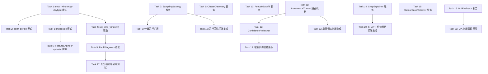

<!-- @AI_GENERATED -->
# 任务清单：光伏故障诊断窗口切分策略、标签扩充策略与审核增强

> 对应 `requirements-feature-enhancement.md`（需求 13～24）与 `design-feature-enhancement.md` 的实现任务拆解。
> 每个任务独立可交付、可测试，按依赖关系排序。

---

## Task Dependency Graph

---

## 阶段一：诊断窗口切分策略（需求 13～15）

### Task 1: 实现 solar_window.py — daylight 模式

- [ ] 新增文件 `fault-diag-algo-release-3.1/enos_fault_diag/utils/solar_window.py`
- [ ] 实现 `segment_solar_window()` 函数的 `daylight` 分支
- [ ] 按设备×天分组，计算 `max_power`，过滤 `power >= max_power * irr_threshold`
- [ ] 全天最大功率为零时排除并产生告警
- [ ] 参数校验：`irr_threshold` 必须在 `(0, 1)` 范围内
- [ ] 输出数据帧包含 `time_window` 列，格式与 daily 模式一致
- [ ] 单元测试：正常日照天、阴天（部分时段低于阈值）、全天零功率三种 case

**关联需求**：需求 13  
**修改文件**：新增 `utils/solar_window.py`  
**预计工时**：4h

---

### Task 2: 实现 solar_window.py — solar_period 模式

- [ ] 在 `segment_solar_window()` 中新增 `solar_period` 分支
- [ ] 在 Daylight_Period 内按 `peak_ratio` 切分 A 段和 S 段
- [ ] 对 A/S 段分别调用 `FeatureEngineer.transform()` 提取特征
- [ ] 横向拼接，A 段列加 `peak_` 前缀，S 段列加 `trans_` 前缀
- [ ] 空段以零向量填充 + 告警
- [ ] 参数校验：`peak_ratio > irr_threshold`
- [ ] 单元测试：正常双段、A 段为空（全天低辐照）、S 段为空（直接高辐照）

**关联需求**：需求 14  
**依赖**：Task 1  
**修改文件**：`utils/solar_window.py`  
**预计工时**：6h

---

### Task 3: 实现 solar_window.py — multiscale 模式

- [ ] 在 `segment_solar_window()` 中新增 `multiscale` 分支
- [ ] 产生整天粒度样本 + 日照时段子窗口样本
- [ ] 子窗口按 `sub_window` 滑动切分，`time_window` = 子窗口起始时刻
- [ ] 标签继承父天（`window_one_label=1`）
- [ ] 尾部不足一个完整子窗口时保留
- [ ] 保证 `(id_cols + [time_window])` 唯一性
- [ ] 参数校验：`sub_window` < 24h
- [ ] 单元测试：正常多子窗口、日照不足一个子窗口、全天无日照

**关联需求**：需求 15  
**依赖**：Task 1  
**修改文件**：`utils/solar_window.py`  
**预计工时**：6h

---

### Task 4: set_time_window() 改造

- [ ] 修改 `utils/time.py` 的 `set_time_window()` 签名：新增 `solar_mode=None, **solar_kwargs`
- [ ] `solar_mode=None` 时保持原有 resample 逻辑不变
- [ ] `solar_mode` 非空时委托给 `segment_solar_window()`
- [ ] 回归测试：现有调用方（`diagnosis_window='1d'` 等）行为不变

**关联需求**：需求 13.5  
**依赖**：Task 1  
**修改文件**：`utils/time.py`  
**预计工时**：2h

---

### Task 5: FaultDiagnosis 适配

- [ ] 修改 `fault_diagnosis.py` 的 `FaultDiagnosis.__init__()`：解析 `diagnosis_window` 新枚举值
- [ ] 新增 `sub_window` 参数（默认 `'4h'`）
- [ ] `train()` 和 `predict()` 调用 `set_time_window()` 时透传 `solar_mode` + `value_cols`
- [ ] 同步修改 `fault_main.py` 的 `MlflowFaultDiagnosis`：在 `init_train_data()` 和 `init_pred_data()` 中透传
- [ ] 回归测试：`diagnosis_window='1d'` 的训练/预测行为不变

**关联需求**：需求 13.7, 14.6, 15.6  
**依赖**：Task 4  
**修改文件**：`fault_diagnosis.py`, `fault_main.py`  
**预计工时**：3h

---

### Task 6: FeatureEngineer quantile_min_points 参数

- [ ] 修改 `feature_engineer.py` 的 `FeatureEngineer.__init__()`：新增 `quantile_min_points=48` 可选参数
- [ ] `init_data()` 中将 `if self.avg_count < 48` 改为 `if self.avg_count < self.quantile_min_points`
- [ ] multiscale 模式时由 `FaultDiagnosis` 计算 `sub_window_points` 并传入
- [ ] 回归测试：不传时默认 48，行为不变

**关联需求**：需求 15.4  
**依赖**：Task 3  
**修改文件**：`features/feature_engineer.py`  
**预计工时**：1h

---

### Task 17: 切分模式端到端测试

- [ ] 使用现有测试数据（如 `relate_data/` 下的 parquet 文件）对三种模式做端到端跑通
- [ ] 验证 daylight 模式的特征维度 = daily 模式
- [ ] 验证 solar_period 模式的特征维度 = 2 × daily 模式（peak_ + trans_）
- [ ] 验证 multiscale 模式的样本数 > daily 模式
- [ ] 验证原有 `diagnosis_window='1d'` 的结果不变（回归）

**依赖**：Task 5, Task 6  
**预计工时**：4h

---

## 阶段二：标签扩充策略（需求 16～19）

### Task 7: SamplingStrategy 服务

- [ ] 新增 `backend-service/services/iterative_labeling/sampling_strategy.py`
- [ ] 实现 `SamplingStrategy.sort_units()` 方法
- [ ] `random` 模式：随机打乱
- [ ] `uncertainty` 模式：confidence 升序，同分时按 unit_key 字典序
- [ ] `diversity` 模式：K-means 聚类低置信度样本 → 代表样本前置
- [ ] 低置信度样本不足 n_clusters 时跳过聚类
- [ ] 单元测试：三种策略各一个 case + 边界 case

**关联需求**：需求 16  
**修改文件**：新增 `sampling_strategy.py`  
**预计工时**：4h

---

### Task 8: 分歧采样扩展

- [ ] 在 `SamplingStrategy.sort_units()` 中新增 `disagreement_first` 参数
- [ ] disagreement=true 单元前置，组内按 confidence 升序
- [ ] 与 uncertainty/diversity 可组合（分歧分组优先级 > 策略排序）
- [ ] 扩展 Review_Session API：新增 `disagreement_first` 开关
- [ ] 扩展存储：Human_Verdict 新增 `was_disagreement` 字段
- [ ] 扩展 Accuracy_Evaluator：分歧子集单独精度统计

**关联需求**：需求 19  
**依赖**：Task 7  
**修改文件**：`sampling_strategy.py`, `api/iterative_labeling.py`, `review_session.py`, `accuracy_evaluator.py`  
**预计工时**：5h

---

### Task 9: ClusterDiscovery 服务

- [ ] 新增 `backend-service/services/iterative_labeling/cluster_discovery.py`
- [ ] 实现 `ClusterDiscoveryService.create_session()`
- [ ] 筛选低置信度单元 → 提取特征向量 → HDBSCAN/K-means 聚类
- [ ] 计算 cluster 质心到已知类别距离
- [ ] 标记 New_Class_Candidate + 取代表样本
- [ ] 实现 `confirm_cluster()` → 调用 `Label_Registry.allocate_label()` 批量写入
- [ ] 实现 `reject_cluster()` → 标记 rejected + 备注
- [ ] 特征维度不一致时拒绝执行
- [ ] 新增 API 端点：POST/GET cluster-discovery-sessions
- [ ] 单元测试

**关联需求**：需求 17  
**修改文件**：新增 `cluster_discovery.py`, 扩展 `api/iterative_labeling.py`  
**预计工时**：8h

---

### Task 10: PseudoBackfill 服务

- [ ] 新增 `backend-service/services/iterative_labeling/pseudo_backfill.py`
- [ ] 实现 `PseudoBackfillService.execute()`
- [ ] 筛选 `confidence >= threshold` 的单元
- [ ] 截断检查（`max_ratio`）
- [ ] 写入 `is_pseudo=true` 记录到 Storage_Abstraction
- [ ] 扩展 Accuracy_Evaluator：排除 `is_pseudo` 记录
- [ ] 支持伪标签升级为 Human_Verdict
- [ ] 新增 API 端点：POST /loops/{id}/pseudo-backfill
- [ ] 单元测试

**关联需求**：需求 18  
**修改文件**：新增 `pseudo_backfill.py`, 扩展 `api/iterative_labeling.py`, `accuracy_evaluator.py`  
**预计工时**：5h

---

## 阶段三：审核期增量训练（需求 20～22）

### Task 11: IncrementalTrainer 触发机制

- [ ] 新增 `backend-service/services/iterative_labeling/incremental_trainer.py`
- [ ] 实现 `IncrementalTrainer.check_and_trigger()` 方法
- [ ] `on_batch` 模式：审核计数器达 `batch_size` 倍数时触发
- [ ] `on_new_label` 模式：`action_type='new_label'` 时立即触发
- [ ] `on_error_spike` 模式：计算批次错误率，超阈值触发
- [ ] 并发保护：`threading.Lock()` 互斥，跳过而非排队
- [ ] 实现 `_execute_mini_backfill()`：合并原始数据 + 已审裁决 → 调用训练工作流
- [ ] Storage 记录 Mini_Backfill 元数据
- [ ] 集成到 `POST /review-sessions/{id}/verdicts` 接口：每次提交 verdict 后调用
- [ ] 单元测试：三种触发模式 + 并发跳过 case

**关联需求**：需求 20  
**修改文件**：新增 `incremental_trainer.py`, 扩展 `api/iterative_labeling.py`  
**预计工时**：8h

---

### Task 12: ConfidenceRefresher

- [ ] 新增 `backend-service/services/iterative_labeling/confidence_refresher.py`
- [ ] 实现 `ConfidenceRefresher.refresh()` 方法
- [ ] 用新模型对未审核单元批量预测
- [ ] 更新 `confidence` 和 `predicted_label`
- [ ] 非阻塞：`threading.Thread` 后台执行，完成后更新 Review_Session 状态
- [ ] 基于新 confidence 重新排序队列（复用 SamplingStrategy）
- [ ] Storage 记录 ConfidenceRefresh 元数据
- [ ] 单元测试

**关联需求**：需求 21  
**依赖**：Task 11  
**修改文件**：新增 `confidence_refresher.py`  
**预计工时**：5h

---

### Task 13: 增量训练监控面板数据接口

- [ ] 新增 API 端点：GET `/review-sessions/{id}/incremental-status`
- [ ] 返回：`retrain_count`、`latest_retrain_status`、`avg_confidence_trend`、每批次 `batch_error_rate_before/after`
- [ ] 会话结束时 Iteration_Tracker 追加 `incremental_retrain_count`/`final_avg_confidence`/`incremental_mode`
- [ ] 最终模型使用增量重训最后一次的产出

**关联需求**：需求 22  
**依赖**：Task 12  
**修改文件**：扩展 `api/iterative_labeling.py`, `iteration_tracker.py`  
**预计工时**：4h

---

## 阶段四：审核辅助增强（需求 23～24）

### Task 14: ShapExplainer 服务

- [ ] 新增 `backend-service/services/iterative_labeling/shap_explainer.py`
- [ ] 实现 `ShapExplainer.compute_explanations()` 方法
- [ ] 使用 `shap.TreeExplainer`（随机森林原生支持）
- [ ] 预计算 Review_Session 所有样本的 SHAP 值
- [ ] 提取 top-K 特征贡献（含正负 shap_value）
- [ ] 超时机制（`ThreadPoolExecutor` + timeout）
- [ ] 缓存至 Review_Session 生命周期
- [ ] 新增 API 端点：GET `/review-sessions/{id}/shap/{unit_key}`
- [ ] 单元测试

**关联需求**：需求 23  
**修改文件**：新增 `shap_explainer.py`, 扩展 `api/iterative_labeling.py`  
**预计工时**：5h  
**新增依赖**：`shap` 包（可选）

---

### Task 15: SimilarCaseRetriever 服务

- [ ] 新增 `backend-service/services/iterative_labeling/similar_case_retriever.py`
- [ ] 实现 `SimilarCaseRetriever.build_index()` 和 `retrieve()` 方法
- [ ] 使用 `sklearn.neighbors.NearestNeighbors`
- [ ] 以 Labeled_Dataset 特征矩阵为索引
- [ ] 返回 top-k + `similarity_score = 1/(1+distance)`
- [ ] 索引在 Review_Session 创建时构建，缓存复用
- [ ] 超时降级
- [ ] 新增 API 端点：GET `/review-sessions/{id}/similar-cases/{unit_key}`
- [ ] 单元测试

**关联需求**：需求 23  
**修改文件**：新增 `similar_case_retriever.py`, 扩展 `api/iterative_labeling.py`  
**预计工时**：4h

---

### Task 16: IAAEvaluator 服务

- [ ] 新增 `backend-service/services/iterative_labeling/iaa_evaluator.py`
- [ ] 实现 `create_overlap_batch()`：随机抽取 `floor(total × overlap_ratio)` 条
- [ ] 实现 `compute_kappa()`：2 人 Cohen's Kappa，≥3 人 Fleiss' Kappa
- [ ] 实现 `detect_bias()`：每人标签分布 vs 整体分布，偏差超阈值标记
- [ ] 低于 `kappa_threshold` 时产生告警
- [ ] 单人审核时跳过
- [ ] 扩展 Review_Session API：`enable_iaa`/`overlap_ratio` 参数
- [ ] Storage 记录 IAA 字段
- [ ] Iteration_Tracker 追加 `iaa_score`/`biased_reviewer_count`
- [ ] 新增 API 端点：GET `/review-sessions/{id}/iaa`
- [ ] 单元测试

**关联需求**：需求 24  
**修改文件**：新增 `iaa_evaluator.py`, 扩展 `api/iterative_labeling.py`, `iteration_tracker.py`  
**预计工时**：6h

---

## 阶段五：前端集成

### Task 18: 采样策略前端集成

- [ ] 扩展 `IterativeLabelingReviewPage.tsx`：创建审核会话时新增采样策略下拉选择
- [ ] 审核界面顶部显示当前 `sampling_strategy` 标签
- [ ] 「按分歧排列」开关 UI
- [ ] 分歧统计摘要展示（`disagreement_count`/`ratio`）
- [ ] 扩展 `iterativeLabelingApi.ts`：传递新参数

**关联需求**：需求 16, 19  
**依赖**：Task 7, Task 8  
**预计工时**：5h

---

### Task 19: 增量训练前端集成

- [ ] 扩展 `IterativeLabelingReviewPage.tsx`：创建审核会话时新增增量模式选择
- [ ] 审核界面右侧/底部新增增量训练状态面板
- [ ] 展示 `retrain_count`、`latest_retrain_status`
- [ ] `avg_confidence_trend` 折线图（ECharts）
- [ ] 置信度刷新后 Toast 提示 + 队列自动更新
- [ ] 扩展 `iterativeLabelingApi.ts`

**关联需求**：需求 20, 21, 22  
**依赖**：Task 11, Task 12, Task 13  
**预计工时**：6h

---

### Task 20: SHAP + 相似案例前端集成

- [ ] 扩展 `IterativeLabelingReviewPage.tsx`：审核卡片内新增 SHAP 条形图区域
- [ ] 正向贡献蓝色、负向贡献红色
- [ ] 审核卡片内新增相似案例折叠面板
- [ ] 展示相似案例的 `label_name`、`similarity_score`、时序曲线缩略图
- [ ] 两者均标注「参考信息」
- [ ] 缺失时展示 placeholder
- [ ] 扩展 `iterativeLabelingApi.ts`

**关联需求**：需求 23  
**依赖**：Task 14, Task 15  
**预计工时**：6h

---

### Task 21: IAA 前端管理视图

- [ ] 新增管理员视角的 IAA 面板（可在审核界面或独立页面）
- [ ] 展示 `iaa_score`、`iaa_method`
- [ ] 低一致性告警 Alert 组件
- [ ] 审核人偏差表格：高亮 biased_reviewers
- [ ] 各审核人标签分布雷达图
- [ ] 扩展 `iterativeLabelingApi.ts`

**关联需求**：需求 24  
**依赖**：Task 16  
**预计工时**：5h

---

## 总工时估算

| 阶段 | 任务数 | 预计工时 |
|------|--------|----------|
| 阶段一：切分策略 | 7 | 26h |
| 阶段二：标签扩充 | 4 | 22h |
| 阶段三：增量训练 | 3 | 17h |
| 阶段四：审核辅助 | 3 | 15h |
| 阶段五：前端集成 | 4 | 22h |
| **总计** | **21** | **~102h** |

---

## 实施优先级

按建议顺序实施（与需求文档一致）：

1. Task 1→4→5（daylight 模式贯通）→ Task 17（端到端验证）
2. Task 2, 3, 6（solar_period + multiscale）
3. Task 7→8（采样策略）→ Task 18（前端）
4. Task 11→12→13（增量训练）→ Task 19（前端）
5. Task 14, 15（SHAP + 相似案例）→ Task 20（前端）
6. Task 16（IAA）→ Task 21（前端）
7. Task 10（伪标签回流）
8. Task 9（聚类新类发现）

<!-- @AI_GENERATED: end -->
