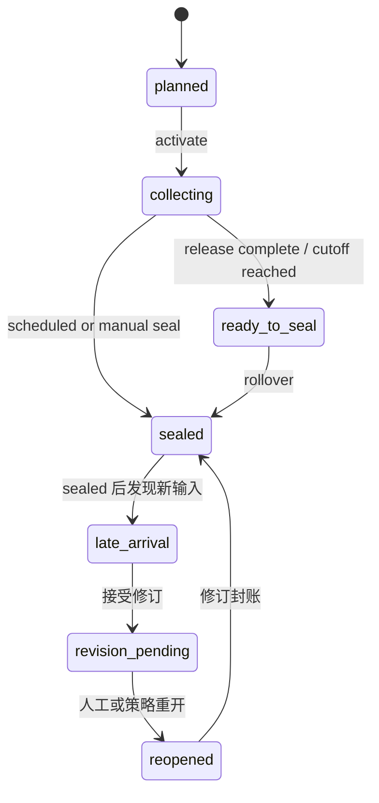

<!-- @AI_GENERATED -->
# PV 业务日推进、设备级错峰与双路径预测资格专项设计

> 所属规格：`pv-fault-dual-path-serving` — 光伏故障诊断双路径生产接入  
> 文档状态：Draft / 待实施  
> 设计日期：2026-08-18  
> 影响范围：业务日控制、Mock 到达、Legacy 天级预测、Seq 点级预测、调度 API 与前端控制台  
> 不包含：模型训练结构调整、精度维护、同路径 Champion/Challenger 晋升、跨路径效果仲裁

## 0. 结论先行

本专项设计确认以下不可混淆的结论：

1. **当前 Mock 喂数的逻辑最小单元是 `Device_Day` — 设备日，即一个设备三元组在一个业务自然日的数据。**自动 cron 每次可以批量释放多个设备日，但同一设备的当天观测目前是整日一次性释放，不是逐测点流式释放。
2. **Legacy 天级路径与 Seq 点级路径都不需要等待站点全部设备到齐才预测。**预测资格按设备或设备日独立判断；单次执行可以为了效率批量处理多个已经就绪的设备，但不能把“批量执行”误解为“必须全站一起就绪”。
3. **只有业务日汇总与封账关心全站设备状态。**到达截止时，系统把设备区分为 ready、waiting、dropped、timeout；不能让一台缺失设备永久阻塞其他设备预测，也不能让它永久阻塞真实业务日历。
4. **Legacy 天级路径不做隔日等待。**它继续按每台设备自己的 `(cursor, watermark]` 增量消费当前日已到达数据；窗口未封账时结果可标记为 provisional，封账时再做 final reconciliation。
5. **Seq 点级路径以设备日 readiness 或业务日 sealed 作为候选触发。**目标实现不再依赖“下一日第一条数据到达”才能证明前一日结束；但全天 BiLSTM 仍要求单设备、单自然日、288 时钟网格，不支持每到一个测点就即时推理。
6. **凌晨 02:00 自动日切与演示手动推进调用同一个幂等业务日服务。**触发来源不同，业务动作相同；二者并发时依靠 `generation` — 日历乐观锁版本防止重复推进。
7. **Mock 日内释放 cron 与业务日日切 cron 必须拆责。**前者只释放当前 active day 的下一批设备，不能自行寻找下一业务日；后者只封账当前日并激活下一日，不能把下一日全部设备一次性写入。
8. **正常生产、演示回放、历史补跑是三条不同执行通道。**补跑指定日期分区，不修改当前 active day，也不通过重置全局 cursor 模拟。

一句话概括：

> **业务日控制面决定“当前允许接收哪一天”；公共到达事实决定“每台设备实际到哪里”；路径策略决定“哪些设备已经能预测”；三者不能合并成一个最大日期游标。**

---

## 1. 文档定位与现有规格关系

本文件是 `.kiro/specs/pv-fault-dual-path-serving/` 下的专项设计增补，集中回答以下问题：

- 数据是按测点、设备、设备日还是整站喂入？
- 是否需要等待所有设备到齐才预测？
- Legacy 天级路径和 Seq 点级路径为什么使用不同就绪条件？
- 每天凌晨 02:00 如何自动推进业务日？
- 演示时如何手动推进下一业务日？
- 自动与手动如何防止同时推进两次？
- 当前日增量、日封账、迟到数据与补跑如何统一？

现有正式规格中的以下定义继续有效：

- `Device_Day` — 设备日：`(site_id, device_id, branch_id, business_date)`。
- `Data_Watermark` — 数据到达水位：每台设备已入库数据的最大 Event Time。
- `Device_Cursor` — 设备预测游标：Legacy 按路径记录已消费到的 Event Time。
- `Seq_Device_Day_Ledger` — Seq 设备日记账：Seq 是否处理过某个设备日的权威真相。
- `Path_Activation_Epoch` — 路径启用周期：本次路径从哪些设备日开始承担生产责任。
- `PV_Model_Registry` — PV 模型登记：当前生产路径、路径 Champion 和启用周期的唯一可写真相。

本专项提出一项需要回写正式规格的目标变化：

```text
现状：Seq 候选要求 business_date < device_watermark_date
目标：Seq 在 device_day_readiness_changed 或 business_day_status = sealed 时扫描候选；只有 completeness gate 与 predictor precheck 均通过才进入 runnable
```

因此，本方案确认后，需要同步修订：

- `requirements.md` — 正式需求与验收条件；
- `design.md` — 总体架构与组件设计；
- `design-通俗版.md` — 面向交接的通俗解释；
- `tasks.md` — 实施任务与验证清单。

本文件本身不代表代码已经实现。

---

## 2. 当前代码事实

### 2.1 Mock 到达粒度

`backend-service/services/db/datasources/pv_fault_mock.py` — PV Mock 数据释放器，负责从相对配置的数据源读取历史观测、生成设备错峰计划并写入 `training_samples`。

当前 `PvFaultMockFeeder` 的真实粒度如下：

| 层次 | 当前粒度 | 说明 |
|---|---|---|
| 释放计划键 | `business_date + site_id + device_id + branch_id` | 一条计划代表一个设备日 |
| 单次 cron tick | 一个批次内的多个设备日 | 一次可能释放多台设备，不保证只释放一台 |
| 单台设备写入 | 该设备当天全部可用测点 | 当前不是逐点慢速到达 |
| dropped 判定 | 单设备日 | dropped 设备当天不释放 |
| delay 判定 | 单设备日 | 延迟若干 tick 后释放 |
| 当日 feed complete | 当日全部非 dropped 设备已释放 | 这是业务日汇总，不是预测前置 |

`PvFaultMockFeeder.release_next_batch_tick()` — 自动错峰入口；当前每次 tick 通过 `_next_unfed_date()` 选择日期并释放一批设备。某日全部非 dropped 设备释放后，下一 tick 会自动进入下一源日期。

`PvFaultMockFeeder.feed_manually()` — 当前人工喂数入口；内部调用 `_feed_date_locked()`，一次释放该日全部未释放且非 dropped 的设备，因此绕过日内错峰节奏。

### 2.2 Legacy 天级路径

`backend-service/services/scheduler/pv_dual_path/legacy_day_strategy.py` — Legacy 天级检测策略，输入每台设备的路径游标、公共数据水位和当前模型上下文，输出本轮天级预测批次与游标推进结果。

当前核心合同：

```text
eligible_event_time_range = (device_path_cursor, device_watermark]
```

每台设备独立读取水位、独立判断是否有新增数据；无数据、Event Time 无效或模型未产出时只跳过该设备，不阻塞其他设备。

当前策略为了执行效率会把本轮多个可用设备的数据汇总到一个 workflow batch，但资格判断仍然是逐设备的。因此：

> Legacy 是“逐设备就绪、可批量执行”，不是“全站设备全部到齐后一起执行”。

### 2.3 Seq 点级路径

`backend-service/services/scheduler/pv_dual_path/seq_daily_strategy.py` — Seq 全天序列策略，输入 Path Activation Epoch、设备水位、设备日完整性和当前 Seq Champion，按设备日建立 288 时钟网格并输出逐点预测、分段预测与天级聚合标签。

`SeqDailyStrategy._run_ledger_driven()` — 当前 Ledger 驱动执行主流程；每个 `Device_Day` 独立完成候选登记、完整性门禁、推理、不可变批次写入和 Ledger 状态推进。

当前真实特点：

- 一个设备日 waiting/failed 不阻塞其他设备日；
- 单次 cycle 可以从 runnable 队列批量取多个设备日；
- 每个设备日仍独立查询、独立推理、独立落账；
- 当前候选日期仍要求严格早于设备 watermark date；
- 当前完整性放行已使用“完整或占用槽达到 173”的代码口径，和旧文档中的 90%/288 文字存在漂移；
- predictor 仍执行 288 网格、白天覆盖、最长空洞和单日边界门禁。

因此：

> Seq 是“逐设备日就绪、可批量调度”，也不是“全站设备全部到齐后一起执行”。

### 2.4 当前真正等待全体设备的位置

`PvFaultMockFeeder._maybe_mark_day_fed()` — 当日喂完汇总函数；它等待当日全部非 dropped 设备释放后，才把日期写入 feed cursor。

这个等待只应影响：

- 当前日是否完成释放；
- 是否允许业务日封账或给出缺失摘要；
- Mock 是否可以进入下一源日期。

它不应影响：

- Legacy 是否消费已经到达设备的新增点；
- Seq 是否预测已经 ready 的设备日；
- 其他设备是否进入 runnable 队列。

### 2.5 当前预测并非到达事件即时触发

当前 `pv_prediction` 默认按 cron 运行，也可以由通用 trigger-now 手动触发。数据已经具备预测资格，并不等于预测任务已经执行。

需要区分：

```text
eligible / ready = 业务上已经允许预测
scheduled / queued = 已经进入执行队列
running = 正在执行
succeeded / failed = 已完成或失败
```

目标方案会补充到达事件或短周期 reconciliation，但仍保留定时兜底任务。

---

## 3. 竞品与成熟平台机制

### 3.1 Apache Flink：窗口与触发条件分离

[Apache Flink Windows](https://nightlies.apache.org/flink/flink-docs-stable/docs/dev/datastream/operators/windows/) 将 Window、Trigger、Watermark 与 Allowed Lateness 分开：同一个事件时间窗口可以按元素数量、处理时间、watermark 或自定义条件触发；迟到事件可以在宽限期内再次触发窗口，或进入独立 late-data 输出。

对本项目的映射：

| Flink 概念 | PV 映射 |
|---|---|
| Keyed Window | 设备三元组 + 业务日 |
| Trigger | Legacy 增量到达、Seq 完整性达标、业务日封账 |
| Watermark | 每台设备公共 Data Watermark |
| Allowed Lateness | sealed 后迟到宽限期 |
| Late firing | 输入变化后的修订预测 |

启示：共享业务日窗口不代表所有路径必须使用同一个触发条件。

### 3.2 Databricks Structured Streaming：增量更新与封闭输出并存

[Databricks Structured Streaming Triggers](https://docs.databricks.com/aws/en/structured-streaming/triggers) 支持持续/固定间隔微批和 AvailableNow 增量批；[Databricks Watermarks](https://docs.databricks.com/en/structured-streaming/watermarks.html) 区分 Update、Append 与 Complete 输出语义。

对本项目的映射：

- Legacy collecting 日的当前结果类似 Update：数据继续到达时可产生新 revision；
- 业务日 sealed 后的最终对账类似 Append/final；
- Seq 全天序列更接近完整设备日就绪后输出。

启示：天级路径无需等待隔日，但必须标识“当前水位暂定结果”和“封账最终结果”。

### 3.3 Azure Data Factory：同一流程支持定时、事件与手动运行

[Azure Data Factory Pipeline Triggers](https://learn.microsoft.com/en-us/azure/data-factory/concepts-pipeline-execution-triggers) 支持同一 pipeline 由 manual、schedule、tumbling window 或 event trigger 启动，每次执行都有独立 run ID。

[Azure Data Factory Tumbling Window](https://learn.microsoft.com/en-us/azure/data-factory/how-to-create-tumbling-window-trigger) 提供有状态固定窗口、WindowStart/WindowEnd、delay、retry、cancel/rerun、依赖和确定性 backfill。

启示：凌晨 02:00 自动推进和演示手动推进应调用同一个业务日服务，只记录不同 `trigger_type` — 触发来源。

### 3.4 Dagster：日期是分区，补跑不改变在线日历

[Dagster Partitions](https://docs.dagster.io/guides/build/partitions-and-backfills/partitioning-ops) 将日期定义为明确 partition key；[Dagster Backfills](https://docs.dagster.io/concepts/partitions-schedules-sensors/backfills) 对单个或一组日期分区创建独立运行。

启示：每个业务日应有独立实例；补跑日期范围不能靠重置在线全局 cursor 实现。

### 3.5 Airflow：数据区间与执行时刻分离

[Airflow Dag Run / Data Interval](https://airflow.apache.org/docs/apache-airflow/stable/core-concepts/dag-run.html) 区分 data interval、logical date 与实际执行时间，并提醒手动运行的日期语义不能从实际触发时刻推断。

启示：PV 必须明确区分 Event Time、Processing Time、Business Date 与 Scheduled Time。

> 本节内容均基于官方资料重新组织和改写，未逐字复制原文。

---

## 4. 时间语义与粒度模型

### 4.1 四种时间

| 字段/概念 | 中文含义 | 用途 |
|---|---|---|
| `event_time` — 事件时间 | 设备观测真实所属时刻 | 决定数据属于哪个业务日和路径窗口 |
| `ingested_at` — 入库时间 | 数据实际进入平台的处理时刻 | 判断到达延迟、审计与排障 |
| `scheduled_at` — 调度时刻 | cron 或手动动作的触发时间 | 审计触发来源，不直接决定数据归属 |
| `executed_at` — 执行时间 | 模型本轮实际开始/结束时间 | 运行审计和性能统计 |

### 4.2 四种粒度

| 粒度 | 键 | 负责什么 |
|---|---|---|
| 测量点 | `device_key + event_time` | 原始观测事实 |
| 设备日 | `device_key + business_date` | Mock 释放、完整性、Seq readiness、Seq Ledger |
| 业务日实例 | `slot + source_kind + business_date` | collecting/sealed、日切、全站汇总 |
| 路径运行 | `slot + modeling_path + device_scope + business_date + revision` | 路径预测结果、批次和修订 |

其中 `device_key` — 设备键，由 `site_id` — 站点标识、`device_id` — 设备标识、`branch_id` — 支路标识组成。

### 4.3 “不等所有设备”精确定义

“不等所有设备”意味着：

- 任意设备达到本路径资格后可以独立进入待预测队列；
- 一台设备 waiting/failed/dropped 不阻塞其他设备；
- 单次 worker 可以批量领取多个 ready 设备以提高吞吐；
- 批量领取只是一种执行优化，不形成全站 barrier；
- 业务日封账时仍要汇总所有设备状态并记录缺失设备。

它不意味着：

- Seq 可以在数据不足时绕过 288 网格和完整性门禁；
- Legacy 每到一个点都立即启动一次昂贵模型；
- dropped/timeout 设备不需要审计；
- 业务日无需封账；
- 多设备数据可以拼成一个设备的模型输入。

---

## 5. 目标架构

```mermaid
flowchart TB
    AUTO[02:00 Scheduled Rollover] --> BDC[PV Business Day Coordinator]
    MANUAL[Manual Advance] --> BDC
    BDI[(Business Day Instances)] <--> BDC
    AUDIT[(Append-only Day Audit)] <-- BDC

    BDC -->|activate day| FEED[Mock Feed Tick]
    FEED -->|device-day batches| RAW[(Training Samples)]
    FEED --> ING[(Measurement Ingestion Daily)]

    RAW --> WM[Data Watermark Service]
    ING --> READY[Device-Day Readiness Evaluator]
    BDC -->|day sealed| READY

    WM --> LEGACY[Legacy Eligibility Policy]
    LEGACY -->|arrival delta / reconcile| DISPATCH[Dual Path Scheduler]

    READY --> SEQ[Seq Eligibility Policy]
    SEQ -->|device day ready / sealed| DISPATCH

    REG[(PV Model Registry)] --> DISPATCH
    DISPATCH -->|production_path=legacy_day| LEG_RUN[Legacy Strategy]
    DISPATCH -->|production_path=seq_annotation| SEQ_RUN[Seq Strategy]

    LEG_RUN --> LEG_CURSOR[(Legacy Device Cursor)]
    LEG_RUN --> LEG_REV[(Legacy Day Revisions)]
    SEQ_RUN --> LEDGER[(Seq Device-Day Ledger)]
    SEQ_RUN --> BATCH[(Immutable Prediction Batches)]

    BACKFILL[Independent Backfill Runner] -.指定日期/路径.-> LEG_RUN
    BACKFILL -.独立命名空间.-> SEQ_RUN
```

### 5.1 三个相互独立的真相

1. **业务日控制真相**：哪个源日期 collecting，哪个日期 sealed。
2. **公共到达真相**：每台设备真实已到达哪些 Event Time、完整性如何。
3. **路径消费真相**：Legacy cursor 与 Seq Ledger 分别处理到了哪里。

任一层都不能替代另外两层。

---

## 6. 业务日实例设计

建议新增 `pv_business_day_instance` — PV 业务日实例持久化实体。

### 6.1 为什么单独存

- **存什么**：当前 active 业务日、每个历史日状态、封账时间、触发来源、源指纹和乐观锁版本。
- **为什么单独存**：避免继续用 feed cursor、最大数据日期或模型预测游标猜测当前业务日；自动和手动日切需要同一持久化真相。
- **按什么维度分区**：`slot + source_kind + business_date`；其中 `slot` — 产品槽位，PV 固定为 `pv_fault`，`source_kind` — 数据源类型，取 `mock` 或 `production`。
- **路径/介质**：由部署配置决定，推荐 MySQL 表；不得写死任何开发机绝对路径。若测试环境使用文件存储，只能保存项目相对路径并保持同一字段合同。

### 6.2 建议字段

| 字段 | 中文说明 |
|---|---|
| `day_instance_id` | 业务日实例唯一标识 |
| `slot` | 产品槽位，PV 为 `pv_fault` |
| `source_kind` | 数据源类型：`mock` / `production` |
| `business_date` | 数据所属业务自然日 |
| `status` | 日实例状态 |
| `window_start` | 业务日事件时间起点 |
| `window_end` | 业务日事件时间终点，使用半开区间 `[start, end)` |
| `opened_at` | 进入 collecting 的墙钟时刻 |
| `ready_to_seal_at` | 首次满足自动封账条件的时刻，可为空 |
| `sealed_at` | 实际封账时刻 |
| `watermark_at` | 封账采用的数据水位或截止时刻 |
| `expected_device_count` | 当日预期设备数 |
| `ready_device_count` | 已满足到达条件设备数 |
| `waiting_device_count` | 尚未满足条件设备数 |
| `dropped_device_count` | 明确模拟/生产丢失设备数 |
| `timeout_device_count` | 到截止时间仍未到齐设备数 |
| `generation` | 日历乐观锁版本，防止手动与 cron 双推进 |
| `advanced_by` | 推进来源：`scheduled` / `manual` / `migration` |
| `advance_reason` | 人类可读推进原因 |
| `source_digest` | 当前 Mock/生产源稳定摘要 |
| `revision` | 业务日输入修订号 |
| `created_at` | 创建时间 |
| `updated_at` | 最后更新时间 |

### 6.3 状态机



`collecting` 不代表所有设备都未预测；它只表示当前业务日仍允许新增数据。

---

## 7. Mock 设备级错峰设计

### 7.1 日内释放 cron

保留任务：

```text
task_id = pv_mock_data_feed
cron = */12 * * * *
```

目标职责：

1. 读取当前唯一 `collecting` 的 mock business day；
2. 没有 active day 时返回 `waiting_for_active_day`；
3. 只释放 active day 的下一计划批次；
4. 每台设备释放自己的当日观测；
5. 更新设备日完整性和释放进度；
6. 当日全部非 dropped 设备释放后标记 `ready_to_seal`；
7. **不得自行调用 `_next_unfed_date()` 激活下一日。**

### 7.2 两个不同的人工动作

必须把当前一个 manual-feed 语义拆成两个按钮：

#### `快速完成当前日`

- 只释放当前 active day 剩余非 dropped 设备；
- 不封账；
- 不激活下一日；
- 用于演示时跳过等待 7 个 tick。

#### `推进下一业务日（模拟日切）`

- 封账当前日；
- 激活下一源业务日；
- 默认保持新日设备错峰，不立即整日写入；
- 与凌晨 02:00 调用同一 Coordinator。

### 7.3 Feed complete 不是预测 barrier

当前日 feed complete 只表示：

```text
所有非 dropped 设备均已执行释放计划
```

不表示：

```text
所有设备必须一起预测
```

在 feed 尚未 complete 时：

- Legacy 可消费已到达设备增量；
- Seq 可处理已经达到门禁的设备日；
- 未到设备继续 waiting；
- dropped 设备等待封账汇总。

---

## 8. 路径预测资格设计

### 8.1 统一资格接口

建议引入 `PredictionEligibilityPolicy` — 路径预测资格策略接口。输入业务日状态、设备到达事实、路径消费状态与触发上下文，输出可运行设备范围及原因。

输入字段：

| 字段 | 中文说明 |
|---|---|
| `slot` | 产品槽位，PV 为 `pv_fault` |
| `modeling_path` | 建模/检测路径，取 `legacy_day` 或 `seq_annotation` |
| `trigger_context` | 触发上下文，取 `arrival_delta`、`device_day_ready`、`day_sealed`、`manual`、`reconciliation` 或 `backfill` |
| `business_date` | 本次评估的业务日 |
| `device_scope` | 设备范围，包含一个或多个设备三元组 |
| `data_watermark` | 设备公共数据到达水位 |
| `day_status` | 业务日实例状态 |
| `activation_epoch_id` | 当前路径启用周期标识 |

输出字段：

| 字段 | 中文说明 |
|---|---|
| `eligible` | 是否至少存在一个可运行单元 |
| `readiness_reason` | 就绪或顺延的结构化原因 |
| `eligible_device_days` | 已满足本路径预测条件的设备日列表 |
| `deferred_device_days` | 暂不满足条件的设备日及原因列表 |
| `trigger_context` | 原样回传本轮触发上下文，供运行审计 |

### 8.2 Legacy 天级路径：到达增量即有资格

资格合同：

```text
eligible when device_watermark > legacy_device_cursor
```

行为：

1. 每台设备独立计算 `(cursor, watermark]`；
2. 按 Event Time 所属自然日拆分，禁止跨日拼样本；
3. 有新增点即可进入下一次微批，不等待设备日完整；
4. 某设备无新点、坏时间或采样合同暂不成立，只顺延该设备；
5. 本轮可以合并多个 eligible 设备执行；
6. 只有预测和记录落账成功才推进该设备 cursor。

#### 微批与防抖

不建议每写入一行就启动一次模型。建议：

```text
arrival event
→ mark legacy dirty
→ debounce 1～5 minutes
→ consume all currently available deltas
```

Mock 当前按设备整日释放，因此每个 feed tick 后可发布一次合并触发事件。

#### provisional / final

为避免同一业务日多次结果语义不清，建议新增结果阶段：

| 状态 | 含义 |
|---|---|
| `provisional` | collecting 期间按当前 watermark 生成，可被同日后续 revision 取代 |
| `final` | sealed 后完成 final reconciliation 的结果 |
| `superseded` | 已被同业务日更新 revision 取代的历史结果 |

这不意味着 Legacy 必须等封账才预测；封账只负责生成或确认 final 版本。

### 8.3 Seq 点级路径：设备日独立 readiness

Seq 必须区分“触发候选扫描”和“允许进入 runnable 队列”两个条件：

```text
candidate scan when:
  in_active_epoch
  AND not_owned_by_backfill_lane
  AND (
      device_day_readiness_changed
      OR business_day_status = sealed
  )

runnable when:
  candidate_found
  AND device_day_completeness_gate_passed
  AND predictor_input_precheck_passed
```

即：

- 设备日提前达到完整性门禁，可以立即进入 Seq runnable 队列；
- 到业务日封账时，对尚未登记或状态可能变化的设备日执行最终候选扫描；
- sealed 只负责触发扫描和缺失分类，绝不绕过完整性及 predictor 输入门禁；
- 数据严重不足时保留 `waiting_data`，或按封账策略记录 `insufficient_data`/failed 原因，不进入 runnable；
- 不再要求下一业务日已经出现第一条数据，前一日是否结束由业务日实例明确表达；
- 一台设备 waiting/failed 不阻塞其他设备；
- 同一设备较早日期 waiting 不阻塞较晚已 ready 日期，权威判断继续使用 Seq Ledger。

### 8.4 路径矩阵

| 事件 | Legacy 天级 | Seq 点级 |
|---|---|---|
| 单设备数据批到达 | 该设备增量进入 debounce | 重算该设备日完整性 |
| 单设备日达到门禁 | 可继续消费新增点 | 设备日进入 ready |
| 其他设备尚未到达 | 不阻塞 | 不阻塞 |
| 当前业务日仍 collecting | 可输出 provisional | 达门禁设备可先预测 |
| 业务日 sealed | final reconciliation | 扫描剩余设备日，不依赖下一日首点 |
| 单设备 dropped/timeout | 记录缺失，不影响其他设备 | 该设备日 deferred/failed，不影响其他设备 |
| 迟到数据 | 新 revision 或补偿消费 | input fingerprint 变化后 revision_pending |
| 手动立即预测 | 只消费 eligible 增量 | 只消费 ready 设备日，除非显式 force |

### 8.5 生产路径互斥

本专项不改变现有生产路径治理：

- `DualPathScheduler.dispatch()` — 双路径调度入口，仍从 PV Model Registry 读取 `production_path` — 当前生产路径；
- 默认只执行当前生产路径；
- 非生产路径只有在显式 shadow/backfill 时运行；
- “两条路径都不等全站设备”不等于生产环境自动同时运行两条路径。

---

## 9. 自动日切与手动推进

### 9.1 自动日切任务

建议新增：

```text
task_id = pv_business_day_rollover
cron = 0 2 * * *
timezone = Asia/Shanghai
```

生产模式下，在 2026-08-19 02:00 触发时：

1. 目标封账日固定为 2026-08-18；
2. 读取或创建 18 日业务日实例；
3. 汇总 ready/waiting/dropped/timeout 设备；
4. 封账 18 日；
5. 创建或激活 19 日 collecting 实例；
6. 发布 `day_sealed(2026-08-18)` 与 `day_activated(2026-08-19)`；
7. Legacy 对 18 日执行 final reconciliation；
8. Seq 扫描 18 日尚未处理的设备日；
9. 预测失败进入 retry/backfill，不阻止真实业务日历进入 19 日。

### 9.2 Mock 定时回放

Mock 模式不能用墙钟日期直接计算历史源日期。Coordinator 应从当前 `source_digest` 对应的有序源日期集合中选择下一实际日期：

```text
active source day = 2021-11-18
next source day = first source date greater than 2021-11-18
```

源日期不连续时，不创建不存在的中间日期。

### 9.3 手动推进

手动按钮模拟同一次日切：

```text
seal current day
→ activate next source day
→ publish same domain events
```

手动与自动只在审计字段上不同：

- `advanced_by=manual` — 人工推进；
- `advanced_by=scheduled` — cron 推进。

### 9.4 自动与手动并发防重

拟新增 `PvBusinessDayCoordinator.advance()` — 业务日推进服务；输入 `expected_generation` — 调用方预期的日历版本、目标日期、触发来源与原因，原子完成封账和激活。

示例：

```text
01:59:59 manual expected_generation=12 成功
→ generation=13

02:00:00 cron expected_generation=12
→ already_advanced
→ 不得再进入下一天
```

### 9.5 推进条件

#### 生产 scheduled 模式

- 到达 02:00 截止时间即可日切；
- waiting 设备转 timeout 或 late-eligible；
- 预测失败不冻结真实业务日历；
- 失败预测独立重试。

#### 演示 manual 模式

默认严格校验：

- 当前日存在 active instance；
- 目标日来自当前源日期集合；
- 当前没有另一个推进事务；
- generation 一致。

允许 `force=true` — 强制推进，但必须填写 `reason` — 原因，并记录审计；force 仍不能绕过 generation 并发保护。

---

## 10. REST API 设计

以下均为拟新增接口，不代表当前已实现。

### 10.1 查询业务日状态

```http
GET /api/scheduler/pv-business-days/status?source_kind=mock
```

**用途**：SchedulerTab 页面轮询当前业务日、下一源日期、自动日切和设备进度；只读，无业务副作用。

查询参数：

- `source_kind` — 数据源类型，可选，取 `mock` 或 `production`；默认由当前运行模式决定。

返回字段：

| 字段 | 中文说明 |
|---|---|
| `slot` | 产品槽位 |
| `source_kind` | 数据源类型 |
| `active_day` | 当前 collecting 业务日实例；无 active day 时为 null |
| `last_sealed_day` | 最近封账业务日实例 |
| `next_source_business_date` | Mock 源中下一实际可用日期 |
| `generation` | 当前日历乐观锁版本 |
| `auto_rollover_enabled` | 是否启用自动日切 |
| `rollover_cron` | 日切 cron 表达式 |
| `timezone` | 调度时区 |
| `next_rollover_at` | 下一次自动日切墙钟时刻 |
| `release_progress` | 当前日设备批次与设备释放进度 |
| `path_backlog` | 各 modeling_path 待运行数量，仅作只读展示 |

### 10.2 手动推进下一业务日

```http
POST /api/scheduler/pv-business-days/advance
```

**语义**：模拟一次日切；原子封账当前日并激活下一日。不会把下一日全部设备立即写入。

请求体：

| 字段 | 中文说明 |
|---|---|
| `expected_generation` | 必填，调用方看到的日历版本；不一致则拒绝 |
| `target_business_date` | 可选，目标业务日；Mock 不传时取下一实际源日期 |
| `trigger_type` | 必填，手动请求固定为 `manual` |
| `reason` | 必填，人工推进原因 |
| `force` | 可选，是否强制推进；默认 false |

返回字段：

| 字段 | 中文说明 |
|---|---|
| `status` | `advanced` / `already_advanced` / `blocked` / `generation_conflict` |
| `sealed_business_date` | 本次封账日期 |
| `activated_business_date` | 本次激活日期 |
| `generation` | 推进后的新版本 |
| `triggered_actions` | 后续发布的 seal、reconcile、activate 动作摘要 |
| `warnings` | 缺失设备、强制推进等警告 |

### 10.3 快速完成当前日

```http
POST /api/scheduler/pv-business-days/current/complete-release
```

**语义**：只释放当前日剩余非 dropped 设备，不封账、不激活下一日。

请求体：

- `expected_generation` — 必填，当前日历版本；
- `reason` — 必填，快速完成原因。

返回体包含：

- `business_date` — 被快速完成的当前业务日；
- `released_device_count` — 本次释放设备数；
- `inserted_row_count` — 本次新增测点行数；
- `skipped_row_count` — 因已存在等原因跳过行数；
- `release_progress` — 操作后的日内进度。

### 10.4 立即释放下一批

```http
POST /api/scheduler/pv-business-days/current/release-next-batch
```

**语义**：复用一次自动 tick，只处理 active day 的下一批，不推进日期。

### 10.5 手动执行预测

```http
POST /api/scheduler/pv-predictions/run
```

请求体：

| 字段 | 中文说明 |
|---|---|
| `business_date` | 必填，目标业务日 |
| `modeling_path` | 可选，默认当前 production_path；显式非生产路径仅允许 shadow/backfill 权限 |
| `device_scope` | 可选，设备三元组范围；不传表示该日期全部 eligible 设备 |
| `run_mode` | `eligible_only` / `force_reconcile`，默认 eligible_only |
| `reason` | 必填，人工执行原因 |

该接口不推进业务日，不修改 Production Path Pointer。

### 10.6 历史补跑

```http
POST /api/scheduler/pv-predictions/backfills
```

请求字段：

- `modeling_path` — 必填，补跑路径；
- `start_business_date` — 必填，起始业务日；
- `end_business_date` — 必填，结束业务日；
- `device_scope` — 可选，设备范围；
- `model_ref` — 可选，默认该路径当前 Champion；
- `max_concurrency` — 可选，最大并发；
- `reason` — 必填，补跑原因。

返回字段：

- `backfill_id` — 补跑任务 ID，用于轮询；
- `partition_count` — 日期/设备日分区数量；
- `status` — queued/running/succeeded/failed/cancelled；
- `active_day_unchanged` — 必须为 true，证明补跑未改变在线日历。

---

## 11. 审计设计

建议新增 append-only 日切审计实体 `pv_business_day_advance_audit` — PV 业务日推进审计日志。

### 11.1 存储约定

- **存什么**：每次自动/手动推进、封账、强制操作和冲突结果。
- **为什么单独存**：业务日当前状态是可更新快照，审计日志用于回答谁在何时因何原因从哪一天推进到哪一天，不能被状态更新覆盖。
- **按什么维度分区**：`slot + source_kind`，查询可按业务日期和触发来源过滤。
- **路径/介质**：由部署配置决定，推荐数据库 append-only 表；不保存绝对文件路径。

### 11.2 建议字段

| 字段 | 中文说明 |
|---|---|
| `audit_id` | 审计事件唯一标识 |
| `slot` | 产品槽位 |
| `source_kind` | 数据源类型 |
| `from_business_date` | 推进前业务日 |
| `to_business_date` | 推进后业务日 |
| `expected_generation` | 请求携带版本 |
| `result_generation` | 操作后版本 |
| `trigger_type` | scheduled/manual/migration |
| `operator` | 操作者；cron 使用稳定系统身份 |
| `reason` | 推进原因 |
| `force` | 是否强制 |
| `result` | advanced/already_advanced/blocked/conflict/failed |
| `warnings` | 缺失设备等结构化警告 |
| `created_at` | 事件创建时间 |

审计只追加，不允许通过普通 API 修改或删除。

---

## 12. 前端信息架构

目标页面：`frontend-sevice/src/pages/deployment/SchedulerTab.tsx` — 调度与数据到达控制页。

### 12.1 业务日控制卡

建议显示：

```text
运行模式：Mock 定时回放
当前接收日：2021-11-21
状态：collecting
最近封账日：2021-11-20
下一源日期：2021-11-22
自动日切：每天 02:00 Asia/Shanghai
日内批次：4 / 7
设备：ready 10 / waiting 3 / dropped 2 / timeout 1
Generation：12
```

按钮：

- `立即释放下一批`；
- `快速完成当前日`；
- `封账当前日`；
- `推进下一业务日（模拟日切）`；
- `暂停/恢复自动日切`；
- `查看迟到数据`。

### 12.2 按钮必须拆责

| 按钮 | 释放数据 | 封账 | 激活下一日 | 触发路径对账 |
|---|---:|---:|---:|---:|
| 立即释放下一批 | 下一批 | 否 | 否 | 到达事件触发 eligible 路径 |
| 快速完成当前日 | 当前日剩余设备 | 否 | 否 | 到达事件触发 eligible 路径 |
| 封账当前日 | 否 | 是 | 否 | 是 |
| 推进下一业务日 | 否 | 是 | 是 | 是 |

不能再让“推进下一天”同时隐式整日写入下一天数据。

### 12.3 路径运行卡

#### Legacy 天级卡

显示：

- 当前 production/shadow 身份；
- 每台设备水位摘要；
- 待消费增量点数；
- 当前业务日最新 provisional revision；
- 最近 final 日期；
- 最近增量预测时间；
- deferred 原因。

#### Seq 点级卡

显示：

- ready 设备日数；
- waiting_data 设备日数；
- running/succeeded/failed/revision_pending 数量；
- 门禁原因；
- 当前 Champion 与 Activation Epoch；
- 最近 sealed 日期。

### 12.4 空态、加载态、错误态、禁用态

- 加载态：业务日状态、路径积压分别显示 skeleton，避免一个请求阻塞整个页面；
- 空态：无 active day 时显示“等待首次自动日切或手动激活首日”；
- 错误态：显示接口错误码、最近成功刷新时间和重试按钮；
- 禁用态：generation 过期、正在推进、源已耗尽时禁用推进按钮并解释原因；
- 权限态：force、reopen、backfill 使用独立高风险权限；
- 冲突态：收到 generation_conflict 后自动刷新，不重复提交旧请求。

---

## 13. 迟到数据、修订与封账

### 13.1 迟到分类

| 场景 | 处理方式 |
|---|---|
| collecting 日内晚到 | 正常更新完整性与 watermark |
| sealed 后但在宽限期内 | 标记 late_arrival，进入 revision_pending |
| 超过宽限期 | 进入 late-data 审计队列，需人工 reopen/backfill |
| 重复数据 | 通过业务唯一键/输入指纹幂等忽略 |

### 13.2 Legacy 修订

同一业务日可能产生多个 revision：

```text
revision 1 provisional
revision 2 provisional supersedes revision 1
revision 3 final supersedes revision 2
```

每个 revision 至少记录：

- `business_date` — 结果业务日；
- `revision` — 修订序号；
- `result_stage` — provisional/final/superseded；
- `input_watermark` — 本次输入水位；
- `input_fingerprint` — 输入稳定摘要；
- `supersedes_prediction_id` — 被替代结果 ID；
- `model_ref` — 执行模型引用；
- `activation_epoch_id` — 生产责任周期。

### 13.3 Seq 修订

继续复用现有 Ledger 语义：

```text
succeeded
→ input_fingerprint changed
→ revision_pending
→ new immutable batch
→ supersedes_batch_id points to previous batch
```

旧批次不得修改或删除。

---

## 14. 幂等、并发与失败策略

### 14.1 幂等键

业务日推进：

```text
slot | source_kind | from_business_date | to_business_date | expected_generation
```

Mock 设备日释放：

```text
source_digest | business_date | site_id | device_id | branch_id | release_attempt
```

路径预测：

```text
slot | modeling_path | device_key | business_date
| model_ref | activation_epoch_id | input_fingerprint
```

### 14.2 并发规则

- 同一 `slot + source_kind` 同时只能有一个 advance 事务；
- 同一设备日同一路径同时只能有一个 running 预测；
- 不同设备日可并发；
- Legacy debounce 合并同一设备重复 arrival event；
- Seq Ledger 领取 ready 项时必须原子标记 running；
- backfill 与 production 使用独立 lane 和容量限流。

### 14.3 失败策略

| 失败 | 在线日历 | 设备/路径状态 | 后续处理 |
|---|---|---|---|
| 单设备 Feed 写入失败 | 不自动完成该设备 | release failed | 后续 tick 重试 |
| Legacy 单设备失败 | 不阻塞其他设备 | cursor 不推进 | retry/reconcile |
| Seq 单设备日失败 | 不阻塞其他设备日 | Ledger failed | 按策略重试 |
| 02:00 日切失败 | 不部分更新 | generation 不变 | 告警并重试 |
| 预测失败 | 生产真实日历继续 | prediction failed | retry/backfill |
| 手动强制推进 | 日历推进 | 缺失设备记 warning | append-only 审计 |

---

## 15. 字段全链路追踪

### 15.1 `business_date` — 业务日

```text
UI 当前日/目标日
→ POST advance.target_business_date
→ PvBusinessDayCoordinator
→ pv_business_day_instance.business_date
→ pv_mock_data_feed 只读取 active business_date
→ measurement_ingestion_daily.business_date
→ Legacy 按 Event Time 自然日拆分
→ Seq DeviceDayKey.business_date
→ prediction_records.business_date
→ UI 路径运行卡
```

默认与兼容：

- 自动生产日切：由 `scheduled_at` 在 `Asia/Shanghai` 下计算封账前一日和激活当日；
- Mock 手动日切：目标日默认取源日期集合中的下一实际日期；
- 不允许通过 `MAX(training_samples.time) + 1 day` 猜测下一日。

### 15.2 `generation` — 日历版本

```text
GET status.generation
→ UI 提交 expected_generation
→ advance 原子 compare-and-swap
→ 成功 generation + 1
→ 审计记录 expected/result generation
→ UI 刷新
```

不传或过期时默认拒绝，不做盲写。

### 15.3 `trigger_context` — 预测触发上下文

```text
arrival / readiness / seal / manual / reconciliation / backfill
→ EligibilityPolicy
→ DualPathScheduler.dispatch
→ 当前 production_path Strategy
→ CycleResult 与批次审计
→ UI 展示本轮为什么执行
```

旧调用未传时，兼容期默认 `reconciliation`，但必须记录兼容告警；新入口不得依赖默认值。

---

## 16. 迁移与兼容方案

### 16.1 现有数据不删除

迁移不得删除或重置：

- `training_samples`；
- `measurement_ingestion_daily`；
- `prediction_records`；
- Seq Ledger；
- 当前 PV Model Registry；
- 已有不可变审核批次。

### 16.2 日实例回填

建议规则：

1. feed cursor 已记录完成的日期回填为 `sealed`，`advanced_by=migration`；
2. release schedule 有未释放非 dropped 设备的最新日期回填为 `collecting`；
3. 只有 release schedule、没有 cursor 且无剩余非 dropped 设备的日期回填为 `ready_to_seal`；
4. 多个 collecting 冲突时停止迁移并输出报告，不自动猜测；
5. generation 从稳定初值开始，并记录 migration audit；
6. 不把数据库最大 Event Time 直接当成 active day。

### 16.3 旧接口兼容

当前接口：

```text
POST /api/scheduler/tasks/pv_mock_data_feed/manual-feed
```

迁移建议：

- 前后端同一发布批次切换到新接口；
- 旧接口进入 deprecated 状态；
- 兼容期只能映射为“快速完成当前 active day”，不能再隐式激活下一日；
- 若没有 active day，返回明确错误并引导使用 advance；
- 通用 trigger-now 不得绕过业务日确认直接推进 Mock 日期。

### 16.4 配置默认值

| 配置 | 建议默认 |
|---|---|
| `rollover_cron` | `0 2 * * *` |
| `rollover_timezone` | `Asia/Shanghai` |
| `mock_release_cron` | `*/12 * * * *` |
| `legacy_debounce_seconds` | 120 |
| `manual_force_requires_reason` | true |
| `production_calendar_continues_on_prediction_failure` | true |
| `manual_advance_strict_guard` | true |
| `late_arrival_grace_minutes` | 由业务配置决定，不在代码硬编码 |

---

## 17. 实施文件与职责

以下路径是后续实现预计涉及的文件；每条均说明职责，避免只凭文件名猜测：

- `backend-service/services/db/datasources/pv_fault_mock.py` — Mock 设备日释放计划和数据写入；需要改成只消费 active day，并拆分 release、complete current day 与 advance。
- `backend-service/services/db/models/pv_fault.py` — PV 数据库模型集中定义；需要增加业务日实例与日切审计 ORM，或引用独立模型模块。
- `backend-service/services/db/repositories/ingestion_tracker.py` — 设备日到达完整性查询和聚合；为业务日控制卡提供 ready/waiting/dropped/timeout 汇总。
- `backend-service/services/scheduler/pv_dual_path/legacy_day_strategy.py` — Legacy 增量消费与游标推进；需要补 trigger context、provisional/final revision 和 seal reconciliation。
- `backend-service/services/scheduler/pv_dual_path/seq_daily_strategy.py` — Seq 设备日候选和推理；需要把“严格早于 watermark date”调整为“readiness 变化或业务日 sealed 时扫描候选”，并确保只有完整性及 predictor 输入预检通过的设备日进入 runnable。
- `backend-service/services/scheduler/pv_dual_path/scheduler.py` — 生产路径分派器；需要接收触发上下文并继续只运行当前生产路径。
- `backend-service/api/scheduler.py` — 调度 HTTP API；新增业务日 status/advance/complete-release/release-next-batch、手动预测和补跑入口。
- `backend-service/main.py` — FastAPI 启动与 SchedulerEngine 任务装配；注册 02:00 日切任务并保留预测 reconciliation 兜底任务。
- `frontend-sevice/src/pages/deployment/SchedulerTab.tsx` — 调度控制页；增加业务日卡、拆分按钮、路径积压与冲突状态。
- `frontend-sevice/src/services/deploymentApi.ts` — 前端调度 API 客户端；增加业务日、手动推进和预测运行类型化调用。
- `.kiro/specs/pv-fault-dual-path-serving/requirements.md` — 双路径正式需求；同步 readiness、日切和无全站 barrier 的验收条款。
- `.kiro/specs/pv-fault-dual-path-serving/design.md` — 双路径总体设计；纳入 Business Day Coordinator、触发上下文和修订模型。
- `.kiro/specs/pv-fault-dual-path-serving/tasks.md` — 实施任务清单；拆成持久化、服务、策略、API、UI、迁移和测试批次。

建议新增内部符号首次职责：

- `PvBusinessDayCoordinator` — 输入当前日历版本、触发来源和目标日期，原子封账当前日、激活下一日并写审计；返回推进结果和后续领域事件。
- `PredictionEligibilityPolicy` — 输入路径、设备日到达事实、业务日状态与触发上下文，输出 eligible/deferred 设备日及结构化原因。
- `LegacyRevisionRepository` — 保存同一业务日 provisional/final 修订链，不覆盖旧预测事实。
- `BusinessDayInstanceRepository` — 业务日实例唯一持久化入口，提供 active day 查询、generation compare-and-swap 和历史日状态查询。

---

## 18. 验收标准

### 18.1 粒度与独立性

1. 自动 feed 的释放计划键必须是设备三元组 + business_date。
2. 一次 tick 可以释放多个设备，但不得把多设备拼成单设备模型输入。
3. 任意设备未到、dropped、timeout 或预测失败时，其他 eligible 设备仍可预测。
4. Legacy 和 Seq 的 ready 队列不得使用“全站 ready_device_count == expected_device_count”作为前置条件。
5. 业务日汇总必须能展示每类设备数量，且总数守恒。

### 18.2 Legacy 天级路径

1. 当前日第一批有效数据到达后，Legacy 在下一次 debounce/reconciliation 内可消费该日增量，不需要下一业务日数据。
2. 单设备无新点不阻塞其他设备。
3. 结果落账失败时该设备 cursor 不推进。
4. collecting 日允许 provisional revision；sealed 后可生成 final revision。
5. 多 revision 保留替代关系，不覆盖历史记录。

### 18.3 Seq 点级路径

1. 单设备日达到完整性门禁后可独立进入 ready，不等待全站设备。
2. 业务日 sealed 后，即使下一日尚无任何数据，前一日设备日仍能被扫描为候选。
3. sealed 不得绕过 288 网格、白天覆盖和最长空洞门禁。
4. 某设备日 waiting/failed 不阻塞其他设备或其他 ready 日期。
5. 相同 input fingerprint 不重复推理；变化后进入 revision_pending 并创建新不可变批次。

### 18.4 自动与手动日切

1. 02:00 cron 每次最多推进一个业务日实例。
2. 手动推进复用同一 Coordinator，不复制业务逻辑。
3. 01:59 手动成功后，02:00 cron 使用旧 generation 必须返回 already_advanced/conflict，不能再推进一次。
4. 手动推进不得立即整日写入下一日数据。
5. 快速完成当前日不得封账或激活下一日。
6. Mock 下一日必须来自源日期集合，不能机械 `+1 day`。
7. 生产日切失败不得留下“一半 sealed、一半 activated”的状态。

### 18.5 迟到、失败与补跑

1. sealed 后迟到输入不能静默修改旧结果。
2. Legacy 产生新 revision，Seq 产生 revision_pending 与 superseding batch。
3. 预测失败不阻塞真实生产业务日历，但必须可重试和告警。
4. backfill 指定日期范围运行后，active business day 和 generation 保持不变。
5. 服务重启后从业务日实例恢复，不从最大数据日期猜 active day。

### 18.6 UI

1. 页面清晰区分“释放下一批”“快速完成当前日”“封账”“推进下一日”。
2. 页面分别展示 Legacy 增量状态与 Seq 设备日 Ledger 状态。
3. 所有按钮具备加载、错误、禁用和冲突刷新状态。
4. generation conflict 后不自动重试旧请求。
5. 强制推进必须二次确认并填写原因。

---

## 19. 测试建议

本专项实施时至少需要以下测试，但本设计文档本身不新增测试代码：

### 单元测试

- Coordinator generation compare-and-swap；
- Mock active day 限定；
- Legacy 单设备 eligibility；
- Seq readiness/sealed 资格；
- dropped/timeout 不阻塞其他设备；
- provisional/final revision 链；
- 相同 fingerprint 幂等。

### 属性测试

- 任意设备到达顺序下，设备间预测资格互不阻塞；
- 自动与手动任意交错下，每个 generation 最多推进一次；
- 业务日设备状态计数守恒；
- Seq 每个预测输入只包含一个设备和一个自然日；
- backfill 不改变在线 active day。

### 集成测试

- Mock 7 批设备错峰 → 部分设备提前预测 → 日切 → 下一日错峰；
- Legacy 当前日增量多 revision；
- Seq 不依赖下一日首点；
- 01:59 manual 与 02:00 scheduled 并发；
- 服务重启恢复 active day；
- sealed 后迟到修订。

### 前端验证

- 状态卡与按钮文案；
- 慢请求 loading；
- 409 generation conflict；
- 源耗尽空态；
- 无 active day 空态；
- force 权限和确认弹窗。

---

## 20. 分阶段落地

### P0：修正规格与停止隐式跨日

- 将本专项决策回写 requirements/design/tasks；
- Mock tick 不再自行 `_next_unfed_date()` 跨日；
- 当前日期完成后停在 ready_to_seal；
- 前端拆分“快速完成”和“推进下一日”。

### P1：业务日控制面

- 新增 Business Day Instance 与 append-only audit；
- 实现 Coordinator 与 generation CAS；
- 接入 02:00 cron 和手动 advance；
- 迁移现有 feed cursor/release schedule 状态。

### P2：路径资格与事件触发

- Legacy 接到达增量 debounce；
- Legacy 增加 provisional/final；
- Seq 改为 device-day-ready/sealed 候选；
- DualPathScheduler 接 trigger context；
- 保留 02:30 reconciliation 兜底。

### P3：迟到、补跑与 UI 完整态

- 迟到 revision；
- 日期分区 backfill；
- 业务日卡和双路径运行卡；
- 告警、权限和强制操作审计。

---

## 21. 不在本专项范围

- 不修改 Seq BiLSTM/Attention 模型结构；
- 不把 Seq 改造成真正逐测点因果流式模型；
- 不实现 Champion/Challenger 精度维护；
- 不自动开启双路径 shadow；
- 不改变 PV Model Registry 的生产路径治理；
- 不清理现有数据库、模型工件、审核批次或历史预测；
- 不使用绝对路径保存任何运行状态或数据引用。

---

## 22. 最终决策摘要

```text
喂数逻辑单元：设备日
自动 tick 执行单元：一批设备日
Legacy 资格：单设备 cursor < watermark，当前日增量可预测
Seq 候选扫描：设备日 readiness 变化 OR 业务日 sealed
Seq runnable：完整性门禁与 predictor 输入预检均通过
全站设备到齐：不是任一路径的预测 barrier
业务日封账：汇总 ready/waiting/dropped/timeout
自动日切：每天 02:00，Asia/Shanghai
手动日切：与自动调用同一 Coordinator
并发防重：generation compare-and-swap
Mock 新日释放：默认继续错峰，不因 advance 整日写入
历史补跑：独立日期分区，不改变 active day
```

这套设计允许系统同时做到：设备错峰到达、已就绪设备先预测、Legacy 当前日增量处理、Seq 全天序列完整性治理、凌晨定时日切、演示手动推进、迟到可修订和历史可补跑，而不会再把“设备到达”“业务日推进”“路径预测进度”混成同一根日期游标。

Content was rephrased for compliance with licensing restrictions.
<!-- @AI_GENERATED: end -->
