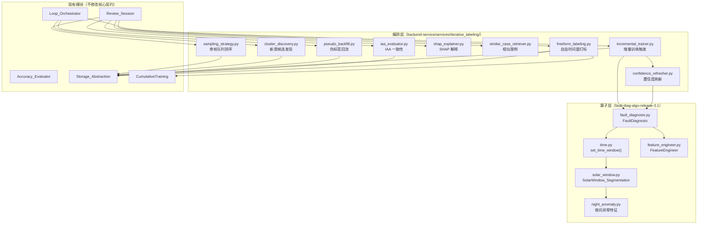
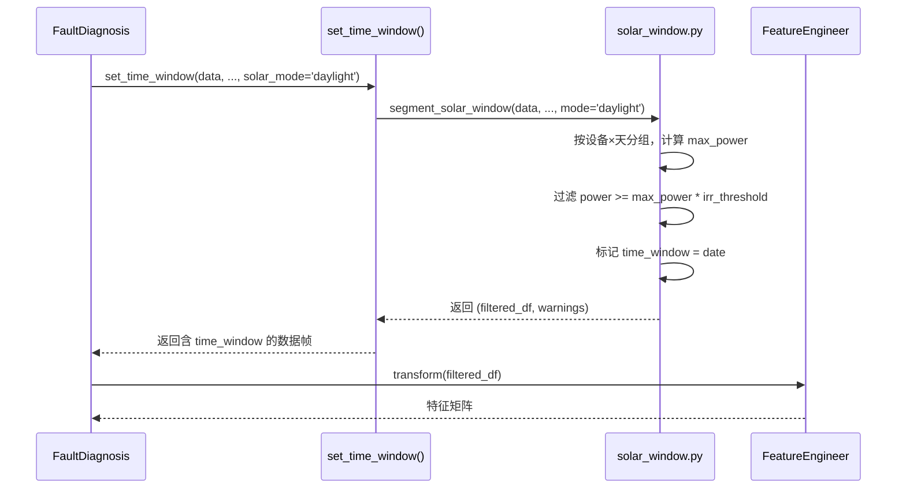
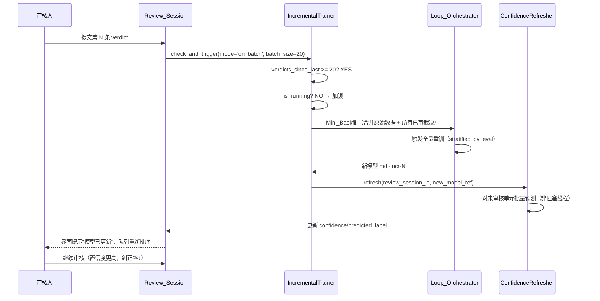
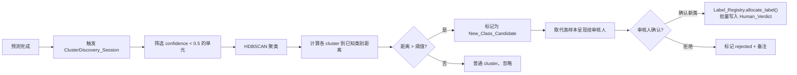

<!-- @AI_GENERATED -->
# 扩展设计文档：光伏故障诊断窗口切分策略、标签扩充策略与审核增强

## Overview

本设计是对 `design.md`（光伏故障人机协同迭代标注闭环）的扩展，覆盖 `requirements-feature-enhancement.md` 中的需求 13～26，分五个优化方向：

1. **诊断窗口切分策略增强**（需求 13～15）：在 `set_time_window()` 上游新增 `SolarWindow_Segmentation` 模块，支持 `daylight`/`solar_period`/`multiscale` 三种切分模式。
2. **标签扩充策略增强**（需求 16～19）：新增采样策略、聚类新类发现、伪标签回流、分歧优先采样。
3. **审核期增量训练**（需求 20～22）：在 `reviewing` 阶段内部引入 Mini_Backfill + 全量重训 + 置信度刷新子循环。
4. **审核辅助增强**（需求 23～24）：SHAP 可解释性、相似案例检索、审核人 IAA 一致性检测。
5. **夜间诊断与自由时间窗标注**（需求 25～26）：补齐夜间故障样本/特征；审核界面支持任意框选时段打标并扩充标签。

**核心设计理念：**
- **算子层最小改动**：`FeatureEngineer`、`RandomForest`、`DataCleaner` 等核心算子内部不修改，切分逻辑在上游完成
- **向后兼容**：所有新参数均有安全默认值，不传则退化为现有行为
- **可独立交付**：每个需求为独立模块，可单独实现和测试
- **日照与夜间正交**：`daylight` 仍可排除夜间以提升日照信噪比；夜间能力通过显式 `night` / `day_and_night` 开启，二者不互相替代

---

## 新增模块文件结构

```
fault-diag-algo-release-3.1/enos_fault_diag/
├── utils/
│   ├── time.py                    # 修改：set_time_window() 新增 solar_mode 参数
│   └── solar_window.py            # 新增：SolarWindow_Segmentation（日照 + 夜间切分）
├── fault_diagnosis.py              # 修改：diagnosis_window 新枚举值解析 + solar_mode 转发
└── features/
    ├── feature_engineer.py         # 修改：新增 quantile_min_points 可选参数
    └── night_anomaly.py            # 新增：夜间异常电流/功率特征族

backend-service/
├── api/
│   └── iterative_labeling.py      # 扩展：采样/聚类/增量/SHAP/IAA/自由时间窗标注 HTTP 接口
└── services/
    └── iterative_labeling/
        ├── sampling_strategy.py        # 新增：不确定性/多样性/分歧采样排序逻辑
        ├── cluster_discovery.py        # 新增：ClusterDiscovery_Session 聚类发现
        ├── pseudo_backfill.py          # 新增：伪标签回流
        ├── incremental_trainer.py      # 新增：Mini_Backfill + 增量重训触发 + 并发保护
        ├── confidence_refresher.py     # 新增：置信度刷新（非阻塞）
        ├── shap_explainer.py           # 新增：SHAP TreeExplainer 特征贡献计算
        ├── similar_case_retriever.py   # 新增：相似案例 KNN 检索
        ├── iaa_evaluator.py            # 新增：IAA Cohen/Fleiss Kappa + 审核人偏差检测
        └── freeform_labeling.py        # 新增：自由时间窗打标、冲突检测、特征化与回流
```

各路径职责：

- `utils/solar_window.py` — 封装日照/夜间时段识别与切分模式（`daylight`/`solar_period`/`multiscale`/`night`/`day_and_night`），被 `time.py` 的 `set_time_window()` 调用。
- `features/night_anomaly.py` — 夜间异常特征族（`night_nonzero_current_ratio` 等），仅在 Night_Period 或 freeform 夜间子段上计算。
- `services/iterative_labeling/sampling_strategy.py` — 审核队列排序服务：接收待审核单元列表和策略参数，输出排序后的列表；支持 `uncertainty`/`diversity`/`disagreement_first` 三种模式。
- `services/iterative_labeling/cluster_discovery.py` — 独立的新类候选发现引擎：筛选低置信度样本、执行 HDBSCAN/K-means 聚类、计算与已知类别距离、标记新类候选。
- `services/iterative_labeling/pseudo_backfill.py` — 伪标签回流逻辑：筛选高置信度预测、执行截断检查、写入 `is_pseudo=true` 记录。
- `services/iterative_labeling/incremental_trainer.py` — 增量训练核心：维护审核计数器、触发判断（`on_batch`/`on_new_label`/`on_error_spike`）、执行 Mini_Backfill、调用训练工作流、并发互斥锁。
- `services/iterative_labeling/confidence_refresher.py` — 置信度刷新：增量重训完成后用新模型对未审核单元批量预测，非阻塞更新 `confidence`/`predicted_label`。
- `services/iterative_labeling/shap_explainer.py` — SHAP 解释计算：使用 `shap.TreeExplainer`（随机森林原生支持）为每个样本计算 top-K 特征贡献，预计算 + 缓存。
- `services/iterative_labeling/similar_case_retriever.py` — 相似案例检索：以 Labeled_Dataset 的特征矩阵为索引，使用 `sklearn.neighbors.NearestNeighbors` 返回 top-k 最近邻。
- `services/iterative_labeling/iaa_evaluator.py` — IAA 一致性评估：Overlap_Batch 抽样、Cohen/Fleiss Kappa 计算、审核人偏差检测。
- `services/iterative_labeling/freeform_labeling.py` — 自由时间窗标注：校验区间、冲突检测、特征化、写入累计训练集、会话内列表与撤销。

---

## 组件架构图



---

## 组件详细设计

### 组件 A：SolarWindow_Segmentation（日照窗口切分器）

**职责**：实现需求 13/14/15 的三种日照切分模式。  
**文件**：`fault-diag-algo-release-3.1/enos_fault_diag/utils/solar_window.py`（新增）

**核心函数签名：**

```python
def segment_solar_window(
    data: pd.DataFrame,
    id_cols: list,
    time_col: str,
    value_cols: list,
    solar_mode: str,           # 'daylight' | 'solar_period' | 'multiscale'
    irr_threshold: float = 0.05,
    peak_ratio: float = 0.30,
    sub_window: str = '4h',
    power_col: str = None,     # 用于判断功率的列名，默认取 value_cols[0]
) -> tuple[pd.DataFrame, list[str]]:
    """
    返回：
        - 切分后的数据帧（含 time_window 列）
        - 告警列表（字符串数组）
    """
```

**三种模式的内部处理逻辑：**

**`daylight` 模式：**
1. 按 `id_cols + [date]` 分组
2. 每组计算 `max_power = group[power_col].max()`
3. `threshold = max_power * irr_threshold`
4. 过滤 `group[power_col] >= threshold` 的行 → Daylight_Period
5. 如果 `max_power == 0`，记告警，跳过该组
6. 对 Daylight_Period 数据标记 `time_window = date`（与 daily 模式输出格式一致）

**`solar_period` 模式：**
1. 先执行 daylight 筛选
2. 在 Daylight_Period 内进一步切分：
   - A 段：`power > max_power * peak_ratio`
   - S 段：`irr_threshold * max_power <= power <= peak_ratio * max_power`
3. 对 A 段和 S 段分别调用 `FeatureEngineer.transform()`
4. 拼接时加前缀：A 段列加 `peak_`，S 段列加 `trans_`
5. 空段以零向量填充 + 告警

**`multiscale` 模式：**
1. 产生整天粒度样本（与 daily 模式相同）
2. 对 Daylight_Period 按 `sub_window` 做 pandas resample 切分
3. 每个子窗口产生独立样本，`time_window = sub_window_start`
4. 标签继承父天（`window_one_label=1`）
5. 保证 `(id_cols + [time_window])` 唯一性

**参数校验：**
- `irr_threshold` 须在 `(0, 1)` 范围内
- `peak_ratio > irr_threshold`
- `sub_window` 时长 < 24h

---

### 组件 B：set_time_window() 改造

**文件**：`fault-diag-algo-release-3.1/enos_fault_diag/utils/time.py`（修改）

**新函数签名（向后兼容）：**

```python
def set_time_window(data, id_cols, time_col, freq, solar_mode=None, **solar_kwargs):
    """
    solar_mode=None 时：走原有 resample 逻辑，完全不引用 solar_window 模块
    solar_mode 非空时：委托给 segment_solar_window()
    """
    if solar_mode is None:
        # 原有逻辑不变
        ...
    else:
        from utils.solar_window import segment_solar_window
        return segment_solar_window(
            data, id_cols, time_col, 
            value_cols=solar_kwargs.get('value_cols', []),
            solar_mode=solar_mode,
            **solar_kwargs
        )
```

---

### 组件 C：FaultDiagnosis 适配

**文件**：`fault-diag-algo-release-3.1/enos_fault_diag/fault_diagnosis.py`（修改）

**改动点：**
1. `__init__()` 新增解析逻辑：

```python
# diagnosis_window 新增枚举值映射
SOLAR_MODES = {
    'daylight': 'daylight',
    'solar_period': 'solar_period',
    'multiscale': 'multiscale',
    'night': 'night',
    'day_and_night': 'day_and_night',
}

def __init__(self, ..., diagnosis_window='1d', sub_window='4h', ...):
    ...
    self.solar_mode = SOLAR_MODES.get(diagnosis_window, None)
    self.sub_window = sub_window
```

2. `train()` 和 `predict()` 中调用 `set_time_window()` 时透传：

```python
new_dataset = set_time_window(
    new_dataset, self.structure, TIME_COL, self.diagnosis_window,
    solar_mode=self.solar_mode,
    value_cols=self.value_fields,
    sub_window=self.sub_window
)
```

---

### 组件 D：SamplingStrategy 服务

**职责**：需求 16/19  
**文件**：`backend-service/services/iterative_labeling/sampling_strategy.py`

```python
class SamplingStrategy:
    def sort_units(
        self,
        units: list[dict],
        strategy: str = 'random',
        disagreement_first: bool = False,
        n_clusters: int = 5,
        diversity_conf_threshold: float = 0.5,
        feature_vectors: np.ndarray = None,
    ) -> list[dict]:
        """
        输入：待审核单元列表（含 unit_key/confidence/disagreement/特征向量索引）
        输出：按策略排序后的列表
        """
```

**排序优先级：**
1. `disagreement_first=True` 时：分歧单元前置
2. 各组内按 `strategy` 排序：
   - `random`：随机打乱
   - `uncertainty`：confidence 升序
   - `diversity`：K-means 聚类 → 代表样本前置 → 非代表后置

---

### 组件 E：ClusterDiscovery 服务

**职责**：需求 17  
**文件**：`backend-service/services/iterative_labeling/cluster_discovery.py`

```python
class ClusterDiscoveryService:
    def create_session(
        self,
        prediction_batch_id: str,
        discovery_conf_threshold: float = 0.5,
        cluster_algorithm: str = 'hdbscan',  # 'hdbscan' | 'kmeans'
        n_clusters: int = 10,
        new_class_dist_threshold: float = None,
        representative_count: int = 3,
    ) -> dict:
        """创建 ClusterDiscovery_Session"""

    def confirm_cluster(self, session_id: str, cluster_id: str, label_name: str) -> dict:
        """确认某 cluster 为新类，批量分配 label_id"""

    def reject_cluster(self, session_id: str, cluster_id: str, reason: str) -> dict:
        """拒绝某 cluster"""
```

**流程：**
1. 筛选 `confidence < discovery_conf_threshold` 的单元
2. 提取其特征向量
3. 执行聚类（HDBSCAN 或 K-means）
4. 计算每个 cluster 质心到 Label_Registry 中各类别样本均值的最小欧氏距离
5. 距离超阈值的标记为 New_Class_Candidate
6. 每个候选取 representative_count 个代表样本

---

### 组件 F：PseudoBackfill 服务

**职责**：需求 18  
**文件**：`backend-service/services/iterative_labeling/pseudo_backfill.py`

```python
class PseudoBackfillService:
    def execute(
        self,
        loop_id: str,
        prediction_batch_id: str,
        pseudo_label_threshold: float = 0.92,
        pseudo_label_max_ratio: float = 0.5,
    ) -> dict:
        """
        返回：backfill_id, final_pseudo_count, truncated, warnings
        """
```

**流程：**
1. 筛选 `confidence >= pseudo_label_threshold`
2. 计算当前回流总量（含后续 Human_Verdict 预估）
3. 如超过 `max_ratio`，按 confidence 降序截断
4. 写入 `is_pseudo=true` 记录
5. 记录元数据

---

### 组件 G：IncrementalTrainer 服务

**职责**：需求 20/21/22  
**文件**：`backend-service/services/iterative_labeling/incremental_trainer.py` + `confidence_refresher.py`

```python
class IncrementalTrainer:
    def __init__(self):
        self._lock = threading.Lock()  # 并发互斥
        self._is_running = False

    def check_and_trigger(
        self,
        review_session_id: str,
        new_verdict: dict,
        mode: str,  # 'on_batch' | 'on_new_label' | 'on_error_spike'
        batch_size: int = 20,
        error_spike_threshold: float = 0.4,
    ) -> dict:
        """
        每次提交 verdict 后调用，判断是否触发增量重训
        返回：triggered, skipped_reason, mini_backfill_id
        """

    def _execute_mini_backfill(self, review_session_id: str, batch_index: int) -> str:
        """执行 Mini_Backfill + 触发全量重训"""

    def _refresh_confidence(self, review_session_id: str, mini_backfill_id: str):
        """非阻塞置信度刷新"""
```

**触发判断伪代码（`on_batch` 模式）：**
```python
verdicts_since_last = count_verdicts_since_last_trigger(review_session_id)
if verdicts_since_last >= batch_size:
    if not self._is_running:
        self._is_running = True
        threading.Thread(target=self._execute_mini_backfill, ...).start()
    else:
        log("incremental_retrain_skipped_busy")
```

**Mini_Backfill 流程：**
1. 收集所有已审核裁决（confirm/correct/new_label）
2. 与原始 Labeled_Dataset 合并
3. 调用现有训练工作流（`stratified_cv_eval`）全量重训
4. 产出新模型
5. 触发 confidence_refresh
6. 释放锁

**ConfidenceRefresher：**
```python
class ConfidenceRefresher:
    def refresh(self, review_session_id: str, new_model_ref: str) -> dict:
        """
        用新模型对未审核单元批量预测，更新 confidence/predicted_label
        非阻塞：在后台线程执行，完成后通知前端
        """
```

---

### 组件 H：ShapExplainer 服务

**职责**：需求 23  
**文件**：`backend-service/services/iterative_labeling/shap_explainer.py`

```python
class ShapExplainer:
    def compute_explanations(
        self,
        model,                    # sklearn RandomForest model object
        feature_matrix: np.ndarray,
        feature_names: list[str],
        shap_top_k: int = 5,
        timeout_seconds: float = 10.0,
    ) -> list[dict]:
        """
        返回每个样本的 SHAP 解释：
        [{"unit_index": 0, "top_features": [
            {"name": "current_nanmean", "value": 3.2, "shap_value": 0.15},
            ...
        ]}, ...]
        """
```

**实现：**
- 使用 `shap.TreeExplainer(model)` — 随机森林原生支持，计算速度快
- 预计算整个 Review_Session 的所有样本，缓存至会话生命周期
- 超时机制：`concurrent.futures.ThreadPoolExecutor` 包裹，超时返回缺失

---

### 组件 I：SimilarCaseRetriever 服务

**职责**：需求 23  
**文件**：`backend-service/services/iterative_labeling/similar_case_retriever.py`

```python
class SimilarCaseRetriever:
    def build_index(self, labeled_feature_matrix: np.ndarray, labeled_metadata: list[dict]):
        """以已标注数据集的特征矩阵构建 KNN 索引"""

    def retrieve(
        self,
        query_vector: np.ndarray,
        k: int = 3,
        metric: str = 'euclidean',  # 'euclidean' | 'cosine'
    ) -> list[dict]:
        """
        返回 top-k 相似案例：
        [{"unit_key": ..., "label_name": ..., "similarity_score": 0.93}, ...]
        """
```

**实现：**
- 使用 `sklearn.neighbors.NearestNeighbors`（数据量小时足够）
- 索引在 Review_Session 创建时构建一次，缓存复用
- `similarity_score = 1 / (1 + distance)`

---

### 组件 J：IAAEvaluator 服务

**职责**：需求 24  
**文件**：`backend-service/services/iterative_labeling/iaa_evaluator.py`

```python
class IAAEvaluator:
    def create_overlap_batch(
        self,
        total_units: list[str],
        overlap_ratio: float = 0.1,
    ) -> list[str]:
        """随机抽取 Overlap_Batch 单元标识"""

    def compute_kappa(
        self,
        overlap_verdicts: dict[str, list[dict]],  # reviewer_id -> [verdicts]
    ) -> dict:
        """
        返回：iaa_score, iaa_method ('cohen'/'fleiss'), per_unit_agreement
        """

    def detect_bias(
        self,
        all_verdicts: dict[str, list[dict]],
        bias_threshold: float = 0.2,
    ) -> list[dict]:
        """
        返回存在偏差的审核人列表：
        [{"reviewer": ..., "biased_labels": [...], "deviation": 0.25}, ...]
        """
```

**实现：**
- `sklearn.metrics.cohen_kappa_score`（两人）
- `statsmodels` 或手动实现 Fleiss' Kappa（多人）
- 偏差检测：对比每人各类别占比 vs 整体占比，差异超阈值标记

---

### 组件 K：Night_Period 切分与夜间异常特征（需求 25）

**职责**：在不破坏 `daylight`/`solar_period` 默认排除夜间行为的前提下，显式产出夜间样本并计算夜间异常特征。  
**文件**：
- `fault-diag-algo-release-3.1/enos_fault_diag/utils/solar_window.py`（扩展）
- `fault-diag-algo-release-3.1/enos_fault_diag/features/night_anomaly.py`（新增）

**模式语义：**

| `solar_mode` | 日照样本 | 夜间样本 | 与需求 13/14 关系 |
|---|---|---|---|
| `None` / 原 freq | 按原 resample | 含在整天窗口内（不单独拆） | 完全兼容 |
| `daylight` | 有 | **无**（排除） | 需求 13 不变 |
| `solar_period` | A/S 段 | **无**（排除） | 需求 14 不变 |
| `night` | 无 | 有 | 新增 |
| `day_and_night` | 有 | 有 | 新增；同日两套样本 |

**`night` / `day_and_night` 内部逻辑：**

1. 与 daylight 相同方式识别 Night_Period：`power < irr_threshold * max_power`
2. 夜间样本写入 `period_role='night'`；日照样本写入 `period_role='daylight'`
3. `time_window` 约定（固定实现并写入元数据）：`f"{date.isoformat()}#night"`，避免与日照 `date` 主键冲突
4. 调用 `compute_night_anomaly_features(night_df, current_col=..., power_col=..., night_zero_epsilon=..., night_anomaly_current_threshold=...)`
5. 特征列统一 `night_` 前缀后并入该样本特征向量（或作为附加列供 FE 透传）

**夜间特征函数签名：**

```python
def compute_night_anomaly_features(
    night_df: pd.DataFrame,
    current_col: str,
    power_col: str | None = None,
    night_zero_epsilon: float = 0.01,
    night_anomaly_current_threshold: float | None = None,
) -> dict[str, float]:
    """
    返回：
      night_nonzero_current_ratio,
      night_current_mean,
      night_current_max,
      night_over_threshold_duration,
      night_power_residual_mean
    """
```

**与 daylight 的冲突消解（设计决策）：**

- **不修改**需求 13/14 的默认排除夜间行为。
- 需要夜间故障建模时，工作流/训练配置显式选择 `night` 或 `day_and_night`。
- 推荐生产默认：`day_and_night`（日照 + 夜间双样本）；仅做日照精度对比实验时用 `daylight`。

---

### 组件 L：FreeformLabeling 服务（需求 26）

**职责**：审核界面任意时间窗打标、冲突检测、切片写入、累计训练集准入。  
**文件**：`backend-service/services/iterative_labeling/freeform_labeling.py`  
**前端**：`frontend-sevice/src/pages/IterativeLabelingReviewPage.tsx`（波形 brush 交互）

**已锁定实现口径（Phase 1）**：

| 项 | 约定 |
|---|---|
| 窗口键 | `{YYYY-MM-DDTHH:MM:SS}__{YYYY-MM-DDTHH:MM:SS}#freeform` |
| 样本粒度 | 切片 CSV 写入 `time_window` 覆盖列；FE 按该键聚成一条训练样本 |
| 回流 | `create_confirmed_time_slice` → `CumulativeTrainingService.register_labeled_dataset` |
| 冲突 | 同 site\|device\|branch 时间区间重叠 → 422 |
| 撤销 | MVP 仅删会话 `freeform_labels` 指针，不从累计账本物理删除 |
| 审核队列 | 默认 `sampling_strategy=uncertainty`（confidence 升序） |
| 模型 | 自由窗与整日窗共用同一生产模型；不新增模型路由 |

```python
class FreeformLabelingService:
    def create_label(...) -> dict: ...
    def list_labels(self, review_id: str) -> list[dict]: ...
    def revoke_label(self, review_id: str, unit_key: str) -> dict: ...
```

**前端交互要点：**

1. 在现有 ECharts 时序图上启用 `brush`（或 `dataZoom` + 显式「确认框选」按钮）。
2. 框选后弹出抽屉：展示 `[t_start, t_end]`、已有标签下拉、`new_label` 输入。
3. 提交成功后在图上叠加 markArea（标签名 + 颜色），并刷新 freeform 列表。
4. 纯手工标注会话同样可用（不依赖 `predicted_label`）。

**冲突规则：**

- 同 `site|device|branch` 下，与已有 freeform 区间时间重叠面积 > `freeform_overlap_tolerance`（默认 0）→ 422。
- 不修改父 Diagnosis_Unit 的 `time_window`；freeform 是附加样本。

**回流权威性：**

- Freeform 标注与 Human_Verdict 同级（`is_pseudo=false`）。
- 写入 `CumulativeTrainingService.admit_*` 或等价寄存器路径；路径保持项目相对路径。

---

## 新增/扩展 API 接口

> 所有接口路径前缀 `/api/iterative-labeling`，扩展现有 `iterative_labeling.py`。

| 方法 | 路径 | 用途 | 关联需求 |
|------|------|------|----------|
| POST | `/review-sessions` | 扩展：新增 `sampling_strategy`/`enable_shap`/`enable_similar_cases`/`enable_iaa`/`incremental_retrain_mode` 等可选参数 | 16,19,20,23,24 |
| POST | `/cluster-discovery-sessions` | 创建聚类发现会话 | 17 |
| POST | `/cluster-discovery-sessions/{id}/confirm` | 确认某 cluster 为新类 | 17 |
| POST | `/cluster-discovery-sessions/{id}/reject` | 拒绝某 cluster | 17 |
| POST | `/loops/{loop_id}/pseudo-backfill` | 触发伪标签回流 | 18 |
| GET | `/review-sessions/{id}/shap/{unit_key}` | 获取某单元的 SHAP 解释 | 23 |
| GET | `/review-sessions/{id}/similar-cases/{unit_key}` | 获取某单元的相似案例 | 23 |
| GET | `/review-sessions/{id}/iaa` | 获取 IAA 评估结果 | 24 |
| GET | `/review-sessions/{id}/incremental-status` | 获取增量训练状态 | 22 |
| POST | `/review-sessions/{id}/freeform-labels` | 创建自由时间窗标注（可触发标签扩充） | 26 |
| GET | `/review-sessions/{id}/freeform-labels` | 列出本会话自由时间窗标注 | 26 |
| DELETE | `/review-sessions/{id}/freeform-labels/{unit_key}` | 撤销自由时间窗标注 | 26 |

> 夜间切分（需求 25）主要通过算子层 `solar_mode` / `diagnosis_window` 配置启用，不强制新增独立 HTTP 路由；训练/预测工作流模板增加可选枚举即可。若需运行时查询，可扩展现有 slot overview 返回 `period_role` 分布。

---

## 数据模型扩展

### Mini_Backfill 记录

```jsonc
{
  "mini_backfill_id": "mbf-r3-002",        // 迷你回流 ID
  "review_session_id": "rev-r3-77",        // 所属审核会话
  "batch_index": 2,                         // 第几批（从 1 起）
  "verdicts_included": 20,                  // 本批纳入裁决条数
  "trigger_reason": "batch_size",           // 触发原因：batch_size/new_label/error_spike
  "training_data_total": 142,               // 本次重训总训练样本数
  "retrain_started_at": "2026-07-13T10:00:00",
  "retrain_completed_at": "2026-07-13T10:02:30",
  "new_model_ref": "mdl-r3-incr-002"       // 增量重训产出的模型引用
}
```

### ConfidenceRefresh 记录

```jsonc
{
  "refresh_id": "cfr-r3-002",
  "review_session_id": "rev-r3-77",
  "mini_backfill_id": "mbf-r3-002",
  "units_refreshed": 358,                   // 刷新的未审核单元数
  "avg_confidence_before": 0.62,            // 刷新前平均置信度
  "avg_confidence_after": 0.71,             // 刷新后平均置信度
  "completed_at": "2026-07-13T10:03:00"
}
```

### ClusterDiscovery_Session 记录

```jsonc
{
  "session_id": "cds-r3-001",
  "iteration_round": 3,
  "discovery_conf_threshold": 0.5,
  "cluster_algorithm": "hdbscan",
  "cluster_count": 8,                       // 总 cluster 数
  "new_class_candidate_count": 2,           // 新类候选数
  "confirmed_count": 1,                     // 已确认新类数
  "rejected_count": 1,                      // 已拒绝数
  "created_at": "2026-07-13T11:00:00"
}
```

### IAA 记录（Review_Session 扩展字段）

```jsonc
{
  "iaa_enabled": true,
  "overlap_count": 15,
  "iaa_score": 0.73,
  "iaa_method": "cohen",
  "low_consistency_alert": false,
  "biased_reviewers": []
}
```

---

## Key Flows

### 1. daylight 切分流



### 2. 增量训练 + 置信度刷新闭环



### 3. ClusterDiscovery → 批量确认新类别



---

## 设计决策

| 决策 | 选择 | 理由 |
|------|------|------|
| SolarWindow 放在独立文件 vs 内联 time.py | 独立 `solar_window.py` | 关注点分离；三种模式逻辑复杂，放 time.py 会使其过长 |
| 增量训练用全量重训 vs 真正增量 | 全量重训（选项 A） | 随机森林不支持增量；改动最小，效果等价 |
| SHAP 用 TreeExplainer vs KernelExplainer | TreeExplainer | 随机森林原生支持，O(n·d) 复杂度，比 KernelExplainer 快 100x |
| 相似案例用 faiss vs sklearn KNN | sklearn KNN | 数据量预期 <50k 样本，sklearn 足够；避免引入 faiss 编译依赖 |
| IAA 用 Cohen vs Fleiss | 自适应（2 人 Cohen，≥3 人 Fleiss） | 覆盖两种场景 |
| 聚类用 HDBSCAN vs K-means | 可配，默认 HDBSCAN | HDBSCAN 无需预设 k，更适合新类发现场景 |
| confidence_refresh 阻塞 vs 非阻塞 | 非阻塞（后台线程） | 审核不应因模型更新而暂停 |
| 子窗口标签继承策略 | 继承父天标签 | `window_one_label=1` 语义：一个时间窗口一个标签 |
| Mini_Backfill 与正式 Backfill 关系 | 独立，正式 Backfill 仍为权威 | 避免中间状态污染最终数据集版本 |

---

## 依赖与风险

### 新增 Python 依赖

| 包 | 用途 | 需求 | 是否必须 |
|----|------|------|----------|
| `shap` | SHAP 解释计算 | 23 | 可选（`enable_shap=false` 时不引入） |
| `hdbscan` | 新类候选聚类 | 17 | 可选（可回退 K-means） |
| `scikit-learn` | KNN、K-means、Kappa | 16,17,23,24 | 已有依赖 |

### 性能风险

| 风险 | 影响 | 缓解 |
|------|------|------|
| SHAP 计算大样本耗时 | 审核界面加载慢 | 预计算 + 超时降级（10s） |
| HDBSCAN 在高维稀疏特征上效果差 | 新类发现不准确 | 先用 PCA 降维再聚类 |
| 增量重训频繁（batch_size 过小） | CPU 占用高 | 并发互斥 + 最小 batch_size=5 |
| Labeled_Dataset 大时 KNN 索引慢 | 相似案例响应慢 | 索引构建一次缓存，懒加载 |

### 向后兼容风险

无。所有新参数都有安全默认值（`solar_mode=None`、`sampling_strategy='random'`、`enable_shap=false`、`enable_iaa=false`、`incremental_retrain_mode='disabled'`），不传则完全退化为现有行为。

<!-- @AI_GENERATED: end -->
