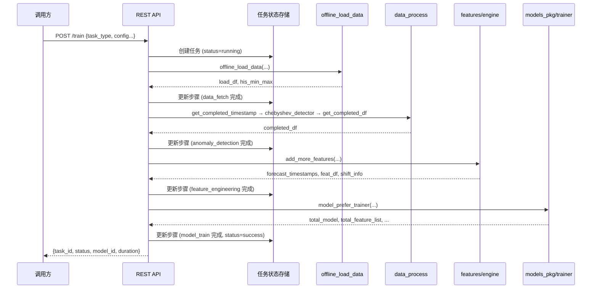
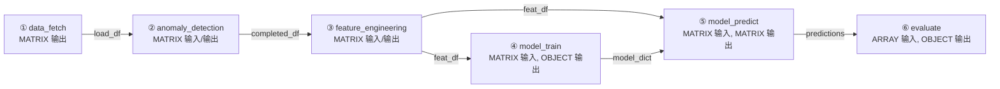

<!-- @AI_GENERATED -->
# 设计文档：负荷预测项目融合到 AIP 算法平台

## 概述

本设计文档描述如何将现有的电力负荷预测项目融合到 AIP 工业AI算法平台。核心策略是**薄包装、不侵入**：在现有代码之上添加一层轻量的 REST API 和 Agent Tool 适配层，同时把 6 个预测步骤注册为可视化编辑器中的 Function 节点。

### 设计原则

1. **零侵入**：不修改 `db_data_fetch.py`、`data_process.py`、`features/engine.py`、`models_pkg/trainer.py`、`models_pkg/wrapper.py` 等现有核心模块
2. **直接调用**：REST API 内部通过 `import` 直接调用现有函数，数据以 Python 原生对象（DataFrame、dict）在进程内传递
3. **不走 SkillOrchestrator**：不封装 BaseSkill 子类，Agent Tool 直接调用 REST API
4. **渐进式集成**：先跑通整条流水线（REST API），再让每个步骤在可视化编辑器中可拖拽执行（Function 节点）

### 涉及的变更范围

| 变更类型 | 文件/目录 | 说明 |
|---------|----------|------|
| 新增 | `AIP-service/backend/api/load_forecast.py` | REST API 路由模块 |
| 修改 | `AIP-service/backend/main.py` | 注册新路由 |
| 修改 | `AIP-service/backend/services/agent_tools.py` | 添加 5 个 Agent Tool |
| 修改 | `AIP-service/backend/data/functions.json` | 注册 6 个 Function 节点 |
| 修改 | `AIP-service/backend/services/execution_service.py` | 添加 6 个 Function 的执行逻辑 |
| 修改 | `AIP-service/backend/data/skills/packaged_skills.json` | 注册 Skill 条目 |
| 修改 | `AIP-service/backend/data/forecast_scenarios.json` | 添加负荷预测场景知识库 |
| 新增 | `AIP-service/backend/data/skills/load-forecast/` | AutoResearch Skill 包（3 个文件） |
| 不修改 | 现有负荷预测核心代码 | 保持原封不动 |

## 架构

### 整体架构图

```mermaid
graph TB
    subgraph 前端
        UI_Chat[AI 对话界面]
        UI_API[程序化 API 调用]
        UI_Visual[可视化工作流编辑器]
    end

    subgraph AIP后端["AIP 后端 (FastAPI)"]
        subgraph AgentLayer["Agent Tool 层"]
            AT1[trigger_load_forecast_train]
            AT2[trigger_load_forecast_predict]
            AT3[trigger_load_forecast_backtest]
            AT4[get_forecast_scenarios]
            AT5[get_forecast_status]
        end

        subgraph APILayer["REST API 层"]
            API_Train["POST /api/load-forecast/train"]
            API_Predict["POST /api/load-forecast/predict"]
            API_Backtest["POST /api/load-forecast/backtest"]
            API_Scenarios["GET /api/load-forecast/scenarios"]
            API_Status["GET /api/load-forecast/status/{task_id}"]
        end

        subgraph ExecLayer["ExecutionService 层"]
            FN1[load_forecast_data_fetch]
            FN2[load_forecast_anomaly_detection]
            FN3[load_forecast_feature_engineering]
            FN4[load_forecast_model_train]
            FN5[load_forecast_model_predict]
            FN6[load_forecast_evaluate]
        end

        TaskStore[任务状态存储<br/>内存 Dict]
    end

    subgraph CoreCode["现有负荷预测代码 (不修改)"]
        M1[data_fetch/fetcher.py<br/>offline_load_data]
        M2[data_process.py<br/>异常检测 & 数据补全]
        M3[features/engine.py<br/>特征工程]
        M4[models_pkg/trainer.py<br/>XGBoost 训练]
        M5[models_pkg/wrapper.py<br/>LoadForecastWrapper]
        M6[utils.py<br/>smape 等评估]
    end

    UI_Chat -->|Function Calling| AgentLayer
    UI_API --> APILayer
    UI_Visual -->|拓扑排序执行| ExecLayer

    AT1 -->|HTTP 调用| API_Train
    AT2 -->|HTTP 调用| API_Predict
    AT3 -->|HTTP 调用| API_Backtest
    AT4 -->|HTTP 调用| API_Scenarios
    AT5 -->|读取| TaskStore

    API_Train -->|import 调用| M1
    API_Train -->|import 调用| M2
    API_Train -->|import 调用| M3
    API_Train -->|import 调用| M4
    API_Predict -->|import 调用| M1
    API_Predict -->|import 调用| M2
    API_Predict -->|import 调用| M3
    API_Predict -->|import 调用| M5
    API_Backtest -->|复用 run.py 逻辑| M1
    API_Train --> TaskStore
    API_Predict --> TaskStore

    FN1 -->|import 调用| M1
    FN2 -->|import 调用| M2
    FN3 -->|import 调用| M3
    FN4 -->|import 调用| M4
    FN5 -->|import 调用| M5
    FN6 -->|import 调用| M6
```



### 调用路径说明

系统提供三条并行的调用路径，共享同一套核心代码：

**路径 A：AI 对话触发**
```
用户对话 → LLM Function Calling → Agent Tool → HTTP → REST API → import 现有代码
```

**路径 B：程序化 API 调用**
```
前端/外部系统 → HTTP → REST API → import 现有代码
```

**路径 C：可视化工作流执行**
```
用户拖拽节点 → 执行工作流 → ExecutionService 拓扑排序 → 逐节点 import 现有代码
```

### 关键设计决策

| 决策 | 选择 | 理由 |
|------|------|------|
| API 内部如何调用现有代码 | 直接 `import` | 数据在进程内以原生对象传递，无序列化开销 |
| Agent Tool 如何调用 API | HTTP 请求 | 保持 Agent Tool 和 API 的解耦，方便独立测试 |
| 任务状态如何存储 | 内存 Dict | 当前阶段不需要持久化，简单够用 |
| 模型文件如何存储 | pickle 文件 | 与现有 `run.py` 保持一致 |
| 是否定义 Pydantic 请求模型 | 否 | 需求明确不做，API 直接接收 JSON dict |

## 组件与接口

### 组件 1：REST API 路由模块 (`api/load_forecast.py`)

这是核心适配层，负责接收 HTTP 请求、调用现有代码、管理任务状态。

```python
# 文件位置：AIP-service/backend/api/load_forecast.py
router = APIRouter(prefix="/api/load-forecast", tags=["Load Forecast"])
```

#### 端点定义

| 端点 | 方法 | 功能 | 内部调用链 |
|------|------|------|-----------|
| `/api/load-forecast/train` | POST | 训练模型 | offline_load_data → get_completed_timestamp → chebyshev_detector → get_completed_df → add_more_features → model_prefer_trainer |
| `/api/load-forecast/predict` | POST | 执行预测 | offline_load_data → 数据处理 → 特征工程 → LoadForecastWrapper.predict |
| `/api/load-forecast/backtest` | POST | 回测评估 | 按日期循环调用训练+预测（复用 run.py 逻辑） |
| `/api/load-forecast/scenarios` | GET | 获取场景列表 | 读取 SCENARIO_CONFIGS |
| `/api/load-forecast/status/{task_id}` | GET | 查询任务状态 | 读取内存任务状态 |

#### 训练端点内部流程



#### 请求/响应格式

训练请求体示例：
```json
{
  "task_type": "D",
  "table_name": "sgms_hbuilding_load_quarter3",
  "parent_field": "parent_id",
  "child_field": "child_id",
  "time_field": "record_time",
  "load_field": "load",
  "parent_id": "mengxi",
  "child_id": "child_001",
  "time_granularity": "15min",
  "time_zone": "Asia/Shanghai",
  "forecast_horizon": 1,
  "forecast_start_time": "00:15",
  "separate_modeling": "true",
  "operate_status": "offline",
  "other_cols": ["temperature_forecast", "humidity_forecast"],
  "data_source": "offline",
  "csv_path": "data/load_true_mengxi_sum_20250101_250518.csv"
}
```

训练响应体示例：
```json
{
  "task_id": "train-a1b2c3d4",
  "status": "success",
  "model_id": "model-mengxi-child_001-D-20250601",
  "duration_seconds": 125.3,
  "steps_completed": ["data_fetch", "anomaly_detection", "feature_engineering", "model_train"],
  "metrics": {
    "prefer_metric": 0.935
  }
}
```

错误响应体示例：
```json
{
  "task_id": "train-a1b2c3d4",
  "status": "failed",
  "error_type": "DataFetchError",
  "error_message": "CSV file not found: data/xxx.csv",
  "failed_step": "data_fetch"
}
```

### 组件 2：Agent Tool 定义与执行 (`services/agent_tools.py`)

在现有的 `AGENT_TOOLS` 列表中添加 5 个工具定义，在 `AgentToolExecutor` 类中添加对应的执行方法。

#### 工具列表

| 工具名 | 描述 | 关键参数 | 调用的 API |
|--------|------|---------|-----------|
| `trigger_load_forecast_train` | 触发负荷预测模型训练 | task_type, config_override | POST /train |
| `trigger_load_forecast_predict` | 触发负荷预测 | task_type, parent_id, child_id, forecast_horizon | POST /predict |
| `trigger_load_forecast_backtest` | 触发回测评估 | task_type, start_date, end_date | POST /backtest |
| `get_forecast_scenarios` | 获取场景列表 | 无必填 | GET /scenarios |
| `get_forecast_status` | 查询任务状态 | task_id | GET /status/{task_id} |

#### 执行方法实现模式

每个执行方法内部通过 `httpx.AsyncClient` 调用对应的 REST API 端点：

```python
async def trigger_load_forecast_train(self, task_type: str, config_override: dict = None):
    async with httpx.AsyncClient() as client:
        payload = {"task_type": task_type}
        if config_override:
            payload.update(config_override)
        resp = await client.post("http://localhost:8000/api/load-forecast/train", json=payload)
        return resp.json()
```

#### LLM 降级策略

当 LLM 不可用时，`AgentToolExecutor` 降级为关键词匹配规则引擎：
- 识别 "训练"/"train" → 调用 `trigger_load_forecast_train`
- 识别 "预测"/"predict"/"forecast" → 调用 `trigger_load_forecast_predict`
- 识别 "回测"/"backtest" → 调用 `trigger_load_forecast_backtest`
- 识别 "场景"/"scenario" → 调用 `get_forecast_scenarios`

### 组件 3：Function 节点注册与执行

#### 6 个 Function 节点在 `functions.json` 中的注册

每个 Function 节点遵循现有的 JSON 结构，包含 `id`、`name`、`category`、`description`、`parameters`、`inputs`、`outputs` 字段。

节点连接关系（端口类型匹配）：



#### ExecutionService 中的执行逻辑

在 `_execute_function_node` 方法中添加 6 个 `elif` 分支，每个分支：
1. 从 `parameters` 中提取参数
2. 通过 `import` 调用对应的现有函数
3. 返回结果供下游节点使用

```python
elif function_id == 'load_forecast_data_fetch':
    from data_fetch.fetcher import offline_load_data
    load_df, his_min_max = offline_load_data(
        task_type=parameters.get('task_type'),
        table_name=parameters.get('table_name'),
        # ... 其他参数
    )
    return {'load_df': load_df, 'his_min_max': his_min_max}
```

### 组件 4：AutoResearch Skill 包

在 `data/skills/load-forecast/` 目录下创建三个文件：

| 文件 | 角色 | 说明 |
|------|------|------|
| `program.md` | 实验手册 | 定义实验目标（最小化 SMAPE）、规则、输出格式 |
| `prepare.py` | 只读数据准备 | 数据加载、预处理、评估函数（AI 不可修改） |
| `train.py` | 可编辑训练脚本 | 基线 XGBoost 训练（AI 可修改优化） |

`prepare.py` 的评估函数使用与 `utils.py` 中 `smape()` 一致的计算逻辑，确保实验结果与生产环境评估标准一致。

### 组件 5：任务状态管理

使用内存 Dict 存储任务状态，结构如下：

```python
task_store: Dict[str, TaskStatus] = {}

class TaskStatus:
    task_id: str
    status: str  # pending | running | success | failed
    task_type: str  # train | predict | backtest
    current_step: str
    completed_steps: List[str]
    total_duration: float
    error_message: Optional[str]
    error_step: Optional[str]
    created_at: datetime
    updated_at: datetime
    result: Optional[dict]
```

### 组件 6：平台注册

| 注册项 | 文件 | 操作 |
|--------|------|------|
| 路由注册 | `main.py` | `app.include_router(load_forecast_router)` |
| Skill 注册 | `packaged_skills.json` | 添加 `load-forecast` Skill 条目 |
| 场景知识库 | `forecast_scenarios.json` | 添加负荷预测场景详细信息 |

## 数据模型

### 任务状态模型

```python
# 内存中的任务状态（不持久化）
task_store: Dict[str, dict] = {}

# 每个任务的状态结构
{
    "task_id": "train-a1b2c3d4",
    "status": "running",           # pending | running | success | failed
    "task_type": "train",          # train | predict | backtest
    "current_step": "feature_engineering",
    "completed_steps": ["data_fetch", "anomaly_detection"],
    "step_durations": {
        "data_fetch": 2.3,
        "anomaly_detection": 0.8
    },
    "total_duration": 0.0,
    "error_message": None,
    "error_step": None,
    "created_at": "2025-06-01T10:00:00",
    "updated_at": "2025-06-01T10:00:03",
    "result": None                 # 完成后填充
}
```

### Function 节点数据流模型

Function 节点之间传递的数据类型：

| 节点 | 输入类型 | 输出类型 | 说明 |
|------|---------|---------|------|
| data_fetch | 参数（字符串/数字） | `{load_df: DataFrame, his_min_max: DataFrame}` | 原始数据 |
| anomaly_detection | `{load_df: DataFrame}` | `{completed_df: DataFrame, time_freq: str, daily_horizon: int}` | 清洗后数据 |
| feature_engineering | `{completed_df: DataFrame}` | `{feat_df: dict, forecast_timestamps: list}` | 特征数据 |
| model_train | `{feat_df: dict}` | `{model_dict: dict, feature_list: dict, model_tag: dict}` | 训练产物 |
| model_predict | `{model_dict, feat_df}` | `{predictions: list, timestamps: list}` | 预测结果 |
| evaluate | `{y_true: list, y_pred: list}` | `{smape: float, mae: float, rmse: float}` | 评估指标 |

### Packaged Skill 注册模型

```json
{
  "skill_id": "skill-load-forecast-001",
  "skill_name": "负荷预测 AutoResearch Skill",
  "skill_version": "1.0.0",
  "description": "基于 XGBoost 和贝叶斯超参优化的电力负荷预测，支持 DI/D/WI/W/MI/M 六种场景",
  "source_template_id": "tpl-load-forecast-001",
  "source_template_name": "电网负荷预测模板",
  "source_template_version": "v1.5.0",
  "training_config": {
    "enabled": true,
    "min_samples": 14,
    "default_epochs": 1,
    "default_batch_size": 1
  },
  "resource_config": {
    "cpu": "4",
    "memory": "8Gi",
    "gpu": "none",
    "timeout_seconds": 600
  },
  "status": "ready",
  "created_by": "system"
}
```

### 场景配置模型（复用现有 ScenarioConfig）

现有的 `common/constants.py` 中已定义 6 种场景配置，REST API 直接复用：

| 场景 | task_type | rounding_unit | default_retrain | 适用范围 |
|------|-----------|---------------|-----------------|---------|
| 日内 | DI | hour | False | 0-4 小时超短期预测 |
| 日前 | D | day | True | 次日 24 小时预测 |
| 周内 | WI | day | True | 本周剩余天数预测 |
| 周前 | W | day | True | 下周 7 天预测 |
| 月内 | MI | day | False | 本月剩余天数预测 |
| 月前 | M | day | False | 下月整月预测 |


## 正确性属性（Correctness Properties）

*正确性属性是一种在系统所有有效执行中都应成立的特征或行为——本质上是对系统应该做什么的形式化陈述。属性是连接人类可读规格说明和机器可验证正确性保证之间的桥梁。*

### Property 1：错误响应结构一致性

*For any* 无效的请求配置（缺少必填字段、无效的 task_type、不存在的数据文件等），REST API 返回的错误响应 SHALL 始终包含 `error_type`（字符串）、`error_message`（字符串）和 `failed_step`（字符串）三个字段，且 HTTP 状态码为 500。

**Validates: Requirements 1.6**

### Property 2：关键词降级分发正确性

*For any* 包含负荷预测相关关键词的用户消息，当 LLM 不可用时，关键词匹配规则引擎 SHALL 将消息分发到正确的工具：包含"训练"/"train"的消息分发到 `trigger_load_forecast_train`，包含"预测"/"predict"/"forecast"的消息分发到 `trigger_load_forecast_predict`，包含"回测"/"backtest"的消息分发到 `trigger_load_forecast_backtest`，包含"场景"/"scenario"的消息分发到 `get_forecast_scenarios`。

**Validates: Requirements 2.9**

### Property 3：SMAPE 计算一致性与数学性质

*For any* 有效的真实值数组 `y_true` 和预测值数组 `y_pred`（长度相同、非空），`prepare.py` 中的 SMAPE 实现和 `utils.py` 中的 `smape()` 函数 SHALL 产生相同的结果，且该结果满足：(a) 非负，(b) 当 `y_pred == y_true` 时结果为 0。

**Validates: Requirements 4.2, 4.4**

### Property 4：任务 ID 唯一性

*For any* 数量的并发或顺序请求，系统生成的所有 task_id SHALL 互不相同。

**Validates: Requirements 6.2**

### Property 5：任务状态转换合法性

*For any* 任务的生命周期，状态转换 SHALL 遵循合法路径：`pending → running → success` 或 `pending → running → failed`。不允许从 `success` 或 `failed` 回退到 `running`，不允许从 `pending` 直接跳到 `success` 或 `failed`。

**Validates: Requirements 6.3**

### Property 6：Function 节点端口类型匹配

*For any* 负荷预测流水线中相邻的两个 Function 节点，上游节点的输出端口类型 SHALL 与下游节点对应输入端口的类型兼容（MATRIX → MATRIX，OBJECT → OBJECT，ARRAY → ARRAY）。

**Validates: Requirements 7.5**

## 错误处理

### 错误分类与处理策略

| 错误类型 | 触发场景 | 处理方式 | HTTP 状态码 |
|---------|---------|---------|------------|
| `ConfigError` | 请求参数缺失或无效（如 task_type 不在 DI/D/WI/W/MI/M 中） | 返回错误详情，不执行流程 | 400 |
| `DataFetchError` | CSV 文件不存在、数据库连接失败、数据为空 | 记录日志，标记 failed_step="data_fetch" | 500 |
| `ProcessingError` | 异常检测或数据补全失败（如数据量不足） | 记录日志，标记 failed_step | 500 |
| `FeatureError` | 特征工程失败（如训练数据不满足最低天数要求） | 记录日志，标记 failed_step="feature_engineering" | 500 |
| `TrainingError` | 模型训练失败（如贝叶斯优化不收敛） | 记录日志，标记 failed_step="model_train" | 500 |
| `PredictionError` | 模型推理失败（如模型文件损坏） | 记录日志，标记 failed_step="model_predict" | 500 |
| `TimeoutError` | 训练或回测超时 | 记录日志，标记 failed_step 和超时时间 | 500 |

### 错误响应格式

所有错误响应遵循统一格式：

```json
{
  "task_id": "train-a1b2c3d4",
  "status": "failed",
  "error_type": "DataFetchError",
  "error_message": "CSV file not found: data/xxx.csv",
  "failed_step": "data_fetch",
  "completed_steps": [],
  "traceback": "Traceback (most recent call last):\n  ..."
}
```

### 日志记录策略

使用 `loguru.logger`（与现有代码一致），在每个关键步骤的开始和结束记录日志：

```python
logger.info(f"[{task_id}] Step data_fetch started")
# ... 执行步骤 ...
logger.info(f"[{task_id}] Step data_fetch completed in {duration:.2f}s, rows={len(load_df)}")
```

失败时记录完整堆栈：

```python
logger.error(f"[{task_id}] Step {step_name} failed: {e}")
logger.error(traceback.format_exc())
```

## 测试策略

### 测试方法概述

本特性采用**双轨测试策略**：单元测试覆盖具体场景和边界条件，属性测试验证跨输入空间的通用正确性。

### 属性测试（Property-Based Testing）

使用 **Hypothesis** 库（Python 生态的标准 PBT 库），每个属性测试运行最少 100 次迭代。

| Property | 测试文件 | 生成器策略 | 最少迭代 |
|----------|---------|-----------|---------|
| Property 1: 错误响应结构 | `test_error_responses.py` | 生成随机无效配置（缺字段、错类型、空值） | 100 |
| Property 2: 关键词降级分发 | `test_keyword_fallback.py` | 生成包含关键词的随机消息字符串 | 100 |
| Property 3: SMAPE 一致性 | `test_smape_consistency.py` | 生成随机 float 数组对 (y_true, y_pred) | 100 |
| Property 4: 任务 ID 唯一性 | `test_task_id_uniqueness.py` | 生成随机数量的 task_id 批次 | 100 |
| Property 5: 状态转换合法性 | `test_state_transitions.py` | 生成随机状态转换序列 | 100 |
| Property 6: 端口类型匹配 | `test_port_compatibility.py` | 枚举所有合法的节点连接对 | 100 |

每个属性测试标注对应的设计属性：
```python
# Feature: workflow-modularization, Property 3: SMAPE 计算一致性与数学性质
@given(
    y_true=st.lists(st.floats(min_value=0.1, max_value=1000), min_size=1, max_size=100),
    y_pred=st.lists(st.floats(min_value=0.1, max_value=1000), min_size=1, max_size=100),
)
def test_smape_consistency(y_true, y_pred):
    ...
```

### 单元测试

| 测试范围 | 测试内容 | 数量 |
|---------|---------|------|
| REST API 端点 | 各端点的正常请求/响应、参数校验 | 8-10 |
| Agent Tool 定义 | 工具定义格式正确性、必填字段 | 5 |
| AgentToolExecutor | 各工具的执行方法（mock HTTP） | 5 |
| Function 节点注册 | functions.json 中 6 个节点的定义完整性 | 6 |
| ExecutionService 分发 | 6 个 function_id 的正确分发 | 6 |
| 任务状态管理 | 创建、更新、查询任务状态 | 4 |
| 平台注册 | packaged_skills.json、路由注册 | 3 |

### 集成测试

| 测试场景 | 说明 |
|---------|------|
| 端到端训练流程 | 使用样本数据调用 /train，验证完整流程 |
| 端到端预测流程 | 先训练再预测，验证预测结果格式 |
| Agent Tool → REST API | 通过 AgentToolExecutor 触发训练，验证调用链 |
| 可视化工作流执行 | 构建 6 节点工作流，通过 ExecutionService 执行 |
| 向后兼容性 | 验证 `python run.py --config` 仍能正常运行 |

### 测试数据

使用现有的离线 CSV 数据文件作为测试数据源，不需要连接真实数据库。测试配置使用 `configs/` 目录下的 YAML 文件。
<!-- @AI_GENERATED: end -->
